# Fintech Ledger & General Ledger Mastery Guide
### From Accounting Fundamentals to Enterprise MFS / Banking GL Architecture (Python · Django · DRF · PostgreSQL · Redis · Celery)

> **Goal:** Not just to *understand* accounting, but to **design, implement, troubleshoot, audit and maintain** enterprise-grade double-entry ledger and General Ledger systems as a Fintech Specialist Software Engineer.

---

## 0. How to Use This Guide

### 0.1 Honesty and scope conventions (read first)

| Label | Meaning |
|---|---|
| **[GENERAL]** | Universal accounting / engineering principle (true in any institution). |
| **[BD-PUBLIC]** | Publicly known Bangladesh payment-infrastructure fact (e.g., NPSB, BEFTN, RTGS exist and what they broadly do). Verify details on the Bangladesh Bank website before relying on them. |
| **[ILLUSTRATIVE]** | Invented-but-realistic example for teaching. **Not** any real provider's internal chart of accounts, fee, or policy. |
| **[VERIFY]** | Regulatory/tax/fee detail that changes over time. Confirm with the current regulation, your compliance team, or your auditors. |

- bKash, Nagad, Upay, Rocket etc. **do not publish their internal GL designs**. Everything below that looks like "an MFS GL" is a **generic, illustrative model** (called **"XPay"**, a fictional MFS operator) built from universal accounting rules.
- All money amounts are in **BDT (Taka, Tk)** unless stated. Fees, VAT rates and commission rates are **illustrative** — do not treat them as real tariffs or tax law.
- No real customer data is used. Names (Rahim, Karim, Agent A1, Merchant M1) are synthetic.

### 0.2 The "Topic Card" format
Every important topic follows this pattern so nothing is skipped:

1. **What it is** (definition — every term defined before use)
2. **Why it exists**
3. **How it works internally**
4. **Where it is used in real institutions**
5. **How it connects to other components**
6. **Common implementation mistakes**
7. **Best practices**

For small topics, cards are compressed into a table row.

### 0.3 Learning path at a glance


---

## Table of Contents

- [Phase 1 — Accounting Fundamentals](#phase-1--accounting-fundamentals)
- [Phase 2 — Double-Entry Bookkeeping Logic](#phase-2--double-entry-bookkeeping-logic)
- [Phase 3 — Ledger Anatomy, Types & Chart of Accounts Design](#phase-3--ledger-anatomy-types--chart-of-accounts-design)
- [Phase 4 — Double-Entry in an MFS Platform (with numeric examples)](#phase-4--double-entry-in-an-mfs-platform)
- [Phase 5 — Transaction Lifecycle & Processing vs Ledger Systems](#phase-5--transaction-lifecycle--processing-vs-ledger-systems)
- [Phase 6 — MFS Operators, Banks & Bangladesh Payment Infrastructure](#phase-6--mfs-operators-banks--bangladesh-payment-infrastructure)
- [Phase 7 — GL Architecture & Implementation (Software Engineering)](#phase-7--gl-architecture--implementation-software-engineering)
- [Phase 8 — Advanced Ledger Engineering](#phase-8--advanced-ledger-engineering)
- [Phase 9 — Enterprise Financial Controls, Audit & DR](#phase-9--enterprise-financial-controls-audit--dr)
- [Phase 10 — Case Studies, Testing, Best Practices, Projects](#phase-10--case-studies-testing-best-practices-projects)
- [Appendix A — Glossary](#appendix-a--glossary)
- [Appendix B — Master Checklists](#appendix-b--master-checklists)
- [Appendix C — Study Plan](#appendix-c--study-plan)

---

# Phase 1 — Accounting Fundamentals

> **Why start here?** A ledger is just a *software implementation of accounting rules*. If you do not know which side increases a liability, you will write a bug that is invisible to the compiler and obvious to an auditor.

## 1.1 What is accounting?

- **Accounting** = the systematic process of *recording*, *classifying*, *summarizing* and *reporting* the financial effects of events on an entity.
- **Entity** = the thing being accounted for (a company, a bank, an MFS operator). The **business entity concept** says the entity's money is separate from its owners' money. *Critical for MFS:* **customer money is not the MFS operator's money** (see §1.4 and Phase 6).
- **Transaction (accounting sense)** = an event that changes the entity's financial position and can be measured in money.
- **Bookkeeping** = the recording part. **Accounting** = recording + interpretation + reporting.

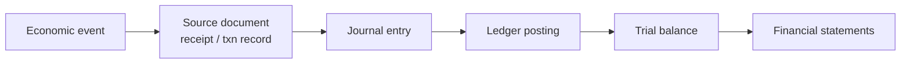

## 1.2 The five element types (account categories)

| Element | Definition | Plain example | MFS example [ILLUSTRATIVE] |
|---|---|---|---|
| **Asset** | Resource the entity **owns or controls** that has future economic benefit | Cash, bank balance, receivables, equipment | Cash at partner bank, receivable from a bank for settlement, prepaid expenses |
| **Liability** | Obligation the entity **owes** to others | Loans, payables, deposits | **E-money owed to customers' wallets**, payable to billers/telcos, VAT payable |
| **Equity** | Owners' residual claim = Assets − Liabilities | Share capital, retained earnings | Paid-up capital, retained earnings |
| **Revenue (Income)** | Increase in economic benefit from ordinary activity | Sales, fees, interest | Transaction fees, MDR, commission earned from billers |
| **Expense** | Decrease in economic benefit from ordinary activity | Salaries, rent, commissions paid | Agent commission, SMS cost, promo cashback, bank charges |

**Key insight for MFS:** a customer's wallet balance of Tk 1,000 is **not XPay's asset**. It is XPay's **liability** (XPay *owes* the customer Tk 1,000). XPay's *asset* is the real money in the partner bank that backs it.

## 1.3 The accounting equation

```
Assets = Liabilities + Equity
```

Expanded (includes period performance):

```
Assets = Liabilities + Owner's Capital + (Revenue − Expenses) − Drawings/Dividends
```

- **Every** valid transaction keeps this equation true. This is the mathematical heart of double-entry.
- **Software meaning:** if your system can reach a state where the equation is false, your ledger is *corrupt* — not "slightly off".

**Worked micro-examples** (the equation after each event):

| # | Event | Assets | = | Liabilities | + | Equity |
|---|---|---|---|---|---|---|
| 1 | Owners invest Tk 1,000,000 cash | +1,000,000 (Cash) | | | | +1,000,000 (Capital) |
| 2 | Customer deposits Tk 5,000 into wallet (cash arrives in bank) | +5,000 (Bank) | | +5,000 (E-money liability) | | |
| 3 | Operator earns Tk 5 fee, taken from the wallet | | | −5 (E-money liability) | | +5 (Revenue → Equity) |
| 4 | Operator pays Tk 2 bank charge | −2 (Bank) | | | | −2 (Expense → Equity) |

## 1.4 Debit and Credit — what they actually mean

- **Debit (Dr)** = the **left** side of an account entry. **Credit (Cr)** = the **right** side.
- They are **not** "increase/decrease" and **not** "good/bad". They are *directions*. Whether a debit increases or decreases a balance **depends on the account type**.
- **Normal balance** = the side on which an account normally increases (and normally sits).

| Account type | Normal balance | Debit does | Credit does |
|---|---|---|---|
| Asset | **Debit** | Increase | Decrease |
| Expense | **Debit** | Increase | Decrease |
| Liability | **Credit** | Decrease | Increase |
| Equity | **Credit** | Decrease | Increase |
| Revenue | **Credit** | Decrease | Increase |

**Memory aid:** **DEAD CLIC** → **D**ebit increases **E**xpenses, **A**ssets, **D**ividends; **C**redit increases **L**iabilities, **I**ncome, **C**apital.

> **The #1 beginner trap in fintech:** from the *bank's* perspective your savings account balance is a **liability** (credit-normal). From *your* perspective it is an **asset**. A bank statement showing "credit" to your account means the bank **owes you more**. Same for MFS wallets: **crediting a customer wallet increases the wallet balance** because the wallet is a liability of XPay.

**T-account** visualization:

```
        Cash at Bank (Asset)
   Debit (Dr) |  Credit (Cr)
   ───────────┼────────────
   increases  |  decreases
```

## 1.5 Account classifications (deeper)

| Classification | Meaning | Examples |
|---|---|---|
| **Real accounts** | Asset/liability/equity — balances **carry forward** across periods (permanent) | Bank, E-money liability |
| **Nominal accounts** | Revenue/expense — **closed to zero** at period end (temporary) | Fee income, Commission expense |
| **Personal accounts** | Individuals/entities | Customer wallet, Agent account |
| **Current vs Non-current** | Due/usable within 12 months or longer | Customer wallets (current liability), Property (non-current asset) |
| **Contra accounts** | Offset another account (opposite normal balance) | Accumulated depreciation, Allowance for doubtful receivables |
| **Control accounts** | GL account that summarizes a sub-ledger | "Customer wallets (control)" |
| **Memorandum / statistical accounts** | Off-balance-sheet tracking, **not part of the equation** | Daily limits, guarantees received |
| **Suspense accounts** | Temporary holding for unidentified/unresolved items | Unmatched bank credits |
| **Clearing / transit accounts** | Hold money "in flight" between systems | Payment in transit to bank |

## 1.6 Chart of Accounts (COA) — basics
*(Full design in Phase 3.)*

- **COA** = the structured, coded list of **all accounts** an entity may post to. It is the *vocabulary* of the ledger.
- **Why:** consistent reporting, regulatory mapping, automation of posting rules.
- Typical numbering (convention, not law): `1xxx Assets`, `2xxx Liabilities`, `3xxx Equity`, `4xxx Revenue`, `5xxx Expenses`.

## 1.7 Journal, journal entry, journal voucher

| Term | Definition |
|---|---|
| **Journal** | Chronological book of original entry — "what happened, in date order". |
| **Journal entry (JE)** | One recorded financial event: a **header** + **two or more lines**, total debits = total credits. |
| **Journal voucher (JV)** | The **document/form** (paper or digital) authorizing and describing a journal entry — often used for manual adjustments with maker-checker approval. In software, a JV is a *journal entry with source = MANUAL and an approval workflow*. |
| **Narration / description** | Human-readable explanation. Auditors read these. |
| **Voucher types** | Receipt voucher, payment voucher, journal voucher, contra voucher, etc. (common in South-Asian ERPs). |

**Example JE** (customer deposit):

| Line | Account | Dr | Cr |
|---|---|---|---|
| 1 | 1010 Cash at Partner Bank (Asset) | 5,000.00 | |
| 2 | 2010 E-money – Customer Wallets (Liability) | | 5,000.00 |

## 1.8 Posting, the ledger, and posting rules

- **Posting** = transferring journal lines into the **ledger** accounts, updating account balances/history.
- **Ledger** = the collection of accounts showing **all movements per account** (organized by account instead of by date).
- **Posting rule** = a rule defining *which accounts to debit and credit for a given transaction type* (e.g., "CASH_OUT → Dr customer wallet, Cr agent wallet, Cr fee income, Cr VAT payable").
- **Journal vs ledger:** journal = chronological; ledger = by account. They contain the *same* facts, organized differently. In databases both are queries over the same `journal_line` table.

## 1.9 Trial balance

- **Trial balance (TB)** = a list of all ledger accounts with their total debit or credit balances at a point in time.
- **Test:** ΣDebits = ΣCredits. If not, there is an *error* (a one-sided posting, a bug, data corruption).
- **Limits:** a balanced TB does **not** prove correctness (wrong account, wrong amount on both sides, omitted transaction all still balance).
- **Types:** unadjusted TB, adjusted TB (after accruals), post-closing TB.

## 1.10 The three (four) financial statements

| Statement | Question answered | Content | Formula |
|---|---|---|---|
| **Statement of Financial Position (Balance Sheet)** | "What do we own/owe **at a date**?" | Assets, Liabilities, Equity | A = L + E |
| **Income Statement (P&L)** | "Did we make a profit **over a period**?" | Revenue − Expenses | Net income |
| **Cash Flow Statement** | "Where did **cash** come from/go?" | Operating, Investing, Financing | Opening cash + flows = closing cash |
| **Statement of Changes in Equity** | "How did equity move?" | Capital, retained earnings, dividends | |

**MFS-specific observation:** the balance sheet of an MFS operator has a **huge liability (customer e-money)** matched by **huge bank/trust assets**, while the *profit* is small (fees/commissions). Auditors focus intensely on *"is every taka of e-money backed by real money?"* (Phase 6).

## 1.11 Accounting periods and cut-off

- **Accounting period** = the time slice for reporting (day, month, quarter, financial year).
- **Cut-off** = the rule deciding which period an event belongs to (by **posting date**, not "when the server ran").
- **Period states:** `OPEN → SOFT-CLOSED → CLOSED (LOCKED)`. Posting to a closed period must be rejected (or routed to an *adjustment period* with approval).
- **Engineering link:** **business date ≠ system timestamp**. A transaction at 00:03 on the 1st may belong to the previous *business day* if EOD hasn't rolled over. Store **both** `posting_date` and `created_at`.

## 1.12 Accounting principles & concepts (and how they hit software)

| Principle | Meaning | Software implication |
|---|---|---|
| **Accrual basis** | Record when earned/incurred, not when cash moves | Fee accrued at transaction time; commission expense accrued before it's paid |
| **Cash basis** | Record when cash moves | Rarely for institutions; used in cash flow statement |
| **Going concern** | Entity will continue operating | Shapes valuation, provisions |
| **Consistency** | Same methods each period | Posting rules are versioned, not edited silently |
| **Matching** | Expenses recorded in the same period as the revenue they helped earn | Commission expense posts with the fee income |
| **Revenue recognition** | When/how much revenue to record | Immediate for fees; deferred for prepaid/subscription |
| **Prudence (conservatism)** | Don't overstate assets/income | Provisions for doubtful items |
| **Materiality** | Only significant items matter for reporting | Rounding differences below threshold go to a rounding account |
| **Monetary unit** | Everything expressed in one currency measure | Base (functional) currency per entity |
| **Historical cost** | Record at original cost | FX handling |
| **Full disclosure** | Report everything relevant | Notes, regulatory reports |
| **Segregation of the entity** | Entity ≠ owners; **customer funds ≠ own funds** | Separate ledgers and bank accounts |

Standards you will hear about: **IFRS** / **IAS** (international) and in Bangladesh **BFRS/IFRS adopted by ICAB** — [VERIFY current adoption and any Bangladesh Bank-specific reporting formats for banks and MFS providers].

## 1.13 Worked: one full mini-cycle (before the MFS specifics)

A trader starts a business:

| # | Event | Dr | Cr | Amount |
|---|---|---|---|---|
| 1 | Owner invests cash | Cash (A) | Capital (E) | 100,000 |
| 2 | Buys goods on credit | Inventory (A) | Accounts payable (L) | 40,000 |
| 3 | Sells goods (cost 30,000) for cash 50,000 | Cash (A) | Sales (R) | 50,000 |
| 3b | Cost of goods sold | COGS (X) | Inventory (A) | 30,000 |
| 4 | Pays supplier | Accounts payable (L) | Cash (A) | 40,000 |
| 5 | Pays rent | Rent expense (X) | Cash (A) | 5,000 |

**Result:** Cash = 100,000 + 50,000 − 40,000 − 5,000 = **105,000**; Inventory = 10,000; Payables = 0; Capital 100,000; Profit = 50,000 − 30,000 − 5,000 = **15,000**.
Check: Assets (105,000 + 10,000 = 115,000) = Liabilities (0) + Equity (100,000 + 15,000 = 115,000) ✔.

## 1.14 Phase 1 — Common mistakes & best practices

| Mistake | Why it hurts | Best practice |
|---|---|---|
| Treating Dr/Cr as "plus/minus" | Wrong signs everywhere | Always derive from **normal balance** of the account type |
| Treating customer wallet as company asset | Regulatory & reporting disaster | Wallet = **liability**; backing funds = asset |
| Mixing business date and timestamp | Wrong period reporting | Two fields: `posting_date`, `created_at` |
| Trusting "trial balance balances" as proof | Errors can offset | Add reconciliations (Phase 8–9) |
| Editing posted entries | Destroys audit trail | Reverse + repost (Phase 2/7) |

### Phase 1 exercises
1. Classify: agent e-float, commission payable to agent, SMS gateway cost, MDR income, VAT payable, bank charge, promotional cashback, suspense for unmatched bank credit.
2. Write the journal entry when a customer deposits Tk 800 through a bank app.
3. Prove the accounting equation holds after each of the four micro-examples in §1.3.
4. Build a trial balance for §1.13 and check it balances.


---

# Phase 2 — Double-Entry Bookkeeping Logic

## 2.1 What and why

- **Double-entry bookkeeping** = every transaction is recorded in **at least two accounts**, with **total debits = total credits**.
- **Why it exists:** it makes errors *detectable*. A single-entry system ("balance went from 100 to 90") cannot tell you *where the 10 went*. Double-entry always records **source and destination**, so money never appears or vanishes.
- **Origin:** formalized by Luca Pacioli (1494); still the basis of every bank core system.

## 2.2 The logic: "every event has two sides"

Every event answers two questions:
1. **What did we receive / what increased?** (the *benefit side*)
2. **What did we give / what is the source or obligation?** (the *source side*)

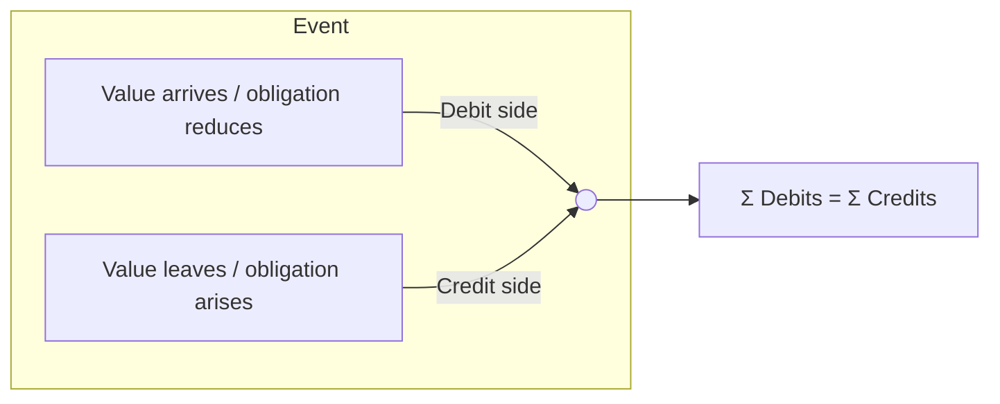

**Four-step method to journalize anything:**
1. Identify the **accounts affected** (≥ 2).
2. Classify each (A/L/E/R/X).
3. Decide **increase or decrease** of each.
4. Apply the normal-balance table → Dr/Cr. Verify Σ Dr = Σ Cr.

## 2.3 Types of journal entries

| Type | Description | Example |
|---|---|---|
| **Simple** | 1 debit + 1 credit | Deposit |
| **Compound (split)** | Multiple debits and/or credits | Cash-out: customer wallet Dr; agent, fee, VAT Cr |
| **Adjusting** | End-of-period accruals/provisions | Accrue commission |
| **Reversing** | Cancels a prior entry (swap Dr/Cr) | Failed transaction |
| **Closing** | Zeroes nominal accounts into retained earnings | Year-end |
| **Opening** | Brings forward balances | New period/migration |
| **Correcting** | Fix a posting error | Wrong account |
| **Recurring / system-generated** | Template-based | Daily interest/fee sweep |

## 2.4 Why debits must equal credits — the invariants

| Invariant | Statement | How enforced |
|---|---|---|
| **I1 – Balanced journal** | For every journal: ΣDr = ΣCr (per currency) | App validation **and** DB constraint/trigger |
| **I2 – Global balance** | For the whole ledger: ΣDr = ΣCr | Trial balance check job |
| **I3 – Immutability** | Posted lines never change | No UPDATE/DELETE privileges, triggers |
| **I4 – Control = Σ sub-ledger** | Control account balance = Σ sub-accounts | Reconciliation query (Phase 8) |
| **I5 – No negative where prohibited** | Wallet ledger balance ≥ 0 | Posting-time check under lock |
| **I6 – Period integrity** | No posting into closed periods | Period check in posting engine |
| **I7 – Single currency per line; balanced per currency** | Multi-currency journals balance **per currency** (and in base currency) | Validation + FX rules (Phase 8) |

## 2.5 How institutions maintain accuracy

1. Atomic multi-line posting (all lines or none).
2. Unique references + idempotency (no double posting).
3. Maker-checker for manual entries.
4. Daily reconciliation (internal vs bank vs partners).
5. Trial balance at EOD; automated alerts when ≠ 0.
6. Append-only history & audit trails.
7. Period locking.
8. Independent audit.

## 2.6 Applying principles to real-world transactions

| Principle | Real MFS event | Treatment |
|---|---|---|
| Accrual | Agent earns commission on a Friday cash-out; paid next month | Expense + payable recorded **Friday** |
| Matching | Fee income and agent commission for same cash-out | Same day, same period |
| Prudence | Customer dispute pending for Tk 10,000 | Hold/provision, not income |
| Consistency | Rate card change on 1 Jan | New posting-rule **version** with effective date |
| Segregation | Operator's profit sits in bank with customers' money | Separate GL accounts/bank accounts, reconcile |

## 2.7 Corrections: never edit, always reverse

```
Original (wrongly posted to 5020 instead of 5010)
  Dr 5020 Incentive expense   500
  Cr 2010 Customer wallet     500

Reversal (new entry, links to original)
  Dr 2010 Customer wallet     500
  Cr 5020 Incentive expense   500

Correct entry
  Dr 5010 Commission expense  500
  Cr 2010 Customer wallet     500
```
Net effect cancels cleanly; the history shows *what happened and who fixed it*.

## 2.8 Phase 2 mistakes & best practices

| Mistake | Best practice |
|---|---|
| Single-sided "balance update" shortcuts (`UPDATE wallet SET balance = balance - x`) with no journal | Balance is a **derived/cached value of journal lines**, never the source of truth alone |
| Allowing partial journals | One DB transaction per journal |
| Using floats | `Decimal` / `NUMERIC` only |
| Deleting wrong entries | Reverse and repost |
| Journals that balance in total but mix currencies | Balance per currency |

### Exercises
1. Journalize: Cash-in Tk 2,000 at an agent (no fee).
2. Compound entry: bill payment Tk 1,850 + convenience fee Tk 10.
3. Write the reversing and correcting entries for a fee posted to the wrong revenue account.

---

# Phase 3 — Ledger Anatomy, Types & Chart of Accounts Design

## 3.1 The big picture

```mermaid
flowchart TB
  TX[Transaction Processing System\n(wallet, limits, fees, routing)] -->|posting request| POST[Posting Engine]
  POST --> JE[(Journal / Journal Lines\nappend-only)]
  JE --> GL[General Ledger\nsummary accounts]
  JE --> SL1[Customer Wallet Sub-ledger]
  JE --> SL2[Agent Sub-ledger]
  JE --> SL3[Merchant Sub-ledger]
  JE --> SL4[Settlement / Clearing / Suspense]
  GL --> TB[Trial Balance]
  TB --> FS[Financial Statements & Regulatory Reports]
  GL <-->|reconcile| BANK[Bank statements]
  SL1 <-->|control = Σ| GL
```

## 3.2 Ledger types — definitions, responsibilities, relationships

| Ledger | What it is | Normal balance (from operator view) | Typical owner / responsibility | Relationship to GL |
|---|---|---|---|---|
| **General Ledger (GL)** | The master set of summary accounts covering the whole entity; source of financial statements | by account | Finance/Accounting | Top of hierarchy |
| **Sub-ledger** | Detailed ledger for one domain with many accounts (e.g., all wallets) | per type | Domain owner | Summarized by a **control account** in GL |
| **Customer Ledger / Wallet Ledger** | One account **per customer wallet**; holds each customer's e-money balance | Credit (liability) | Wallet service | Σ = GL "E-money – Customers" |
| **Agent Ledger** | Agent e-float (and commission payable) accounts | Credit (liability) | Agent network ops | Σ = GL "E-money – Agents" |
| **Merchant Ledger** | Merchant collection wallets/receivables | Credit (liability) | Merchant ops | Σ = GL "Merchant payables" |
| **Distributor Ledger** | Distributor e-float | Credit | Distribution ops | Σ = GL control |
| **Bank Ledger** | Mirror of operator's accounts at each partner bank (what *we* think the bank holds) | **Debit (asset)** | Treasury | Reconciled vs bank statement |
| **Settlement Ledger** | Amounts due to/from partners (billers, telcos, banks, schemes) pending settlement | Mixed | Settlement/Treasury | Net settlement accounts |
| **Clearing Ledger** | Money "in flight" between systems/rails | Mixed, should net to ~0 over time | Ops/Treasury | Must be cleared by matching |
| **Suspense Ledger** | Temporary holding for unidentified/unresolved items | Mixed, should be ~0 | Ops/Finance | Aged, investigated |
| **Control Account** | A GL account whose balance = Σ of a sub-ledger | per type | Finance | Reconciliation anchor |
| **Intercompany Ledger** | Balances between legal entities in a group (e.g., MFS subsidiary ↔ parent bank) | Mixed | Group finance | Eliminated on consolidation |
| **Memorandum Account** | Off-balance-sheet tracking; **not** part of A = L + E | n/a | Risk/Compliance | Separate "ledger book" |

### 3.2.1 GL vs sub-ledger — the key relationship

- The **GL** answers: *"How much does XPay owe all customers in total?"* → `2010 = 4,441.06`.
- The **sub-ledger** answers: *"How much does Rahim have?"* → `3,994.25`.
- Rule: **GL control account balance == Σ sub-ledger account balances**, always.
- **How sub-ledger posts into GL:**
  - **Real-time posting (per journal):** each journal line carries `gl_account` + `sub_account`. The GL balance is just the aggregate of lines for that GL account. *Preferred for MFS.*
  - **Summary posting (batch):** sub-ledger keeps detail; a periodic job posts **one summarized journal per day** per GL account. Used when volume is huge or the sub-ledger is a separate system. Requires reconciliation between the two.

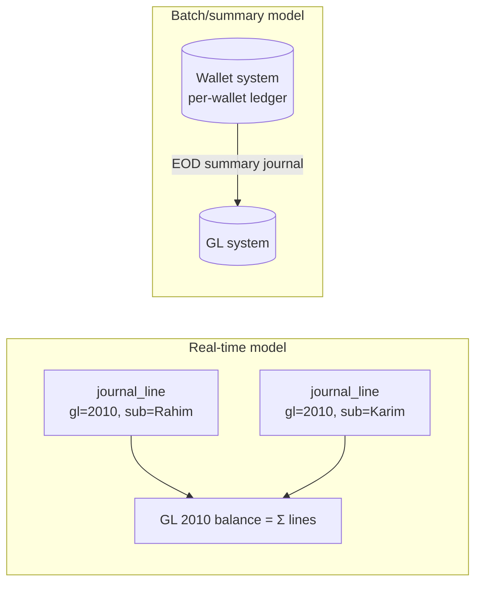

## 3.3 Sub-ledger deep dives

### 3.3.1 Customer / Wallet Ledger
- **Wallet** = a stored-value account in the MFS system, identified by (usually) the customer's mobile number/wallet ID.
- **Balances (three views)**
  - **Ledger balance** = Σ posted credits − Σ posted debits (the accounting truth).
  - **Hold / reserved balance** = amounts earmarked for pending operations (authorization holds).
  - **Available balance** = ledger balance − holds (− minimum balance rules). *This is what the customer can spend.*
- **Mistake:** storing only "balance" and mutating it. **Best practice:** immutable lines + a **balance cache** updated atomically in the same transaction.

### 3.3.2 Agent ledger
- Agent has an **e-float** (digital balance bought with real cash/bank deposit). Cash-in **decreases** agent float; cash-out **increases** it.
- Commission earned is first an **accrued payable** (liability), later credited to the wallet (or paid) — separate accounts keep float and earnings distinct.

### 3.3.3 Merchant ledger
- Merchant payments credit the merchant's collection account (net of MDR). **Settlement** moves it to the merchant's bank account on a schedule (T+0/T+1... [ILLUSTRATIVE]).

### 3.3.4 Bank ledger
- A **GL asset account per partner-bank account** (e.g., `1010 Trust A/C – Bank A`). The "bank ledger" is the operator's *own record* of that bank account. Bank's statement is the *external* record. **They are reconciled daily.**

### 3.3.5 Settlement, Clearing, Suspense
| | Purpose | Healthy state |
|---|---|---|
| **Settlement account** | Track obligations to/from partners until funds actually move | Balance = outstanding, clears upon settlement |
| **Clearing account** | Bridge between "we booked it" and "the rail confirmed it" | Near zero except in-flight items |
| **Suspense account** | Park unknowns (unmatched bank credit, wrong reference) | Small, aged, owner-assigned, resolved quickly |

> **Rule:** *Suspense is a symptom, not a destination.* Every item needs an owner, an age, and a resolution entry.

### 3.3.6 Control accounts — the discipline
- **Direct manual posting to a control account is prohibited** (it would break Control = Σ sub-ledger). Only the sub-ledger posting path may touch it.
- Implement with `allow_manual_posting = false` and a `requires_sub_account = true` flag.

### 3.3.7 Intercompany ledger
- Example: XPay (MFS subsidiary) uses services of a parent bank. Each entity has *its own* books: XPay books "Due to Parent Bank"; the bank books "Due from XPay". On **consolidation**, these eliminate. Mismatches are an *intercompany reconciliation* topic.

### 3.3.8 Memorandum accounts
- Track facts that matter but aren't balance-sheet items: daily transaction limits used, guarantees received, written-off balances still being pursued, dormant account counts, regulatory limits.
- **Implementation:** a separate `ledger_book` value (`MEMO`) with the same double-entry mechanics (Dr memo / Cr memo contra) so it's auditable, but excluded from financial statements.

## 3.4 Chart of Accounts (COA) design

### 3.4.1 Principles
1. **Hierarchy** — group → account class → control → leaf (postable).
2. **Only leaf accounts are postable.**
3. **Stable codes** — never reuse a retired code.
4. **Few GL accounts, many dimensions** — don't create an account per branch/product; use **dimensions** instead.
5. **Regulatory mapping** — every GL maps to regulatory/report lines.
6. **Ownership** — each account has an owner (team) responsible for reconciliation.

### 3.4.2 Account code structure [ILLUSTRATIVE]

```
  2 0 1 0 - 0 0
  │ │ │ │   └─ sub-code (optional)
  │ │ │ └──── leaf sequence
  │ │ └────── group (e.g., 01 = customer-related)
  │ └──────── class (20 = e-money liabilities)
  └────────── type (2 = Liability)
```

### 3.4.3 Illustrative XPay COA (used throughout this guide)

| Code | Name | Type | Normal | Control? | Notes |
|---|---|---|---|---|---|
| **1000** | **ASSETS** | group | | | |
| 1010 | Trust/Collection A/C – Bank A | Asset | Dr | | Backs e-money |
| 1020 | Operating A/C – Bank B | Asset | Dr | | Own funds |
| 1030 | Settlement A/C – Bank A (NPSB/BEFTN) | Asset | Dr | | Rail settlement |
| 1100 | Receivable from Banks (settlement) | Asset | Dr | | |
| 1110 | Receivable from Billers/Partners | Asset | Dr | | |
| 1200 | Prepaid expenses | Asset | Dr | | |
| 1900 | Suspense – Assets (unmatched debits) | Asset | Dr | | |
| **2000** | **LIABILITIES** | group | | | |
| 2010 | E-money – Customer Wallets | Liability | Cr | **Yes** | Sub-ledger = wallets |
| 2020 | E-money – Agent Wallets (float) | Liability | Cr | **Yes** | |
| 2030 | E-money – Merchant Wallets | Liability | Cr | **Yes** | |
| 2040 | E-money – Distributor Wallets | Liability | Cr | **Yes** | |
| 2100 | Payable to Billers | Liability | Cr | | |
| 2110 | Payable to Telcos (recharge) | Liability | Cr | | |
| 2200 | Agent Commission Payable | Liability | Cr | **Yes** | |
| 2300 | VAT Payable [VERIFY] | Liability | Cr | | |
| 2310 | Tax Withheld Payable (TDS) [VERIFY] | Liability | Cr | | |
| 2400 | Outbound Transfers in Transit (clearing) | Liability | Cr | | |
| 2410 | Inbound Transfers in Transit (clearing) | Liability | Cr | | |
| 2500 | Settlement Payable – Merchants | Liability | Cr | | |
| 2900 | Suspense – Liabilities (unidentified credits) | Liability | Cr | | |
| **3000** | **EQUITY** | group | | | |
| 3010 | Share capital | Equity | Cr | | |
| 3020 | Retained earnings | Equity | Cr | | |
| 3030 | Current-year earnings (system) | Equity | Cr | | closing |
| **4000** | **REVENUE** | group | | | |
| 4010 | Cash-out fee income | Revenue | Cr | | |
| 4020 | Send-money fee income | Revenue | Cr | | |
| 4030 | Merchant discount (MDR) income | Revenue | Cr | | |
| 4040 | Bill-payment fee/commission income | Revenue | Cr | | |
| 4050 | Recharge commission income | Revenue | Cr | | |
| 4900 | FX gain / Rounding gain | Revenue | Cr | | |
| **5000** | **EXPENSES** | group | | | |
| 5010 | Agent commission expense | Expense | Dr | | |
| 5020 | Incentive / cashback expense | Expense | Dr | | |
| 5030 | Bank charges | Expense | Dr | | |
| 5040 | SMS/USSD cost | Expense | Dr | | |
| 5900 | FX loss / Rounding loss | Expense | Dr | | |

### 3.4.4 Dimensions (ledger dimensions)

Instead of exploding accounts, tag each journal line with dimensions:

| Dimension | Meaning | Example values |
|---|---|---|
| **Branch / business unit** | Organizational unit | HEAD_OFFICE, DHAKA_REGION |
| **Cost center** | Who bears cost | CC-AGENT-NETWORK, CC-IT |
| **Product** | Service line | SEND_MONEY, CASH_OUT, MERCHANT_PAY |
| **Channel** | Origin | APP, USSD, API, AGENT_POS |
| **Currency** | ISO 4217 | BDT, USD |
| **Counterparty** | Partner | BANK_A, BILLER_DESCO |
| **Project / campaign** | Promotions | CASHBACK_EID |

**Ownership & mapping:** each account has `owner_team`, `reconciled_by`, `regulatory_map_code`, `report_line`. The **account mapping engine** (Phase 7) resolves transaction attributes → accounts+dimensions.

### 3.4.5 Financial reporting structure
- **Hierarchy roll-up:** leaf → group → statement line (e.g., "Cash and cash equivalents").
- Keep **mapping tables** (`gl_account → report_line`) separate from the COA so reports can be re-organized without re-coding.
- **Regulatory reports** [VERIFY]: map GLs to central-bank report formats via versioned mapping.

### 3.4.6 COA mistakes & best practices
| Mistake | Best practice |
|---|---|
| Account per customer in the GL | Customers live in sub-ledger; GL has control account |
| Branch/product baked into account code | Use dimensions |
| Reusing codes | Retire (status=CLOSED), never reuse |
| No owner for accounts | Mandatory owner and reconciliation frequency |
| Postable parents | Only leaves are postable |
| No effective dating | `valid_from` / `valid_to` for COA changes |

### Phase 3 exercises
1. Design COA additions for "Add money via card" with a card-acquirer settlement receivable and acquirer fee expense.
2. Explain why `2010` must reject manual journals.
3. Define which dimensions you need to report "cash-out profitability by region".


---

# Phase 4 — Double-Entry in an MFS Platform

> **Reminder:** "XPay" is fictional. Rates, fees, VAT and commission values are **[ILLUSTRATIVE]**. Real operators (bKash, Nagad, Upay, Rocket…) have their own tariffs and internal accounting, which are not public; regulatory treatment is **[VERIFY]**.

## 4.1 The MFS balance-sheet model (the single most important picture)

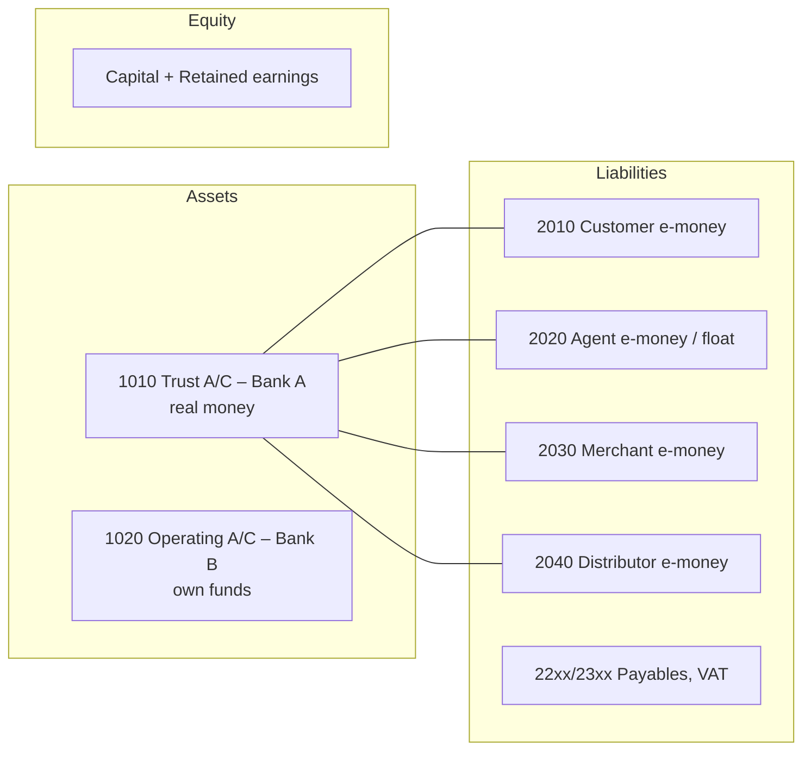

**Safeguarding idea [GENERAL, verify local rule]:** outstanding e-money (all wallets) must be fully backed by funds in designated bank accounts. Reconciliation question #1 every day: **`Σ e-money liabilities ≤ balance in trust/collection accounts`** — the difference is the operator's own money (earned fees, VAT payable, etc.) that should be periodically swept out to operating accounts. [VERIFY exact local rules.]

## 4.2 Wallet & account types and their lifecycle

### 4.2.1 Wallet types

| Wallet / account | GL control | Normal bal. | Who/what | Notes |
|---|---|---|---|---|
| Customer wallet | 2010 | Cr | Retail user | KYC tiers limit balance & transaction sizes [VERIFY] |
| Agent wallet (e-float) | 2020 | Cr | Cash-in/cash-out point | Float purchased with real money |
| Merchant wallet | 2030 | Cr | Shop/biller collecting payments | Settles to bank |
| Distributor wallet | 2040 | Cr | Float wholesaler to agents | Sells float to agents |
| Agent commission account | 2200 | Cr | Earnings payable | Distinct from float |
| Fee income | 4xxx | Cr | Operator revenue | |
| VAT/tax payable | 23xx | Cr | Owed to government | |
| Operational accounts (clearing, in-transit) | 24xx/25xx | Cr/Dr | Operator | |
| Organization accounts | e.g., promo budget | Dr/Cr | Operator | Prefunded campaigns |

### 4.2.2 Wallet creation (what the ledger does)
1. Onboarding & **KYC** (know-your-customer identity verification) completes in the *customer* system.
2. Ledger creates a **sub-ledger account** (wallet) under control account 2010 with `balance = 0`.
3. **No journal entry** is posted at creation (nothing of value moved). Opening balance is zero.
4. Status lifecycle: `PENDING_KYC → ACTIVE → RESTRICTED/FROZEN → DORMANT → CLOSED`. Closing requires **zero balance** (balance must be paid out or escheated per policy [VERIFY]).

### 4.2.3 Balance management
- `ledger_balance`, `held_balance`, `available_balance` (see §5.6).
- **Float management** for agents: low-float alerts, rebalancing via distributors.
- **Minimum / maximum balance rules** per KYC tier.

## 4.3 How to read the posting tables

- **Sub-account** column shows the wallet/entity inside the control account.
- Amounts in BDT. "Dr/Cr" are from the **operator's GL** perspective.
- *Effect* column states what the balance does (↑/↓).

---

## 4.4 Transaction 1 — Add Money (Bank → Wallet)

**Scenario:** Rahim adds Tk 5,000 from his bank account to his XPay wallet via a bank rail (fee 0).

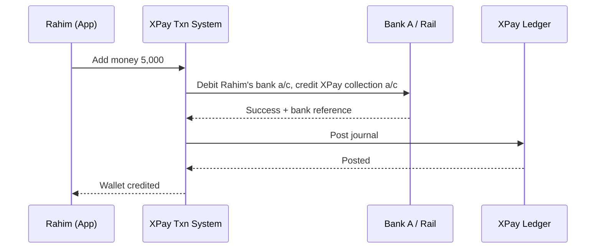

| Line | GL | Sub-account | Dr | Cr | Effect |
|---|---|---|---|---|---|
| 1 | 1010 Trust A/C Bank A | – | 5,000 | | Asset ↑ (real money arrived) |
| 2 | 2010 E-money Customer | Rahim | | 5,000 | Liability ↑ (we owe Rahim more) |

**Account-level impact:** Rahim wallet 0 → 5,000 · XPay bank (book) +5,000 · Partner bank: Rahim's account −5,000, XPay's account +5,000.
**Note:** if the bank's confirmation is delayed, the wallet must **not** be credited until funds are confirmed (or credit provisionally with a risk policy; see §5.8).

## 4.5 Transaction 2 — Agent float purchase (cash/bank → agent e-float)

**Scenario:** Agent A1 deposits Tk 100,000 into XPay's collection account at the bank; XPay credits A1's e-float.

| Line | GL | Sub | Dr | Cr |
|---|---|---|---|---|
| 1 | 1010 Trust A/C Bank A | – | 100,000 | |
| 2 | 2020 E-money Agent | A1 | | 100,000 |

(If a **distributor** sells float: Dr 2040 Distributor wallet / Cr 2020 Agent wallet — a pure internal book transfer, no bank movement.)

## 4.6 Transaction 3 — Cash In (customer deposits cash at an agent)

**Scenario:** Karim gives Tk 2,000 cash to agent A1. A1's e-float decreases; Karim's wallet increases. Fee: 0. [ILLUSTRATIVE]

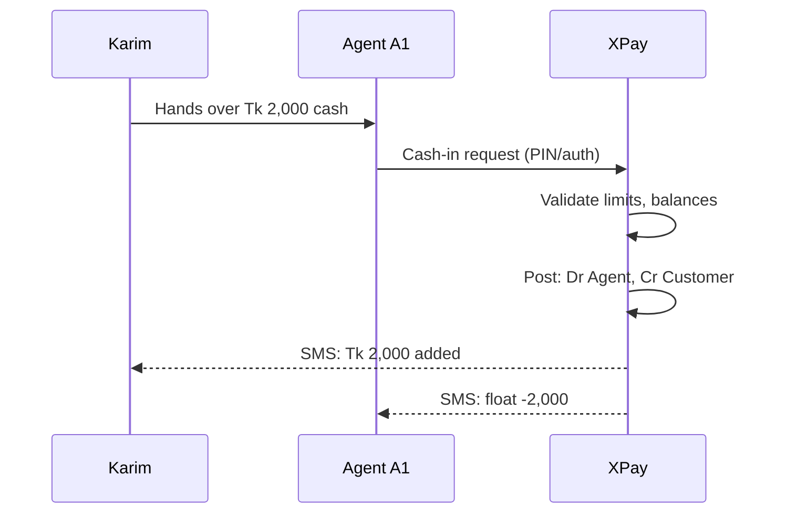

| Line | GL | Sub | Dr | Cr | Effect |
|---|---|---|---|---|---|
| 1 | 2020 E-money Agent | A1 | 2,000 | | Agent float ↓ (liability reduces) |
| 2 | 2010 E-money Customer | Karim | | 2,000 | Customer balance ↑ |

**Impact:** Karim +2,000 · A1 −2,000 · **Total e-money unchanged** (pure transfer between liabilities) · **No bank movement** · Agent physically holds +2,000 cash (outside the ledger; an agent-side reconciliation concern).

## 4.7 Transaction 4 — Send Money (P2P) with fee and VAT

**Scenario:** Rahim sends Tk 1,000 to Karim. Fee Tk 5.00 charged to sender; **VAT 15% of fee = 0.75** [ILLUSTRATIVE; VERIFY real tax]. Sender pays 1,005.75.

| Line | GL | Sub | Dr | Cr | Effect |
|---|---|---|---|---|---|
| 1 | 2010 E-money Customer | Rahim | 1,005.75 | | Rahim ↓ |
| 2 | 2010 E-money Customer | Karim | | 1,000.00 | Karim ↑ |
| 3 | 4020 Send-money fee income | – | | 5.00 | Revenue ↑ |
| 4 | 2300 VAT payable | – | | 0.75 | Liability to govt ↑ |

Check: Dr 1,005.75 = Cr (1,000 + 5 + 0.75) = 1,005.75 ✔
**Insight:** total e-money in 2010 **falls by 5.75** (the fee+VAT leaves the e-money pool and becomes revenue + tax payable). The *bank balance is unchanged* → the bank now holds 5.75 more than e-money liabilities; this excess is the operator's own money (see §4.1).

## 4.8 Transaction 5 — Cash Out (customer withdraws cash at agent) with fee, VAT, commission

**Scenario:** Karim withdraws Tk 2,500 from agent A1. Fee 1.85% = Tk 46.25; VAT 15% of fee = 6.9375 → **6.94** (rounded half-up, see §8.9); agent commission 0.4% of amount = Tk 10.00 [ILLUSTRATIVE].

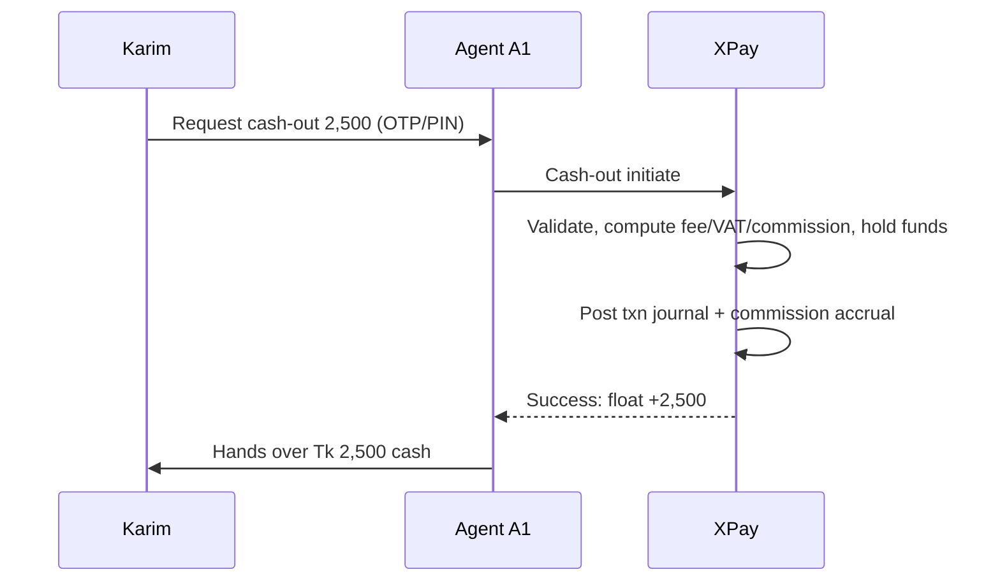

**Journal A — transaction (customer-facing):**

| Line | GL | Sub | Dr | Cr |
|---|---|---|---|---|
| 1 | 2010 E-money Customer | Karim | 2,553.19 | |
| 2 | 2020 E-money Agent | A1 | | 2,500.00 |
| 3 | 4010 Cash-out fee income | – | | 46.25 |
| 4 | 2300 VAT payable | – | | 6.94 |

Check: 2,553.19 = 2,500 + 46.25 + 6.94 ✔

**Journal B — commission accrual (accrual basis, same day):**

| Line | GL | Sub | Dr | Cr |
|---|---|---|---|---|
| 1 | 5010 Agent commission expense | – | 10.00 | |
| 2 | 2200 Agent commission payable | A1 | | 10.00 |

**Journal C — commission settlement (e.g., end of day/month):**

| Line | GL | Sub | Dr | Cr |
|---|---|---|---|---|
| 1 | 2200 Agent commission payable | A1 | 10.00 | |
| 2 | 2020 E-money Agent | A1 | | 10.00 |

(If withholding tax applies on commission, split Cr: wallet net + 2310 TDS payable. [VERIFY])

## 4.9 Transaction 6 — Merchant Payment (with MDR)

**Scenario:** Rahim pays Tk 1,500 at merchant M1. **MDR (merchant discount rate)** = 1.5% = Tk 22.50, deducted from the merchant. [ILLUSTRATIVE; VAT on MDR omitted for brevity]

| Line | GL | Sub | Dr | Cr |
|---|---|---|---|---|
| 1 | 2010 E-money Customer | Rahim | 1,500.00 | |
| 2 | 2030 E-money Merchant | M1 | | 1,477.50 |
| 3 | 4030 MDR income | – | | 22.50 |

**Impact:** Rahim −1,500 · M1 +1,477.50 · revenue +22.50 · no bank movement until **merchant settlement** (§4.15).

## 4.10 Transaction 7 — Bank Transfer (Wallet → Bank account)

**Scenario:** Rahim transfers Tk 10,000 from wallet to his bank account at Bank C via an interbank rail (e.g., NPSB or BEFTN; see Phase 6). Fee waived.

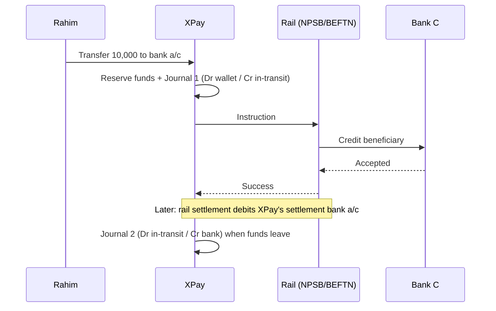

**Journal 1 — at acceptance:**

| Line | GL | Sub | Dr | Cr |
|---|---|---|---|---|
| 1 | 2010 E-money Customer | Rahim | 10,000 | |
| 2 | 2400 Outbound Transfers in Transit | – | | 10,000 |

**Journal 2 — when the funds actually leave XPay's bank account (settlement):**

| Line | GL | Sub | Dr | Cr |
|---|---|---|---|---|
| 1 | 2400 Outbound Transfers in Transit | – | 10,000 | |
| 2 | 1030 Settlement A/C Bank A | – | | 10,000 |

**If the rail rejects/returns:** reverse Journal 1 (Dr 2400 / Cr 2010 Rahim). **Key lesson:** the customer's wallet is debited **immediately**, but real money may leave the bank **later** — the *in-transit account* is the bridge and must be reconciled to zero.

## 4.11 Transaction 8 — Mobile Recharge (Top-up)

**Scenario:** Rahim recharges Tk 200 on a telco prepaid number. Telco gives XPay 3% commission (Tk 6). XPay owes the telco Tk 194. [ILLUSTRATIVE]

| Line | GL | Sub | Dr | Cr |
|---|---|---|---|---|
| 1 | 2010 E-money Customer | Rahim | 200.00 | |
| 2 | 2110 Payable to Telcos | Telco-X | | 194.00 |
| 3 | 4050 Recharge commission income | – | | 6.00 |

**Later settlement with the telco (e.g., T+1 bank payment):**

| Line | GL | Sub | Dr | Cr |
|---|---|---|---|---|
| 1 | 2110 Payable to Telcos | Telco-X | 194.00 | |
| 2 | 1010/1020 Bank | – | | 194.00 |

## 4.12 Transaction 9 — Bill Payment (utility) with convenience fee

**Scenario:** Rahim pays an electricity bill Tk 1,850 with a Tk 10 convenience fee (VAT ignored for brevity).

| Line | GL | Sub | Dr | Cr |
|---|---|---|---|---|
| 1 | 2010 E-money Customer | Rahim | 1,860.00 | |
| 2 | 2100 Payable to Billers | Utility-Y | | 1,850.00 |
| 3 | 4040 Bill-payment fee income | – | | 10.00 |

Settlement to the biller: Dr 2100 / Cr Bank (like §4.11). Biller confirmation (receipt/ACK) is a **non-accounting** workflow state that nevertheless can trigger reversal if the biller rejects.

## 4.13 Transaction 10 — Refund (merchant-initiated, full)

**Scenario:** Merchant M1 refunds the Tk 1,500 payment from §4.9 to Rahim. Policy [ILLUSTRATIVE]: MDR is returned to the merchant.

| Line | GL | Sub | Dr | Cr |
|---|---|---|---|---|
| 1 | 2030 E-money Merchant | M1 | 1,477.50 | |
| 2 | 4030 MDR income (contra via Dr) | – | 22.50 | |
| 3 | 2010 E-money Customer | Rahim | | 1,500.00 |

**Refund vs reversal:**

| | **Refund** | **Reversal** |
|---|---|---|
| Initiator | Merchant/business decision | System/ops correction of an erroneous or failed txn |
| Nature | A **new business transaction** (reverse direction) | **Cancels** the original entry |
| Link | Refers to original txn | `reversal_of` = original journal |
| Fee | Policy-dependent | Typically full fee reversal |
| Reporting | Shows as refund activity | Original marked `REVERSED`; net zero |

## 4.14 Transaction 11 — Reversal (failed cash-out)

**Scenario:** A cash-out journal posted (Karim −2,553.19; A1 +2,500) but the agent's POS timed out and the agent never handed over cash; support confirms. Operator reverses.

**Original (J-1001):** as §4.8 Journal A.
**Reversal (J-1002, `reversal_of = J-1001`):**

| Line | GL | Sub | Dr | Cr |
|---|---|---|---|---|
| 1 | 2020 E-money Agent | A1 | 2,500.00 | |
| 2 | 4010 Cash-out fee income | – | 46.25 | |
| 3 | 2300 VAT payable | – | 6.94 | |
| 4 | 2010 E-money Customer | Karim | | 2,553.19 |

Also reverse commission accrual (Dr 2200 / Cr 5010 for 10.00). **Requirements:** reversal is a *new* journal; original stays `POSTED` but flagged `reversed=true`; **each journal can be reversed at most once**; if the agent has spent the float meanwhile, the reversal may drive A1 negative → policy (allow negative with recovery, or hold the reversal) [see §8.13].

## 4.15 Transaction 12 — Settlement (merchant payout to bank)

**Scenario:** At T+1, XPay settles M1's accumulated Tk 1,477.50 to M1's bank account (bank charge Tk 5 absorbed by XPay [ILLUSTRATIVE]).

**Step 1 — initiate settlement (reduce merchant wallet):**

| Line | GL | Sub | Dr | Cr |
|---|---|---|---|---|
| 1 | 2030 E-money Merchant | M1 | 1,477.50 | |
| 2 | 2500 Settlement Payable – Merchants | M1 | | 1,477.50 |

**Step 2 — money leaves the bank account (bank confirmation):**

| Line | GL | Sub | Dr | Cr |
|---|---|---|---|---|
| 1 | 2500 Settlement Payable – Merchants | M1 | 1,477.50 | |
| 2 | 1010 Trust A/C Bank A | – | | 1,477.50 |

**Step 3 — bank charge:**

| Line | GL | Dr | Cr |
|---|---|---|---|
| 1 | 5030 Bank charges | 5.00 | |
| 2 | 1020 Operating A/C Bank B (own funds) | | 5.00 |

## 4.16 Transaction 13 — Incentive / Cashback

**Scenario:** A campaign gives Rahim Tk 50 cashback. [ILLUSTRATIVE]

| Line | GL | Sub | Dr | Cr |
|---|---|---|---|---|
| 1 | 5020 Incentive expense | CAMPAIGN-EID | 50.00 | |
| 2 | 2010 E-money Customer | Rahim | | 50.00 |

**Critical funding point:** the operator just **created Tk 50 of new e-money liability**. To keep full backing, the operator must **move 50 of own money into the trust account** (Dr 1010 / Cr 1020). Ledgers often model a prefunded **promo budget account** to track this. A frequent audit finding: promotions credited to wallets **without topping up trust funds**.

## 4.17 Transaction 14 — Transaction Fee (standalone) & Commission patterns

- **Fee types:** flat, percentage, tiered, slab-based, min/max-capped, shared (payer/beneficiary), and **fee-on-top vs fee-inclusive**. The posting engine must be told *which*.
- **Commission patterns:** % of amount, % of fee (revenue share), flat per transaction, tiered by volume, split among **agent / distributor / super-distributor** (multi-level).

**Multi-level commission example (illustrative):** cash-out fee net 46.25 shared: Agent 10.00, Distributor 3.00, XPay keeps 33.25.

| Line | GL | Sub | Dr | Cr |
|---|---|---|---|---|
| 1 | 5010 Agent commission expense | – | 13.00 | |
| 2 | 2200 Agent commission payable | A1 | | 10.00 |
| 3 | 2200 Agent commission payable | D1 (distributor) | | 3.00 |

## 4.18 End-of-day proof for the worked day (all of the above core flows)

Using the day: **T1** Add money 5,000 (§4.4) · **T2** Float 100,000 (§4.5) · **T3** Cash-in 2,000 (§4.6) · **T4** Send money 1,000 (§4.7) · **T5** Cash-out 2,500 (§4.8 A, B, C).

**Trial balance at EOD**

| GL | Account | Debit | Credit |
|---|---|---|---|
| 1010 | Trust A/C Bank A | 105,000.00 | |
| 2010 | E-money Customer (Rahim 3,994.25 + Karim 446.81) | | 4,441.06 |
| 2020 | E-money Agent (A1: 100,000 − 2,000 + 2,500 + 10) | | 100,510.00 |
| 2300 | VAT payable (0.75 + 6.94) | | 7.69 |
| 4010 | Cash-out fee income | | 46.25 |
| 4020 | Send-money fee income | | 5.00 |
| 5010 | Agent commission expense | 10.00 | |
| | **Totals** | **105,010.00** | **105,010.00** |

**Verify wallet math:** Rahim = 5,000 − 1,005.75 = 3,994.25 ✔; Karim = 2,000 + 1,000 − 2,553.19 = 446.81 ✔.

**Income statement:** Revenue 51.25 − Expense 10.00 = **Net income 41.25**.
**Balance sheet:** Assets 105,000.00 = Liabilities (4,441.06 + 100,510.00 + 7.69 = 104,958.75) + Equity (current earnings 41.25) = 105,000.00 ✔.

**Safeguarding check:** Bank 105,000.00 − e-money (4,441.06 + 100,510.00 = 104,951.06) = **48.94** surplus = own money (earnings 41.25) + VAT held 7.69 ✔. *This is exactly the daily "trust account vs e-money" test.*

**Cash-flow note:** operating cash flow here = +5,000 + 100,000 (customer/agent funds received; classification of customer funds in the cash-flow statement is an accounting-policy question [VERIFY with auditors]).

## 4.19 Summary matrix — which side moves?

| Transaction | Customer wallet | Agent wallet | Merchant | Bank (asset) | Fee/Revenue | Payables | Total e-money |
|---|---|---|---|---|---|---|---|
| Add money | ↑ | | | ↑ | | | ↑ |
| Agent float purchase | | ↑ | | ↑ | | | ↑ |
| Cash-in | ↑ | ↓ | | | | | = |
| Send money | ↓ / ↑ | | | | ↑ | VAT ↑ | ↓ (fee) |
| Cash-out | ↓ | ↑ | | | ↑ | VAT ↑ | ↓ (fee) |
| Merchant pay | ↓ | | ↑ | | ↑ (MDR) | | ↓ |
| Wallet→Bank | ↓ | | | ↓ (later) | | in-transit | ↓ |
| Recharge | ↓ | | | ↓ (at settlement) | ↑ | Telco ↑ | ↓ |
| Bill pay | ↓ | | | ↓ (at settlement) | ↑ | Biller ↑ | ↓ |
| Cashback | ↑ | | | (needs top-up) | expense | | ↑ |

### Phase 4 exercises
1. Post a **Send Money** of Tk 25,000 where the **receiver** pays a 0.5% fee. Where does the fee Cr go?
2. Post a **Cash-in** where the agent earns 0.2% commission. Compute commission and show accrual + settlement.
3. A merchant refund occurs **after** settlement already paid out. Design the entries when M1's wallet balance is lower than the refund.
4. Extend the EOD proof with a Tk 50 cashback and show the safeguarding gap if the trust account is *not* topped up.


---

# Phase 5 — Transaction Lifecycle & Processing vs Ledger Systems

## 5.1 End-to-end lifecycle

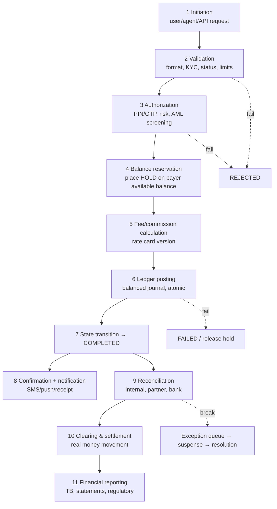

| Step | What happens | Output | Failure handling |
|---|---|---|---|
| Initiation | Request arrives with idempotency key | Transaction record `INITIATED` | Duplicate key → return original result |
| Validation | Schema, account status, KYC tier, limits (per txn/daily/monthly), blacklist | `VALIDATED` or `REJECTED` | Reject with reason code |
| Authorization | Credentials, risk scoring, AML screening | `AUTHORIZED` | Reject/step-up auth |
| Reservation | Hold payer funds | Hold record; available ↓ | Insufficient funds → reject |
| Posting | Create journal + lines; update balances | `POSTED` | Roll back DB txn; release hold |
| Commit/Completion | Transaction state `COMPLETED`; hold converted | Final state | Retry/compensate |
| Notification | SMS/push | Event | Retry independently (never rolls back the ledger) |
| Reconciliation | Compare with partner/bank/records | Matches/breaks | Exception workflow |
| Clearing/settlement | Net obligations; move real money | Settlement journals | Failed settlement → investigate |
| Reporting | Trial balance, statements, regulators | Reports | Re-run (idempotent) |

## 5.2 Transaction state machine

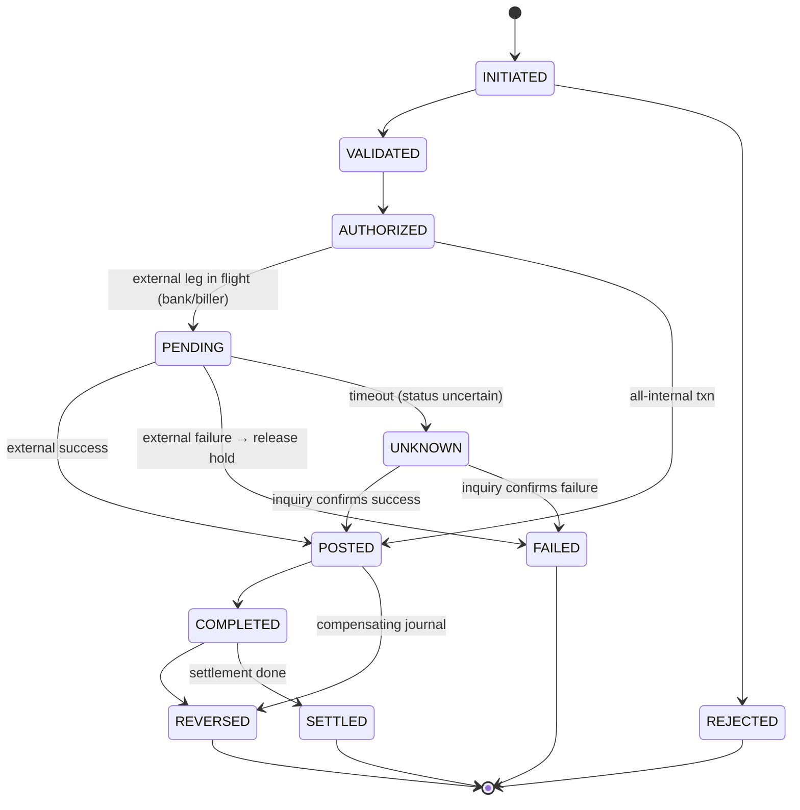

**Rules:** transitions are **append-only events** (store history); illegal transitions raise errors; **UNKNOWN is a first-class state** (timeouts are real in banking — never assume failure).

## 5.3 Transaction Processing System (TPS) vs Accounting Ledger System

| Aspect | **Transaction processing system (TPS / wallet / switch)** | **Accounting ledger (GL)** |
|---|---|---|
| Purpose | Execute business operations fast (validate, route, limit, fee) | Record **financial truth** in double-entry form |
| Unit | Transaction/request with workflow states | Journal entry with balanced lines |
| Optimized for | Latency, throughput, idempotency | Integrity, auditability, immutability |
| Knows about | Users, channels, limits, KYC, partner APIs | Accounts, periods, Dr/Cr, dimensions |
| Mutability | State changes over time | Append-only |
| Failure mode | Retry/timeout/unknown | Must be exact |
| Owner | Product/engineering | Finance + engineering |

**They are different systems (or at least different bounded contexts).** The TPS answers *"should this transaction happen and what are its parameters?"*; the ledger answers *"what is the financial effect, recorded permanently and balanced?"*. 

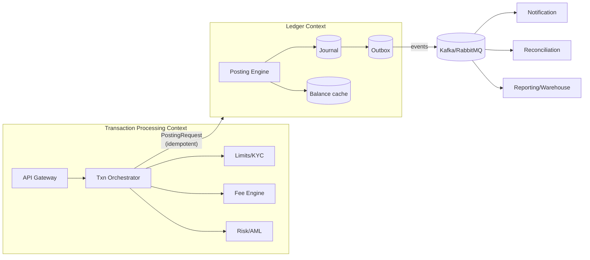

## 5.4 How TPS and ledger communicate in a distributed MFS

Three integration styles:

| Style | How | Pros | Cons |
|---|---|---|---|
| **Synchronous API (request/response)** | Orchestrator calls `POST /journals`; waits | Immediate balance truth; simple | Ledger latency/availability coupled to TPS |
| **Asynchronous (command via queue)** | Orchestrator publishes posting command; ledger consumes | Decoupled, burst-tolerant | Eventual consistency; user-visible pending state |
| **Hybrid (recommended for wallets)** | **Synchronous** for wallet debit/credit (balance must be exact); **asynchronous** for downstream (GL summary, reporting, notifications) via outbox | Best of both | More moving parts |

**Principle:** anything affecting **spendable balance** is posted **synchronously and atomically**. Anything reporting-only can be **asynchronous**.

## 5.5 Synchronous vs asynchronous posting

| Aspect | Synchronous | Asynchronous |
|---|---|---|
| Balance correctness at response time | Immediate | Delayed — need pending/holds |
| Typical use | Wallet debits/credits, P2P | GL aggregation, regulatory feed, analytics |
| Failure | Fail fast | Retry + idempotency + DLQ |

## 5.6 Balances: ledger, available, reserved

| Balance | Definition | Formula |
|---|---|---|
| **Ledger (book) balance** | Σ posted credits − Σ posted debits for the wallet | from journal lines |
| **Reserved / held balance** | Amount blocked for in-flight operations | Σ active holds |
| **Available balance** | Spendable now | `ledger − holds − minimum balance` |
| **Pending credits** | Incoming not yet final (e.g., unconfirmed bank credit) | Not spendable until confirmed |
| **Projected** | Available + pending credits | Display only |

**Holds are not journal entries** (nothing was *posted*); they are a separate record that changes *available*, not *ledger*. On completion, the hold is **released and the real debit is posted** in the same DB transaction.

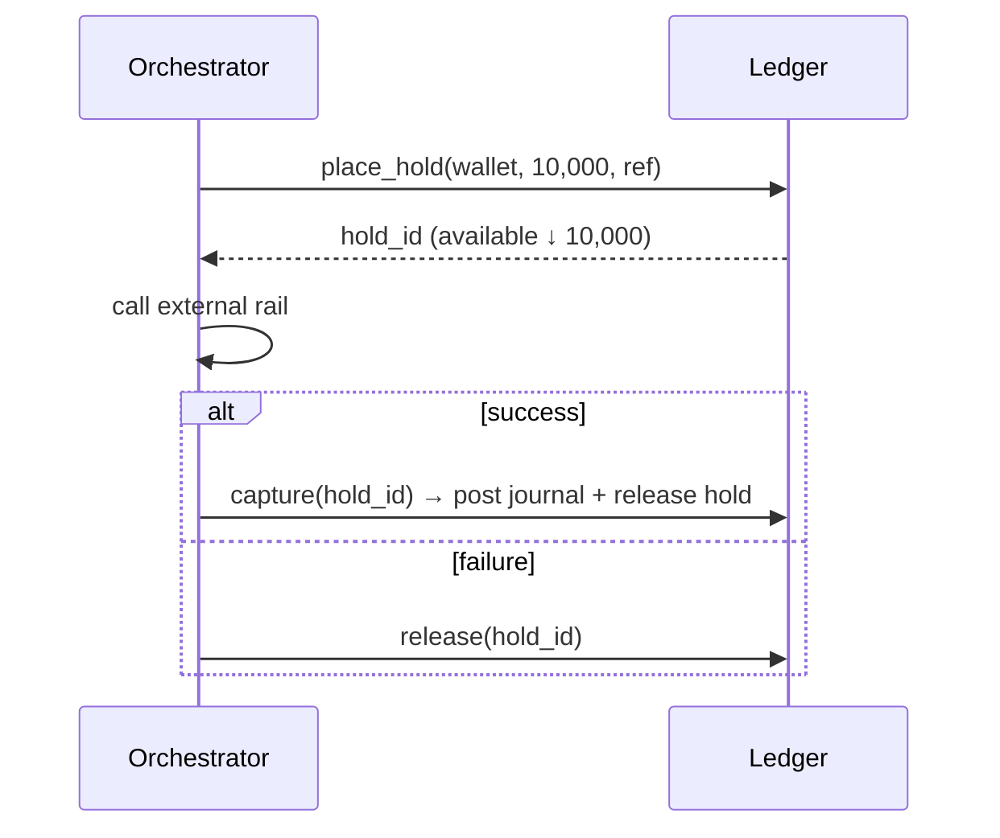

## 5.7 Pending, provisional and posted entries

| Concept | Meaning | Accounting effect |
|---|---|---|
| **Pending transaction** | Business txn not final | **None** (only a hold) |
| **Provisional (memo) entry** | Posted but flagged "may reverse" | Counts in ledger; risk-managed |
| **Posted** | Final, immutable | Counts |
| **Reversed** | Cancelled by a compensating journal | Net zero |

Use **provisional** credits sparingly (risk of reversal after the customer already spent it); define **reversibility windows** and **recovery workflows**.

## 5.8 Reversal entries & compensating transactions

- **Reversal journal** = exact mirror of an earlier journal (Dr↔Cr), linked via `reversal_of`.
- **Compensating transaction** = a *business-level* undo in a distributed workflow (saga step) — may not be an exact mirror (e.g., refund minus non-refundable fee).
- **Rules:** (1) never mutate the original; (2) enforce *max one reversal per journal*; (3) reversal posts in the **current open period** (not back in the closed one) unless policy allows; (4) record reason code + approver.

## 5.9 Idempotency & duplicate prevention

- **Idempotency** = repeating the same request produces the **same effect once**. Essential because networks retry.
- **Idempotency key** = client-supplied unique string per *intended* operation.
- **Mechanism:** `UNIQUE(idempotency_key)` on the journal (or a request table). On conflict, return the **original** result.
- **Also guard:** the same payload with a *different* key (accidental duplicate by user) → business duplicate detection (same payer, payee, amount within N seconds).
- **Pitfall:** check-then-insert is racy. Use **insert-first with unique constraint** and handle `IntegrityError`.
- **Store request fingerprint** (hash of payload) with the key: same key + different payload = **error**, not a replay.

## 5.10 References and correlation IDs

| ID | Purpose | Scope |
|---|---|---|
| **Transaction ID** | Business transaction | XPay-generated |
| **Journal ID / number** | Accounting entry | Ledger-generated (sequential number for audit + UUID) |
| **Idempotency key** | De-dupe | Client/orchestrator |
| **Correlation ID** | Trace one logical flow across services/logs | Propagated via headers (`X-Correlation-Id`) |
| **External/partner reference** | Bank/biller/RRN | Partner-generated; store as received |
| **Parent/original ID** | Reversal/refund linkage | Internal |

## 5.11 Delivery semantics: at-most-once, at-least-once, exactly-once

| Semantics | Behavior | Reality |
|---|---|---|
| At-most-once | Never duplicates, may lose | Unacceptable for money |
| **At-least-once** | Never loses, may duplicate | What queues/networks actually give |
| **Exactly-once (effect)** | Each effect applied once | **Achieved** = at-least-once delivery + **idempotent consumers** + atomic state |

> There is no "magic exactly-once" across independent systems. You **build** exactly-once *effects* with idempotency keys, unique constraints, and the transactional outbox/inbox patterns.

**Inbox pattern (consumer side):** store processed message IDs in the same DB transaction that applies the effect; if the message arrives again, skip.

## 5.12 Phase 5 mistakes & best practices

| Mistake | Best practice |
|---|---|
| Posting before external confirmation without a pending model | Hold → external → capture/release |
| Treating timeout as failure | `UNKNOWN` state + status inquiry + reconcile |
| Retrying without idempotency | Key on every money-moving API |
| Sending SMS inside the DB transaction | Outbox → async notification |
| Letting UI "balance" come from a cache without invalidation | Single balance authority; cache is derived and versioned |

### Exercises
1. Draw the state flow and entries for wallet→bank transfer when the bank times out; then the inquiry says "success".
2. Write the unique constraints needed for idempotency on `POST /v1/journals`.
3. Explain why notifications must not be inside the posting transaction.

---

# Phase 6 — MFS Operators, Banks & Bangladesh Payment Infrastructure

> **[BD-PUBLIC] caution:** rail names and broad roles below are public knowledge; cut-off times, fees, limits and eligibility change — always confirm on Bangladesh Bank / scheme documentation. Nothing here describes any provider's confidential bank arrangements.

## 6.1 Why MFS operators need banks

- An MFS operator holds **e-money liabilities** to customers. The **real money** backing them sits in **bank accounts**.
- In Bangladesh, MFS is generally provided by **bank-owned subsidiaries or bank-led structures** under Bangladesh Bank's MFS regulatory framework [BD-PUBLIC; VERIFY current regulation and licensing model]. Funds equal to outstanding e-money are generally required to be held with banks in designated accounts [VERIFY exact requirement].
- Banks provide: account holding, interbank rails access, settlement, cash handling (for float purchase/redemption), card/NPSB connectivity.

## 6.2 The three layers of money (never confuse them)

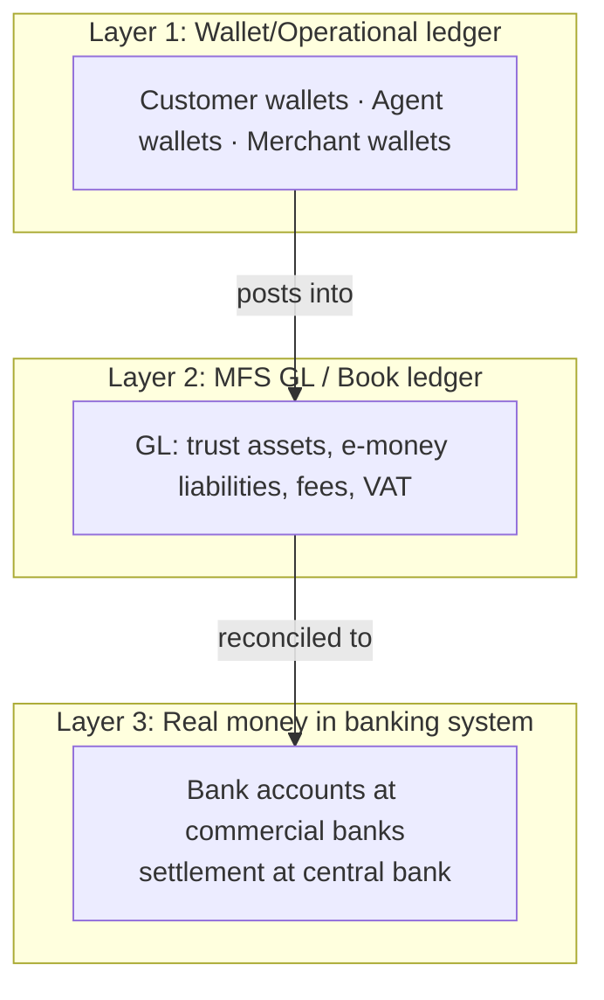

| Layer | What moves | Speed | Reversibility |
|---|---|---|---|
| Wallet/book transfer (internal) | Ledger entries only | Instant | Reversible by journal |
| Bank-account movement | Real deposits at a bank | Minutes–days depending on rail | Rail rules (returns, disputes) |
| Central-bank settlement | Banks' balances at central bank | Per scheme cycle | Final per scheme rules |

## 6.3 Internal book transfer vs actual fund movement

- **Book transfer:** Rahim → Karim inside XPay. Only **liability sub-accounts change**; **no bank movement**. Instant and free of interbank cost.
- **Actual movement:** wallet → another bank's account. Value must travel via a **rail**; at some point **the MFS's bank account is debited** and the beneficiary bank is credited.
- **Therefore:** most MFS volume (P2P, cash-in/out between wallets/agents) is *book-only*; **bank movements only happen at the edges** (add money, withdraw to bank, settlement to merchants/billers, float purchase/redemption).

## 6.4 Trust / safeguarding (collection) accounts

- **What:** dedicated bank account(s) holding customers' funds, kept separate from the operator's own operating funds.
- **Why:** protect customers if the operator fails; satisfy regulators.
- **How the ledger models it:** `1010 Trust A/C` (asset) vs `2010..2040` (liabilities). Daily test: `balance(1010) ≥ Σ e-money liabilities (+ amounts owed to partners as per policy)`.
- **Sweeps:** fee income and VAT sit physically in the trust account until the operator **sweeps** them to operating/tax accounts:

| Journal | Dr | Cr | Amount |
|---|---|---|---|
| Sweep earned fees to operating | 1020 Operating A/C | 1010 Trust A/C | 41.25 |
| Pay VAT to authority (bank payment) | 2300 VAT payable | 1020 Operating A/C | 7.69 |

- **Interest on trust funds** (if any) has regulatory/treatment rules [VERIFY]; model as a distinct income account and a clear policy on who benefits.

## 6.5 Money flows in detail

### 6.5.1 Bank → MFS (Add Money / agent float purchase)

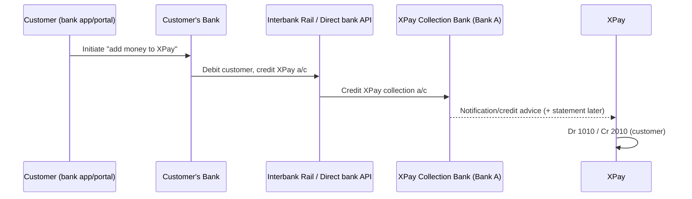
**Rule:** the customer's wallet credit should rest on a **confirmed** credit advice (or a risk-approved provisional credit). Missing confirmation but arrived money → **suspense** (Dr 1010 / Cr 2900) until matched.

### 6.5.2 MFS → Bank (Withdraw to bank)
See §4.10. Debit wallet immediately → in-transit liability → rail → bank settlement → clear in-transit.

### 6.5.3 Interbank (Bank X ↔ Bank Y) — context
MFS operators are *not* parties to every interbank transfer; they are **participants** or use a **sponsor/partner bank** to connect to rails. Interbank settlement between banks happens at the **central bank** (accounts of banks held at Bangladesh Bank [BD-PUBLIC]).

## 6.6 Bangladesh payment infrastructure [BD-PUBLIC — verify details]

| Infrastructure | Broad role | Nature | Typical use in MFS context |
|---|---|---|---|
| **NPSB** (National Payment Switch Bangladesh) | Interbank switch for **real-time** retail transfers/ATM/POS routing among participating banks/institutions | Real-time switching, then net settlement | Wallet↔bank instant transfers, card/ATM routing where connected |
| **BEFTN** (Bangladesh Electronic Funds Transfer Network) | Batch-based **ACH**-style credit/debit transfers (salary, bill, bulk, recurring) | Batch, clearing cycles | Bulk payouts, merchant settlement to bank, utility collections |
| **RTGS** | High-value, **real-time gross settlement** at central bank | Per-transaction gross settlement | Large treasury/inter-bank liquidity movement |
| **BACPS** | Cheque processing/clearing | Batch | Cheque-based deposits |
| **Binimoy** (interoperable digital transaction platform, IDTP) | Interoperability between banks and MFS/PSPs for digital transfers [VERIFY scope/status] | Real-time interoperable | Cross-provider wallet/bank interoperability |
| **Bangla QR** | National QR standard for merchant payments | QR payload standard | Merchant payments interoperable across schemes [VERIFY] |

**Concept primer:**
- **Clearing** = exchanging and *validating/netting* payment instructions between institutions.
- **Settlement** = the **final transfer of funds** that discharges the obligations (usually across accounts at the central bank).
- **Gross vs net settlement:** RTGS = gross (each payment individually); batch systems/switches often use **multilateral net** positions.
- **Real-time retail with deferred settlement:** a customer sees money move *instantly*, but interbank **settlement** completes later in a cycle → the **participants carry credit/settlement risk** in between (hence prefunding/limits at participants).

### 6.6.1 Clearing & settlement cycles — how to model them
You do not hard-code scheme times; you **configure** them (`rail`, `cutoff_time`, `settlement_lag_days`, `business_calendar`, `holiday_calendar`). The ledger models cycles as:

```
T (initiation)  → in-transit / clearing account
T+n (settlement) → bank account debited/credited → clear in-transit
```

## 6.7 Nostro / Vostro (where relevant)

- **Nostro** ("ours, held at you"): *our* account **held at another bank** (e.g., XPay's / a bank's account at a correspondent bank).
- **Vostro** ("yours, held at us"): *another institution's* account **held at our bank**.
- Same account, two viewpoints. In MFS context: if a bank holds XPay's trust account, from XPay's view it's a **bank account (asset)** and from the bank's view XPay is a **customer deposit (liability)** — conceptually *vostro-like* for correspondent arrangements. Strict nostro/vostro terminology is more common for **correspondent banking and cross-border** flows (e.g., remittances in foreign currency), including **FX**.
- **Ledger rule:** each nostro is a GL asset account **per bank per currency**, reconciled against the correspondent's statements (e.g., MT940/camt.053 statements in cross-border environments [GENERAL]).

## 6.8 Reconciliation types

| Reconciliation | Compares | Frequency | Breaks mean |
|---|---|---|---|
| **Bank reconciliation** | GL bank account (1010/1020/1030) vs bank statement | Daily | Missing/duplicate/late items, fees, errors |
| **Settlement reconciliation** | Internal settlement records vs rail/switch/partner settlement file | Daily/per cycle | Disputed/failed transfers |
| **Wallet-to-GL (control) reconciliation** | Σ wallet balances vs GL control | Continuous/daily | Posting/engine bug |
| **Partner reconciliation** | XPay txn log vs biller/telco report | Daily | Missed ACK, status mismatch |
| **Trust-coverage reconciliation** | Trust balance vs e-money liabilities | Daily | Safeguarding shortfall |
| **Suspense aging** | Open items by age | Daily | Operational backlog |

**Matching keys (priority):** (1) unique external reference (RRN/bank ref), (2) amount + date + counterparty, (3) fuzzy rules (tolerance ± window), (4) manual.

## 6.9 Example — a day's bank reconciliation (illustrative)

| | Amount |
|---|---|
| Bank statement closing balance (Bank A trust) | 1,205,000.00 |
| + Deposits in transit (booked by XPay, not yet on statement) | 30,000.00 |
| − Withdrawals in transit (booked, bank not yet debited) | (12,500.00) |
| − Bank charges on statement not yet booked | (250.00) |
| + Interest on statement not yet booked | 100.00 |
| **= Adjusted bank balance** | **1,222,350.00** |
| GL 1010 balance (before booking charges/interest) | 1,222,500.00 |
| − Bank charges to book | (250.00) |
| + Interest to book | 100.00 |
| **= Adjusted GL balance** | **1,222,350.00** ✔ matches |

**Follow-up journals:** Dr 5030 Bank charges 250 / Cr 1010 250; Dr 1010 100 / Cr 4xxx Interest income (or per trust-interest policy) 100.

## 6.10 Phase 6 mistakes & best practices

| Mistake | Best practice |
|---|---|
| Thinking a wallet debit means money left the bank | Track **in-transit/clearing** until bank confirms |
| Hard-coded rail rules (cut-offs, calendars) | Configurable rail profiles |
| Ignoring bank charges/interest | Book from statements daily |
| No trust-coverage report | Daily automated coverage check with alerts |
| Matching by amount only | Reference-first, multi-key matching |

### Exercises
1. A customer's bank shows debit success; XPay shows nothing. Describe the suspense lifecycle and journals until resolved.
2. Prepare the reconciliation if the bank statement shows a duplicate credit of Tk 5,000.
3. Explain why an instant wallet→bank transfer can be "instant" for the customer but settled hours/days later between banks.


---

# Phase 7 — GL Architecture & Implementation (Software Engineering)

## 7.1 Architecture overview

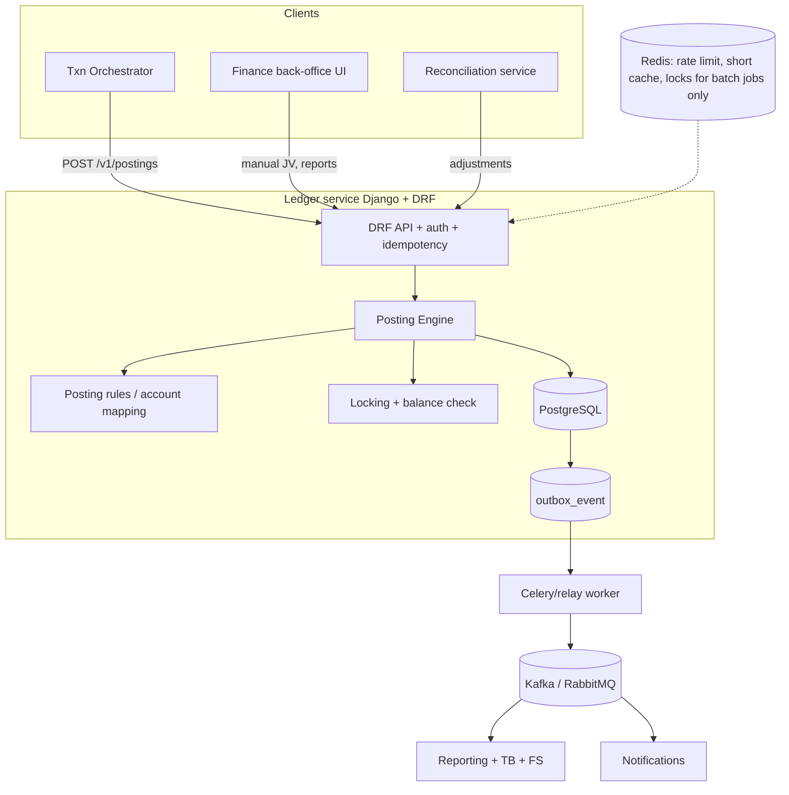

**Design principles**
1. **PostgreSQL is the system of record.** Redis never holds financial truth.
2. **One DB transaction = one journal** (header, lines, balance updates, hold changes, outbox rows).
3. **Append-only journal**; balances are a derived cache updated atomically.
4. **Deterministic lock ordering** to avoid deadlocks.
5. **Idempotent by construction** (unique keys).
6. **Money = `NUMERIC` / `Decimal`**, never float.

## 7.2 Domain model (ER diagram)

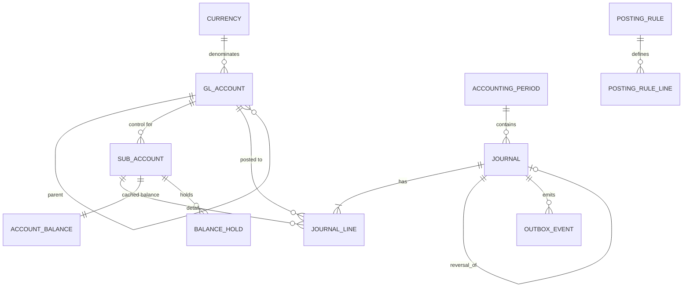

## 7.3 PostgreSQL schema (DDL)

```sql
-- Extensions
CREATE EXTENSION IF NOT EXISTS pgcrypto;   -- gen_random_uuid()

CREATE TABLE currency (
  code        char(3) PRIMARY KEY,           -- ISO 4217, e.g. 'BDT'
  minor_units smallint NOT NULL CHECK (minor_units BETWEEN 0 AND 6)
);

CREATE TYPE account_type AS ENUM ('ASSET','LIABILITY','EQUITY','REVENUE','EXPENSE');
CREATE TYPE entry_side   AS ENUM ('D','C');

CREATE TABLE gl_account (
  id              bigserial PRIMARY KEY,
  code            varchar(20) NOT NULL UNIQUE,
  name            varchar(200) NOT NULL,
  account_type    account_type NOT NULL,
  normal_side     entry_side   NOT NULL,
  parent_id       bigint REFERENCES gl_account(id),
  is_postable     boolean NOT NULL DEFAULT true,      -- leaves only
  is_control      boolean NOT NULL DEFAULT false,
  allow_manual    boolean NOT NULL DEFAULT true,
  currency_code   char(3) NOT NULL REFERENCES currency(code),
  owner_team      varchar(80),
  status          varchar(12) NOT NULL DEFAULT 'ACTIVE',
  valid_from      date NOT NULL DEFAULT current_date,
  valid_to        date,
  CHECK (normal_side = CASE WHEN account_type IN ('ASSET','EXPENSE') THEN 'D'::entry_side ELSE 'C'::entry_side END),
  CHECK (NOT (is_control AND allow_manual))           -- control accounts never manual
);

CREATE TABLE sub_account (          -- wallets, agents, merchants, etc.
  id            bigserial PRIMARY KEY,
  gl_account_id bigint NOT NULL REFERENCES gl_account(id),
  owner_type    varchar(20) NOT NULL,   -- CUSTOMER/AGENT/MERCHANT/DISTRIBUTOR/PARTNER
  owner_ref     varchar(64) NOT NULL,   -- external id (wallet id)
  currency_code char(3) NOT NULL REFERENCES currency(code),
  status        varchar(12) NOT NULL DEFAULT 'ACTIVE',
  allow_negative boolean NOT NULL DEFAULT false,
  created_at    timestamptz NOT NULL DEFAULT now(),
  UNIQUE (gl_account_id, owner_type, owner_ref, currency_code)
);

CREATE TABLE accounting_period (
  id          bigserial PRIMARY KEY,
  code        varchar(10) NOT NULL UNIQUE,   -- '2026-11'
  start_date  date NOT NULL,
  end_date    date NOT NULL,
  status      varchar(12) NOT NULL DEFAULT 'OPEN',  -- OPEN/SOFT_CLOSED/CLOSED
  CHECK (end_date >= start_date)
);

CREATE TABLE journal (
  id               uuid PRIMARY KEY DEFAULT gen_random_uuid(),
  journal_no       bigint GENERATED ALWAYS AS IDENTITY UNIQUE,  -- gap-tolerant audit number
  idempotency_key  varchar(100) NOT NULL UNIQUE,
  request_hash     char(64) NOT NULL,
  txn_ref          varchar(64) NOT NULL,           -- business transaction id
  correlation_id   varchar(64),
  external_ref     varchar(100),
  journal_type     varchar(30) NOT NULL,           -- CASH_OUT, SEND_MONEY, MANUAL_JV, ...
  source_system    varchar(30) NOT NULL,
  status           varchar(12) NOT NULL DEFAULT 'POSTED', -- POSTED / REVERSED
  posting_date     date NOT NULL,                  -- business date
  period_id        bigint NOT NULL REFERENCES accounting_period(id),
  description      text,
  reversal_of_id   uuid UNIQUE REFERENCES journal(id), -- UNIQUE ⇒ max one reversal
  created_by       varchar(80) NOT NULL,
  approved_by      varchar(80),
  created_at       timestamptz NOT NULL DEFAULT now(),
  rule_version     varchar(20)
);

CREATE TABLE journal_line (
  id             bigserial PRIMARY KEY,
  journal_id     uuid NOT NULL REFERENCES journal(id),
  line_no        smallint NOT NULL,
  gl_account_id  bigint NOT NULL REFERENCES gl_account(id),
  sub_account_id bigint REFERENCES sub_account(id),
  side           entry_side NOT NULL,
  amount         numeric(20,4) NOT NULL CHECK (amount > 0),
  currency_code  char(3) NOT NULL REFERENCES currency(code),
  base_amount    numeric(20,4) NOT NULL CHECK (base_amount > 0),   -- in functional currency (BDT)
  fx_rate        numeric(18,8) NOT NULL DEFAULT 1,
  branch_code    varchar(20),
  cost_center    varchar(20),
  product_code   varchar(30),
  channel        varchar(20),
  counterparty   varchar(40),
  memo           varchar(200),
  UNIQUE (journal_id, line_no)
);
CREATE INDEX jl_gl_date_idx  ON journal_line (gl_account_id, journal_id);
CREATE INDEX jl_sub_idx      ON journal_line (sub_account_id, id);
CREATE INDEX jl_journal_idx  ON journal_line (journal_id);
CREATE INDEX j_postdate_idx  ON journal (posting_date, id);
CREATE INDEX j_txnref_idx    ON journal (txn_ref);
CREATE INDEX j_corr_idx      ON journal (correlation_id);

-- Cached balances (derived, but atomically maintained)
CREATE TABLE account_balance (
  sub_account_id  bigint PRIMARY KEY REFERENCES sub_account(id),
  ledger_balance  numeric(20,4) NOT NULL DEFAULT 0,   -- credit-positive for liabilities
  held_amount     numeric(20,4) NOT NULL DEFAULT 0 CHECK (held_amount >= 0),
  version         bigint NOT NULL DEFAULT 0,
  last_journal_id uuid,
  updated_at      timestamptz NOT NULL DEFAULT now()
);

CREATE TABLE balance_hold (
  id             uuid PRIMARY KEY DEFAULT gen_random_uuid(),
  sub_account_id bigint NOT NULL REFERENCES sub_account(id),
  amount         numeric(20,4) NOT NULL CHECK (amount > 0),
  txn_ref        varchar(64) NOT NULL,
  status         varchar(10) NOT NULL DEFAULT 'ACTIVE',  -- ACTIVE/CAPTURED/RELEASED/EXPIRED
  expires_at     timestamptz,
  created_at     timestamptz NOT NULL DEFAULT now(),
  UNIQUE (sub_account_id, txn_ref)
);

CREATE TABLE outbox_event (
  id            bigserial PRIMARY KEY,
  aggregate_id  uuid NOT NULL,
  event_type    varchar(60) NOT NULL,
  payload       jsonb NOT NULL,
  created_at    timestamptz NOT NULL DEFAULT now(),
  published_at  timestamptz
);
CREATE INDEX outbox_unpub_idx ON outbox_event (id) WHERE published_at IS NULL;
```

### 7.3.1 Enforcing "Σ debits = Σ credits" in the database

Application validation is necessary but **not sufficient** (a bug or a manual SQL session can bypass it). Add a **deferred constraint trigger** that checks at COMMIT:

```sql
CREATE OR REPLACE FUNCTION assert_journal_balanced() RETURNS trigger AS $$
DECLARE
  bad record;
BEGIN
  SELECT currency_code,
         SUM(CASE WHEN side='D' THEN amount ELSE -amount END) AS diff
    INTO bad
    FROM journal_line
   WHERE journal_id = NEW.journal_id
   GROUP BY currency_code
  HAVING SUM(CASE WHEN side='D' THEN amount ELSE -amount END) <> 0
   LIMIT 1;
  IF FOUND THEN
    RAISE EXCEPTION 'Journal % is unbalanced in %: diff %', NEW.journal_id, bad.currency_code, bad.diff;
  END IF;

  -- base currency must also balance
  PERFORM 1 FROM journal_line WHERE journal_id = NEW.journal_id
  HAVING SUM(CASE WHEN side='D' THEN base_amount ELSE -base_amount END) <> 0;
  IF FOUND THEN
    RAISE EXCEPTION 'Journal % base amounts unbalanced', NEW.journal_id;
  END IF;
  RETURN NULL;
END $$ LANGUAGE plpgsql;

CREATE CONSTRAINT TRIGGER trg_journal_balanced
AFTER INSERT ON journal_line
DEFERRABLE INITIALLY DEFERRED
FOR EACH ROW EXECUTE FUNCTION assert_journal_balanced();
```
> Multi-currency note: *per-currency balance* plus *base-currency balance* will generally not both be zero when FX gain/loss lines are required. Real designs add an explicit FX gain/loss line so both tests pass (see §8.8). In a single-currency BDT ledger the first check suffices.

### 7.3.2 Immutability (append-only) enforcement

```sql
CREATE OR REPLACE FUNCTION forbid_mutation() RETURNS trigger AS $$
BEGIN
  RAISE EXCEPTION 'Ledger rows are immutable (% on %)', TG_OP, TG_TABLE_NAME;
END $$ LANGUAGE plpgsql;

CREATE TRIGGER trg_jl_immutable BEFORE UPDATE OR DELETE ON journal_line
FOR EACH ROW EXECUTE FUNCTION forbid_mutation();

-- journal: allow ONLY status POSTED -> REVERSED
CREATE OR REPLACE FUNCTION journal_limited_update() RETURNS trigger AS $$
BEGIN
  IF TG_OP = 'DELETE' THEN RAISE EXCEPTION 'journal rows cannot be deleted'; END IF;
  IF (NEW.status = 'REVERSED' AND OLD.status = 'POSTED')
     AND (to_jsonb(NEW) - 'status') = (to_jsonb(OLD) - 'status') THEN
    RETURN NEW;
  END IF;
  RAISE EXCEPTION 'journal is immutable except POSTED->REVERSED flag';
END $$ LANGUAGE plpgsql;
CREATE TRIGGER trg_j_immutable BEFORE UPDATE OR DELETE ON journal
FOR EACH ROW EXECUTE FUNCTION journal_limited_update();

-- Application DB role: INSERT/SELECT only on journal_line; no UPDATE/DELETE grants.
REVOKE UPDATE, DELETE, TRUNCATE ON journal_line FROM ledger_app;
```

## 7.4 Django models (core)

```python
# ledger/models.py
import uuid
from decimal import Decimal
from django.db import models
from django.db.models import Q, F, CheckConstraint, UniqueConstraint


class Side(models.TextChoices):
    DEBIT = "D", "Debit"
    CREDIT = "C", "Credit"


class AccountType(models.TextChoices):
    ASSET = "ASSET"
    LIABILITY = "LIABILITY"
    EQUITY = "EQUITY"
    REVENUE = "REVENUE"
    EXPENSE = "EXPENSE"


class Currency(models.Model):
    code = models.CharField(max_length=3, primary_key=True)
    minor_units = models.PositiveSmallIntegerField(default=2)


class GLAccount(models.Model):
    code = models.CharField(max_length=20, unique=True)
    name = models.CharField(max_length=200)
    account_type = models.CharField(max_length=10, choices=AccountType.choices)
    normal_side = models.CharField(max_length=1, choices=Side.choices)
    parent = models.ForeignKey("self", null=True, blank=True, on_delete=models.PROTECT, related_name="children")
    is_postable = models.BooleanField(default=True)
    is_control = models.BooleanField(default=False)
    allow_manual = models.BooleanField(default=True)
    currency = models.ForeignKey(Currency, on_delete=models.PROTECT)
    status = models.CharField(max_length=12, default="ACTIVE")

    class Meta:
        constraints = [
            CheckConstraint(check=~Q(is_control=True, allow_manual=True), name="control_not_manual"),
        ]

    def increases_with(self) -> str:
        return self.normal_side


class SubAccount(models.Model):
    gl_account = models.ForeignKey(GLAccount, on_delete=models.PROTECT, related_name="sub_accounts")
    owner_type = models.CharField(max_length=20)
    owner_ref = models.CharField(max_length=64)
    currency = models.ForeignKey(Currency, on_delete=models.PROTECT)
    status = models.CharField(max_length=12, default="ACTIVE")
    allow_negative = models.BooleanField(default=False)

    class Meta:
        constraints = [
            UniqueConstraint(fields=["gl_account", "owner_type", "owner_ref", "currency"], name="uniq_sub_account"),
        ]


class AccountingPeriod(models.Model):
    code = models.CharField(max_length=10, unique=True)
    start_date = models.DateField()
    end_date = models.DateField()
    status = models.CharField(max_length=12, default="OPEN")


class Journal(models.Model):
    id = models.UUIDField(primary_key=True, default=uuid.uuid4, editable=False)
    journal_no = models.BigAutoField(unique=True)  # NOTE: use IDENTITY via migration if preferred
    idempotency_key = models.CharField(max_length=100, unique=True)
    request_hash = models.CharField(max_length=64)
    txn_ref = models.CharField(max_length=64, db_index=True)
    correlation_id = models.CharField(max_length=64, blank=True, db_index=True)
    journal_type = models.CharField(max_length=30)
    source_system = models.CharField(max_length=30)
    status = models.CharField(max_length=12, default="POSTED")
    posting_date = models.DateField(db_index=True)
    period = models.ForeignKey(AccountingPeriod, on_delete=models.PROTECT)
    description = models.TextField(blank=True)
    reversal_of = models.OneToOneField("self", null=True, blank=True, on_delete=models.PROTECT, related_name="reversed_by")
    created_by = models.CharField(max_length=80)
    approved_by = models.CharField(max_length=80, blank=True)
    created_at = models.DateTimeField(auto_now_add=True)
    rule_version = models.CharField(max_length=20, blank=True)


class JournalLine(models.Model):
    journal = models.ForeignKey(Journal, on_delete=models.PROTECT, related_name="lines")
    line_no = models.PositiveSmallIntegerField()
    gl_account = models.ForeignKey(GLAccount, on_delete=models.PROTECT)
    sub_account = models.ForeignKey(SubAccount, null=True, blank=True, on_delete=models.PROTECT)
    side = models.CharField(max_length=1, choices=Side.choices)
    amount = models.DecimalField(max_digits=20, decimal_places=4)
    currency = models.ForeignKey(Currency, on_delete=models.PROTECT)
    base_amount = models.DecimalField(max_digits=20, decimal_places=4)
    fx_rate = models.DecimalField(max_digits=18, decimal_places=8, default=Decimal("1"))
    branch_code = models.CharField(max_length=20, blank=True)
    cost_center = models.CharField(max_length=20, blank=True)
    product_code = models.CharField(max_length=30, blank=True)
    channel = models.CharField(max_length=20, blank=True)
    counterparty = models.CharField(max_length=40, blank=True)
    memo = models.CharField(max_length=200, blank=True)

    class Meta:
        constraints = [
            CheckConstraint(check=Q(amount__gt=0), name="jl_amount_positive"),
            UniqueConstraint(fields=["journal", "line_no"], name="uniq_journal_line_no"),
        ]
        indexes = [
            models.Index(fields=["gl_account", "journal"], name="jl_gl_journal_idx"),
            models.Index(fields=["sub_account", "id"], name="jl_sub_id_idx"),
        ]

    def save(self, *args, **kwargs):          # app-level immutability (DB triggers are the real guard)
        if self.pk:
            raise RuntimeError("JournalLine is immutable")
        super().save(*args, **kwargs)

    def delete(self, *args, **kwargs):
        raise RuntimeError("JournalLine cannot be deleted")


class AccountBalance(models.Model):
    sub_account = models.OneToOneField(SubAccount, primary_key=True, on_delete=models.PROTECT)
    ledger_balance = models.DecimalField(max_digits=20, decimal_places=4, default=0)  # credit-positive for CREDIT-normal accounts
    held_amount = models.DecimalField(max_digits=20, decimal_places=4, default=0)
    version = models.BigIntegerField(default=0)
    last_journal_id = models.UUIDField(null=True)
    updated_at = models.DateTimeField(auto_now=True)

    class Meta:
        constraints = [CheckConstraint(check=Q(held_amount__gte=0), name="held_non_negative")]

    @property
    def available(self):
        return self.ledger_balance - self.held_amount


class BalanceHold(models.Model):
    id = models.UUIDField(primary_key=True, default=uuid.uuid4, editable=False)
    sub_account = models.ForeignKey(SubAccount, on_delete=models.PROTECT)
    amount = models.DecimalField(max_digits=20, decimal_places=4)
    txn_ref = models.CharField(max_length=64)
    status = models.CharField(max_length=10, default="ACTIVE")
    expires_at = models.DateTimeField(null=True, blank=True)
    created_at = models.DateTimeField(auto_now_add=True)

    class Meta:
        constraints = [UniqueConstraint(fields=["sub_account", "txn_ref"], name="uniq_hold_per_txn")]


class OutboxEvent(models.Model):
    aggregate_id = models.UUIDField()
    event_type = models.CharField(max_length=60)
    payload = models.JSONField()
    created_at = models.DateTimeField(auto_now_add=True)
    published_at = models.DateTimeField(null=True, blank=True)
```

**Balance sign convention (pick one and document it).** For a wallet (liability, credit-normal): `ledger_balance += amount` on **Cr**, `−= amount` on **Dr**. For a debit-normal sub-account (e.g., receivable): reverse. Helper:

```python
def signed_delta(account_normal_side: str, line_side: str, amount: Decimal) -> Decimal:
    """Positive = balance moves in the account's normal direction."""
    return amount if account_normal_side == line_side else -amount
```

## 7.5 Money, `Decimal` and rounding

- **Never** `float`. Use `Decimal` created from **strings** (`Decimal("0.1")`), not floats.
- Store with **4 decimal places** (`numeric(20,4)`) for internal precision; **round to currency minor units (2 for BDT)** at *defined points* (fee computation, customer-visible amounts).
- Choose and document **rounding mode** (`ROUND_HALF_UP` is common for fees; banks sometimes use `ROUND_HALF_EVEN` "banker's rounding") — **a policy decision, not a coding preference**.

```python
from decimal import Decimal, ROUND_HALF_UP, getcontext
getcontext().prec = 28

TWO = Decimal("0.01")

def money(x: Decimal) -> Decimal:
    return x.quantize(TWO, rounding=ROUND_HALF_UP)

def fee_with_vat(amount: Decimal, fee_rate: Decimal, vat_rate: Decimal):
    fee = money(amount * fee_rate)           # 2500 * 0.0185 = 46.25
    vat = money(fee * vat_rate)              # 46.25 * 0.15 = 6.9375 -> 6.94
    return fee, vat, amount + fee + vat      # (46.25, 6.94, 2553.19)

assert fee_with_vat(Decimal("2500"), Decimal("0.0185"), Decimal("0.15")) == (
    Decimal("46.25"), Decimal("6.94"), Decimal("2553.19"))
```

**Allocation without losing a paisa — largest remainder method** (splitting a fee among parties):

```python
def allocate(total: Decimal, ratios: list[Decimal], places=Decimal("0.01")) -> list[Decimal]:
    s = sum(ratios)
    raw = [total * r / s for r in ratios]
    base = [x.quantize(places, rounding="ROUND_DOWN") for x in raw]
    remainder = total - sum(base)
    units = int(remainder / places)
    order = sorted(range(len(raw)), key=lambda i: raw[i] - base[i], reverse=True)
    for i in order[:units]:
        base[i] += places
    assert sum(base) == total
    return base
```

## 7.6 Posting rules & the account-mapping engine

- **Posting rule** = declarative template mapping a *transaction type + attributes* to journal lines.
- **Account mapping engine** = resolves symbolic roles (`PAYER_WALLET`, `AGENT_WALLET`, `FEE_INCOME`) to concrete GL/sub accounts using transaction context (product, channel, partner, currency).
- **Why declarative:** finance can review/version rules; engineers don't hard-code `if txn_type == ...` everywhere.

**Rule definition (JSON/YAML in DB, versioned, effective-dated):**

```json
{
  "rule_code": "CASH_OUT",
  "version": "2026.11.1",
  "effective_from": "2026-11-01",
  "lines": [
    {"side": "D", "account_role": "PAYER_WALLET",  "amount": "$gross"},
    {"side": "C", "account_role": "AGENT_WALLET",  "amount": "$principal"},
    {"side": "C", "gl": "4010", "amount": "$fee_net"},
    {"side": "C", "gl": "2300", "amount": "$vat"}
  ],
  "dimensions": {"product": "CASH_OUT", "channel": "$channel"}
}
```

**Engine pseudocode:**

```python
def build_journal(request) -> list[LineSpec]:
    rule = rules.active(request.journal_type, request.posting_date)       # versioned
    ctx  = {**request.amounts, **request.attributes}                     # $gross, $fee_net, ...
    lines = []
    for spec in rule.lines:
        gl, sub = mapper.resolve(spec, request)                          # role -> accounts
        amt = Decimal(eval_amount(spec.amount, ctx))
        lines.append(LineSpec(gl, sub, spec.side, amt, request.currency, dims(spec, ctx)))
    assert_balanced(lines)                                               # fail before DB
    return lines
```

**Never** let a client send arbitrary GL accounts for production (customer-facing) transaction types — only *roles and amounts*. Arbitrary accounts are allowed **only** for **manual JVs** behind maker-checker.

## 7.7 The posting engine — core algorithm

```mermaid
flowchart TB
  S([Receive PostingRequest]) --> V1[Validate schema + amounts + currency]
  V1 --> ID[Idempotency: INSERT journal with unique key]
  ID -->|conflict| RET[Return stored result / 409 if hash differs]
  ID --> PER[Check period OPEN for posting_date]
  PER --> BLD[Build lines from rule + mapping]
  BLD --> BAL[Assert Σ Dr = Σ Cr per currency]
  BAL --> LK[Lock affected balance rows ordered by sub_account_id]
  LK --> CHK[Check availability/negative rules/limits at lock time]
  CHK --> INS[bulk_create journal_lines]
  INS --> UPD[Update account_balance (+version)]
  UPD --> OB[Insert outbox events]
  OB --> C([COMMIT])
```

**Implementation:**

```python
# ledger/services/posting.py
import hashlib, json
from dataclasses import dataclass
from decimal import Decimal
from django.db import transaction, IntegrityError
from django.db.models import F
from .models import (Journal, JournalLine, AccountBalance, SubAccount, GLAccount,
                     AccountingPeriod, OutboxEvent, BalanceHold, Side)

class LedgerError(Exception): ...
class InsufficientFunds(LedgerError): ...
class PeriodClosed(LedgerError): ...
class IdempotencyConflict(LedgerError): ...
class Unbalanced(LedgerError): ...

@dataclass(frozen=True)
class LineSpec:
    gl_account_id: int
    sub_account_id: int | None
    side: str                 # 'D' | 'C'
    amount: Decimal
    currency: str
    base_amount: Decimal | None = None
    dims: dict | None = None
    memo: str = ""

def _hash(payload: dict) -> str:
    return hashlib.sha256(json.dumps(payload, sort_keys=True, default=str).encode()).hexdigest()

def assert_balanced(lines: list[LineSpec]):
    totals = {}
    for l in lines:
        totals.setdefault(l.currency, Decimal("0"))
        totals[l.currency] += l.amount if l.side == "D" else -l.amount
    if any(v != 0 for v in totals.values()):
        raise Unbalanced(totals)

@transaction.atomic
def post_journal(*, idempotency_key, txn_ref, journal_type, posting_date, lines: list[LineSpec],
                 created_by, source_system, correlation_id="", description="",
                 hold_id=None, reversal_of=None) -> Journal:

    assert_balanced(lines)
    req_hash = _hash({"txn_ref": txn_ref, "type": journal_type, "date": str(posting_date),
                      "lines": [(l.gl_account_id, l.sub_account_id, l.side, str(l.amount), l.currency) for l in lines]})

    # 1) Idempotency: insert-first; unique key decides
    try:
        with transaction.atomic():                        # savepoint so we can recover from IntegrityError
            period = AccountingPeriod.objects.get(start_date__lte=posting_date, end_date__gte=posting_date)
            if period.status != "OPEN":
                raise PeriodClosed(period.code)
            journal = Journal.objects.create(
                idempotency_key=idempotency_key, request_hash=req_hash, txn_ref=txn_ref,
                correlation_id=correlation_id, journal_type=journal_type, source_system=source_system,
                posting_date=posting_date, period=period, description=description,
                created_by=created_by, reversal_of=reversal_of)
    except IntegrityError:
        existing = Journal.objects.get(idempotency_key=idempotency_key)
        if existing.request_hash != req_hash:
            raise IdempotencyConflict("Same key, different payload")
        return existing                                    # safe replay

    # 2) Lock balance rows in a deterministic order (avoid deadlocks)
    sub_ids = sorted({l.sub_account_id for l in lines if l.sub_account_id})
    balances = {b.sub_account_id: b for b in
                AccountBalance.objects.select_for_update().filter(sub_account_id__in=sub_ids).order_by("sub_account_id")}
    subs = {s.id: s for s in SubAccount.objects.select_related("gl_account").filter(id__in=sub_ids)}

    # 3) Apply effects + checks under lock
    deltas = {}
    for l in lines:
        if not l.sub_account_id:
            continue
        sub = subs[l.sub_account_id]
        sign = Decimal(1) if sub.gl_account.normal_side == l.side else Decimal(-1)
        deltas[l.sub_account_id] = deltas.get(l.sub_account_id, Decimal(0)) + sign * l.amount

    for sid, delta in deltas.items():
        b, sub = balances[sid], subs[sid]
        new_ledger = b.ledger_balance + delta
        if delta < 0 and not sub.allow_negative:
            # available check: when a hold backs this txn, the hold is released first
            held = b.held_amount - (_hold_amount(hold_id, sid) if hold_id else Decimal(0))
            if new_ledger - held < 0:
                raise InsufficientFunds(sid)

    # 4) Write immutable lines
    JournalLine.objects.bulk_create([
        JournalLine(journal=journal, line_no=i + 1, gl_account_id=l.gl_account_id, sub_account_id=l.sub_account_id,
                    side=l.side, amount=l.amount, currency_id=l.currency, base_amount=l.base_amount or l.amount,
                    memo=l.memo, **(l.dims or {}))
        for i, l in enumerate(lines)
    ])

    # 5) Update cached balances (atomic, same transaction)
    for sid, delta in deltas.items():
        AccountBalance.objects.filter(pk=sid).update(
            ledger_balance=F("ledger_balance") + delta, version=F("version") + 1, last_journal_id=journal.id)

    # 6) Capture hold if provided
    if hold_id:
        BalanceHold.objects.filter(pk=hold_id, status="ACTIVE").update(status="CAPTURED")
        # held_amount reduced in same transaction (omitted for brevity)

    # 7) Outbox event (published after commit by a relay)
    OutboxEvent.objects.create(aggregate_id=journal.id, event_type="journal.posted",
                               payload={"journal_id": str(journal.id), "txn_ref": txn_ref, "type": journal_type})
    return journal

def _hold_amount(hold_id, sub_id) -> Decimal:
    h = BalanceHold.objects.filter(pk=hold_id, sub_account_id=sub_id, status="ACTIVE").first()
    return h.amount if h else Decimal(0)
```

> **Teaching note:** this is deliberately compact. Production code adds: dimension validation, currency/FX line generation, per-account-type rules, max-lines guard, metrics, structured logging, and a savepoint-safe retry for serialization failures/deadlocks.

## 7.8 Balance calculation strategies

| Strategy | How | Pros | Cons | Use |
|---|---|---|---|---|
| **A. Compute on read** | `SUM(lines)` per query | Always right; simplest | Slow at scale | Small systems, reports, **verification** |
| **B. Running balance column on each line** | Each line stores `balance_after` | Fast statements | Strict serialization per account; harder to backfill | Bank-style statements |
| **C. Cached balance row (this guide)** | `account_balance` updated atomically | Fast reads/limit checks | Must stay consistent; verify with A | **Wallet systems (default)** |
| **D. Periodic snapshots + delta** | Daily closing balance + today's lines | Fast historical balance; cheap TB | Needs snapshot job | Reporting, GL TB |
| **E. Materialized aggregates by (account, date, dims)** | Rollup table | Fast GL reports | Eventual consistency | Reporting layer |

**Always keep Strategy A as the *audit oracle*:** a nightly job recomputes balances from lines and compares to cached values.

```sql
-- Drift detector: cached vs recomputed
SELECT b.sub_account_id, b.ledger_balance AS cached,
       COALESCE(SUM(CASE WHEN jl.side = g.normal_side THEN jl.amount ELSE -jl.amount END),0) AS recomputed
FROM account_balance b
JOIN sub_account sa ON sa.id = b.sub_account_id
JOIN gl_account g   ON g.id  = sa.gl_account_id
LEFT JOIN journal_line jl ON jl.sub_account_id = b.sub_account_id
GROUP BY b.sub_account_id, b.ledger_balance
HAVING b.ledger_balance <> COALESCE(SUM(CASE WHEN jl.side = g.normal_side THEN jl.amount ELSE -jl.amount END),0);
```

## 7.9 ACID, isolation levels, locking & concurrency

### 7.9.1 ACID in ledger terms
| Property | Meaning | Ledger consequence |
|---|---|---|
| **Atomicity** | All or nothing | Journal + lines + balances + outbox succeed together |
| **Consistency** | Constraints hold before/after | Balanced journals; no negative balance (where banned) |
| **Isolation** | Concurrent txns don't corrupt each other | No lost updates / double spends |
| **Durability** | Committed = survives crash | `synchronous_commit=on`, WAL, replication |

### 7.9.2 The double-spend race (why locking matters)

```
Balance 1,000.   T1: spend 800.   T2: spend 800.
Without lock: both read 1,000 → both OK → balance −600  ✗
With SELECT ... FOR UPDATE: T2 waits; reads 200 → rejects ✓
```

### 7.9.3 Pessimistic vs optimistic locking

| | **Pessimistic (`SELECT ... FOR UPDATE`)** | **Optimistic (version column)** |
|---|---|---|
| Idea | Lock rows first, then change | Read, change, write only if version unchanged |
| Contention behavior | Waits (queues) | Fails/retries |
| Best for | **Hot accounts, money debits** (high conflict) | Low-conflict updates (profile, config) |
| Django | `select_for_update()` | `.filter(pk=…, version=v).update(version=v+1, …)`; if 0 rows → retry |

```python
# Optimistic example (low contention)
updated = AccountBalance.objects.filter(pk=sid, version=expected).update(
    ledger_balance=F("ledger_balance") + delta, version=F("version") + 1)
if updated == 0:
    raise RetryableConflict()
```

**Conditional atomic update (lock-free guard)** — good for debits:

```sql
UPDATE account_balance
   SET ledger_balance = ledger_balance - :amt, version = version + 1
 WHERE sub_account_id = :id
   AND ledger_balance - held_amount >= :amt;     -- fails (0 rows) if insufficient
```

### 7.9.4 Isolation levels in PostgreSQL

| Level | Behavior | Risk | Ledger use |
|---|---|---|---|
| **READ COMMITTED** (default) | Each statement sees committed data | Non-repeatable reads, write skew | OK **with explicit row locks** |
| **REPEATABLE READ** | Snapshot for whole txn | Serialization errors on conflicting updates | Reporting snapshots (consistent TB) |
| **SERIALIZABLE** | Behaves as if serial; may abort | Retries needed | Critical invariants across rows (rare; costs throughput) |

**Practical rule:** use READ COMMITTED + **row locks on balances** for postings; use **REPEATABLE READ (read-only)** for trial balance/reports so they see one consistent snapshot.

### 7.9.5 Deadlock avoidance
1. Lock rows in **one global order** (e.g., ascending `sub_account_id`).
2. Keep transactions **short** (no network calls inside).
3. Retry on `deadlock_detected` / `serialization_failure` with jittered backoff.
4. For **hot accounts** (fee income, VAT, bank), **avoid per-transaction updates** — see §7.10.

### 7.9.6 Django specifics
- `transaction.atomic()` for scope; `select_for_update(nowait=True | skip_locked=True)` where appropriate; set `ATOMIC_REQUESTS=False` for ledger endpoints and be explicit.
- `select_for_update()` only works **inside** a transaction.
- Use `F()` expressions for arithmetic **in SQL**, not Python read-modify-write.

## 7.10 High-volume posting strategies

| Problem | Technique |
|---|---|
| **Hot accounts** (every txn credits fee income/VAT/bank) cause lock contention | **Do not update GL-level cached balances per transaction.** Keep only wallet balances hot; compute GL balances from lines/rollups. Or **shard hot accounts** (`fee_income#0..N`), aggregate on read |
| Write throughput | Batch `bulk_create` lines; index only what you need (each index slows inserts); partition `journal_line` by month |
| Large tables | **Declarative partitioning** by `posting_date` (range); detach/archive old partitions |
| Reporting load | Read replicas / warehouse; **never** run heavy TB queries on the primary during peaks |
| Spikes | Queue + backpressure; async for non-critical effects |
| Connection limits | PgBouncer (transaction pooling—careful with session features/advisory locks) |
| Sequence gaps | Accept gaps (`IDENTITY` rolls back not); use *journal_no gap analysis* only as a signal, not proof |

```sql
-- Partitioning sketch (PG 12+)
CREATE TABLE journal_line_p (LIKE journal_line INCLUDING DEFAULTS) PARTITION BY RANGE (id);
-- or partition by posting_date by denormalizing posting_date into the line table
```

## 7.11 Immutable ledger, append-only & audit trail

- **Immutable ledger** = once written, entries are never altered/deleted. Corrections are **new entries**.
- **Audit trail** = who/what/when/why for every change, including reads of sensitive data where required.
- **Techniques:** DB triggers (above), restricted DB roles, WORM/archival backups, **hash chaining** (tamper-evidence).

```python
# Optional tamper-evidence: chain hash per journal
# hash_n = SHA256(hash_{n-1} || canonical(journal_n_with_lines))
# Periodically anchor the latest hash in an external system (e.g., signed daily report).
```

## 7.12 Financial period management, locking & closing

| State | Posting allowed? | Who can change state |
|---|---|---|
| **OPEN** | Yes | – |
| **SOFT_CLOSED** | Only privileged adjustments (maker-checker) | Finance manager |
| **CLOSED/LOCKED** | **No** (late items go to the next open period with a reference to the original) | Controller/CFO (dual approval) |

**Month-end/year-end routine:**
1. EOD complete for all days; reconciliations signed off.
2. Post **accruals/provisions** (adjusting entries).
3. Generate **adjusted trial balance**; review.
4. **Closing entries** (year-end): zero all revenue/expense into retained earnings:

| Dr | Cr | Meaning |
|---|---|---|
| 4010,4020,… (each revenue) | 3030 Current-year earnings | Close revenue |
| 3030 Current-year earnings | 5010,5020,… (each expense) | Close expenses |
| 3030 Net | 3020 Retained earnings | Move profit |

5. **Opening balances** for next period = closing balances of **real** accounts (carried automatically if balances are computed cumulatively; explicit opening journals are used in **migrations/new systems**).
6. Set period status → `CLOSED`.

## 7.13 Trial balance & financial statement SQL

```sql
-- Trial balance as of a date (GL level)
SELECT g.code, g.name, g.account_type,
       SUM(CASE WHEN jl.side='D' THEN jl.base_amount ELSE 0 END) AS debits,
       SUM(CASE WHEN jl.side='C' THEN jl.base_amount ELSE 0 END) AS credits,
       SUM(CASE WHEN jl.side='D' THEN jl.base_amount ELSE -jl.base_amount END) AS net_dr
FROM journal_line jl
JOIN journal j     ON j.id = jl.journal_id
JOIN gl_account g  ON g.id = jl.gl_account_id
WHERE j.posting_date <= DATE '2026-11-05'
GROUP BY g.code, g.name, g.account_type
ORDER BY g.code;

-- Global proof: must return 0
SELECT SUM(CASE WHEN side='D' THEN base_amount ELSE -base_amount END) AS global_diff FROM journal_line;

-- Wallet statement (customer ledger) with running balance
SELECT j.posting_date, j.journal_no, j.journal_type, jl.side, jl.amount,
       SUM(CASE WHEN jl.side='C' THEN jl.amount ELSE -jl.amount END)
         OVER (ORDER BY jl.id) AS running_balance
FROM journal_line jl JOIN journal j ON j.id = jl.journal_id
WHERE jl.sub_account_id = :wallet_sub_id
ORDER BY jl.id;

-- Control account vs sub-ledger reconciliation (must be equal)
WITH ctl AS (
  SELECT SUM(CASE WHEN jl.side='C' THEN jl.amount ELSE -jl.amount END) AS gl_bal
  FROM journal_line jl JOIN gl_account g ON g.id = jl.gl_account_id WHERE g.code = '2010'),
sl AS (
  SELECT SUM(b.ledger_balance) AS sub_bal
  FROM account_balance b JOIN sub_account s ON s.id=b.sub_account_id
  JOIN gl_account g ON g.id=s.gl_account_id WHERE g.code='2010')
SELECT ctl.gl_bal, sl.sub_bal, ctl.gl_bal - sl.sub_bal AS diff FROM ctl, sl;

-- Trust coverage
SELECT (SELECT SUM(CASE WHEN jl.side='D' THEN jl.amount ELSE -jl.amount END)
          FROM journal_line jl JOIN gl_account g ON g.id=jl.gl_account_id WHERE g.code='1010') AS trust_balance,
       (SELECT SUM(CASE WHEN jl.side='C' THEN jl.amount ELSE -jl.amount END)
          FROM journal_line jl JOIN gl_account g ON g.id=jl.gl_account_id WHERE g.code IN ('2010','2020','2030','2040')) AS emoney;

-- Unbalanced journals detector (should be empty)
SELECT journal_id, currency_code,
       SUM(CASE WHEN side='D' THEN amount ELSE -amount END) AS diff
FROM journal_line GROUP BY journal_id, currency_code
HAVING SUM(CASE WHEN side='D' THEN amount ELSE -amount END) <> 0;
```

**Financial statement generation:** map GL → report lines (`report_line_map`), aggregate TB by report line:
- **Balance sheet** = TB for A/L/E at date.
- **Income statement** = Σ revenue − Σ expense between dates.
- **Cash-flow** (indirect): net income ± non-cash items ± working-capital changes; or direct from cash/bank account movements categorized by `journal_type`.

## 7.14 API design (DRF)

| Method & path | Purpose | Notes |
|---|---|---|
| `POST /v1/postings` | Post a business transaction via rules (service-to-service) | Header `Idempotency-Key` required |
| `POST /v1/journals/manual` | Create manual JV (**maker**) | Status `PENDING_APPROVAL` |
| `POST /v1/journals/manual/{id}/approve` | **Checker** approval → posts | Checker ≠ maker |
| `POST /v1/journals/{id}/reverse` | Reverse a journal | Reason code mandatory; one reversal max |
| `POST /v1/holds` | Place hold | Idempotent by `txn_ref` |
| `POST /v1/holds/{id}/capture` / `release` | Capture/release | |
| `GET /v1/accounts/{id}/balance` | ledger/held/available | |
| `GET /v1/accounts/{id}/statement?from&to&cursor` | Statement | Keyset pagination |
| `GET /v1/reports/trial-balance?as_of=` | TB | RBAC-protected |
| `POST /v1/periods/{code}/close` | Close period | Dual approval |

**Request/response sample**

```http
POST /v1/postings
Idempotency-Key: 7f1c6c7e-...-cashout-TXN883
X-Correlation-Id: c-20261105-001
Authorization: Bearer <service token>

{
  "journal_type": "CASH_OUT",
  "txn_ref": "TXN883",
  "posting_date": "2026-11-05",
  "currency": "BDT",
  "amounts": {"principal": "2500.00", "fee_net": "46.25", "vat": "6.94", "gross": "2553.19"},
  "parties": {"payer_wallet": "W-01712345678", "agent_wallet": "A-0001"},
  "attributes": {"channel": "AGENT_POS", "product": "CASH_OUT"}
}
```
```json
{ "journal_id": "…uuid…", "journal_no": 10293847, "status": "POSTED",
  "balances": {"W-01712345678": {"ledger": "446.81", "available": "446.81"}} }
```
**Errors:** `409 IDEMPOTENCY_CONFLICT`, `402/422 INSUFFICIENT_FUNDS`, `423 PERIOD_CLOSED`, `422 UNBALANCED`, `404 ACCOUNT_NOT_FOUND`, `409 ALREADY_REVERSED`.

```python
# ledger/api/views.py (sketch)
from rest_framework.views import APIView
from rest_framework.response import Response
from rest_framework import status, serializers

class PostingSerializer(serializers.Serializer):
    journal_type = serializers.CharField()
    txn_ref = serializers.CharField(max_length=64)
    posting_date = serializers.DateField()
    currency = serializers.CharField(max_length=3)
    amounts = serializers.DictField(child=serializers.DecimalField(max_digits=20, decimal_places=4))
    parties = serializers.DictField(child=serializers.CharField())
    attributes = serializers.DictField(required=False)

class PostingView(APIView):
    permission_classes = [ServiceCanPost]                   # service-to-service RBAC
    def post(self, request):
        key = request.headers.get("Idempotency-Key")
        if not key:
            return Response({"code": "IDEMPOTENCY_KEY_REQUIRED"}, status=400)
        s = PostingSerializer(data=request.data); s.is_valid(raise_exception=True)
        try:
            lines = engine.build_lines(s.validated_data)     # rules + mapping
            j = post_journal(idempotency_key=key, txn_ref=s.validated_data["txn_ref"],
                             journal_type=s.validated_data["journal_type"],
                             posting_date=s.validated_data["posting_date"], lines=lines,
                             created_by=request.user.username, source_system="TPS",
                             correlation_id=request.headers.get("X-Correlation-Id", ""))
        except InsufficientFunds:  return Response({"code": "INSUFFICIENT_FUNDS"}, status=422)
        except PeriodClosed:       return Response({"code": "PERIOD_CLOSED"}, status=423)
        except IdempotencyConflict:return Response({"code": "IDEMPOTENCY_CONFLICT"}, status=409)
        return Response({"journal_id": str(j.id), "journal_no": j.journal_no, "status": j.status}, status=201)
```

## 7.15 Microservices architecture considerations

| Service | Owns | Notes |
|---|---|---|
| Wallet/Account service (or Ledger core) | Sub-accounts, balances, holds, journals | **Strongest consistency** boundary |
| GL / Finance service | COA, periods, TB, statements, manual JV workflow | Can consume events; may share DB with ledger core initially |
| Transaction orchestrator | Business workflow, sagas | Calls ledger synchronously |
| Fee & commission engine | Rate cards (versioned) | Pure function-style; deterministic |
| Limits/risk/KYC | Limits and rules | Pre-posting checks |
| Reconciliation service | Matching, exceptions, suspense | Reads ledger/bank/partner files |
| Reporting service | TB, statements, regulatory outputs | Reads replicas/warehouse |
| Notification service | SMS/push | Async only |

**Anti-pattern:** splitting one journal across services (e.g., wallet service posts debit, GL service posts credit as separate commits) — creates *half-posted* money. Keep **a journal inside one transactional boundary.** Cross-service coordination uses **events/sagas** for *business workflows*, not for splitting a single double-entry posting.

## 7.16 Redis & Celery roles

| Tool | Appropriate use | Not for |
|---|---|---|
| **Redis** | Rate limiting, short-TTL read cache (balance **display** only, invalidated on write), distributed lock for *batch jobs*, idempotency fast-path cache (DB unique key remains the authority) | Source of truth for balances; sole idempotency guard; locking money rows |
| **Celery** | Outbox relay, EOD jobs, reconciliation runs, report generation, retries, notifications | Doing the posting of a user-facing txn after returning success (unless modeled as pending) |

```python
# Outbox relay (Celery beat every few seconds)
@shared_task(bind=True, max_retries=None)
def relay_outbox(self, batch=500):
    with transaction.atomic():
        rows = list(OutboxEvent.objects.select_for_update(skip_locked=True)
                    .filter(published_at__isnull=True).order_by("id")[:batch])
        for r in rows:
            publisher.publish(topic=r.event_type, key=str(r.aggregate_id), value=r.payload)  # at-least-once
        OutboxEvent.objects.filter(id__in=[r.id for r in rows]).update(published_at=timezone.now())
```
Consumers **must** be idempotent (inbox table or natural keys) because relay + broker deliver **at least once**.

## 7.17 Phase 7 mistakes & best practices

| Mistake | Best practice |
|---|---|
| `UPDATE balance` without lines | Lines are truth; balances derived |
| Float/`FloatField` for money | `DecimalField(max_digits=20, decimal_places=4)` |
| Read-modify-write in Python | `F()` or `SELECT FOR UPDATE` |
| Hot-account lock contention | Shard/aggregate or compute from lines |
| Calling external APIs inside DB transaction | Hold → call → capture |
| No DB-level balanced check | Deferred constraint trigger |
| Updating/deleting ledger rows to "fix" | Reverse + repost |
| Idempotency by Redis only | DB unique constraint is authority |
| Using `auto_now`/server time as accounting date | Explicit `posting_date` |
| Ignoring period locks | Period check inside the posting transaction |

### Phase 7 exercises
1. Implement `place_hold`, `capture_hold`, `release_hold` with correct locking and tests for double capture.
2. Write a Django management command that recomputes balances from lines and reports drift.
3. Add a deferred constraint trigger and write a test that a manual SQL insert of an unbalanced journal fails at COMMIT.
4. Design sharding for `fee_income` to eliminate a lock hotspot; show how to compute the GL balance.


---

# Phase 8 — Advanced Ledger Engineering

## 8.1 Double-entry invariants, ledger consistency, data integrity

**Invariant catalogue (turn each into an automated check):**

| ID | Invariant | Check type | Frequency |
|---|---|---|---|
| INV-1 | Every journal balances per currency | DB trigger + nightly query | Commit + daily |
| INV-2 | Global Σ Dr = Σ Cr | Query | Hourly/EOD |
| INV-3 | Control account = Σ sub-ledger | Query | Hourly/EOD |
| INV-4 | Cached balance = recomputed from lines | Drift job | Nightly |
| INV-5 | No negative wallet (unless allowed) | Query + DB check | Continuous |
| INV-6 | Trust balance ≥ Σ e-money | Coverage report | Daily/intraday |
| INV-7 | Each journal has ≤ 1 reversal | Unique constraint | Commit |
| INV-8 | No lines in closed periods after close timestamp | Query | Daily |
| INV-9 | Journal-number sequence gaps explained | Gap report | Daily |
| INV-10 | Suspense aged > N days = 0 | Aging report | Daily |
| INV-11 | Σ holds = Σ ACTIVE hold rows per account | Query | Daily |
| INV-12 | Every outbox event eventually published | Lag monitor | Continuous |

**Data-integrity layers (defense in depth):** type system/serializers → application validation → **DB constraints/triggers** → immutability → independent recomputation → reconciliation with external records → audit.

## 8.2 Event-driven accounting & the transactional outbox

- **Event-driven accounting** = business events (e.g., `CashOutCompleted`) *cause* postings, and posted journals *emit* events consumed by reporting, notification, reconciliation, risk.
- **Dual-write problem:** "write DB, then publish to Kafka" can fail between the two → lost/ghost events.
- **Transactional outbox:** write the event row **in the same DB transaction** as the journal; a relay publishes later (at-least-once) → consumers dedupe (**inbox**). See §7.16.

```mermaid
sequenceDiagram
  participant P as Posting Engine
  participant D as PostgreSQL
  participant R as Outbox Relay
  participant K as Kafka
  participant C as Consumer (Reporting)
  P->>D: BEGIN; insert journal+lines+outbox; COMMIT
  R->>D: poll unpublished (SKIP LOCKED)
  R->>K: publish (at-least-once)
  R->>D: mark published
  K->>C: deliver (may duplicate)
  C->>C: inbox check by event_id → apply once
```

**Alternative:** CDC (change-data-capture, e.g., Debezium reading WAL) to publish outbox rows — lower latency, more infra.

## 8.3 Event sourcing vs traditional ledger design

| | **Traditional (state + immutable journal)** | **Event sourcing** |
|---|---|---|
| Truth | Journal lines + balance cache | Event stream (all domain events) |
| State | Stored & updated | **Derived** by replaying events |
| Fit for accounting | **Natural** (journal *is* an event log) | Powerful but heavier |
| Complexity | Moderate | High (versioning events, snapshots, projections) |
| Audit | Via lines + audit tables | Built-in by design |

**Reality for ledgers:** a double-entry journal is already an **append-only event log of financial facts**. Many teams adopt a **"ledger-as-event-store" hybrid**: journal lines = events; balances/statements/TB = **projections**. Full event sourcing of *business workflows* (txn state machine) is optional and separate.

## 8.4 CQRS

- **CQRS** (Command Query Responsibility Segregation) = separate the **write model** (posting commands, strict consistency) from **read models** (statements, dashboards, reports, search).
- **Write side:** Django/PostgreSQL primary, strict transactions.
- **Read side:** replicas/ElasticSearch/warehouse; updated from outbox events; **eventually consistent**.
- **Rule:** *decisions* (can I debit?) use the write side; *display* (history list) may use read models; always label staleness for finance users (`as_of`).

## 8.5 Distributed transactions & sagas

- **2PC (two-phase commit)** gives atomicity across resources but hurts availability/latency and isn't supported by external partners (banks/billers).
- **Saga** = a sequence of **local transactions**, each with a **compensating action**, coordinated by **orchestration** (central brain) or **choreography** (events).

**Example saga — wallet → bank transfer:**

| Step | Local transaction | Compensation if later step fails |
|---|---|---|
| 1 | Place hold on wallet | Release hold |
| 2 | Post Dr wallet / Cr in-transit (2400) | Reverse journal |
| 3 | Send instruction to rail | Cancel/recall (if supported) or treat as pending/unknown |
| 4 | On confirmation: Dr 2400 / Cr bank when settled | Investigate (return flow: Dr bank / Cr 2400, then Dr 2400 / Cr wallet) |

**Saga rules:** every step idempotent; persist saga state; handle **unknown** outcomes (query partner status); compensations must also be retryable; **timeouts** produce `UNKNOWN`, not `FAILED`.

```python
# Orchestrator sketch
def wallet_to_bank(txn):
    hold = ledger.place_hold(txn.wallet, txn.amount, txn.ref)           # step 1
    try:
        ledger.post(rule="WALLET_TO_BANK_ACCEPT", txn=txn, hold=hold)    # step 2 (captures hold)
        result = rail.send(txn, idempotency=txn.ref)                     # step 3
    except RailTimeout:
        saga.mark_unknown(txn); schedule(status_inquiry, txn, delay=60); return
    except RailRejected:
        ledger.reverse(txn.journal_id, reason="RAIL_REJECT"); return
    saga.mark_pending_settlement(txn)
```

## 8.6 Reconciliation engines

**Definition:** automated system that **ingests two (or more) sources of truth**, **matches** records, and **classifies** differences ("breaks").

```mermaid
flowchart LR
  A[Internal ledger extract] --> N[Normalize]
  B[Bank statement / partner file / switch report] --> N
  N --> M1[Rule 1: exact ref + amount]
  M1 --> M2[Rule 2: amount + date window + counterparty]
  M2 --> M3[Rule 3: many-to-one / one-to-many groups]
  M3 --> X[Unmatched]
  X --> E[Exception queue + age + owner]
  E --> S[Suspense journal]
  S --> R[Resolution journal / bank claim / write-off with approval]
```

**Data model (sketch):**

| Table | Key columns |
|---|---|
| `recon_run` | id, source_a, source_b, business_date, status, started/finished |
| `recon_item` | id, run_id, side (A/B), ref, amount, currency, value_date, raw_payload_hash, matched_group_id |
| `recon_match` | id, run_id, rule_code, confidence, matched_by (auto/manual) |
| `recon_break` | id, run_id, type (MISSING_A/MISSING_B/AMOUNT_DIFF/DUPLICATE/STATUS_DIFF), age_days, owner, status |

**Break taxonomy:**

| Break type | Typical cause | Typical accounting treatment |
|---|---|---|
| Present in bank, missing in ledger | Bank credit w/o notification | Dr bank / Cr **2900 suspense** → identify → move to wallet/income |
| Present in ledger, missing in bank | Timing; failed transfer | Keep in-transit; if failed → reverse |
| Amount mismatch | Fee deducted, FX, partial settlement | Book difference to bank charges/FX/receivable |
| Duplicate at bank | Partner replay | Claim refund; receivable from bank |
| Status mismatch | Ledger success, partner failed (or vice versa) | Reverse or confirm; escalate |

### 8.6.1 Automated suspense resolution
1. **Auto-classify** new suspense items (ref pattern, amount, sender).
2. **Auto-match** with late-arriving counterpart (e.g., delayed notification).
3. **Auto-post resolution journal** (Dr 2900 / Cr target) with `source=RECON_AUTO`, **bounded by thresholds** and sampled for review.
4. **Escalate** by age buckets (0–1d, 2–3d, 4–7d, >7d) to owners.
5. **Never auto-write-off** without approval.

```python
def resolve_suspense(item: SuspenseItem):
    cand = find_wallet_by_reference(item.narrative, item.amount)    # deterministic rules only
    if cand and item.amount == cand.expected_amount and item.age_hours < 72:
        post_journal(rule="SUSPENSE_TO_WALLET", from_=item, to=cand, created_by="recon-bot")
        item.mark_resolved(resolution="AUTO_MATCH")
    else:
        item.escalate()
```

## 8.7 Ledger balancing & proofs

- **Balancing** = proving the ledger is internally consistent: INV-1…INV-4.
- **Proof of cash** = bank + in-transit adjustments = GL.
- **Three-way match (MFS):** (1) wallet sub-ledger Σ, (2) GL control, (3) trust bank balance (+ adjustments).
- **Daily "balancing certificate"** report: all invariants green, signed by system, reviewed by finance.

## 8.8 Multi-currency accounting & FX gains/losses

**Terms**
- **Functional (base) currency** = currency of the primary economic environment (BDT for XPay).
- **Transaction currency** = currency of the specific transaction (USD remittance).
- **Spot rate** = rate for immediate settlement; **mid/buy/sell** rates apply to different parties/policies.
- **Realized FX gain/loss** = difference arising when a foreign-currency item is **settled** at a different rate than when recorded.
- **Unrealized FX gain/loss** = difference from **revaluing** open foreign-currency balances at period-end rates.

**Rules**
1. Each line stores `amount` (txn currency), `fx_rate`, `base_amount`.
2. Journals must balance **in each currency** *and* **in base currency**; any base imbalance from rate differences goes to **FX gain/loss** (4900/5900).
3. Revalue foreign-currency monetary accounts (nostro, receivables) at period-end; **reverse** the revaluation on day 1 of the next period (common pattern).

**Example (illustrative):** inbound remittance USD 100 credited to a customer; XPay's USD nostro asset recorded at 110.00 BDT/USD; customer credited at 109.50 (sell rate); spread is revenue.

| Line | Account | Dr (BDT) | Cr (BDT) | Note |
|---|---|---|---|---|
| 1 | Nostro USD (asset) | 11,000.00 | | USD 100 @110.00 |
| 2 | 2010 Customer wallet | | 10,950.00 | 100 × 109.50 |
| 3 | 4xxx FX spread income | | 50.00 | |

**Revaluation example:** USD 5,000 nostro, booked at avg 110.00 = BDT 550,000; period-end rate 110.40 → 552,000. Unrealized gain 2,000: Dr Nostro USD 2,000 / Cr FX unrealized gain 2,000. Next day reverse.

## 8.9 Rounding differences

- **Causes:** percentage fees, VAT on fee, FX conversion, splitting (agent/distributor shares), tax inclusive/exclusive conversion.
- **Policy decisions:** rounding mode, **where** to round (per line vs per total), who absorbs residual.
- **Rules:** (1) compute exact decimals; (2) round once at defined points; (3) allocate remainders with **largest remainder** (§7.5); (4) any unavoidable residual goes to **Rounding gain/loss (4900/5900)** with a daily materiality alert.

**Example:** fee 1.85% on 2,500 = 46.25 exact; VAT 15% × 46.25 = 6.9375 → **6.94** (half-up). Customer pays 2,553.19; the extra 0.0025 vs exact is inside the VAT rounding policy, the journal still balances because **the same rounded VAT value is both debited (customer) and credited (VAT payable)**.

## 8.10 Fees, commissions, incentives (engineering view)

- **Rate-card engine:** versioned, effective-dated, deterministic; inputs → `{fee_gross, fee_net, vat, shares}`.
- **Persist the computed breakdown** in the transaction (so reversals use the *original* numbers, not a recomputation under a new tariff).
- **Commission lifecycle:** accrue (expense/payable) → validate (anti-fraud, reversals) → settle (credit wallet/bank) → tax withholding → statement.
- **Clawback:** if a transaction is reversed after commission settled → debit agent commission (may go negative; policy for recovery).

## 8.11 Revenue recognition, accruals, provisions

| Topic | Rule | MFS example |
|---|---|---|
| **Revenue recognition** | Recognize when earned/performance obligation satisfied | Fee at transaction completion (point in time) |
| **Deferred revenue** | Cash received before service | Annual merchant subscription: Dr bank / Cr deferred revenue; each month Dr deferred / Cr revenue |
| **Accrued expense** | Incurred, unpaid | Agent commission payable; SMS cost for the month before invoice |
| **Accrued revenue** | Earned, not yet billed | Biller commission earned, partner statement arrives later |
| **Prepaid expense** | Paid before benefit | Annual license: Dr prepaid / Cr bank; monthly amortize |
| **Provision** | Estimated liability of uncertain timing/amount | Provision for fraud losses, disputes; Dr expense / Cr provision |

**Accrual example (month-end):** SMS provider usage estimated Tk 120,000, invoice not received:
`Dr 5040 SMS cost 120,000 / Cr 2xxx Accrued expenses 120,000`; on invoice receipt: Dr accrued 120,000 (+ difference to expense) / Cr payable/bank.

## 8.12 Settlement delays, chargebacks, disputes

### 8.12.1 Settlement delay (in-transit management)
- Use clearing/in-transit accounts with **aging**; alerts when beyond scheme SLA.
- Do **not** release funds to merchants before the funding leg is confirmed unless risk-approved (credit exposure).

### 8.12.2 Disputes & chargebacks
- **Dispute** = customer/merchant claims a transaction is wrong (unauthorized, not delivered, wrong amount).
- **Chargeback** = formal return of funds through a scheme/bank process (mainly card networks; QR/rail schemes have their own dispute rules [VERIFY]).
- **Lifecycle:** `OPENED → EVIDENCE → DECISION → (RESOLVED_FOR_CUSTOMER | RESOLVED_FOR_MERCHANT) → CLOSED`.

| Stage | Accounting |
|---|---|
| Dispute opened | **Hold** on merchant settlement balance (not an entry) or provisional debit |
| Resolved for customer | Dr 2030 Merchant (+ chargeback fee) / Cr 2010 Customer (or Cr bank/acquirer receivable) |
| Resolved for merchant | Release hold; no entry; (fee to loser per policy) |
| Operator absorbs loss | Dr 5xxx Fraud/dispute loss (use **provision** if estimated earlier) / Cr 2010 or bank |

## 8.13 Reversals & negative balances (edge cases)

| Scenario | Policy options |
|---|---|
| Reversal makes recipient negative (already spent) | (a) allow negative + debt recovery; (b) place recoverable hold on future credits; (c) loss to operator (Dr loss / Cr wallet) |
| Reversal after period close | Post in current open period referencing original; disclose in period notes |
| Partial reversal | Reverse only affected lines; record proportion; keep original linkage |
| Reversal of settled transaction | Requires reverse settlement leg (bank/partner recall) |

## 8.14 End-of-day (EOD) processing

```mermaid
flowchart TB
  A[Cut-off time reached] --> B[Freeze business date D]
  B --> C[Complete/expire pending & UNKNOWN items → status inquiry]
  C --> D[Post scheduled entries: commission settlements, fees sweeps, accruals]
  D --> E[Snapshot balances + generate TB for D]
  E --> F[Run invariants INV-1..12]
  F --> G[Reconciliation runs: bank, partners, trust coverage]
  G --> H[Aging & suspense reports]
  H --> I[Regulatory/MIS extracts]
  I --> J{All green?}
  J -- yes --> K[Open business date D+1]
  J -- no --> L[Incident: hold roll-over or flag exceptions]
```

**Design points**
- **Business date vs calendar date:** system has a **current business date**; postings carry it; rolling the date is an auditable event.
- **Online during EOD:** MFS is 24×7; use **"soft cut-off"**: postings continue into D+1 while D is finalized (needs `posting_date` assigned at accept time).
- **EOD jobs must be idempotent and restartable** (job run table, checkpoints, locks).
- **Time zone:** store UTC timestamps; derive Asia/Dhaka business date.

## 8.15 Phase 8 mistakes & best practices

| Mistake | Best practice |
|---|---|
| Publishing events outside the DB transaction | Outbox |
| Saga without unknown-state handling | Explicit `UNKNOWN` + inquiry |
| Auto-writing off recon breaks | Thresholded, approved write-offs |
| FX handled via float/rate re-lookup at reversal | Store rates on lines; reverse with original rate |
| Recomputing fees on reversal with new tariff | Persist fee breakdown per txn |
| EOD as a single giant transaction | Chunked, idempotent steps |

### Exercises
1. Design the `recon_*` tables and write the SQL for rule 1 (exact ref + amount) and rule 2 (amount + ±1 day).
2. Create revaluation and reversal journals for a USD 20,000 receivable when rates move 110.00 → 109.20.
3. Write the saga compensation table for **bill payment** with biller timeout.

---

# Phase 9 — Enterprise Financial Controls, Audit & DR

## 9.1 Control framework overview

| Control family | Purpose | Examples |
|---|---|---|
| **Preventive** | Stop errors/fraud before they occur | Maker-checker, limits, RBAC, locks |
| **Detective** | Find issues quickly | Reconciliation, anomaly alerts, invariants |
| **Corrective** | Fix issues | Reversal workflows, recovery |
| **Directive** | Policies/standards | Procedures, SOPs |

## 9.2 Maker-checker (four-eyes) authorization

- **What:** the person (or system) who **creates** a sensitive action (the *maker*) cannot **approve** it; a different authorized **checker** must.
- **Where:** manual JVs, reversals above threshold, COA changes, rate-card changes, limit changes, period close, write-offs, bulk adjustments, user-privilege changes.
- **Implementation:** state machine `DRAFT → PENDING_APPROVAL → APPROVED → POSTED | REJECTED`; DB check `approved_by <> created_by`; approval tiers by amount.

```python
class ManualJV(models.Model):
    class Status(models.TextChoices):
        DRAFT="DRAFT"; PENDING="PENDING_APPROVAL"; APPROVED="APPROVED"; REJECTED="REJECTED"; POSTED="POSTED"
    maker = models.CharField(max_length=80)
    checker = models.CharField(max_length=80, blank=True)
    status = models.CharField(max_length=20, choices=Status.choices, default=Status.DRAFT)
    payload = models.JSONField()           # lines, reason, attachments
    total_amount = models.DecimalField(max_digits=20, decimal_places=4)

    class Meta:
        constraints = [models.CheckConstraint(check=~models.Q(maker=models.F("checker")), name="maker_ne_checker")]
```

## 9.3 Segregation of duties (SoD) & RBAC

- **SoD:** no single person controls an entire sensitive process (e.g., create **and** approve **and** reconcile).
- **RBAC** (role-based access control): permissions attach to roles; users get roles.
- **ABAC extension:** attribute conditions (amount limits, branch scope).

**Illustrative SoD matrix**

| Duty | Developer | Ledger Ops | Finance Maker | Finance Checker | Auditor | Recon Analyst |
|---|---|---|---|---|---|---|
| Create manual JV | ✗ | ✗ | ✓ | ✗ | ✗ | ✗ |
| Approve manual JV | ✗ | ✗ | ✗ | ✓ | ✗ | ✗ |
| Run production SQL writes | ✗ (no direct) | ✗ | ✗ | ✗ | ✗ | ✗ |
| View TB/statements | ✗ | ✓ | ✓ | ✓ | ✓ (read-only) | ✓ |
| Resolve recon breaks | ✗ | ✗ | ✗ | ✓ approve | ✗ | ✓ propose |
| Change posting rules | ✗ (deploy via CI) | ✗ | ✓ propose | ✓ approve | ✗ | ✗ |
| Close period | ✗ | ✗ | ✗ | ✓ (dual) | ✗ | ✗ |

**Engineering SoD:** no engineer has write access to production ledger tables; changes via reviewed migrations/CI; **break-glass** access logged, time-boxed, and reviewed.

## 9.4 Audit logging

**Two different things:**
1. **Ledger history** (journals) — the financial record.
2. **Audit log** — *who did what, when, from where*, including config/permission changes, approvals, logins, exports, failed attempts.

**Audit record minimum fields:** `event_id, timestamp(UTC), actor_id, actor_role, action, object_type, object_id, before/after (hash or diff), reason, source_ip/device, correlation_id, result`.
**Properties:** append-only, separate store/permissions, retention per policy [VERIFY regulatory retention periods], tamper-evidence (hash chain), time sync (NTP).

## 9.5 Account restrictions, limits & financial approvals

| Control | Description | Implementation |
|---|---|---|
| **Account status** | `ACTIVE/RESTRICTED/FROZEN/BLOCKED/CLOSED` | Checked in TPS and again in ledger |
| **Debit-block / credit-block** | Freeze only one direction (e.g., block outflows for fraud) | Flags on `sub_account` |
| **Per-transaction, daily, monthly limits** | By KYC tier/product | Limits service; counters in DB; Redis only as accelerator |
| **Velocity rules** | N txns per window | Risk engine |
| **Float limits** (agent) | Min/max float | Alerts + restrictions |
| **Approval matrices** | Amount-based approval levels | Workflow engine |
| **Legal/regulatory holds** | Court/regulator orders | Holds with legal reference, special release role |

> Limits values are set by regulation and policy [VERIFY]; do not hard-code — make them configurable and effective-dated.

## 9.6 Exception handling

- **Exceptions queue** for: unknown status, failed postings, recon breaks, limit breaches, negative balances, unmatched bank credits.
- **Each exception:** owner, severity, SLA, age, linked entities, resolution code, approver.
- **Dead-letter queues (DLQ)** for events failing repeatedly; replay tooling with idempotency.
- **Runbooks** for top exception types.

## 9.7 Operational & GL reconciliation program

| Recon | Owner | Frequency | Evidence |
|---|---|---|---|
| Wallet ↔ GL control | Ledger ops | Daily + real-time monitor | Report + sign-off |
| GL bank ↔ Bank statement | Treasury ops | Daily | Statement + adjustments |
| Settlement ↔ Scheme/switch files | Settlement ops | Per cycle | Matching report |
| Partner (biller/telco) ↔ Ledger | Partner ops | Daily | Differences + claims |
| Trust coverage | Finance + Compliance | Daily | Coverage % report |
| Suspense aging | Finance | Daily | Aging report |
| Intercompany | Group finance | Monthly | Confirmations |
| Fixed controls (TB, invariants) | Finance/Tech | Daily | Balancing certificate |

**Sign-off discipline:** preparer + reviewer, timestamps, retained evidence, unresolved items aged and escalated.

## 9.8 Regulatory reporting & fraud monitoring

- **Regulatory reporting [VERIFY exact formats/frequency from Bangladesh Bank and other authorities]:** typical report families include transaction/volume statistics, e-money outstanding and trust coverage, agent network stats, KYC/AML reports (suspicious/threshold-based), financial statements, tax filings (VAT/withholding).
- **Design:** reporting from **frozen snapshots** (as_of date), versioned report definitions, reproducibility (same inputs → same output), lineage from GL to report line.
- **Fraud/AML monitoring (ledger-adjacent):** velocity, structuring, unusual agent behavior (e.g., cash-in/out cycling), device/account anomalies; rules + ML; alerts → case management → STR/SAR filing process per local law [VERIFY]. The ledger's role: **complete, accurate, queryable history** + holds/restrictions APIs + immutable evidence.

## 9.9 Financial audit requirements (what auditors will ask your system for)

| Auditor request | System must provide |
|---|---|
| Completeness | Sequential journal numbers, gap explanation, no deletions |
| Accuracy | Recomputation scripts, rate-card versions, rounding policy |
| Cut-off | Posting date vs created time, period lock evidence |
| Existence | Link journals to source transactions & external refs |
| Authorization | Maker-checker records, role history |
| Valuation | FX rates, provisions methodology |
| Presentation | GL → statement mapping |
| IT general controls (ITGC) | Access reviews, change management, backups, DR tests |
| Population extracts | Full journal extract with filters (read-only, reproducible) |

**Build "auditor-friendly" tools early:** read-only audit role, journal search by ref/date/amount/user, exports with checksums, as-of-date queries.

## 9.10 Disaster recovery & business continuity

| Term | Meaning |
|---|---|
| **RPO** (recovery point objective) | Max tolerable data loss (ideal for ledger: **zero** → synchronous replication / WAL archiving + sync standby) |
| **RTO** (recovery time objective) | Max downtime |
| **HA** | Automatic failover within a site/region |
| **DR** | Recovery from site/region loss |

**Ledger-grade DR checklist**
1. PostgreSQL streaming replication with **synchronous standby** for critical commit durability (trade latency).
2. **Continuous WAL archiving** + base backups → **point-in-time recovery (PITR)**.
3. Cross-site replica (async if distance large) with **documented data-loss exposure**.
4. **Backup restore tests** (quarterly+) with invariant checks post-restore.
5. Immutable/offsite backups (WORM), encryption at rest/in transit, key management.
6. **Failover runbook** including **post-failover reconciliation** (compare last committed journal numbers, outbox lag, partner statuses, in-flight sagas).
7. **Idempotency keys survive failover** (they live in the DB).
8. DR drills including partner/bank connectivity.
9. Business continuity: manual procedures during downtime; regulator notification procedures [VERIFY].

**After any outage:** identify `UNKNOWN`/pending transactions → status inquiries → reconcile → fix → report.

## 9.11 Security essentials for ledger systems

- Encrypt sensitive data; minimize PII in ledger (use IDs).
- Secrets in a vault; short-lived service tokens; mTLS between services.
- Least-privilege DB roles (`ledger_app` INSERT/SELECT; `ledger_ro` SELECT; no UPDATE/DELETE on lines).
- Rate limiting + anomaly detection on posting APIs; replay protection (timestamp/nonce + idempotency).
- Dependency/vulnerability management; code review; separation of environments; no production data in dev (use masked/synthetic).

## 9.12 Phase 9 mistakes & best practices

| Mistake | Best practice |
|---|---|
| Admin "fix" scripts directly in prod DB | Reviewed, approved, journaled corrections |
| Same person edits rules and approves | SoD + maker-checker |
| Audit log in the same mutable table | Separate append-only store |
| Backups never restored | Scheduled restore + invariant verification |
| No post-failover reconciliation | Mandatory runbook step |
| Reconciliation done "when time permits" | Daily, owned, SLA'd, evidenced |

### Exercises
1. Draft the maker-checker workflow & approval matrix for write-offs of suspense items.
2. List the audit-log events you'd capture for a *period close*.
3. Write the DR runbook steps for "primary DB lost; async replica 3 seconds behind".


---

# Phase 10 — Case Studies, Testing, Best Practices, Projects

## 10.1 Case study A — "The Missing Taka": wallet–GL drift

**Symptom:** Nightly check shows `GL 2010 = 4,441.06` but `Σ wallet balances = 4,446.06` (diff **5.00**).
**Investigation path:**
1. Run the drift detector (§7.8) per wallet → finds Rahim's cached balance 3,999.25 vs recomputed 3,994.25.
2. Find lines for Rahim after the last verified date; compare `last_journal_id`.
3. Discover a code path that updated `account_balance` for a **fee** line twice-skipped (a retry applied the balance update outside the journal's transaction).
4. Check whether lines themselves are right (they are; cached balance wrong).

**Fix:** recompute the cache from lines (journaled correction **not needed** because ledger truth was right; document with an audit-log entry). Patch the code so lines+balance updates are in the **same atomic block**; add a test + an alert on drift > 0.
**Lesson:** the **lines are truth**, the cache is derived — and always verify with recomputation.

## 10.2 Case study B — Bank credit with no wallet credit (suspense)

**Facts:** Bank statement shows Tk 8,000 credited to the XPay collection account from "Karim R." with a reference `ADD-77231`; XPay has no matching add-money request.

| Step | Entry |
|---|---|
| Day 0: book what the bank proves | Dr 1010 Trust 8,000 / Cr 2900 Suspense 8,000 |
| Day 1: customer support finds Karim's request failed at the app layer but the bank leg succeeded | |
| Resolution (customer wallet credit) | Dr 2900 Suspense 8,000 / Cr 2010 Wallet (Karim) 8,000 |
| Alternative: cannot identify after policy period | Return to bank/sender if possible: Dr 2900 / Cr 1010 (after bank return), or per policy treat as unclaimed funds [VERIFY] |

**Controls:** suspense item owner, 24h SLA, escalation, maker-checker for non-standard resolutions.

## 10.3 Case study C — Duplicate settlement file

**Facts:** Switch settlement file processed twice; ledger shows two settlement journals of Tk 250,000.
**Root cause:** file ingestion lacked idempotency (file hash not stored).
**Correction:** reverse duplicate journal J-B (linked `reversal_of`), contact bank for any actual duplicate fund movement, record claim: Dr 1100 Receivable from bank / Cr 1030 (if bank really debited twice).
**Prevention:** `settlement_file(hash UNIQUE)`, file-level + record-level idempotency, row-count/total checks before posting.

## 10.4 Case study D — Hot-account contention

**Symptom:** p99 latency of posting API spikes at peak; DB shows lock waits on `account_balance` for VAT payable and fee income.
**Cause:** per-transaction updates to a single "GL cached balance" row.
**Fix:** stop maintaining cached balances for **non-wallet GL accounts**; compute from lines/rollups (daily snapshots + intraday delta) or **shard accounts** (`fee_income#00..15` chosen by hash of txn_ref, summed on read).
**Result:** lock queue disappears; posting scales with wallets, not with global counters.

## 10.5 Case study E — Agent float reversal into negative

**Facts:** Cash-out J-1001 posted; agent A1 used the 2,500 float to buy something (spent) before support reversed J-1001.
**Options:** (1) allow A1 to go to −2,500 with debt flag & auto-recovery from next cash-out credits; (2) block reversal until A1 funds; (3) operator absorbs loss.
**Engineering:** `sub_account.allow_negative=true` for agent accounts *only through approved policy*; negative balances generate **recovery tasks** and appear in risk dashboards; accounting recognizes a **receivable from agent** presentation if required [VERIFY with finance].

## 10.6 Testing strategy

### 10.6.1 Test pyramid for ledgers

| Layer | What | Tools |
|---|---|---|
| Unit | Rounding, fee calc, allocation, mapping, rule evaluation | `pytest` |
| Property-based | Invariants for random inputs | `hypothesis` |
| Integration | DB constraints/triggers, locking, idempotency | `pytest-django`, real PostgreSQL (not SQLite) |
| Concurrency | Double-spend, deadlocks, hot rows | threads/multiprocessing, `pgbench`, `locust` |
| Contract | API & event schemas | schemathesis, pact |
| Reconciliation | Matching rules with golden datasets | fixtures |
| Failure injection | Timeouts, partial failures, duplicate messages | toxiproxy/chaos |
| Migration | Backward compat, data migrations | CI with snapshot DB |
| DR/restore | Backup restore + invariants | scheduled drill |

### 10.6.2 Property-based invariants

```python
from hypothesis import given, strategies as st, settings
from decimal import Decimal

money_st = st.decimals(min_value=Decimal("1.00"), max_value=Decimal("1000000.00"), places=2)

@settings(max_examples=300, deadline=None)
@given(amount=money_st)
def test_cash_out_always_balances(amount, db, fixtures):
    fee, vat, gross = fee_with_vat(amount, Decimal("0.0185"), Decimal("0.15"))
    lines = build_cash_out_lines(fixtures.customer, fixtures.agent, amount, fee, vat)
    assert sum(l.amount for l in lines if l.side == "D") == sum(l.amount for l in lines if l.side == "C")

@given(total=money_st, ratios=st.lists(st.integers(1, 100), min_size=2, max_size=6))
def test_allocation_never_loses_money(total, ratios):
    parts = allocate(total, [Decimal(r) for r in ratios])
    assert sum(parts) == total and all(p >= 0 for p in parts)
```

### 10.6.3 Concurrency test (double-spend)

```python
import threading, pytest
from decimal import Decimal

@pytest.mark.django_db(transaction=True)
def test_no_double_spend(wallet_with_1000, payee):
    results, errors = [], []
    def spend():
        try:
            post_cash_out(wallet_with_1000, payee, Decimal("800.00"), key=str(uuid.uuid4()))
            results.append(True)
        except InsufficientFunds:
            errors.append(True)
    ts = [threading.Thread(target=spend) for _ in range(8)]
    [t.start() for t in ts]; [t.join() for t in ts]
    assert len(results) == 1 and len(errors) == 7
    assert balance(wallet_with_1000) == Decimal("200.00")
```

### 10.6.4 Idempotency & trigger tests

```python
def test_replay_same_key_returns_same_journal(db, req):
    j1 = post_journal(**req); j2 = post_journal(**req)
    assert j1.id == j2.id and JournalLine.objects.filter(journal=j1).count() == len(req["lines"])

def test_same_key_different_payload_conflicts(db, req):
    post_journal(**req)
    with pytest.raises(IdempotencyConflict):
        post_journal(**{**req, "lines": mutate_amounts(req["lines"])})

def test_db_rejects_unbalanced_even_if_app_is_bypassed(db):
    with pytest.raises(Exception), connection.cursor() as c, transaction.atomic():
        c.execute("INSERT INTO journal ...")        # then one-sided line
        # COMMIT of deferred constraint trigger must raise

def test_lines_are_immutable(db, posted_journal):
    with pytest.raises(Exception):
        connection.cursor().execute("UPDATE journal_line SET amount = amount + 1 WHERE journal_id=%s", [posted_journal.id])
```

### 10.6.5 Golden scenario tests
Keep a **scenario library** (YAML) with inputs and expected ledger lines/balances: every transaction type in Phase 4 (+ reversal, refund, partial refund, failed settlement, FX). Run on every PR; a change in expected output requires finance sign-off.

### 10.6.6 Reconciliation tests
Synthetic bank statements with: exact matches, timing differences, duplicates, amount diffs, missing refs, one-to-many splits; assert break classification and suspense postings.

### 10.6.7 Performance targets (set your own SLOs)
Measure p50/p95/p99 post latency, TPS per core, lock wait time, outbox lag, reconciliation throughput, EOD duration. Load test with **realistic skew** (hot merchants/agents).

## 10.7 Production best practices (checklist narrative)

1. **Single-writer discipline:** only the ledger service writes journals.
2. **Small, ordered transactions:** lock → check → write → commit; no network calls inside.
3. **Immutable + reversible:** reversals link to originals; one per journal.
4. **Config as data:** rate cards, rules, limits, calendars — versioned and effective-dated; changes via maker-checker; deploys reproducible.
5. **Observability:** metrics (post latency, rejects by reason, lock waits), structured logs with `correlation_id`, tracing; dashboards for invariants and recon breaks.
6. **Runbooks & on-call:** top-20 incidents scripted (drift, stuck pending, outbox lag, bank file late).
7. **Feature flags & dark launches** for posting-rule changes; shadow-posting to compare old/new rules before cut-over.
8. **Data retention & archival** per regulation; partition + archive, keep audit queryability.
9. **Migrations:** zero-downtime, backward compatible, never rewrite ledger history; backfills are journaled.
10. **Synthetic data & masking** in non-prod; no real customer data in dev/test.
11. **Documented accounting policy** (rounding, rate-card versioning, negative balances, reversals, suspense) approved by finance/audit — the code implements *policy*, it doesn't invent it.

## 10.8 Troubleshooting playbook

| Symptom | First checks | Likely causes |
|---|---|---|
| TB doesn't balance | Unbalanced journal query; trigger status; recent migrations | Disabled trigger, bad import/backfill, FX base mismatch |
| Wallet ≠ GL control | Drift detector; recent code deploys | Balance update outside txn; manual SQL; failed rollback handling |
| Customer says "debited, no credit" | Txn state, hold, journal by `txn_ref`, partner status, suspense | `UNKNOWN` state; bank leg done but ledger leg not posted |
| Duplicate debits | Idempotency keys for both requests | Client retry with new key; missing business duplicate check |
| Slow postings | Lock waits (`pg_locks`), hot rows, missing indexes, long txns | Hot account updates; sequential scans; network in txn |
| Deadlocks | Lock order in code paths | Inconsistent ordering; multi-account journals |
| Period close fails | Open pending journals; unreconciled items; policy flags | Missing approvals, recon sign-off |
| Trust shortfall | Coverage report; promos/cashbacks; unswept fees; in-transit | Unfunded incentives; bank timing |
| Recon breaks spike | File format change; duplicate file; partner outage | Parser drift; missing idempotency |

**Useful PostgreSQL diagnostics**

```sql
-- Who is blocking whom
SELECT blocked.pid AS blocked_pid, blocked.query AS blocked_query,
       blocking.pid AS blocking_pid, blocking.query AS blocking_query
FROM pg_catalog.pg_locks bl
JOIN pg_catalog.pg_stat_activity blocked ON blocked.pid = bl.pid
JOIN pg_catalog.pg_locks kl ON kl.locktype = bl.locktype AND kl.database IS NOT DISTINCT FROM bl.database
  AND kl.relation IS NOT DISTINCT FROM bl.relation AND kl.page IS NOT DISTINCT FROM bl.page
  AND kl.tuple IS NOT DISTINCT FROM bl.tuple AND kl.transactionid IS NOT DISTINCT FROM bl.transactionid
  AND kl.pid <> bl.pid
JOIN pg_catalog.pg_stat_activity blocking ON blocking.pid = kl.pid
WHERE NOT bl.granted;

-- Long-running transactions
SELECT pid, now() - xact_start AS xact_age, state, query FROM pg_stat_activity
WHERE xact_start IS NOT NULL ORDER BY xact_age DESC LIMIT 20;
```

## 10.9 Hands-on projects (build in this order)

| # | Project | Skills proven | Deliverable |
|---|---|---|---|
| 1 | **Mini double-entry engine** (no web) | Accounting basics, Decimal, invariants | Library + pytest + property tests |
| 2 | **COA + posting rules service** | Rule versioning, mapping engine | DRF API + admin + rule tests |
| 3 | **Wallet ledger with holds** | Locking, idempotency, ACID | Django app; concurrency tests |
| 4 | **MFS transaction suite (§4.4–4.17)** | All transaction types, fees/VAT/commission | Golden scenario YAML + statements |
| 5 | **Period close + TB + statements** | Period mgmt, SQL reporting | CLI/API + sample reports |
| 6 | **Reconciliation engine** | Matching, suspense, aging | Bank statement matcher + dashboards |
| 7 | **Outbox + event pipeline** | Outbox, Celery, Kafka/RabbitMQ, inbox | Reliable events + consumers |
| 8 | **Controls module** | Maker-checker, RBAC, audit log | Manual JV workflow, approval matrix |
| 9 | **Saga: wallet→bank + status inquiry** | Distributed workflows, UNKNOWN | Orchestrator + mock bank |
| 10 | **Multi-currency + FX reval** | FX, rounding policy | Revaluation job + tests |
| 11 | **DR drill** | PITR, invariant verification | Runbook + restore script |
| 12 | **Capstone: "XPay Ledger"** | Everything | Documented architecture, ADRs, load test results, audit-ready extracts |

**Portfolio tip:** use **synthetic data only**, publish ADRs (architecture decision records) explaining choices (locking strategy, balance strategy, rounding policy), and include an "auditor's guide" README.

## 10.10 Common implementation mistakes — master list

1. Floats for money. 2. Mutable ledger rows. 3. Balance updated without lines. 4. Posting before external confirmation without a pending model. 5. Timeout = failure. 6. Idempotency only in cache. 7. Check-then-insert races. 8. No DB-level balance constraint. 9. Hot-row contention. 10. Notification inside the posting transaction. 11. Publishing events outside the transaction. 12. No period locks. 13. Using server time as business date. 14. Hard-coded fees/limits/rails. 15. Recomputing fees at reversal. 16. Manual posting to control accounts. 17. Suspense without ownership/aging. 18. Reconciliation by amount only. 19. Promotions without trust funding. 20. No restore testing. 21. Developers with prod write access. 22. Rounding "fixed" ad-hoc. 23. Unversioned posting rules. 24. Treating a balanced TB as proof of correctness.

---

# Appendix A — Glossary

| Term | Definition |
|---|---|
| **Account (GL)** | A named, coded bucket of a specific type that accumulates debits/credits |
| **Accrual** | Recording an item when earned/incurred, regardless of cash movement |
| **Agent (MFS)** | Retail point that converts cash ↔ e-money |
| **AML** | Anti-money-laundering controls |
| **Append-only** | Data structure where records are only added, never changed/deleted |
| **Available balance** | Ledger balance minus holds/minimums |
| **BEFTN / NPSB / RTGS / Binimoy / BACPS** | Bangladesh payment infrastructure components (see §6.6) |
| **Book transfer** | Transfer recorded only in the institution's ledger, with no external fund movement |
| **Chargeback** | Formal return of funds after a dispute process |
| **Chart of Accounts (COA)** | Structured list of all ledger accounts |
| **Clearing** | Exchange/validation/netting of payment instructions |
| **Compensating transaction** | Business-level action that undoes a prior step |
| **Control account** | GL account summarizing a sub-ledger |
| **Correlation ID** | Identifier tying together logs/events of one logical flow |
| **Credit (Cr)** | Right side of an entry; increases liabilities/equity/revenue |
| **CQRS** | Separation of write and read models |
| **Debit (Dr)** | Left side of an entry; increases assets/expenses |
| **Dimension** | Tag on a line (branch, product, cost center) for reporting |
| **E-money** | Electronic stored value owed to holders by the issuer |
| **Event sourcing** | Persisting state as a sequence of events |
| **Exactly-once effect** | At-least-once delivery + idempotent processing |
| **Functional/base currency** | Currency used for primary reporting |
| **GL (General Ledger)** | Master record of all summary accounts |
| **Hold** | Reservation reducing available balance without posting |
| **Idempotency key** | Unique token making retries safe |
| **Journal / JE / JV** | Chronological record / entry / voucher document |
| **Ledger balance** | Posted balance, excluding holds |
| **Maker-checker** | Two-person authorization |
| **MDR** | Merchant discount rate |
| **Memorandum account** | Off-balance-sheet tracking account |
| **MFS** | Mobile Financial Services |
| **Nostro / Vostro** | "Our account at you" / "your account at us" |
| **Normal balance** | Side on which an account normally increases |
| **Outbox pattern** | Persist events in the same DB transaction as state change |
| **Posting** | Applying journal lines to ledger accounts |
| **RPO / RTO** | Max data loss / max downtime objectives |
| **Reconciliation** | Comparing two records and resolving differences |
| **Reversal** | New entry mirroring an earlier one to cancel it |
| **Saga** | Sequence of local transactions with compensations |
| **Settlement** | Final transfer of funds that discharges obligations |
| **Sub-ledger** | Detailed ledger summarized by a control account |
| **Suspense** | Temporary account for unresolved items |
| **Trial balance** | List of all account balances proving Σ Dr = Σ Cr |
| **Trust/safeguarding account** | Bank account holding customer funds separate from own funds |
| **Unknown (txn state)** | Outcome uncertain, e.g., after timeout |
| **Value date** | Date funds become available/count for interest |
| **VAT/TDS** | Value-added tax / tax deducted at source [VERIFY rules] |

---

# Appendix B — Master Checklists

## B.1 Design review checklist (new ledger/posting feature)
- [ ] Accounts and normal sides identified; control accounts untouched by manual posting
- [ ] Journal balances per currency; FX/rounding policy applied
- [ ] Idempotency key + unique constraint + request-hash check
- [ ] Locking order defined; hot accounts reviewed
- [ ] Holds/pending/unknown states modeled
- [ ] Reversal/refund path defined (and who/when)
- [ ] Period, dimension, audit fields set
- [ ] Outbox event + consumers idempotent
- [ ] Recon impact: what will break/match; suspense treatment
- [ ] Controls: maker-checker, RBAC, limits
- [ ] Tests: unit, property, concurrency, golden scenario
- [ ] Runbook + monitoring + alerts

## B.2 Daily operations checklist
- [ ] EOD completed; business date rolled
- [ ] INV-1…INV-12 green (balancing certificate)
- [ ] Bank/partner/settlement recons done & signed
- [ ] Trust coverage ≥ 100% (per policy)
- [ ] Suspense aging reviewed; owners assigned
- [ ] Outbox lag and DLQs empty/understood
- [ ] Backups succeeded; replication healthy

## B.3 Month-end checklist
- [ ] All recons signed; breaks aged/justified
- [ ] Accruals/prepayments/provisions posted
- [ ] FX revaluation (if any) posted
- [ ] Adjusted TB reviewed; statements generated
- [ ] Regulatory/tax reports prepared from frozen snapshot
- [ ] Period closed with dual approval; evidence archived

---

# Appendix C — Study Plan (12 weeks, ~10–12 hours/week)

| Week | Focus | Output |
|---|---|---|
| 1 | Phase 1: fundamentals, T-accounts, statements | 40 journal-entry drills; trial balance |
| 2 | Phase 2–3: double-entry logic, ledger types, COA | Your own XPay COA with dimensions |
| 3 | Phase 4 (part 1): wallet, add money, cash in/out, send money | Hand-calculated postings + EOD proof |
| 4 | Phase 4 (part 2): merchant, bank transfer, recharge, bill, refund, reversal, settlement | Scenario library (YAML) |
| 5 | Phase 5: lifecycle, state machine, holds, idempotency | State diagrams + API contract |
| 6 | Phase 6: banks, trust, rails, recon | Bank recon worksheet + coverage report |
| 7 | Phase 7 (a): schema, constraints, triggers, models | Running Django app + migrations |
| 8 | Phase 7 (b): posting engine, locking, concurrency tests | Passing double-spend tests |
| 9 | Phase 7 (c): periods, TB, statements, API/DRF | Reports + API docs |
| 10 | Phase 8: outbox, sagas, recon engine, FX, EOD | Outbox relay + recon prototype |
| 11 | Phase 9: controls, audit, DR | Maker-checker workflow + DR drill |
| 12 | Phase 10: capstone hardening, load/perf test, ADRs | Capstone repo + auditor README |

**Competency self-assessment (target = "Yes" to all)**
- [ ] I can post any MFS transaction by hand with correct sides and prove the EOD trial balance.
- [ ] I can explain why wallet balance is a liability and how trust coverage is verified.
- [ ] I can design the schema, constraints, and posting algorithm and defend locking/isolation choices.
- [ ] I can handle unknown/timeouts, reversals, refunds, disputes, and suspense with correct entries.
- [ ] I can build and run reconciliation and explain every break type.
- [ ] I can design maker-checker/RBAC/audit/DR so an auditor would be satisfied.
- [ ] I can separate accounting policy (finance's decision) from implementation (my job) and document the assumptions.

---

## Source & Verification Notes

This guide intentionally **does not cite proprietary MFS internals**. Before relying on any **[BD-PUBLIC]**/**[VERIFY]** item, consult primary sources, for example:
- **Bangladesh Bank** (payment systems department, MFS regulations, circulars, NPSB/BEFTN/RTGS/Binimoy documentation): https://www.bb.org.bd
- **National Board of Revenue (NBR)** for VAT/withholding rules: https://nbr.gov.bd
- **ICAB** for adopted accounting/reporting standards: https://www.icab.org.bd
- **PostgreSQL documentation** (transaction isolation, explicit locking, constraint triggers, partitioning): https://www.postgresql.org/docs/
- **Django documentation** (`transaction.atomic`, `select_for_update`, constraints): https://docs.djangoproject.com/

> All numeric examples, rates, VAT, fees and policies in this document are **teaching illustrations**. Your institution's finance, compliance, and audit functions define the real accounting policy; your job is to implement it exactly, prove it continuously, and make it auditable.

*— End of guide —*
