# Fintech System Design Engineer Roadmap
### From Django Backend Engineer to Designer of Production-Grade MFS Platforms

> **Audience:** Python/Django backend engineer (3+ years) who wants to reason about, design, build, test, secure, scale and operate financially correct MFS and fintech systems.
> **Scope:** 17 sequential phases, a simulated MFS platform project sequence, a competency matrix and independence-readiness criteria.
> **Data policy:** Every example uses **fictional** users, wallets, agents, merchants, banks and providers and **synthetic** money. Nothing here describes the internals of Upay, bKash, Nagad or any real provider. Where a real provider is named, it is only to point at the *category* of business, never at confidential design.

---

## How to read the labels in this document

| Label | Meaning |
|---|---|
| **[E] Essential** | You cannot design a correct MFS system without it. Learn first, learn deeply. |
| **[A] Advanced** | Needed to design at scale or to lead design reviews. |
| **[S] Specialist** | Valuable depth for a specific role (fraud, settlement ops, platform engineering). |
| **UNIVERSAL** | A principle that holds in any fintech system. |
| **HYPOTHETICAL** | An illustrative example or number. Do not treat it as real provider design or real regulation. |
| **VERIFY** | A fact about regulation, fees, limits, rails or a product that changes. Check the current authoritative source before relying on it. |

> **Regulation rule:** This roadmap deliberately contains **no** Bangladesh Bank limit, threshold, fee cap, licence condition or deadline. Treat every such item as a research task against current official publications (see [Appendix B](#appendix-b-resources-and-how-to-use-them)).

---

## Table of Contents

1. [Roadmap overview](#1-roadmap-overview)
2. [Study plan and weekly schedule](#2-study-plan-and-weekly-schedule)
3. [Technology choices: essential vs optional](#3-technology-choices-essential-vs-optional)
4. [Phase 1: Financial system fundamentals](#phase-1-financial-system-fundamentals)
5. [Phase 2: System design fundamentals](#phase-2-system-design-fundamentals)
6. [Phase 3: Accounting and ledger design](#phase-3-accounting-and-ledger-design)
7. [Phase 4: Database and concurrency engineering](#phase-4-database-and-concurrency-engineering)
8. [Phase 5: MFS platform architecture and transaction workflows](#phase-5-mfs-platform-architecture-and-transaction-workflows)
9. [Phase 6: API design and API security](#phase-6-api-design-and-api-security)
10. [Phase 7: Distributed systems](#phase-7-distributed-systems)
11. [Phase 8: Domain-driven design and microservices](#phase-8-domain-driven-design-and-microservices)
12. [Phase 9: Payment orchestration and external integrations](#phase-9-payment-orchestration-and-external-integrations)
13. [Phase 10: Clearing and settlement](#phase-10-clearing-and-settlement)
14. [Phase 11: Reconciliation](#phase-11-reconciliation)
15. [Phase 12: Security, fraud prevention and risk](#phase-12-security-fraud-prevention-and-risk)
16. [Phase 13: Caching, performance, scalability and high availability](#phase-13-caching-performance-scalability-and-high-availability)
17. [Phase 14: Observability and financial operations](#phase-14-observability-and-financial-operations)
18. [Phase 15: Deployment and testing](#phase-15-deployment-and-testing)
19. [Phase 16: Architecture decision-making](#phase-16-architecture-decision-making)
20. [Phase 17: Case studies](#phase-17-case-studies)
21. [Common fintech design mistakes](#common-fintech-design-mistakes)
22. [Project sequence: build a simulated MFS platform](#project-sequence-build-a-simulated-mfs-platform)
23. [Competency matrix](#competency-matrix)
24. [Portfolio requirements and independence-readiness criteria](#portfolio-requirements-and-independence-readiness-criteria)
- [Appendix A: Glossary](#appendix-a-glossary)
- [Appendix B: Resources and how to use them](#appendix-b-resources-and-how-to-use-them)

---

# 1. Roadmap overview

## 1.1 The one-sentence goal

Be able to take a business requirement such as *"let a customer send money to another wallet"* and produce a design that stays **financially correct** under duplicates, timeouts, crashes, concurrency, provider failures and peak load, then implement, test, secure and operate it.

## 1.2 Core mental model (UNIVERSAL)

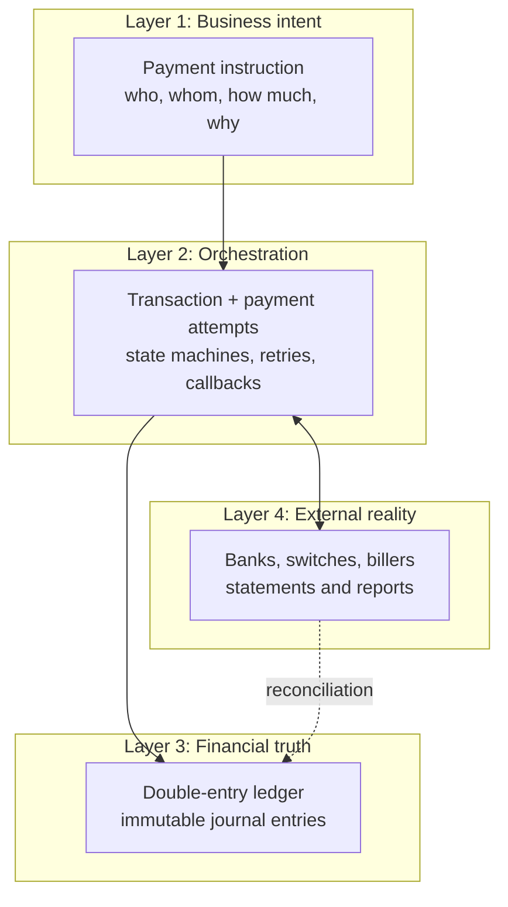

Plain-language reading of the diagram:

- **Business intent** is what the customer asked for. It can be repeated, cancelled or rejected. It is not money movement.
- **Orchestration** drives the request to a conclusion across services and providers. It owns *states* and *retries*, never balances.
- **Ledger** is the only authoritative record of money movement. Everything else is a view or a workflow.
- **External reality** is what banks and providers say happened. Reconciliation compares it with your ledger and forces every difference to be explained.

Five invariants to memorise before you start:

1. Money is never created or destroyed inside the ledger: every journal entry balances (sum of debits = sum of credits).
2. A balance is a **derived** value of ledger entries, never a free-floating mutable field. (A materialised balance row is allowed only as a *constrained cache of the ledger inside the same database transaction*.)
3. A timeout is **not** a failure. It is an *unknown* outcome until proven otherwise.
4. Every state-changing operation is **idempotent** by design, not by hope.
5. Every difference between your records and the outside world is either explained or visible in a queue. Nothing is silently ignored.

## 1.3 Phase map and dependency order

The order below is **dependency-aware**, not the order a business person would list topics. For example, accounting and database concurrency come *before* MFS workflows, because you cannot design a cash-out flow correctly without knowing how a ledger posting and a row lock behave.

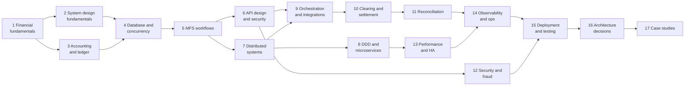

| Phase | Tier mix | Weeks (at ~10-12 h/week) | Core deliverable |
|---|---|---|---|
| 1 Financial system fundamentals | E | 2 | Participant and money-flow map |
| 2 System design fundamentals | E | 3 | Requirements spec + capacity sheet for P2P |
| 3 Accounting and ledger design | E | 4 | Double-entry ledger library with invariants |
| 4 Database and concurrency | E/A | 4 | Concurrency lab: race conditions reproduced and fixed |
| 5 MFS architecture and workflows | E | 5 | Wallet service + P2P, cash-in/out, merchant flows |
| 6 API design and security | E | 3 | OpenAPI contract, idempotency, signing |
| 7 Distributed systems | E/A | 4 | Outbox, inbox, saga lab |
| 8 DDD and microservices | A | 3 | Context map + modular-monolith split decision |
| 9 Orchestration and integrations | E/A | 4 | Provider adapter framework + simulator |
| 10 Clearing and settlement | E/A | 3 | Settlement batch engine |
| 11 Reconciliation | E | 4 | Reconciliation engine with break queue |
| 12 Security, fraud, risk | E/S | 4 | Threat model + rule engine |
| 13 Performance, scale, HA | A | 3 | Load-test report + DR plan |
| 14 Observability and operations | A | 3 | Dashboards, SLOs, runbooks, dispute trace |
| 15 Deployment and testing | E/A | 4 | CI/CD + invariant, chaos and load test suite |
| 16 Architecture decision-making | A | 2 | ADR set + trade-off matrix |
| 17 Case studies | A/S | 6 | 4+ full design documents |
| **Total** | | **~61 weeks** | |

> **Fast path (about 36 weeks):** Phases 1-7, 9, 11, 12 (essentials only), 15 (testing), then two case studies. Skip Kafka depth, Kubernetes depth and specialist fraud topics on the first pass.

---

# 2. Study plan and weekly schedule

## 2.1 Weekly rhythm (about 10-12 hours)

| Block | Hours | Activity |
|---|---|---|
| Mon / Tue evenings | 2 x 1.5 | Read the phase material and one primary resource chapter. Write notes in your own words. |
| Wed evening | 1.5 | Work the micro-topic exercises. |
| Thu evening | 1.5 | Work review questions without notes. Log what you could not answer. |
| Weekend (one long block) | 3-4 | Build the phase project increment. Commit with tests. |
| Weekend (short block) | 1 | Write one ADR or one failure-mode note about what you built. |

## 2.2 Phase rhythm

1. **Week 1 of a phase:** concepts and vocabulary. Draw the diagrams yourself.
2. **Middle weeks:** implement the smallest working version, then deliberately break it (duplicates, crashes, concurrency).
3. **Final week:** review questions, completion criteria, retrospective.

A phase is **not complete** until every item in its "Completion criteria" is demonstrably true in code or documents you can show someone else.

## 2.3 Working at your job

You already work in an MFS environment. Use that advantage safely:

- Study **concepts and shapes**, not your employer's confidential designs, data or credentials.
- Never copy production schemas, data, provider documents or keys into practice projects. Rebuild with fictional names.
- Where the roadmap says "observe", observe public documentation and your own system's *non-confidential* behaviour, and discuss patterns with colleagues in general terms.

---

# 3. Technology choices: essential vs optional

| Technology | Tier | Why | When to skip |
|---|---|---|---|
| Python 3.12+ / Django / DRF | E | Your base. Used for services, admin tooling and tests. | Never. |
| PostgreSQL | E | Transactions, isolation levels, constraints, partial indexes, partitioning, row locks, `SKIP LOCKED`, advisory locks. The right default for ledgers. | Never for the ledger. |
| Redis | E | Rate limiting, idempotency fast-path, short-lived locks, sessions, caches that are never financial truth. | If you do not need any of those yet. |
| Celery (+ Redis/RabbitMQ) | E | Background work: callbacks, retries, status inquiry, notifications, reports. | If you go all-in on Kafka consumers. |
| Docker / docker compose | E | Reproducible labs. | Never. |
| pytest, Hypothesis, Locust or k6 | E | Invariant, property-based and load testing. | Never. |
| Kafka (or Redpanda, or RabbitMQ streams) | A | Durable event log, replay, consumer groups, outbox publishing. | In the first 20 weeks. A Postgres outbox plus Celery is enough to learn the patterns. |
| RabbitMQ | A | Task and work-queue semantics, routing, DLQs. | If Kafka covers your needs. |
| Kubernetes | A | Rolling deployments, probes, autoscaling, config and secrets. | Learn fundamentals only until Phase 15. |
| OpenTelemetry + Prometheus + Grafana + Loki/ELK | A | Metrics, traces, logs. | Never skip the concepts; the specific stack is replaceable. |
| Terraform / Ansible | A | Infrastructure as code. | Defer until Phase 15. |
| PgBouncer | A | Connection pooling for Postgres. | Until you hit connection limits. |
| Vault or cloud KMS | A | Secrets and key management. | Use environment-based secrets in labs, but learn the concept. |
| Event store products, ClickHouse, data warehouses | S | Analytics and read models. | Until reporting phase of case studies. |
| gRPC / protobuf | A | Typed internal contracts. | REST is enough for labs. |

> **Opinionated default:** keep the ledger and transaction core on **one PostgreSQL primary** for as long as the workload allows. Most beginner "we need microservices and Kafka" arguments are really "we have not designed our module boundaries or indexes yet".

---

# Phase 1: Financial system fundamentals

**Tier:** Essential | **Weeks:** 2 | **Prerequisites:** none (general backend experience)

### Why this phase exists
You will make architecture decisions that depend on *who holds the money*, *who is allowed to move it*, and *when a payment is final*. Engineers who skip this phase design systems that "work" in the happy path and misrepresent finality, settlement and liability.

### Learning objectives
- Name every participant in an MFS payment and state what each one holds, promises and risks.
- Distinguish authorisation, processing, clearing, settlement, reconciliation and final accounting.
- Draw money-flow and information-flow diagrams separately for a P2P transfer, a cash-out and a merchant payment.
- Produce a **research list** of Bangladesh regulatory topics to verify, with source URLs.

### Micro-topics

| # | Micro-topic | What it is and why it matters | Depends on | MFS application | Exercise |
|---|---|---|---|---|---|
| 1.1 [E] | Money, e-money and stored value | Physical cash, bank deposits and e-money are different claims on different issuers. E-money is a liability of the issuer to the holder. | none | An MFS wallet balance is a claim on the provider, which must be backed by funds held according to regulation (VERIFY the exact arrangement). | Write a one-page explanation of "where the money is" when a customer holds 1,000 BDT in a wallet. |
| 1.2 [E] | Central bank role | Monetary policy, payment-system oversight, licensing, settlement of interbank balances. | 1.1 | The regulator licenses and supervises MFS; interbank rails settle across the central bank. | List Bangladesh Bank functions relevant to payments, each with a source link. |
| 1.3 [E] | Commercial banks and settlement banks | Hold deposits, run accounts, provide the money legs for wallet funding and withdrawal. | 1.2 | A partner bank holds a settlement or trust-style account for the provider (VERIFY actual structure). | Draw the partner-bank relationship in a diagram. |
| 1.4 [E] | MFS operator vs PSP vs gateway vs switch | An MFS operator issues wallets. A PSP offers payment services to merchants. A gateway exposes a checkout API. A switch routes messages between institutions. | 1.1 | Merchant checkout via a gateway may debit a wallet or a card. | Classify five Bangladesh payment services into these categories (research task). |
| 1.5 [E] | Cards: issuer, acquirer, networks | Issuer holds the cardholder account, acquirer holds the merchant relationship, network routes and clears. | 1.4 | MFS-to-card top-ups and card-funded wallet loads. | Trace a card payment through four parties with timings. |
| 1.6 [E] | Agents, distributors, merchants | Agents convert cash to e-money and back; distributors fund agents with float; merchants accept wallet payment. | 1.1 | Agent float is working capital: when an agent cashes in a customer, the agent's e-float falls. | Model agent float over a day with ten transactions. |
| 1.7 [E] | Authorisation vs processing vs clearing vs settlement vs reconciliation vs accounting | Six different activities that people loosely call "payment". Authorisation says "may proceed", clearing exchanges the obligations, settlement moves net funds, reconciliation proves records agree, accounting records the economic effect. | 1.1-1.6 | A wallet transfer authorises and settles instantly *inside the provider's ledger*; an interbank leg settles later. | Make a timeline table for a P2P transfer and a bank cash-in showing each of the six activities. |
| 1.8 [E] | Gross vs net settlement, prefunding | Gross: each payment settles individually. Net: obligations are netted and settled in cycles. Prefunding: a counterparty deposits funds to cover expected obligations. | 1.7 | Bank-to-wallet and biller settlement often use net cycles. | Compute gross vs net obligations for 20 synthetic payments between three banks. |
| 1.9 [E] | Bangladesh payment rails overview | Domestic interbank and retail rails (e.g. BEFTN, NPSB, RTGS, BACPS, Bangla QR, Binimoy). | 1.2, 1.7 | Wallet-to-bank transfer, bank-to-wallet, QR merchant payment. | For each rail write: purpose, direction, timing model, finality model, source link. Mark all details VERIFY. |
| 1.10 [E] | Regulator, licensing and compliance map | Bangladesh Bank, financial intelligence unit, tax and data bodies, plus applicable laws (VERIFY the current statutes and circulars). | 1.2 | KYC tiers, reporting duties, audit rights. | Build a source register: topic, authority, document title, URL, date reviewed. |
| 1.11 [A] | International standards awareness | ISO 8583 (card messages), ISO 20022 (rich payment messages), SWIFT messaging, PCI DSS, ISO 27001. | 1.5 | Message mapping when integrating banks and card processors. | Read the ISO 20022 overview and map five fields of a credit transfer to your future `payment_instruction` model. |
| 1.12 [A] | Finality and irrevocability | When can a payment no longer be reversed by anyone? Differs per rail and rulebook. | 1.7, 1.9 | Customer expectations versus rail rules for "money back". | Write a table of finality per payment type, marking every cell VERIFY. |

### Implementation guidance
There is no code in this phase. Your artefacts are **diagrams and tables**. Use Mermaid so they live in version control:

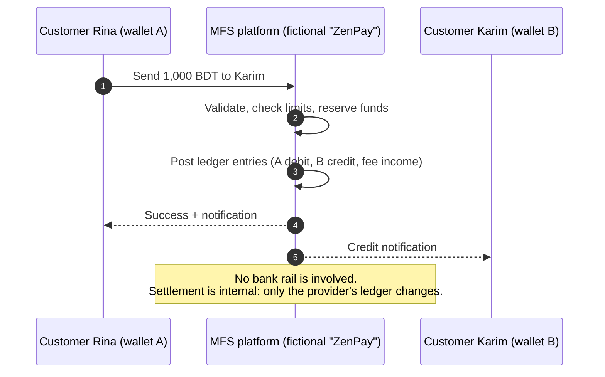

Reading the diagram: a wallet-to-wallet transfer within one provider usually involves **no external settlement** at all. The money "moves" by changing which customer the provider owes, and the total liability to customers stays the same minus any fee. This is why internal P2P can be instant while bank legs cannot.

### Common mistakes
- Using "payment", "transaction" and "settlement" interchangeably.
- Assuming that an API "success" means the interbank settlement is final.
- Memorising rail names without understanding **who is liable at each step**.

### Hands-on exercises
1. Money-flow and information-flow diagrams for: P2P, cash-in at an agent, cash-out at an agent, merchant QR payment, bill payment, bank-to-wallet.
2. A "who owes whom" table after each of the above, using synthetic amounts.
3. Regulatory source register with at least 15 entries.

### Deliverables
`docs/phase1/` containing the diagrams, the six-activities timeline, the rail comparison table and the source register.

### Review questions
1. Why is a wallet balance a liability, not an asset, of the provider?
2. What is the difference between clearing and settlement? Give an MFS-specific example.
3. Why can an internal P2P transfer be final immediately while a bank transfer may not be?
4. What does prefunding protect against, and who bears the risk?
5. Which statements in your rail table did you verify against an official source?

### Completion criteria
- You can explain all six activities to a non-engineer in under five minutes.
- Your source register has at least 15 entries with review dates.
- You can state, without notes, where the money is at every step of a cash-out.

---

# Phase 2: System design fundamentals

**Tier:** Essential | **Weeks:** 3 | **Prerequisites:** Phase 1

### Why this phase exists
Good design starts with precise requirements, explicit assumptions and numbers. Fintech adds a twist: **correctness is a requirement, not a quality attribute you trade away**.

### Learning objectives
- Convert a business request into functional requirements, non-functional requirements, business rules, constraints and assumptions.
- Estimate TPS, storage and processing capacity without confusing API requests with financial transactions.
- Walk "send money wallet-to-wallet" end to end as a complete technical design.

### Micro-topics

| # | Micro-topic | What it is and why it matters | Depends on | MFS application | Exercise |
|---|---|---|---|---|---|
| 2.1 [E] | Requirement gathering | Interviewing stakeholders (product, ops, compliance, support, finance) to find rules and failure expectations. | none | Ops needs "pending transaction age" reports; compliance needs audit trails. | Write ten questions you would ask each stakeholder for P2P. |
| 2.2 [E] | Functional requirements and use cases | What the system does, as testable statements and use-case flows. | 2.1 | "A registered customer can send money to another registered wallet." | Write 15 numbered functional requirements for P2P with acceptance criteria. |
| 2.3 [E] | Non-functional requirements | Availability, latency, durability, consistency, security, auditability, maintainability, cost. Written as measurable targets. | 2.1 | "p99 initiation latency under X ms at Y TPS" (choose HYPOTHETICAL numbers). | Write 12 measurable NFRs. |
| 2.4 [E] | Business rules | Fees, limits, eligibility, status checks, cut-offs. They change often and must be data-driven. | 2.2 | Limit and fee rules per customer tier. | Express 10 rules as data (JSON) rather than code. |
| 2.5 [E] | Domain modelling basics | Nouns, verbs, invariants, lifecycles. | 2.2 | Customer, wallet, transaction, ledger account. | Draw an entity model and list five invariants. |
| 2.6 [E] | User journeys | Happy path plus alternate and failure paths, including support journeys. | 2.2 | Customer disputes a missing credit; agent reports a failed cash-in. | Document three journeys with failure variants. |
| 2.7 [E] | Constraints and assumptions | What you must obey (regulation, partner SLAs) versus what you believe (traffic). Assumptions are written down and revisited. | 2.1 | "Partner bank status inquiry rate-limited" (HYPOTHETICAL). | Keep an assumptions register; mark each with owner and review date. |
| 2.8 [E] | Capacity estimation (traffic, TPS, peak-to-average) | Convert users and behaviour into rates. Distinguish *business transactions* from *requests*. | 2.3 | Eid and salary-day peaks. | Work the estimation below. |
| 2.9 [E] | Storage estimation | Rows per transaction x bytes x retention, plus indexes and replicas. | 2.8 | Ledger growth. | Estimate five-year storage. |
| 2.10 [E] | Latency, throughput, availability maths | p50/p95/p99, Little's law, availability nines, error budgets. | 2.3 | Capacity of worker pools. | Compute worker count for a target throughput. |
| 2.11 [E] | Reliability, durability, consistency | Not losing accepted transactions; defining what "consistent" means per read. | 2.3 | Balance reads vs spend authorisation. | Classify 10 reads as strongly or eventually consistent. |
| 2.12 [E] | Scalability and maintainability | Vertical vs horizontal; module structure; testability. | 2.3 | Stateless API tier, single-writer ledger. | Identify the first scaling bottleneck in your P2P design. |
| 2.13 [A] | Fault tolerance, DR, RTO/RPO | Redundancy, failover, backups, recovery objectives. | 2.3 | Region-level outage plans. | Define RTO/RPO per component and justify them. |
| 2.14 [A] | Cost optimisation | Cost per transaction, infrastructure vs operational cost. | 2.8 | Storage tiering, log retention. | Estimate monthly cost per million transactions. |
| 2.15 [E] | Requirement-to-design walkthrough | Take one requirement through APIs, services, DB, states, ledger, validations, failures, monitoring, reconciliation, operations. | 2.1-2.12 | "Send money wallet to wallet." | Produce the design document below. |

### Worked capacity estimate (HYPOTHETICAL numbers, reproducible method)

```text
Assumptions
- Monthly active wallets (MAW)            : 10,000,000
- Daily active wallets (DAW) = 30% of MAW : 3,000,000
- Financial transactions per DAW per day  : 1.5  -> 4,500,000 business txns/day
- Distinct ledger journal entries per txn : 1 (each with 3-6 posting lines for fees/commission)
- API requests per business txn           : ~12 (login, balance, lookup, quote, confirm, status polls, history)

Average rates
- Business TPS (avg)   = 4,500,000 / 86,400            ~ 52 TPS
- Requests/sec (avg)   = 52 * 12                       ~ 625 RPS

Peaks (peak-to-average ratios are assumptions you must validate with real traffic graphs)
- Normal daily peak (10x)   : ~520 TPS financial, ~6,200 RPS
- Eid / salary-day peak (30x): ~1,560 TPS financial, ~18,700 RPS

Storage (ledger lines only)
- 4.5M txns/day * 5 posting lines * ~120 bytes   ~ 2.7 GB/day raw
- Per year (x365)                                 ~ 1 TB raw, ~2-3 TB with indexes
- Plus transactions, attempts, callbacks, audit   -> budget 3x ledger size
```

Key lesson: **financial TPS (~1.5k at the worst peak) is much smaller than request RPS (~18k)**. Design the ledger write path for the former and the read/API tier for the latter. A single well-tuned PostgreSQL primary can plausibly handle financial TPS in this range; the hard part is *hot accounts* (fee, commission and settlement accounts that every transaction touches), covered in Phase 4.

### From requirement to design: "Send money wallet to wallet" (outline you will flesh out)

1. **API:** `POST /v1/transfers` with `Idempotency-Key`; `GET /v1/transfers/{id}`.
2. **Validation:** both wallets active, KYC tier allows, limits (per-txn, daily, monthly), PIN verified, device bound, risk score acceptable.
3. **Quote:** fee computed from versioned fee rule and stored on the transaction.
4. **Execution:** single DB transaction: lock wallets in deterministic order, check available balance, insert transaction row, post journal entry (debit sender, credit receiver, credit fee income), update materialised balances, write outbox event.
5. **Response:** `201` with final state `SUCCESS` because no external dependency exists.
6. **After commit:** notifications by outbox consumer (never inside the money transaction).
7. **Failure cases:** duplicate request, concurrent spend, receiver blocked mid-flight, DB failover, notification failure.
8. **Observability:** metric `transfer_total{status}`, latency histogram, trace across API to ledger.
9. **Reconciliation:** nightly check: sum of ledger entries equals materialised balances; sum of wallet liabilities equals the control account.
10. **Operations:** support can retrieve the transfer by reference, see ledger entries and notification status.

### Common mistakes
- Estimating traffic as *requests* and sizing the ledger for it.
- Writing NFRs as adjectives ("fast", "highly available").
- Hard-coding fees and limits.
- Treating DR as "we have backups".

### Hands-on exercises
1. Requirements spec for P2P (functional, NFR, rules, constraints, assumptions).
2. Capacity spreadsheet with three scenarios (normal, salary day, Eid) and a sensitivity table.
3. Design document for P2P that fills in all ten points above.

### Review questions
1. Why is p99 more important than average latency for payments?
2. What is the difference between a business transaction and an API request in capacity planning?
3. Which NFRs conflict with each other in a payment system, and how do you resolve each conflict?
4. What changes in the design if RPO must be zero?

### Completion criteria
- Spec, capacity sheet and P2P design document reviewed by a peer.
- Every NFR has a number and a way to measure it.
- You can derive TPS, storage and worker counts on a whiteboard in 10 minutes.

---

# Phase 3: Accounting and ledger design

**Tier:** Essential | **Weeks:** 4 | **Prerequisites:** Phase 1

### Why this phase exists
The ledger is the heart of the system. Most fintech incidents are accounting incidents wearing engineering clothes.

### Learning objectives
- Apply double-entry bookkeeping to wallet systems.
- Model users, wallets, financial accounts, ledger accounts, transactions, journal entries and payment instructions as distinct concepts.
- Build a posting engine that enforces ledger invariants.

### Micro-topics

| # | Micro-topic | What it is and why it matters | Depends on | MFS application | Exercise |
|---|---|---|---|---|---|
| 3.1 [E] | Accounting equation: Assets = Liabilities + Equity | Every economic event keeps this true. Income and expenses flow into equity. | none | Customer wallet balances are **liabilities**; the trust or settlement bank balance is an **asset**. | Classify 20 accounts of a fictional MFS. |
| 3.2 [E] | Debit and credit | Debit increases assets and expenses, credit increases liabilities, equity and income. Not "plus and minus". | 3.1 | Customer wallet credit increases what the provider owes the customer. | Post 10 events without a calculator, then verify with code. |
| 3.3 [E] | Double-entry bookkeeping | Every journal entry has equal debits and credits. | 3.2 | Every wallet movement is a balanced entry. | Write a function that rejects unbalanced entries. |
| 3.4 [E] | Chart of accounts | A structured list of ledger accounts with types and codes. | 3.2 | Customer liabilities, agent liabilities, merchant liabilities, fee income, commission expense, suspense, settlement bank, tax payable. | Design a chart of accounts for the platform. |
| 3.5 [E] | General ledger and subledgers | The GL holds summary accounts; subledgers hold per-wallet detail that reconciles to a **control account**. | 3.4 | One subledger account per wallet, controlled by "Customer wallets payable". | Prove that sum(wallet subledgers) = control account. |
| 3.6 [E] | Journal entries and posting rules | A journal entry is a balanced set of lines. Posting rules map business events to entries. | 3.3 | "P2P with fee" posting rule. | Implement posting rules as data plus code. |
| 3.7 [E] | Entity separation | **User** (person), **wallet** (product held by a user), **financial account** (contract-level account), **ledger account** (accounting bucket), **transaction** (business event), **journal entry** (accounting record), **payment instruction** (request to move funds, possibly externally). | 3.5 | Drawing correct foreign keys between these. | Draw the ERD and justify each relation. |
| 3.8 [E] | Balances: ledger, available, reserved, pending | Ledger = posted entries. Reserved = holds. Available = ledger minus holds (plus permitted overdraft, normally zero). Pending = not yet posted effects. | 3.6 | Cash-out hold while agent confirmation is pending. | Compute each balance type from sample data. |
| 3.9 [E] | Why a balance is not a mutable field | A bare `balance` column loses history, hides bugs, and cannot be audited or rebuilt. Use entries as truth and a controlled cache of balance. | 3.8 | Dispute investigations need entry history. | Build a "bad design" that loses 1 BDT, then show the ledger design catching it. |
| 3.10 [E] | Immutability and append-only | Entries are never updated or deleted. Corrections are new entries. | 3.6 | Audit and regulator inspection. | Add DB triggers or permissions that block UPDATE/DELETE on entries. |
| 3.11 [E] | Reversal, refund and compensating entries | Reversal undoes a prior entry exactly. Refund is a new business event. Compensation corrects a workflow step. | 3.10 | Failed cash-out after hold; merchant refund. | Implement reversal that references the original entry. |
| 3.12 [E] | Holds: reserve, release, capture | Reserve reduces available but not ledger balance. Capture converts the hold into a posting. Release cancels it. | 3.8 | Two-step flows: cash-out, bank withdrawal, card-like authorisation. | Implement the hold lifecycle with expiry. |
| 3.13 [E] | Idempotent posting and references | A unique business reference per posting guarantees that retries do not duplicate. | 3.6 | Callback arriving twice. | Add a unique constraint on `(posting_reference)`. |
| 3.14 [E] | Ledger invariants | Always-true statements, checked continuously (see list below). | 3.3-3.13 | Daily integrity job. | Write invariant checks as SQL and as property tests. |
| 3.15 [E] | Accounting periods and end-of-day | Period close, cut-off, immutable closed periods, adjustments in the next period. | 3.10 | End-of-day trial balance. | Implement trial balance for a day. |
| 3.16 [A] | Multi-currency, rounding and minor units | Store money in integer minor units (poisha) or fixed-point decimals. Define rounding rule per fee. | 3.6 | Percentage fees yielding fractions. | Property test: no rounding leaks across fee splits. |
| 3.17 [A] | Suspense and clearing accounts | Temporary holding accounts for unidentified or in-transit funds. Must always be explained and aged. | 3.4 | Unmatched bank credit awaiting identification. | Implement suspense with aging report. |

### Ledger invariants (UNIVERSAL)

1. For every journal entry: `SUM(debits) = SUM(credits)`.
2. Entries are immutable. Corrections reference the original.
3. Each posting line belongs to exactly one ledger account and one journal entry.
4. Each business reference posts at most once (idempotent).
5. For each wallet: `balance = SUM(credits) - SUM(debits)` on its liability account (sign convention documented).
6. Control account equals the sum of its subledgers.
7. The grand trial balance is zero: all debits equal all credits.
8. Available balance is never negative unless an explicitly permitted overdraft exists.
9. Closed periods accept no new entries.
10. Every entry traces to a transaction and every transaction traces to an actor and a request.

### Worked examples (HYPOTHETICAL amounts and rates)

Sign convention: **liability accounts increase with credit**. Accounts are fictional.

**P2P transfer, fee paid by sender.** Rina sends 1,000 BDT to Karim, fee 5 BDT.

| Line | Account | Type | Debit | Credit |
|---|---|---|---:|---:|
| 1 | Wallet: Rina | Liability | 1,005 | |
| 2 | Wallet: Karim | Liability | | 1,000 |
| 3 | Fee income: P2P | Income | | 5 |

Reading: Rina's liability falls by 1,005 (provider owes her less), Karim's rises by 1,000, and the 5 BDT is the provider's income.

**Cash-in at an agent.** Customer hands 2,000 BDT cash to Agent Sultana, agent's e-float is debited.

| Line | Account | Debit | Credit |
|---|---|---:|---:|
| 1 | Wallet: Agent Sultana (e-float, liability) | 2,000 | |
| 2 | Wallet: Customer | | 2,000 |

Commission to agent of 10 BDT (HYPOTHETICAL), funded by the provider:

| Line | Account | Debit | Credit |
|---|---|---:|---:|
| 1 | Expense: Agent commission | 10 | |
| 2 | Agent commission payable (or agent wallet) | | 10 |

**Cash-out at an agent.** Customer withdraws 1,500 BDT with fee 20 BDT (HYPOTHETICAL), agent earns 8 BDT.

| Line | Account | Debit | Credit |
|---|---|---:|---:|
| 1 | Wallet: Customer | 1,520 | |
| 2 | Wallet: Agent (e-float increases, cash goes out) | | 1,500 |
| 3 | Fee income: cash-out | | 20 |

Agent commission of 8 BDT is a separate posting (Dr Commission expense, Cr Agent commission payable).

**Merchant payment.** Customer pays 800 BDT, merchant discount rate 1.5% (HYPOTHETICAL) = 12 BDT.

| Line | Account | Debit | Credit |
|---|---|---:|---:|
| 1 | Wallet: Customer | 800 | |
| 2 | Merchant payable: Cafe Alpha | | 788 |
| 3 | Fee income: MDR | | 12 |

**Bank-to-wallet cash-in.** Customer loads 5,000 BDT from a bank account through a fictional bank "Bank Delta". After the bank confirms:

| Line | Account | Type | Debit | Credit |
|---|---|---|---:|---:|
| 1 | Settlement bank: Bank Delta | Asset | 5,000 | |
| 2 | Wallet: Customer | Liability | | 5,000 |

While the bank result is unknown, funds are **not** credited. If you must show an optimistic "pending credit", model it as a *pending* balance, not a posted one, or park in a clearing account.

**Reversal.** The cash-out above fails at the agent side after posting. Post a reversing entry that references the original with every line flipped, and link both with `reverses_entry_id`. Never delete the original.

**Settlement with external bank (net).** End of day, the provider owes Bank Delta 3,200,000 BDT net for the day and settles from the settlement account:

| Line | Account | Debit | Credit |
|---|---|---:|---:|
| 1 | Payable: Bank Delta settlement | 3,200,000 | |
| 2 | Settlement bank: Bank Delta | | 3,200,000 |

### Starter schema (PostgreSQL, simplified)

```sql
CREATE TABLE ledger_account (
    id            BIGSERIAL PRIMARY KEY,
    code          TEXT NOT NULL UNIQUE,
    name          TEXT NOT NULL,
    type          TEXT NOT NULL CHECK (type IN ('ASSET','LIABILITY','EQUITY','INCOME','EXPENSE')),
    parent_id     BIGINT REFERENCES ledger_account(id),
    currency      CHAR(3) NOT NULL DEFAULT 'BDT',
    is_control    BOOLEAN NOT NULL DEFAULT FALSE,
    allow_negative BOOLEAN NOT NULL DEFAULT FALSE
);

CREATE TABLE journal_entry (
    id               BIGSERIAL PRIMARY KEY,
    posting_reference TEXT NOT NULL UNIQUE,          -- idempotency anchor
    transaction_id   UUID NOT NULL,
    entry_type       TEXT NOT NULL,                  -- P2P, CASH_IN, REVERSAL ...
    reverses_entry_id BIGINT REFERENCES journal_entry(id),
    effective_date   DATE NOT NULL,
    created_at       TIMESTAMPTZ NOT NULL DEFAULT now(),
    created_by       TEXT NOT NULL
);

CREATE TABLE posting_line (
    id               BIGSERIAL PRIMARY KEY,
    journal_entry_id BIGINT NOT NULL REFERENCES journal_entry(id),
    ledger_account_id BIGINT NOT NULL REFERENCES ledger_account(id),
    direction        CHAR(1) NOT NULL CHECK (direction IN ('D','C')),
    amount_minor     BIGINT NOT NULL CHECK (amount_minor > 0),  -- poisha
    currency         CHAR(3) NOT NULL
);
CREATE INDEX posting_line_account_idx ON posting_line (ledger_account_id, id);

-- Balanced-entry enforcement at commit time
CREATE OR REPLACE FUNCTION assert_entry_balanced() RETURNS trigger AS $$
DECLARE diff BIGINT;
BEGIN
  SELECT COALESCE(SUM(CASE direction WHEN 'D' THEN amount_minor ELSE -amount_minor END),0)
    INTO diff FROM posting_line WHERE journal_entry_id = NEW.journal_entry_id;
  IF diff <> 0 THEN
    RAISE EXCEPTION 'journal entry % is unbalanced by %', NEW.journal_entry_id, diff;
  END IF;
  RETURN NULL;
END $$ LANGUAGE plpgsql;

CREATE CONSTRAINT TRIGGER posting_line_balanced
AFTER INSERT ON posting_line
DEFERRABLE INITIALLY DEFERRED
FOR EACH ROW EXECUTE FUNCTION assert_entry_balanced();
```

Reading: the deferred constraint trigger checks balance **at commit**, after all lines are inserted, so a half-written entry can never commit. Also block `UPDATE`/`DELETE` on `journal_entry` and `posting_line` with revoked privileges or triggers.

### Common mistakes
- Using floats for money.
- Storing balance as the only truth and "fixing" it with scripts.
- Deleting or editing entries to correct mistakes.
- No control account, so subledgers cannot be proven to match the GL.
- Modelling fees as a side effect rather than as ledger lines.

### Hands-on exercises
1. Chart of accounts (at least 25 accounts) with rationale.
2. Posting rules for every transaction type in Phase 5.
3. Python library `ledger/` with `post(entry)`, `reverse(entry)`, `reserve/capture/release`, trial balance and invariant checks.
4. Hypothesis tests: random sequences of postings keep all invariants true.

### Review questions
1. Why is a customer's wallet a liability?
2. Why is a reversal not a delete?
3. How do you prove a subledger equals its control account?
4. Which balance do you use to authorise a spend, and why?

### Completion criteria
- Library passes property tests with 10,000 random operation sequences.
- You can post any scenario in this phase by hand and in code with the same result.
- Trial balance is zero after every test run.

---

# Phase 4: Database and concurrency engineering

**Tier:** Essential/Advanced | **Weeks:** 4 | **Prerequisites:** Phases 2-3

### Why this phase exists
Two customers pressing "Send" at the same instant, a worker crashing after the commit but before the response, a replica lagging by two seconds: these are normal events. Your database design must make the wrong outcome *impossible*, not merely unlikely.

### Learning objectives
- Reproduce lost updates, dirty/non-repeatable/phantom reads and write skew in PostgreSQL, then fix each.
- Choose between optimistic locking, `SELECT ... FOR UPDATE`, atomic updates and serializable isolation, with reasons.
- Design wallet, ledger, transaction, idempotency, attempt, callback, reconciliation, settlement, rule, audit and outbox tables.
- Decide which invariant belongs to the database, the application, the posting engine or the reconciliation process.

### Micro-topics

| # | Micro-topic | What it is and why it matters | Depends on | MFS application | Exercise |
|---|---|---|---|---|---|
| 4.1 [E] | ACID and transaction boundaries | Atomicity, consistency, isolation, durability. The transaction boundary is a **design decision**. | none | One transaction covers ledger posting plus outbox row, never an external call. | Draw the transaction boundary for P2P and for cash-out. |
| 4.2 [E] | Isolation levels in PostgreSQL | Read Committed (default), Repeatable Read (snapshot), Serializable (SSI). Each permits different anomalies. | 4.1 | Balance check then debit can race under Read Committed. | Reproduce each anomaly with two `psql` sessions. |
| 4.3 [E] | Lost update | Two transactions read the same balance and both write. | 4.2 | Two simultaneous transfers from one wallet. | Reproduce, then fix with `FOR UPDATE`. |
| 4.4 [E] | Dirty read, non-repeatable read, phantom read | Read anomalies; PostgreSQL never allows dirty reads. | 4.2 | Daily limit computed from history while new entries commit. | Demonstrate non-repeatable read and phantom with limits. |
| 4.5 [E] | Write skew | Two transactions each read a set and write different rows, breaking a cross-row rule. | 4.2 | Two debits each pass a "total daily limit" check. | Reproduce and fix using a locked limit-counter row or Serializable. |
| 4.6 [E] | Pessimistic locking | `SELECT ... FOR UPDATE`, `FOR NO KEY UPDATE`, `NOWAIT`, `SKIP LOCKED`. | 4.3 | Locking sender and receiver wallets in a deterministic order (by id) to avoid deadlock. | Implement deadlock-safe two-wallet lock and a deadlock test. |
| 4.7 [E] | Optimistic locking | Version column plus compare-and-swap update. | 4.3 | Low-contention profile updates, limits configuration. | Implement `UPDATE ... WHERE id=? AND version=?` with retry. |
| 4.8 [E] | Atomic conditional update | `UPDATE wallet SET balance = balance - :a WHERE id=:id AND balance >= :a`. Single-statement, no explicit lock. | 4.3 | Fast debit path with insufficient-funds protection. | Benchmark against `FOR UPDATE`. |
| 4.9 [E] | Unique and check constraints | Constraints are the strongest guard because they work for every client and bug. | 4.1 | Unique idempotency key; non-negative amounts; valid state values. | Add constraints for five invariants and try to violate them. |
| 4.10 [E] | Foreign keys and referential integrity | Prevent orphan ledger lines or attempts. | 4.9 | Every attempt belongs to a transaction. | Add FKs and decide `ON DELETE` (almost always `RESTRICT`). |
| 4.11 [E] | Partial and composite indexes | Index only the rows queried; order columns by selectivity and sort. | 4.9 | `WHERE status IN ('PENDING','UNKNOWN')` index for status inquiry workers. | `EXPLAIN (ANALYZE, BUFFERS)` before and after. |
| 4.12 [E] | Query plans | Seq scan, index scan, bitmap, join strategy; reading cost and row estimates. | 4.11 | Transaction history pagination. | Fix a slow history query. |
| 4.13 [E] | Hot rows and write contention | Fee, commission and settlement accounts touched by every transaction serialise writers. | 4.6 | Single "P2P fee income" account. | Measure TPS with one hot row; fix with sharded sub-accounts or deferred aggregation. |
| 4.14 [E] | Idempotency records | Table of `(scope, key) -> request hash, response, status` guaranteeing safe retries. | 4.9 | Mobile app retries after a network drop. | Implement with `INSERT ... ON CONFLICT`. |
| 4.15 [E] | Transactional outbox table | Write the event in the same transaction as the state change; publish asynchronously. | 4.1 | Notification and downstream events. | Implement `outbox_event` with a relay worker using `FOR UPDATE SKIP LOCKED`. |
| 4.16 [A] | Serializable and SSI | Serializable transactions can abort with serialization failures; the application must retry. | 4.2 | Complex cross-row limit checks. | Implement retry wrapper with bounded attempts. |
| 4.17 [A] | Advisory locks | Application-level locks keyed by integers. | 4.6 | Serialising per-customer sequences or scheduled job singletons. | Implement per-wallet advisory lock and compare to row lock. |
| 4.18 [A] | Partitioning and archival | Range partition by date for large tables; detach and archive old partitions. | 4.11 | Ledger lines and audit logs partitioned monthly. | Create monthly partitions and a retention job. |
| 4.19 [A] | Migrations and schema evolution | Expand/contract migrations, no long locks, backward-compatible changes. | 4.10 | Add a column to a 2 TB table safely. | Perform an online `ADD COLUMN` + backfill + constraint validation. |
| 4.20 [A] | Replication, lag, failover | Streaming replicas, synchronous vs asynchronous commit, replica reads. | 4.2 | Customer history from replicas vs spend authorisation on primary. | Simulate lag and show a stale read bug, then route correctly. |
| 4.21 [A] | Backup, PITR, retention | WAL archiving, base backups, restore drills, retention rules (VERIFY applicable retention periods). | 4.20 | Recovery from operator error. | Perform a point-in-time restore to just before a bad migration. |
| 4.22 [A] | Pooling and connection limits | PgBouncer modes, `max_connections`, pool sizing. | 4.1 | Celery workers plus gunicorn workers exhausting connections. | Size pools for 8 API pods and 40 workers. |
| 4.23 [A] | Choosing stores: relational, event store, analytical, cache, read model | Each store has a job. The ledger lives in a relational DB; analytics belong elsewhere; caches are never truth. | 4.1 | Reporting on a warehouse fed by CDC. | Write a one-page decision table for 8 data needs. |

### Sample schema (core transaction tables, simplified)

```sql
CREATE TABLE wallet (
    id               UUID PRIMARY KEY,
    owner_id         UUID NOT NULL,
    wallet_type      TEXT NOT NULL CHECK (wallet_type IN ('CUSTOMER','AGENT','MERCHANT','DISTRIBUTOR')),
    status           TEXT NOT NULL CHECK (status IN ('PENDING','ACTIVE','FROZEN','CLOSED')),
    ledger_account_id BIGINT NOT NULL UNIQUE REFERENCES ledger_account(id),
    -- controlled cache of ledger state, updated only inside the posting engine
    ledger_balance_minor BIGINT NOT NULL DEFAULT 0,
    reserved_minor   BIGINT NOT NULL DEFAULT 0,
    version          BIGINT NOT NULL DEFAULT 0,
    CHECK (reserved_minor >= 0),
    CHECK (ledger_balance_minor - reserved_minor >= 0)   -- available never negative
);

CREATE TABLE idempotency_record (
    scope          TEXT NOT NULL,                 -- e.g. 'wallet:<id>:transfers'
    idem_key       TEXT NOT NULL,
    request_hash   BYTEA NOT NULL,                -- detects same key + different body
    response_code  INT,
    response_body  JSONB,
    status         TEXT NOT NULL CHECK (status IN ('IN_PROGRESS','COMPLETED')),
    created_at     TIMESTAMPTZ NOT NULL DEFAULT now(),
    expires_at     TIMESTAMPTZ NOT NULL,
    PRIMARY KEY (scope, idem_key)
);

CREATE TABLE financial_transaction (
    id              UUID PRIMARY KEY,
    reference       TEXT NOT NULL UNIQUE,         -- customer-visible
    type            TEXT NOT NULL,
    business_state  TEXT NOT NULL,
    amount_minor    BIGINT NOT NULL CHECK (amount_minor > 0),
    currency        CHAR(3) NOT NULL DEFAULT 'BDT',
    initiator_wallet_id UUID NOT NULL REFERENCES wallet(id),
    counterparty_ref TEXT,
    fee_rule_version INT,
    created_at      TIMESTAMPTZ NOT NULL DEFAULT now(),
    updated_at      TIMESTAMPTZ NOT NULL DEFAULT now()
);

CREATE TABLE transaction_leg (                    -- business legs (who pays whom)
    id              BIGSERIAL PRIMARY KEY,
    transaction_id  UUID NOT NULL REFERENCES financial_transaction(id),
    leg_type        TEXT NOT NULL,                -- PRINCIPAL, FEE, COMMISSION, TAX
    from_wallet_id  UUID,
    to_wallet_id    UUID,
    amount_minor    BIGINT NOT NULL CHECK (amount_minor >= 0)
);

CREATE TABLE payment_attempt (                    -- one row per external try
    id               UUID PRIMARY KEY,
    transaction_id   UUID NOT NULL REFERENCES financial_transaction(id),
    provider_code    TEXT NOT NULL,
    attempt_no       INT NOT NULL,
    provider_reference TEXT,
    orchestration_state TEXT NOT NULL,
    provider_status  TEXT,                        -- raw, provider vocabulary
    request_payload  JSONB,
    response_payload JSONB,
    created_at       TIMESTAMPTZ NOT NULL DEFAULT now(),
    UNIQUE (transaction_id, provider_code, attempt_no)
);

CREATE TABLE provider_callback (
    id            BIGSERIAL PRIMARY KEY,
    provider_code TEXT NOT NULL,
    dedupe_key    TEXT NOT NULL,                  -- provider event id or body hash
    received_at   TIMESTAMPTZ NOT NULL DEFAULT now(),
    signature_ok  BOOLEAN NOT NULL,
    payload       JSONB NOT NULL,
    processed_at  TIMESTAMPTZ,
    UNIQUE (provider_code, dedupe_key)
);

CREATE TABLE outbox_event (
    id           BIGSERIAL PRIMARY KEY,
    aggregate_id UUID NOT NULL,
    event_type   TEXT NOT NULL,
    payload      JSONB NOT NULL,
    created_at   TIMESTAMPTZ NOT NULL DEFAULT now(),
    published_at TIMESTAMPTZ
);
CREATE INDEX outbox_unpublished_idx ON outbox_event (id) WHERE published_at IS NULL;

CREATE INDEX txn_open_idx ON financial_transaction (updated_at)
  WHERE business_state IN ('PENDING','PROCESSING','UNKNOWN','RECONCILIATION_REQUIRED');
```

Other tables to design yourself in the exercises: `reconciliation_run`, `reconciliation_item`, `settlement_batch`, `settlement_line`, `fee_rule`, `commission_rule`, `limit_rule`, `limit_counter`, `audit_log`.

### Where each invariant is enforced

| Invariant | Database | Application | Posting engine | Reconciliation |
|---|---|---|---|---|
| Entry balances | Deferred trigger | Validation | Builds balanced entries | Daily trial balance |
| No duplicate posting | Unique `posting_reference` | Idempotency layer | Returns the existing entry | Detect duplicates in provider reports |
| Available balance >= 0 | CHECK on wallet | Pre-check for UX | Locked check inside transaction | Recompute balances from entries |
| Valid state transitions | CHECK on state values | State machine class | n/a | Find stuck/illegal states |
| Limits not exceeded | Counter row with CHECK | Rule engine | Atomic increment | Recompute usage from history |
| Wallet balance = entries | Not fully expressible | Never update outside engine | Single writer module | Nightly equality check |
| Provider outcome known | n/a | Status inquiry workflow | n/a | Provider report matching |

Rule of thumb: put an invariant in the **lowest layer that can enforce it cheaply and universally**, and add a higher layer only for user experience or for rules the DB cannot express.

### Django implementation sketch: debit with deadlock-safe locking

```python
from django.db import transaction, IntegrityError
from django.db.models import F

def transfer(sender_id, receiver_id, amount_minor, fee_minor, reference):
    ids = sorted([sender_id, receiver_id])           # deterministic lock order
    with transaction.atomic():
        wallets = {
            w.id: w for w in Wallet.objects.select_for_update().filter(id__in=ids)
        }
        s, r = wallets[sender_id], wallets[receiver_id]
        if s.status != "ACTIVE" or r.status != "ACTIVE":
            raise WalletNotActive()
        total = amount_minor + fee_minor
        if s.ledger_balance_minor - s.reserved_minor < total:
            raise InsufficientFunds()
        try:
            entry = post_entry(                      # inserts journal_entry + lines
                posting_reference=f"P2P:{reference}",
                lines=[
                    ("wallet", s.ledger_account_id, "D", total),
                    ("wallet", r.ledger_account_id, "C", amount_minor),
                    ("fee_income_p2p", FEE_ACCOUNT_ID, "C", fee_minor),
                ],
            )
        except IntegrityError:                       # duplicate posting_reference
            return existing_entry(reference)
        Wallet.objects.filter(id=s.id).update(
            ledger_balance_minor=F("ledger_balance_minor") - total, version=F("version") + 1)
        Wallet.objects.filter(id=r.id).update(
            ledger_balance_minor=F("ledger_balance_minor") + amount_minor, version=F("version") + 1)
        OutboxEvent.objects.create(aggregate_id=entry.transaction_id,
                                   event_type="transfer.completed", payload={...})
    return entry
```

Notes: the fee account is a **hot row** (see 4.13). Mitigate by crediting fee income into one of N bucket accounts chosen by hash and summing for reports. Never call a provider, send an SMS or hit Redis for truth inside this `atomic` block.

### Consistency strategies for reads

| Read | Source | Why |
|---|---|---|
| Spend authorisation (can I debit?) | Primary DB, locked | Stale data can overspend. |
| Balance shown to the customer | Primary or cached with short TTL and clear "as of" time | UX tolerance; never used for authorisation. |
| Transaction history | Replica, ordered by immutable id | Slightly stale is acceptable. |
| Reporting and analytics | Warehouse via CDC | Heavy queries stay away from the OLTP primary. |
| Cross-service lookups | API call or event-fed local copy | Avoid cross-database joins. |

### Common mistakes
- Checking the balance in Python and updating later without a lock.
- Taking locks in inconsistent order (deadlocks).
- Calling external services while holding row locks.
- Using `SERIALIZABLE` without retry logic.
- Forgetting that `READ COMMITTED` statements can see different data within one transaction.

### Hands-on exercises
1. **Concurrency lab:** 50 threads, one wallet, 1,000 BDT, each tries to spend 100 BDT. Prove exactly 10 succeed and the balance is 0. Then deliberately remove the lock and show the failure.
2. **Idempotency lab:** replay the same request 100 times concurrently; exactly one posting results.
3. **Hot-row lab:** measure TPS with a single fee account vs 16 bucket accounts.
4. **Replication lab:** show a stale read bug and fix routing.
5. **Restore drill:** PITR to a timestamp and verify ledger invariants.

### Deliverables
Schema with constraints, concurrency test suite, `EXPLAIN` notes, migration playbook, backup/restore runbook.

### Review questions
1. Why is `SELECT balance; UPDATE balance` unsafe under Read Committed?
2. When is an atomic conditional update better than `FOR UPDATE`?
3. How does consistent lock ordering prevent deadlocks?
4. What anomalies remain under Repeatable Read in PostgreSQL?
5. Which table must never be updated in place?

### Completion criteria
- Concurrency and idempotency labs pass under repeated runs (1,000 iterations).
- You can explain, with a diagram, why the outbox and the ledger share one transaction and the provider call does not.
- You have restored from backup at least once and verified invariants afterwards.

---

# Phase 5: MFS platform architecture and transaction workflows

**Tier:** Essential | **Weeks:** 5 | **Prerequisites:** Phases 3-4

### Why this phase exists
This is the product domain: onboarding, wallets, agent networks, merchants and the full set of money-moving workflows. Everything before this phase prepares you to design these flows *correctly*.

### Learning objectives
- Model customer, agent, distributor and merchant onboarding with KYC states and risk profiles.
- Design the complete lifecycle of each transaction type with states, ledger postings, limits, fees, commissions, failure handling, settlement and reconciliation implications.
- Keep **four kinds of state** separate: business, orchestration, provider and ledger-posting state.

### Platform component view (HYPOTHETICAL, generic)

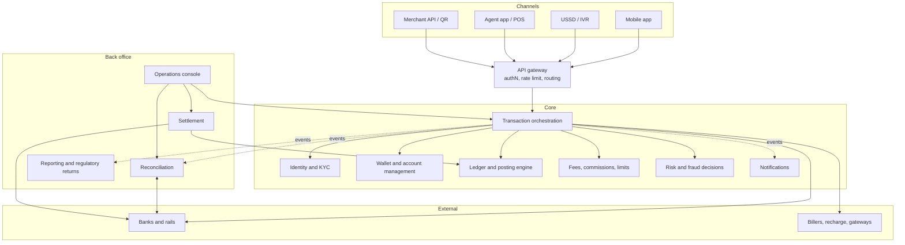

Plain-language reading: channels reach one gateway; **transaction orchestration** coordinates specialist components; only the **ledger** records money; back-office components consume events and external files; external parties never touch the ledger directly.

### Micro-topics: onboarding and accounts

| # | Micro-topic | What it is and why it matters | Depends on | MFS application | Exercise |
|---|---|---|---|---|---|
| 5.1 [E] | Customer registration | Collect identity attributes, verify phone ownership, create a pending profile. | Phase 2 | Self-registration or agent-assisted registration. | Implement registration states and OTP verification stub. |
| 5.2 [E] | KYC and e-KYC | Identity verification levels; e-KYC uses digital identity checks (VERIFY the current national requirements and approved methods). | 5.1 | Tiered wallets: higher verification, higher limits. | Model KYC tiers as data; attach limits per tier. |
| 5.3 [E] | Identity vs profile vs wallet | A person has one identity, possibly several wallets, each with a status and tier. | 5.1 | Dormant wallet reactivation. | Draw the entities and write lifecycle rules. |
| 5.4 [E] | Wallet lifecycle and status | PENDING, ACTIVE, DORMANT, FROZEN, CLOSED with allowed transitions and who may trigger them. | 5.3 | Compliance freeze during investigation. | Implement a state machine with a transition table and audit. |
| 5.5 [E] | PIN management | PIN set/change/reset, hashed with a slow salted hash or handled via HSM-style verification; attempt counters and lockouts. | 5.4 | PIN retry lockout. | Implement attempt counters that are atomic and survive restarts. |
| 5.6 [E] | Device binding and authentication factors | Knowledge (PIN), possession (device, SIM, OTP), inherence (biometric); binding a device to a wallet; re-binding rules. | 5.5 | SIM swap risk, new-device cooling-off. | Design a re-binding flow with risk controls. |
| 5.7 [E] | Transaction limits and customer risk profile | Per-transaction, daily, monthly, count and balance caps by tier (values are VERIFY). | 5.2 | Limit counters updated atomically. | Implement counters with a concurrency test. |
| 5.8 [E] | Agent and distributor onboarding | Business verification, float accounts, hierarchical relationships. | 5.4 | Distributor funds agent float. | Model hierarchy and float top-up. |
| 5.9 [E] | Merchant onboarding | Business verification, settlement account, MDR plan, QR or API credentials. | 5.4 | Merchant wallet plus settlement schedule. | Model merchant profile and settlement preference. |
| 5.10 [E] | Internal accounts | Fee, commission, tax, suspense, settlement, clearing and provider payable accounts. | Phase 3 | Fee income and VAT payable. | Add them to the chart of accounts with ownership rules. |
| 5.11 [E] | Bank account linking | Verifying that a bank account belongs to the customer (VERIFY allowed methods). | 5.2 | Wallet-to-bank and bank-to-wallet. | Model linked-account states. |

### Transaction state model (do not merge these)

| State family | Owner | Example values | Meaning |
|---|---|---|---|
| **Business transaction state** | Transaction service | INITIATED, PENDING, SUCCESS, FAILED, REVERSED, REFUNDED, RECONCILIATION_REQUIRED | What the customer and support should believe about the transaction. |
| **Orchestration state** | Orchestrator | CREATED, VALIDATED, FUNDS_RESERVED, SENT_TO_PROVIDER, AWAITING_CALLBACK, STATUS_INQUIRY, COMPLETING, COMPENSATING | Where the workflow engine is. |
| **Provider response status** | Adapter (raw, per provider) | ACCEPTED, DECLINED, TIMEOUT, ERROR_5XX, UNKNOWN_CODE_17 | What the external party said, in its own words. |
| **Ledger posting state** | Posting engine | NOT_POSTED, HELD, POSTED, REVERSED | Whether and how money has moved in the books. |

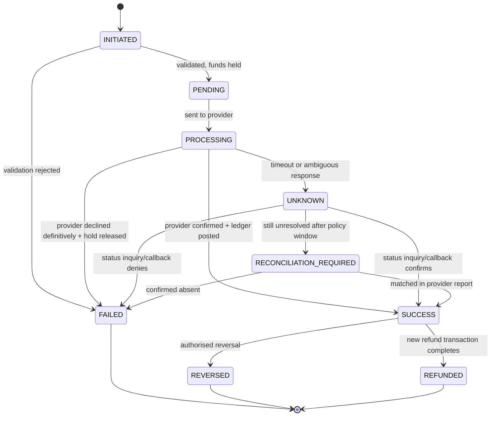

Reading: `UNKNOWN` is a first-class state, **not** a synonym for `PENDING` or `FAILED`. `PENDING` means "work is queued or in flight and we know it"; `UNKNOWN` means "we sent something and cannot prove the outcome". While `UNKNOWN`, funds stay held and the customer is told the truth ("being confirmed"). Moving out of `UNKNOWN` requires evidence: callback, status inquiry or reconciliation file.

### Micro-topics: transaction workflows

For **every** workflow, complete this template in your own design document: participants, preconditions, business rules, validations, API calls, service boundaries, state transitions, ledger postings, fees, commissions, limits, external dependencies, timeout behaviour, failure handling, reconciliation, settlement implications.

| # | Workflow | Core shape | Key design question | Exercise |
|---|---|---|---|---|
| 5.20 [E] | P2P transfer | Single provider ledger, fully internal | How do you prevent double-spend under concurrency? | Implement end to end with a concurrency test. |
| 5.21 [E] | Cash-in (via agent) | Agent e-float debited, customer credited, agent paid commission | What proves the agent really received cash? Float limits, agent confirmation, dispute handling. | Implement with agent float constraints. |
| 5.22 [E] | Cash-out (via agent) | Customer debited, agent float credited, cash leaves the agent | Hold then capture; what if the agent does not confirm? | Implement reserve/capture/release with expiry. |
| 5.23 [E] | Bank transfer (wallet to bank) | External rail; outcome may be unknown or delayed | How to treat the unknown outcome and the funds meanwhile? | Implement with a simulator that times out. |
| 5.24 [E] | Bank-to-wallet (add money) | External debit; credit wallet only after confirmation | Credit on confirmation vs on provisional advice? Risk and reversal. | Implement both and compare risk. |
| 5.25 [E] | Merchant payment (QR / API) | Customer debited, merchant payable credited, MDR fee | Merchant settlement timing and refund path. | Implement with settlement schedule. |
| 5.26 [E] | Bill payment | Wallet debited, biller notified or paid; biller outcome may be asynchronous | Who owns the customer if the biller later rejects? | Implement with a biller simulator and delayed confirmation. |
| 5.27 [E] | Mobile recharge | Fast, low value, external recharge provider | Duplicate recharge prevention. | Implement with provider reference dedupe. |
| 5.28 [A] | Salary disbursement (bulk) | Corporate funds many wallets; batch file; partial failure | Per-item results, all-or-nothing vs partial, funding check up front. | Implement batch with per-item state. |
| 5.29 [A] | Government payments (disbursement or collection) | High volume, strict audit, beneficiary lists (VERIFY applicable rules) | Beneficiary validation and exception handling. | Implement disbursement with exception queue. |
| 5.30 [E] | Refunds | A **new** transaction that returns value, linked to the original | Full vs partial, who funds it, time limits. | Implement partial refunds with remaining-refundable tracking. |
| 5.31 [E] | Reversals and cancellations | Undo a specific transaction in the books, referencing the original | Who may authorise? Which transactions are not reversible? | Implement with maker-checker approval. |
| 5.32 [E] | Fees | Rules selected by transaction type, tier, amount band, effective date | Versioned rules, stored on the transaction, rounding. | Implement rule versioning. |
| 5.33 [E] | Commissions | Share of fee or fixed amount owed to agents, distributors, partners | Accrual vs immediate payout; clawback on reversal. | Implement accrual and payout run. |
| 5.34 [A] | Agent settlement | Aggregating commissions and float adjustments into payouts | Statement generation and dispute window. | Implement settlement statement. |
| 5.35 [A] | Merchant settlement | Merchant payable swept to merchant bank account on schedule | Holidays, cut-off, chargeback-like deductions. | Implement settlement batch with cut-off. |
| 5.36 [A] | Inter-provider transfer (where applicable) | Interoperability via a switch or scheme; settlement between providers (VERIFY availability and rules) | Who owns state when the other provider is slow? | Implement with a counterparty simulator. |

### Worked flow: cash-out with hold, timeout and recovery

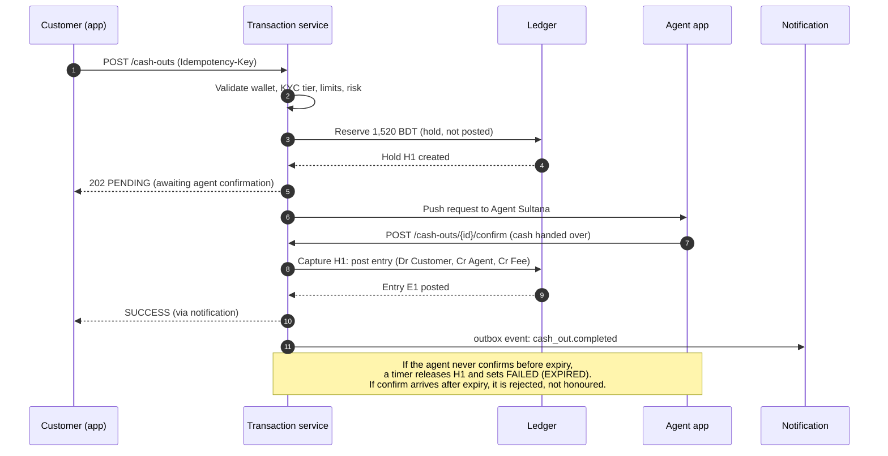

Failure scenarios to design explicitly (write the expected state, ledger effect and customer message for each): agent confirms twice; agent confirms after expiry; DB failover between hold and capture; customer wallet frozen mid-flow; notification service down; duplicate customer request; agent device offline.

### Provider timeout, late callback, duplicates, ordering (generic handling table)

| Event | Wrong reaction | Correct reaction |
|---|---|---|
| Provider times out after you sent a debit request | Mark FAILED and release funds | Mark orchestration `AWAITING_CALLBACK`, business `UNKNOWN`, keep hold, start status inquiry with backoff, set escalation deadline. |
| Callback arrives late (after you already inquired) | Process again | Dedupe by provider reference; apply only if it advances state; ignore otherwise but store it. |
| Same request submitted twice | Create two transactions | Idempotency key returns the first result or `409` if body differs. |
| Callbacks arrive out of order (SUCCESS then PENDING) | Overwrite with the latest | Apply a state machine that never moves backwards; compare provider timestamps/sequence if available. |
| Outcome cannot be determined | Guess | Move to `RECONCILIATION_REQUIRED` and resolve using provider report; never silently time out to success or failure. |
| Callback signature invalid | Process anyway | Store raw payload with `signature_ok=false`, alert, do not apply. |

### Common mistakes
- Using one `status` column for everything.
- Treating SUCCESS as "provider accepted request".
- Skipping the "who owns the customer's money while unknown" question.
- Paying commission before the underlying transaction is final, with no clawback.

### Hands-on exercises
1. Complete the workflow template for all 17 workflows (short for the advanced ones).
2. Build the wallet service, P2P, cash-in and cash-out on the Phase 3-4 foundation.
3. Write a state-transition table and unit-test every legal and illegal transition.
4. Implement merchant payments with fee and settlement schedule.

### Review questions
1. Why must UNKNOWN keep funds held?
2. What is the difference between a refund and a reversal, in data and in accounting?
3. Why is commission accrual separate from fee collection?
4. Which state belongs to the provider and which to you?

### Completion criteria
- All implemented workflows have ledger postings that pass invariants after random fault injection.
- State machine tests cover 100% of transitions, including illegal ones.
- You can narrate the cash-out failure scenarios without notes.

---

# Phase 6: API design and API security

**Tier:** Essential | **Weeks:** 3 | **Prerequisites:** Phases 4-5

### Why this phase exists
APIs are where retries, partial knowledge and attackers meet your financial core. Good API design makes unsafe usage hard.

### Learning objectives
- Design resource-oriented, versioned, idempotent financial APIs with a clear error taxonomy.
- Separate **synchronous response** from **final outcome**.
- Apply authentication, authorisation, signing, replay protection and key rotation correctly.

### Micro-topics

| # | Micro-topic | What it is and why it matters | Depends on | MFS application | Exercise |
|---|---|---|---|---|---|
| 6.1 [E] | Resource modelling | Resources (transfers, cash-outs, holds) vs RPC-style verbs; commands as resources. | Phase 5 | `POST /v1/transfers` creates a transfer resource. | Model 10 resources and their lifecycle endpoints. |
| 6.2 [E] | Idempotency keys | Client-supplied unique key per intended operation; server stores result and replays it. | 4.14 | App retries after network error. | Implement middleware with in-progress handling and request-hash mismatch error. |
| 6.3 [E] | Transaction reference and correlation/trace ids | Business reference (customer-visible), correlation id (cross-system), trace id (distributed tracing). | 6.1 | Support finds a transaction in all systems. | Propagate ids across API, Celery and outbox events. |
| 6.4 [E] | Sync response vs final outcome | `201` with `SUCCESS` only if final; `202 Accepted` + status resource + callback otherwise. | 6.1 | Bank transfer returns `202 PENDING`. | Design status endpoint and polling guidance (ETA, `Retry-After`). |
| 6.5 [E] | Validation and error taxonomy | Stable, machine-readable errors, categorised as client, business-rule, retryable, unknown. | 6.1 | `INSUFFICIENT_FUNDS`, `LIMIT_EXCEEDED`, `OUTCOME_UNKNOWN`. | Write an error catalogue with retry guidance for each. |
| 6.6 [E] | Pagination, filtering, sorting | Keyset (cursor) pagination on immutable ordered keys. | 6.1 | Transaction history. | Implement keyset pagination and compare with offset on large data. |
| 6.7 [E] | Versioning and backward compatibility | URL or header versioning, additive changes, deprecation policy. | 6.1 | Mobile apps in the field for years. | Define a compatibility policy and a contract test. |
| 6.8 [E] | OpenAPI and contract testing | Machine-readable contract driving docs, mocks and tests. | 6.7 | Provider and partner integration. | Generate OpenAPI from DRF and run contract tests. |
| 6.9 [E] | AuthN and AuthZ | OAuth 2.0 and OpenID Connect for partners/back-office; device-bound sessions for customers; role- and attribute-based authorisation; resource-level checks. | 6.1 | A customer may act only on own wallets. | Write tests for broken object-level authorisation. |
| 6.10 [E] | JWT handling | Short lifetimes, audience, key rotation, no sensitive data in tokens. | 6.9 | Session tokens. | Implement validation with key rotation (`kid`). |
| 6.11 [A] | Transport and message security | TLS, mutual TLS between services/partners, HMAC and RSA request signatures, canonicalisation, timestamp and nonce. | 6.9 | Partner callbacks and bank APIs. | Implement HMAC signing and verification with canonical string and clock-skew window. |
| 6.12 [A] | Replay protection | Reject reused nonce or old timestamps; combine with idempotency. | 6.11 | Duplicate callback attack. | Implement nonce store with TTL. |
| 6.13 [A] | Webhook and callback authentication | Verify signature, source, schema; respond fast; process asynchronously. | 6.11 | Provider callbacks. | Implement callback endpoint that stores, verifies, acks, processes later. |
| 6.14 [E] | Secure PIN handling | Never log PINs; transmit encrypted; verify server-side; throttle. | 5.5 | PIN entry in app/USSD. | Implement masked logging and test no PIN appears in logs. |
| 6.15 [E] | Secrets, encryption, masking | Encryption at rest, field-level encryption for sensitive identifiers, masking in logs and UI, least privilege, audit logging. | 6.9 | Mask phone/ID in logs. | Add a log filter and a test that asserts masking. |
| 6.16 [A] | Timeout budgets and rate limiting | Allocate time per hop; limit per user, device, IP, partner. | 6.4 | Gateway 10 s budget split among services. | Compute and enforce a budget; add token-bucket limiter. |
| 6.17 [A] | Provider-specific adapters at API level | Keep provider quirks out of your public API and domain model. | 6.1 | Normalised `PaymentResult`. | Create a normalised result schema and two adapters. |

### Sample API exchange (fictional)

```http
POST /v1/transfers HTTP/1.1
Authorization: Bearer <token>
Idempotency-Key: 6f1f2c3a-9b0e-4b7e-a2f4-0d1c9a7e1111
X-Correlation-Id: c-20261102-8f21
Content-Type: application/json

{
  "from_wallet_id": "w_rina_001",
  "to_msisdn": "+8801XXXXXXXXX",
  "amount": {"value": "1000.00", "currency": "BDT"},
  "purpose": "FAMILY_SUPPORT",
  "quote_id": "q_7712"
}
```

```http
HTTP/1.1 201 Created
Location: /v1/transfers/tr_01HZ0000EXAMPLE
Content-Type: application/json

{
  "id": "tr_01HZ0000EXAMPLE",
  "reference": "TRX20261102A8F2",
  "state": "SUCCESS",
  "amount": {"value": "1000.00", "currency": "BDT"},
  "fee": {"value": "5.00", "currency": "BDT"},
  "completed_at": "2026-11-02T10:15:30Z"
}
```

Asynchronous variant for an external bank leg:

```http
HTTP/1.1 202 Accepted
Location: /v1/bank-transfers/bt_01HZ0000EXAMPLE
Retry-After: 5

{
  "id": "bt_01HZ0000EXAMPLE",
  "state": "PENDING",
  "message": "Your transfer is being processed. We will notify you.",
  "next_check_after_seconds": 5
}
```

Error taxonomy example:

```json
{
  "error": {
    "code": "OUTCOME_UNKNOWN",
    "category": "UNKNOWN",
    "retryable_with_same_key": true,
    "message": "We could not confirm the result. Do not retry with a new key.",
    "transaction_id": "bt_01HZ0000EXAMPLE"
  }
}
```

Reading: the client is told to retry **only with the same idempotency key**. A new key would be a new intention to pay.

### Core APIs to design (write the OpenAPI yourself)

| API | Key points |
|---|---|
| Initiate payment | Idempotency key, quote id, returns 201 final or 202 pending. |
| Check status | Cheap, cacheable for terminal states, returns all four state families to internal callers and a simplified state to customers. |
| Provider callback | Signature check, store raw, ack quickly, process asynchronously, idempotent. |
| Refund | References original transaction, remaining-refundable amount check, maker-checker for large values. |
| Query balance | Returns ledger, reserved, available, `as_of`; clearly **not** an authorisation. |
| Reserve funds | Internal only; returns hold id and expiry. |
| Post ledger transaction | Internal only; takes posting reference; idempotent; returns entry id. |
| Initiate settlement | Back-office only, maker-checker, references a settlement batch. |

### Common mistakes
- Returning `SUCCESS` before the money has moved or is final.
- Treating `5xx` or timeout as "not processed" and retrying with a new key.
- Putting provider-specific fields into the public API.
- Logging full request bodies containing PINs or IDs.
- Authorising by wallet id in the request body without ownership checks.

### Hands-on exercises
1. OpenAPI 3 contract for the eight APIs above, with examples and error catalogue.
2. Idempotency middleware with tests for: same key same body, same key different body, concurrent same key, expired key.
3. HMAC-signed callback endpoint with replay protection and key rotation.
4. Authorisation test suite for broken object-level access.

### Review questions
1. Why must a status endpoint exist even if callbacks exist?
2. Why is HMAC alone insufficient against replay?
3. What should the server do when it sees the same idempotency key with a different body?
4. How do you design APIs so clients know when it is unsafe to retry?

### Completion criteria
- Contract tests pass against the running service.
- Idempotency under concurrency proven by test.
- No secret, PIN or full identifier appears in logs (tested automatically).

---

# Phase 7: Distributed systems

**Tier:** Essential/Advanced | **Weeks:** 4 | **Prerequisites:** Phases 4-6

### Why this phase exists
The moment a financial operation spans a database, a queue, a provider and a notification service, local ACID no longer implies end-to-end correctness. This phase teaches you to reason about partial failure.

### Learning objectives
- Explain failure modes (partition, partial failure, timeout ambiguity, duplicate/lost/reordered messages) and the guarantees you can truly build.
- Implement outbox, inbox, saga, retries with backoff and jitter, circuit breaker and bulkhead.
- Choose orchestration vs choreography, and know when event sourcing/CQRS help or hurt.

### Why local success is not end-to-end success

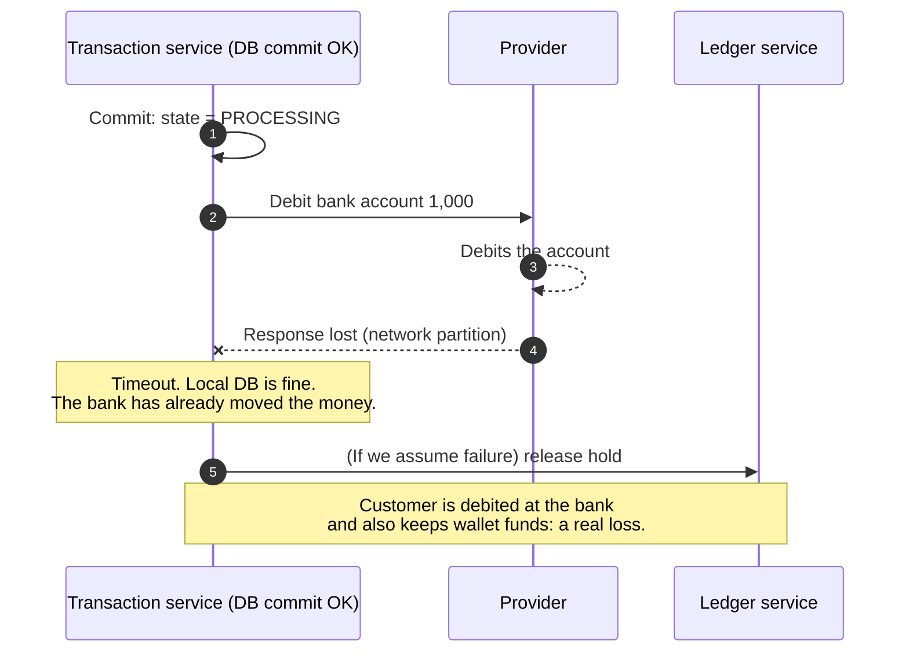

Reading: the local transaction committed, yet the end-to-end operation is **inconsistent** because the provider acted and we never learned. The only safe move is `UNKNOWN`, then inquiry and reconciliation.

### Micro-topics

| # | Micro-topic | What it is and why it matters | Depends on | MFS application | Exercise |
|---|---|---|---|---|---|
| 7.1 [E] | Fallacies of distributed computing | Network is unreliable, latency non-zero, topology changes. | none | Every provider integration. | List the fallacies with an MFS incident for each. |
| 7.2 [E] | Partial failure and timeout ambiguity | A timeout tells you nothing about the remote effect. | 7.1 | Debit request to a bank. | Build a simulator that executes the effect but drops the response. |
| 7.3 [E] | Delivery semantics | At-most-once, at-least-once, effectively-once. Exactly-once delivery across systems is not generally achievable; effectively-once = at-least-once + idempotent handling. | 7.2 | Consumer processing payment events. | Prove with a test that duplicate delivery does not duplicate postings. |
| 7.4 [E] | Retries, exponential backoff, jitter | Spacing retries, randomising to avoid synchronised storms. | 7.2 | Status inquiry against a rate-limited bank. | Implement full-jitter backoff with caps and budgets. |
| 7.5 [E] | Safe vs unsafe retries | Reads and idempotent writes are safe; non-idempotent money operations are unsafe without keys or inquiry. | 7.4 | Re-sending a debit. | Classify every external call in your system. |
| 7.6 [E] | Idempotent consumers / inbox pattern | Store processed message ids in the same transaction as the effect. | 7.3 | Ledger posting from an event. | Implement `inbox` table with unique `(consumer, message_id)`. |
| 7.7 [E] | Transactional outbox | State change and event row commit atomically; a relay publishes at-least-once. | 4.15 | Notifications, downstream services. | Implement relay with `SKIP LOCKED` and publish-then-mark. |
| 7.8 [A] | Change data capture | Stream database changes as events (log-based). | 7.7 | Feed warehouse and search. | Compare CDC to polling outbox for your needs. |
| 7.9 [E] | Saga: orchestration and choreography | Long-running workflows made of local transactions plus compensations. | 7.7 | Bank transfer with hold, send, post, release. | Implement orchestrated saga with persisted state. |
| 7.10 [E] | Compensating transactions | Business-level undo (not DB rollback). Some steps cannot be compensated (cash handed over). | 7.9 | Release hold; reverse posting. | Mark each saga step as compensatable or pivot/irreversible. |
| 7.11 [A] | Two-phase commit and why it is rarely used across providers | Blocking, coordinator failure, unsupported by external parties. | 7.9 | Not feasible with banks. | Write a short note: when 2PC is acceptable (single trusted datastore group). |
| 7.12 [A] | Event sourcing | Store events as truth, derive state. Powerful audit but costly to evolve; a ledger is already event-like. | 7.7 | Alternative ledger design. | Prototype an event-sourced wallet and compare complexity. |
| 7.13 [A] | CQRS and read models | Separate write model from read models fed by events. | 7.12 | Fast history and dashboards. | Build a history read model with rebuild-from-ledger tool. |
| 7.14 [E] | Circuit breaker, bulkhead, timeout, rate limiting | Stop calling failing dependencies, isolate pools, bound waits, protect capacity. | 7.4 | Provider outage must not exhaust all workers. | Implement breaker with half-open probing and per-provider pools. |
| 7.15 [A] | Load shedding, backpressure, graceful degradation | Reject or queue work to protect the core; disable non-critical features first. | 7.14 | Eid peak: disable heavy history queries before payments. | Define a degradation ladder and test it. |
| 7.16 [A] | Leader election and distributed locks | Single-active jobs; locks need fencing tokens; avoid for correctness-critical state. | 7.2 | Scheduler for settlement jobs. | Implement DB advisory-lock leader with fencing id. |
| 7.17 [A] | Time, ordering, clock skew | Wall clocks lie; use logical order (DB sequence, event offsets) for correctness. | 7.1 | Late callbacks and ordering. | Show a bug caused by comparing client timestamps. |
| 7.18 [A] | Message brokers: Kafka concepts | Topics, partitions, keys, consumer groups, offsets, rebalances, retention, compaction, DLQ patterns. | 7.3 | Events keyed by wallet or transaction id for ordering. | Build producer/consumer with key-based ordering and DLQ. |
| 7.19 [A] | Schema evolution and event versioning | Backward/forward-compatible schemas, registry, upcasters. | 7.18 | Adding a field to `transfer.completed`. | Version an event without breaking old consumers. |
| 7.20 [A] | Reconciliation-based recovery | Accepting that some failures are only resolved by comparison with the outside world. | Phase 11 | Unknown provider outcomes. | Link saga unknown paths to reconciliation tasks. |

### Orchestration vs choreography (decision guide)

| Question | Prefer orchestration | Prefer choreography |
|---|---|---|
| Is there a clear business process with money at risk? | Yes: one owner of state, easy audit | No |
| Do you need to answer "where is this transaction now?" | Yes | Harder |
| Are many independent consumers reacting to a fact? | No | Yes (notifications, analytics) |
| Team autonomy over steps? | Lower | Higher |

Rule: use **orchestration for money-moving workflows** and **choreography for side effects** (notifications, analytics, search).

### Outbox relay sketch

```python
def relay_batch(publish, batch_size=100):
    with transaction.atomic():
        rows = list(OutboxEvent.objects.select_for_update(skip_locked=True)
                    .filter(published_at__isnull=True).order_by("id")[:batch_size])
        for row in rows:
            publish(topic=row.event_type, key=str(row.aggregate_id), value=row.payload)
        OutboxEvent.objects.filter(id__in=[r.id for r in rows]).update(published_at=now())
```

Reading: if the process crashes after `publish` but before the update, events publish again. That is **at-least-once**, which is why consumers must be idempotent.

### Common mistakes
- Believing "exactly-once" delivery removes the need for idempotent consumers.
- Using Redis locks as the only safety for money correctness.
- Retrying all errors, including business rejections.
- Ordering by client time.
- Building sagas without persisted state, so restart loses progress.

### Hands-on exercises
1. Fault-injection simulator: drop responses, delay, duplicate, reorder; run your saga through it 10,000 times and assert invariants.
2. Outbox + inbox end-to-end lab with a crash between each step.
3. Circuit breaker and bulkhead lab with a slow provider.
4. Kafka (or equivalent) lab: partition key for ordering, consumer lag, rebalance, DLQ, replay.

### Review questions
1. Why is effectively-once = at-least-once + idempotency?
2. Which saga steps in a cash-out are not compensatable?
3. When is a distributed lock acceptable, and what must accompany it?
4. What breaks if two consumers handle the same wallet's events in parallel?

### Completion criteria
- 10,000-run fault-injection suite passes with all ledger invariants intact.
- You can explain every arrow of the "local success is not end-to-end success" diagram and the fix.

---

# Phase 8: Domain-driven design and microservices

**Tier:** Advanced | **Weeks:** 3 | **Prerequisites:** Phases 5, 7

### Why this phase exists
Wrong service boundaries are the most expensive fintech architecture mistake. This phase teaches how to find boundaries and when **not** to split.

### Learning objectives
- Identify bounded contexts and a ubiquitous language for MFS.
- Decide, with criteria, whether each capability is a module or a service.
- Recognise the costs of premature decomposition in a financial system.

### Micro-topics

| # | Micro-topic | What it is and why it matters | Depends on | MFS application | Exercise |
|---|---|---|---|---|---|
| 8.1 [A] | Ubiquitous language | One shared vocabulary per context ("transaction" means different things to ledger and to orchestration). | Phase 3 | Glossary per context. | Write a glossary exposing conflicting terms. |
| 8.2 [A] | Bounded contexts and context maps | Explicit boundaries and relationships (customer/supplier, conformist, anti-corruption layer, shared kernel). | 8.1 | Identity, Wallet, Ledger, Transaction, Fee, Limits, Risk, KYC, Notification, Reconciliation, Settlement, Merchant, Reporting. | Draw the context map with relationship types. |
| 8.3 [A] | Entities, value objects, aggregates, aggregate roots | Consistency boundaries: one transaction modifies one aggregate. | 8.2 | `Money` value object; `Wallet` aggregate; `Hold` entity. | Implement `Money` value object with currency-safe arithmetic. |
| 8.4 [A] | Repositories, domain services, application services | Where logic lives; thin views, rich domain, orchestration in application layer. | 8.3 | Posting domain service; transfer application service. | Refactor a fat Django view into layers. |
| 8.5 [A] | Domain events vs integration events | Internal facts vs published contracts with versioning. | 8.4 | `LedgerEntryPosted` (domain) vs `transfer.completed.v1` (integration). | Define both and the mapping. |
| 8.6 [A] | Anti-corruption layer | Translate external models to your domain model. | 8.2 | Provider adapters (Phase 9). | Build ACL for a fictional bank's data model. |
| 8.7 [A] | Modular monolith | One deployable with enforced module boundaries and separate schemas/apps. | 8.2 | Start here. | Enforce boundaries with import rules and per-module tables. |
| 8.8 [A] | Microservices, database-per-service, shared-DB risks | Independent deployability vs distributed complexity; shared DB couples releases and breaks invariants. | 8.7 | Fraud scoring service. | List the invariants that would break if two services wrote the same table. |
| 8.9 [A] | Decomposition criteria | Different scaling profile, different release cadence, different security boundary, different team, different failure isolation need. | 8.8 | Per-capability decision below. | Score each capability and justify. |
| 8.10 [A] | Platform plumbing | API gateway, BFF, service discovery, centralised config, secrets, service-to-service authN/authZ (mTLS, JWT). | 8.8 | Channel-specific BFFs for app, USSD, agent. | Sketch the gateway and BFF design. |
| 8.11 [A] | Sync vs async communication | REST, gRPC vs events; temporal coupling; fallback behaviour. | 7.3 | Transaction to Limits is sync; to Notification is async. | Decide per interaction and document failure behaviour. |
| 8.12 [A] | Risks of over-decomposition | Distributed transactions, duplicated rules, cross-service joins, inconsistent state, operational overhead. | 8.8 | Splitting wallet and ledger into services with separate DBs. | Write a pre-mortem for a 20-service design. |
| 8.13 [A] | Evolution from monolith to distributed | Strangler pattern, extracting by seam, data migration. | 8.7 | Extract notification first, ledger last. | Plan extraction order with rollback. |

### Service or module? (HYPOTHETICAL starting recommendation, to be challenged by you)

| Capability | Start as | Reason | Split when |
|---|---|---|---|
| Ledger and posting engine | Module (own schema), protect strictly | Needs single-database ACID with wallets for spend authorisation | Throughput exceeds a single primary after all tuning, and you have designed a safe cross-database approach. |
| Wallet management | Same deployable as ledger initially | Balance checks and postings are tightly coupled | Same as ledger. |
| Transaction orchestration | Module, later service | Owns workflow state; scales with provider calls | Distinct scaling or team ownership. |
| Customer identity | Module/service | Different data sensitivity and change cadence | Security boundary or separate team. |
| KYC / e-KYC | Service | External integrations, document storage, different risk | Early split is common and low risk. |
| Fraud detection | Service (decision API) + pipeline | Different tech (ML, streaming), different SLOs | When rules/models outgrow the core. |
| Fees, commissions, limits | Module with data-driven rules | Rules change often but must be consistent with posting | Rarely; keep close to transaction. |
| Notifications | Service | Failure must never affect money movement | Early split is safe (event-driven). |
| Reconciliation | Service/batch system | Reads files, heavy compute, separate cadence | Early split is safe. |
| Settlement | Service/batch system | Operational cadence, approvals | Early split is safe. |
| Reporting | Service on read models | Heavy queries must not hit OLTP | Early. |
| Merchant management | Module/service | Onboarding workflows differ from payments | When team grows. |

### Common mistakes
- Splitting by technical layer (a "database service") rather than by business capability.
- Giving two services write access to the same ledger tables.
- Duplicating fee rules in several services.
- Choosing microservices before you have observability, CI/CD and on-call.

### Hands-on exercises
1. Context map for the simulated MFS with relationship types and ubiquitous-language glossary.
2. Convert your Django project into a modular monolith with enforced boundaries.
3. Extract Notification into a separate service fed by the outbox; measure operational cost.
4. Write an ADR: "Ledger remains in the core database".

### Review questions
1. Why is "one aggregate per transaction" a useful rule?
2. What breaks when the wallet service and ledger service use different databases?
3. Which capabilities are safe to extract early, and why?
4. What is an anti-corruption layer protecting you from?

### Completion criteria
- Context map reviewed by a peer, with explicit relationship types.
- Modular-monolith boundaries enforced automatically in CI.
- A written decomposition decision for every capability in the table, with triggers for revisiting it.

---

# Phase 9: Payment orchestration and external integrations

**Tier:** Essential/Advanced | **Weeks:** 4 | **Prerequisites:** Phases 6-8

### Why this phase exists
Real money systems talk to banks, billers, switches and recharge providers with inconsistent APIs, unreliable networks and different definitions of success.

### Learning objectives
- Build a provider-adapter framework with a normalised model.
- Handle timeouts, callbacks, duplicates and unknown outcomes safely.
- Explain why blind retries cause duplicate financial effects and how to avoid them.

### Orchestration architecture (HYPOTHETICAL, generic)

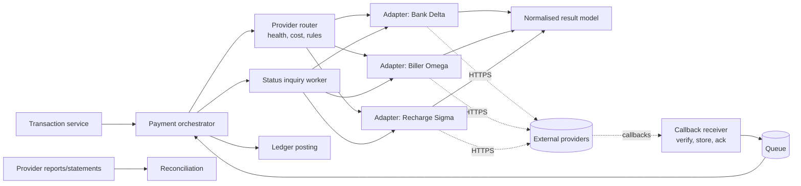

Plain reading: the **router** picks a provider; **adapters** isolate provider quirks and map to a **normalised** model; callbacks are stored then queued; a **status inquiry worker** resolves unknowns; reports feed reconciliation.

### Micro-topics

| # | Micro-topic | What it is and why it matters | Depends on | MFS application | Exercise |
|---|---|---|---|---|---|
| 9.1 [E] | Provider adapter pattern | One interface (`initiate`, `inquire`, `parse_callback`, `cancel`), one implementation per provider. | 8.6 | Bank, biller, recharge, card-processor adapters. | Define the abstract adapter and implement two fake providers. |
| 9.2 [E] | Normalised transaction model | Internal statuses mapped from raw provider codes; raw codes retained. | 9.1 | `SUCCESS/DECLINED/PENDING/UNKNOWN` plus raw. | Build mapping tables as data with default-to-UNKNOWN. |
| 9.3 [E] | Request/response mapping and canonicalisation | Field mapping, units, encodings, date/timezone, amount formats. | 9.1 | Amount in poisha vs decimal string. | Property-test round-trips. |
| 9.4 [E] | Signature generation and verification | HMAC/RSA signing of outbound, verification of inbound, key rotation. | 6.11 | Bank callbacks. | Implement verify-before-parse. |
| 9.5 [E] | Timeouts and retry policy | Connect/read timeouts, retry only when safe, jittered backoff. | 7.4 | Different policies for initiate vs inquire. | Write a retry policy table per call type. |
| 9.6 [E] | Provider status inquiry | Ask the provider for the true state of a transaction by reference. | 9.1 | Resolving UNKNOWN. | Implement inquiry schedule: short at first, then widening, then escalate. |
| 9.7 [E] | Callback processing | Store raw, verify, dedupe, apply transitions, ack fast. | 6.13 | Late and duplicate callbacks. | Implement idempotent callback processor with state-machine guard. |
| 9.8 [E] | Duplicate prevention | Provider reference/idempotency token passed to the provider where supported; own reference as correlation otherwise. | 9.1 | Recharge duplicates. | Test: replay timeout path without double recharge. |
| 9.9 [E] | Unknown outcome recovery workflow | Hold funds, inquire, wait for callback, check report, escalate to manual with SLA. | 9.6 | Cash-out to bank timeouts. | Implement the full workflow with a timer and escalation queue. |
| 9.10 [A] | Provider routing and failover | Route by health, cost, success rate, amount, time; fail over only when **safe** (no possible duplicate). | 9.5 | Two banks for the same rail. | Implement routing with a "may failover?" check that requires a definitive failure. |
| 9.11 [A] | Circuit breakers per provider | Open on error ratio; half-open probing. | 7.14 | Provider downtime. | Implement and chart behaviour under injected outage. |
| 9.12 [A] | Rate limits and throttling | Respect partner limits; queue and smooth. | 9.5 | Status inquiry bursts. | Implement token-bucket per provider. |
| 9.13 [A] | Sandbox vs production differences | Different behaviour, data and timing; sandbox success proves little. | 9.1 | Certification checklists. | Create a test matrix showing behaviours only testable in production-like conditions. |
| 9.14 [A] | Reconciliation files and reports | Ingest provider files with formats and schedules. | Phase 11 | Daily biller settlement file. | Parse a synthetic CSV/fixed-width file with schema validation. |
| 9.15 [A] | Message standards | ISO 8583 for cards, ISO 20022 for credit transfers/statements (conceptual). | 1.11 | Mapping bank statements. | Map one ISO 20022 statement entry to your reconciliation record. |

### Why blind retry duplicates money

```mermaid
sequenceDiagram
    participant O as Orchestrator
    participant B as Bank (fictional)
    O->>B: Debit 1,000 (ref R1)
    B-->>B: Debit executed
    B--xO: response lost
    O->>B: Retry: Debit 1,000 (ref R2)  %% wrong: new reference
    B-->>B: Second debit executed
    B-->>O: OK (for R2)
    Note over O,B: Customer debited twice. Two safe options:<br/>1) retry with the SAME reference R1 if the bank dedupes<br/>2) never retry; inquire status for R1 first
```

### Safe recovery workflow (UNKNOWN outcome)

1. Persist attempt with a **stable provider reference** *before* sending.
2. On timeout: set business `UNKNOWN`, orchestration `AWAITING_CONFIRMATION`; keep hold.
3. Schedule `inquire(ref)` at increasing intervals; accept callbacks meanwhile.
4. If provider says **definitely not processed**: release hold, set `FAILED` with evidence stored.
5. If provider says **processed**: capture hold and post ledger; set `SUCCESS`.
6. If provider says unknown/not found *and* its documentation allows delay: wait per policy.
7. After the policy window: `RECONCILIATION_REQUIRED`; final decision from provider report, with maker-checker for manual outcomes.
8. Alert on `UNKNOWN` age; **never auto-fail** on elapsed time alone.

### Adapter interface sketch

```python
from dataclasses import dataclass
from enum import Enum

class Outcome(str, Enum):
    SUCCESS = "SUCCESS"; DECLINED = "DECLINED"; PENDING = "PENDING"; UNKNOWN = "UNKNOWN"

@dataclass(frozen=True)
class ProviderResult:
    outcome: Outcome
    provider_ref: str | None
    raw_code: str | None
    raw_payload: dict
    definitive: bool          # True only if provider proves the final state

class ProviderAdapter:
    code: str
    def initiate(self, instruction) -> ProviderResult: ...
    def inquire(self, provider_ref: str) -> ProviderResult: ...
    def parse_callback(self, headers, body) -> ProviderResult: ...   # verifies signature first
```

Key rule: map **every unrecognised code to `UNKNOWN`**, never to `FAILED`.

### Common mistakes
- Mixing provider status with internal status in one column.
- Failing over to a second provider after a timeout on the first (possible double payment).
- Trusting sandbox results.
- Calling providers inside a DB transaction holding locks.
- Not storing raw provider payloads (impossible to investigate later).

### Hands-on exercises
1. Build a provider simulator with switches: delay, drop response, duplicate callback, out-of-order callback, wrong signature, rate limit, outage.
2. Implement two adapters and the orchestrator; run a chaos suite; assert zero duplicates and zero stuck holds.
3. Implement inquiry scheduler and escalation queue.
4. Write a go-live checklist for a new provider integration.

### Review questions
1. When is failover to a second provider safe?
2. Why must the provider reference exist before the request is sent?
3. How do you treat a provider response code you have never seen?
4. What evidence must be stored to resolve a dispute months later?

### Completion criteria
- Chaos suite (1,000+ scenarios) ends with zero duplicate effects and all holds resolved or escalated.
- Every provider status in your mapping has a documented default.

---

# Phase 10: Clearing and settlement

**Tier:** Essential/Advanced | **Weeks:** 3 | **Prerequisites:** Phases 3, 9

### Why this phase exists
Customers see instant success. Between institutions, money still has to move, obligations must be netted and cut-offs honoured. If you do not model settlement, your ledger will drift from your bank accounts.

### Learning objectives
- Distinguish clearing, settlement and finality for each flow.
- Model settlement cycles, windows, cut-offs, holidays, prefunding, gross/net settlement and settlement batches.
- Build a settlement engine with instructions, approvals and ledger postings.

### Micro-topics

| # | Micro-topic | What it is and why it matters | Depends on | MFS application | Exercise |
|---|---|---|---|---|---|
| 10.1 [E] | Settlement cycles and windows | When obligations accumulate and are settled (T+0, T+1, intraday; VERIFY actual rail cycles). | 1.7 | Merchant and biller settlement. | Model cycles as data with cut-off times and time zones. |
| 10.2 [E] | Cut-off times and holidays | Business days, bank holidays, weekend handling. | 10.1 | Eid holidays delaying settlement. | Implement a business-day calendar service. |
| 10.3 [E] | Gross vs net settlement | Per-transaction vs netted per counterparty and cycle. | 1.8 | Daily net with a bank. | Implement netting for 10,000 synthetic transactions. |
| 10.4 [E] | Prefunding and liquidity | Pre-positioned funds covering obligations; monitoring and top-up. | 10.3 | Agent float, bank settlement account balances. | Build a liquidity monitor with thresholds. |
| 10.5 [E] | Settlement instruction and batch | A document describing who pays whom how much by when, with line-level traceability. | 10.3 | Merchant payout batch. | Model `settlement_batch` and `settlement_line` with line-to-transaction links. |
| 10.6 [E] | Settlement accounts and postings | Payable, receivable, clearing and bank accounts. | Phase 3 | Dr Merchant payable, Cr Bank settlement. | Post settlement events, including failures. |
| 10.7 [E] | Approvals and maker-checker | Separate preparer and approver, with audit. | 10.5 | Large settlements. | Implement dual control with role separation. |
| 10.8 [E] | Settlement failure handling | Rejected instructions, wrong account, partial credit, returns. | 10.6 | Return of a merchant payout. | Implement return postings and retry. |
| 10.9 [A] | Settlement finality | When the settlement can no longer be reversed (rail-specific, VERIFY). | 1.12 | Release funds only after finality. | Mark each settlement type with finality events. |
| 10.10 [A] | Fees and taxes in settlement | MDR, VAT-like taxes, withholding handled by configured rules (VERIFY applicable tax rules). | 10.5 | Net-of-fee merchant payout. | Add fee and tax lines to settlement. |
| 10.11 [A] | Agent and distributor settlement | Float adjustments, commission payout, cash-bank deposits by agents. | 5.34 | Agent bank deposit reconciled to float top-up. | Implement an agent settlement statement. |

### Settlement flow

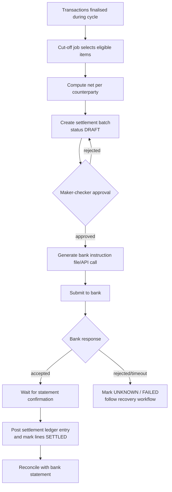

Reading: ledger posting for the *cash* movement happens when you have evidence of it (bank confirmation or statement), not when you merely sent the file. The batch is a **document with its own state machine** (DRAFT, APPROVED, SUBMITTED, CONFIRMED, FAILED, PARTIALLY_SETTLED).

### Common mistakes
- Treating internal "SUCCESS" as settled.
- Settling on holidays without a calendar.
- Netting without line-level traceability (impossible to explain disputes).
- No approval and audit on manual settlement actions.

### Hands-on exercises
1. Implement a settlement engine for merchants: cut-off, net, batch, approval, bank-file generation (synthetic), confirmation by statement.
2. Add failure cases: partial credit, return after success, duplicate file submission.
3. Build a liquidity dashboard with projected shortfall.

### Review questions
1. Why not mark settled when the file is sent?
2. What is netting, and what information must survive it?
3. Who bears loss if a settlement fails after merchants have been told "paid"?

### Completion criteria
- Settlement engine passes tests for duplicates, partial failures and returns with ledger invariants intact.
- Every batch line is traceable to originating transactions and to a ledger entry.

---

# Phase 11: Reconciliation

**Tier:** Essential | **Weeks:** 4 | **Prerequisites:** Phases 9-10

### Why this phase exists
Reconciliation is the safety net under every other control. Retries, callbacks, timeouts, operators and bugs all create drift. A reconciliation engine proves your books match external reality and forces every difference into a visible, owned, aged queue.

### Learning objectives
- Design a reconciliation engine that compares internal ledgers with bank statements and provider reports.
- Classify breaks, match automatically, route to investigation and resolve with audited ledger adjustments.
- Make reprocessing idempotent and prevent silent ignoring of differences.

### Micro-topics

| # | Micro-topic | What it is and why it matters | Depends on | MFS application | Exercise |
|---|---|---|---|---|---|
| 11.1 [E] | Reconciliation types | Internal vs internal (ledger vs wallet balances), internal vs bank statement, internal vs provider report, three-way (internal, provider, bank). | Phase 10 | Nightly ledger integrity and daily bank match. | Draw all four types for your simulated MFS. |
| 11.2 [E] | Source ingestion | Parse files/APIs, validate schema, checksum, record file identity, make ingestion idempotent. | 9.14 | Daily statement from a fictional bank. | Ingest the same file twice; assert no duplicates. |
| 11.3 [E] | Normalisation | Map each source to a common record: reference, amount, currency, value date, direction, counterparty. | 11.2 | Different date and amount formats. | Write a normaliser per source with tests. |
| 11.4 [E] | Matching rules | Exact on reference + amount; fallbacks (amount + date + counterparty); tolerance rules; one-to-many and many-to-one (batch lines). | 11.3 | Settlement batch vs one bank credit line. | Implement a rule pipeline with ordered rules and confidence labels. |
| 11.5 [E] | Break taxonomy | Unmatched internal, unmatched external, duplicate, amount mismatch, fee discrepancy, timing difference, status mismatch. | 11.4 | See table below. | Generate each break type in synthetic data and detect it. |
| 11.6 [E] | Suspense handling | Unidentified items are parked in a suspense account with ageing, owner and deadline. | 3.17 | Unknown bank credit. | Implement suspense postings and an ageing report. |
| 11.7 [E] | Investigation workflow | Assign, annotate, request provider evidence, propose resolution, approve, post adjustment. | 11.5 | Support-driven disputes. | Implement a break case with states and SLA timers. |
| 11.8 [E] | Resolution and adjusting entries | Fixes are new ledger entries or provider-side corrections, never edits. | 3.11 | Credit a customer after confirmed provider debit. | Post resolution entries referencing the break id. |
| 11.9 [E] | Idempotent reprocessing | Re-running a day must converge to the same result and not duplicate cases or postings. | 11.2 | Rerun after a late file. | Run a day three times; assert identical state. |
| 11.10 [E] | Auditability and no silent ignoring | Every run, rule result, manual action and closure stored; unresolved items escalate by age. | 11.7 | Regulator or auditor evidence. | Implement a "runs without a closed outcome" alert. |
| 11.11 [A] | Timing and cut-off differences | Transactions near cut-off appear on different days in different systems. | 10.2 | Late-night transactions. | Add value-date logic and a "timing break" classification that auto-clears next day. |
| 11.12 [A] | Volume engineering | Partitioned processing, batch matching with indexes, streaming matching, backfills. | 11.4 | Millions of rows per day. | Match 5 million synthetic records in a bounded time and memory budget. |
| 11.13 [A] | Continuous / intraday reconciliation | Detect drift sooner than end of day. | 11.12 | Pending-age monitoring and provider status sweeps. | Add hourly sweeps for UNKNOWN transactions. |
| 11.14 [A] | Reconciliation metrics | Match rate, break count/value, ageing buckets, time-to-resolve. | 11.10 | Operations dashboards. | Export metrics and set alert thresholds. |

### Break taxonomy and handling

| Break | Likely cause | Detect | First action | Typical resolution |
|---|---|---|---|---|
| Internal SUCCESS, external missing | Provider did not process; our success was premature or our posting was wrong | Unmatched internal | Query provider; hold further action | Reverse internally or get provider to process; document. |
| Internal FAILED, external present | Timeout treated as failure (bug) | Unmatched external | Treat as provider-processed; customer exposure assessment | Post correct entry, notify, fix root cause. |
| Internal UNKNOWN, external present | Expected resolution of unknown | Status mismatch | Auto-resolve with evidence | Capture hold and post. |
| Duplicate external | Provider or retry duplicate | Two external to one internal | Claim from provider | Provider reversal, suspense meanwhile. |
| Amount mismatch | Fee/tax difference, partial settlement, rounding | Reference match, amount differs | Compare fee rules and versions | Fee correction entry or provider dispute. |
| Fee discrepancy | Rule version drift | Aggregate fee variance | Compare effective dates | Correct rule data; adjustment. |
| Timing | Cut-off | Appears next day | Wait one cycle | Auto-clear. |
| Unidentified credit | Missing reference | Unmatched external with no reference | Suspense | Identify with sender/bank; allocate. |

### Reconciliation engine outline

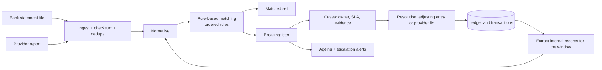

Reading: matching never changes the ledger by itself. Only an **approved resolution** posts an adjusting entry. The break register is append-and-state-transition only, so an auditor can replay what was known and when.

### Core schema idea

```sql
CREATE TABLE reconciliation_run (
    id BIGSERIAL PRIMARY KEY,
    source TEXT NOT NULL,                  -- 'BANK_DELTA_STATEMENT'
    business_date DATE NOT NULL,
    file_checksum TEXT,
    status TEXT NOT NULL,                  -- STARTED, COMPLETED, FAILED
    started_at TIMESTAMPTZ NOT NULL DEFAULT now(),
    UNIQUE (source, business_date, file_checksum)
);

CREATE TABLE reconciliation_item (
    id BIGSERIAL PRIMARY KEY,
    run_id BIGINT NOT NULL REFERENCES reconciliation_run(id),
    side TEXT NOT NULL CHECK (side IN ('INTERNAL','EXTERNAL')),
    reference TEXT,
    amount_minor BIGINT NOT NULL,
    value_date DATE,
    match_group_id BIGINT,                 -- null while unmatched
    match_rule TEXT,
    status TEXT NOT NULL,                  -- MATCHED, BREAK, RESOLVED
    UNIQUE (run_id, side, reference, amount_minor)
);

CREATE TABLE reconciliation_break (
    id BIGSERIAL PRIMARY KEY,
    item_id BIGINT NOT NULL REFERENCES reconciliation_item(id),
    break_type TEXT NOT NULL,
    state TEXT NOT NULL,                   -- OPEN, INVESTIGATING, PROPOSED, APPROVED, CLOSED
    owner TEXT,
    opened_at TIMESTAMPTZ NOT NULL DEFAULT now(),
    due_at TIMESTAMPTZ NOT NULL,
    resolution_entry_id BIGINT REFERENCES journal_entry(id)
);
```

### Worked daily example (HYPOTHETICAL volumes)

- Internal: 4.5M transactions, of which 600k involve an external bank leg that day.
- Bank statement: 598,900 credit/debit lines (some batched).
- Auto-match by reference+amount: 596,400 (99.6%); timing breaks: 1,200 (clear next day); unmatched internal: 450; unmatched external: 300; amount mismatch: 550.
- Operations works the 1,300 non-timing breaks by oldest value first; ageing alerts at 1 day, 3 days, 7 days.

Design questions this example forces you to answer: Which breaks block settlement? Which block customer notifications? What is the financial exposure total, and who is told?

### Common mistakes
- Auto-"fixing" breaks by editing records.
- Ignoring small breaks "because they are tiny" (they compound and hide systemic bugs).
- No ageing and escalation.
- Matching on amount alone.

### Hands-on exercises
1. Build the engine on synthetic bank and provider files with all eight break types injected.
2. Add idempotent re-run and late-file reprocessing.
3. Implement suspense ageing and manual resolution with maker-checker.
4. Create a reconciliation dashboard.

### Review questions
1. Why must resolution be a new entry rather than an edit?
2. How does the engine behave if the same statement is uploaded twice?
3. Which breaks may be auto-resolved, and under what evidence?

### Completion criteria
- All injected break types detected with correct classification.
- Three consecutive reruns produce identical results.
- Nothing remains unresolved without an owner and due date.

---

# Phase 12: Security, fraud prevention and risk

**Tier:** Essential/Specialist | **Weeks:** 4 | **Prerequisites:** Phases 5-6

### Why this phase exists
Money attracts attackers and insiders. Security controls must integrate with transaction lifecycle logic without breaking financial correctness or causing unnecessary outages.

> **Compliance rule:** AML/CFT, KYC, sanctions, data protection and retention obligations in Bangladesh are **jurisdiction-specific legal requirements**. This phase teaches engineering patterns. Always confirm the current obligations with your compliance team and authoritative publications (see Appendix B). Items marked **VERIFY** must not be assumed.

### Learning objectives
- Build a threat model using STRIDE for the MFS platform.
- Design layered controls: authentication, authorisation, velocity, limits, risk scoring, rule engine, anomaly detection, monitoring.
- Place controls in the lifecycle without compromising correctness or availability.

### Micro-topics

| # | Micro-topic | What it is and why it matters | Depends on | MFS application | Exercise |
|---|---|---|---|---|---|
| 12.1 [E] | Threat modelling and STRIDE | Systematic discovery of Spoofing, Tampering, Repudiation, Information disclosure, Denial of service, Elevation of privilege. | Phase 6 | Transfer endpoint, callback endpoint, admin console. | Produce a data-flow diagram and a STRIDE table. |
| 12.2 [E] | Attack surface mapping | Entry points: APIs, USSD, agent apps, admin panels, partner links, CI/CD, support tooling. | 12.1 | Insider tools often outweigh public APIs. | Inventory the attack surface with owners. |
| 12.3 [E] | Authentication factors | Something known, held, inherent; step-up for risk. | 5.6 | Step-up for high-value transfers. | Design step-up rules. |
| 12.4 [E] | Account takeover, credential stuffing, SIM swap, social engineering | Typical customer-facing attacks and mitigations (device binding, cooling-off, SIM-change signals where available, education, caller-verification policy). | 12.3 | New device plus SIM change plus large cash-out. | Write attack trees for each. |
| 12.5 [E] | Replay, tampering, duplicate payment | Signatures, nonces, idempotency, immutable references. | 6.12 | Replayed callback. | Demonstrate and block each attack in tests. |
| 12.6 [E] | Agent, merchant and insider fraud | Float manipulation, collusion, fake merchants, privileged misuse. | 5.8 | Structuring through agents; support staff abuse. | Design controls: dual control, scoped access, audit, behaviour monitoring. |
| 12.7 [E] | Velocity checks and limits | Count/amount per time window per customer, device, agent, merchant, beneficiary. | 5.7 | Many small transfers to one beneficiary. | Implement sliding-window counters with atomicity. |
| 12.8 [E] | Rule engine | Data-driven rules with versions, simulation mode, shadow mode, explainable outcomes. | 12.7 | Rules block, step-up, delay, or flag. | Implement rules as data with a dry-run mode. |
| 12.9 [A] | Risk scoring and anomaly detection | Feature-based scoring; statistical baselines; supervised/unsupervised models; feedback loops. | 12.8 | Behaviour deviations. | Build features from synthetic history and score with a simple model. |
| 12.10 [A] | Where controls sit in the lifecycle | Pre-authorisation (sync, fast), in-flight (async holds), post-transaction (monitoring, STR-type reports, VERIFY terminology). | 12.8 | Sync decision budget of a few tens of ms. | Document each control's phase, latency, failure mode. |
| 12.11 [E] | Fail-open vs fail-closed | Decide per control what happens if the control is down; never allow an unavailable fraud service to cause financial inconsistency. | 12.10 | Fraud scoring timeout: degrade to static limits. | Implement a degradation policy with metrics and alerts. |
| 12.12 [S] | AML/CFT engineering concepts | Customer due diligence, transaction monitoring, suspicious activity workflows, record-keeping (VERIFY exact duties). | 12.8 | Case management and reporting data. | Design a case workflow without hard-coding legal thresholds. |
| 12.13 [S] | Sanctions and watchlist screening | Name matching, fuzzy logic, false positives, list updates (VERIFY applicable lists). | 12.12 | Onboarding and payment screening. | Implement fuzzy name matching with review queue. |
| 12.14 [E] | Privacy, minimisation, retention | Collect less, mask, encrypt, delete or archive on schedule (VERIFY legal retention). | 6.15 | Retention policies for logs and documents. | Implement retention jobs and masking in non-prod data. |
| 12.15 [E] | Key and secrets management | Rotation, separation, HSM/KMS concepts, no secrets in code or logs. | 6.15 | Signing keys with `kid`. | Implement rotation with overlap period. |
| 12.16 [E] | Incident response | Detect, triage, contain, eradicate, recover, learn; customer and regulator communication (VERIFY duties). | 12.1 | Compromised partner key. | Run a tabletop exercise and write a runbook. |
| 12.17 [A] | Security testing | SAST/DAST, dependency scanning, secrets scanning, abuse-case tests, penetration testing coordination. | 12.1 | CI pipeline gates. | Add security gates and abuse-case tests. |

### STRIDE example for `POST /v1/transfers` (excerpt)

| Threat | Example | Control |
|---|---|---|
| Spoofing | Stolen token used from another device | Device binding, short token life, risk-based step-up |
| Tampering | Modify amount in transit | TLS, request signing for partners, server-side quote id |
| Repudiation | "I did not send that" | PIN verification record, device id, immutable audit log |
| Information disclosure | Beneficiary name leakage | Minimal responses, masking, rate-limited lookup |
| Denial of service | Flood of requests | Rate limits, load shedding, WAF |
| Elevation of privilege | Customer acts on another wallet | Object-level authorisation checks, tests |

### Fraud decision flow

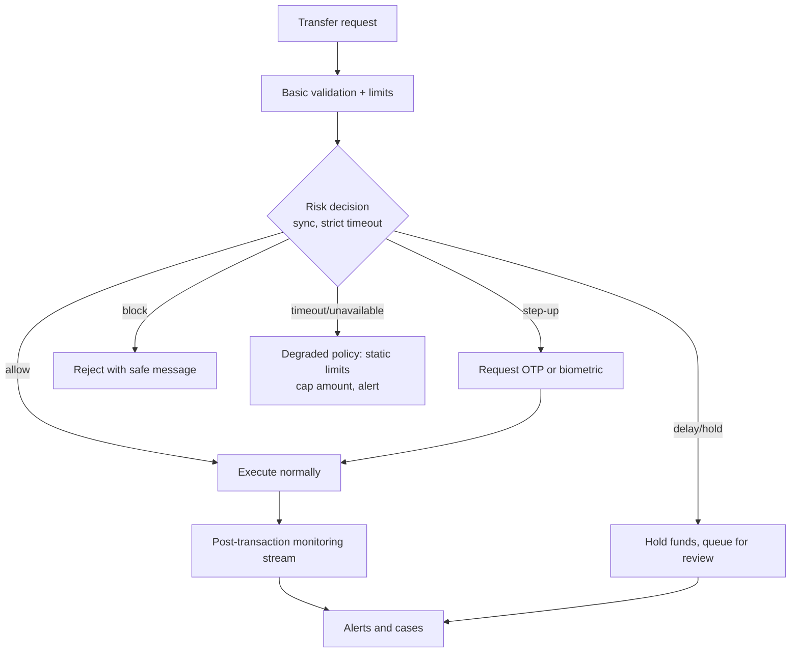

Reading: the risk decision is a **gate before money moves**, never a step that runs after posting that could leave half-applied state. For `delay/hold`, the hold is a ledger reservation, so funds are neither lost nor spendable. For degraded mode, you choose a safe fallback in advance, such as lower caps, rather than blocking all payments or allowing everything.

### Common mistakes
- Making fraud scoring a hard dependency without a degradation policy.
- Hard-coding thresholds in code.
- Logging sensitive data in detection pipelines.
- Granting support staff broad data access with no audit.
- Treating compliance as a one-time project.

### Hands-on exercises
1. STRIDE model for the simulated MFS with at least 30 threats and controls.
2. Rule engine with versions, simulation and shadow mode plus explainable reasons.
3. Velocity counters with concurrency tests.
4. Tabletop exercise and a written incident postmortem.

### Review questions
1. Where should a velocity check be enforced for correctness under concurrency?
2. Why must a risk service outage not create an incorrect ledger state?
3. What is the difference between a hold for review and a rejection?
4. Which of your controls assume a legal threshold, and how did you verify it?

### Completion criteria
- Threat model reviewed; top 10 risks have implemented controls and tests.
- Rule engine supports dry-run and rollback of rule versions.
- No sensitive data in logs (automated test).

---

# Phase 13: Caching, performance, scalability and high availability

**Tier:** Advanced | **Weeks:** 3 | **Prerequisites:** Phases 4, 8

### Why this phase exists
Peak days (Eid, salary days, campaigns) test every assumption. Performance work in fintech means being fast **without ever letting speed override financial truth**.

### Learning objectives
- Use Redis safely (never as the source of financial truth).
- Estimate and test capacity; find bottlenecks (hot rows, connection limits, queue lag).
- Design multi-zone high availability and regional DR with explicit RTO/RPO, and test them.

### Micro-topics

| # | Micro-topic | What it is and why it matters | Depends on | MFS application | Exercise |
|---|---|---|---|---|---|
| 13.1 [E] | Cache patterns | Cache-aside, write-through, write-behind and their failure modes. | 4.23 | Profile and configuration caching. | Implement cache-aside with invalidation on write. |
| 13.2 [E] | Why balances must not be cached for spending | A stale cached balance can allow an overspend or reject a valid spend. | 13.1 | Show cached balance with `as_of`; authorise from the DB. | Write a test that stale cache never changes authorisation outcome. |
| 13.3 [E] | TTLs, invalidation, hot keys, stampede | Short TTLs, jitter, request coalescing, per-key locks. | 13.1 | Popular merchant configs on Eid. | Reproduce and fix a stampede. |
| 13.4 [E] | Redis uses in payments | Rate limits, OTP and session stores, idempotency fast-path (backed by DB), short-lived reservations that are **not** money. | 13.1 | Throttling login attempts. | Implement token bucket with Lua; confirm DB remains authoritative. |
| 13.5 [E] | Connection pooling | Pools per process, PgBouncer, limits. | 4.22 | Gunicorn plus Celery. | Compute pool sizes and test saturation. |
| 13.6 [E] | Query optimisation and batching | Indexes, avoiding N+1, set-based operations, batching writes. | 4.12 | History, settlement. | Optimise five slow queries with plans. |
| 13.7 [E] | Async workloads | Move non-critical work out of the request path. | 7.7 | Notifications, statements. | Identify what must be sync vs async in P2P. |
| 13.8 [A] | Read replicas and workload isolation | Separate OLTP from reporting; replica lag awareness. | 4.20 | Statements and dashboards. | Route reads with lag guards. |
| 13.9 [A] | Horizontal scaling and stateless services | Scale API pods; keep state in DB/Redis; sticky-free. | 8.7 | Autoscaling API tier. | Load-test scale-out. |
| 13.10 [A] | Database scaling | Vertical scaling, partitioning, archiving, then (last) sharding and its trade-offs: cross-shard transfers, rebalancing, operations. | 4.18 | Shard by wallet id range only if proven necessary. | Write a sharding trade-off memo and rejection/acceptance criteria. |
| 13.11 [A] | Queue sizing and consumer lag | Little's law; lag as an SLI. | 7.18 | Callback and status-inquiry queues. | Size workers and alert on lag. |
| 13.12 [A] | Load testing | Realistic mix, think time, data volumes, failure injection during load. | 2.8 | Eid simulation. | Build a Locust/k6 scenario matching your capacity sheet. |
| 13.13 [A] | Peak-period design | Pre-scaling, feature degradation ladder, provider coordination, change freezes, war rooms. | 13.12 | Eid, salary days, government disbursement. | Create a peak-readiness checklist. |
| 13.14 [A] | Availability architecture | Multi-AZ, health checks, failover testing, leader/replica behaviour, quorum. | 4.20 | Database failover. | Fail the primary and measure recovery. |
| 13.15 [A] | Disaster recovery | RTO, RPO, regional replication, runbooks, regular drills. | 13.14 | Region loss. | Execute a DR drill with timings and gaps. |
| 13.16 [A] | Graceful degradation | Prioritise payment correctness: disable history, promotions, non-critical lookups. | 7.15 | Salary day. | Implement feature flags for degradation. |

### Sensitive-read decision

| Read | Source | Permitted staleness |
|---|---|---|
| Authorise a debit | Primary DB under lock | None |
| Show wallet balance | DB or cache with `as_of` | Seconds, labelled |
| Transaction history | Replica | Seconds to minutes |
| Fee quote | Cache keyed by rule version | Until rule changes; validated at execution |
| Daily limit remaining (display) | Cache | Seconds; enforced from DB at execution |

### Hot-account mitigation (design options)

1. **Bucketed accounts:** spread fee/commission credits across N sub-accounts; sum when reading.
2. **Deferred aggregation:** record fee lines in the journal, aggregate into the balance asynchronously, because fee accounts are not spent from in real time.
3. **Batching:** group postings per micro-batch where product semantics allow.
4. **Avoid updating a materialised balance for non-spendable internal accounts**; compute from entries.

Trade-off: options 2-4 reduce contention but make some internal balances eventually consistent; they must never be used for customer spend authorisation.

### Common mistakes
- Caching a balance and using it to decide whether to allow a spend.
- Sharding early because "it is a payments company".
- Autoscaling workers beyond the DB connection budget.
- Load-testing only the happy path and only the API tier.

### Hands-on exercises
1. Load test at 3x your peak estimate with provider simulator latency; produce a bottleneck report.
2. Reproduce and fix hot-row contention.
3. Execute primary failover under load; record RTO/RPO.
4. Write the peak-readiness checklist and degradation ladder.

### Review questions
1. Why is a stale cache dangerous only for some reads?
2. When is sharding justified, and what must you give up?
3. What does consumer lag tell you that CPU does not?

### Completion criteria
- Load-test report shows target TPS with p99 latency within SLO and no invariant violation.
- Failover and DR drills completed with measured RTO/RPO.

---

# Phase 14: Observability and financial operations

**Tier:** Advanced | **Weeks:** 3 | **Prerequisites:** Phases 9-13

### Why this phase exists
You cannot operate what you cannot see. Fintech observability must answer a financial question: *"Where is this customer's money, and why?"*

### Learning objectives
- Implement structured logging, metrics, tracing and audit trails with consistent correlation.
- Define SLIs, SLOs, error budgets and financial-health alerts.
- Investigate a disputed payment end to end and run an incident.

### Micro-topics

| # | Micro-topic | What it is and why it matters | Depends on | MFS application | Exercise |
|---|---|---|---|---|---|
| 14.1 [E] | Structured logging | JSON logs with correlation id, transaction id, actor, outcome; masking. | 6.15 | Search by transaction reference. | Implement and test log schema. |
| 14.2 [E] | Metrics: RED/USE plus business | Rate/errors/duration for services; utilisation/saturation/errors for resources; business metrics. | 14.1 | See metric list below. | Define 20 metrics with labels and cardinality limits. |
| 14.3 [E] | Distributed tracing | Trace context across API, Celery, broker, provider calls. | 6.3 | One trace per payment. | Propagate context through the outbox and Celery. |
| 14.4 [E] | Audit trails | Who did what, when, from where, with before/after, tamper-evident. | 3.10 | Admin actions on wallets. | Implement append-only audit log with hash chaining. |
| 14.5 [E] | SLIs, SLOs, error budgets | Measurable service quality targets and budget policy. | 14.2 | Payment success ratio, p99 latency, status freshness. | Define SLOs for P2P and bank transfer. |
| 14.6 [E] | Dashboards and alerts | Symptom-based alerts, runbook links, avoid alert fatigue. | 14.5 | Payment health dashboard. | Create dashboards and 10 alerts with runbooks. |
| 14.7 [E] | Financial-health signals | Pending transaction age, UNKNOWN count, provider success rate, reconciliation breaks, ledger imbalance, settlement delay, suspense value. | 11.14 | See below. | Implement each as a metric with threshold. |
| 14.8 [E] | Investigating a disputed payment | Follow reference through gateway, transaction, broker, provider, callback, ledger, settlement, reconciliation. | 14.3 | Customer says "money deducted, receiver not credited". | Write and rehearse the investigation playbook. |
| 14.9 [E] | Incident management | Severity classes, roles (commander, communications, ops), on-call, status updates, timelines. | 14.6 | Provider outage; ledger imbalance. | Run a game day and postmortem. |
| 14.10 [E] | Runbooks and safe replay tools | Idempotent, audited tools to replay callbacks, re-run inquiries, re-publish outbox, with dry-run. | 7.7 | Support re-triggers a stuck callback. | Build a replay tool with approval and dry run. |
| 14.11 [E] | Operational access control | Least privilege, just-in-time access, maker-checker for money-affecting actions, break-glass. | 12.6 | Production console. | Implement scoped roles and break-glass logging. |
| 14.12 [A] | Postmortems | Blameless, causal analysis, action items with owners. | 14.9 | Duplicate payment incident. | Write a postmortem template and one example. |
| 14.13 [A] | Capacity and cost observability | Cost per txn, storage growth, saturation forecasts. | 2.14 | Plan before Eid. | Build a forecast dashboard. |

### Financial-health metrics (names are suggestions)

| Metric | Why it matters | Alert idea |
|---|---|---|
| `txn_state_total{type,state}` | Throughput and outcome mix | Success ratio drop |
| `txn_pending_age_seconds_max{type}` | Customers waiting | Over policy threshold |
| `txn_unknown_count{provider}` | Unresolved outcomes | Growing or old items |
| `provider_success_ratio{provider}` | Provider health | Below baseline |
| `ledger_trial_balance_diff` | Ledger integrity | Any nonzero value pages |
| `wallet_vs_ledger_mismatch_count` | Cache integrity | Any nonzero value pages |
| `recon_open_break_value{age_bucket}` | Financial exposure | Ageing growth |
| `suspense_balance` | Unexplained funds | Above limit or old |
| `settlement_batch_delay_seconds` | Operational delay | After cut-off |
| `outbox_unpublished_age_seconds` | Event pipeline | Rising |
| `consumer_lag{group}` | Processing delay | Beyond SLO |
| `db_connections_used_ratio` | Saturation | High sustained |

### Dispute investigation path

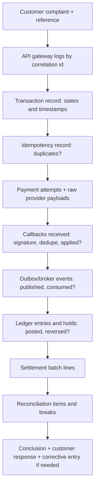

Reading: each box is a **different system of record**. A good platform lets support see all of them from one reference, with permissions and masking applied.

### Common mistakes
- Alerting on CPU instead of user-visible and financial symptoms.
- Metrics with unbounded labels (transaction id as a label).
- Support tooling that can edit balances directly.
- No tested replay path, so engineers run ad-hoc SQL under pressure.

### Hands-on exercises
1. Instrument the simulated MFS fully; build the dashboards and alerts.
2. Seed five incidents (duplicate callback, lost response, ledger bug, provider outage, reconciliation break) and investigate each using only your tools.
3. Build the safe replay tool.
4. Run an on-call game day and write postmortems.

### Review questions
1. What is the difference between an SLI and a business metric?
2. Which alert should page immediately, and which should create a ticket?
3. How do you ensure replay tools are safe to run twice?

### Completion criteria
- A teammate can resolve a seeded dispute using only your dashboards, logs and tools.
- SLOs and alerts documented; runbooks linked from alerts.

---

# Phase 15: Deployment and testing

**Tier:** Essential/Advanced | **Weeks:** 4 | **Prerequisites:** Phases 4-14

### Why this phase exists
Financial correctness is only real if it is tested continuously and deployed safely. A correct design that is deployed with a destructive migration or a missing health check is still an outage.

### Learning objectives
- Treat **financial invariants** as first-class test objectives.
- Build a CI/CD pipeline with safe migrations, progressive rollout and rollback.
- Deploy Django/DRF/Celery/Postgres/Redis/Kafka workloads with correct probes, shutdown and concurrency.

### Micro-topics: deployment and delivery

| # | Micro-topic | What it is and why it matters | Depends on | MFS application | Exercise |
|---|---|---|---|---|---|
| 15.1 [E] | Linux and networking essentials | Processes, signals, file descriptors, DNS, TLS, `ss`, `tcpdump`, resource limits. | none | Debug connection exhaustion. | Diagnose a seeded FD leak. |
| 15.2 [E] | Docker for production | Minimal images, non-root user, pinned dependencies, SBOM, multi-stage builds. | 15.1 | Reproducible builds. | Build a hardened image. |
| 15.3 [A] | Kubernetes fundamentals | Pods, deployments, services, config maps, secrets, probes, resource limits, HPA, PodDisruptionBudget. | 15.2 | Rolling updates without dropping payments. | Deploy the simulated MFS on a local cluster. |
| 15.4 [E] | CI/CD | Build, test, scan, package, deploy; protected branches; signed artefacts. | 15.2 | Gate on invariant tests. | Pipeline with test, lint, security scan and deploy stages. |
| 15.5 [E] | Database migration safety | Expand/contract; avoid table rewrites and long locks; lock timeouts; separate deploy from migrate; backfills in batches. | 4.19 | Add a column to the ledger line table. | Perform a zero-downtime migration drill. |
| 15.6 [A] | Rolling, canary, blue-green | Gradual rollout, automated rollback criteria on SLO breach. | 15.4 | New fee engine canary. | Canary with automatic abort on error ratio. |
| 15.7 [E] | Feature flags | Decouple deploy from release; kill switches for providers, features, risk rules. | 15.6 | Disable a provider route instantly. | Implement flags with audit and default-safe values. |
| 15.8 [A] | Secrets rotation, IaC, configuration management | Terraform/Ansible, environment separation, rotation without downtime. | 15.4 | Provider key rotation. | Rotate a signing key with overlap. |
| 15.9 [E] | Environment separation | Dev, test, staging, production, DR; synthetic data only outside production. | 15.4 | No production data in lower environments. | Create anonymised/synthetic data generator. |
| 15.10 [E] | Dependency upgrades and rollbacks | Pin, scan, upgrade regularly, rollback plan. | 15.4 | Django LTS upgrades. | Perform one major dependency upgrade with rollback rehearsal. |
| 15.11 [E] | Django/DRF production setup | Gunicorn workers/threads sizing, ASGI only where needed, `CONN_MAX_AGE` vs pooler, `ATOMIC_REQUESTS` decision, timeouts. | 15.2 | API service. | Tune workers under load. |
| 15.12 [E] | Celery in production | Acks late, visibility timeout, idempotent tasks, task time limits, queues per priority/provider, prefetch, concurrency. | 7.6 | Callback processing queue. | Crash a worker mid-task; prove idempotent completion. |
| 15.13 [E] | Health, readiness, graceful shutdown | Liveness vs readiness; stop accepting, finish in-flight, release leases; handle SIGTERM. | 15.3 | Rolling deploy mid-payment. | Test a deploy during load without lost or duplicated payments. |
| 15.14 [A] | Kafka/broker deployment concerns | Replication, partitions, retention, ACLs, lag monitoring. | 7.18 | Event backbone. | Run a 3-broker local cluster; kill one broker. |

### Django-specific settings worth deciding deliberately

| Concern | Decision to make |
|---|---|
| `ATOMIC_REQUESTS` | Prefer explicit `transaction.atomic()` around the posting unit; avoid wrapping entire requests that call external services. |
| Connection reuse | `CONN_MAX_AGE` with a pooler requires care; know the pooler mode (transaction pooling breaks session-level features and prepared statements/advisory locks unless handled). |
| Gunicorn | Workers x threads vs DB connections; sync workers with timeouts shorter than the gateway budget. |
| Celery | Separate queues for money-critical and bulk tasks; limits on retries; idempotent task bodies; `acks_late` with idempotency. |
| Graceful shutdown | Gunicorn graceful timeout longer than longest normal request; Celery warm shutdown. |

### Micro-topics: testing

| # | Test type | What it proves | MFS example | Exercise |
|---|---|---|---|---|
| 15.20 [E] | Unit tests | Pure logic: fee calculation, state machine, rounding | Fee tiers and rounding | 100% on state transitions. |
| 15.21 [E] | Integration tests (real Postgres) | Constraints, locks, transactions, migrations | Posting engine | Use a real DB, not SQLite. |
| 15.22 [E] | API contract tests | Public contract and compatibility | OpenAPI conformance | Run Schemathesis-style fuzz against your spec. |
| 15.23 [E] | Provider sandbox and simulator tests | Adapter mapping and recovery | Timeout, duplicate callback | Failure matrix per adapter. |
| 15.24 [E] | **Ledger invariant tests** | Financial correctness after every operation | See invariant list in Phase 3 | Invariant checker run after every integration test. |
| 15.25 [E] | Property-based tests | Invariants over random operation sequences | Hypothesis-generated transfers, holds, reversals | 10,000 random sequences. |
| 15.26 [E] | Concurrency tests | No lost update/double spend/deadlock | 50 threads on one wallet | Repeat 1,000 iterations. |
| 15.27 [A] | Fault-injection / chaos tests | Behaviour under failures | Kill worker mid-posting; drop broker; DB restart | Seeded fault matrix. |
| 15.28 [A] | Load and soak tests | Capacity, leaks, degradation | Eid profile | Run a 4-hour soak. |
| 15.29 [A] | DR tests | Recovery within RTO/RPO | Region failover | Quarterly drills. |
| 15.30 [E] | Security tests | Authorisation, injection, secrets | BOLA tests | Automated in CI. |
| 15.31 [E] | End-to-end tests | Full flow including notification and reconciliation | Cash-out to settlement to reconciliation | One E2E per workflow. |

### Scenarios every suite must include

| Scenario | Expected result |
|---|---|
| Duplicate request, same key | One transaction, same response |
| Same key, different body | `409`/`422`, no effect |
| Two simultaneous transfers exceed balance | Exactly the affordable ones succeed |
| Insufficient balance | Rejected, no ledger lines |
| Callback arrives twice | Single state transition and posting |
| Callback arrives before the initiating request returns | Correctly applied once state is persisted |
| Callback arrives late after inquiry already resolved | Stored, ignored |
| Provider outcome unknown | UNKNOWN, hold retained, inquiry scheduled |
| Partial outage (provider A down, B up) | Circuit breaker; no unsafe failover |
| Message redelivered | No duplicate effect |
| Settlement batch fails after submit | Batch UNKNOWN/FAILED path, no premature ledger posting |
| Reconciliation mismatch injected | Break created, owner and due date set |
| Worker killed mid-task | Task resumes or retries idempotently |
| DB failover during posting | Transaction either fully committed or not; client retry safe |

### Invariant harness (example)

```python
def assert_ledger_invariants():
    assert db.scalar("SELECT COALESCE(SUM(CASE direction WHEN 'D' THEN amount_minor ELSE -amount_minor END),0) FROM posting_line") == 0
    assert db.scalar("""
        SELECT COUNT(*) FROM wallet w
        JOIN (SELECT ledger_account_id, SUM(CASE direction WHEN 'C' THEN amount_minor ELSE -amount_minor END) AS bal
              FROM posting_line GROUP BY 1) l ON l.ledger_account_id = w.ledger_account_id
        WHERE w.ledger_balance_minor <> l.bal""") == 0
    assert db.scalar("SELECT COUNT(*) FROM wallet WHERE ledger_balance_minor - reserved_minor < 0") == 0
    assert db.scalar("SELECT COUNT(*) FROM (SELECT posting_reference FROM journal_entry GROUP BY 1 HAVING COUNT(*)>1) d") == 0
```

Reading: after every test (and nightly in production), run the harness. A failing invariant is a **stop-the-line** event.

### Deployment flow

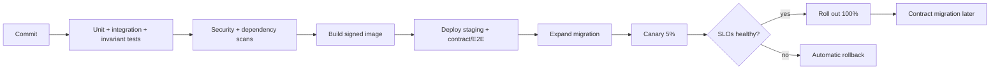

### Common mistakes
- Testing on SQLite while production uses PostgreSQL features.
- Running destructive migrations in the same deploy as code that needs them.
- Treating liveness and readiness as the same probe.
- No test for deploy-during-traffic.

### Hands-on exercises
1. Full CI/CD for the simulated MFS with invariant gates.
2. Zero-downtime migration drill on a 50-million-row ledger table.
3. Chaos suite with at least 20 injected faults.
4. Deploy mid-load and prove no lost or duplicated transactions.

### Review questions
1. Why must migrations be backward compatible with the previous app version?
2. How does graceful shutdown protect in-flight payments?
3. Which test would have caught a double-spend regression?

### Completion criteria
- Pipeline blocks a deliberately introduced invariant violation.
- Deploy under load shows zero invariant failures.
- Rollback rehearsed.

---

# Phase 16: Architecture decision-making

**Tier:** Advanced | **Weeks:** 2 | **Prerequisites:** Phases 1-15

### Why this phase exists
Senior engineers are paid for decisions, not diagrams. This phase teaches how to compare alternatives on multiple criteria and document them so others can challenge them.

### Learning objectives
- Compare designs using latency, throughput, consistency, availability, correctness, security, regulatory constraints, complexity, team capability, operational burden and cost.
- Write ADRs, threat models, capacity assumptions, failure-mode analyses and dependency maps.
- Plan system evolution from a monolith to a distributed platform.

### Micro-topics

| # | Micro-topic | What it is and why it matters | Exercise |
|---|---|---|---|
| 16.1 [A] | Criteria and weighting | Make criteria explicit; correctness and security are gates, not weights. | Build a weighted decision matrix where correctness is a pass/fail gate. |
| 16.2 [A] | Trade-off analysis | Name what you give up (e.g., consistency vs availability under partition). | Write trade-off statements for five decisions. |
| 16.3 [A] | Architecture decision records | Context, options, decision, consequences, review date. | Write 10 ADRs for your simulated MFS. |
| 16.4 [A] | Failure-mode analysis (FMEA-style) | Enumerate failure modes, effect, detection, mitigation, severity. | FMEA for the cash-out flow. |
| 16.5 [A] | Dependency mapping | Critical path, single points of failure, blast radius. | Map dependencies and rank by blast radius. |
| 16.6 [A] | Capacity assumptions and validation | State assumptions; plan to measure; revisit. | Maintain a living assumptions file. |
| 16.7 [A] | Threat models in decisions | Include security trade-offs explicitly. | Attach STRIDE results to two ADRs. |
| 16.8 [A] | Evolution paths | Monolith to modular monolith to selective services; migration cost and triggers. | Write an evolution roadmap with triggers (not dates). |
| 16.9 [A] | Communicating decisions | Reviews, RFCs, objections, reversibility ("one-way vs two-way doors"). | Present an RFC and record objections. |

### ADR template

```markdown
# ADR-007: Keep ledger and wallet in one PostgreSQL database

- Status: Accepted (review: after 12 months or when sustained write load > X TPS)
- Context: spend authorisation needs atomic balance check + posting; peak 1.6k financial TPS (assumption A-3).
- Options: (1) single DB, (2) wallet and ledger services with separate DBs, (3) sharded DB.
- Decision criteria (gates): financial correctness, auditability. Weighted: latency, ops burden, cost, team capability.
- Decision: Option 1.
- Consequences: simpler invariants and tests; DB becomes a scaling and availability focus; need hot-row mitigation (ADR-009).
- Revisit triggers: sustained primary CPU > 60% after tuning; storage > Y TB; regulatory data-locality requirement.
```

### Decision matrix example (HYPOTHETICAL scores 1-5; gates first)

| Option | Correctness gate | Security gate | Latency | Ops burden (higher = easier) | Complexity (higher = simpler) | Cost | Team capability | Weighted total |
|---|---|---|---|---|---|---|---|---|
| Single Postgres core | Pass | Pass | 5 | 4 | 5 | 4 | 5 | high |
| Separate wallet and ledger DBs | **Needs saga + reconciliation** | Pass | 3 | 2 | 2 | 3 | 2 | low |
| Event-sourced ledger | Pass | Pass | 3 | 2 | 2 | 3 | 2 | medium-low |

Reading: an option that cannot meet a gate is eliminated *before* scoring. Do not let a high score on convenience offset a correctness failure.

### Common mistakes
- Choosing by fashion.
- Hiding assumptions.
- Decisions without revisit triggers.

### Hands-on exercises
Write 10 ADRs, one FMEA and one evolution roadmap.

### Review questions
1. Which criteria are gates, which are weights, and why?
2. What would make you reverse a decision?

### Completion criteria
10 ADRs peer-reviewed, each with explicit trade-offs and triggers.

---

# Phase 17: Case studies

**Tier:** Advanced/Specialist | **Weeks:** 6 | **Prerequisites:** Phases 1-16

### Why this phase exists
Case studies integrate everything. Each one forces you to produce the full design package a senior engineer would present in a design review.

> **Honesty rule:** The designs below are **hypothetical teaching designs** built from universal fintech principles. They do not describe any real provider's internals, and every number is an assumption to be replaced with real data.

### Required deliverables for every case study

1. Problem statement and requirements (functional, NFR, rules).
2. Assumptions and constraints (mark HYPOTHETICAL and VERIFY).
3. Capacity estimates (TPS, storage, queue sizing).
4. Architecture diagram (Mermaid) with explanation of every component.
5. Component responsibilities and boundaries.
6. API contracts (OpenAPI excerpts).
7. Database model with constraints.
8. State machines (all four state families where relevant).
9. Sequence diagrams (happy path and at least two failure paths).
10. Ledger postings.
11. Concurrency controls.
12. Failure scenarios with detection and recovery.
13. Security measures and threat model excerpt.
14. Monitoring: SLIs, metrics, alerts.
15. Deployment considerations.
16. Trade-offs and at least two alternative designs with reasons for rejection.
17. Universal principles vs hypothetical specifics (a final table).

### Case study list

| # | Case study | Focus | Special challenge |
|---|---|---|---|
| 17.1 | MFS wallet platform (end to end) | Whole system | Boundaries and sequencing |
| 17.2 | P2P transfer service | Concurrency, idempotency, fees | Hot fee account |
| 17.3 | Cash-in / cash-out platform | Agent float, holds, confirmation | Cash cannot be compensated |
| 17.4 | Merchant payment system | QR, MDR, settlement | Refunds and settlement timing |
| 17.5 | Bank transfer integration | Unknown outcomes, rails, finality | Recovery workflow |
| 17.6 | Bill-payment platform | Many billers, async confirmation | Biller diversity and delayed rejections |
| 17.7 | Agent banking workflow | Onboarding, float, settlement | Fraud and liquidity |
| 17.8 | Transaction notification system | Decoupling, delivery, deduplication | Never affect money correctness |
| 17.9 | Fraud-detection pipeline | Streaming features, rules, ML, feedback | Latency vs accuracy; fail-open/closed |
| 17.10 | Financial ledger | Posting engine, invariants, scaling | Hot accounts, immutability |
| 17.11 | Settlement engine | Netting, cut-off, approvals | Finality and failure |
| 17.12 | Reconciliation engine | Matching, breaks, ageing | Volume and auditability |
| 17.13 | Transaction reporting platform | Read models, regulatory returns (VERIFY formats) | Consistency vs freshness |

### Worked mini case: P2P transfer service (condensed, HYPOTHETICAL)

**Requirements.** Registered, active wallets send money to other registered, active wallets; fee by tier; limits per tier; instant final result; full audit.

**Assumptions.** 1.6k TPS Eid peak; p99 under 300 ms at the service; zero tolerance for double spend; RPO near zero for committed transfers (synchronous replication choice documented in an ADR).

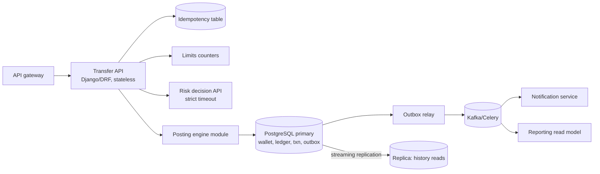

Reading: the **only** place money changes is the posting engine inside one DB transaction. Notification and reporting hang off the outbox; their failure cannot undo or block a transfer.

**Sequence (success and duplicate).**

```mermaid
sequenceDiagram
    participant U as App
    participant A as Transfer API
    participant D as DB
    U->>A: POST /transfers (key K)
    A->>D: INSERT idempotency (K) IN_PROGRESS
    A->>D: BEGIN; lock wallets by id order
    A->>D: check status, balance, limits
    A->>D: INSERT journal_entry (ref=P2P:K) + lines
    A->>D: UPDATE wallets; INSERT outbox; COMMIT
    A->>D: store response for K (COMPLETED)
    A-->>U: 201 SUCCESS
    U->>A: (retry) POST /transfers (key K)
    A->>D: lookup K -> COMPLETED
    A-->>U: 201 same response
```

**Failure scenarios.** (a) crash after COMMIT before response: retry returns stored result (idempotency row updated in the same commit or recoverable via `posting_reference`); (b) crash before COMMIT: nothing happened; retry executes; (c) receiver frozen after validation: re-checked under lock; (d) notification down: outbox retries; (e) replica lag: history stale, balance for authorisation read from primary.

**Alternatives.** (1) Event-sourced wallet: stronger audit, higher complexity; (2) separate ledger service with sagas: independent scaling, adds distributed-transaction risk; (3) Redis balance counters: faster but unsafe as truth.

**Universal vs hypothetical.**

| Universal principle | Hypothetical in this example |
|---|---|
| Single atomic posting unit, idempotent reference, outbox for side effects | 1.6k TPS, 300 ms p99, fee tiers, replica usage details |

Complete the other twelve case studies yourself to the 17-point template. Start with 17.2, 17.3, 17.5 and 17.12, which exercise most of the earlier phases.

### Common mistakes
- Drawing boxes without failure behaviour.
- Copying a real provider's public features as if they were its internals.
- Skipping alternatives.

### Completion criteria
- At least **four** full case studies reviewed by a senior peer: P2P, cash-out, bank transfer, reconciliation.
- Each includes failure sequence diagrams and capacity maths you can defend.

---

# Common fintech design mistakes

| # | Mistake | Failure mechanism | Potential financial impact | Detection | Prevention | Recovery |
|---|---|---|---|---|---|---|
| 1 | Updating balances directly without ledger entries | No history; concurrent or buggy writes change money untraceably | Silent loss or creation of funds; failed audit | Nightly equality check: balance vs entries; trial balance | All movements through a posting engine; DB permissions block direct updates; append-only entries | Rebuild from last trusted state, post adjusting entries, root-cause and add constraint |
| 2 | Treating a timeout as failure | Remote side may have completed | Double payment or customer debited twice | `UNKNOWN` age metric; reconciliation unmatched external | Explicit `UNKNOWN` state, hold funds, inquiry workflow | Inquiry/report; post correct entry; compensate customers |
| 3 | Retrying without idempotency | Retry creates a second effect | Duplicate debits/payouts | Duplicate reference detection; provider reports | Idempotency keys, stable provider references, unique constraints | Reverse duplicates, claim back from provider |
| 4 | Using a cache as financial truth | Stale or lost cache | Overspend, wrongful decline, lost state after eviction | Cache vs DB audit job | Cache only for display; authorise from DB | Reconcile, correct balances from ledger |
| 5 | Coupling transaction processing to notification delivery | Notification outage blocks or rolls back money flow | Outage of payments, stuck states | Latency/error correlation | Outbox + async consumers | Replay outbox events |
| 6 | Relying on eventual consistency for spend authorisation | Reads from replica/cache allow double spend | Direct monetary loss | Negative available balance checks | Primary-DB locked checks; constraints | Freeze accounts, recover funds, strengthen checks |
| 7 | Mixing provider status with internal status | Provider vocabulary leaks into business logic; unknown codes mishandled | Wrong customer outcomes, hidden failures | Unmapped-code metrics; state-machine violations | Normalised model; store raw separately; default unknown to UNKNOWN | Re-map and re-process from raw payloads |
| 8 | Ignoring reconciliation | Drift accumulates unseen | Large unexplained differences, regulatory exposure | Break counts and ageing | Daily (or intraday) engine with owners and SLAs | Investigate backlog by value and age; adjusting entries |
| 9 | Splitting services without clear domain boundaries | Distributed transactions, duplicated rules, inconsistent state | Inconsistent balances, slow delivery, outages | Cross-service incident patterns, rising reconciliation breaks | Context map, modular monolith first, split by capability with triggers | Re-merge or redraw boundary; add reconciliation and contract tests |

> Add your own entries as you meet real incidents. Each new incident should add a row, a test and an alert.

---

# Project sequence: build a simulated MFS platform

All projects use **fictional** entities (customers Rina, Karim; Agent Sultana; Merchant Cafe Alpha; Bank Delta; Biller Omega; provider "ZenPay") and synthetic data. Each project must ship with tests, an invariant harness run, a README with design notes and at least one ADR.

| # | Project | Builds on | Core features | Key failure injections | Done when |
|---|---|---|---|---|---|
| P1 | Wallet API | Phases 2, 4 | Registration (stub KYC), wallet lifecycle, PIN with lockout, balance endpoint | Duplicate registration, PIN brute force | Auth and lifecycle tests pass |
| P2 | Double-entry ledger | Phase 3 | Chart of accounts, posting engine, reversals, trial balance | Unbalanced entry, concurrent postings | Property tests pass 10k runs |
| P3 | P2P transfers | P1, P2 | Idempotent transfers, locking, outbox notifications | Double spend, duplicate request, crash mid-flow | Concurrency lab passes |
| P4 | Cash-in / cash-out | P3, Phase 5 | Agents, float, holds (reserve/capture/release), expiry | Agent never confirms, double confirm | No stuck holds |
| P5 | Limits, fees, commissions | P4 | Versioned rules, atomic limit counters, commission accrual and clawback | Write-skew on limits, rounding | Limits hold under concurrency |
| P6 | Provider integration | Phase 9 | Adapter framework, simulator, bank transfer flow | Timeouts, drops, bad signatures | Chaos suite shows zero duplicates |
| P7 | Async processing and callbacks | P6, Phase 7 | Celery/Kafka, inbox/outbox, status inquiry, escalation | Duplicate/out-of-order callbacks, worker kill | Idempotent end to end |
| P8 | Reconciliation | Phase 11 | Ingestion, matching, break register, suspense | All eight break types | Reruns deterministic |
| P9 | Settlement | Phase 10 | Merchant payments, netting, batch approval, bank confirmation | Failed/partial settlement | Ledger and bank files agree |
| P10 | Fraud rules | Phase 12 | Velocity, rule engine, step-up, case queue | Rule service outage | Degradation policy proven |
| P11 | Observability and operations | Phase 14 | Metrics, tracing, dashboards, SLOs, replay tool, runbooks | Seeded incidents | Dispute resolved from tools only |
| P12 | Load testing and production-style deployment | Phases 13, 15 | Eid load profile, containers/K8s, CI/CD, canary, DR drill | Failover under load | Measured SLOs and RTO/RPO |

Suggested package layout (modular monolith):

```text
mfs_sim/
  identity/        # users, KYC state, PINs, devices
  wallets/         # wallet lifecycle, holds
  ledger/          # accounts, entries, posting engine (own schema, strict API)
  transactions/    # orchestration, state machines, sagas
  fees_limits/     # rules, counters
  providers/       # adapters, simulator, normalisation
  recon/           # ingestion, matching, breaks
  settlement/      # batches, approvals
  risk/            # rules, scoring
  notifications/   # outbox consumers
  ops/             # replay tools, dashboards
  tests/           # unit, integration, invariants, chaos, load
```

---

# Competency matrix

Levels: **Beginner** (knows the concept), **Intermediate** (implements with guidance), **Advanced** (designs and reviews independently), **Expert** (sets standards, handles novel failure modes, mentors).

| Skill | Beginner | Intermediate | Advanced | Expert |
|---|---|---|---|---|
| Financial ecosystem | Names participants and rails | Explains money and information flows for each flow | Chooses designs based on finality, liability and settlement models | Anticipates regulatory and ecosystem change; advises on partnerships |
| Requirements and capacity | Writes basic requirements | Produces measurable NFRs and capacity estimates | Validates estimates with data; design reviews catch gaps | Calibrates models across peaks and growth with measured feedback |
| Accounting and ledger | Reads debits/credits | Implements a balanced posting engine | Designs chart of accounts, holds, reversals, period close | Designs multi-entity, high-scale ledgers; audits others' ledgers |
| Database and concurrency | Uses transactions | Fixes lost updates and deadlocks | Chooses isolation/locking strategy per invariant; designs for hot rows | Designs partitioning/failover strategies; diagnoses production lock storms |
| MFS workflows | Describes flows | Implements P2P, cash-in/out, merchant | Handles unknown outcomes, refunds, settlements across flows | Designs new products and flows end to end with controls |
| API design | Builds CRUD APIs | Implements idempotency and error taxonomy | Designs versioned contracts and secure callbacks | Defines platform API standards |
| Distributed systems | Knows CAP and queues | Implements outbox, inbox, retries | Designs sagas and fault-tolerant workflows | Reasons about novel failure modes; guides platform architecture |
| DDD and microservices | Knows terms | Applies bounded contexts in a monolith | Decides split vs module with criteria | Leads decomposition and evolution programmes |
| Payment orchestration | Calls a provider API | Builds adapters and status inquiry | Designs routing, failover and recovery policies | Defines integration standards across many providers |
| Settlement and reconciliation | Understands the terms | Implements matching and batches | Designs breaks, ageing, suspense, approvals at volume | Owns financial-control design with finance and audit |
| Security and fraud | Knows OWASP basics | Implements authZ, signing, rules | Leads threat modelling; designs fail-open/closed policy | Shapes security architecture and incident leadership |
| Performance and HA | Uses caching | Load tests and tunes | Designs DR with measured RTO/RPO | Leads capacity strategy for national-scale peaks |
| Observability and operations | Reads logs | Builds dashboards and alerts | Defines SLOs, runbooks, safe tooling | Builds operational culture and error-budget policy |
| Deployment and testing | Writes tests | Builds CI/CD and invariant tests | Designs chaos, migration and rollout strategy | Sets engineering-wide quality standards |
| Architecture decisions | Follows patterns | Writes ADRs | Leads trade-off analysis with measurable criteria | Governs architecture across organisation |
| Communication and leadership | Documents work | Explains designs clearly | Runs design reviews; influences without authority | Mentors, sets direction, handles executive/regulator-level communication |

**Target for "independently designs production-grade fintech systems":** Advanced in rows 1-7 and 9-15, Intermediate-to-Advanced in rows 8 and 12 and 16, with demonstrated Advanced capability in at least ledger, concurrency and unknown-outcome handling.

---

# Portfolio requirements and independence-readiness criteria

## Portfolio (minimum)

1. **Simulated MFS repository** (P1-P12) with README, ADRs, diagrams, tests, CI and invariant harness.
2. **Four full case-study documents** (P2P, cash-out, bank transfer, reconciliation) at the 17-point standard.
3. **Failure and chaos report** showing injected faults and results.
4. **Load-test and DR report** with measured numbers and bottleneck analysis.
5. **Threat model and incident postmortems** (at least three seeded incidents).
6. **Regulatory source register** with dated review notes and a clear separation of engineering practice vs legal requirement.

## Measurable readiness criteria

You are ready to design production-grade fintech systems **independently** when all of the following are true.

| # | Criterion | Evidence |
|---|---|---|
| 1 | Money integrity | Property tests (>= 10,000 sequences) and concurrency tests show invariants hold; no direct balance writes in codebase (static check). |
| 2 | Unknown-outcome handling | Chaos suite of >= 1,000 scenarios: zero duplicate effects, zero silently failed unknowns, all holds resolved or escalated. |
| 3 | Idempotency everywhere | Every state-changing endpoint, consumer and job has an idempotency mechanism with tests. |
| 4 | Reconciliation | Engine detects all injected break classes; reruns deterministic; ageing and ownership enforced. |
| 5 | Design review performance | Present three designs to peers/seniors; no critical correctness gap remains unaddressed after review. |
| 6 | Capacity credibility | Predicted peak TPS vs measured within a stated tolerance (e.g., within 30%); bottlenecks identified before testing. |
| 7 | Operational readiness | A colleague resolves seeded disputes using only your tools in a set time; SLOs, alerts and runbooks exist. |
| 8 | Recovery proven | Backup restore, failover and DR drills completed with measured RTO/RPO. |
| 9 | Security | Threat model with implemented top-10 controls; automated tests for authorisation, replay and log masking. |
| 10 | Decision quality | At least 10 ADRs with explicit trade-offs and revisit triggers; a rejected-alternatives log. |
| 11 | Regulatory discipline | Every legal or limit assumption traced to a current authoritative source or flagged as unverified. |
| 12 | Teach-back | You can explain the full P2P, cash-out and bank-transfer designs, including failure paths, without notes in 30 minutes. |

---

# Appendix A: Glossary

| Term | Meaning |
|---|---|
| Agent | Cash-handling partner who converts cash to e-money and back. |
| Authorisation | Permission for a payment to proceed. |
| BDT / poisha | Bangladeshi taka and its minor unit (100 poisha = 1 BDT). |
| Break | A reconciliation difference not yet explained. |
| Capture | Convert a hold into a posted ledger movement. |
| Clearing | Exchange and validation of payment obligations between institutions. |
| Control account | GL account whose balance equals the sum of its subledger accounts. |
| Compensating entry | New entry that counteracts an earlier effect. |
| Finality | The point after which a payment cannot be reversed by the rails. |
| Float | E-money (or cash) an agent holds for serving customers. |
| Hold / reservation | Funds set aside, reducing available balance without posting. |
| Idempotency | Repeating an operation yields the same effect as doing it once. |
| Journal entry | Balanced set of posting lines. |
| KYC / e-KYC | Identity verification, performed manually or digitally. |
| Ledger balance vs available balance | Posted balance vs posted minus holds. |
| MFS | Mobile financial services. |
| MDR | Merchant discount rate, a fee charged to merchants. |
| Net settlement | Settlement of netted obligations per cycle. |
| Outbox / inbox | Patterns for reliable event publishing / deduplicated consumption. |
| PSP | Payment service provider. |
| Prefunding | Pre-positioned funds that cover obligations. |
| Reversal | Entry or transaction undoing a prior one by reference. |
| Saga | Long-running workflow of local transactions with compensations. |
| Suspense account | Temporary account for unidentified or in-transit funds. |
| SLI / SLO | Measured service indicator / its target. |
| UNKNOWN | State meaning "outcome cannot be proven yet". |

---

# Appendix B: Resources and how to use them

> **Labels:** **[Stable]** = fundamentals unlikely to change. **[VERIFY]** = regulatory, rail, product or standards-version content that changes; check the current official source and date before relying on it. Prefer official documentation and primary publications. Do not treat provider marketing pages as architectural truth.

## B.1 Foundational books

| Resource | What it teaches | When to use it |
|---|---|---|
| *Designing Data-Intensive Applications* (Martin Kleppmann) [Stable] | Replication, partitioning, transactions and isolation, consistency models, stream processing, idempotence, exactly-once discussion | Core reading for Phases 4, 7, 13. Re-read the transactions and distributed-trouble chapters before concurrency labs. |
| *Domain-Driven Design* (Eric Evans) and *Implementing Domain-Driven Design* (Vaughn Vernon) [Stable] | Bounded contexts, aggregates, ubiquitous language, anti-corruption layers | Phase 8. Read Evans for concepts, Vernon for implementation detail. |
| *Building Microservices* (Sam Newman) [Stable] | Decomposition, communication styles, deployment, when not to split | Phase 8, together with the modular-monolith exercises. |
| *Microservices Patterns* (Chris Richardson) [Stable] | Sagas, transactional outbox, CQRS, event sourcing patterns | Phase 7 implementation guidance. |
| *Release It!* (Michael Nygard) [Stable] | Stability patterns: timeouts, circuit breakers, bulkheads, failure case studies | Phases 7 and 9. |
| *Site Reliability Engineering* and *The SRE Workbook* (Google, free online) [Stable] | SLOs, error budgets, incident response, postmortems, monitoring | Phase 14. |
| *Enterprise Integration Patterns* (Hohpe, Woolf) [Stable] | Messaging patterns: idempotent receiver, dead-letter channel, correlation | Phases 7 and 9. |
| *Patterns of Enterprise Application Architecture* and *Analysis Patterns* (Martin Fowler) [Stable] | Application structure; accounting and money patterns | Phases 3 and 8. |
| *Threat Modeling: Designing for Security* (Adam Shostack) [Stable] | STRIDE and practical modelling | Phase 12. |
| *Fundamentals of Software Architecture* (Richards, Ford) and *Building Evolutionary Architectures* [Stable] | Architecture characteristics, trade-offs, fitness functions | Phase 16. |

## B.2 Accounting references

| Resource | What it teaches | When to use it |
|---|---|---|
| An introductory financial accounting textbook (for example Weygandt, *Financial Accounting*) [Stable] | Debits/credits, accounting equation, statements, period close | Phase 3 first week. Use it to build the vocabulary your finance colleagues use. |
| Martin Kleppmann's article "Accounting for Computer Scientists" [Stable] | Maps double-entry to graph/data structures | Phase 3 as a bridge from engineering to accounting. |
| Fowler's *Analysis Patterns* chapters on accounting [Stable] | Account, posting, posting rules as software patterns | Phase 3 design of posting rules. |
| Bangladesh accounting and reporting standards applicable to your institution (IFRS adoption, local rules) [VERIFY] | How your finance team classifies e-money liabilities and reports | Ask your finance team for their policy; do not guess. |

## B.3 Database and infrastructure documentation (official)

| Resource | What it teaches | When to use it |
|---|---|---|
| PostgreSQL documentation: *Concurrency Control*, *Transaction Isolation*, *Explicit Locking*, `SELECT ... FOR UPDATE ... SKIP LOCKED`, *Partitioning*, *Continuous Archiving and PITR*, *High Availability* [Stable; check version] | Exact guarantees and syntax | Phase 4 labs; consult before any isolation or locking decision. |
| Django documentation: *Database transactions*, `select_for_update`, *Settings* (`ATOMIC_REQUESTS`, `CONN_MAX_AGE`), *Deployment checklist* [Stable; check version] | How Django maps to DB transactions | Phases 4 and 15. |
| Django REST Framework documentation [Stable] | Serialisation, permissions, throttling, schema | Phase 6. |
| Celery documentation: *Optimizing*, *Tasks* (acks_late, retries), *Workers* (shutdown) [Stable] | Reliability semantics of tasks | Phases 7, 15. |
| Redis documentation (data types, persistence, eviction) [Stable] | What Redis does and does not guarantee | Phase 13. |
| Apache Kafka documentation (design, producer/consumer semantics, delivery guarantees) [Stable; check version] | Partitions, offsets, groups, transactions | Phase 7. |
| Kubernetes documentation: probes, rolling updates, PodDisruptionBudgets [Stable] | Safe rollout and shutdown behaviour | Phase 15. |
| OpenTelemetry documentation [Stable; check version] | Instrumentation and context propagation | Phase 14. |
| Jepsen analyses (jepsen.io) [Stable] | How real databases fail under partitions and what isolation claims mean | Phases 4 and 7, as a critical-thinking exercise. |

## B.4 Security and standards

| Resource | What it teaches | When to use it |
|---|---|---|
| OWASP API Security Top 10 and ASVS [VERIFY version] | Common API vulnerabilities (e.g., broken object-level authorisation) and verification requirements | Phases 6 and 12; turn each item into a test. |
| NIST publications on digital identity, cryptographic key management, and secure development (SP 800-63, 800-57, SSDF) [VERIFY versions] | Authentication assurance, key lifecycle | Phase 12 design of PIN, device binding, keys. |
| OAuth 2.0 and OpenID Connect specifications; JWT BCP (IETF RFCs) [Stable; check updates] | Exact token and flow semantics | Phase 6. |
| PCI DSS (PCI Security Standards Council) [VERIFY version] | Card data security requirements | Only if you handle card data; otherwise use as a benchmark. |
| ISO/IEC 27001 and 27002 overview [VERIFY] | Information-security management framework | Phase 12 governance context. |
| ISO 20022 and ISO 8583 overview materials [VERIFY] | Message formats for credit transfers/statements and card messages | Phase 9 mapping exercises. |
| FATF Recommendations (fatf-gafi.org) [VERIFY] | International AML/CFT standards that national rules implement | Phase 12 concepts; always follow with Bangladesh-specific rules. |

## B.5 Bangladesh regulatory and ecosystem sources (all [VERIFY])

| Source | What to extract | When to use it |
|---|---|---|
| Bangladesh Bank official website (bb.org.bd): circulars, guidelines and regulations on MFS, payment systems, payment service providers and e-KYC | Currently applicable regulations, licensing categories, limits and obligations. **Check effective dates; later circulars may supersede earlier ones.** | Phases 1, 5, 10, 12. Build your source register here first. |
| Bangladesh Financial Intelligence Unit (BFIU) publications | AML/CFT guidance, reporting obligations | Phase 12. |
| Bangladesh Bank pages and publications on payment systems and rails (BEFTN, NPSB, RTGS, BACPS, Bangla QR, Binimoy and others) | Official descriptions of how each rail works, cut-offs and participant roles | Phases 1, 9, 10. Do not infer technical details from third-party blogs. |
| National laws and ordinances relevant to payment and settlement systems, data protection, cyber security and digital identity | The legal basis for obligations | Phase 12; ask your compliance/legal team for the current list. |
| Your institution's compliance and finance teams | Interpretation, internal policies, reporting formats | Always. Engineers design; compliance confirms. |

## B.6 How to use these resources efficiently

1. **Read with a question.** Before opening a chapter, write the design question it should answer.
2. **Reproduce, do not just read.** Every database or distributed-systems claim becomes a lab you can break.
3. **Date every regulatory note.** Record title, issuing authority, date, URL and your review date. Re-review quarterly.
4. **Separate layers in your notes:** universal principle, jurisdictional rule, provider-specific behaviour, your own assumption.
5. **Ask for review.** Have a senior engineer, a finance colleague and a compliance colleague each review designs in their own area.

---

*End of roadmap. Treat this file as a living document: when you complete a phase, update the completion checklist, add the ADRs and incidents you produced, and record every assumption you verified or disproved.*
