# MFS & Fintech Software Engineering Roadmap

> **Goal:** Become a Fintech Specialist Software Engineer with deep expertise in Mobile Financial Services (MFS), payment processing, ledgers, transaction lifecycle management, banking integrations, distributed systems and financial architecture, with a Bangladesh focus.
>
> **Status of this document:** a learning guide, not legal, compliance, or accounting advice. All code is **simplified educational code** and is *not* safe to move real customer money without the controls listed in each section, independent security review, audit, and compliance sign-off. Regulatory statements are marked **[VERIFIED-SOURCE]**, **[VERIFY-WITH-COMPLIANCE]** or **[GENERAL-PRACTICE]** (see §8).
>
> **Document date:** 29 October 2026. Regulations change; re-check every dated reference before relying on it.

---

## Table of Contents

0. [Introduction, Profile, Roadmap Overview, How to Use](#0-introduction-profile-roadmap-overview-how-to-use)
1. [Phase 1: Financial System Fundamentals](#phase-1-financial-system-fundamentals)
2. [Phase 2: MFS Domain Knowledge](#phase-2-mfs-domain-knowledge)
3. [Phase 3: Double-Entry Accounting & Ledger Engineering](#phase-3-double-entry-accounting--ledger-engineering)
4. [Phase 4: MFS Transaction Types & Workflows](#phase-4-mfs-transaction-types--workflows)
5. [Phase 5: Transaction States, Failures & Recovery](#phase-5-transaction-states-failures--recovery)
6. [Phase 6: APIs & External Integrations](#phase-6-apis--external-integrations)
7. [Phase 7: Bangladesh Regulation, Compliance & Ecosystem](#phase-7-bangladesh-regulation-compliance--ecosystem)
8. [Phase 8: Architecture & Distributed Systems](#phase-8-architecture--distributed-systems)
9. [Phase 9: Production Database Design](#phase-9-production-database-design)
10. [Phase 10: Security, Fraud & Risk](#phase-10-security-fraud--risk)
11. [Phase 11: Reconciliation, Clearing & Settlement](#phase-11-reconciliation-clearing--settlement)
12. [Phase 12: Python & Django for Fintech](#phase-12-python--django-for-fintech)
13. [Phase 13: Testing Financial Correctness](#phase-13-testing-financial-correctness)
14. [Phase 14: Operations, Reliability & Observability](#phase-14-operations-reliability--observability)
15. [Phase 15: Advanced Topics](#phase-15-advanced-topics)
16. [Phase 16: End-to-End Projects](#phase-16-end-to-end-projects)
17. [Phase 17: Career Development](#phase-17-career-development)
18. [Study Plans (6-month and 12-month)](#18-study-plans)
19. [Skill Matrices & Progress Templates](#19-skill-matrices--progress-templates)
20. [Learning Resources](#20-learning-resources)
21. [Glossary](#21-glossary)
22. [Final Competency Assessment](#22-final-competency-assessment)

---

## 0. Introduction, Profile, Roadmap Overview, How to Use

### 0.1 Target professional profile

| Attribute | Current (as stated) | Target (12-24 months) |
|---|---|---|
| Employer context | Software engineer at an MFS company in Bangladesh | Senior MFS/Fintech engineer, then architect |
| Core stack | Python, Django, DRF, PostgreSQL, Redis, Celery, Docker | Same, plus Kafka/RabbitMQ, OpenTelemetry, advanced PostgreSQL |
| Domain depth | Working knowledge of MFS flows from the job | Can explain *why* every flow, ledger entry, and control exists |
| Distinguishing skills | Backend engineering | Ledger correctness, failure recovery, reconciliation, partner integration, compliance-aware design |

A "fintech specialist" differs from a generalist backend engineer mainly in **what they refuse to get wrong**: money must not appear, vanish or duplicate; every state must be explainable months later; and uncertain outcomes (timeouts) must be handled as uncertainty, not as failure.

### 0.2 Roadmap overview

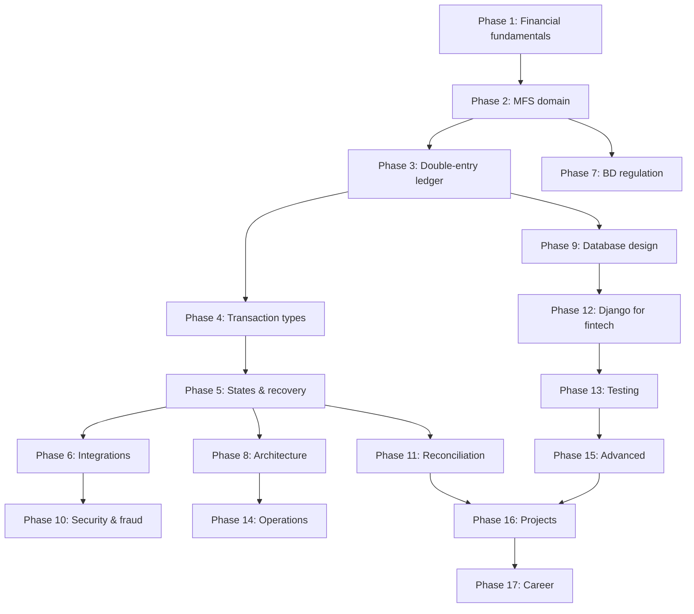

**Foundational phases that must be understood deeply before moving on (do not skip):** 1, 2, 3, 5, 9 (concurrency parts), 11. Phases 6-8, 10, 12-15 can be interleaved with projects.

### 0.3 Per-phase template used in this document

Every phase has: **Objectives → Prerequisites → Modules → Exercises → Common mistakes → Security/ops notes → Interview questions → Completion checklist → Resources.** Tick the checklists (`- [ ]` → `- [x]`) as you go.

### 0.4 Labels used for claims

| Label | Meaning |
|---|---|
| **[VERIFIED-SOURCE]** | Checked against an official or primary source while writing (see §7.3 table). Re-check the date. |
| **[VERIFY-WITH-COMPLIANCE]** | Plausibly applicable, but the exact current rule, threshold, or applicability must be confirmed with your company's compliance/legal team. |
| **[GENERAL-PRACTICE]** | Industry practice or architectural advice, not a legal requirement. |
| **[SIMPLIFIED]** | Educational code/example; production needs extra controls (listed beside it). |

All names, balances, partners, and credentials in examples are **fictional/synthetic**.

---

## Phase 1: Financial System Fundamentals

**Objectives:** Explain who the participants are in a financial system and how money and *information about money* moves between them; speak the vocabulary precisely.
**Prerequisites:** none.
**Estimated time:** 3 weeks (part-time).

### 1.1 Money, ledgers, and the core idea

Money in modern systems is mostly **records**: balances in ledgers maintained by institutions. A payment is the coordinated update of records at one or more institutions, plus a **settlement** step that moves claims on the central bank (or a commercial bank) between those institutions.

Three layers to keep separate in your head (and in your code):

| Layer | Question it answers | Example |
|---|---|---|
| **Messaging / authorization** | "Is this payment allowed and what was requested?" | App → MFS platform → partner API |
| **Accounting / ledger** | "Who owes whom, how much, recorded how?" | Journal entries in the MFS ledger |
| **Settlement** | "How do institutions actually transfer funds between themselves?" | Bank-to-bank settlement, trust/settlement account movements |

### 1.2 Financial participants

> Regulatory classification differs by entity and by the Bangladesh Bank framework in force. **Do not assume that every organization fits one category**, and verify permissions with compliance. [VERIFY-WITH-COMPLIANCE]

| Participant | Plain-language role | Bangladesh example (illustrative, verify classification) | Software implication |
|---|---|---|---|
| **Central bank** | Monetary policy, regulator, runs core payment infrastructure, holds banks' reserve accounts | Bangladesh Bank | Source of circulars; settlement finality for interbank systems |
| **Commercial bank** | Takes deposits, lends, holds customer accounts; clearing member | Scheduled commercial banks | Bank accounts you integrate with; settlement/trust account holders |
| **Non-bank financial institution (NBFI)** | Financial services without a full banking licence | Finance companies | Different permissions; may be shareholders of MFS subsidiaries |
| **Payment Service Provider (PSP)** | Provides payment services under a licence/permission | Defined in the Payment and Settlement framework; MFS providers act as PSPs under the 2022 MFS regulations [VERIFIED-SOURCE] | Your platform's regulatory category determines allowed activities |
| **Payment System Operator (PSO)** | Operates payment infrastructure/switches | Operators of national switch/interoperability rails | You integrate as a participant |
| **MFS provider** | Issues e-money wallets, agent network, wallet-based payments | bKash, Nagad, Upay, Rocket (as examples of MFS brands/operators) | Wallet ledger, agent/merchant management |
| **Payment aggregator** | Collects payments for many merchants under one integration | Aggregator platforms | Sub-merchant onboarding, settlement splits |
| **Payment gateway** | Technical bridge for online merchants to payment instruments | Merchant checkout gateways | Redirect/API flows, callbacks |
| **Switch** | Routes transaction messages among institutions | National payment switch (NPSB) | Message formats (ISO 8583/20022-like), routing, certification |
| **Card network / scheme** | Rules + network for card payments | Visa, Mastercard, local schemes | PCI DSS, ISO 8583, chargeback rules |
| **Issuer / acquirer** | Issuer: gives the instrument to payer. Acquirer: onboards merchants and receives funds | Banks as card issuers/acquirers | Roles flip depending on flow |
| **Merchant / sub-merchant** | Receives payment for goods/services | Retailers, e-commerce | Merchant wallet, MDR, settlement |
| **Agent / distributor** | Cash-in/out point; distributors supply e-float to agents | MFS agents/distributors | Agent float, commissions, fraud controls |
| **Customer / beneficiary** | Payer / receiver | Subscribers | KYC, limits |
| **Biller / collection org** | Receives recurring payments | Utilities, telecom, schools | Bill inquiry/pay APIs, settlement |
| **Government payment organizations** | Pay/collect (G2P/P2G) | Social-safety-net, tax/duty collection | Bulk disbursement, reporting |
| **Settlement / correspondent bank** | Holds accounts through which interinstitutional money moves | Settlement banks | Bank statements = independent evidence for reconciliation |

**Key national rails to learn (verify current capability on bb.org.bd):** BEFTN (Bangladesh Electronic Funds Transfer Network, batch-based credit/debit transfers), NPSB (National Payment Switch Bangladesh, interbank switching for ATM/POS/internet/mobile channels), RTGS (Real Time Gross Settlement, high-value), Bangla QR (interoperable QR standard), BACH (automated cheque clearing). Binimoy and NPS-related interoperability initiatives: confirm current status. [VERIFY-WITH-COMPLIANCE]

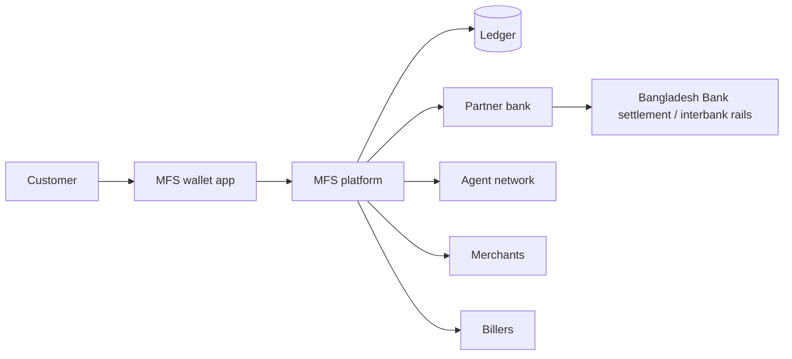

### 1.3 Banking and financial operations

For each: **workflow → financial impact → parties → system components → ledger effect (preview; Phase 3 formalizes).**

| Operation | Workflow (short) | Financial impact | Typical ledger effect (conceptual) |
|---|---|---|---|
| Onboarding / KYC | Collect identity data → verify → risk-classify → activate | None yet; creates account | Account created, limits assigned |
| e-KYC | Digital identity verification (biometric/NID-based) under the BB/BFIU e-KYC guideline | None | Same, with a simplified or regular tier |
| Customer due diligence (CDD) | Understand who the customer is, purpose, risk | None | Risk class drives limits & monitoring |
| Account lifecycle | Activate / suspend / freeze / close | Freeze blocks debits (sometimes credits) | Status change; no money movement, but balance may need sweep on closure |
| Cash-in | Customer gives cash to agent; agent e-float → customer wallet | E-money issued to customer, funded by agent float | Dr Agent wallet / Cr Customer wallet |
| Cash-out | Customer wallet → agent wallet; agent pays cash | E-money redeemed | Dr Customer wallet / Cr Agent wallet (+fee) |
| P2P | Wallet to wallet | Liability moves between customers | Dr Sender / Cr Receiver (+fee) |
| Merchant payment | Customer wallet → merchant wallet | Merchant discount rate earned | Dr Customer / Cr Merchant + Cr MDR revenue |
| Utility bill payment | Wallet → biller (via inquiry + pay) | Liability to biller until settled | Dr Customer / Cr Biller payable |
| Salary disbursement (bulk) | Corporate funds → many wallets | Bulk e-money issuance | Dr Corporate wallet / Cr N customer wallets |
| G2P / P2G | Government → citizens / citizens → government | Similar to bulk / bill | Disbursement or collection with government settlement account |
| Bank↔MFS | Move value between bank account and wallet | Trust/settlement account changes | Dr Bank asset / Cr Customer wallet (bank→wallet) |
| Remittance | Inward foreign funds → wallet | FX, regulatory reporting | Per BB framework; route via authorized channels |
| Reversal / refund / adjustment / chargeback | Compensating entries | Original effect offset | New entries; originals untouched |
| Limits & velocity | Per-txn, daily, monthly caps; count/amount per window | Prevent abuse | Enforced pre-posting |
| Fees, commissions, taxes | Computed by rules at posting | Revenue/expense/tax liability | Separate lines per component |
| Daily reconciliation & settlement | Compare ledgers with banks/partners; settle net/gross | Cash positions confirmed | Settlement entries; exception entries |

### 1.4 Financial terminology (foundations; full glossary in §21)

| Term | Definition | Software design consequence |
|---|---|---|
| Principal / transaction amount | The amount being moved, excluding fees | Store separately from fee/tax to enable partial reversal |
| Fee vs commission | Fee: charged to the payer/customer. Commission: paid to an agent/partner | Distinct accounts and reporting |
| Ledger balance | Sum of posted entries | Source of truth for "what is owed" |
| Available balance | Ledger balance minus holds minus unavailable amounts | Use for authorization checks |
| Hold / reservation | Funds earmarked, not yet posted | Needs expiry, release, and capture workflow |
| Debit / credit | Sides of an entry; meaning depends on account type (Phase 3) | Never use "debit = decrease" as a universal rule |
| Authorization vs posting | Permission/reservation vs final accounting entry | Two stages; may have different timestamps |
| Clearing | Exchange and validation of payment instructions between institutions | Files/messages, cut-offs |
| Settlement | Actual transfer of funds between institutions | Bank statement evidence |
| Gross vs net settlement | Each item settled alone vs offset into one net amount per counterparty | Netting reports and breaks |
| Reconciliation | Comparing independent records to find differences | Dedicated subsystem (Phase 11) |
| Suspense account | Temporary holding account for unexplained/unclassified items | Must be monitored and aged; never a dumping ground |
| Reversal / refund | Reversal: cancels an original (usually same day/error). Refund: returns funds after a successful completed payment (business decision) | Different eligibility rules and ledger flows |
| Liquidity / prefunding | Cash/e-float available to meet obligations; partners may require prefunded accounts | Real-time balance monitoring, alerts |
| Float | Agent/distributor e-money balance used to serve customers | Float requests, rebalancing |
| Settlement exposure / counterparty risk | Money at risk because the other side hasn't settled / may fail | Exposure limits per partner |
| Operational / fraud risk | Process failure vs deliberate abuse | Controls & monitoring |
| Assets vs liabilities | What the operator holds vs what it owes (customer wallets are typically liabilities of the issuer) | Wallet credit = increase in liability |

### 1.5 Exercises
- [ ] Draw a participant map for **cash-out at an agent**, **bill payment to a utility**, and **bank-to-wallet transfer** (who talks to whom, what message, what money).
- [ ] Write a 1-page explanation of "authorization vs clearing vs settlement" in your own words with a Bangladesh example.
- [ ] For each operation in §1.3, name the system component in *your company's* platform that implements it (just names; no confidential details in shared notes).
- [ ] Create flash cards for all terms in §1.4; answer each without notes.

### 1.6 Common mistakes
- Treating the wallet balance as "the customer's money sitting in our database" rather than a **liability** backed by funds held elsewhere under the applicable trust/custody model.
- Treating *refund*, *reversal*, *chargeback*, and *adjustment* as synonyms.
- Believing a switch/gateway/PSP/MFS are interchangeable roles.

### 1.7 Interview questions
1. What is the difference between available balance and ledger balance, and when do they diverge?
2. Why do payments involve both a messaging step and a settlement step?
3. Who bears the risk if a partner bank confirms a transfer but later says it failed?

### 1.8 Completion checklist
- [ ] I can explain every participant in §1.2 and give an example flow where each appears.
- [ ] I can define every term in §1.4 and give a software consequence.
- [ ] I can distinguish MFS provider from bank, PSP, PSO, gateway and switch, and I know classification is a compliance question.

**Resources:** Bangladesh Bank website (https://www.bb.org.bd), BIS CPMI "Principles for Financial Market Infrastructures" (https://www.bis.org/cpmi/publ/d101.htm), Bangladesh Bank payment systems pages (navigate from the Bangladesh Bank site).

---
## Phase 2: MFS Domain Knowledge

**Objectives:** Understand MFS from purpose to full technical lifecycle; be able to draw any MFS flow and name every ledger, service, partner and failure mode.
**Prerequisites:** Phase 1.
**Estimated time:** 4 weeks. **This is the most important phase.**

### 2.1 MFS fundamentals

**What MFS is.** Under the Bangladesh MFS Regulations, 2022, MFS refers to e-money services provided against a mobile account, where the record of funds is kept in an electronic general ledger. The regulation allows bank/financial-institution/government-entity-led MFS providers, and an MFS provider acts as a Payment Service Provider (PSP) as defined in the Bangladesh Payment and Settlement Systems Regulations, 2014. [VERIFIED-SOURCE: see §7.3] Read the regulation's own definitions before relying on this summary.

**Why MFS exists:** reach people without bank branches/accounts, using the mobile phone as the identity and channel, and agents as the cash on/off-ramp.

| Concept | MFS wallet | Traditional bank account | Internet/digital banking | Generic "digital wallet" app |
|---|---|---|---|---|
| Value held as | E-money (issuer liability) under MFS regulation | Deposit liability of a bank | Same as bank account, online channel | May be stored value *or* just a pointer to cards/accounts |
| Onboarding | Mobile number + KYC/e-KYC (tiered) | Full bank KYC | Requires existing account | App-level, depends on backing instrument |
| Cash access | Agent network | Branch / ATM | ATM / branch | Usually via linked instruments |
| Regulator rules | MFS Regulations + payment/settlement rules | Banking law | Banking law | Depends on licence model |

**Customer money safeguarding.** Customer e-money is backed by funds the provider must hold and account for under the applicable regulatory and trust-fund model (the search for this roadmap surfaced the BB "Guidelines for Trust Fund Management for Payment and Settlement Services" as relevant, 2021). **Exact custody structure, account types and permitted investments: [VERIFY-WITH-COMPLIANCE].** What software must guarantee regardless: *the sum of customer wallet balances (liability) is always reconcilable to funds held in the designated bank/trust accounts plus documented in-transit and suspense items.*

**Revenue model (typical, varies by operator):**

| Revenue | Paid by | Notes |
|---|---|---|
| Cash-out fee | Customer | Often a percentage; shared with agent as commission |
| P2P / send-money fee | Sender (some bands free) | Often tiered by amount |
| Merchant Discount Rate (MDR) | Merchant | % of payment |
| Bill-payment fee/commission | Customer or biller | Split with biller/aggregator |
| Bulk disbursement fee | Corporate/government | Per item or %|
| Partner/interchange-like fees | Banks/partners | Bilaterally negotiated |
| Float income | Provider | Subject to trust-fund rules [VERIFY-WITH-COMPLIANCE] |

**System layers (keep them separated in code):**

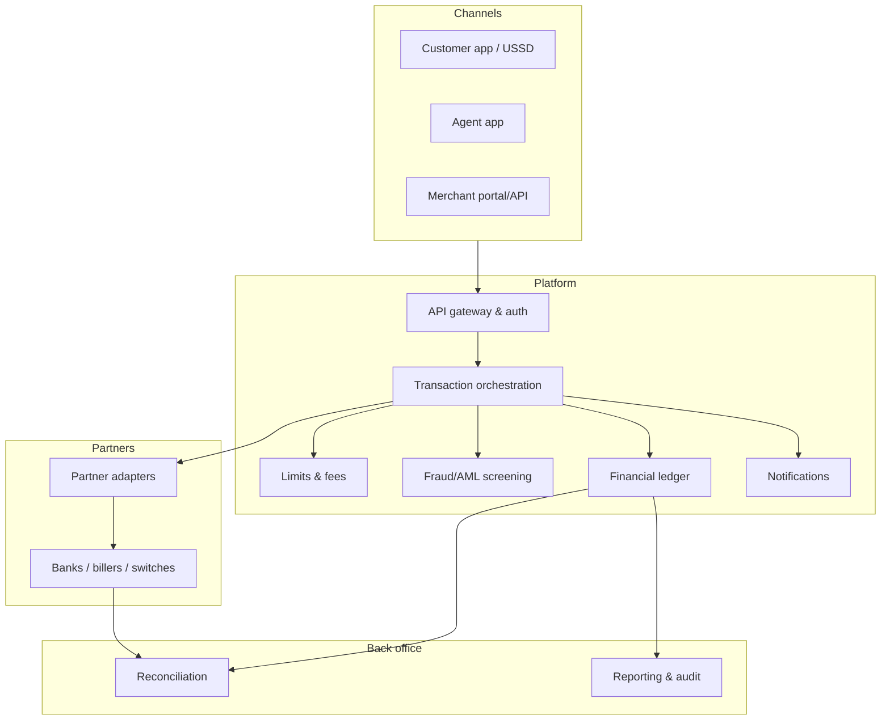

### 2.2 MFS business models (each: participants, revenue, flow, ledger, settlement, risks, components)

| Model | Participants | Revenue | Key flow | Ledger implication | Settlement need | Main risks | Components |
|---|---|---|---|---|---|---|---|
| Customer wallet | Customer, provider | Fees, float policy | Open account → fund → spend | Customer wallet liability | Reconcile to trust/bank balances | Account takeover, KYC gaps | Identity, wallet, ledger |
| Agent-assisted services | Agent, distributor, customer | Cash-out fees | Agent performs cash-in/out | Agent wallet moves opposite to customer | Agent cash vs e-float | Agent fraud, float shortfall | Agent mgmt, commission engine |
| Merchant payments | Customer, merchant | MDR | Customer pays merchant | Merchant wallet + MDR revenue | Merchant settlement to bank | Chargeback-like disputes, fake merchants | Merchant mgmt, settlement |
| QR payments | Same + QR scheme | MDR | Scan → resolve merchant → pay | As merchant payment | As above | Static-QR substitution | QR parser/validator |
| P2P | Two customers | Transfer fee | Wallet-to-wallet | Dr sender / Cr receiver | None external | Mule accounts, social engineering | Transfer service |
| Cash-in/out | Agent, customer | Fees/commission | See §2.4 | See Phase 3 | Agent float | Agent collusion | Float service |
| Bank↔wallet | Bank, customer | Fees | Initiate → bank confirm → credit | Dr bank asset / Cr wallet | Bank statement | Async uncertainty | Bank adapter |
| Salary / bulk | Corporate, many recipients | Per-item fees | File upload → validate → disburse | One debit, N credits | Corporate funding | Bad beneficiary data, partial batches | Batch engine |
| Utility bills | Customer, biller, aggregator | Bill fee | Inquiry → pay → confirm | Biller payable | Biller settlement | Duplicate payment, stale bill | Bill adapters |
| Government payments | Gov entity, citizens | Negotiated | G2P/P2G | Per bulk / bill | Gov account | Beneficiary errors | Batch + reporting |
| Intl remittance | Remitter, partner, wallet | FX/service fee | Partner credit → wallet | Wallet credit vs partner settlement | Partner settlement | Compliance screening | Remittance adapter |
| Payment collection / API | Business, customers | MDR/fees | Hosted checkout/API | Merchant wallet | Merchant settlement | Replay, callbacks | Payment API, webhooks |
| Network management | Provider, agents/merchants | n/a | Onboard/KYB/monitor | n/a | n/a | Fake agents | Onboarding, risk |

### 2.3 Complete MFS transaction lifecycle

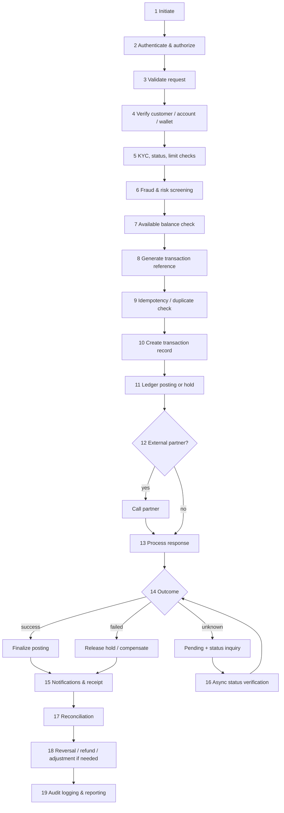

> Practical ordering note: step 9 (idempotency) usually happens **earlier** (right after authentication) so a retried request returns the stored result before heavier work. The checklist order above is conceptual. [GENERAL-PRACTICE]

**What varies by transaction type and why**

| Step | Internal P2P | Cash-in/out | Merchant | Bank transfer | Bill pay |
|---|---|---|---|---|---|
| Needs external partner | No | No (agent is internal) | No | **Yes** | **Yes** |
| Final outcome known synchronously | Yes | Yes | Yes | Often **no** | Often partial |
| Risk of "uncertain" state | Low | Low | Low | **High** | **High** |
| Needs reconciliation with external records | Internal only | Agent cash/float | Merchant settlement | **Bank statement** | **Biller file** |
| Extra authorization | PIN | Agent PIN + customer OTP/PIN | PIN | PIN + bank-side auth | PIN |

### 2.4 Sequence diagrams (educational; real platforms differ)

**Cash-in (agent deposits cash for customer)**

```mermaid
sequenceDiagram
  autonumber
  participant AG as Agent app
  participant API as API gateway
  participant TX as Transaction service
  participant LIM as Limits/Fees
  participant RSK as Risk
  participant LED as Ledger
  participant NT as Notification
  AG->>API: POST /cash-in (idempotency-key, customer MSISDN, amount, agent PIN)
  API->>TX: authenticated request
  TX->>TX: idempotency lookup, create txn INITIATED
  TX->>LIM: check limits & compute fee/commission
  TX->>RSK: screen
  RSK-->>TX: allow
  TX->>LED: post journal (Dr Agent wallet, Cr Customer wallet; commission lines)
  LED-->>TX: posted
  TX->>TX: mark SUCCESS
  TX->>NT: enqueue SMS/push to both
  TX-->>AG: 200 {txn_id, SUCCESS}
```

**Cash-out (customer withdraws cash at agent)**

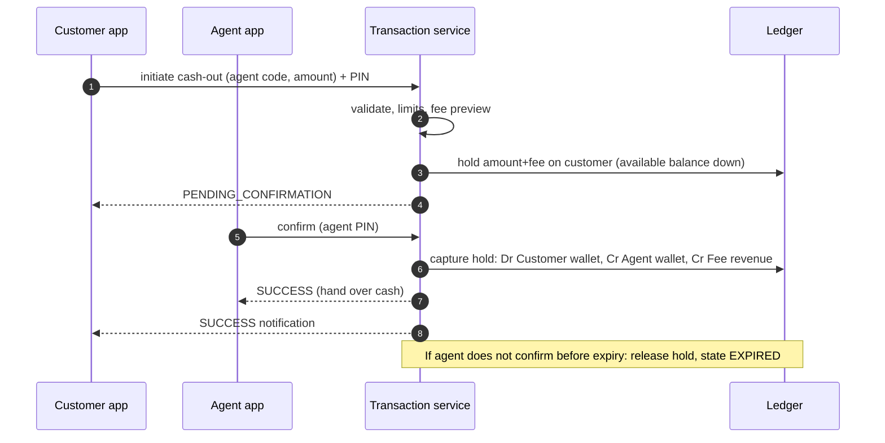

**P2P transfer**

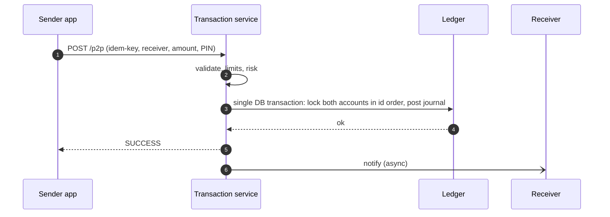

**Merchant payment (QR)**

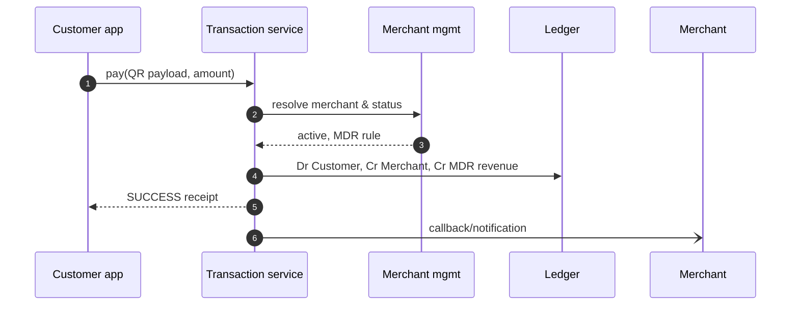

**Bank-to-wallet (asynchronous, external)**

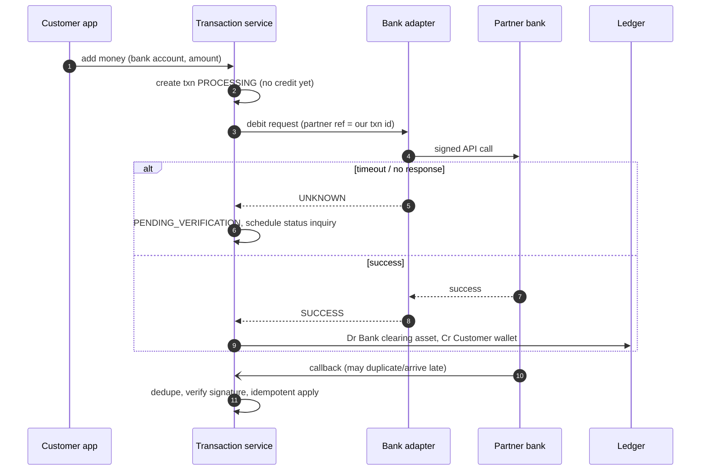

**Bill payment (inquiry + pay)**

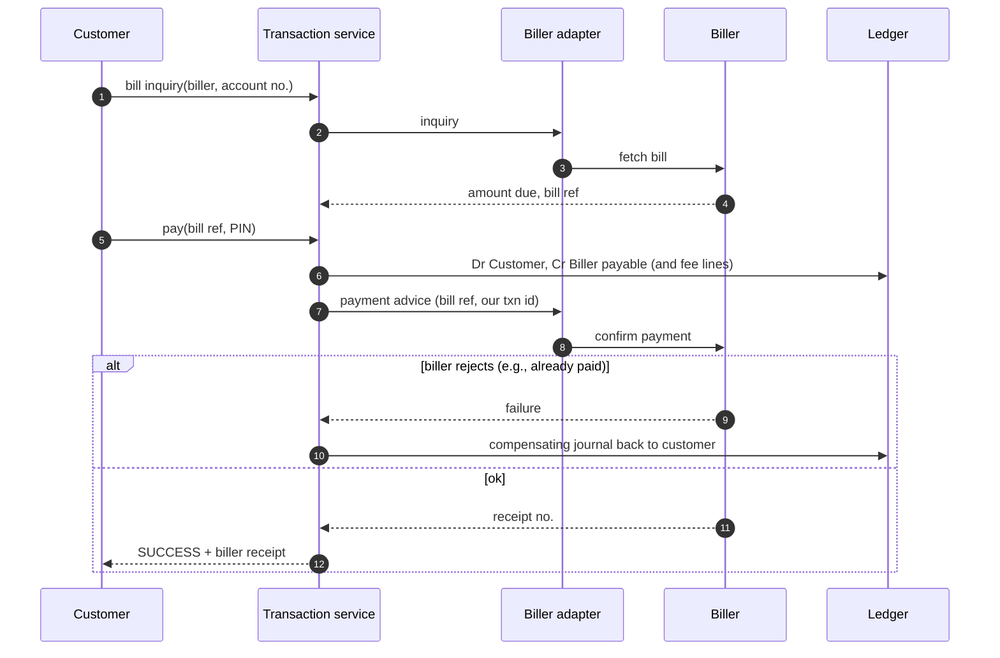

### 2.5 Per-transaction-type analysis grid (fill this for each type — it is your core study artifact)

| Item | Cash-in | Cash-out | P2P | Merchant | Bank→Wallet | Bill |
|---|---|---|---|---|---|---|
| Initiator | Agent | Customer (+agent confirm) | Sender | Customer | Customer | Customer |
| Receiver | Customer | Agent | Receiver | Merchant | Customer | Biller |
| Accounts involved | Agent wallet, customer wallet, commission exp./payable | Customer wallet, agent wallet, fee revenue | Two wallets, fee revenue | Customer, merchant, MDR revenue | Bank clearing/settlement, customer wallet | Customer, biller payable, fee revenue, bank (at settlement) |
| Services called | Limits, risk, ledger, notifications | + hold/capture | Limits, risk, ledger | + merchant mgmt | + bank adapter | + biller adapter |
| DB changes | txn, journal, entries, idempotency, audit | + holds | same | same | + partner req/resp, callback inbox | same |
| External integrations | none | none | none | none | bank API | biller API |
| Failure scenarios | Limit breach, agent float short | Customer cancels, agent absent | Insufficient funds, duplicate | Merchant suspended | Timeout, callback loss | Biller down, stale bill |
| Recovery | Reject cleanly | Expire & release hold | Reject cleanly | Reject cleanly | Status inquiry + reconcile | Compensate or retry per partner rules |
| Reconciliation | Agent float/cash | Agent float/cash | Internal only | Merchant settlement | Bank statement | Biller file/statement |

### 2.6 Exercises
- [ ] Reproduce all six sequence diagrams from memory, then compare to your company's real flows (keep real details private).
- [ ] Fill the §2.5 grid for **QR payment, salary disbursement, remittance, refund**.
- [ ] Write the "uncertain outcome" runbook for bank→wallet in half a page.

### 2.7 Common mistakes
- Crediting the customer **before** the partner confirmed (or never crediting after a late success).
- Using the HTTP response as the financial outcome of an asynchronous operation.
- Computing fees in the client app.

### 2.8 Interview questions
1. Walk me through a cash-out and name every table touched.
2. Why might the same business operation have a hold step in one flow and not another?
3. What is different about the failure modes of an internal P2P versus a bank transfer?

### 2.9 Completion checklist
- [ ] I can narrate the 19-step lifecycle and justify the order changes.
- [ ] I can draw all six flows and list their failure modes.
- [ ] I can explain customer wallet vs ledger vs partner records vs bank/settlement records.

**Resources:** Bangladesh MFS Regulations 2022 (official PDF, §7.3), Trust Fund Management guidelines (BB site; verify link), GSMA Mobile Money resources (https://www.gsma.com/mobilefordevelopment/mobile-money/).

---
## Phase 3: Double-Entry Accounting & Ledger Engineering

**Objectives:** Model MFS money movement as balanced, immutable journal entries; compute balances; correct errors with compensating entries.
**Prerequisites:** Phases 1-2. **Time:** 4 weeks. **Foundational: do not skip.**

> **Caveat.** Actual journal entries depend on the legal entity, accounting policy, custody/trust model, tax treatment and transaction design. The examples below are a *teaching model*. Customer-wallet **subledger** entries (per customer) are not the same thing as the operator's **general ledger** and settlement records; in practice the subledger rolls up into a control account in the GL. Confirm the real chart of accounts with your finance team. [VERIFY-WITH-COMPLIANCE]

### 3.1 Accounting fundamentals for engineers

| Account type | Normal balance | Increases with | Examples (MFS) |
|---|---|---|---|
| Asset | Debit | Debit | Settlement bank account, receivable from partner, suspense (outflow side) |
| Liability | Credit | Credit | **Customer/agent/merchant wallet balances**, biller payable, tax payable, commission payable |
| Equity | Credit | Credit | Retained earnings |
| Revenue | Credit | Credit | Fee revenue, MDR revenue |
| Expense | Debit | Debit | Agent commission expense |

Core equation: **Assets = Liabilities + Equity** (with revenue/expense flowing into equity). A **journal** is a set of **lines**; each line debits or credits one account; **total debits = total credits** per journal and per currency.

Rules to memorize: a wallet credit *increases* a liability; "debit = decrease" is only true for liability accounts. Never store signed amounts without also storing the side and the account's normal balance.

**Chart of accounts (teaching model)**

| Code | Name | Type | Normal |
|---|---|---|---|
| `CW:<id>` | Customer wallet (subledger) | Liability | Credit |
| `AW:<id>` | Agent wallet | Liability | Credit |
| `MW:<id>` | Merchant wallet | Liability | Credit |
| `BANK:SETTLE` | Settlement/trust bank account (mirror of bank) | Asset | Debit |
| `LIAB:BILLER` | Biller payable | Liability | Credit |
| `CLR:BANKOUT` | Wallet-to-bank clearing | Liability | Credit |
| `LIAB:COMM_PAYABLE` | Commission payable | Liability | Credit |
| `SUSP:RECON` | Reconciliation suspense (unexplained outflow) | Asset | Debit |
| `SUSP:UNIDENT` | Unidentified receipts | Liability | Credit |
| `RECV:PARTNER` | Receivable from partner | Asset | Debit |
| `REV:FEE`, `REV:MDR` | Fee / MDR revenue | Revenue | Credit |
| `EXP:COMM` | Agent commission expense | Expense | Debit |

### 3.2 Ledger data model (conceptual)

| Table | Key columns | Notes |
|---|---|---|
| `ledger_account` | id, code, type, owner_ref, currency, status | Type determines normal balance |
| `ledger_journal` | id, txn_id, kind, posted_at, reverses_journal_id (nullable), description | **Immutable after posting** |
| `ledger_entry` | id, journal_id, account_id, side (D/C), amount (Decimal > 0), currency | **Append-only** |
| `account_balance` | account_id, ledger_balance, hold_total, version | Derived/cached; must reconcile to entries |
| `balance_hold` | id, account_id, amount, txn_id, status, expires_at | Reduces available balance only |

**Invariants**
1. Per journal: Σ debits = Σ credits per currency.
2. Entries are never updated or deleted after posting; corrections are new journals.
3. `ledger_balance(account)` = Σ(credit − debit) for credit-normal (or the inverse) over entries, and the cached balance equals this.
4. `available = ledger_balance − active holds` and never below the allowed minimum.
5. A reversal journal references exactly one original and mirrors its lines (or a stated partial portion).
6. Σ wallet liabilities ties out to the bank/trust position plus documented in-transit and suspense items.

**Why not delete or overwrite.** Auditors, regulators, dispute teams and reconciliation need to know *what was believed at each point in time*. Overwriting destroys evidence, makes balances irreproducible, and hides fraud. Compensating entries preserve the original and the correction, each with who/when/why/approval.

### 3.3 Worked examples

All amounts BDT, synthetic. Wallet balances shown as the (credit-normal) liability amount. Fees/commissions are invented; **taxes (e.g., VAT/excise on fees) are omitted** because rates and treatment are legal/accounting matters. [VERIFY-WITH-COMPLIANCE]

**Ex 1 — Customer cash-in.** Amina (CW:A) has 500. Agent Rahim (AW:R) has 50,000. Amina cashes in 1,000; agent commission 4.

| Journal | Account | Dr | Cr |
|---|---|---|---|
| J1 cash-in | AW:R | 1,000 | |
| J1 | CW:A | | 1,000 |
| J2 commission | EXP:COMM | 4 | |
| J2 | AW:R | | 4 |

After: CW:A = 1,500; AW:R = 49,000 + 4 = 49,004. Records: txn(CASH_IN, SUCCESS), 2 journals/4 entries, idempotency row, audit event, notification outbox rows. Invariants: both journals balance; Amina's gain equals the agent's e-float drop (conservation of e-money).

**Ex 2 — Customer cash-out.** Amina cashes out 1,000, fee 15, agent share 6.

| Journal | Account | Dr | Cr |
|---|---|---|---|
| J3 | CW:A | 1,015 | |
| J3 | AW:R | | 1,000 |
| J3 | REV:FEE | | 15 |
| J4 commission | EXP:COMM | 6 | |
| J4 | AW:R | | 6 |

After: CW:A = 485; AW:R = 49,004 + 1,000 + 6 = 50,010. Invariant: available balance ≥ 1,015 checked under lock before posting.

**Ex 3 — Customer-to-customer transfer.** Amina sends Bilal (CW:B, 200) 100, fee 5.

| Journal | Account | Dr | Cr |
|---|---|---|---|
| J5 | CW:A | 105 | |
| J5 | CW:B | | 100 |
| J5 | REV:FEE | | 5 |

After: CW:A = 380; CW:B = 300. Lock order: ascending account id, always (§9).

**Ex 4 — Merchant payment.** Carla (CW:C, 5,000) pays ShopX (MW:M, 2,000) 1,000; MDR 1.5% = 15.

| Journal | Account | Dr | Cr |
|---|---|---|---|
| J6 | CW:C | 1,000 | |
| J6 | MW:M | | 985 |
| J6 | REV:MDR | | 15 |

After: CW:C = 4,000; MW:M = 2,985.

**Ex 5 — Transaction fee collection (standalone).** Monthly service fee of 10 on Amina.

| Journal | Account | Dr | Cr |
|---|---|---|---|
| J7 | CW:A | 10 | |
| J7 | REV:FEE | | 10 |

Rounding: define one policy (e.g., round half-up to 2 decimals at the fee-line level) and store the rounded amounts; never recompute later.

**Ex 6 — Agent commission (accrue, then pay).**

| Journal | Account | Dr | Cr |
|---|---|---|---|
| J8 accrual | EXP:COMM | 120 | |
| J8 | LIAB:COMM_PAYABLE | | 120 |
| J9 payout | LIAB:COMM_PAYABLE | 120 | |
| J9 | AW:R | | 120 |

Why two steps: commission may be calculated in batch after reversals settle, and may need approval.

**Ex 7 — Bill payment.** Amina pays an electricity bill 500, fee 10; settlement to biller next day.

| Journal | Account | Dr | Cr |
|---|---|---|---|
| J10 payment | CW:A | 510 | |
| J10 | LIAB:BILLER | | 500 |
| J10 | REV:FEE | | 10 |
| J11 settlement (T+1) | LIAB:BILLER | 500 | |
| J11 | BANK:SETTLE | | 500 |

The wallet debit and the biller payable are internal; **BANK:SETTLE only moves when funds actually leave the bank**, and it must match the bank statement.

**Ex 8 — Failed transaction after a temporary debit.** Wallet-to-bank 1,000, bank fails.

*Model A: hold only (no GL effect).* Create `balance_hold` 1,000 → available balance down. On failure, release hold (status=RELEASED). No journals. On success, capture: post the journal and mark hold CAPTURED.

*Model B: clearing account.*

| Journal | Account | Dr | Cr |
|---|---|---|---|
| J12 initiate | CW:A | 1,000 | |
| J12 | CLR:BANKOUT | | 1,000 |
| J13 bank failed (compensate) | CLR:BANKOUT | 1,000 | |
| J13 | CW:A | | 1,000 |
| *(alt) J13' bank success, funds leave* | CLR:BANKOUT | 1,000 | |
| J13' | BANK:SETTLE | | 1,000 |

Trade-off: Model A is simpler and keeps the GL clean; Model B makes in-flight liabilities visible in the GL for finance. Pick per policy.

**Ex 9 — Refund after successful payment (full).** Refund Ex 4 in full, MDR refunded per policy.

| Journal | Account | Dr | Cr |
|---|---|---|---|
| J14 (`reverses`/`refunds` J6) | MW:M | 985 | |
| J14 | REV:MDR | 15 | |
| J14 | CW:C | | 1,000 |

If MW:M lacks the balance: business policy decides (reject, allow negative with a receivable, offset against next settlement). Do not hard-code.

**Ex 10 — External settlement to merchant bank account.**

| Journal | Account | Dr | Cr |
|---|---|---|---|
| J15 | MW:M | 2,985 | |
| J15 | BANK:SETTLE | | 2,985 |

Settlement batch record references J15 and the bank payment reference; reconciliation later matches the bank statement line.

**Ex 11 — Reconciliation discrepancy (unexplained bank debit).** Bank statement shows a 500 debit on the settlement account with no matching internal transaction.

| Journal | Account | Dr | Cr |
|---|---|---|---|
| J16 (after approval) | SUSP:RECON | 500 | |
| J16 | BANK:SETTLE | | 500 |

Reconciliation does **not** touch customer wallets. Investigation outcomes: (a) partner debited for a transaction we recorded as failed → book receivable `Dr RECV:PARTNER / Cr SUSP:RECON`, then on refund `Dr BANK:SETTLE / Cr RECV:PARTNER`; (b) transaction actually succeeded → follow the approved correction workflow (new, linked journals). Age the suspense item; escalate by threshold.

**Ex 12 — Duplicate transaction prevention.**

| Request | idempotency_key | Result | New journals |
|---|---|---|---|
| 1 | `K-7f3a` | creates txn T1, posts J5 | 1 |
| 2 (client retry, same body) | `K-7f3a` | returns stored response of T1 | **0** |
| 3 (same key, different amount) | `K-7f3a` | **409/422: key reuse with different payload** | 0 |

Enforcement: `UNIQUE (client_id, idempotency_key)` plus request fingerprint compare. Invariant: financial effect count for one logical request ≤ 1.

**Ex 13 — Suspense handling (unidentified incoming bank credit).**

| Journal | Account | Dr | Cr |
|---|---|---|---|
| J17 receipt | BANK:SETTLE | 2,000 | |
| J17 | SUSP:UNIDENT | | 2,000 |
| J18 identified as Amina's deposit | SUSP:UNIDENT | 2,000 | |
| J18 | CW:A | | 2,000 |
| *(alt) J18' returned to sender* | SUSP:UNIDENT | 2,000 | |
| J18' | BANK:SETTLE | | 2,000 |

Suspense is *temporary*; every item needs an owner, an age, and an exit.

**Ex 14 — Partial reversal.** Refund 300 of the 1,000 payment in Ex 4; fee refunded proportionally (policy).

| Journal | Account | Dr | Cr |
|---|---|---|---|
| J19 (references J6, portion 30%) | MW:M | 295.50 | |
| J19 | REV:MDR | 4.50 | |
| J19 | CW:C | | 300.00 |

Track `refunded_total ≤ original_amount` with a constraint/locked check; the sum of partial reversals can never exceed the original.

### 3.4 Period closing, trial balance
Trial balance = list of every account's balance; Σ debit-normal balances = Σ credit-normal balances. Period close: stop backdated posting for that period, run reconciliations, resolve/age suspense, produce reports, record approvals. Late corrections post into the *open* period, referencing the original. [GENERAL-PRACTICE]

### 3.5 Exercises
- [ ] Re-derive every balance in Ex 1-14 by hand, then by SQL over a toy schema.
- [ ] Build `post_journal(lines)` that rejects unbalanced journals; add a property test (random balanced/unbalanced inputs).
- [ ] Add multi-currency rejection (all lines in a journal share one currency).
- [ ] Write the trial-balance query and verify it after 10,000 random transactions.

### 3.6 Common mistakes
- Storing only `balance` and mutating it (no entries).
- Updating a posted entry "just to fix a typo".
- Mixing fee into principal so partial refunds are impossible.
- Treating suspense as a permanent parking lot.

### 3.7 Interview questions
1. Show the journal for a cash-out with fee and agent commission; which accounts are liabilities?
2. How do you correct a posted wrong amount, and who must approve it?
3. How would you detect that the subledger drifted from the control account?

### 3.8 Completion checklist
- [ ] I can post all 14 examples without notes.
- [ ] I can state the six invariants and test each.
- [ ] I can explain subledger vs GL and why chart-of-accounts is a finance-owned decision.

**Resources:** Square, "Books, an immutable double-entry accounting database service" (engineering blog, supplementary); Modern Treasury, "Accounting for Developers" (supplementary tutorial); Martin Fowler, "Accounting Patterns" and "Event Sourcing" (https://martinfowler.com); official accounting standards are the finance team's domain (IFRS/IAS; BFRS is the local adoption; verify).

---

## Phase 4: MFS Transaction Types & Workflows

**Objectives:** For each transaction type, specify purpose, sequence, states, data model, API, ledger, partners, failures, security, reconciliation, monitoring, and tests.
**Prerequisites:** Phases 2-3. **Time:** 4 weeks.

### 4.1 Sync vs async; immediate response vs final outcome

| Concept | Meaning | Design consequence |
|---|---|---|
| Synchronous | Caller waits; final outcome known in the response | Only when all steps are internal and atomic |
| Asynchronous | Response means "accepted"; final outcome arrives later (callback/poll) | Persist first; expose status endpoint; callbacks need dedupe |
| Immediate response | HTTP reply right now (e.g., 202 Accepted) | Not a financial outcome |
| Final financial outcome | SUCCESS/FAILED determined and ledgered | Only this triggers receipt, credit, or release |

### 4.2 Module matrix (use as a template: duplicate one row into a full module doc per type)

| Type | State machine (core) | Key tables | Ledger (simplified) | Partner | Main failures → handling | Security | Reconciliation | Monitoring | Test focus |
|---|---|---|---|---|---|---|---|---|---|
| Cash-in | INITIATED→SUCCESS/FAILED | txn, journal, agent_float | Dr Agent / Cr Customer | none | Float short → reject | Agent PIN, geo/velocity | Agent cash vs float | Agent anomalies | Float race tests |
| Cash-out | INITIATED→PENDING_CONFIRM→SUCCESS/EXPIRED/FAILED | txn, hold | Dr Customer / Cr Agent, Cr Fee | none | Agent no-show → expire & release | Customer PIN + agent PIN | Agent cash | Expired-hold rate | Hold lifecycle |
| P2P | INITIATED→SUCCESS/FAILED | txn, journal | Dr S / Cr R, Cr Fee | none | Duplicate → idempotent | PIN, risk rules | Internal | Velocity | Concurrency |
| Merchant | INITIATED→SUCCESS/FAILED | txn, merchant | Dr C / Cr M, Cr MDR | none | Suspended merchant → reject | Merchant auth, QR signature | Merchant settlement | Success rate by merchant | MDR math |
| QR | same + QR resolve | qr_registry | as merchant | Switch for interoperable QR [VERIFY] | Tampered QR → reject | Verify QR payload/CRC | as merchant | Invalid QR rate | Parser fuzz |
| Bank→wallet | INITIATED→PROCESSING→SUCCESS/FAILED/UNKNOWN | txn, partner_req/resp | Dr Bank clr / Cr Wallet | Bank | Timeout → inquiry | Signing, mTLS | Bank statement | Pending age | Fault injection |
| Wallet→bank | …→PROCESSING→(SUCCESS/FAILED/UNKNOWN) | txn, hold/clearing | Dr Wallet / Cr Clearing | Bank | Fail → release/compensate | Beneficiary validation | Bank statement | Pending age | Timeout matrix |
| Bill pay | INITIATED→PROCESSING→SUCCESS/FAILED/UNKNOWN | txn, bill_ref | Dr Cust / Cr Biller payable | Biller | Stale bill, duplicate bill | Bill ref integrity | Biller file | Biller uptime | Duplicate pay |
| Bulk/salary | BATCH_RECEIVED→VALIDATED→APPROVED→EXECUTING→COMPLETED/PARTIAL | batch, batch_item | Dr Corp / Cr N wallets | Optional | Partial failure → per-item states | Maker-checker | Batch totals | Item failure rate | Large-batch idempotency |
| Government disbursement | as bulk + beneficiary list | batch, beneficiary | as bulk | Gov | Wrong beneficiary → hold/return | Strong approvals | Gov reports | Return rate | Data validation |
| Remittance | RECEIVED→SCREENED→CREDITED/HELD | remit, screening | Per BB framework | Remittance partner | Screening hit → hold | Sanctions screening | Partner settlement | Hold aging | Compliance rules |
| Agent commission | ACCRUED→APPROVED→PAID | commission_accrual | Ex 6 | none | Disputed → adjust | Approval | Commission statement | Payout drift | Recalc idempotency |
| Merchant settlement | PENDING→BATCHED→PAID/FAILED | settlement_batch | Ex 10 | Bank | Bank reject → retry/hold | Bank detail change controls | Bank statement | Payout lateness | Net/gross |
| Refund/reversal | REQUESTED→APPROVED→POSTED | refund, journal link | Mirror of original | Maybe | Over-refund → block | Approval | Link to original | Refund rate | Over-refund constraint |
| Transaction inquiry | read-only | txn view | none | Maybe partner | Stale cache | AuthZ ownership | n/a | Latency | Authorization |
| Balance inquiry | read-only | balance | none | none | Cache lag | AuthZ | n/a | Latency | Cache staleness |
| Limit enforcement | evaluated before posting | limit_rule, usage_counter | none | none | Race on counters | Server-side only | Limit reports | Breach rates | Concurrent limit test |
| Failed/pending handling | see Phase 5 | txn_attempt | compensating | Maybe | see Phase 5 | Ops authorization | Mandatory | Pending age | State-machine tests |

### 4.3 Example API (P2P) — [SIMPLIFIED]

```http
POST /api/v1/transfers
Idempotency-Key: 6f9a7b64-3c1a-4d2f-9b1a-0c1f9d5c3a11
Authorization: Bearer <token>
Content-Type: application/json

{ "to_msisdn": "+8801XXXXXXXXX", "amount": "100.00", "currency": "BDT", "reference": "rent" }
```
Response `201`:
```json
{ "transaction_id": "TXN202610290001", "status": "SUCCESS", "amount": "100.00", "fee": "5.00", "created_at": "2026-10-29T10:15:00Z" }
```
Errors use stable machine codes (`INSUFFICIENT_FUNDS`, `LIMIT_EXCEEDED`, `DUPLICATE_REQUEST_MISMATCH`, `ACCOUNT_RESTRICTED`) — never leak internal details. Amounts are **strings**, not floats. PIN is verified via a separate secured step/channel; **never** log it. Before production: rate limiting, device binding, step-up auth, signed receipts, audit logging, abuse detection.

### 4.4 Exercises
- [ ] Complete a full module doc (all 11 columns expanded to ≥1 page) for **cash-out**, **bank→wallet**, **bulk salary**.
- [ ] Write the OpenAPI spec for transaction inquiry with ownership checks.
- [ ] Design `limit_rule` + `usage_counter` and demonstrate a race that exceeds a daily cap, then fix it.

### 4.5 Common mistakes
- Letting the client choose fee or limit tier.
- Using one generic status for every transaction type.
- Skipping maker-checker on bulk and refunds.

### 4.6 Interview questions
1. Why does bulk disbursement need *item-level* states?
2. When does an inquiry endpoint risk leaking data, and how do you prevent it?
3. How would you enforce a daily limit under concurrent requests?

### 4.7 Completion checklist
- [ ] I produced a full module document for at least 3 types.
- [ ] I can state sync/async consequences for each type.
- [ ] I can show a failing concurrent-limit test and its fix.

---

## Phase 5: Transaction States, Failures & Recovery

**Objectives:** Design state machines per transaction type; recover safely from timeouts, lost/duplicate/late callbacks; never double-debit or double-credit.
**Prerequisites:** Phases 3-4. **Time:** 4 weeks. **Foundational.**

### 5.1 State machine (illustrative, not a universal enum)

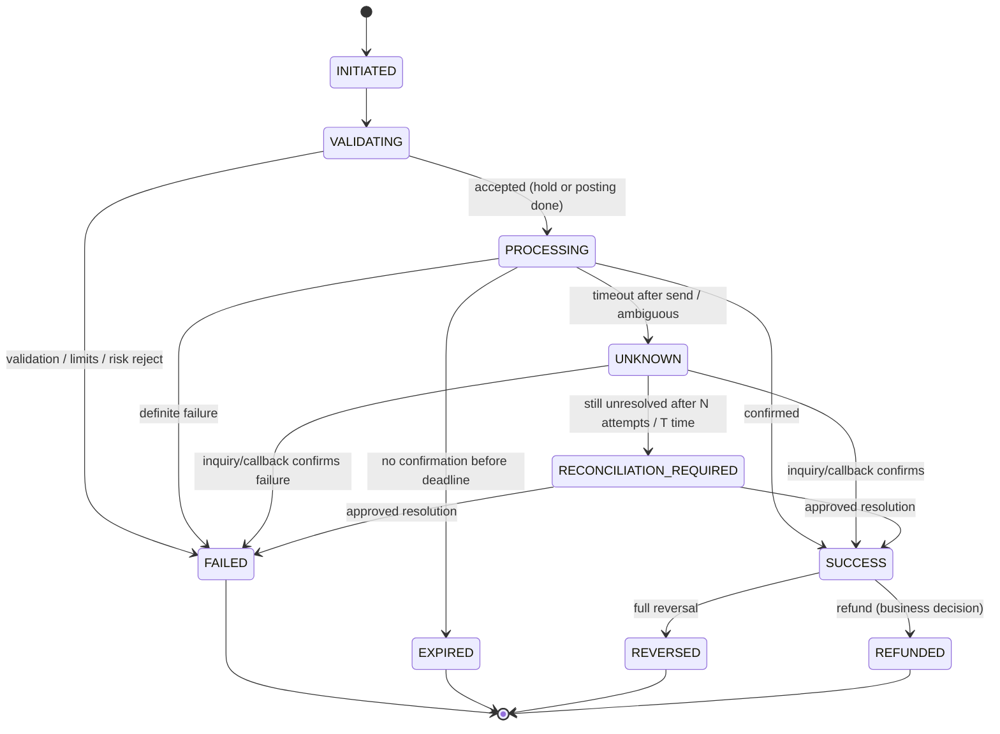

Define a **transition table** in code and test it; reject all others.

| From | To | Trigger | Allowed side effects |
|---|---|---|---|
| INITIATED | VALIDATING | Request persisted | none |
| VALIDATING | PROCESSING | Checks passed | Create hold / post journal |
| VALIDATING | FAILED | Check failed | none |
| PROCESSING | SUCCESS | Definite success evidence | Capture/post, notify |
| PROCESSING | FAILED | Definite failure evidence | Release/compensate |
| PROCESSING | UNKNOWN | Ambiguity | **No** release, **no** retry of the external debit |
| UNKNOWN | SUCCESS/FAILED | Authoritative inquiry/callback | As above |
| UNKNOWN | RECONCILIATION_REQUIRED | Retry budget exhausted | Ops ticket |
| SUCCESS | REVERSED/REFUNDED | Approved request | Compensating journal |

Terminal vs non-terminal: FAILED/EXPIRED/REVERSED/REFUNDED terminal; SUCCESS terminal for the original payment but can have post-success children (refund).

### 5.2 Failure taxonomy

| Failure | Meaning | Safe response |
|---|---|---|
| **Business failure** | Valid outcome: insufficient funds, limit, invalid account | FAILED, clear error code |
| **Technical failure** (before send) | Never reached partner | Safe to fail & release, safe to retry same attempt |
| **Timeout before sending** | Local error before network call | As above |
| **Timeout after sending** | Request may have been processed | **UNKNOWN**; inquire; never blind-retry a non-idempotent call |
| Partner response lost | Same as above | Same |
| Duplicate callbacks | Same event twice | Dedupe via inbox; idempotent apply |
| Delayed callbacks | Arrive after we timed out/failed | Accept; reconcile with current state (may need compensation) |
| Conflicting partner responses | Callback says success, inquiry says failed | Do **not** pick; evidence hierarchy → RECONCILIATION_REQUIRED |
| Partial processing | Some steps done (e.g., debit done, notify failed) | Track per-step; compensate or complete forward |
| DB rollback after external call | External effect exists but our record rolled back | Outbox/persist-before-call; reconcile |

**Why a timeout does not mean failure.** Scenario: we call Bank X to debit Amina's account 1,000; the bank debits successfully but the response is dropped by the network. If we mark FAILED and credit nothing, Amina is out 1,000 at the bank. If we retry blindly and the bank lacks idempotency, she may be debited twice. Correct behavior: mark UNKNOWN, keep funds in a pending position, query status using our unique reference, and reconcile against the bank statement.

### 5.3 Recovery design

Principles: (1) **persist intent before side effect** (txn + attempt row first); (2) every external call carries a **partner reference derived from our attempt id**; (3) retries reuse the same reference; (4) state changes are **compare-and-set** (`UPDATE ... WHERE id=? AND status IN (...)`); (5) every transition writes an audit event; (6) only **authoritative evidence** closes UNKNOWN.

Evidence hierarchy (example, [GENERAL-PRACTICE]): bank/partner statement or settlement file > partner status-inquiry response > signed callback > our own timeout.

[SIMPLIFIED] state transition helper:

```python
from django.db import transaction as dbtx

ALLOWED = {
    "INITIATED": {"VALIDATING", "FAILED"},
    "VALIDATING": {"PROCESSING", "FAILED"},
    "PROCESSING": {"SUCCESS", "FAILED", "UNKNOWN", "EXPIRED"},
    "UNKNOWN": {"SUCCESS", "FAILED", "RECONCILIATION_REQUIRED"},
    "RECONCILIATION_REQUIRED": {"SUCCESS", "FAILED"},
    "SUCCESS": {"REVERSED", "REFUNDED"},
}

class InvalidTransition(Exception): ...

@dbtx.atomic
def transition(txn_id, to_status, *, actor, evidence):
    txn = Transaction.objects.select_for_update().get(pk=txn_id)
    if to_status == txn.status:
        return txn                      # idempotent replay
    if to_status not in ALLOWED.get(txn.status, set()):
        raise InvalidTransition(f"{txn.status} -> {to_status}")
    txn.status = to_status
    txn.save(update_fields=["status", "updated_at"])
    AuditEvent.objects.create(txn=txn, action=f"STATUS_{to_status}", actor=actor, evidence=evidence)
    return txn
```
Production additions: per-type transition tables, evidence validation, authorization on manual transitions, outbox events, metrics.

### 5.4 Recovery workflows
- **Status inquiry job** (Celery beat): select UNKNOWN older than backoff; call partner inquiry; apply result via `transition`; exponential backoff with cap; after N tries → RECONCILIATION_REQUIRED.
- **Duplicate/late callback handler:** `inbox(partner, event_id) UNIQUE`; if event already processed → 200 OK no-op; if late and txn already FAILED but partner says success → open exception case, **do not** silently flip.
- **Compensation workflows:** reversal eligibility (status SUCCESS, within allowed window, not already reversed, amount ≤ remaining), approval, new journal referencing original.
- **Dead-letter queues:** messages that exceed retry budget go to DLQ with alert and replay tooling (idempotent).
- **Manual intervention:** four-eyes approval, reason code, attached evidence, full audit.
- **Reconciliation-triggered correction:** reconciliation opens a *case*; a human/approved workflow performs the correction (Phase 11).

### 5.5 Exercises
- [ ] Implement the state machine for bank→wallet and test all valid/invalid transitions.
- [ ] Build a fake partner with 5 failure modes (drop response, delay callback, duplicate callback, wrong status, 500) and prove no double effect.
- [ ] Write a runbook for "customer debited, bank says no record".

### 5.6 Common mistakes
- Retrying external debits without idempotency support.
- Releasing a hold on timeout.
- Letting a late callback overwrite a terminal state.
- Manual DB updates to "fix" a status.

### 5.7 Interview questions
1. Timeout after sending a bank debit: what do you do, step by step?
2. A callback says SUCCESS but our txn is FAILED and the customer was refunded. Now what?
3. How do you prove a retry did not duplicate the debit?

### 5.8 Completion checklist
- [ ] I can define per-type state machines and tests.
- [ ] I can explain each failure class and safe response.
- [ ] My fake-partner test suite passes with zero double effects.

---
## Phase 6: APIs & External Integrations

**Objectives:** Integrate banks, billers, aggregators and partners securely and reliably; separate a generic integration framework from partner-specific adapters.
**Prerequisites:** Phases 4-5. **Time:** 3 weeks.

### 6.1 Concept map

| Area | What to learn | Why it matters |
|---|---|---|
| REST, webhooks/callbacks | Request/response vs partner-initiated events | Callbacks are untrusted input until verified |
| Request signing | HMAC-SHA256 (shared secret) vs RSA signatures (asymmetric) | Integrity + authenticity; RSA avoids sharing a secret |
| TLS / mTLS | Server auth vs mutual client-cert auth | Transport security; partner identity |
| OAuth 2.0 client credentials | Machine-to-machine tokens (RFC 6749) | Short-lived access tokens |
| API keys | Identification, **not** strong authentication alone | Combine with signing/IP controls |
| Timestamps, nonces, replay protection | Reject stale/duplicate signed requests | Stops replay of valid requests |
| IP allowlisting | Network-level restriction | Defense in depth, not sole control |
| Validation | Strict schema, amount/currency/format checks | Prevents injection & logic abuse |
| Versioning | `/v1`, additive changes, deprecation policy | Partner stability |
| Rate limiting | Per client/key/endpoint | Abuse + capacity protection |
| Idempotency keys | Same key → same result | Safe retries |
| Correlation IDs / txn references | Trace across systems | Incident response, reconciliation |
| Status mapping | Partner codes → internal states | Partners disagree on semantics |
| Error normalization | Map to stable internal error set | Clean client behavior |
| Timeouts/retries/circuit breakers | Budget per call; retry only safe ops | Avoid cascades & duplicates |
| Status inquiry | Query partner by our reference | Resolves UNKNOWN |
| Callback auth & dedupe | Verify signature, store event id | Spoof/duplicate defense |
| Webhook delivery (outbound) | Retries with backoff, signing, DLQ | You are the partner for merchants |
| Logging | Request/response logging with masking | Evidence + privacy |
| Environments | Sandbox/UAT/production isolation | No cross-env secrets |
| Secrets & cert rotation | Vault/KMS, expiry alerts | Outages from expired certs are common |
| Testing & certification | Contract tests, partner test cases, signoff | Go-live gate |

### 6.2 HMAC signing example (synthetic secret) — [SIMPLIFIED]

```python
import hashlib, hmac, json, time, uuid

SECRET = b"synthetic-demo-secret-not-real"   # In production: from a secret manager, never in code.

def sign_request(method: str, path: str, body: dict, *, secret=SECRET):
    ts = str(int(time.time()))
    nonce = uuid.uuid4().hex
    canonical_body = json.dumps(body, separators=(",", ":"), sort_keys=True)
    body_hash = hashlib.sha256(canonical_body.encode()).hexdigest()
    string_to_sign = "\n".join([method.upper(), path, ts, nonce, body_hash])
    sig = hmac.new(secret, string_to_sign.encode(), hashlib.sha256).hexdigest()
    return {"X-Timestamp": ts, "X-Nonce": nonce, "X-Signature": sig}, canonical_body

def verify_request(method, path, headers, raw_body: bytes, *, secret=SECRET,
                   max_skew=300, seen_nonce=lambda n: False, remember_nonce=lambda n: None):
    ts, nonce, sig = headers["X-Timestamp"], headers["X-Nonce"], headers["X-Signature"]
    if abs(time.time() - int(ts)) > max_skew:
        return False                                  # stale
    if seen_nonce(nonce):
        return False                                  # replay
    body_hash = hashlib.sha256(raw_body).hexdigest()
    expected = hmac.new(secret, "\n".join([method.upper(), path, ts, nonce, body_hash]).encode(),
                        hashlib.sha256).hexdigest()
    ok = hmac.compare_digest(expected, sig)           # constant-time compare
    if ok:
        remember_nonce(nonce)                         # store with TTL > max_skew (e.g., Redis SETNX+EXPIRE)
    return ok
```
Production additions: verify against the **raw** bytes received (not re-serialized JSON); per-partner keys with rotation (`kid` header); nonce store with TTL; audit failures; alert on spikes; prefer asymmetric signatures when partners must not share secrets.

### 6.3 Generic framework vs partner adapter

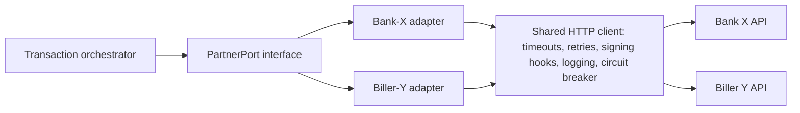

| Generic framework (shared) | Partner adapter (per partner) |
|---|---|
| HTTP client, timeout/retry policy, circuit breaker | Endpoint paths, payload shapes |
| Signing/verification hooks, secret fetch | Which signature algorithm & fields |
| Request/response audit log with masking | Status-code mapping table |
| Callback inbox + dedupe | Callback payload parsing |
| Error normalization framework | Partner error → internal error |

[SIMPLIFIED] interface:

```python
from dataclasses import dataclass
from decimal import Decimal
from enum import Enum

class PartnerOutcome(str, Enum):
    SUCCESS = "SUCCESS"; FAILED = "FAILED"; UNKNOWN = "UNKNOWN"

@dataclass(frozen=True)
class PartnerResult:
    outcome: PartnerOutcome
    partner_ref: str | None
    raw_code: str
    message: str

class BankPort:
    def debit(self, *, our_ref: str, account_no: str, amount: Decimal) -> PartnerResult: ...
    def status(self, *, our_ref: str) -> PartnerResult: ...
    def verify_callback(self, headers: dict, raw_body: bytes) -> dict: ...

# Hypothetical partner "BankX": codes "00"=success, "05"=declined, "91"=system unavailable
BANKX_MAP = {"00": PartnerOutcome.SUCCESS, "05": PartnerOutcome.FAILED, "91": PartnerOutcome.UNKNOWN}
# Rule: any code NOT in the table (or any transport timeout) -> UNKNOWN, never FAILED.
```

### 6.4 Partner integration lifecycle

1. **Intake:** business case, owner, regulator/compliance approval where required. [VERIFY-WITH-COMPLIANCE]
2. **Documentation review:** auth model, idempotency support, status inquiry, callback guarantees, settlement files, SLAs, limits, error codes, cut-offs, holidays.
3. **Gap analysis:** which of *your* invariants the partner can/can't support (e.g., no inquiry endpoint → heavy reconciliation reliance).
4. **Design:** state mapping, failure matrix, recon design, monitoring.
5. **Build adapter + fakes** (a local fake partner for tests).
6. **Sandbox testing** and the partner's certification scenarios (success, decline, timeout, duplicate, late callback).
7. **Security review:** keys, certs, IP lists, logging masking, threat model.
8. **UAT with business/ops/finance** incl. reconciliation file samples.
9. **Production readiness:** secrets provisioned in prod only, runbooks, alerts, rollback plan, limits ramp (small caps first).
10. **Go-live & hypercare**, then **operational handover** with on-call runbook and ownership.

### 6.5 Exercises
- [ ] Implement the signer/verifier above with a Redis nonce store and prove replay rejection.
- [ ] Build `FakeBank` with configurable fault injection and the BankX adapter; run the Phase-5 failure matrix against it.
- [ ] Write an integration checklist document you will reuse for every partner.

### 6.6 Common mistakes
- Treating non-2xx as "failed" when the request may have been processed.
- Logging full payloads including PINs/tokens/PII.
- Trusting callback IP alone.
- One shared secret for all partners/environments.

### 6.7 Interview questions
1. Design callback handling for a partner that retries aggressively and sometimes sends out-of-order events.
2. HMAC vs RSA signatures here: trade-offs?
3. A partner has no status endpoint. What does that change in your design?

### 6.8 Completion checklist
- [ ] Adapter + fake partner pass the failure matrix.
- [ ] Callback inbox is idempotent and signature-verified.
- [ ] Integration playbook document exists.

**Resources:** RFC 6749 OAuth 2.0 (https://datatracker.ietf.org/doc/html/rfc6749), RFC 2104 HMAC (https://datatracker.ietf.org/doc/html/rfc2104), OWASP API Security Top 10 (https://owasp.org/API-Security/), Stripe engineering post on idempotency (supplementary).

---

## Phase 7: Bangladesh Regulation, Compliance & Ecosystem

**Objectives:** Know how to find and read the governing documents, understand what engineering must implement, and know when to escalate to compliance.
**Prerequisites:** Phases 1-2. **Time:** 3 weeks (ongoing).

### 7.1 How to research regulation (repeatable method)

1. Start from **bb.org.bd** (regulation/guideline sections, circulars of the relevant departments such as the payment systems, banking regulation and policy departments) and **bfiu.org.bd** (circulars, guidelines).
2. Record for each document: title, issuer, date, circular number, status (current/superseded), link, relevant sections.
3. Check whether a newer circular or amendment exists (search the issuer's circular archive by date).
4. Summarize obligations as **testable engineering requirements**; have compliance sign off.
5. Never copy a thresholds table from a blog; thresholds change.

### 7.2 Classification of statements in this roadmap

| Class | Meaning |
|---|---|
| Mandatory legal requirement | Appears in a law/regulation/circular binding your entity |
| Regulatory guidance | Official but non-binding or sector-specific |
| Industry practice | Common, not required |
| Architecture recommendation | Engineering opinion in this document |

### 7.3 Source register (checked 29 Oct 2026)

| Document | Publisher | Date / version | What I could confirm | Link | Status |
|---|---|---|---|---|---|
| Bangladesh Mobile Financial Services (MFS) Regulations, 2022 | Bangladesh Bank | Issued Feb 2022; replaced the 2018 regulations; effective immediately per cover circular | Defines scope (bank/FI/government-entity-led MFS), says MFS providers act as PSPs under BPSSR 2014, defines cash-in and e-money terms, mentions operational account concept | https://www.bb.org.bd/aboutus/regulationguideline/psd/mfs_regulations_2022.pdf | [VERIFIED-SOURCE]; check for later amendments (secondary reporting indicates provisions were added after issuance) [VERIFY-WITH-COMPLIANCE] |
| Guidelines on Electronic Know-Your-Customer (e-KYC) | Bangladesh Bank (Banking Regulation & Policy Dept.) | Circular dated 11 Mar 2026 (BRPD circular no. 108 in file name) | Addressed to banks, finance companies, MFS providers, PSPs, PSOs; issued under Bank Company Act 1991 s.45, Finance Companies Act 2023 s.41, Payment and Settlement System Act 2024 s.8; refers to simplified and regular e-KYC; says reporting for MFS/PSP/PSO follows instructions from Payment Systems Dept.-1 | Circular: https://www.bb.org.bd/mediaroom/circulars/brpd/mar112026brpd-108.pdf ; Guideline: https://www.bb.org.bd/aboutus/regulationguideline/brpd/ekyc2026.pdf | [VERIFIED-SOURCE]; read tiers, limits, and data/biometric rules directly |
| Guidelines on e-KYC (first edition) | BFIU | BFIU Circular No. 25, 8 Jan 2020 | First BFIU e-KYC guideline; later updated/replaced for many entities by the 2026 guideline | https://www.bfiu.org.bd//pdf/circular/aml/jan082020bfiu25.pdf | Historical; confirm supersession scope [VERIFY-WITH-COMPLIANCE] |
| Payment and Settlement System Act, 2024 | Government of Bangladesh | 2024 | Cited as empowering instrument in the 2026 BB circular | Find via Bangladesh Laws portal (http://bdlaws.minlaw.gov.bd) or BB; link not verified here | Obtain official text via compliance |
| Bangladesh Payment and Settlement Systems Regulations, 2014 (BPSSR) | Bangladesh Bank | 2014 | Referenced by the MFS 2022 regulation as defining PSP/PSO | Via bb.org.bd regulation section; link not verified here | Check for amendments/replacement under the 2024 Act [VERIFY-WITH-COMPLIANCE] |
| Guidelines for Trust Fund Management for Payment and Settlement Services | Bangladesh Bank | 2021 (per secondary references) | Referenced as applicable alongside the MFS regulations | Via bb.org.bd; link not verified here | [VERIFY-WITH-COMPLIANCE] |
| Money Laundering Prevention Act, 2012; Anti-Terrorism Act, 2009 | Government of Bangladesh | as amended | Cited by BFIU e-KYC guidance as legal basis | http://bdlaws.minlaw.gov.bd | Confirm current amended versions |
| BFIU AML/CFT circulars & guidelines for MFS/PSP | BFIU | Various | Exist; **I did not verify current MFS-specific circular numbers** | https://www.bfiu.org.bd | Obtain list from compliance |
| FATF Recommendations | FATF | Current edition | International benchmark; BFIU guidance states alignment with FATF recommendations | https://www.fatf-gafi.org/en/topics/fatf-recommendations.html | International reference |
| PCI DSS | PCI Security Standards Council | v4.0.1 current at last check; confirm | Applies only if cardholder data is stored/processed/transmitted | https://www.pcisecuritystandards.org | International standard |
| Data protection law | Government of Bangladesh | **Status not verified here** | I could not verify the current in-force data protection statute | — | **Ask legal**; do not assume |

### 7.4 Topics and the engineering responsibilities they imply

| Topic | Engineering responsibility (all [VERIFY-WITH-COMPLIANCE] for exact rules) |
|---|---|
| Licensing / permitted activities | Feature gating by entity permissions; no launching unapproved services |
| KYC / e-KYC | Tiered onboarding, evidence retention, limits tied to tier, re-KYC workflows, reporting hooks |
| Customer risk classification | Risk score fields, EDD triggers, limit/monitoring differences |
| AML/CFT | Screening (names/lists), rule-based monitoring, alert case management, suspicious activity report workflow support |
| Transaction limits | Server-side per-txn/daily/monthly/count limits from configuration owned by compliance, with change audit |
| Fraud prevention | Velocity, device, behavior rules; fast freeze capability |
| Customer protection & disputes | Complaint tracking, transaction evidence retrieval, SLA timers |
| Record retention | Immutable storage, retention schedules, legal hold, retrieval tooling |
| Audit | Tamper-evident logs, access logs, maker-checker evidence |
| Information security | Access control, encryption, key management, testing, incident reporting |
| Outsourcing/third-party risk | Vendor inventory, exit plans, access control for vendors |
| Settlement & liquidity | Daily reconciliation to trust/bank accounts, exposure alerts |
| Agent/merchant oversight | KYB, limits, monitoring, suspension |
| Regulatory reporting | Reproducible reports from ledger/warehouse with lineage |
| Remittance controls | Routing through authorized channels, screening, reporting (MFS inward remittance permission was announced by BB in late 2022 per press; confirm current framework) |
| Payment rails | Understand BEFTN/NPSB/RTGS/Bangla QR interfaces your company actually uses |

### 7.5 Exercises
- [ ] Read the MFS Regulations 2022 end-to-end; write a 2-page "engineering obligations" extract with section references.
- [ ] Read the 2026 e-KYC guideline; build an onboarding state machine for simplified vs regular e-KYC *as the document defines them*.
- [ ] Create a "regulatory change log" template and fill it for 5 documents.

### 7.6 Common mistakes
- Using a blog post's limits table as truth.
- Hardcoding limits in code instead of governed configuration.
- Treating "KYC done" as a boolean rather than evidence with versioning.

### 7.7 Interview questions
1. How do you make sure a new circular's limit change reaches production safely and audibly?
2. What evidence would you retain for an e-KYC onboarding and for how long (ask compliance)?
3. How do you separate AML monitoring rules from application code?

### 7.8 Completion checklist
- [ ] I have the current official text of every document in 7.3 saved with date and status.
- [ ] I can map each obligation to a system control and a test.
- [ ] I know who in my company confirms each [VERIFY-WITH-COMPLIANCE] item.

---

## Phase 8: Architecture & Distributed Systems

**Objectives:** Choose architecture by evidence; apply the right consistency model per operation; implement outbox/inbox/saga patterns.
**Prerequisites:** Phases 3-6. **Time:** 5 weeks.

### 8.1 Architecture progression


| Criterion | Monolith / modular monolith | Microservices |
|---|---|---|
| Domain complexity | Fine when boundaries still unclear | Needs stable bounded contexts |
| Transaction consistency | One ACID DB transaction covers wallet+ledger+txn | Cross-service needs sagas/outbox; harder invariants |
| Operational maturity | Low overhead | Needs tracing, CI/CD, platform team |
| Team size | Small/medium | Multiple autonomous teams |
| Scaling | Vertical + replicas; scale hot parts via queues | Independent scaling per service |
| Recommendation | **Start modular monolith around ledger+transactions**; extract integrations/notifications/reporting first | Extract only for a measured reason |

**Rule of thumb:** keep **wallet + ledger + transaction state** in one consistency boundary (one database, one ACID transaction) as long as possible. [GENERAL-PRACTICE]

### 8.2 Bounded contexts (DDD)
Identity/Customer · Wallet/Account · Transaction orchestration · Ledger · Limits & Fees · Agent mgmt · Merchant mgmt · Partner adapters · Notification · Risk/Fraud · Reconciliation · Reporting/Audit. Each owns its data and publishes events; avoid shared tables across contexts.

### 8.3 Consistency requirements by operation

| Operation | Consistency | Why |
|---|---|---|
| Debit/credit & balance check | **Strong** (single ACID tx, row locks) | Money correctness |
| Limit counters | Strong or atomically updated | Prevent bypass under concurrency |
| Idempotency record + txn creation | Strong (same tx or unique constraint) | Duplicate prevention |
| Notifications, SMS | Eventual (outbox → queue) | Can be delayed |
| Reporting/warehouse | Eventual | Read models |
| Fraud scoring signals | Near-real-time, eventual | Latency vs accuracy trade-off |
| Reconciliation | Batch/eventual | Uses independent evidence |

### 8.4 Core concepts (learn each as a small unit)

| Concept | Key idea for MFS |
|---|---|
| ACID, isolation levels | PostgreSQL default READ COMMITTED; use row locks or SERIALIZABLE with retry for invariants |
| Race conditions | Two debits read same balance → overdraft; prevent via `SELECT ... FOR UPDATE` or atomic conditional update |
| Pessimistic vs optimistic | Pessimistic for hot financial rows; optimistic (version column) for low-contention records |
| Unique constraints | Strongest duplicate defense |
| Atomic update | `UPDATE wallet SET bal = bal - :amt WHERE id=:id AND bal >= :amt` |
| Eventual consistency, CAP | During partitions choose consistency for money, availability for non-money reads |
| Saga | Sequence of local transactions with compensations; use orchestration for payment flows |
| Transactional outbox | Write event row in same DB tx; relay publishes; guarantees "state change ⇔ event" |
| Inbox/dedupe | Record consumed message ids to make consumers idempotent |
| Delivery semantics | Exactly-once is not achievable end-to-end; use at-least-once + idempotent consumers |
| Distributed transactions (2PC) | Rarely appropriate; availability/coupling costs |
| Kafka vs RabbitMQ | Kafka: log, replay, ordering by partition key; RabbitMQ: routing, task queues |
| Redis | Cache, rate limits, nonce store; **not** source of truth for balances |
| PostgreSQL partitioning/indexing | Partition large append-only tables by time; index for access paths |

[SIMPLIFIED] transactional outbox:

```python
from django.db import transaction as dbtx

@dbtx.atomic
def complete_transfer(txn):
    post_journal(txn)                                   # ledger entries
    txn.status = "SUCCESS"; txn.save(update_fields=["status"])
    OutboxEvent.objects.create(                         # same DB transaction
        aggregate_id=txn.id, type="TransferCompleted",
        payload={"txn_id": str(txn.id), "amount": str(txn.amount)},
    )
# A separate relay (Celery/worker) reads unsent OutboxEvent rows FOR UPDATE SKIP LOCKED,
# publishes to the broker, then marks sent. Consumers dedupe by event id (inbox table).
```

### 8.5 Exercises
- [ ] Break a naïve balance update with 50 concurrent threads, then fix with locking and with conditional update; compare.
- [ ] Implement outbox + relay + idempotent consumer and kill the relay mid-publish to prove no loss/duplicate effects.
- [ ] Write an ADR (architecture decision record) "Monolith vs service extraction for notifications".

### 8.6 Common mistakes
- Splitting the ledger and wallet into separate services early.
- Using Redis as the balance of record.
- Assuming broker "exactly once" removes the need for idempotency.

### 8.7 Interview questions
1. Which operations must be strongly consistent and why?
2. Explain outbox vs 2PC.
3. How would you scale a hot merchant account that receives thousands of credits/second?

### 8.8 Completion checklist
- [ ] I can justify a monolith/microservice choice in writing with trade-offs.
- [ ] Outbox/inbox implemented and chaos-tested.
- [ ] I can state where strong vs eventual consistency applies.

**Resources:** Kleppmann, *Designing Data-Intensive Applications*; Pat Helland, "Life beyond Distributed Transactions"; PostgreSQL docs on explicit locking and isolation (https://www.postgresql.org/docs/current/mvcc.html); microservices.io patterns (https://microservices.io/patterns/).

---

## Phase 9: Production Database Design

**Objectives:** Design a high-integrity PostgreSQL schema with Django; handle money with `Decimal`; control concurrency.
**Prerequisites:** Phases 3, 8. **Time:** 4 weeks. **Foundational (concurrency).**

### 9.1 Entity overview

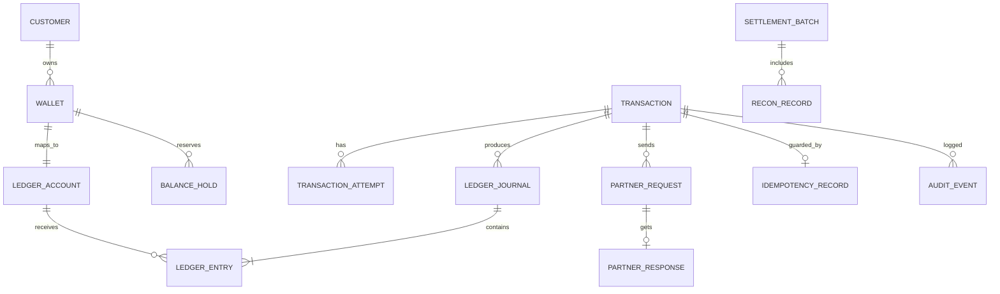

Also model: webhook_delivery, inbox_event, fee_rule, commission_rule, limit_rule, usage_counter, suspense_item, fraud_signal, agent/merchant balances (as ledger accounts, not separate balance columns).

### 9.2 Key decisions

| Topic | Recommendation | Reason |
|---|---|---|
| Money type | `NUMERIC(20,4)` / Django `DecimalField` | Never floats |
| Currency | `CHAR(3)` per entry; journal single-currency | Prevent mixing |
| Primary keys | UUIDv4/UUIDv7 or bigint + public ref | Don't expose sequential ids; ordering needs `created_at` |
| Business refs | Separate unique `txn_ref` | Human/partner-facing |
| Status | `CharField` with choices + check constraint | Enforce valid values |
| Timestamps | `timestamptz` UTC; also `business_date` | Time zone & cut-off logic |
| Entries | Append-only; no UPDATE/DELETE (DB privileges + triggers) | Auditability |
| Constraints | `CHECK(amount > 0)`, FKs, unique `(client_id, idempotency_key)` | Integrity in the DB, not just code |
| Balance cache | Optional `account_balance` updated in the same tx; verified by job | Performance with correctness check |
| Partitioning | By time for entries/audit; archive per retention policy | Operations |
| Backups | PITR via WAL archiving; restore drills | Recovery |
| Encryption | TLS in transit; disk/volume or column encryption for PII; KMS-managed keys | Confidentiality |
| PII | Minimize, mask in logs, separate tables/schemas, access logging | Privacy/security |

### 9.3 Decimals and rounding

```python
from decimal import Decimal, ROUND_HALF_UP, getcontext

print(0.1 + 0.2)                          # 0.30000000000000004  -> floats are wrong for money
print(Decimal("0.1") + Decimal("0.2"))    # 0.3

BDT_QUANT = Decimal("0.01")
def money(x) -> Decimal:
    return Decimal(x).quantize(BDT_QUANT, rounding=ROUND_HALF_UP)

fee = money(Decimal("1000") * Decimal("0.015"))   # 15.00
# Parse from strings, never from float; define ONE rounding policy per fee type and store the rounded result.
# Allocation: when splitting an amount, assign the remainder cent to a defined party so totals always match.
```

### 9.4 Django models — [SIMPLIFIED]

```python
import uuid
from decimal import Decimal
from django.db import models
from django.db.models import Q, F

class LedgerAccount(models.Model):
    class Type(models.TextChoices):
        ASSET="ASSET"; LIABILITY="LIABILITY"; EQUITY="EQUITY"; REVENUE="REVENUE"; EXPENSE="EXPENSE"
    id = models.UUIDField(primary_key=True, default=uuid.uuid4, editable=False)
    code = models.CharField(max_length=64, unique=True)
    type = models.CharField(max_length=10, choices=Type.choices)
    currency = models.CharField(max_length=3, default="BDT")
    status = models.CharField(max_length=12, default="ACTIVE")

class Transaction(models.Model):
    id = models.UUIDField(primary_key=True, default=uuid.uuid4, editable=False)
    ref = models.CharField(max_length=32, unique=True)
    kind = models.CharField(max_length=24)
    status = models.CharField(max_length=32)
    amount = models.DecimalField(max_digits=20, decimal_places=4)
    currency = models.CharField(max_length=3, default="BDT")
    client_id = models.CharField(max_length=64)
    idempotency_key = models.CharField(max_length=128)
    request_fingerprint = models.CharField(max_length=64)
    created_at = models.DateTimeField(auto_now_add=True)
    class Meta:
        constraints = [
            models.UniqueConstraint(fields=["client_id", "idempotency_key"], name="uniq_idem"),
            models.CheckConstraint(check=Q(amount__gt=0), name="txn_amount_positive"),
        ]

class LedgerJournal(models.Model):
    id = models.UUIDField(primary_key=True, default=uuid.uuid4, editable=False)
    transaction = models.ForeignKey(Transaction, on_delete=models.PROTECT)
    reverses = models.ForeignKey("self", null=True, blank=True, on_delete=models.PROTECT)
    posted_at = models.DateTimeField(auto_now_add=True)

class LedgerEntry(models.Model):
    class Side(models.TextChoices):
        DEBIT="D"; CREDIT="C"
    journal = models.ForeignKey(LedgerJournal, on_delete=models.PROTECT, related_name="entries")
    account = models.ForeignKey(LedgerAccount, on_delete=models.PROTECT)
    side = models.CharField(max_length=1, choices=Side.choices)
    amount = models.DecimalField(max_digits=20, decimal_places=4)
    class Meta:
        constraints = [models.CheckConstraint(check=Q(amount__gt=0), name="entry_amount_positive")]
        indexes = [models.Index(fields=["account", "id"])]
# Balanced-journal check: enforce in the service (sum of D == sum of C) AND with a deferred constraint
# trigger in PostgreSQL; prevent UPDATE/DELETE on ledger tables with DB permissions/triggers.
```

### 9.5 Concurrent transfer with lock ordering — [SIMPLIFIED]

```python
from django.db import transaction as dbtx

@dbtx.atomic
def transfer(from_id, to_id, amount, *, client_id, idem_key, fingerprint):
    # 1) idempotency: unique (client_id, idem_key) -> on IntegrityError, load & compare fingerprint
    # 2) lock both accounts in a deterministic order to avoid deadlocks
    ids = sorted([from_id, to_id])
    accts = {a.id: a for a in LedgerAccount.objects.select_for_update().filter(id__in=ids).order_by("id")}
    # 3) compute available balance under lock (ledger balance - holds), validate limits
    # 4) post balanced journal, update cached balances in the SAME transaction
    # 5) write outbox events and audit event
```
Deadlock rule: **always acquire locks in the same global order**; keep transactions short; no external calls inside a DB transaction holding row locks.

Isolation anomalies: write skew under REPEATABLE READ (two txns each read "sum OK", both write) → use explicit locks or SERIALIZABLE with retry. Hot rows (merchant/fee revenue accounts): batch/aggregate fee postings or use sub-accounts ("sharding" a hot account into N shards summed at read) — see Phase 15.

### 9.6 Why SQLite tests are not enough
SQLite doesn't implement PostgreSQL row-level locks (`SELECT FOR UPDATE` is ignored), MVCC isolation behavior, `SKIP LOCKED`, deferrable constraints or partitioning. Concurrency/integrity tests **must** run on PostgreSQL (Phase 13).

### 9.7 Retention, archive, backups
Retention duration is a legal/compliance decision [VERIFY-WITH-COMPLIANCE]. Technically: partition by month, detach/archive cold partitions to cheaper storage with integrity hashes, keep retrieval tooling tested, practice PITR restore and measure RTO/RPO (Phase 14).

### 9.8 Exercises
- [ ] Create the schema with migrations and add DB-level constraints incl. a deferred balanced-journal trigger.
- [ ] Prove (with a test that fails first) that without locking, 100 concurrent debits overdraw a wallet.
- [ ] Partition `ledger_entry` by month; measure query plans before/after.
- [ ] Write a script that recomputes balances from entries and diffs against cached balances.

### 9.9 Common mistakes
- `FloatField` for amounts; `Decimal(0.1)` from floats.
- Updating balances without an entry.
- Calling a partner API inside a transaction that holds locks.
- Missing unique constraints "because the code checks".

### 9.10 Interview questions
1. Design the tables for holds and explain how available balance is computed.
2. Explain lock ordering and give a deadlock example.
3. Why `NUMERIC` not `FLOAT`? What rounding policy would you choose for a 1.5% fee?

### 9.11 Completion checklist
- [ ] Schema has DB-enforced invariants.
- [ ] Concurrency tests pass on PostgreSQL.
- [ ] Balance recompute job exists and is clean.

---
## Phase 10: Security, Fraud & Risk

**Objectives:** Treat security as core engineering; place each control at the right layer; detect and prevent abuse (defensive focus only).
**Prerequisites:** Phases 4-6. **Time:** 4 weeks.

### 10.1 Control map by layer

| Topic | Application | Infrastructure | Operations | Compliance |
|---|---|---|---|---|
| Threat modeling (STRIDE) | Abuse cases per endpoint | Network zones | Review cadence | Risk register |
| AuthN/AuthZ, RBAC, least privilege | Object-level checks (customer can only read own txns), scoped tokens | IAM, network policy | Access reviews, JIT admin | Access evidence |
| MFA / PIN security | PIN never logged; attempt limits; hashing with slow KDF if stored (prefer verifying via HSM/secure service) | HSM/KMS for keys | Lockout runbooks | Policy |
| Password/PIN hashing | Argon2/bcrypt/scrypt, per-user salt | n/a | Rotation policy | Standards mapping |
| Secrets & keys | No secrets in code/env dumps | Vault/KMS, rotation | Rotation drills | Key custody records |
| Encryption | TLS; field-level encryption for sensitive fields | Disk encryption | Backup encryption | Data classification |
| Digital signatures, replay defense | Sign/verify, nonce+timestamp | n/a | Alerts on replay | n/a |
| API abuse / rate limits | Throttles, quotas, anomaly flags | WAF, gateway | Block lists | n/a |
| Account takeover / SIM-swap risk | Device binding, step-up auth after SIM/device change, cooling-off limits | Telco signals where available | Fast freeze | Reporting |
| Social engineering | Clear in-app warnings, confirmation screens for payees | n/a | Customer care scripts | Awareness |
| Transaction manipulation | Server-side amounts/fees, signed payloads | n/a | Anomaly review | n/a |
| Duplicate requests | Idempotency | n/a | n/a | n/a |
| Insider threats | Maker-checker, privileged action audit, no direct DB writes | Break-glass access, DB audit | Segregation of duties | Audit |
| Agent fraud | Float anomaly rules, geo/velocity | n/a | Field audits | Agent oversight |
| Merchant fraud | KYB, refund-rate rules, settlement holds | n/a | Reviews | n/a |
| AML monitoring, velocity, risk scoring | Rules engine + case mgmt | Streaming/batch infra | Alert triage SLAs | Regulatory reporting |
| Sensitive data masking | Mask MSISDN/NID in logs & UIs | Log pipeline redaction | Access to raw data limited | Privacy rules |
| Secure audit logging | Append-only, hash-chained or WORM storage | Separate log account | Retention | Evidence |
| Incident response | Kill switches, feature flags | Isolation tooling | Playbooks, comms | Notification duties [VERIFY] |
| Vulnerability mgmt / pen tests | SAST/dependency scan | Patching | Scheduled tests, fix SLAs | Evidence |
| Secure SDLC | Threat model per feature, code review checklists | CI security gates | Release approvals | Policy |

### 10.2 Synthetic fraud-defense example (detection, not attack how-to)

```python
# Velocity rule (synthetic): >5 outbound transfers to >5 distinct new recipients within 10 minutes
# from an account whose device changed in the last 24 hours -> hold + step-up verification + alert.
def evaluate_velocity(events, now):
    recent = [e for e in events if (now - e.ts).total_seconds() <= 600 and e.type == "TRANSFER_OUT"]
    new_recipients = {e.to_account for e in recent if e.recipient_first_seen_within_days <= 1}
    return len(recent) > 5 and len(new_recipients) > 5
```
Production: rules in a versioned, reviewable engine; tuned thresholds from data; false-positive handling; explainable decisions stored with the transaction.

### 10.3 Exercises
- [ ] Threat-model P2P transfer and bank→wallet with STRIDE; list 10 abuse cases and the control for each.
- [ ] Implement object-level authorization tests (user A cannot read user B's transaction).
- [ ] Add log redaction and a test that fails if a PIN/token pattern appears in logs.
- [ ] Build 5 velocity/AML-style rules with unit tests and a case-queue table.

### 10.4 Common mistakes
- Authorization only at the UI level; missing object-level checks.
- Logging full request bodies.
- "Admin" tools writing directly to ledger tables.

### 10.5 Interview questions
1. Design controls against account takeover after a SIM swap.
2. How do you prevent insiders from creating money?
3. Which fraud controls are synchronous and which are post-transaction?

### 10.6 Completion checklist
- [ ] Threat models exist for 3 flows with mapped controls/tests.
- [ ] No sensitive data in logs (tested).
- [ ] Privileged actions require maker-checker and are audited.

**Resources:** OWASP ASVS (https://owasp.org/www-project-application-security-verification-standard/), OWASP API Security Top 10, NIST SP 800-63 digital identity (https://pages.nist.gov/800-63-3/), PCI SSC (if cards in scope).

---

## Phase 11: Reconciliation, Clearing & Settlement

**Objectives:** Build reconciliation as independent verification; handle exceptions with auditable workflows; understand settlement cycles.
**Prerequisites:** Phases 3, 5, 6. **Time:** 4 weeks. **Foundational.**

### 11.1 Types and independence
| Reconciliation | Compares | Independent evidence |
|---|---|---|
| Internal txn ↔ ledger | Transaction table vs journals | Ledger entries |
| Wallet subledger ↔ GL control | Σ wallets vs control account | GL |
| GL ↔ bank statement | `BANK:SETTLE` vs statement | **Bank statement** |
| Partner txn recon | Our txns vs partner file | **Partner settlement file** |
| Agent / merchant recon | Float/cash, settlement amounts | Agent cash logs, settlement reports |
| Fee/commission recon | Computed vs paid | Rule engine replay |

Reconciliation compares **independent** sources. It must **not** silently change a transaction's state or any balance: it records matches/exceptions; corrections go through approved workflows that post new, linked journals.

### 11.2 Settlement concepts
Clearing cycles and cut-off times (a transaction after cut-off lands in the next cycle); holidays/weekends (rails like BEFTN are batch-based with calendar rules; confirm with the rail's rules); gross (item-by-item) vs net (offset per counterparty) settlement; late-arriving records; duplicates in partner files; missing, amount-mismatch and status-mismatch classes.

### 11.3 Matching algorithm (educational) — [SIMPLIFIED]

```python
from dataclasses import dataclass
from datetime import datetime, timedelta
from decimal import Decimal
from collections import defaultdict

@dataclass(frozen=True)
class Rec:
    source: str            # "internal" | "partner"
    ref: str               # our reference / partner's echo of it
    partner_ref: str | None
    amount: Decimal
    status: str
    ts: datetime

def reconcile(internal: list[Rec], partner: list[Rec], *, tolerance=Decimal("0.00"),
              window=timedelta(hours=36)):
    result = {"matched": [], "amount_mismatch": [], "status_mismatch": [],
              "missing_in_partner": [], "missing_in_internal": [], "duplicates_in_partner": []}
    pidx = defaultdict(list)
    for p in partner:
        pidx[p.ref].append(p)

    used = set()
    for i in internal:
        cands = pidx.get(i.ref, [])
        if len(cands) > 1:
            result["duplicates_in_partner"].append((i, cands)); used.update(id(c) for c in cands); continue
        if not cands:
            result["missing_in_partner"].append(i); continue
        p = cands[0]; used.add(id(p))
        if abs(i.amount - p.amount) > tolerance:           # tolerance = 0 by default (exact)
            result["amount_mismatch"].append((i, p))
        elif i.status != p.status:
            result["status_mismatch"].append((i, p))
        elif abs(i.ts - p.ts) > window:
            result["status_mismatch"].append((i, p))        # timing anomaly as exception
        else:
            result["matched"].append((i, p))
    for p in partner:
        if id(p) not in used:
            result["missing_in_internal"].append(p)
    return result
# Tolerance-based matching only for known, documented cases (e.g., FX rounding of ±0.01), enabled per
# partner, logged, and never used to auto-adjust money. Anything else is an exception for a human.
```

Matching order: (1) exact on unique reference + amount; (2) exact on partner ref; (3) controlled fuzzy (amount+date+account) only to *suggest* candidates, never auto-close.

### 11.4 Exception lifecycle

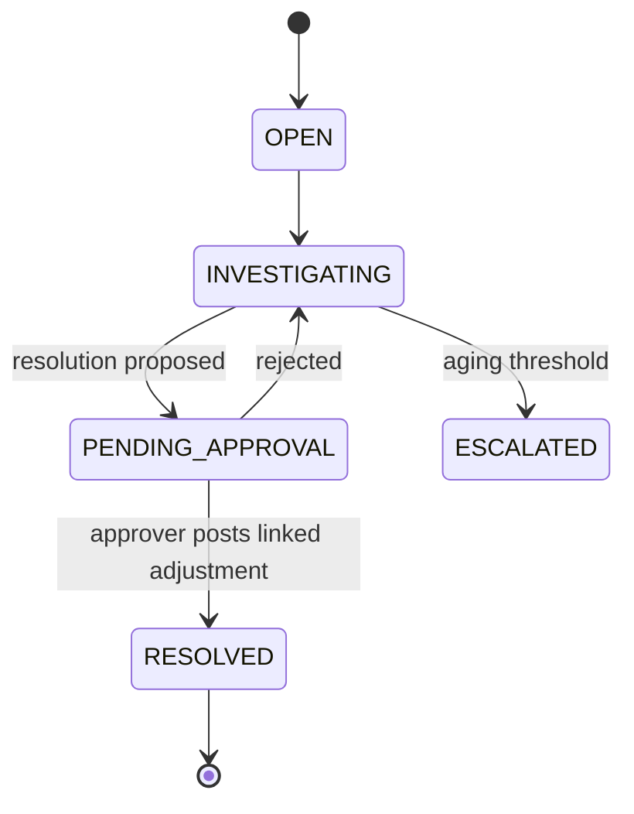
Fields: case id, type, amounts, evidence files, owner, aging, approver, linked journal id.

### 11.5 End-of-day workflow (example)
1. Cut-off: freeze business date; flush pending outbox.
2. Run internal recon (txn↔ledger; subledger↔control).
3. Ingest bank statement and partner files (checksum, file-level dedupe).
4. Run matching; open exceptions.
5. Review suspense aging; post approved adjustments.
6. Settlement: compute gross/net, generate payment instructions, maker-checker approval.
7. Reports to finance/ops; signoff; lock business date.

### 11.6 Exercises
- [ ] Implement the matcher with fixtures for each exception class; add property tests (permuting input order must not change results).
- [ ] Write a file-ingestion pipeline with idempotent file hashing.
- [ ] Build the exception-case model and approval workflow with audit events.
- [ ] Simulate netting across 3 counterparties.

### 11.7 Common mistakes
- Auto-"fixing" mismatches by editing txn status.
- Using your own logs as the only evidence.
- No aging on suspense/unmatched items.

### 11.8 Interview questions
1. Why shouldn't reconciliation auto-correct balances?
2. A partner file contains the same txn twice. What do you do?
3. Design net settlement for 3 banks with different cut-offs.

### 11.9 Completion checklist
- [ ] Matcher + exception workflow tested.
- [ ] EOD runbook written and rehearsed.
- [ ] Aging/escalation alerts exist.

---

## Phase 12: Python & Django for Fintech

**Objectives:** Write production-oriented Python/Django for financial backends: clear domains, minimal abstraction, strong correctness tooling.
**Prerequisites:** your existing Django/DRF/Celery experience; Phases 3, 8, 9. **Time:** 6 weeks (overlaps with projects).

### 12.1 Learning units

| Unit | Content | Fintech relevance |
|---|---|---|
| Python essentials for money | `Decimal`, `enum`, `dataclasses(frozen=True)`, type hints + mypy, custom exceptions, context managers | Value objects (`Money`), explicit errors |
| OOP, SOLID, clean architecture | Ports/adapters, dependency inversion | Partner adapters, testability |
| Async & concurrency | `asyncio` for I/O fan-out, threads/processes, GIL implications | Parallel status inquiries; **not** for balance logic |
| Django ORM & PostgreSQL | `atomic`, `select_for_update`, `F()` expressions, constraints, `RunSQL` migrations, bulk ops | Concurrency & integrity |
| DRF | Serializers/validators, throttling, authentication classes, versioning | API contracts |
| Service layer | Business logic in services; views thin; selectors for reads | Testability |
| Repository/selector patterns | Use when multiple data sources or heavy query reuse; avoid by default | Avoid needless abstraction |
| Orchestration & idempotency | Transaction service + idempotency service/middleware | Duplicate prevention |
| Celery, Redis, RabbitMQ/Kafka | Retry policies, `acks_late`, idempotent tasks, beat schedules, DLQ | Async recovery |
| Request signing & auth | Custom DRF auth classes | Partner APIs |
| Observability | `structlog`, audit logs, OpenTelemetry traces | Incident response |
| Testing | pytest, factory_boy, hypothesis, locust/k6 | Phase 13 |
| Migrations | Expand/contract, zero-downtime patterns, lock-aware DDL | Safe schema change |
| Docker, CI/CD, Linux | Multi-stage builds, health checks, systemd basics | Phase 14 |

### 12.2 Suggested project layout (domains, no needless layers)

```text
mfs/
  config/                # settings, urls, celery
  apps/
    identity/            # customers, KYC state
    wallets/             # wallet accounts, holds
    ledger/              # accounts, journals, entries, posting service
    transactions/        # orchestrator, state machine, idempotency
    limits_fees/         # rule models + calculators
    partners/            # base client, adapters/, callback inbox
    risk/                # rules, cases
    recon/               # file ingest, matcher, cases
    notifications/       # outbox consumers
    audit/               # append-only audit events
  libs/                  # money.py, signing.py, logging.py
  tests/
```
Rules: apps depend inward (`transactions` → `ledger`, never the reverse); no cross-app model imports except through a small public `services.py`/`api.py`; avoid "BaseManagerFactoryAbstract" layers until duplication proves necessary.

### 12.3 Idempotency service — [SIMPLIFIED]

```python
import hashlib, json
from django.db import IntegrityError, transaction as dbtx

def fingerprint(payload: dict) -> str:
    return hashlib.sha256(json.dumps(payload, sort_keys=True, separators=(",", ":")).encode()).hexdigest()

@dbtx.atomic
def create_or_get(client_id, key, payload, create_fn):
    fp = fingerprint(payload)
    try:
        with dbtx.atomic():                       # savepoint
            txn = Transaction.objects.create(client_id=client_id, idempotency_key=key,
                                             request_fingerprint=fp, status="INITIATED", **payload_fields(payload))
            created = True
    except IntegrityError:
        txn = Transaction.objects.select_for_update().get(client_id=client_id, idempotency_key=key)
        if txn.request_fingerprint != fp:
            raise KeyReuseMismatch()              # 409/422
        return txn, False                         # replay: return stored result
    return create_fn(txn), created
# Production: response snapshot storage, key TTL policy, in-flight (processing) replay behavior,
# per-endpoint scoping, metrics on replays.
```

### 12.4 Celery safety rules
- Tasks must be **idempotent**; use the transaction id and CAS state changes.
- `acks_late=True` + idempotent handlers for at-least-once safety; avoid unbounded retries; set time limits.
- Don't pass big/PII payloads; pass ids.
- Dedicated queues for recovery/inquiry vs notifications; monitor lag.

### 12.5 Exercises
- [ ] Implement `Money` value object (Decimal, currency, safe ops; rejects float).
- [ ] Wire the service layer for P2P: view → service → ledger, with 100% branch coverage on the service.
- [ ] Add OpenTelemetry tracing across API → Celery → partner call; verify a single trace id appears in logs.
- [ ] Write an expand/contract migration that adds a NOT NULL column to a large table safely.

### 12.6 Common mistakes
- Business logic in serializers/views/signals.
- Transactions wrapping network calls.
- Using `float()` anywhere near amounts.
- Celery retries that repeat external side effects.

### 12.7 Interview questions
1. Where do you put fee calculation and why?
2. How do you keep Celery tasks safe under at-least-once delivery?
3. When would you introduce a repository layer?

### 12.8 Completion checklist
- [ ] Project follows domain layout with enforced import rules.
- [ ] Idempotency service + signed callbacks + audit log operational.
- [ ] Tracing/logging/metrics wired.

**Resources:** Django docs (https://docs.djangoproject.com), DRF (https://www.django-rest-framework.org), Celery (https://docs.celeryq.dev), PostgreSQL (https://www.postgresql.org/docs/current/), Redis (https://redis.io/docs/), OpenTelemetry Python (https://opentelemetry.io/docs/languages/python/), *Two Scoops of Django*, *Architecture Patterns with Python* (Percival & Gregory).

---

## Phase 13: Testing Financial Correctness

**Objectives:** Prove invariants, not just endpoints; test concurrency, failures, and reconciliation on PostgreSQL.
**Prerequisites:** Phases 3, 5, 9, 12. **Time:** 4 weeks.

### 13.1 Test taxonomy
Unit · integration (DB) · API contract · partner sandbox · end-to-end · DB-transaction · **concurrency/race** · **idempotency** · duplicate-callback · failure injection · timeout/retry · reconciliation · load · security · **property-based** · **state-machine** · **ledger-invariant** · disaster-recovery drills.

### 13.2 Invariants to test
1. Every posted journal balances per currency.
2. No logical request produces more than one financial effect.
3. Concurrent debits never overdraw or exceed limits.
4. Retrying a completed request returns the original result and adds no entries.
5. A reversal references the original and compensates exactly (or the declared portion; cumulative ≤ original).
6. Reconciliation discrepancies are detectable and traceable to evidence.
7. Cached balances equal entry-derived balances.

### 13.3 Concurrency test (pytest + PostgreSQL) — [SIMPLIFIED]

```python
import threading, pytest
from decimal import Decimal
from django.db import connection

@pytest.mark.django_db(transaction=True)      # real commits so threads see each other; requires PostgreSQL
def test_concurrent_debits_never_overdraw(make_wallet, debit):
    wallet = make_wallet(balance=Decimal("1000.00"))
    results, lock = [], threading.Lock()

    def worker():
        try:
            debit(wallet.id, Decimal("100.00"), idem_key=None)   # each call is its own logical request
            outcome = "ok"
        except Exception as e:
            outcome = type(e).__name__
        finally:
            connection.close()                                    # each thread has its own DB connection
        with lock:
            results.append(outcome)

    threads = [threading.Thread(target=worker) for _ in range(30)]
    [t.start() for t in threads]; [t.join() for t in threads]

    wallet.refresh_from_db()
    assert results.count("ok") == 10                  # exactly 10 x 100 fit in 1000
    assert wallet.balance == Decimal("0.00")
    assert recompute_balance_from_entries(wallet.id) == wallet.balance   # cache == entries
```
**Why SQLite is insufficient:** no row-level `FOR UPDATE`, different transaction/isolation semantics, no `SKIP LOCKED`/deferred constraint triggers/partitioning; tests can pass on SQLite and fail in production.

### 13.4 Property-based ledger test (Hypothesis) — [SIMPLIFIED]

```python
from hypothesis import given, strategies as st
from decimal import Decimal

amounts = st.decimals(min_value=Decimal("0.01"), max_value=Decimal("100000"), places=2)

@given(st.lists(st.tuples(st.integers(0, 4), st.integers(0, 4), amounts), max_size=50))
def test_total_conserved(transfers):
    ledger = ToyLedger(accounts=5, opening=Decimal("1000"))
    for a, b, amt in transfers:
        if a != b:
            ledger.try_transfer(a, b, amt)        # may reject insufficient funds
    assert ledger.total() == Decimal("5000")      # conservation
    assert all(bal >= 0 for bal in ledger.balances())
    assert ledger.journals_balanced()
```

### 13.5 Other must-have tests
- **State machine:** generate random event sequences (callback duplicates, timeouts) and assert only allowed transitions and single financial effect.
- **Failure injection:** fake partner drops response after processing; assert UNKNOWN → inquiry → SUCCESS with exactly one credit.
- **Reconciliation:** seeded mismatch files → expected exception classes.
- **Load:** locust/k6 against staging with realistic account skew (hot merchant), measure p95/p99 and lock waits.
- **Security:** authorization matrix tests, signature tampering tests, replay tests.
- **DR:** quarterly restore drill with row-count + invariant verification.

### 13.6 Exercises
- [ ] Implement the three tests above, make them fail by removing locking, then fix.
- [ ] Add a CI job running PostgreSQL service containers and invariants as gates.
- [ ] Add a nightly "ledger integrity" job on a staging copy.

### 13.7 Common mistakes
- Mocking the database for ledger tests.
- Testing only happy paths.
- Flaky concurrency tests without deterministic assertions (assert on invariants, not ordering).

### 13.8 Interview questions
1. How do you test for race conditions deterministically enough for CI?
2. What property tests would you write for a ledger?
3. How do you test that a retry did not double-credit?

### 13.9 Completion checklist
- [ ] Invariant suite runs in CI on PostgreSQL.
- [ ] Failure-injection suite covers Phase 5 matrix.
- [ ] Restore drill executed and documented.

---

## Phase 14: Operations, Reliability & Observability

**Objectives:** Operate an MFS platform: deploy safely, observe technical *and* business health, respond to incidents, learn from postmortems.
**Prerequisites:** Phases 8-9, 12. **Time:** 4 weeks.

### 14.1 Topic map
Linux admin (systemd, journald, networking, `ss`, `strace` basics) · Docker/orchestration concepts (Kubernetes: deployments, probes, resource limits) · CI/CD (build → test → scan → staged rollout → rollback) · environments (dev/staging/UAT/prod isolation, separate secrets) · secret rotation · PostgreSQL backups, WAL archiving, PITR · HA (replicas, failover) · DR (RTO/RPO targets set by the business) · probes (liveness: process alive; readiness: dependencies OK to serve) · metrics/logs/traces · SLI/SLO/error budgets · alert design (symptom-based, actionable, with runbooks) · on-call · incident management (roles, comms, timeline) · blameless postmortems · capacity planning · performance profiling · queue monitoring · partner availability monitoring · reconciliation alerts · business monitoring.

### 14.2 Technical vs business health

| Layer | Example signals | Can look healthy while money is failing? |
|---|---|---|
| Technical | CPU, p95 latency, error rate, queue depth | Yes |
| Business | Txn success rate by type/partner, **UNKNOWN count and age**, hold expiry rate, recon exception count/age, suspense total/age, float levels, callback lag | These reveal the failure |

Example: all pods are Ready and HTTP 200s are flowing, but a partner started returning `"status":"PENDING"` forever; success rate drops to 40%, UNKNOWN backlog grows. Only business metrics page you.

### 14.3 Starter SLOs (illustrative; set with product/ops)
| SLI | SLO |
|---|---|
| P2P success rate excluding customer errors | ≥ 99.9% / 30 days |
| P2P p95 latency | < 800 ms |
| UNKNOWN transactions older than 30 min | = 0 sustained; page if > N |
| Callback processing lag | p99 < 60 s |
| Daily reconciliation completed by | T+X hours |

### 14.4 Incident playbook skeleton
Detect → declare severity → assign incident commander/scribe/comms → mitigate (feature flag, kill switch, route around partner) → verify via business metrics → reconcile affected transactions → postmortem (timeline, root cause, contributing factors, action items with owners/dates).

### 14.5 Exercises
- [ ] Build a Grafana dashboard with 6 business metrics and 6 technical metrics for the lab project.
- [ ] Write alerts with runbooks for UNKNOWN age, suspense age, outbox lag.
- [ ] Run a PITR restore drill and record RTO/RPO achieved.
- [ ] Conduct a game-day: partner outage with delayed callbacks.

### 14.6 Common mistakes
- Alerting on causes, not symptoms.
- No ownership/runbooks.
- Backups never restored.

### 14.7 Interview questions
1. Technically healthy but transactions failing: what do you check?
2. Define RTO and RPO for a ledger DB; how do you meet them?
3. How do you design alerts to avoid fatigue?

### 14.8 Completion checklist
- [ ] Dashboards/alerts for business metrics live in lab.
- [ ] Restore drill + game-day completed.
- [ ] Postmortem template used at least once.

**Resources:** Google SRE Book (https://sre.google/books/), PostgreSQL continuous archiving & PITR (https://www.postgresql.org/docs/current/continuous-archiving.html), Kubernetes docs (https://kubernetes.io/docs/).

---

## Phase 15: Advanced Topics

**Objectives:** Know what exists, when it matters, and its costs. *Essential* = needed for an MFS specialist; *Recommended* = high-value; *Optional* = situational.

| Topic | Prerequisites | Practical relevance for MFS | Trade-offs | Rating |
|---|---|---|---|---|
| High-throughput processing | Phases 8-9 | Peak events (festivals, salary days) | Complexity vs headroom | Essential |
| Hot-account contention | Locking | Merchant/fee accounts | Sharded sub-accounts complicate reads | Essential |
| Ledger sharding / partitioning by account | DB design | Very large scale | Cross-shard transfers need sagas | Recommended |
| Multi-region / DR | Ops | Resilience requirements | Data residency & replication lag [VERIFY regulatory] | Recommended |
| Event sourcing / CQRS | DDD | Audit-friendly read models | Operational complexity; ledger already is an event log | Recommended (selective) |
| Real-time fraud detection | Streaming | Reduces losses | False positives; latency | Essential (basic), Recommended (advanced) |
| Rules engines | Risk | Compliance-owned limits/rules | Governance | Essential |
| ML-assisted risk | Data pipeline | Anomaly detection | Explainability, drift, regulation | Optional→Recommended |
| Data warehouse / analytics | SQL | Regulatory & business reporting | Lineage, privacy | Recommended |
| Privacy-preserving handling | Security | Data minimization, tokenization | Utility vs privacy | Recommended |
| Payment orchestration platforms | Integrations | Multi-rail routing | Abstraction cost | Recommended |
| Multi-tenant platforms | Architecture | White-label/MFS-as-a-service | Isolation vs cost | Optional |
| API products for merchants/partners | API design | Revenue channel | Support burden | Recommended |
| ISO 20022 | Messaging | Modern interbank messaging (pacs/pain/camt families) | Verbose XML, mapping | Recommended |
| ISO 8583 | Cards | Card/ATM/switch messages | Legacy bitmap format | Recommended if cards/switch in scope |
| Open banking / interoperability | APIs | Account access & interoperability | Consent/security model | Optional→Recommended |
| Digital identity / verifiable credentials | Security | e-KYC evolution | Standards maturity | Optional |
| Tokenization & key management (HSM/KMS) | Crypto basics | Card tokens, PIN/keys | Operational burden | Essential if keys managed in-house |
| Blockchain / digital assets | Crypto | Research topic | Rarely necessary for MFS; compare to a centralized ledger honestly | Optional |

**Resources:** ISO 20022 (https://www.iso20022.org), ISO 8583 overview (ISO standard; paid), Kleppmann DDIA, Greg Young on CQRS/ES (talks).

---
## Phase 16: End-to-End Projects

> **Safety notice.** These are educational projects with synthetic customers, fake balances and mock partners. They are **not** suitable for real customer money without extensive additional controls, independent security audit, compliance approval, DR testing and production-readiness work.

Common to all projects: Python 3.12+, Django + DRF, PostgreSQL, pytest, Docker Compose, GitHub Actions. Keep an ADR log and a README with run/test instructions.

### Project 1: Financial Terminology & Transaction Flow Notebook
- **Business req:** A reference set documenting participants, workflows, terms and diagrams for 8 MFS operations.
- **Technical req:** Markdown + Mermaid in a repo; glossary file; one diagram per flow.
- **Architecture:** none (documentation).
- **Schema/API:** n/a.
- **Workflows:** all Phase 2 flows; ledger preview for each.
- **Security:** no confidential company details.
- **Failure scenarios:** list ≥3 per flow.
- **Testing:** peer review; mermaid lint in CI.
- **Milestones:** M1 glossary · M2 6 diagrams · M3 failure tables · M4 review.
- **Acceptance:** Another engineer can explain a cash-out from your notes alone.
- **Stretch:** Add Bangla-language glossary for customer-care alignment.

### Project 2: Double-Entry Ledger Engine
- **Business req:** Create accounts, post balanced journals, query balances/trial balance, reverse entries.
- **Technical req:** Pure-Python core + Django persistence; `Decimal`; append-only entries.
- **Architecture:**
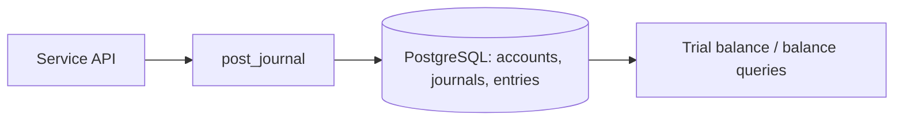
- **Schema:** §9.4 models + `account_balance` cache.
- **API:** `POST /journals`, `GET /accounts/{id}/balance`, `POST /journals/{id}/reverse`, `GET /trial-balance`.
- **Workflows:** Ex 1-14 from Phase 3 as fixtures.
- **Security:** only service credentials can post; no UPDATE/DELETE grants on entries.
- **Failure scenarios:** unbalanced journal, mixed currency, closed account, duplicate post.
- **Testing:** unit + Hypothesis + PostgreSQL concurrency; invariant job.
- **Milestones:** M1 model+post · M2 reverse/partial · M3 holds/available · M4 invariants+trial balance.
- **Acceptance:** all 14 examples reproduce expected balances; invariant job clean after 100k random journals.
- **Stretch:** monthly partitions; deferred constraint trigger for balance; period close.

### Project 3: Wallet & P2P Transfer API
- **Business req:** Customers have wallets; send money with fee; see history; safe under retries/concurrency.
- **Technical req:** DRF, JWT/OAuth2 client credentials for service clients, idempotency, limits, outbox.
- **Architecture:**
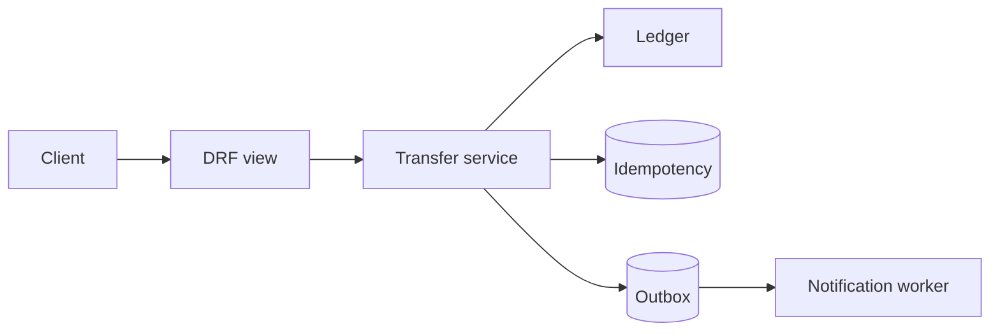
- **Schema:** wallet, transaction, idempotency, limit_rule, usage_counter, outbox.
- **API:** §4.3 + `GET /transfers/{id}`, `GET /wallets/me`.
- **Workflows:** P2P, fee, daily limit.
- **Security:** object-level authorization, throttling, PIN simulation via separate step, log redaction.
- **Failures:** insufficient funds, duplicate retry, limit race, receiver frozen.
- **Testing:** §13.3 concurrency; idempotency replay/mismatch; authorization matrix.
- **Milestones:** M1 transfer happy path · M2 idempotency · M3 limits · M4 outbox+notifications.
- **Acceptance:** 100 concurrent requests respect balance and limit; duplicate keys cause zero extra entries.
- **Stretch:** per-tier fee schedules; statement PDF export.

### Project 4: MFS Transaction Orchestrator
- **Business req:** Support bank→wallet and wallet→bank with pending/unknown handling and compensation.
- **Technical req:** State machine with transition tables, Celery inquiry job, evidence log.
- **Architecture:**
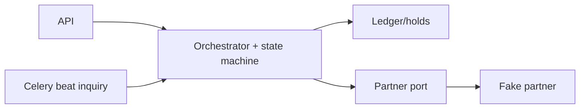
- **Schema:** transaction, attempt, partner_request/response, audit_event, hold.
- **API:** `POST /bank-transfers`, `GET /bank-transfers/{id}`; admin `POST /ops/{id}/resolve` (maker-checker).
- **Workflows:** §5.1 diagram; Ex 8 models A and B.
- **Security:** ops actions role-gated and audited.
- **Failures:** Phase 5 taxonomy.
- **Testing:** state-machine property tests; failure injection with Project 5 fake.
- **Milestones:** M1 happy path · M2 UNKNOWN + inquiry · M3 compensation · M4 ops resolution.
- **Acceptance:** under 1,000 randomized fault runs there are 0 double debits/credits and 0 invalid transitions.
- **Stretch:** DLQ replay tooling; SLA timers.

### Project 5: Mock Bank / MFS Partner Integration
- **Business req:** Simulated partner with realistic quirks; your adapter integrates safely.
- **Technical req:** FastAPI/Django fake partner with HMAC signing, callbacks, configurable faults; adapter per §6.3.
- **Architecture:** Orchestrator ⇄ adapter ⇄ fake partner (+ callback endpoint with inbox).
- **Schema:** partner_request, partner_response, callback_inbox, secret/key table (synthetic).
- **API:** partner `POST /debit`, `GET /status/{ref}`, callbacks `POST /webhooks/bankx`.
- **Workflows:** success, decline, drop-response, delayed/duplicate callback, wrong signature, replay.
- **Security:** signature verification, nonce store, clock-skew limits, IP allowlist simulation.
- **Failures:** timeouts, 5xx, schema drift.
- **Testing:** contract tests; fault matrix.
- **Milestones:** M1 signed calls · M2 callbacks+inbox · M3 status inquiry · M4 fault matrix.
- **Acceptance:** all matrix cells produce exactly-one financial effect.
- **Stretch:** mTLS locally; cert rotation drill.

### Project 6: Reconciliation Engine
- **Business req:** Compare internal transactions to synthetic partner/bank files; produce auditable exceptions.
- **Technical req:** file ingestion with hash dedupe, matcher (§11.3), exception workflow, reports.
- **Architecture:** File → ingest → normalize → match → exceptions → approval → linked adjustment.
- **Schema:** recon_file, recon_record, match, exception_case, suspense_item.
- **API:** `POST /recon/files`, `GET /recon/cases`, `POST /recon/cases/{id}/propose`, `.../approve`.
- **Workflows:** Ex 11, 13; EOD §11.5.
- **Security:** maker-checker; read-only access to ledger by recon.
- **Failures:** malformed files, duplicate files, late records.
- **Testing:** seeded mismatch datasets; permutation property tests.
- **Milestones:** M1 exact match · M2 exceptions · M3 workflow · M4 reports + aging.
- **Acceptance:** each seeded mismatch lands in the expected class; no automatic financial change.
- **Stretch:** net-settlement simulation for 3 banks.

### Project 7: Agent & Merchant Financial Platform
- **Business req:** Agents/merchants with wallets, fee/commission rules, limits, settlement reports.
- **Technical req:** rule tables with effective dating; commission accrual + payout (Ex 6); merchant settlement (Ex 10).
- **Architecture:** Agent/merchant services + fee/commission engine + settlement batch jobs on the ledger.
- **Schema:** agent, merchant, fee_rule, commission_rule, accrual, settlement_batch.
- **API:** onboarding, float top-up, cash-in/out, merchant pay, settlement report.
- **Security:** KYB fields, maker-checker for rule changes, anomaly rules for agents.
- **Failures:** float shortfall, refund > merchant balance, rule overlap.
- **Testing:** table-driven fee/commission tests; rounding/allocation tests.
- **Milestones:** M1 agent flows · M2 merchant flows · M3 commissions · M4 settlements.
- **Acceptance:** trial balance ties; allocations always sum to the original.
- **Stretch:** dispute workflow.

### Project 8: Production-Style MFS Backend
- **Business req:** Integrate Projects 2-7 into one coherent system.
- **Technical req:** domain layout §12.2, outbox/inbox with RabbitMQ or Kafka, OpenTelemetry, dashboards, CI gates, load tests.
- **Architecture:** modular monolith + worker processes + broker + observability stack.
- **Schema:** union of earlier, with migrations managed.
- **API:** OpenAPI documented, versioned.
- **Security:** threat model, SAST/dependency scan, secrets via env injection from a vault in compose.
- **Failures:** chaos: kill worker, drop broker, partner outage, DB failover simulation.
- **Testing:** invariants, concurrency, fault injection, load, DR restore.
- **Milestones:** M1 integrate · M2 observability · M3 chaos · M4 load/DR · M5 docs/ADRs.
- **Acceptance:** after chaos + load runs, recon is clean, invariants hold, dashboards show the incident timeline.
- **Stretch:** blue/green deploy simulation; multi-tenant flag.

---

## Phase 17: Career Development

### 17.1 Roles

| Role | Core focus | Distinguishing expectations |
|---|---|---|
| Backend engineer (fintech) | APIs, services, DB | Writes correct, tested, idempotent endpoints |
| Payment integration engineer | Partners, banks, billers | Adapters, signing, status mapping, certification, recon files |
| MFS transaction engineer | Orchestration, states, recovery | State machines, UNKNOWN handling, ops tooling |
| Financial ledger engineer | Accounts, journals, invariants | Double-entry fluency, immutability, balances, closing |
| Payment systems engineer | Rails, switches, messaging | ISO 8583/20022, throughput, settlement |
| Senior fintech backend engineer | Ownership of a domain | Designs for failure, mentors, leads incidents |
| Fintech software architect | Cross-domain design | Trade-offs, boundaries, compliance-aware platform decisions, roadmaps |

What separates a specialist: financial domain knowledge, ledger correctness, treating uncertainty explicitly, partner integration craft, database concurrency skill, invariant testing, incident discipline, and the habit of collaborating with finance, ops, risk, compliance and product.

### 17.2 Skill matrix

| Skill | Beginner | Intermediate | Advanced | Expert |
|---|---|---|---|---|
| Financial domain | Names participants and flows | Explains settlement, float, fees | Designs new product flows with finance | Shapes policy with regulator-aware design |
| Ledger/accounting | Understands debit/credit | Posts balanced journals, reversals | Designs chart of accounts, closing, subledgers | Leads audit-grade ledger architecture |
| Transaction reliability | Handles retries | Idempotency + states | Recovery workflows, UNKNOWN handling | Designs platform-wide failure model |
| Partner integrations | Calls REST APIs | Signing, callbacks, mapping | Certification, fault-tolerant adapters | Standardizes integration platform |
| Distributed systems | Knows queues | Outbox/inbox, sagas | Capacity, partitioning, trade-off ADRs | Sets multi-year architecture |
| DB concurrency | Uses transactions | Locks, constraints | Isolation anomalies, hot rows, partitioning | Designs scaling strategy |
| Security/compliance | Basic OWASP | Threat models, masking, RBAC | Fraud controls, audit evidence | Programs across org |
| Testing invariants | Unit tests | Integration + concurrency | Property/state-machine, DR drills | Test strategy ownership |
| Operations/incident | Reads dashboards | On-call, runbooks | Leads incidents, SLOs | Reliability program |
| Communication | Documents code | Writes design docs | Aligns finance/ops/compliance | Executive/regulator-level clarity |

### 17.3 Interview preparation (answer frameworks)

**Framework (use for scenario questions):** *Clarify → state invariants → propose design → walk happy path → walk failures → test/monitor → trade-offs.*

| # | Question | Strong-answer outline (why it is strong) |
|---|---|---|
| 1 | Design a P2P transfer API. | Idempotency key + unique constraint; single ACID tx with ordered row locks; balanced journal; limits; outbox for notifications; error taxonomy; tests for concurrency. Shows correctness before scale. |
| 2 | Bank debit timed out. What now? | Mark UNKNOWN; keep funds pending; inquire by our ref with backoff; reconcile with statement; never blind retry; compensate only on authoritative failure. Shows uncertainty handling. |
| 3 | How do you prevent double crediting from duplicate callbacks? | Verify signature; inbox unique (partner,event_id); CAS state transition; idempotent ledger post keyed by txn; metrics on duplicates. |
| 4 | Explain journal entries for a cash-out with fee and commission. | State accounts/types, debit customer wallet, credit agent wallet and fee revenue, commission as separate journal; verify balanced; note policy/tax caveats. |
| 5 | Monolith or microservices for a new MFS? | Start modular monolith with one consistency boundary for ledger+txn; extract by measured need; discuss team/ops maturity; cite trade-offs. |
| 6 | Reconciliation shows bank debited 500 we don't know about. | Do not touch wallets; open exception; post suspense per approved workflow; gather evidence; resolve with linked entries; age/escalate. |
| 7 | Service is healthy but success rate dropped. | Business metrics (UNKNOWN age, partner codes), partner status, recent deploy/config, callback lag; mitigate (route, flag); reconcile impacted txns; postmortem. |
| 8 | Hot merchant account contention. | Measure lock waits; batch/aggregate postings or sub-accounts; async fee accounting; keep invariants; trade-offs on read complexity. |

Behavioral/production-incident prompts to rehearse: "worst bug you shipped in money-moving code," "how you handled a reconciliation break," "how you pushed back on an unsafe manual DB fix."

---

## 18. Study Plans

Assumes a working engineer. **6-month intensive:** ~12-15 h/week. **12-month sustainable:** ~6-8 h/week. Foundational weeks are marked ⭐; do not compress them.

Weekly time split guide (6-month): 35% reading/domain, 45% implementation, 10% revision/questions, 10% writing/review. Across the plan: domain 20%, MFS workflows 15%, ledger 15%, Python/Django 15%, distributed systems 8%, security/compliance 8%, reconciliation 7%, testing 5%, ops 4%, projects/interview 3% (projects run throughout).

### 18.1 Six-month plan (24 weeks)

**Month 1 — Foundations (Phases 1-2)**

- [ ] **W1 ⭐ Participants & rails.** *Objectives:* explain every participant and rail. *Topics:* §1.1-1.2, BB site tour. *Tasks:* participant maps for 3 flows. *Revision Qs:* PSP vs PSO vs gateway vs switch? *Deliverable:* participant map doc. *Done when:* can teach it in 10 min.
- [ ] **W2 ⭐ Operations & terminology.** *Obj:* operations workflow + glossary. *Topics:* §1.3-1.4. *Tasks:* flash cards; op table for your company's products. *Qs:* available vs ledger balance? *Deliverable:* glossary v1. *Done when:* 90% flash-card recall.
- [ ] **W3 MFS fundamentals & models.** *Topics:* §2.1-2.2. *Tasks:* revenue/flow table per model. *Qs:* how is customer money safeguarded (conceptually)? *Deliverable:* models table. *Done when:* can contrast MFS vs bank vs wallet.
- [ ] **W4 ⭐ Lifecycle & diagrams.** *Topics:* §2.3-2.5. *Tasks:* reproduce six sequence diagrams; fill grid. *Qs:* why idempotency early? *Deliverable:* Project 1 (v1). *Done when:* diagrams reviewed by a peer.

**Month 2 — Ledger & types (Phases 3-4)**

- [ ] **W5 ⭐ Accounting basics.** *Topics:* §3.1. *Tasks:* chart of accounts; 20 classification drills. *Qs:* why is wallet a liability? *Deliverable:* CoA. *Done when:* drills 100%.
- [ ] **W6 ⭐ Journals Ex 1-7.** *Tasks:* hand-post examples then SQL. *Deliverable:* worked-examples notebook. *Done when:* balances match.
- [ ] **W7 ⭐ Journals Ex 8-14 + invariants.** *Tasks:* holds vs clearing; partial reversal. *Qs:* why compensating entries? *Deliverable:* invariant list with tests (skeleton). *Done when:* can state 6 invariants.
- [ ] **W8 Project 2 ledger engine.** *Tasks:* implement post/reverse/trial balance. *Deliverable:* repo + tests. *Done when:* acceptance of Project 2 met.

**Month 3 — Wallet API & recovery (Phases 4, 5, 9)**

- [ ] **W9 Transaction types modules.** *Topics:* §4.1-4.2. *Tasks:* write cash-out, bank→wallet, bulk modules. *Deliverable:* 3 module docs.
- [ ] **W10 ⭐ DB concurrency.** *Topics:* §9.2-9.6, §8.4 (locks). *Tasks:* reproduce overdraft race and fix. *Qs:* lock ordering? *Deliverable:* concurrency test suite. *Done when:* tests pass on PostgreSQL.
- [ ] **W11 Project 3 wallet/P2P API (1/2).** *Tasks:* transfer service, idempotency. *Deliverable:* working endpoint.
- [ ] **W12 Project 3 (2/2).** *Tasks:* limits, outbox, auth tests. *Done when:* Project 3 acceptance met.

**Month 4 — Integration & regulation (Phases 5-7)**

- [ ] **W13 ⭐ States & failures.** *Topics:* §5.1-5.4. *Tasks:* transition tables + tests. *Qs:* timeout after send? *Deliverable:* state machine module.
- [ ] **W14 Project 4 orchestrator.** *Tasks:* UNKNOWN + inquiry + compensation. *Deliverable:* repo. *Done when:* fault runs show zero double effects.
- [ ] **W15 Integrations + Project 5.** *Topics:* Phase 6. *Tasks:* signing, callbacks, fake partner. *Deliverable:* adapter + matrix results.
- [ ] **W16 Bangladesh regulation.** *Topics:* Phase 7; read MFS Regs 2022 and e-KYC 2026. *Tasks:* obligations extract; compliance questions list. *Deliverable:* 2-page extract + questions for compliance. *Done when:* every item has a verified source or a named verifier.

**Month 5 — Architecture, security, reconciliation (Phases 8, 10, 11)**

- [ ] **W17 Architecture.** *Topics:* §8.1-8.4. *Tasks:* outbox/inbox + ADR. *Deliverable:* ADR + working outbox.
- [ ] **W18 Security & fraud.** *Topics:* Phase 10. *Tasks:* threat model, redaction tests, 5 rules. *Deliverable:* threat model doc.
- [ ] **W19 ⭐ Reconciliation.** *Topics:* §11.1-11.4. *Tasks:* matcher + fixtures. *Qs:* why not auto-correct? *Deliverable:* matcher + tests.
- [ ] **W20 Project 6 workflow & EOD.** *Tasks:* exception workflow, reports. *Done when:* Project 6 acceptance met.

**Month 6 — Platform, testing, ops, interviews (Phases 12-14, 16-17)**

- [ ] **W21 Testing hardening.** *Topics:* Phase 13. *Tasks:* Hypothesis + invariants in CI. *Deliverable:* CI gates.
- [ ] **W22 Project 7 agents/merchants.** *Tasks:* fee/commission/settlement. *Deliverable:* repo + tests.
- [ ] **W23 Project 8 integration + ops.** *Tasks:* observability, chaos, restore drill. *Deliverable:* dashboards + drill report.
- [ ] **W24 Interviews & assessment.** *Tasks:* mock interviews on §17.3; final checklist §22. *Deliverable:* gap-closure plan.

### 18.2 Twelve-month plan (sustainable)

| Month | Milestone | Maps to 6-mo weeks | Output |
|---|---|---|---|
| 1 | Financial participants, rails, terminology | W1-2 | Participant map, glossary |
| 2 | MFS domain and lifecycle | W3-4 | Project 1 |
| 3 | Accounting & ledger fundamentals ⭐ | W5-7 | Worked examples |
| 4 | Ledger engine (Project 2) + transaction type modules | W8-9 | Project 2 |
| 5 | DB concurrency ⭐ + Wallet API start | W10-11 | Concurrency suite |
| 6 | Wallet API complete (Project 3) | W12 | Project 3 |
| 7 | States/recovery ⭐ + orchestrator (Project 4) | W13-14 | Project 4 |
| 8 | Integrations + regulation | W15-16 | Project 5, obligations extract |
| 9 | Architecture + security | W17-18 | ADRs, threat models |
| 10 | Reconciliation ⭐ (Project 6) | W19-20 | Project 6 |
| 11 | Testing + ops + Project 7 | W21-22 | CI gates, Project 7 |
| 12 | Project 8, interviews, final assessment | W23-24 | Integrated system, assessment |

Within each month, use 4 weekly blocks: **(1)** learn, **(2)** implement, **(3)** extend/failure cases, **(4)** revise + review + deliverable. Keep the same Done-when criteria as the matching 6-month weeks.

---

## 19. Skill Matrices & Progress Templates

### 19.1 Weekly review template

```markdown
## Week N review — <date>
**Objectives (planned):**
**What I completed:** [ ] items
**Key concepts I can now explain without notes:**
**Concepts still shaky:**
**Code/tests added (links):**
**Invariants verified this week:**
**Mistakes made & lessons:**
**Questions for compliance/finance/ops:**
**Hours: domain __ / implementation __ / revision __**
**Next week's top 3 outcomes:**
```

### 19.2 Phase progress tracker

| Phase | Started | Completed | Confidence (1-5) | Project linked | Notes |
|---|---|---|---|---|---|
| 1 Fundamentals | | | | P1 | |
| 2 MFS domain | | | | P1 | |
| 3 Ledger | | | | P2 | |
| 4 Txn types | | | | P3 | |
| 5 States/recovery | | | | P4 | |
| 6 Integrations | | | | P5 | |
| 7 Regulation | | | | — | |
| 8 Architecture | | | | P8 | |
| 9 DB design | | | | P2/P3 | |
| 10 Security | | | | P8 | |
| 11 Reconciliation | | | | P6 | |
| 12 Django | | | | P3/P8 | |
| 13 Testing | | | | all | |
| 14 Ops | | | | P8 | |
| 15 Advanced | | | | — | |

### 19.3 Self-rating matrix (rate yourself monthly: B/I/A/E, using §17.2)
Financial domain · Ledger · Reliability · Integrations · Distributed systems · DB concurrency · Security/compliance · Testing · Operations · Communication.

---

## 20. Learning Resources

### 20.1 Official / primary
| Resource | Publisher | Link |
|---|---|---|
| Bangladesh Bank (regulations, circulars, payment systems) | Bangladesh Bank | https://www.bb.org.bd |
| MFS Regulations 2022 | Bangladesh Bank | https://www.bb.org.bd/aboutus/regulationguideline/psd/mfs_regulations_2022.pdf |
| e-KYC circular (11 Mar 2026) | Bangladesh Bank | https://www.bb.org.bd/mediaroom/circulars/brpd/mar112026brpd-108.pdf |
| e-KYC Guidelines 2026 | Bangladesh Bank | https://www.bb.org.bd/aboutus/regulationguideline/brpd/ekyc2026.pdf |
| BFIU circulars/guidelines | BFIU | https://www.bfiu.org.bd |
| BFIU e-KYC Guidelines (Circular 25, 2020, historical) | BFIU | https://www.bfiu.org.bd//pdf/circular/aml/jan082020bfiu25.pdf |
| Bangladesh laws portal | Ministry of Law | http://bdlaws.minlaw.gov.bd |
| PFMI | BIS/CPMI & IOSCO | https://www.bis.org/cpmi/publ/d101.htm |
| FATF Recommendations | FATF | https://www.fatf-gafi.org |
| PCI DSS | PCI SSC | https://www.pcisecuritystandards.org |
| ISO 20022 | ISO / iso20022.org | https://www.iso20022.org |
| Python, Django, DRF, PostgreSQL, Celery, Redis, Kafka, RabbitMQ docs | Respective projects | https://docs.python.org · https://docs.djangoproject.com · https://www.django-rest-framework.org · https://www.postgresql.org/docs/ · https://docs.celeryq.dev · https://redis.io/docs/ · https://kafka.apache.org/documentation/ · https://www.rabbitmq.com/docs |
| OWASP ASVS & API Security | OWASP | https://owasp.org |
| RFC 6749, RFC 2104 | IETF | https://datatracker.ietf.org |

### 20.2 Books & papers (reputable)
Kleppmann *Designing Data-Intensive Applications* · Evans *Domain-Driven Design* · Vernon *Implementing DDD* · Fowler *Patterns of Enterprise Application Architecture* · Percival & Gregory *Architecture Patterns with Python* · Helland, "Life beyond Distributed Transactions" · Gray & Reuter *Transaction Processing* · Beyer et al. *Site Reliability Engineering* · Lewis *Mobile Money* literature via GSMA (https://www.gsma.com/mobilefordevelopment/mobile-money/).

### 20.3 Supplementary (not official)
Square engineering blog on immutable double-entry books · Modern Treasury "Accounting for Developers" · Stripe engineering blog on idempotency · microservices.io patterns.

### 20.4 Limitations
- I could not verify direct official links for BPSSR 2014, the 2021 Trust Fund Management guidelines, the Payment and Settlement System Act 2024 text, current BFIU AML/CFT circulars for MFS, or an in-force data protection statute. They are marked as items for compliance to supply.
- Secondary reports suggest the MFS Regulations 2022 were amended after issuance; obtain the consolidated current text.

---

## 21. Glossary

| Term | Meaning |
|---|---|
| Acquirer | Institution that onboards merchants and receives card/payment funds on their behalf |
| Adjustment | Authorized accounting correction posted as new entries |
| AML / CFT | Anti-Money Laundering / Countering the Financing of Terrorism |
| Authorization | Approval/reservation of a payment before final posting |
| Available balance | Ledger balance minus holds/unavailable amounts |
| BEFTN | Bangladesh Electronic Funds Transfer Network (batch EFT) |
| Biller | Entity receiving bill payments |
| BPSSR | Bangladesh Payment and Settlement Systems Regulations (2014) |
| CAS | Compare-and-set: conditional update to avoid lost updates |
| Chargeback | Card-scheme dispute that reverses a payment |
| Clearing | Exchange/validation of payment instructions before settlement |
| Compensating entry | New journal that offsets an earlier one |
| Counterparty risk | Risk the other party fails to perform/settle |
| Credit / debit | Sides of an accounting entry |
| CDD / EDD | Customer / Enhanced Due Diligence |
| DLQ | Dead-letter queue |
| e-KYC | Electronic Know-Your-Customer digital identity verification |
| E-money | Electronically stored monetary value issued against funds |
| Float | E-money balance held by agents/distributors for customer service |
| Gross / net settlement | Itemized vs offset settlement |
| Hold | Reservation reducing available balance |
| Idempotency | Repeating a request yields the same single effect |
| Inbox / outbox | Patterns for deduplicated consumption / reliable event publication |
| Issuer | Institution that provides the payment instrument to the payer |
| KYC / KYB | Know Your Customer / Business |
| Ledger balance | Sum of posted entries |
| Liquidity | Funds available to meet obligations |
| MDR | Merchant Discount Rate |
| MFS | Mobile Financial Services |
| MSISDN | Mobile subscriber phone number |
| mTLS | Mutual TLS |
| NPSB | National Payment Switch Bangladesh |
| PITR | Point-in-time recovery |
| PSO / PSP | Payment System Operator / Payment Service Provider |
| Reconciliation | Comparing independent records to find/resolve differences |
| Refund | Returning funds after a successful payment (business decision) |
| Reversal | Cancelling the financial effect of an earlier transaction |
| RTGS | Real Time Gross Settlement |
| RTO / RPO | Recovery Time / Point Objective |
| Saga | Sequence of local transactions with compensations |
| Settlement | Actual transfer of funds between institutions |
| SLI / SLO | Service Level Indicator / Objective |
| Subledger / control account | Detailed ledger rolling up into one GL account |
| Suspense account | Temporary holding account for unresolved items |
| Trial balance | Listing of all account balances proving debits = credits |
| Velocity limit | Limit on count/amount within a time window |

---

## 22. Final Competency Assessment

Rate each: **Not yet / Partly / Yes (can do without notes and teach)**.

**Domain**
- [ ] I can explain every participant and rail and distinguish MFS provider, bank, PSP, PSO, gateway, switch.
- [ ] I can narrate the full 19-step lifecycle and the differences by transaction type.

**Ledger & data**
- [ ] I can post all 14 worked examples and defend the account types.
- [ ] I can design the ledger/holds/idempotency schema with DB-enforced invariants.
- [ ] I can prove no overdraft or duplicate effect under concurrency on PostgreSQL.

**Reliability**
- [ ] I can design state machines and recover from timeout/duplicate/late/conflicting responses.
- [ ] I can implement outbox/inbox/saga correctly and explain exactly-once limits.

**Integration & security**
- [ ] I can onboard a partner end-to-end: signing, callbacks, status mapping, certification, handover.
- [ ] I can threat-model a flow and place controls at the right layers.

**Reconciliation & ops**
- [ ] I can build matching + exception workflow that never silently changes money.
- [ ] I can run EOD, interpret business dashboards, lead an incident, and write a postmortem.

**Regulation**
- [ ] I maintain a source register with dates/status and know who verifies each open item.

**Engineering craft**
- [ ] My project passes invariant, failure-injection, load and restore drills in CI.

**Career**
- [ ] I can answer the §17.3 scenarios using the framework and defend trade-offs.

**Overall:** Count "Yes" answers. ≥ 90%: ready to target senior fintech engineer / architect-track roles. 70-89%: close, repeat weak phases with projects. < 70%: revisit foundational phases (1-3, 5, 9, 11).

---
*End of document. Update the source register (§7.3) at least quarterly.*
