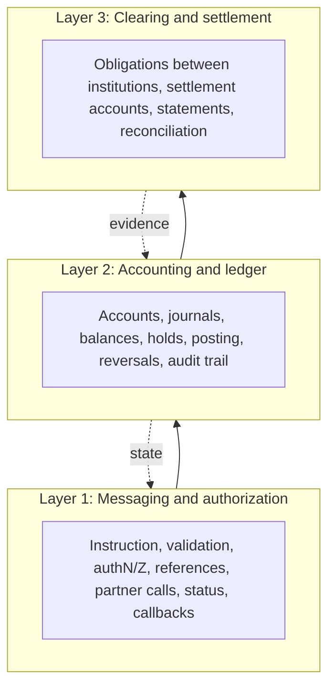
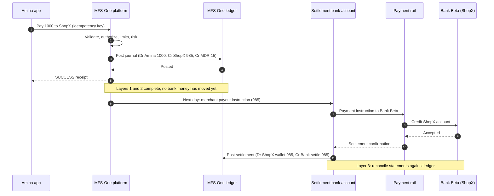
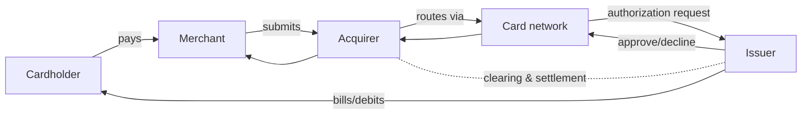
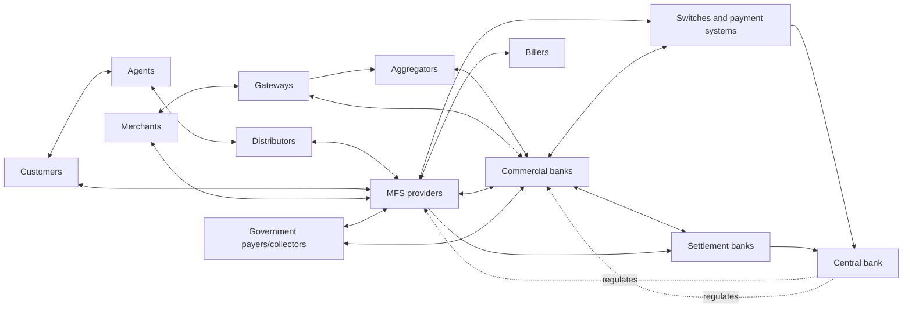

# Phase 1: Financial System Fundamentals for Fintech Engineers

> **Audience:** a working backend engineer at a Mobile Financial Services (MFS) company in Bangladesh who wants to become a Fintech Specialist Software Engineer.
> **Document date:** 29 October 2026. Bangladesh-specific facts change; every claim carries a confidence label (see [Evidence labels](#evidence-labels)).
> **Companion:** this is the deep-dive for Phase 1 of `MFS_FINTECH_ENGINEERING_ROADMAP.md`.
> **Safety notice:** all examples use fictional people, balances, fees and partners. Code is simplified educational code and is **not** suitable for real customer money without security review, audit, compliance approval and production-readiness work.

## Learning objectives

By the end you should be able to:
- [ ] Explain what money is and how a wallet balance differs from the assets backing it.
- [ ] Distinguish the messaging/authorization, accounting/ledger, and clearing/settlement layers and show one payment in all three.
- [ ] Explain each participant's role, risks and software touchpoints.
- [ ] Describe Bangladesh's payment rails and state what is verified versus unverified.
- [ ] Trace 17 core financial operations with ledger effects, failure modes and reconciliation.
- [ ] Use ~65 financial terms precisely.
- [ ] Translate financial invariants into API, database and recovery design.

## Prerequisites
Working knowledge of Python, Django/DRF, PostgreSQL, REST APIs. No accounting background needed.

## Estimated study time
3 weeks part-time (about 10-12 h/week, ~33 h). Mastery of ledgers, reconciliation and regulation takes months; see [Section 10](#section-10-three-week-study-plan) for what to defer.

## Evidence labels

| Label | Meaning |
|---|---|
| **[OFFICIAL]** | Confirmed in an official primary document (title/issuer/date given in [References](#section-13-references-and-source-links)) |
| **[REPORTED]** | Reported by press or secondary sources, not confirmed in a primary document; verify before relying |
| **[PRINCIPLE]** | General financial/accounting principle |
| **[PRACTICE]** | Common industry or engineering practice |
| **[ILLUSTRATIVE]** | Invented example for teaching |
| **[CONFIRM-INTERNALLY]** | Depends on your company's legal/accounting/partner arrangements; ask finance, compliance or architecture |

## Table of Contents

1. [Section 1: Money, Ledgers, and the Core Idea](#section-1-money-ledgers-and-the-core-idea)
2. [Section 2: Financial System Participants](#section-2-financial-system-participants)
3. [Section 3: Bangladesh's Payment Ecosystem](#section-3-bangladeshs-payment-ecosystem)
4. [Section 4: Banking and Financial Operations](#section-4-banking-and-financial-operations)
5. [Section 5: Financial Terminology](#section-5-financial-terminology-and-vocabulary)
6. [Section 6: Accounting Preview](#section-6-accounting-preview-for-software-engineers)
7. [Section 7: From Concepts to Software](#section-7-how-these-concepts-translate-into-software-engineering)
8. [Section 8: Exercises](#section-8-learning-exercises-and-assessments)
9. [Section 9: Practical Projects](#section-9-practical-projects)
10. [Section 10: Three-Week Study Plan](#section-10-three-week-study-plan)
11. [Section 11: Knowledge Assessment](#section-11-knowledge-assessment-and-completion-criteria)
12. [Section 12: Research Sources and Accuracy](#section-12-research-sources-and-accuracy)
13. [Section 13: References](#section-13-references-and-source-links)

---

## Section 1: Money, Ledgers, and the Core Idea

### 1.1 What is money?

#### Functions of money [PRINCIPLE]
- **Medium of exchange:** accepted in payment so people avoid barter.
- **Unit of account:** prices, debts and books are denominated in it (BDT/taka).
- **Store of value:** holds purchasing power over time (imperfectly; inflation erodes it).

#### Forms of money in modern economies [PRINCIPLE]

| Form | Who is the obligor (who owes you)? | Bangladesh example |
|---|---|---|
| Physical cash (banknotes, coins) | Central bank (liability of the issuer) | Taka notes issued by Bangladesh Bank |
| Central bank money in reserve/settlement accounts | Central bank | Banks' accounts at Bangladesh Bank used for interbank settlement |
| Commercial bank deposits | The commercial bank | Savings account at a scheduled bank |
| E-money / stored value | The e-money issuer (e.g., an MFS provider under its regulatory model) | MFS wallet balance |

**Fiat money** has value because a government declares it legal tender and people trust the issuer, not because it is backed by a commodity. The **central bank** issues currency, sets monetary policy and supervises banks (Bangladesh Bank: [OFFICIAL] via its legal mandate; see [Section 2.1](#21-central-bank)).

#### Balances are claims, not objects
A bank "balance" is a **record of a claim**: the bank owes you that amount on demand. Your wallet balance is a record of a claim against the **wallet issuer**. What backs the claim (bank deposits, trust accounts, cash) is the issuer's **assets**; the claim itself is the issuer's **liability**.

> **Why "just update the balance column" is incomplete.** Updating `wallet.balance -= 500; other.balance += 500` records one fact but omits: who authorized it, which reference identifies it, what fee applied, which accounting entries support it, whether an external institution must also move funds, whether it was later reversed, and how an auditor would prove the total of all wallets still matches the funds held. A financial transaction is a **record plus evidence plus obligations**, not an arithmetic update.

#### Bangladesh illustrations [ILLUSTRATIVE]
- **Cash:** Rahim holds 5,000 BDT in notes. Nobody records it; the central bank owes the holder.
- **Bank account:** Amina's 20,000 BDT at Bank Alpha is Bank Alpha's debt to Amina.
- **MFS wallet:** Amina's 1,500 BDT wallet is the MFS provider's e-money liability to her; the provider must be able to cover it from funds held under its regulatory arrangement ([CONFIRM-INTERNALLY] for the exact custody/trust structure; the MFS Regulations 2022 and BB trust-fund guidelines are the starting documents, see [References](#section-13-references-and-source-links)).

**Customer's claim vs institution's assets:** Amina's 1,500 is her claim. The provider's own assets include the bank balances that back all claims plus its own funds. These are different ledgers, which is why [reconciliation](#417-daily-reconciliation-and-settlement) exists.

### 1.2 How does money move?

For each scenario: cash vs instruction vs records vs claims vs institutional transfer vs clearing/settlement vs fees.
All amounts BDT, [ILLUSTRATIVE].

| # | Scenario | Physical cash | Electronic instruction | Internal records | Claims/obligations change | Interinstitutional transfer | Clearing/settlement | Fees/commissions | Timing |
|---|---|---|---|---|---|---|---|---|---|
| 1 | Customer gives 1,000 cash to MFS agent | Cash moves customer→agent | Agent app sends cash-in request | Agent wallet −1,000; customer wallet +1,000 (+commission lines) | Agent's claim on provider falls; customer's rises | None between institutions | None (internal) | Agent commission (e.g., 4) | Immediate |
| 2 | Customer sends 500 to another customer (P2P) | None | P2P request | Sender −505; receiver +500; fee revenue +5 | Claim moves between customers | None | None | Sender fee | Immediate |
| 3 | Customer pays merchant 1,000 | None | Pay request (QR) | Customer −1,000; merchant +985; MDR revenue +15 | Claim moves to merchant | None until merchant withdraws | Merchant settlement to bank later | MDR | Payment immediate; merchant payout deferred |
| 4 | Bank-to-wallet 2,000 | None | Bank debit request via partner API | After bank confirms: wallet +2,000; bank-clearing asset +2,000 | Bank's deposit liability to customer falls; MFS liability to customer rises | Funds move bank→MFS settlement/trust account | Settlement per arrangement (may be net, later) | Bank/MFS fee | Often async; outcome may be pending |
| 5 | Withdraw 1,000 at agent | Agent hands cash to customer | Cash-out request, agent confirm | Customer −1,015; agent +1,000; fee revenue +15 | Customer's claim falls; agent's rises | None | None | Fee, agent commission | Immediate digital; cash handover physical |
| 6 | Customers at different banks | None | Interbank transfer via switch/EFT rail | Each bank updates its customer ledger | Bank A owes Bank B net | Via central bank settlement accounts | Clearing then settlement (timing depends on rail) | Bank/rail fees | Real-time instruction, deferred settlement common |
| 7 | Provider pays merchants after collecting | None | Settlement instruction/bank payment | Merchant wallet/payable −X; bank asset −X | Provider's payable to merchant extinguished | Provider's bank → merchant's bank | Rail-dependent | Settlement fee | Typically T+n by contract |

**What is immediate vs async vs deferred**
- *Immediate:* internal-only moves (1, 2, 3 payment leg, 5).
- *Asynchronous:* anything needing a partner response (4, 6, bill payments).
- *Deferred to settlement:* real interinstitutional money movement (6, 7) and merchant payouts.

### 1.3 The three layers of financial transactions



#### Messaging and authorization layer
Covers: payment **instructions** (what is requested), **request validation** (schema, amounts, currency), **authentication** (who are you) and **authorization** (are you allowed, enough funds, limits), **transaction references** (unique ids), **partner requests/responses**, **timeouts**, **pending** transactions, **status inquiries**, **callbacks/notifications**. Output: a decision and a message trail. It does **not** by itself prove money moved.

#### Accounting and ledger layer
Covers: **financial accounts**, **ledger entries**, **journal entries** (balanced sets of debit/credit lines), **balances** (ledger vs available), **holds/reservations**, **posting** (making entries permanent), **reversals/adjustments** (new compensating entries), **audit trail**. Output: the books. It says who owes whom *inside your institution*.

#### Clearing and settlement layer
Covers: **clearing** (exchanging and validating instructions between institutions), **interinstitutional obligations** (Bank A owes Bank B), **settlement accounts** (where final value moves), **gross vs net settlement**, **settlement finality** (the point after which settlement cannot be unwound under the rules), **settlement failures**, **bank statements** (independent evidence), **reconciliation**.

#### Why they are not interchangeable

| Aspect | Messaging/authorization | Accounting/ledger | Clearing/settlement |
|---|---|---|---|
| Question answered | Is it allowed? What was requested? | What do we owe whom? | Did institutions actually transfer value? |
| Owner of truth | Your platform + partner message logs | Your ledger | Settlement system/bank statement |
| Timing | Milliseconds-seconds | Same transaction as decision, or after confirmation | Minutes to days |
| Failure example | Timeout | Unbalanced journal | Settlement file mismatch |
| Evidence type | API logs, partner responses | Journal entries | Bank statements, settlement reports |

A successful API response (layer 1) does not guarantee the ledger posted (layer 2), and a posted ledger entry does not guarantee that settlement completed (layer 3).

#### One payment in all three layers [ILLUSTRATIVE]
Amina (wallet at MFS-One) pays 1,000 BDT to ShopX, whose settlement account is at Bank Beta. MDR 1.5%.

| Layer | What exists |
|---|---|
| 1 | `POST /pay` with idempotency key; auth OK; limits OK; txn `T-9001` created; response SUCCESS. |
| 2 | Journal: Dr `CW:Amina` 1,000; Cr `MW:ShopX` 985; Cr `REV:MDR` 15. Amina available balance reduced, ShopX wallet payable up. |
| 3 | Next day: ShopX withdraws 985 to Bank Beta. MFS-One instructs payment from its settlement account via a rail; Bank Beta credits ShopX; statement lines at both banks; reconciliation matches. Ledger: Dr `MW:ShopX` 985; Cr `BANK:SETTLE` 985. |



### 1.4 What is a financial claim?

#### Core terms [PRINCIPLE]
- **Asset:** something an entity owns or is owed that has economic value (cash, bank balance, receivable).
- **Liability:** something an entity owes (customer deposits, wallet balances, payables).
- **Claim:** a legal right to receive value from another party; one party's claim is the other's liability.
- **Receivable / payable:** amounts owed *to* / *by* the entity (e.g., receivable from a partner; payable to a biller).
- **Settlement balance:** funds in an account used to settle obligations between institutions.

**Operational database record vs accounting record.** An operational record (`wallet.balance`, `txn.status`) supports running the product. An accounting record (journal entries) is the authoritative, auditable, append-only evidence of financial effect. A balance column may be a *cache* of the accounting record; it must never be the only record.

#### Simplified balance sheet of an MFS issuer [ILLUSTRATIVE, CONFIRM-INTERNALLY]

| Assets | BDT | Liabilities & equity | BDT |
|---|---|---|---|
| Funds in designated bank/trust accounts | 10,300,000 | Customer wallets | 6,000,000 |
| Receivable from partner bank | 100,000 | Agent wallets | 3,000,000 |
| Cash and operating accounts | 200,000 | Merchant wallets | 1,000,000 |
| | | Biller payable | 50,000 |
| | | Equity (retained earnings) | 550,000 |
| **Total** | **10,600,000** | **Total** | **10,600,000** |

Reading it: wallet balances (customers + agents + merchants = 10,000,000) are **liabilities**. Assets must be sufficient and accessible to honor them. The exact asset types, trust structure and allowed investments are regulatory/legal matters ([CONFIRM-INTERNALLY]; see the BB trust-fund guidelines listed in References).

**Effects on database design:**
- Wallet balances must be derived from, or provably equal to, ledger entries.
- You need accounts for assets (bank, receivables), liabilities (wallets, payables), revenue and expenses, not just wallets.
- Every wallet credit must have a corresponding debit somewhere (funding source), or the books do not balance.
- Aggregate wallet liability must reconcile to funds held.

### 1.5 Financial invariants

State the property, then show what breaks. [PRINCIPLE/PRACTICE]

| Invariant | Meaning | Example violation → discrepancy |
|---|---|---|
| Balanced journals | Σ debits = Σ credits per journal | Entry credits receiver 100 but debits sender 90 → 10 BDT created from nothing |
| Accurate balances | Balance = Σ posted entries | Cached balance updated, entry insert fails → balance and ledger disagree |
| No unauthorized movement | Every movement traceable to an authorized request/actor | Admin script edits balance → money appears with no approval |
| Duplicate prevention | One logical request → at most one effect | Client retries after timeout, no idempotency → customer debited twice |
| Traceability | Transaction ↔ journal ↔ partner refs | Credit exists with no txn id → cannot investigate dispute |
| Auditable reversals | Corrections are new linked entries | Deleting a wrong entry → audit history lost, balances not reproducible |
| Independent reconciliation | Compare against records the system did not write | Reconciling ledger to ledger → bank-side differences never found |
| Concurrency safety | Concurrent transactions respect balances/limits | Two 800 debits on a 1,000 wallet both pass → −600 overdraft |

**Warning on models.** Different MFS operators and legal structures use different accounting models (who holds customer funds, how fees/taxes are booked, how agents are treated). The examples here are teaching models. [CONFIRM-INTERNALLY]

---
## Section 2: Financial System Participants

Each participant is documented with the same 14 items, condensed into one table: **(1) definition, (2) purpose, (3) responsibilities, (4) revenue, (5) relationships, (6) example workflow, (7) obligations and risks, (8) software systems, (9) APIs/integrations, (10) engineering challenges, (11) Bangladesh examples, (12) misconceptions, (13) exercise, (14) interview question.**

> Regulatory classification of any real company depends on the applicable Bangladesh Bank framework and that company's authorizations. Do not infer a company's permissions from its brand or from this guide. [CONFIRM-INTERNALLY]

### 2.1 Central bank

| Item | Content |
|---|---|
| Definition | The public authority that issues the national currency, conducts monetary policy, supervises banks and oversees payment systems. |
| Purpose | Monetary and financial stability; safe, efficient payments. |
| Responsibilities | Currency issuance, monetary policy, banking supervision, payment-system oversight and often operation of core systems, holding banks' reserve/settlement accounts, liquidity management, issuing regulations and circulars. |
| Revenue | Seigniorage, returns on reserves (not a commercial revenue model). |
| Relationships | Regulates commercial banks, NBFIs, MFS providers, PSPs/PSOs; banks hold accounts with it. |
| Example workflow | Interbank settlement: Bank A's reserve account at the central bank is debited, Bank B's credited, under system rules. |
| Obligations/risks | Systemic risk, operational resilience of core systems. |
| Software systems | RTGS and other core payment infrastructure; supervision/reporting portals. |
| APIs/integrations | Mostly file/message based and certified connectivity for participants; reporting submissions. [CONFIRM-INTERNALLY] |
| Engineering challenges | Meeting reporting formats and operating calendars, certification, handling holiday/cut-off rules. |
| Bangladesh | **Bangladesh Bank** (bb.org.bd) issues regulations such as the MFS Regulations 2022 and e-KYC guidelines [OFFICIAL]; operates/oversees BEFTN, NPSB, RTGS and related systems [REPORTED for per-system details, see [Section 3](#section-3-bangladeshs-payment-ecosystem)]. |
| Misconceptions | "Every retail payment settles individually in central bank money." Usually retail payments are netted or batched and settled between institutions at defined times. |
| Exercise | List five documents on bb.org.bd that your platform must comply with and who owns each internally. |
| Interview Q | Why do commercial banks hold accounts at the central bank? |

**Central bank vs commercial bank.** The central bank serves banks and the state (issuing currency, setting policy, settling between banks); commercial banks serve the public and businesses (deposits, loans). Commercial banks keep accounts at the central bank so interbank obligations can be settled in central bank money without credit risk to each other.

### 2.2 Commercial banks

| Item | Content |
|---|---|
| Definition | Licensed institutions that take deposits, lend, and provide payment accounts and services. |
| Purpose | Intermediate savings and credit; hold transaction accounts. |
| Responsibilities | Customer accounts (current, savings), transfers, interbank participation, treasury/liquidity, statements, KYC. |
| Revenue | Net interest margin, fees, treasury income. |
| Relationships | Accounts at central bank; partners with MFS (funding, bank-to-wallet); sponsors of MFS subsidiaries under the bank-led model [OFFICIAL: MFS Regulations 2022 scope]. |
| Example workflow | See bank-to-wallet below. |
| Obligations/risks | Credit, liquidity, operational, compliance risks. |
| Software | Core banking system (CBS), internet/mobile banking, card switch, payment gateway interfaces. |
| APIs | Partner APIs (REST/SOAP/file), often signed requests, IP allowlisting, sandbox/UAT. [CONFIRM-INTERNALLY] |
| Challenges | Uncertain outcomes on timeout, batch cut-offs, differing status semantics, statement formats. |
| Bangladesh | Scheduled commercial banks; some own MFS subsidiaries or provide MFS services under the bank-led model [OFFICIAL/REPORTED]. |
| Misconceptions | "A bank API 200 means funds moved." Verify finality semantics per partner. |
| Exercise | Draw the sequence for bank→wallet with an unknown outcome and the recovery. |
| Interview Q | Why is a bank statement better reconciliation evidence than your own API logs? |

**Bank-to-wallet [ILLUSTRATIVE]:** customer authorizes debit of 2,000 at Bank Alpha → MFS sends signed debit request with our txn id → bank debits customer account and credits its settlement/clearing arrangement with MFS → bank replies SUCCESS → MFS credits wallet. **Wallet-to-bank** reverses direction: MFS first reserves wallet funds, instructs bank credit, finalizes on confirmation, compensates on definite failure.

### 2.3 Non-bank financial institutions (NBFIs)

| Item | Content |
|---|---|
| Definition | Licensed financial institutions that provide certain financial services (e.g., leasing, term finance) but are not full banks. In Bangladesh, referred to as non-bank financial institutions/finance companies under the Finance Companies Act 2023 [OFFICIAL: cited in BB e-KYC circular]. |
| Purpose/activities | Term lending, leasing, investment and similar services; scope set by licence. |
| Revenue | Interest, fees. |
| Relationship to payments | May hold shares in MFS subsidiaries under the regulations; may be RTGS participants [REPORTED]; may use payment services via partners. |
| Risks | Liquidity, credit; regulatory scope limits. |
| Software | Loan management, accounting, partner integrations. |
| Challenges | Do not assume parity with banks: many cannot take demand deposits or provide full payment accounts. |
| Misconception | "NBFI = bank-lite that can do everything." Permissions are licence-specific. |
| Exercise | Find, from the regulation text, what role NBFIs may play in the MFS ownership model. |
| Interview Q | Why can't you assume an NBFI can operate a settlement account like a bank? |

### 2.4 Payment service providers (PSPs)

| Item | Content |
|---|---|
| Definition | A business authorized to provide payment services (e.g., collection, processing, wallet-like services) under the applicable framework. The MFS Regulations 2022 state that an MFS provider acts as a PSP as defined in the BPSSR 2014 [OFFICIAL]. |
| Purpose | Enable payments between payers, merchants and institutions. |
| Responsibilities | Merchant onboarding, payment processing, settlement arrangements, customer/merchant interfaces, compliance, risk. |
| Revenue | Processing fees, MDR share, settlement fees. |
| Relationships | Banks (settlement), MFS operators, gateways, aggregators, schemes. |
| Obligations/risks | Settlement risk, fraud, regulatory permission scope. |
| Software | Payment API, merchant portal, ledger, settlement engine. |
| APIs | Merchant checkout API, bank/partner APIs, callbacks. |
| Bangladesh | Bangladesh Bank issues PSP licences (a BB official presentation lists MFS and PSP as DFS licence types) [REPORTED]. |
| Misconception | "PSP and PSO are the same." |
| Exercise | Compare PSP vs PSO on responsibilities, risk and software. |
| Interview Q | Which regulatory permissions should be checked before launching a new payment service? |

**PSP vs PSO:** a PSP provides payment services to end users or merchants; a **PSO** operates the infrastructure/system through which payments are routed, cleared or settled. A company may hold both authorizations or only one; check licences.

### 2.5 Payment system operators (PSOs)

| Item | Content |
|---|---|
| Definition | An entity operating a payment system (switch, clearing house, settlement arrangement). |
| Purpose | Provide shared infrastructure so institutions can interoperate. |
| Responsibilities | Message routing, rules, participant certification, operational resilience, clearing and settlement arrangements. |
| Revenue | Participation and transaction fees. |
| Relationships | Participant banks/PSPs/MFS; settlement at central bank or settlement bank. |
| Obligations/risks | Availability, integrity, cyber risk, settlement risk. |
| Software | Switching engine, HSM, monitoring, rule engine. |
| APIs | Standard messages (e.g., ISO 8583 or ISO 20022 style) plus certified connectivity. |
| Challenges | High availability, deterministic timeouts and response codes, interoperability testing. |
| Bangladesh | NPSB, BEFTN and RTGS are operated/overseen by Bangladesh Bank [REPORTED/OFFICIAL per source]; private switching service providers exist [REPORTED: 2014 BB presentation names bank- and company-operated switches]. |
| Misconception | "Running a consumer wallet is running a payment system." A wallet issues e-money to customers; a system operator provides rails to participants. |
| Exercise | List the operational resilience measures a switch needs vs a wallet app. |
| Interview Q | Why are participant certification tests a gate to production? |

### 2.6 Mobile financial services (MFS) providers

| Item | Content |
|---|---|
| Definition | E-money services provided against a mobile account where the record of funds is held in an electronic ledger; in Bangladesh, regulated under the MFS Regulations 2022 [OFFICIAL]. |
| Purpose | Financial inclusion and convenient payments via phone + agent network. |
| Responsibilities | Wallet issuance/management, onboarding (KYC/e-KYC), agent and merchant networks, transaction processing, ledgers, fees/commissions, liquidity/settlement, customer support, risk and compliance. |
| Revenue | Cash-out/transfer fees, MDR, bill/bulk fees, partner fees. [PRACTICE] |
| Relationships | Banks (funding/settlement), agents, merchants, billers, switches, regulators. |
| Obligations/risks | Honor wallet liabilities, AML/CFT, fraud, agent liquidity, operational resilience. |
| Software | Wallet/ledger, transaction orchestrator, limits/fees, agent/merchant mgmt, risk, recon, notifications. |
| APIs | Partner adapters, merchant APIs, interoperability connections. |
| Challenges | Concurrency at scale, recovery of unknown outcomes, reconciliation across many partners. |
| Bangladesh | bKash, Nagad, Upay, Rocket are widely known MFS brands. A 2025 TIB study states 13 MFS providers were operating [REPORTED]. Verify each provider's legal entity and permissions on bb.org.bd before documenting. |
| Misconceptions | "The brand is the licensee." |
| Exercise | For your employer, write down brand, legal entity, regulatory model (bank/FI/government-entity-led) from official records. |
| Interview Q | Why is a wallet balance a liability? |

**Brand vs legal entity vs permissions:** the **brand** is what customers see; the **legal entity** holds the licence and contracts; the **permissions** are the specific services it may provide under regulation. They can differ (e.g., a bank-owned subsidiary operating under a brand). [CONFIRM-INTERNALLY]

### 2.7 Payment aggregators

| Item | Content |
|---|---|
| Definition | A provider that onboards many merchants under its own relationship with acquirers/payment partners and collects payments on their behalf. |
| Purpose | Let small merchants accept payments without individual contracts. |
| Responsibilities | Merchant/sub-merchant onboarding and identification, collection, fee distribution, settlement allocation, refunds, reconciliation. |
| Revenue | Fee spread over underlying MDR. |
| Relationships | Banks/acquirers, gateways, merchants. |
| Obligations/risks | Pooled funds, sub-merchant fraud, settlement allocation errors, regulatory scope. [CONFIRM-INTERNALLY] |
| Software | Sub-merchant registry, split settlement engine, refund engine. |
| Challenges | Attributing each payment to the right sub-merchant and fee rule; handling refunds after settlement. |
| Misconception | "Aggregator = gateway." |
| Exercise | Design the allocation of a 10,000 pooled settlement across 4 sub-merchants with differing MDRs. |
| Interview Q | How do you reconcile pooled funds to sub-merchant balances? |

**Comparison**

| | Merchant direct integration | Gateway | Aggregator |
|---|---|---|---|
| Contract with acquirer/bank | Merchant | Merchant (gateway is technical) | Aggregator |
| Who receives funds first | Merchant account | Merchant account | Aggregator pool, then split |
| Main value | Control | Technical integration | Onboarding simplicity |
| Main risk | Merchant effort | Technical | Pooled-funds/allocation risk |

### 2.8 Payment gateways

| Item | Content |
|---|---|
| Definition | A technical service that securely carries payment initiation data from a merchant checkout to payment institutions and returns outcomes. |
| Purpose | Standardize online payment acceptance. |
| Responsibilities | Hosted pages/redirects/API, tokenization, callbacks, status inquiry, refunds, merchant reporting. |
| Revenue | Per-transaction fees, setup fees. |
| Relationships | Merchants, banks, schemes, MFS. |
| Software | Checkout, token vault, callback/webhook delivery, merchant dashboard. |
| APIs | Create payment, status inquiry, refund, webhook callbacks. |
| Challenges | Redirect/return flows lost; user closes browser; callback duplicates; reconcile merchant order vs payment. |
| Misconception | "The gateway is the financial institution." It routes; money is held and settled by institutions. |
| Exercise | Draw redirect flow where the customer pays but never returns; how does the merchant learn the outcome? |
| Interview Q | Callback vs return URL vs status inquiry: which is authoritative and why? |

### 2.9 Payment switches

| Item | Content |
|---|---|
| Definition | Infrastructure that routes transaction messages between institutions (issuers, acquirers, banks, wallets). |
| Purpose | Interoperability without N×N bilateral links. |
| Responsibilities | Routing decisions, message translation, participant certification, transaction ids, timeout/response-code handling, availability, clearing data to settlement. |
| Software | Routing engine, HSM, monitoring. |
| APIs/formats | **ISO 8583** (bitmapped messages, dominant for card/ATM/POS switching); **ISO 20022** (richer XML/JSON message standard for payments and interbank messaging). Which one a Bangladesh rail uses is interface-specific [CONFIRM-INTERNALLY]; public documentation is limited. |
| Bangladesh | **NPSB**: reported operational since 2012, interoperability among banks for account and card-based transactions [REPORTED: TBS]; later reporting says it was extended to include MFS and PSP accounts [REPORTED: secondary, verify with the BB circular]. |
| Challenges | Timeouts and late responses, reversals (advice/reversal messages), duplicate message detection. |
| Misconception | "Switch = settlement." Switching moves messages; settlement is separate. |
| Exercise | Map NPSB-style request/response to your internal states including a timeout. |
| Interview Q | What changes between ISO 8583 and ISO 20022 for a developer? |

### 2.10 Card networks, issuers, acquirers

| Item | Content |
|---|---|
| Definition | **Scheme/network** sets rules and routes; **issuer** gives the card to the cardholder and funds payment; **acquirer** signs up merchants and receives funds for them. |
| Revenue | Issuer: interchange, interest, fees. Acquirer: MDR minus interchange/scheme fees. Network: scheme fees. |
| Flow | Authorization (real-time, reserves funds) → clearing (batch) → settlement (net between acquirer and issuer). |
| Risks | Fraud, chargebacks, settlement risk. |
| Software/APIs | ISO 8583 authorization messages, tokenization, 3-D Secure, chargeback case systems. |
| PCI DSS | Applies if your systems store, process or transmit cardholder data (PCI Security Standards Council) [OFFICIAL standard; applicability depends on scope]. |
| Misconception | "Issuer and acquirer are fixed institution types." They are **roles**; one bank can be issuer for some cards and acquirer for some merchants. |
| Exercise | Walk through a refund and a chargeback in the four-party model. |
| Interview Q | Why does PCI scope reduction matter architecturally? |



### 2.11 Merchants and sub-merchants

| Item | Content |
|---|---|
| Definition | Entity accepting payments; a sub-merchant is a merchant onboarded under an aggregator/PSP. |
| Responsibilities | Display/accept payment, fulfill goods/services, handle refunds, reconcile receipts. |
| Cost | MDR, settlement fees. |
| Software | Merchant id, wallet/receivable, settlement account, reports, webhook endpoint. |
| Risks | Fraud, chargeback/dispute exposure, fake merchants. |
| Engineering | Settlement reports tie to ledger lines; merchant balance vs wallet vs payable depends on contract/accounting model [CONFIRM-INTERNALLY]. |
| Exercise | Reconcile a merchant day report of 200 payments to ledger and settlement payout. |
| Interview Q | What happens to the MDR on a refund? (Policy decision.) |

**Relationship of records:** customer wallet debit (liability falls) ↔ merchant wallet credit (liability rises) ↔ merchant settlement (liability falls, bank asset falls).

### 2.12 Agents and distributors

| Item | Content |
|---|---|
| Definition | Agents provide cash-in/cash-out and other assisted services; distributors supply agents with e-float and manage agent networks. |
| Revenue | Commissions. |
| Software | Agent wallet (e-float), float purchase/transfer, commission engine, geo/velocity monitoring. |
| Risks | Float shortage, cash shortage, collusion, fake transactions. |
| Misconception | "Agent balance = agent cash." They are different assets. |

**Physical cash vs electronic float [ILLUSTRATIVE]**
- Cash-in: agent *receives* physical cash and *spends* e-float. Cash-out: agent *pays* cash and *receives* e-float.
- *Case A (cash short, float fine):* Agent has cash 5,000, float 50,000. Three customers cash out 8,000 total. Float rises to 58,000 but cash is only 5,000, so the agent cannot serve the second customer. Fix: agent rebalances (converts float to cash via distributor/bank).
- *Case B (float short, cash fine):* Agent has cash 200,000, float 3,000. A customer wants to cash in 10,000. The agent cannot send 10,000 e-float. Fix: purchase float (deposit cash or bank transfer).

| Process | Notes |
|---|---|
| Float replenishment | Agent buys e-float from distributor/MFS: Dr Bank/Distributor settlement, Cr Agent wallet [ILLUSTRATIVE] |
| Agent settlement | Commissions accrued then paid (see [4.16](#416-fees-commissions-and-taxes)) |
| Reconciliation | Compare e-float movement with cash logs and distributor records |

Exercise: compute the two-sided position of an agent after 10 mixed transactions. Interview Q: how do you detect float hoarding or fake cash-ins?

### 2.13 Customers and beneficiaries

| Item | Content |
|---|---|
| Roles | **Payer** (funds source), **payee/beneficiary** (receives), **account holder** (owns account), **initiator** (starts request; may be an agent or a corporate user acting for the holder). |
| Controls | KYC, risk classification, status, limits, authentication, consent. |
| Misconception | Payer = account holder = initiator = beneficiary. Counterexamples: agent-initiated cash-in for a customer; salary payment where employer initiates and employee benefits; a parent paying a child's school bill. |
| Software | Identity, consent records, notification preferences, dispute/complaint tracking. |
| Exercise | Model "who is who" for a bulk salary item. |
| Interview Q | Which identity does the limit check apply to in an agent-initiated cash-in? |

### 2.14 Billers and collection organizations

| Item | Content |
|---|---|
| Examples | Utilities, telecom, universities, government collectors. |
| Workflow | Inquiry → validate reference → pay → biller confirmation/receipt → settlement → reconciliation. |
| Key distinction | **Accepting payment** (MFS debited the customer) ≠ **bill confirmed paid in the biller's system**. A biller may reject later (already paid, wrong reference), requiring compensation. |
| Risks | Stale bill, duplicate payment, biller downtime. |
| Engineering | Biller adapters, idempotent payment advice, reconciliation file ingestion. |
| Exercise | Design handling when biller responds success but its file next day omits the payment. |
| Interview Q | What is the customer's state during a biller timeout? |

### 2.15 Government payment organizations

| Item | Content |
|---|---|
| G2P | Salaries, allowances, social safety-net transfers via bulk disbursement. |
| P2G | Taxes, duties, fees collected through banks/MFS/billers. |
| Features | Beneficiary lists, approvals, reporting, reconciliation with government accounts. |
| Bangladesh | BEFTN is reported to carry most government salary and social benefit payments [REPORTED: nsave]; MFS channels are also used for G2P programs [REPORTED/verify]. |
| Risks | Wrong beneficiary data, duplicate payments, return handling. |
| Exercise | Design a synthetic 100,000-item disbursement with partial failure and return file handling. |
| Interview Q | How do you make a bulk file retry safe? |

### 2.16 Settlement and correspondent banks

| Item | Content |
|---|---|
| Settlement bank | Bank where settlement accounts are held and statements issued. |
| Correspondent banking | Bank-to-bank relationship to move funds in another bank's market/currency. **Nostro** = "our account held at your bank"; **vostro** = "your account held at our bank" (same account, viewed from each side). |
| Software | Statement ingestion (e.g., MT940/CAMT-style or CSV), settlement instructions, cut-off calendars. |
| Risks | Cut-off misses, failed settlement, counterparty risk. |
| Distinction | Settlement account ≠ customer wallets ≠ operational transaction records. Different owners, different evidence. |
| Exercise | Trace one day's net settlement across statement lines and ledger. |
| Interview Q | Why store bank statement lines as their own table? |

### 2.17 Participant relationship map



**Not every payment uses every participant.**
- *P2P within one MFS:* customers + MFS only.
- *Merchant QR payment (same MFS):* customer, merchant, MFS; settlement to merchant bank later via a bank and a rail.
- *Bill payment:* customer, MFS, biller (via aggregator/bank possibly), settlement bank.
- *Interbank transfer via switch:* two banks, switch, central bank settlement.
- *Government salary via BEFTN:* government, bank(s), BEFTN operator, central bank settlement.

---
## Section 3: Bangladesh's Payment Ecosystem

> **Accuracy statement.** I could confirm only a limited set of facts from primary Bangladesh Bank documents. Most per-rail details below come from press and secondary sources and are labeled **[REPORTED]**. Public technical specifications (message formats, certification procedures, participation fees) are generally not openly documented; where I could not find them I say so. Treat every row as a starting point for verification on bb.org.bd or with your integration/partner team. Status as of 29 Oct 2026 is **not** guaranteed.

### 3.0 Summary table

| System | What it is | Processing mode | Confidence | Verify via |
|---|---|---|---|---|
| Bangladesh Bank (BB) | Central bank; regulator; operator/overseer of core payment systems | n/a | [OFFICIAL] for regulatory role | bb.org.bd |
| BEFTN / Nikash-BEFTN | Interbank electronic fund transfer (credit and debit), batch | Batch, multiple sessions | [REPORTED] | BB Payment Systems Dept. circulars |
| NPSB | National switch for interbank retail transactions (ATM/POS/internet etc.) | Near-real-time messaging; settlement deferred | [REPORTED] | BB PSD |
| BD-RTGS | High-value real-time gross settlement | Real-time gross | [REPORTED] | BB PSD |
| BACPS | Automated cheque processing/clearing | Batch | [REPORTED] | BB PSD |
| Bangla QR | Common QR standard for interoperable QR payments | Depends on underlying rail | [REPORTED] | BB circulars |
| Binimoy (IDTP) | Interoperable platform for bank/MFS/PSP transfers | Reported instant | [REPORTED]; future uncertain | BB, ICT Division |
| Bank↔MFS transfers | Funding/withdrawal between bank accounts and wallets | Partner/rail-dependent | [CONFIRM-INTERNALLY] | Your partner agreements |
| Domestic/international remittance channels | Authorized channels for inward remittance | Partner-dependent | [CONFIRM-INTERNALLY] | BB FEPD circulars |

### 3.1 Bangladesh Bank
1. **What:** the central bank. 2. **Problem solved:** monetary and financial stability, supervision, payment-system oversight. 3. **Participants:** all licensed banks, NBFIs/finance companies, MFS providers, PSPs/PSOs. 4. **Transaction types:** n/a (regulator/operator). 8. **Engineer interaction:** read circulars, regulatory reporting, certification with payment systems. 9. **Failure scenarios:** missed reporting deadlines, outdated circular used. 10. **Docs:** the MFS Regulations 2022 and the March 2026 e-KYC circular are confirmed official documents ([References](#section-13-references-and-source-links)). The e-KYC circular cites the Payment and Settlement System Act, 2024 as one legal basis [OFFICIAL].

### 3.2 BEFTN (and Nikash-BEFTN)
| Question | Answer |
|---|---|
| What / problem | Batch-based electronic funds transfer between accounts at different banks, replacing paper instruments. Launched 28 Feb 2011 [REPORTED: nsave]. A TBS report states that since 12 Nov 2023 transfers run on **Nikash-BEFTN**, software developed by Bangladesh Bank, replacing the original system [REPORTED]. |
| Participants | Banks (and some other institutions) connected by BB [REPORTED]. |
| Transaction types | Credit transfers (e.g., salaries, remittance payouts) and debit transfers (e.g., bill, EMI, premium collections) [REPORTED]. |
| Mode | Batch with sessions; a source describes a return window measured in sessions, not calendar days [REPORTED, verify]. |
| Clearing/settlement | Net settlement through accounts at Bangladesh Bank after batch processing [REPORTED]. |
| Interfaces/standards | Public specification not located; participant file formats and connectivity are BB-controlled [CONFIRM-INTERNALLY]. |
| MFS engineer interaction | Usually indirect: via bank partners, for bulk payouts, merchant settlements to bank accounts. |
| Failure scenarios | Cut-off missed, return/reject by receiving bank, wrong account number, holiday delays. |
| Fees | A government statement reported that BEFTN is free of charge at infrastructure level [REPORTED: TBS, date unverified]; banks may charge customers. |
| Docs | BB Payment Systems Department circulars (links not verified here). |

### 3.3 NPSB
| Question | Answer |
|---|---|
| What / problem | National switch giving interoperability among banks for account and card-based transactions; reported operational since 2012 [REPORTED: TBS]. |
| Participants | Banks; reports state all scheduled banks are expected to connect [REPORTED: nsave]. |
| Transaction types | ATM, POS, internet banking fund transfers and similar [REPORTED]. |
| Extension to MFS/PSP | A secondary source claims a Bangladesh Bank directive (cited as PSD Circular No. 12, 13 Oct 2025) extended NPSB to enable transfers among bank accounts, bKash, Nagad and PSPs from Nov 2025. **I could not verify this in a primary BB document.** [REPORTED, **verify with BB circular and your integration team**]. |
| Mode | Instructions are near-real-time; the switch does not physically move cash. Actual bank settlement happens through Bangladesh Bank accounts, reportedly in deferred batches [REPORTED]. A 2020 BB notice reported NPSB runs round the clock while settlement occurs on a later business date [REPORTED: FE]. |
| Limits/fees | A government statement reported NPSB transfers cost up to Tk10 including VAT [REPORTED: TBS]. Per-transaction limits vary by source and bank; **do not rely on any figure** here. |
| Interfaces/standards | Unknown publicly; ISO 8583-style messaging is common in switches but I could not confirm NPSB's specification [CONFIRM-INTERNALLY]. |
| Failure scenarios | Timeout with unknown outcome, delayed credit, reversal/advice messages, participant downtime. |
| MFS engineer interaction | If your company is connected, you handle NPSB request/response mapping, status inquiry, reconciliation to settlement reports. |

### 3.4 BD-RTGS
| Question | Answer |
|---|---|
| What / problem | Gross, real-time settlement for high-value interbank payments; reduces settlement risk. |
| Dates | Sources differ: 29 Oct 2015 "formally inaugurated" (UNB) and 19 Dec 2015 launch (a bank-services blog) [REPORTED; dates conflict, verify]. |
| Participants | Reported 60 scheduled banks and 19 NBFIs connected (as of that report) [REPORTED]. |
| Mode | Real-time gross; other batch systems (BEFTN, NPSB, BACPS) may settle their net positions via RTGS [REPORTED: EPS blog]. |
| Fees | Up to Tk100 including VAT per transfer, per a government statement [REPORTED]. |
| Minimums/limits | A minimum amount is mentioned by a secondary source; **unverified, do not use**. |
| Next generation | A "Next Generation RTGS" 24/7 project is mentioned by a secondary source [REPORTED, verify]. |
| MFS engineer interaction | Rare directly; your finance/treasury and bank partners use it for large settlements. |
| Failures | Cut-off, insufficient settlement balance at BB, rejected message. |

### 3.5 BACPS
Bangladesh Automated Cheque Processing System: image-based cheque clearing, batch; a 2020 FE report shows BACPS and RTGS were suspended during a holiday period while BEFTN stayed open and NPSB ran 24/7 [REPORTED]. Interaction for MFS engineers is usually limited. Primary documentation not located. [CONFIRM-INTERNALLY]

### 3.6 Bangla QR
| Question | Answer |
|---|---|
| What / problem | A standard QR format intended to let one QR be read by any compliant app/bank/MFS. A Daily Star report says it was introduced in January 2023 and that adoption in shops remained low; the central bank was reported to plan mandatory adoption [REPORTED: TDS]. |
| Participants | Banks, MFS, PSPs, merchants. |
| Transaction types | Merchant payments by QR (payer-scan); other modes unconfirmed. |
| Mode/settlement | Depends on the underlying wallet/bank/switch. |
| Standards | QR payload format follows a published BB specification [CONFIRM-INTERNALLY: obtain the official document]. |
| Engineer interaction | Generate/parse payloads, validate merchant ids and CRC, route payments to the correct issuer, reconcile merchant settlement. |
| Failures | Tampered/replaced stickers, invalid payloads, unsupported fields, interoperable routing failure. |

### 3.7 Binimoy (IDTP) and other interoperability initiatives
- **Binimoy** (Interoperable Digital Transaction Platform) was launched on 13 Nov 2022 [REPORTED: BSS via Daily Star]; operated by Bangladesh Bank with ICT Division/IDEA project involvement, with Velwire Limited reported as the implementer [REPORTED].
- Reported purpose: instant transfers between banks, MFS and PSP accounts; two types, including Direct Pay [REPORTED: Daily Star].
- **Status/uncertainty:** A 2025 Daily Star article reported criticism that Binimoy and Bangla QR were underused, and that the central bank was working with Mojaloop on a new interoperable platform to replace Binimoy [REPORTED]. **Current status requires verification.**
- A BB payments report (reported by FE) lists IDTP alongside BD-RTGS and NPSB as a payment channel [REPORTED].

### 3.8 Bank-to-MFS and MFS-to-bank transfers
Implemented via bilateral integration, a switch, or an interoperability platform depending on the pair of institutions. Layers: customer instruction → partner API/rail → posting on both sides → settlement. Details are [CONFIRM-INTERNALLY]. See [4.12](#412-bank-to-mfs-and-mfs-to-bank-transfers).

### 3.9 Domestic and international remittance channels
- A Bangladesh Bank Foreign Exchange Policy Department circular (Nov 2022) allowed MFS providers to apply to provide inward remittance repatriation services, with an application deadline of 31 Dec 2022, subject to the framework outlined [REPORTED: FE; circular file located at an aggregator site, original BB URL not verified]. **Do not assume any given MFS can process any remittance type.** [CONFIRM-INTERNALLY]
- Inward international remittances normally flow via authorized banks, exchange houses and money transfer operators to bank accounts or wallet payout points.

### 3.10 Rail comparison (for mental model only)

| | BEFTN | NPSB | RTGS | BACPS | Binimoy |
|---|---|---|---|---|---|
| Typical use | Batch credit/debit | Retail interbank | High value | Cheques | Bank/MFS/PSP interop |
| Speed [REPORTED] | Batch, next session/day | Near-real-time instruction | Same day, real time | Batch | Instant (reported) |
| Settlement | Net at BB | Deferred net | Gross, immediate | Net | Unverified |

---

## Section 4: Banking and Financial Operations

**How to read each operation.** The table uses the 15-item structure in condensed rows. Example journals use the chart of accounts from the Roadmap Phase 3 (`CW` customer wallet, `AW` agent wallet, `MW` merchant wallet, `REV:*` revenue, `EXP:COMM`, `BANK:SETTLE`, etc.). All numbers are [ILLUSTRATIVE]. Taxes are **omitted** because rates/treatment are legal matters. Journal entries are teaching models, not a full general-ledger treatment. [CONFIRM-INTERNALLY]

State vocabulary used: INITIATED, VALIDATING, PROCESSING, SUCCESS, FAILED, UNKNOWN, EXPIRED, REVERSED, REFUNDED, RECONCILIATION_REQUIRED (illustrative; design per type).

### 4.1 Customer onboarding and KYC

| Item | Content |
|---|---|
| Objective | Create an account for a verified person with an appropriate risk profile. |
| Participants | Customer, MFS (and possibly agent), identity data sources. |
| Preconditions | Valid mobile number; permitted product tier. |
| Workflow | Register → collect identity data → verify → classify risk → activate (or reject) → set limits → record consent. |
| Financial effect | None until funded. |
| Accounting | Creates ledger account (zero balance). |
| API/services | Identity service, verification adapter, limits service. |
| DB | `customer`, `kyc_record` (versioned), `risk_profile`, `consent`, `account`. |
| States | `REGISTERED → DATA_COLLECTED → VERIFICATION_PENDING → VERIFIED/REJECTED → ACTIVE`. |
| Failures | Mismatch, duplicate identity, verification provider down (pending, not rejected). |
| Recovery | Retry verification; manual review queue; never auto-activate on timeout. |
| Security | Data minimization, encryption, access logging, retention per rules [CONFIRM-INTERNALLY]. |
| Example | Rahim submits identity data; verification pending at provider; account stays `RESTRICTED` (e.g., receive-only) per policy until verified. |
| Exercise/checklist | Draw the KYC state machine; ☐ separate "collected" from "verified". |

**Collected vs verified:** collecting a document or number proves nothing; *verification* is a recorded outcome from a trusted check. Store the evidence reference and result separately.

### 4.2 Electronic KYC
- **Official anchor [OFFICIAL]:** Bangladesh Bank's updated *Guidelines on Electronic Know-Your-Customer (e-KYC)*, circulated 11 March 2026 to banks, finance companies, MFS providers, PSPs, PSOs and others, issued under the Bank Company Act 1991 s.45, the Finance Companies Act 2023 s.41 and the Payment and Settlement System Act 2024 s.8; it refers to simplified and regular e-KYC and says MFS/PSP/PSO reporting follows instructions from the Payment Systems Department-1. It follows BFIU's first e-KYC guideline of 8 Jan 2020 (Circular 25).
- **Engineering view:** digital onboarding; identity data/biometric verification via approved channels; document checks and liveness where applicable; verification-provider integrations; risk-based tiers; failure handling (timeout ≠ rejection); data protection.
- **Mandatory vs optional:** tiers, data fields, thresholds and permitted methods are defined in the guideline text; vendor choice, retry UX, queueing and architecture are implementation options. **Read the guideline directly; I did not extract its thresholds.**
- Checklist: ☐ obtain guideline PDF; ☐ map each requirement to a control and test.

### 4.3 Customer due diligence and risk classification
- Risk profile uses factors such as customer type, product, geography, channel and expected activity. [PRINCIPLE]
- Higher risk can mean lower limits, enhanced due diligence, closer monitoring, periodic reviews, restrictions and escalation to compliance. Specific numeric thresholds **must come from compliance**; this guide gives none. Example fictional policy: "High risk: daily transfer cap 20,000, manual review above it" [ILLUSTRATIVE].
- Software: `risk_class` with effective dates, rules referencing it, alert/case management, audit of changes.

### 4.4 Account lifecycle management
States: `CREATED → ACTIVE ⇄ SUSPENDED/RESTRICTED/FROZEN → DORMANT? → CLOSING → CLOSED` [PRACTICE; dormancy rules per regulation/policy: CONFIRM-INTERNALLY].
- **Closure with obligations:** unresolved holds, pending transactions, disputes, fees owed, or legally frozen funds block simple closure; the final balance must be disposed per policy (payout, escheat/unclaimed rules where applicable) with approvals and audit. Closing must not delete history.
- Freeze semantics (debit-block, credit-block or both) must be explicit in code.

### 4.5 Cash-in

| Item | Content |
|---|---|
| Objective | Convert customer's physical cash into e-money. |
| Participants | Customer, agent, MFS. |
| Preconditions | Active customer and agent; agent float ≥ amount; limits OK. |
| Workflow | Agent enters customer number + amount → customer/agent authentication → validate → post → notify. |
| Financial effect | Customer claim +1,000; agent claim −1,000; physical cash with agent +1,000. |
| Accounting | Dr `AW:agent` 1,000; Cr `CW:cust` 1,000; commission: Dr `EXP:COMM` 4, Cr `AW:agent` 4. Assumption: agent wallet is a liability and the commission is paid immediately. |
| API/DB | `POST /cash-in`; `txn`, `journal`, `entry`, `idempotency`, `audit`. |
| States | `INITIATED → SUCCESS/FAILED`. |
| Failures | Float short, limit exceeded, duplicate request, agent mis-typed number. |
| Recovery | Reject cleanly; reversal workflow if wrong customer (approval). |
| Security | Agent PIN, geolocation/velocity rules, SIM/device checks. |
| Example | Agent 50,000 → 49,004 after (−1,000 + 4); customer 500 → 1,500. |
| Exercise | Compute agent cash and float after 5 cash-ins and 3 cash-outs. |

### 4.6 Cash-out

| Item | Content |
|---|---|
| Objective | Convert e-money to physical cash. |
| Workflow | Customer requests (agent code + amount) → fee preview → customer confirms with PIN → hold → agent confirms → capture → agent pays cash. |
| Accounting | Dr `CW:cust` 1,015; Cr `AW:agent` 1,000; Cr `REV:FEE` 15; commission 6 as a separate journal. |
| States | `INITIATED → PENDING_CONFIRMATION → SUCCESS / EXPIRED / FAILED`. |
| Failures | Agent never confirms; agent confirms but no cash given; customer disputes. |
| Key distinction | **A successful digital debit and the physical cash handover are two events.** The platform only knows the first. Dispute workflows, agent evidence (receipt/SMS) and monitoring address the gap; some platforms confirm handover via customer OTP. [PRACTICE] |
| Recovery | Expire pending request and release hold; for post-debit disputes follow the dispute/reversal process with approvals. |
| Example | Customer 1,500 → 485; agent float +1,006. |

### 4.7 Person-to-person transfers

| Item | Content |
|---|---|
| Workflow | Validate sender/recipient accounts and status → limits → fee calc → balance check under lock → single DB transaction posting → notify. |
| Accounting | Sender 100 + fee 5: Dr `CW:A` 105; Cr `CW:B` 100; Cr `REV:FEE` 5. |
| Numbers | A 485 → 380; B 200 → 300. |
| Concurrency | Two simultaneous 300 sends from a 485 wallet: without locking both can pass the check. Use row locks in deterministic order or atomic conditional updates. |
| Duplicates | Idempotency key unique per client. |
| Failures | Receiver frozen, insufficient funds, duplicate, partial notification failure (never roll back money because SMS failed). |
| States | `INITIATED → SUCCESS/FAILED`. |

### 4.8 Merchant payments
- Workflow: resolve merchant (id/QR) → check status/limits → authorize → debit customer → credit merchant (or payable) + MDR → notify both.
- Example: pay 1,000, MDR 1.5% = 15: Dr `CW:cust` 1,000; Cr `MW:shop` 985; Cr `REV:MDR` 15.
- Whether MDR is netted at payment or invoiced later, and whether the merchant holds a wallet or only a payable, depends on contract/accounting model [CONFIRM-INTERNALLY].
- Settlement: merchant requests/receives payout: Dr `MW:shop` 985; Cr `BANK:SETTLE` 985.
- Refund: see [4.14](#414-reversals-refunds-adjustments-and-chargebacks). Reconciliation: merchant daily report ↔ ledger ↔ payout.

### 4.9 Utility bill payments

| Item | Content |
|---|---|
| Workflow | Inquiry (biller ref) → show amount → customer pays → debit customer + create biller payable → send payment advice → biller confirms → receipt. |
| Accounting | Dr `CW:cust` 510; Cr `LIAB:BILLER` 500; Cr `REV:FEE` 10; later settlement Dr `LIAB:BILLER` 500; Cr `BANK:SETTLE` 500. |
| States | `INITIATED → PROCESSING → SUCCESS/FAILED/UNKNOWN`. |
| Duplicate prevention | Bill reference + period uniqueness; idempotent advice. |
| Late discrepancy | Biller success response, but next-day biller file lacks the payment: exception case; evidence from biller; compensate customer or resubmit per agreement. |

### 4.10 Salary and bulk disbursements
- Corporate funds a batch (Dr corporate wallet N; Cr beneficiary wallets Σ items + fees).
- Batch state: `RECEIVED → VALIDATED → APPROVED → EXECUTING → COMPLETED / PARTIAL / FAILED`. Item state: `PENDING → SUCCESS / FAILED(reason)`.
- Beneficiary validation before execution (number format, active, limits). Duplicate batch protection via file hash + client batch id. Retries only for retryable item failures, idempotent per item. Reports show per-item results; reconcile batch total = Σ success items + refunded failures.

### 4.11 Government payments
G2P: funding from government account → batch → wallet/bank credits → return files for failed items. P2G: collection to government account via bank/biller/MFS with receipts. Needs strong approvals (maker-checker), beneficiary list control, duplicate prevention, reporting. Specific channels/programs: [CONFIRM-INTERNALLY].

### 4.12 Bank-to-MFS and MFS-to-bank transfers

| Item | Content |
|---|---|
| Customer consent | Explicit authorization for linking/debiting; record it. |
| Validation | Source/destination account format, ownership match, status, limits. |
| Bank→wallet states | `INITIATED → PROCESSING → SUCCESS/FAILED/UNKNOWN`. Credit wallet only on authoritative success. |
| Wallet→bank | Reserve funds (hold) first; on SUCCESS capture; on definite FAILED release; on UNKNOWN keep reserved. |
| Accounting (clearing model) | Wallet→bank: Dr `CW` 1,000; Cr `CLR:BANKOUT` 1,000; settled: Dr `CLR:BANKOUT` 1,000; Cr `BANK:SETTLE` 1,000. Bank→wallet: Dr `BANK:SETTLE` or bank clearing 2,000; Cr `CW` 2,000. |
| Separation | **Customer-facing completion** (customer sees success) vs **interinstitutional settlement** (bank settlement may occur later or net). |
| Recovery | Status inquiry by our reference; reconcile with bank statement; compensation on authoritative failure. |

### 4.13 Remittances
- Domestic remittance: wallet/agent/bank-based transfers between individuals [ILLUSTRATIVE].
- International inward: remitter → authorized channel (bank, exchange house, MTO) → payout to wallet. Needs sanctions/AML screening, beneficiary verification, regulatory reporting, exchange rate concept (rate applied by the channel; spread/fees), settlement with the partner.
- Not every MFS provider may directly process every remittance type (see §3.9); permissions are [CONFIRM-INTERNALLY].

### 4.14 Reversals, refunds, adjustments, chargebacks

| Operation | Trigger | Eligibility | Authorization | Relation to original | Ledger effect | State |
|---|---|---|---|---|---|---|
| **Reversal** | Error/failure/duplicate; usually same period | Original exists, not already reversed | Rules or approval | Cancels the original effect | Mirror entries linked to original | `SUCCESS → REVERSED` |
| **Refund** | Merchant/business decision after completed payment | Within policy window, amount ≤ remaining | Merchant/ops approval | Separate business event referencing the original | New journal returning value (possibly incl. fees per policy) | `SUCCESS → REFUNDED` (full) or partial tracked |
| **Adjustment** | Correct an accounting/operational error | Evidence | Maker-checker | May relate to none/many txns | Targeted entries (e.g., suspense clearing) | Case-based |
| **Chargeback** | Cardholder disputes via issuer/scheme | Scheme rules/time limits | Scheme process | Scheme-driven reversal | Debit merchant/aggregator; fees | Dispute state machine |

Common controls: duplicate protection (unique reversal per original), audit, reconciliation, compensating entries not deletes (auditors need the history; balances must be reproducible).

### 4.15 Transaction limits and velocity controls
Types: per-transaction, daily, monthly; customer/agent/merchant/product-level; count-based and amount-based velocity; risk-based restrictions. **Regulatory limits vs internal limits** must be kept distinct in configuration ownership. Engineering: limits are versioned with effective dates; counters updated atomically; concurrent consumption handled via row-level lock or conditional update; decision recorded with the limit version used. **Fictional example:** daily outbound cap 25,000 for tier T1; if used 20,000 and two concurrent 3,000 requests arrive, without locking both pass (total 26,000).

### 4.16 Fees, commissions, and taxes
Definitions: **fee** charged to customer; **MDR** charged to merchant; **commission** paid to agent/distributor; **partner fee** paid to/received from partners; **revenue share** splits. Tax treatment is legal/accounting [CONFIRM-INTERNALLY]. Controls: rounding policy, caps/floors, effective-dated rules, reversal behavior, calculation audit (store rule id/version and inputs).

**Cash-out numbers [ILLUSTRATIVE, no tax]:** fee 15 (1.5% of 1,000); agent commission 6; distributor 1.
| Party | Effect |
|---|---|
| Customer | −1,015 |
| Agent | +1,000 float, +6 commission |
| Distributor | +1 commission (via payable) |
| Operator revenue | 15 fee − 6 − 1 = 8 net before costs |

Merchant example: payment 1,000, MDR 15; merchant receivable/wallet +985; operator revenue +15 (before partner fees).

### 4.17 Daily reconciliation and settlement
- **Steps:** (1) internal checks: txn ↔ journal, subledger ↔ control; (2) ingest independent files (bank statements, partner settlement files, biller files); (3) match by reference + amount + status; (4) classify exceptions (missing, amount, status, duplicates); (5) route to exception queue, age and escalate; (6) investigate with evidence; (7) maker-checker approval, post linked adjustments; (8) compute settlement (gross/net) and post settlement journals; (9) end-of-day report and sign-off.
- **Why independent evidence:** your system's records encode your own assumptions; comparing them to themselves cannot find a partner-side debit you never recorded. Bank statements and partner files are written by someone else.
- **Suspense:** unmatched items sit in suspense accounts with owner, age and exit path; never an indefinite dumping ground.

---
## Section 5: Financial Terminology and Vocabulary

Columns: **Plain** (everyday meaning) · **Precise** · **Example** [ILLUSTRATIVE] · **Not to confuse with** · **Engineering implication** · **Related**.

### 5.1 Amounts and charges

| Term | Plain | Precise | Example | Not to confuse with | Engineering implication | Related |
|---|---|---|---|---|---|---|
| Principal | The main amount | The base amount excluding fees/taxes | 1,000 sent | Gross | Store separately from fees | Net, fee |
| Transaction amount | What the request says | Amount specified in the request; may or may not include fees | 1,000 | Total debited | Define explicitly in API | Gross |
| Gross amount | Total before deductions | Principal plus fees/taxes charged to payer or total before netting | 1,015 | Net | Needed for customer receipt | Net |
| Net amount | What remains after deductions | Amount after fees/taxes/commissions | 985 to merchant | Principal | Used for payouts | Gross |
| Fee | Charge for a service | Amount charged to a customer by the provider | 15 cash-out | Commission | Separate revenue line | MDR |
| Commission | Pay to a seller/agent | Amount paid to an agent/distributor for service | 6 to agent | Fee | Expense/payable accounts | Revenue share |
| Merchant discount rate (MDR) | Merchant's cost to accept | Percentage/fee deducted from merchant payments | 1.5% | Interchange | Calculate and store per txn | Interchange |
| Interchange fee | Issuer's cut in card payments | Fee paid by acquirer to issuer per card transaction | n/a | MDR | Relevant only with cards | Card networks |

### 5.2 Balances and holds

| Term | Plain | Precise | Example | Not to confuse with | Engineering implication | Related |
|---|---|---|---|---|---|---|
| Ledger balance | What the books say | Sum of posted entries | 1,000 | Available | Source of truth | Posting |
| Available balance | What can be spent now | Ledger balance minus holds and unavailable amounts | 800 | Ledger | Authorization uses this | Hold |
| Current balance | Usually same as ledger (term varies by institution) | Often equals ledger balance at a point in time | 1,000 | Available | Define in your API docs | Ledger |
| Hold | Funds set aside | Reservation reducing available balance without posting | 200 held | Debit | Needs expiry/release | Reservation |
| Reservation | Another word for hold | Earmarked amount for a pending operation | 200 | Posting | Same | Hold |
| Authorization | Permission/earmark | Approval of a transaction, may reserve funds, before final posting | Card auth | Posting | Two stages in design | Posting |
| Posting | Making it final in books | Writing balanced entries to the ledger | Journal posted | Authorization | Immutable after posting | Journal |

### 5.3 Accounting

| Term | Plain | Precise | Example | Not to confuse with | Engineering implication | Related |
|---|---|---|---|---|---|---|
| Debit | Left side of an entry | Increases assets/expenses; decreases liabilities/equity/revenue | Dr bank | "Decrease" | Never store signs without type | Credit |
| Credit | Right side | Increases liabilities/equity/revenue; decreases assets/expenses | Cr wallet | "Increase" | Same | Debit |
| Journal | A balanced set of lines | Atomic group of debit/credit entries for one event | J5 | Single entry | Atomic insert | Entry |
| Ledger | Book of accounts | Collection of accounts with entries | Wallet ledger | Database | Append-only | GL |
| Subledger | Detailed ledger | Detail records summing to one control account | Per-customer wallets | GL | Must tie to control | GL |
| General ledger (GL) | Master books | Summary accounts used for financial statements | Wallet control account | Subledger | Reporting source | CoA |
| Chart of accounts | List of accounts | Structured set of account codes and types | `CW`, `AW` | Account table | Finance-owned | GL |
| Asset | Owned/owed to us | Resource with economic value | Bank balance | Revenue | Debit-normal | Liability |
| Liability | Owed by us | Obligation to others | Wallet balance | Expense | Credit-normal | Claim |
| Equity | Owners' stake | Assets minus liabilities | Retained earnings | Revenue | Residual | Assets |
| Revenue | Income | Increase in equity from operations | Fee income | Cash received | Credit-normal | Expense |
| Expense | Cost | Decrease in equity from operations | Commission | Payment | Debit-normal | Revenue |
| Receivable | Owed to us | Right to receive from others | From partner | Asset in general | Needs aging | Payable |
| Payable | Owed by us | Obligation to pay others | To biller | Liability in general | Needs due dates | Receivable |

### 5.4 Clearing and settlement

| Term | Plain | Precise | Example | Not to confuse with | Engineering implication | Related |
|---|---|---|---|---|---|---|
| Clearing | Exchanging and checking instructions | Transmission, reconciliation, confirmation of payment orders before settlement | NPSB files | Settlement | Separate state/data | Settlement |
| Settlement | Actually moving the value | Discharge of obligations between institutions | Bank transfer | Payment success | Track independently | Finality |
| Settlement finality | Cannot be undone | Point after which settlement is irrevocable under system rules | RTGS credit | Success response | Affects reversal policy | Settlement |
| Gross settlement | One by one | Each payment settled individually | RTGS | Net | Many entries | Net |
| Net settlement | Offset then pay once | Obligations offset per counterparty into net amounts | Daily net | Gross | Netting reports | Gross |
| Reconciliation | Compare records | Match independent records and resolve differences | Statement match | Re-running calc | Independent sources | Suspense |
| Suspense account | Holding bucket | Temporary account for unidentified/unresolved items | Unidentified receipt | Permanent account | Aging/owners | Recon |
| Settlement instruction | Payment order for settlement | Instruction to move funds between settlement accounts | Pay Bank B 5m | Customer txn | Maker-checker | Settlement account |
| Settlement account | Account used to settle | Bank account used for interinstitutional movements | `BANK:SETTLE` | Wallet | Mirrors bank statement | Trust account |
| Trust/safeguarding arrangement | Protecting customer funds | Arrangement holding funds for customers separate from the operator's own, per regulation | Trust account | Operating account | Regulatory; [CONFIRM-INTERNALLY] | E-money |

### 5.5 Corrections

| Term | Plain | Precise | Example | Not to confuse with | Engineering implication | Related |
|---|---|---|---|---|---|---|
| Reversal | Undo | Cancels the effect of an earlier transaction | Duplicate reversed | Refund | Link to original | Compensating entry |
| Refund | Give money back | Return of value after a completed payment, by decision | Merchant refund | Reversal | Separate eligibility | Reversal |
| Adjustment | Correction | Authorized change to correct records | Fix mismatch | Edit | New entries | Suspense |
| Chargeback | Forced reversal by issuer | Scheme dispute that debits merchant/acquirer | Card dispute | Refund | Case management | Dispute |
| Compensating entry | New offsetting entry | Journal that offsets a prior one without deleting it | Release | Delete | Immutable ledger | Reversal |

### 5.6 Liquidity and risk

| Term | Plain | Precise | Example | Not to confuse with | Engineering implication | Related |
|---|---|---|---|---|---|---|
| Liquidity | Ability to pay | Access to funds to meet obligations when due | Cash for payouts | Solvency | Real-time monitoring | Prefunding |
| Prefunding | Fund in advance | Depositing funds before transactions | Partner prefund | Credit | Balance alerts | Float |
| Float | Usable e-money | Agent e-money balance; also funds in transit | Agent float | Cash | Replenishment | Liquidity |
| E-money | Electronic money | Electronically stored monetary value issued against funds, redeemable | Wallet | Bank deposit | Liability of issuer | Stored value |
| Stored value | Money on a device/account | Prepaid value held in an instrument/account | Wallet | Credit | Same | E-money |
| Counterparty risk | Other side fails | Risk the counterparty doesn't perform | Partner bank fails | Operational | Exposure limits | Settlement exposure |
| Settlement exposure | Money at risk until settled | Amount owed but not yet received/settled | Unsettled 5m | Credit risk | Monitor | Counterparty |
| Operational risk | Process/system failure | Loss from failed processes/people/systems | Outage | Fraud | Controls/runbooks | Fraud |
| Fraud risk | Deliberate abuse | Loss from deception/misuse | Takeover | Operational | Detection | AML |
| Credit risk | Borrower doesn't repay | Loss from non-payment | Loans | Counterparty | Limited in MFS | Market |
| Market risk | Price movement | Loss from changes in market variables | FX | Operational | Relevant for treasury/FX | Credit |

### 5.7 Transactions

| Term | Plain | Precise | Example | Not to confuse with | Engineering implication | Related |
|---|---|---|---|---|---|---|
| Transaction reference | Unique id | Identifier used end-to-end across systems | T-9001 | Partner ref | Unique, indexed | Correlation id |
| Idempotency | Safe to repeat | Same request yields the same single effect | Key `K-1` | Dedup only | Unique constraint + fingerprint | Duplicate |
| Duplicate transaction | Same effect twice | Unintended repeat of a financial effect | Double debit | Retry | Prevent, detect | Idempotency |
| Pending transaction | In progress | Awaiting completion/confirmation | Awaiting bank | Unknown | Show status | Status inquiry |
| Unknown outcome | We can't tell | Final outcome undetermined (e.g., timeout after send) | Timeout | Failed | Don't release funds | Recon |
| Financial posting | Booking | Recording the effect in ledger | J5 | Authorization | Immutable | Posting |
| Transaction authorization | Approve | Decision that a transaction may proceed | Limits OK | Authentication | Policy decision | Authentication |

### 5.8 Commonly confused pairs

| Pair | Distinction |
|---|---|
| Transaction status vs settlement status | Transaction status = customer-facing/ledger outcome; settlement status = whether institutions have settled. A SUCCESS txn can be unsettled. |
| Authorization vs posting | Authorization permits/reserves; posting records finally. |
| Reversal vs refund | Reversal cancels an erroneous/failed effect; refund returns value after a valid completed sale by decision. |
| Clearing vs settlement | Clearing exchanges/validates instructions; settlement moves the money. |
| Ledger vs available balance | Available = ledger − holds. |
| Wallet balance vs settlement-bank balance | Wallet = liability to customers; bank = asset used to back and settle. They must reconcile but are not the same number. |
| Fee vs commission | Fee is paid by customers to the provider; commission is paid by the provider to agents. |
| Physical cash vs electronic float | Different assets held by agents, replenished by different processes. |
| Payment success vs settlement completion | A payment can be successful for the customer long before funds settle between institutions. |

---

## Section 6: Accounting Preview for Software Engineers

This section previews accounting. **Roadmap Phase 3** covers it fully. The entries below are **conceptual customer-subledger entries** and are *not* a complete general-ledger treatment: operator-level assets (trust/safeguarding and settlement accounts), receivables/payables with partners, taxes, and legal-entity specifics may also be involved. [CONFIRM-INTERNALLY]

**Accounting equation:** `Assets = Liabilities + Equity`. Revenue increases equity; expenses decrease it.

**Debit/credit rules**

| Account type | Debit | Credit |
|---|---|---|
| Asset | Increase | Decrease |
| Liability | Decrease | Increase |
| Equity | Decrease | Increase |
| Revenue | Decrease | Increase |
| Expense | Increase | Decrease |

**Why wallets are liabilities (conventional MFS model):** the provider owes the customer the stored value on demand. A wallet credit increases that obligation. The full treatment (including which entity holds the assets backing it) depends on the legal and accounting structure. [CONFIRM-INTERNALLY]

Examples (all BDT, no taxes, [ILLUSTRATIVE]):

| # | Scenario / assumptions | Journal (Dr / Cr) |
|---|---|---|
| 1 | **Cash-in 1,000.** Agent wallet is a liability prepaid by the agent. | Dr `AW:agent` 1,000 / Cr `CW:cust` 1,000 |
| 2 | **Cash-out 1,000 + fee 15.** Fee booked as revenue. | Dr `CW:cust` 1,015 / Cr `AW:agent` 1,000 / Cr `REV:FEE` 15 |
| 3 | **P2P 100, fee 5.** | Dr `CW:A` 105 / Cr `CW:B` 100 / Cr `REV:FEE` 5 |
| 4 | **Merchant payment 1,000, MDR 15.** Merchant has a wallet. | Dr `CW:cust` 1,000 / Cr `MW:shop` 985 / Cr `REV:MDR` 15 |
| 5 | **Fee collection (service fee 10).** | Dr `CW:cust` 10 / Cr `REV:FEE` 10 |
| 6 | **Agent commission 6.** Paid immediately into agent wallet. | Dr `EXP:COMM` 6 / Cr `AW:agent` 6 |
| 7 | **Bill payment 500 + fee 10.** Funds owed to biller until settlement. | Dr `CW:cust` 510 / Cr `LIAB:BILLER` 500 / Cr `REV:FEE` 10 |
| 8 | **Bank-to-wallet 2,000.** Bank funds arrive at settlement account. | Dr `BANK:SETTLE` 2,000 / Cr `CW:cust` 2,000 |
| 9 | **Wallet-to-bank 1,000 (clearing model).** | Dr `CW:cust` 1,000 / Cr `CLR:BANKOUT` 1,000; on bank success: Dr `CLR:BANKOUT` 1,000 / Cr `BANK:SETTLE` 1,000 |
| 10 | **Failed transfer, compensating entry** (after example 9 initial journal; bank declines). | Dr `CLR:BANKOUT` 1,000 / Cr `CW:cust` 1,000 |

For ex. 8, assumption: bank money lands in the MFS settlement/trust account; in some structures the funds first sit in a bank-clearing receivable. For ex. 9 and 10, an alternative design uses a *hold* with no GL entries until success.

**Where operator-level accounts may enter:** movement between trust and operating accounts; receivables from partners during delayed settlement; payables to billers/distributors; tax payables; safeguarding account mirror entries; suspense accounts for unmatched items.

---

## Section 7: How These Concepts Translate Into Software Engineering

### 7.1 Financial domain modeling

| Concept | Business entity | Database record | Accounting record | State |
|---|---|---|---|---|
| Customer | Person with KYC | `customer`, `kyc_record` | none | KYC/account status |
| Financial account / wallet | Product account | `wallet` ↔ `ledger_account` | Account in CoA | ACTIVE/FROZEN |
| Agent / merchant | Business partner | `agent`, `merchant` + ledger account | Account | Onboarding status |
| Transaction | The business operation | `transaction` | Links to journal(s) | Lifecycle state |
| Transaction attempt | One try against a partner | `transaction_attempt` | none | Attempt outcome |
| Journal entry | Financial effect | `journal`, `entry` | **The record** | Posted (immutable) |
| Hold | Reservation | `balance_hold` | Usually none | ACTIVE/RELEASED/CAPTURED |
| Fee / commission | Rule outcome | `fee_line`, `commission_accrual` | Revenue/expense/payable lines | Computed/paid |
| Settlement batch | Payout bundle | `settlement_batch`, items | Settlement journal | Batch state |
| Recon exception | Investigation case | `recon_exception` | Linked adjustments | OPEN→RESOLVED |

**Distinctions:** a *business entity* is a real-world thing; a *database record* stores it; a *transaction state* tracks workflow progress; an *accounting record* is the immutable evidence of financial effect. Keep them separate; don't use `status` to infer balances.

### 7.2 API design [SIMPLIFIED]

```python
# views.py (DRF) - illustrative
from decimal import Decimal
from rest_framework import serializers, status
from rest_framework.response import Response
from rest_framework.views import APIView

class TransferSerializer(serializers.Serializer):
    to_msisdn = serializers.RegexField(r"^\+8801\d{9}$")      # synthetic validation
    amount = serializers.DecimalField(max_digits=18, decimal_places=2, min_value=Decimal("1.00"))
    currency = serializers.ChoiceField(choices=["BDT"])
    reference = serializers.CharField(max_length=64, required=False)

class TransferView(APIView):
    def post(self, request):
        key = request.headers.get("Idempotency-Key")
        if not key:
            return Response({"code": "IDEMPOTENCY_KEY_REQUIRED"}, status=400)
        ser = TransferSerializer(data=request.data); ser.is_valid(raise_exception=True)
        txn, replay = transfer_service.create_or_get(request.user, key, ser.validated_data)
        code = status.HTTP_200_OK if replay else status.HTTP_201_CREATED
        body = {"transaction_id": txn.ref, "status": txn.status, "amount": str(txn.amount)}
        if txn.status in {"PROCESSING", "UNKNOWN", "PENDING"}:
            return Response(body, status=202)       # accepted, final outcome not yet known
        return Response(body, status=code)
```

Design rules: amounts as **strings/decimals**; fee and limit decisions server-side; stable machine error codes; **202 + status endpoint** for pending outcomes; idempotency required on money-moving POSTs; callbacks authenticated and deduplicated; versioned URLs (`/v1`). Before production add: throttling, auth scopes, object-level authorization, request signing for partners, audit logging.

### 7.3 Database design [SIMPLIFIED]

```sql
CREATE TABLE ledger_account (
  id uuid PRIMARY KEY,
  code text UNIQUE NOT NULL,
  type text NOT NULL CHECK (type IN ('ASSET','LIABILITY','EQUITY','REVENUE','EXPENSE')),
  currency char(3) NOT NULL DEFAULT 'BDT'
);
CREATE TABLE txn (
  id uuid PRIMARY KEY,
  ref text UNIQUE NOT NULL,
  client_id text NOT NULL,
  idempotency_key text NOT NULL,
  request_fingerprint text NOT NULL,
  amount numeric(20,4) NOT NULL CHECK (amount > 0),
  status text NOT NULL,
  created_at timestamptz NOT NULL DEFAULT now(),
  UNIQUE (client_id, idempotency_key)
);
CREATE TABLE journal (id uuid PRIMARY KEY, txn_id uuid REFERENCES txn(id), reverses uuid REFERENCES journal(id), posted_at timestamptz NOT NULL DEFAULT now());
CREATE TABLE entry (
  id bigserial PRIMARY KEY,
  journal_id uuid NOT NULL REFERENCES journal(id),
  account_id uuid NOT NULL REFERENCES ledger_account(id),
  side char(1) NOT NULL CHECK (side IN ('D','C')),
  amount numeric(20,4) NOT NULL CHECK (amount > 0)
);
-- Balanced journals: enforce with a deferred constraint trigger that checks SUM(D)=SUM(C) per journal at commit,
-- and revoke UPDATE/DELETE on entry/journal from the application role.
CREATE TABLE txn_state_history (id bigserial PRIMARY KEY, txn_id uuid REFERENCES txn(id), from_status text, to_status text NOT NULL, actor text, evidence jsonb, at timestamptz NOT NULL DEFAULT now());
```

| Invariant | Enforced by |
|---|---|
| Positive amounts | CHECK constraints |
| One effect per request | UNIQUE (client_id, idempotency_key) |
| Valid account/journal links | Foreign keys |
| Balanced journals | Deferred trigger + service validation |
| Immutability | DB privileges/triggers |
| No overdraft under concurrency | `SELECT ... FOR UPDATE` in deterministic order, or `UPDATE ... WHERE balance >= :amt` |
| Auditable status changes | `txn_state_history` append-only |

Currency codes on every amount (ISO 4217). Use `Decimal`, never floats.

### 7.4 Reliability and recovery
- **Timeout ≠ failure.** Example: you ask a bank to debit 1,000; the bank debits and replies, but the reply is lost. Marking FAILED strands the customer's money; blind retry may double debit. Correct: mark `UNKNOWN`, keep funds held, send status inquiry using the same reference, reconcile with the bank statement, and only compensate on authoritative failure.
- Retries are safe only for idempotent operations with stable references. Duplicate callbacks are deduplicated by (partner, event id). Late callbacks do not silently overwrite terminal states; they open an exception.
- **Reconciliation-driven recovery:** exception → evidence → approved adjustment (new entries).
- **Alerting:** UNKNOWN older than N minutes, recon exceptions aging, suspense total, partner error rate, hold expiry rate. Human intervention requires maker-checker and audit.

### 7.5 Observability

| Signal | Purpose | Example |
|---|---|---|
| Technical logs | Debug code | `partner_call_timeout` with trace id |
| Business events | What happened in the domain | `TransferCompleted` |
| Financial audit records | Legal evidence | Journal entries, state history |
| Operational metrics | Health/trends | UNKNOWN count, p95 latency |
| Transaction traces | Cross-service path | OpenTelemetry trace per txn |
| Reconciliation reports | Independent verification | Daily mismatch report |

**Tracing one synthetic transaction `T-9001`:**

| Component | Evidence emitted |
|---|---|
| API | `request_id=r-1`, idempotency key hash, txn ref `T-9001`, status 201 |
| Orchestration | State history: INITIATED→VALIDATING→PROCESSING |
| Ledger | Journal `J-5001` linked to `T-9001` |
| Partner adapter | Partner request `our_ref=T-9001-A1`, response code, latency |
| Callback handler | Inbox row (partner, event `E-77`) processed once |
| Reconciliation | Match record linking `T-9001`, `J-5001`, bank statement line `S-310` |

Always propagate `T-9001` (and a trace id) through logs, partner references and ledger metadata. Never log PINs, tokens, full identity numbers or real customer data in examples or production logs.

---
## Section 8: Learning Exercises and Assessments

Each exercise: **Objective · Scenario · Deliverable · Evaluation criteria · Common mistakes · Follow-ups.**

### Level 1: Fundamentals

| # | Exercise |
|---|---|
| 1.1 | **Define terms.** Objective: precise vocabulary. Scenario: 20 terms from §5. Deliverable: one-paragraph definitions with an example each. Criteria: correct, distinguishes confused pairs. Mistakes: defining "debit" as "decrease". Follow-up: use five in one sentence about a cash-out. |
| 1.2 | **Roles of institutions.** Objective: separate central bank, bank, NBFI, PSP, PSO, MFS. Deliverable: comparison table. Criteria: responsibilities and risks correct; notes classification depends on licences. Mistake: treating PSP and PSO as synonyms. |
| 1.3 | **Processing vs clearing vs settlement.** Scenario: card payment at a shop. Deliverable: timeline with all three. Criteria: correct ordering and owner of each. Mistake: calling authorization "settlement". |
| 1.4 | **Draw a P2P participant diagram** within one MFS and across MFS providers. Criteria: shows what changes when crossing institutions. |
| 1.5 | **Cash vs float.** Scenario: agent with cash 5,000 and float 50,000 receives three cash-outs of 3,000. Deliverable: positions after each; what the agent must do. Criteria: correct arithmetic and remedy. |

### Level 2: Transaction analysis

| # | Exercise |
|---|---|
| 2.1 | **Trace cash-in** from agent entry to ledger and notification. Deliverable: sequence diagram + tables touched. |
| 2.2 | **Trace cash-out** with hold and expiry. Mistake: debiting before the agent confirms and no expiry path. |
| 2.3 | **Trace merchant payment** with MDR and next-day payout. |
| 2.4 | **Participants in bank-to-wallet.** Deliverable: list every party, system and record produced. |
| 2.5 | **Internally successful, externally unsettled.** Scenario: customer paid merchant; merchant payout failed at bank. Deliverable: what states exist in each layer and the recovery plan. |

### Level 3: Accounting preview

| # | Exercise |
|---|---|
| 3.1 | Classify as asset/liability/equity/revenue/expense: wallet balances, bank settlement balance, fee income, commission cost, biller payable. |
| 3.2 | Create entries for P2P with fee, then verify balance. |
| 3.3 | Explain how a 15 fee changes customer, revenue and agent positions in cash-out. |
| 3.4 | Failed wallet-to-bank: show both the hold model and clearing-account model entries. Criteria: both balance; customer net effect zero. |

### Level 4: Engineering application

| # | Exercise |
|---|---|
| 4.1 | **Design a transaction API** for P2P with idempotency, errors and a status endpoint. |
| 4.2 | **State machine** for bank-to-wallet with UNKNOWN handling; include transition table and forbidden transitions. |
| 4.3 | **Models** for wallet, txn, journal, entry, hold with constraints. |
| 4.4 | **Race conditions:** write a test that overdrafts a wallet via threads, then fix. |
| 4.5 | **Idempotency strategy** including key reuse with different payload. |
| 4.6 | **Reconcile with partner file:** specify matching keys, exception classes, and who approves adjustments. |

Evaluation rubric for Level 4: correctness of invariants (40%), failure handling (30%), clarity (15%), testability (15%).

---

## Section 9: Practical Projects

### Project A: Financial Ecosystem Documentation
- **Deliverables:** participant glossary; Bangladesh payment ecosystem diagram (with confidence labels); 6 transaction flow diagrams; terminology reference; comparison tables.
- **Milestones:** A1 glossary · A2 participant map · A3 rails page with sources and verification list · A4 flow diagrams · A5 peer review.
- **Acceptance:** every Bangladesh-specific claim has a label and source or an explicit "verify" flag.

### Project B: MFS Transaction Simulator
Build a Python app simulating customers, agent float, merchants, P2P, cash-in, cash-out, fees/commissions, states and duplicate protection, with synthetic data.

**Skeleton [SIMPLIFIED, educational only]:**
```python
from dataclasses import dataclass, field
from decimal import Decimal

@dataclass
class Sim:
    wallets: dict[str, Decimal] = field(default_factory=dict)
    seen: dict[str, str] = field(default_factory=dict)       # idempotency: key -> txn id
    log: list[tuple] = field(default_factory=list)            # (journal lines)

    def p2p(self, key, src, dst, amt: Decimal, fee: Decimal = Decimal("5.00")):
        if key in self.seen:
            return self.seen[key]                              # duplicate protection
        total = amt + fee
        if self.wallets[src] < total:
            raise ValueError("INSUFFICIENT_FUNDS")
        self.wallets[src] -= total
        self.wallets[dst] += amt
        self.wallets["REV:FEE"] = self.wallets.get("REV:FEE", Decimal("0")) + fee
        tid = f"T{len(self.seen)+1}"; self.seen[key] = tid
        self.log.append((tid, [("D", src, total), ("C", dst, amt), ("C", "REV:FEE", fee)]))
        return tid

    def check_invariants(self, opening_total: Decimal):
        assert sum(self.wallets.values()) == opening_total  # conservation (no external inflows in this toy)
        assert all(sum(a if s == "D" else -a for s, _, a in lines) == 0 for _, lines in self.log)
```
- **Assumptions/limitations:** single process, no concurrency, in-memory, wallets/revenue share one dict, no persistence, no external partners.
- **Invariants:** conservation of total value; every logged journal balanced; no key produces two effects; no negative wallet.
- **Milestones:** B1 wallets + P2P · B2 cash-in/out with agent float · B3 merchant + MDR · B4 states + pending/failed · B5 property tests.
- **Acceptance:** 10,000 random operations keep invariants; replaying any key adds no effect.

### Project C: Basic Financial Ledger Prototype
- Components: accounts (typed), journals, debit/credit lines, balance validation, `Decimal` amounts, transaction references, immutable posted records (frozen dataclasses or DB privileges), reversal entries, pytest tests.
- **Milestones:** C1 account + journal model · C2 balanced posting · C3 balances/trial balance · C4 reversals (full/partial) · C5 tests (unit + Hypothesis).
- **Acceptance:** all Section 6 examples reproduce; unbalanced journals rejected; reversal links original; trial balance sums to zero.
- **Missing for production:** concurrency control on PostgreSQL, DB-enforced constraints, audit/event trail, idempotency, partitioning/retention, access control, period close, reconciliation, monitoring, backups/DR, security review, compliance sign-off, load testing.

---

## Section 10: Three-Week Study Plan

Assumes ~10-12 h/week: weekdays 1.25-1.5 h, weekend longer. Each day: **topics → concepts → activities → practical task → review questions → time → checklist.** Day 6 = catch-up/revision.

### Week 1: Money, institutions, payment infrastructure

| Day | Topics / concepts | Activities | Practical task | Review questions | Time | Done |
|---|---|---|---|---|---|---|
| 1 | §1.1 money, claims | Read; notes | Write "wallet is a claim" explanation | Why is a wallet a liability? | 1.5 h | - [ ] |
| 2 | §1.2-1.3 movement, three layers | Read; draw | Redraw three-layer diagram with your own payment | What can succeed at layer 1 but fail at 3? | 1.5 h | - [ ] |
| 3 | §1.4-1.5 claims, invariants | Read; simple balance sheet | Build balance sheet; break each invariant | Which invariant does a missing unique key violate? | 1.5 h | - [ ] |
| 4 | §2.1-2.6 central bank to MFS | Read tables | Participant glossary draft | PSP vs PSO? | 1.5 h | - [ ] |
| 5 | §2.7-2.12 aggregators to agents | Read | Agent cash/float exercise 1.5 | Agent cash vs float failure modes | 1.5 h | - [ ] |
| 6 | Catch-up + §2.13-2.17 | Revise | Participant map v1 | Who is the initiator vs account holder? | 2 h | - [ ] |
| 7 | §3 Bangladesh rails | Read, open official sources | Rails page with labels and verification list | Which facts are [REPORTED]? | 2 h | - [ ] |

### Week 2: Operations and workflows

| Day | Topics | Activities | Practical task | Review questions | Time | Done |
|---|---|---|---|---|---|---|
| 1 | §4.1-4.4 KYC, CDD, lifecycle | Read; open e-KYC guideline | KYC state machine | Collected vs verified? | 1.5 h | - [ ] |
| 2 | §4.5-4.6 cash-in/out | Read | Trace both with numbers | Digital debit vs cash handover? | 1.5 h | - [ ] |
| 3 | §4.7-4.8 P2P, merchant | Read | Journals + race scenario | How do two 300 sends overdraft 485? | 1.5 h | - [ ] |
| 4 | §4.9-4.11 bills, bulk, government | Read | Bulk state design | Item vs batch states? | 1.5 h | - [ ] |
| 5 | §4.12-4.14 bank transfers, remittances, reversals | Read | Compare reversal vs refund table | Why compensating entries? | 1.5 h | - [ ] |
| 6 | Catch-up | Revise weak areas | Redo one weak trace | - | 2 h | - [ ] |
| 7 | §4.15-4.17 limits, fees, recon | Read | Fee waterfall + recon outline | Why independent evidence? | 2 h | - [ ] |

### Week 3: Vocabulary and engineering

| Day | Topics | Activities | Practical task | Review questions | Time | Done |
|---|---|---|---|---|---|---|
| 1 | §5 terminology | Flash cards | Glossary v1 | Ledger vs available? | 1.5 h | - [ ] |
| 2 | §6 accounting preview | Read | Post all 10 examples | Why liabilities? | 1.5 h | - [ ] |
| 3 | §7.1-7.3 modeling, API, DB | Read, code | Schema + constraints in PostgreSQL | Which constraints stop duplicates? | 2 h | - [ ] |
| 4 | §7.4-7.5 recovery, observability | Read | Trace T-9001 template | Timeout ≠ failure: why? | 1.5 h | - [ ] |
| 5 | Project B | Code | Simulator milestones B1-B3 | - | 2 h | - [ ] |
| 6 | Catch-up + Project C | Code | Ledger C1-C3 | - | 2 h | - [ ] |
| 7 | §11 assessment | Take quiz, final task | Score and gap plan | - | 2 h | - [ ] |

**Deeper study later (do not claim mastery in 3 weeks):** full double-entry and period close (Roadmap Phase 3), concurrency and DB design (Phase 9), reconciliation engineering (Phase 11), regulation reading in depth (Phase 7), payment rail integrations, security/fraud engineering.

---

## Section 11: Knowledge Assessment and Completion Criteria

### 11.1 Financial fundamentals quiz (answers follow)
1. Who is the obligor for a wallet balance? 2. Name the three layers. 3. Is a "SUCCESS" API response proof of settlement? 4. What backs wallet liabilities on the issuer's balance sheet? 5. Why can't an NBFI be assumed to offer bank-like accounts?

**Answers:** 1. The wallet issuer (e-money issuer). 2. Messaging/authorization, accounting/ledger, clearing/settlement. 3. No; settlement is separate. 4. Funds in designated accounts/assets held under the regulatory model [CONFIRM-INTERNALLY]. 5. Permissions are licence-specific.

### 11.2 Terminology assessment
Distinguish: authorization/posting; reversal/refund; clearing/settlement; fee/commission; ledger/available. *Rubric:* 2 points each: correct definition (1) + software consequence (1).

### 11.3 Scenario questions
- Customer cashed out 1,000 but says the agent paid nothing. What evidence exists and what process applies? *Look for:* digital debit confirmed, handover not provable, dispute workflow, approvals, reversal only with evidence.
- Bank debit timed out. *Look for:* UNKNOWN, hold, inquiry, recon, no blind retry.
- Biller success but missing in next-day file. *Look for:* exception, evidence, compensation path.

### 11.4 Accounting-preview questions
Post: P2P 200 + fee 10; merchant 500 with 1% MDR; failed wallet-to-bank. *Rubric:* balanced, correct account types, compensation as new entries.

### 11.5 Bangladesh ecosystem questions
Which rails are batch vs near-real-time (with labels)? Which claims about NPSB's MFS extension are verified? (None in a primary source here.) What does the e-KYC 2026 circular cover? *Rubric:* labels claims honestly.

### 11.6 Software architecture questions
How enforce no double effect? How avoid overdraft under concurrency? Where do balances come from? Design the callback handler.

### 11.7 Interview questions
Explain wallet liabilities; walk through a cash-out; discuss timeouts; explain why reconciliation needs independent data; describe layers.

### 11.8 Final practical assessment
Deliver: (1) a one-page explanation tracing a merchant payment through three layers with ledger entries and settlement; (2) a schema with constraints; (3) a recovery plan for a timeout in bank-to-wallet; (4) a reconciliation outline for a partner file.
**Pass:** all invariants named and enforced; unknown outcomes handled; independent evidence used; regulatory claims labeled.

### Final checklist
- [ ] I can explain how financial institutions interact.
- [ ] I can distinguish messaging, authorization, accounting, clearing and settlement.
- [ ] I can trace cash-in, cash-out, P2P, merchant, bill and bank transfers.
- [ ] I can explain each participant's role.
- [ ] I use terminology precisely.
- [ ] I can identify main financial risks.
- [ ] I can post basic debit/credit entries.
- [ ] I can distinguish wallet balances from settlement accounts.
- [ ] I can explain why idempotency, concurrency control and reconciliation are required.
- [ ] I can connect business requirements to engineering decisions.
- [ ] I completed Projects A, B and C.

---

## Section 12: Research Sources and Accuracy

### 12.1 Claim register

| Claim | Class | Source | Issuer | Date | Relevance |
|---|---|---|---|---|---|
| MFS providers act as PSPs; scope of MFS regulation | Verified regulatory | MFS Regulations, 2022 | Bangladesh Bank | Feb 2022 | Governing MFS document |
| e-KYC guideline circulated to banks, finance cos, MFS, PSPs, PSOs; legal bases cited | Verified regulatory | BRPD circular + e-KYC Guidelines 2026 | Bangladesh Bank | 11 Mar 2026 | Onboarding rules |
| First BFIU e-KYC guideline | Verified regulatory (historical) | BFIU Circular 25 | BFIU | 8 Jan 2020 | Context |
| BEFTN launched 2011; Nikash-BEFTN since Nov 2023; credit/debit; free infra | Reported operational | Press/aggregators | Various | Various | Rail overview; verify with BB |
| NPSB operational since 2012; extended to MFS/PSP Nov 2025 | Reported operational; extension unverified | Press/aggregators | Various | Various | Verify with BB circular |
| RTGS dates and participants | Reported; dates conflict | Press | UNB etc. | 2015 | Verify |
| Binimoy launched 13 Nov 2022; replacement under consideration | Reported | Daily Star/BSS | Press | 2022-2025 | Verify current status |
| Bangla QR introduced Jan 2023; adoption low | Reported | Daily Star | Press | 2025 | Verify mandate status |
| MFS inward remittance application window (Nov 2022 circular) | Reported | FE/aggregated circular | BB FEPD | Nov 2022 | Verify current rules |
| Fees: BEFTN free, RTGS ≤ Tk100, NPSB ≤ Tk10 | Reported | TBS (finance minister statement) | Press | Date unverified | Verify current tariffs |

### 12.2 Limitations
- Primary BB pages for BEFTN, NPSB, RTGS, BACPS, Bangla QR specifications were not retrieved; their message formats, participation criteria and certification procedures are not publicly documented in what I found.
- Third-party aggregator sites (e.g., nsave, Lightspark) are low-reliability for regulatory details; I used them only to flag claims for verification.
- Company-specific arrangements (custody model, partner contracts, tax treatment) are not public.

---

## Section 13: References and Source Links

### 13.1 Official
- Bangladesh Mobile Financial Services (MFS) Regulations, 2022: Bangladesh Bank: https://www.bb.org.bd/aboutus/regulationguideline/psd/mfs_regulations_2022.pdf
- BB e-KYC circular (11 Mar 2026): https://www.bb.org.bd/mediaroom/circulars/brpd/mar112026brpd-108.pdf
- Guidelines on e-KYC (2026): https://www.bb.org.bd/aboutus/regulationguideline/brpd/ekyc2026.pdf
- BFIU Circular No. 25 (8 Jan 2020): https://www.bfiu.org.bd//pdf/circular/aml/jan082020bfiu25.pdf
- Bangladesh Bank: https://www.bb.org.bd · BFIU: https://www.bfiu.org.bd · Bangladesh laws: http://bdlaws.minlaw.gov.bd
- BIS CPMI-IOSCO, Principles for Financial Market Infrastructures: https://www.bis.org/cpmi/publ/d101.htm
- PCI Security Standards Council: https://www.pcisecuritystandards.org · ISO 20022: https://www.iso20022.org
- Python/Django/PostgreSQL docs: https://docs.python.org · https://docs.djangoproject.com · https://www.postgresql.org/docs/

### 13.2 Reported (press/secondary; verify)
- TBS, mobile interoperability and Nikash-BEFTN: https://www.tbsnews.net/node/1077966
- TBS, interbank fees statement: https://www.tbsnews.net/bangladesh/no-plan-change-interbank-transaction-fees-finance-minister-1417421
- Daily Star/BSS, Binimoy launch: https://www.thedailystar.net/tech-startup/science-gadgets-and-tech/tech-news/news/joy-launches-new-transaction-platform-binimoy-3167986
- Daily Star, cashless society, Binimoy/Bangla QR: https://tds-images.thedailystar.net/business/news/cashless-society-still-distant-dream-3947811
- FE, BB notice on BEFTN/RTGS/NPSB operation: https://old.thefinancialexpress.com.bd/trade/beftn-to-remain-open-on-apr-01-02-1585195463?amp=true
- UNB, RTGS: https://unb.com.bd/news/tag/122093
- nsave, BEFTN/NPSB overviews (low reliability): https://www.nsave.com/bangladesh/beftn · https://nsave.com/bangladesh/npsb
- FE, MFS inward remittance: https://thefinancialexpress.com.bd/economy/bb-okays-mfs-providers-to-bring-remittance-directly-1669725552

### 13.3 Books
Kleppmann, *Designing Data-Intensive Applications*; Fowler, *Patterns of Enterprise Application Architecture*; GSMA mobile money resources (https://www.gsma.com/mobilefordevelopment/mobile-money/).

*End of Phase 1 guide. Re-verify all [REPORTED] items before relying on them.*
