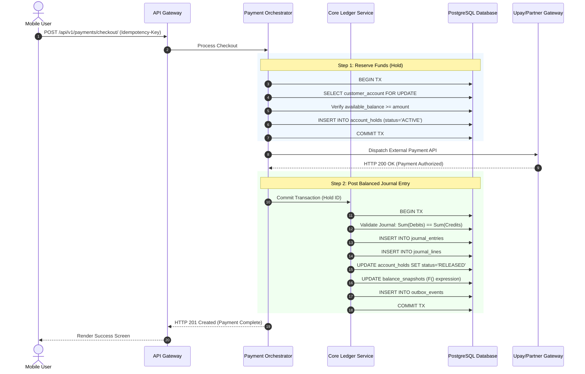
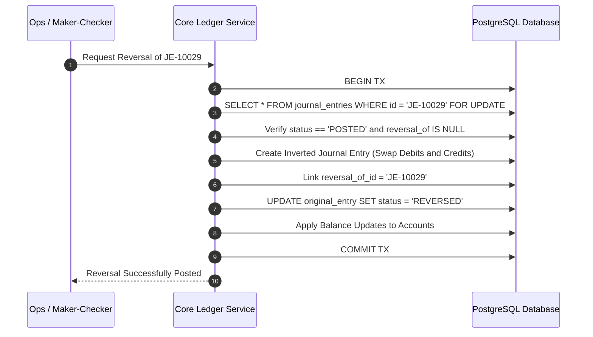

# Double-Entry Bookkeeping, Financial Ledgers, and Ledger Architecture in Fintech Applications
*A Comprehensive Guide for Backend and Fintech Systems Engineers*

---

## Table of Contents
1. [Prerequisites & Learning Objectives](#1-prerequisites--learning-objectives)
2. [Accounting Fundamentals for Software Engineers](#2-accounting-fundamentals-for-software-engineers)
   - 2.1 What is Accounting and Why Do Software Systems Need It?
   - 2.2 Why a Simple `balance` Column Fails in Financial Applications
   - 2.3 The Core Ledger Concept: Append-Only Immutability
3. [The Accounting Equation & Debits vs. Credits](#3-the-accounting-equation--debits-vs-credits)
   - 3.1 Mathematical Formulation of the Accounting Equation
   - 3.2 Expanded Accounting Equation
   - 3.3 Demystifying Debits and Credits (First Principles)
   - 3.4 Normal Balances: The DEALER / DEAD-CLIC Rule
   - 3.5 Debit & Credit Decision Table and Mental Model
4. [Chart of Accounts (CoA) Architecture](#4-chart-of-accounts-coa-architecture)
   - 4.1 Account Hierarchies and Numbering Standards
   - 4.2 Account Classifications & Categories
   - 4.3 General Ledger vs. Subledgers (Wallets, Merchants, Providers)
   - 4.4 Specialized Operational Accounts: Clearing, Settlement, and Suspense
5. [Anatomy of a Journal Entry and Transaction Lifecycle](#5-anatomy-of-a-journal-entry-and-transaction-lifecycle)
   - 5.1 Business Transaction vs. Payment vs. Accounting Event vs. Journal Entry
   - 5.2 Complete Journal Entry Data Structure
   - 5.3 Balances Deconstructed: Available, Reserved, Ledger, and Settled
   - 5.4 The Posting Lifecycle: Authorization, Reservation, Posting, Clearing, Settlement
   - 5.5 Reversals, Corrections, and Compensating Entries (Zero In-Place Edits)
6. [Comprehensive Transaction-by-Transaction Scenarios](#6-comprehensive-transaction-by-transaction-scenarios)
   - 6.1 Cash Deposit (Agent Cash-In)
   - 6.2 Cash Withdrawal (Agent Cash-Out)
   - 6.3 Customer-to-Customer (P2P) Wallet Transfer
   - 6.4 Bank-to-Wallet Top-up (Prefunded / Direct Debit)
   - 6.5 Wallet-to-Bank Transfer (EFT / Real-Time NPSB Transfer)
   - 6.6 Merchant Payment (E-commerce / QR Checkout)
   - 6.7 Merchant Settlement and Fee Deductions
   - 6.8 Multi-Leg Agent Commissions and Revenue Split
   - 6.9 Refunds and Partial Refunds
   - 6.10 Payment Failures, Reversals, and Chargebacks
   - 6.11 Loan Disbursement, Interest Accrual, and Repayment
   - 6.12 Foreign Exchange (FX) Conversion and Cross-Border Remittance
7. [MFS Platform Accounting (Bangladesh Ecosystem Case Study)](#7-mfs-platform-accounting-bangladesh-ecosystem-case-study)
   - 7.1 Regulatory Context: Trust Accounts, Safeguarding, and Bangladesh Bank Directives
   - 7.2 The Role of Settlement Banks, Switches (NPSB, RTGS, BEFTN), and Distributor Float
   - 7.3 Separation of Customer Safeguarded Liabilities vs. Company Operational Funds
   - 7.4 Detailed End-to-End MFS Transaction Accounting Lifecycles
8. [Financial Mathematics and Accounting Controls](#8-financial-mathematics-and-accounting-controls)
   - 8.1 The Double-Entry Invariant: $\sum \text{Debits} - \sum \text{Credits} = 0$
   - 8.2 Trial Balance Calculation and Mathematical Proofs
   - 8.3 Fixed-Point Decimal Arithmetic and Avoiding Floating-Point Hazards
   - 8.4 Rounding Strategies (Banker's Rounding vs. Floor vs. Truncation)
   - 8.5 Multi-Currency Ledgers and Foreign Exchange Gains/Losses
9. [System Architecture for Fintech Ledgers](#9-system-architecture-for-fintech-ledgers)
   - 9.1 High-Level Architecture (Microservices vs. Modular Monolith)
   - 9.2 Provider-Independent Transaction Orchestrator
   - 9.3 Synchronous Processing vs. Asynchronous Posting (Transactional Outbox Pattern)
   - 9.4 Concurrency Control: PostgreSQL Row-Level Locking vs. Optimistic Locking
   - 9.5 Why Redis Is Not Your Financial Source of Truth
   - 9.6 Architectural & Sequence Diagrams (Mermaid)
10. [Production-Ready Django Implementation](#10-production-ready-django-implementation)
    - 10.1 Schema Design: Core Models (`Account`, `JournalEntry`, `JournalLine`, `Hold`, etc.)
    - 10.2 Database-Level Invariants: Constraints, Check Constraints, and Indexes
    - 10.3 Service Layer: Transaction Posting Engine with Strict Concurrency Safety
    - 10.4 Idempotency Engine and API Layer
    - 10.5 Unit and Integration Tests for Invariant Verification
11. [Reconciliation Engine Architecture](#11-reconciliation-engine-architecture)
    - 11.1 Types of Reconciliation: Internal, Bank, Gateway, and Partner
    - 11.2 Matching Algorithms: Exact 1-to-1, 1-to-N, and Many-to-Many Matching
    - 11.3 Handling Exceptions: Unmatched, Missing, Delayed, and Amount Mismatches
    - 11.4 Idempotent Reconciliation Ingestion via Celery
12. [Security, Auditability, Compliance, and Production Operations](#12-security-auditability-compliance-and-production-operations)
    - 12.1 Separation of Duties, Maker-Checker Workflows, and RBAC
    - 12.2 Immutability Guarantees and Tamper-Evident Audit Trails
    - 12.3 Automated Financial Anomaly Detection and Monitoring Alerts
    - 12.4 Disaster Recovery, Cold Balance Snapshots, and Re-playability
13. [Exercises, Mini-Projects, and Interview Questions](#13-exercises-mini-projects-and-interview-questions)
    - 13.1 Practical Coding Exercises
    - 13.2 Real-World Mini-Projects
    - 13.3 Fintech Backend Engineering Interview Q&A
14. [Master Glossary & Learning Roadmap](#14-master-glossary--learning-roadmap)

---

## 1. Prerequisites & Learning Objectives

### 1.1 Prerequisites
- **Python & Django**: Intermediate to advanced familiarity with Django ORM, query optimization, migrations, database transactions, and Django REST Framework (DRF).
- **Relational Databases (PostgreSQL)**: Working knowledge of ACID transactions, isolation levels, row locks (`SELECT FOR UPDATE`), foreign keys, check constraints, and indexing.
- **Distributed Fundamentals**: Basic awareness of message brokers (Redis, RabbitMQ), task workers (Celery), idempotency keys, and asynchronous operations.
- **Accounting Knowledge Required**: **None**. This guide constructs all accounting principles from mathematical first principles.

### 1.2 Learning Objectives
By completing this guide, you will be able to:
1. Construct and execute the double-entry accounting mechanics for any complex fintech product.
2. Translate real-world fintech operations (MFS deposits, P2P, merchant checkouts, interbank transfers) into balanced journal entries.
3. Architect an append-only, tamper-evident ledger system inside PostgreSQL and Django that handles high concurrency without balance drift or race conditions.
4. Implement rigorous financial safety patterns: transactional outbox, reservation holds, row-level locking, and strict database-level invariants.
5. Build an automated multi-way reconciliation pipeline capable of parsing external bank clearing files and isolating discrepancies in suspense accounts.
6. Design systems that comply with global financial standards and regulatory frameworks (such as Central Bank safeguarding and trust regulations).

---

## 2. Accounting Fundamentals for Software Engineers

### 2.1 What is Accounting and Why Do Software Systems Need It?
In software engineering, state management is often approached by tracking the *current value* of an entity (e.g., updating a user's status from `pending` to `active`). 

In financial engineering, tracking only the current state is unacceptable. **Accounting is the science of recording, classifying, summarizing, and verifying financial transactions to provide an indisputable, immutable record of value movement and financial state.**

Financial systems do not merely require accounting for tax purposes or statutory reporting; accounting provides the foundational data integrity model of money:
- **Proof of Origin and Destination**: Every cent in a system must come from somewhere and go somewhere. Money cannot be created or destroyed arbitrarily.
- **Auditability**: When an auditor, regulator, or customer asks, "Why is my balance \$45.00 instead of \$100.00?", the system must produce an unalterable chronological sequence of transactions explaining the difference.
- **System Discrepancy Detection**: Bugs, race conditions, network failures, and hardware bit rot happen. Double-entry accounting creates mathematical symmetries that sound alarms the millisecond a balance calculation fails to balance.

### 2.2 Why a Simple `balance` Column Fails in Financial Applications
A common anti-pattern in amateur web applications is adding a `balance` field to a `User` or `Wallet` table:

```python
# ANTI-PATTERN: DO NOT USE IN PRODUCTION
class Wallet(models.Model):
    user = models.OneToOneField(User, on_delete=models.CASCADE)
    balance = models.DecimalField(max_digits=12, decimal_places=2, default=0.00)
```

Updating this field with a simple assignment or arithmetic expression creates critical vulnerabilities:

```python
# Naive execution susceptible to catastrophic bugs
wallet.balance += deposit_amount
wallet.save()
```

#### Why This Design Fails in Fintech:
1. **Lost Updates and Race Conditions**: If two concurrent requests attempt to deposit \$50 simultaneously, both may read a balance of \$100, calculate \$150, and write back \$150. One \$50 deposit is lost.
2. **Zero Audit Trail**: If the balance changes from \$100 to \$50, there is no record indicating whether this was an authorized withdrawal, a payment, a subscription charge, a platform fee, or an unauthorized database modification.
3. **Impossibility of Mathematical Proof**: There is no mechanism to verify if the sum of all customer balances matches the actual money stored in the bank account.
4. **Disastrous Reversals**: If an external provider times out or fails midway through a multi-step operation, rolling back a single mutable `balance` field without a transaction log frequently results in balance corruption across concurrent operations.

### 2.3 The Core Ledger Concept: Append-Only Immutability
A **financial ledger** is an **append-only, immutable record of financial events**.

```
+---------------------------------------------------------------------------------------+
|                                    FINANCIAL LEDGER                                   |
|                                                                                       |
|  [Entry 1: 2026-01-01]  External Deposit          + $100.00  --> Running Bal: $100.00  |
|  [Entry 2: 2026-01-02]  Merchant Checkout         - $ 30.00  --> Running Bal: $ 70.00  |
|  [Entry 3: 2026-01-03]  P2P Send to Bob           - $ 20.00  --> Running Bal: $ 50.00  |
|  [Entry 4: 2026-01-04]  Refund for Checkout       + $ 30.00  --> Running Bal: $ 80.00  |
|                                                                                       |
|  * ENTRIES ARE NEVER UPDATED.                                                         |
|  * ENTRIES ARE NEVER DELETED.                                                         |
|  * CORRECTIONS ARE NEW ENTRIES WITH COMPENSATING SIGNS.                               |
+---------------------------------------------------------------------------------------+
```

In a proper ledger:
- Records are **never updated** (`UPDATE` operations are forbidden on posting tables).
- Records are **never deleted** (`DELETE` operations are forbidden).
- The state of any account at any point in time can be deterministically calculated by evaluating the sum of its immutable ledger postings up to that specific timestamp:

$$\text{Balance}(A, t) = \sum_{e \in \text{Postings}(A), \text{time}(e) \le t} \text{Amount}(e)$$

---

## 3. The Accounting Equation & Debits vs. Credits

### 3.1 Mathematical Formulation of the Accounting Equation
All modern financial accounting is built upon a fundamental mathematical theorem known as the **Accounting Equation**:

$$\text{Assets} = \text{Liabilities} + \text{Equity}$$

To a backend engineer, think of this as an **invariant condition** that must evaluate to `True` at all times across your entire platform.

```
+--------------------------------------------------------------------+
|                               ASSETS                               |
|                     (Things the entity OWNS)                       |
|                                                                    |
|    Examples: Cash in Bank Vaults, Central Bank Reserves,           |
|              Receivables due from Card Networks, Loans Issued      |
+---------------------------------+----------------------------------+
                                  =
+---------------------------------+----------------------------------+
|                           LIABILITIES                              |
|                     (Things the entity OWES)                       |
|                                                                    |
|    Examples: Customer Wallet Balances, Merchant Balances Due,      |
|              Payables to Settlement Banks, Unearned Fees           |
+--------------------------------------------------------------------+
                                  +
+--------------------------------------------------------------------+
|                             EQUITY                                 |
|              (Net worth / Residual value of owners)                |
|                                                                    |
|    Examples: Shareholder Capital, Retained Earnings,               |
|              Current Period Net Income (Profit/Loss)               |
+--------------------------------------------------------------------+
```

#### Meaning in a Fintech / Payment Service Provider (PSP) Context
Consider a digital wallet application (e.g., Upay, bKash, Revolut). When a customer registers and deposits \$1,000 into their wallet:
- Does the fintech company own that \$1,000 as corporate revenue? **No.**
- The fintech holds \$1,000 in a real physical bank account (an **Asset** of the fintech).
- The fintech owes that \$1,000 to the customer on demand (a **Liability** of the fintech).

$$\begin{aligned}
\text{Assets} &= \text{Liabilities} + \text{Equity} \\
+\$1,000 \text{ (Cash in Trust Bank)} &= +\$1,000 \text{ (Customer Wallet Obligation)} + \$0 \text{ (Equity)}
\end{aligned}$$

The equation remains balanced. If the fintech platform were to shut down tomorrow, it would liquidate its assets (\$1,000 in bank) to pay off its liabilities (\$1,000 to user), leaving zero net equity.

### 3.2 Expanded Accounting Equation
As a business operates, it earns revenue and incurs expenses. Revenue increases Equity, while Expenses decrease Equity:

$$\text{Equity} = \text{Contributed Capital} + \text{Retained Earnings} + (\text{Revenue} - \text{Expenses})$$

Substituting this into the core equation yields the **Expanded Accounting Equation**:

$$\text{Assets} = \text{Liabilities} + \text{Contributed Capital} + \text{Retained Earnings} + \text{Revenue} - \text{Expenses}$$

To eliminate negative terms, algebraically add $\text{Expenses}$ to both sides:

$$\mathbf{\text{Assets} + \text{Expenses} = \text{Liabilities} + \text{Equity} + \text{Revenue}}$$

This algebraic symmetry is the mathematical foundation of **Debits** and **Credits**.

### 3.3 Demystifying Debits and Credits (First Principles)
Software engineers often struggle with debits and credits because of how consumer banks use the words:
- When your bank sends an SMS: *"Your account has been credited with \$500"*, your money went **up**.
- When your bank sends an SMS: *"Your account has been debited with \$50"*, your money went **down**.

**This consumer framing is from the perspective of the bank's general ledger, not yours.** 
To the bank, your account is a **Liability** (money they owe you). When you deposit money, their liability to you *increases*, and in accounting, an increase in a liability is recorded as a **Credit**.

#### The Pure Mathematical Definition
Strip away all English connotations of "good", "bad", "plus", or "minus".
- **Debit (Dr)** comes from the Latin *debere* ("to owe") and simply means the **Left Side** of the ledger.
- **Credit (Cr)** comes from the Latin *credere* ("to entrust") and simply means the **Right Side** of the ledger.

$$\begin{array}{r|l}
\multicolumn{2}{c}{\textbf{T-Account}} \\
\hline
\textbf{Debit (Dr)} & \textbf{Credit (Cr)} \\
\text{(Left Column)} & \text{(Right Column)}
\end{array}$$

### 3.4 Normal Balances: The DEALER / DEAD-CLIC Rule
Every account belongs to one of five major account types. Based on our expanded equation:

$$\underbrace{\text{Dividends} + \text{Expenses} + \text{Assets}}_{\textbf{Left Side (DEAD)}} = \underbrace{\text{Liabilities} + \text{Equity} + \text{Revenue}}_{\textbf{Right Side (CLIC)}}$$

This relationship can be remembered using the **DEAD-CLIC** or **DEALER** mnemonics:

- **D-E-A-D**: **D**ebit increases **E**xpenses, **A**ssets, and **D**ividends.
- **C-L-I-C**: **C**redit increases **L**iabilities, **I**ncome (Revenue), and **C**apital (Equity).

```
+----------------------------------------------------------------------------------+
| ACCOUNT TYPE   | NORMAL BALANCE | DEBIT (Dr) IMPACT     | CREDIT (Cr) IMPACT     |
+----------------+----------------+-----------------------+------------------------+
| Asset          | Debit          | INCREASES (+)         | DECREASES (-)          |
| Expense        | Debit          | INCREASES (+)         | DECREASES (-)          |
| Liability      | Credit         | DECREASES (-)         | INCREASES (+)          |
| Equity         | Credit         | DECREASES (-)         | INCREASES (+)          |
| Revenue/Income | Credit         | DECREASES (-)         | INCREASES (+)          |
+----------------------------------------------------------------------------------+
```

The **Normal Balance** of an account is the side (Debit or Credit) where increases are recorded. It is also the expected positive sign of the account's terminal balance.

### 3.5 Debit & Credit Decision Table and Mental Model
When designing an automated accounting flow for an engineering feature, follow this deterministic decision algorithm:

```
Step 1: Identify the two or more accounts involved in the transaction.
Step 2: For each account, determine its category (Asset, Liability, Equity, Revenue, Expense).
Step 3: Determine whether the account balance must INCREASE or DECREASE.
Step 4: Look up the required entry type (Debit or Credit) using the matrix below.
Step 5: Verify that the sum of Debits strictly equals the sum of Credits.
```

| Account Classification | Intended Direction | Required Action |
| :--- | :--- | :--- |
| **Asset** | Increase | **Debit** |
| **Asset** | Decrease | **Credit** |
| **Liability** | Increase | **Credit** |
| **Liability** | Decrease | **Debit** |
| **Equity** | Increase | **Credit** |
| **Equity** | Decrease | **Debit** |
| **Revenue** | Increase | **Credit** |
| **Revenue** | Decrease | **Debit** |
| **Expense** | Increase | **Debit** |
| **Expense** | Decrease | **Credit** |

---

## 4. Chart of Accounts (CoA) Architecture

### 4.1 Account Hierarchies and Numbering Standards
A **Chart of Accounts (CoA)** is a structured, categorical directory of all financial accounts in an organization's ledger.

In production systems, accounts are assigned a standardized numerical code where the leading digit denotes the primary balance-sheet or income-statement classification.

```
Standard 5-Digit / 6-Digit Coding Framework:
  100,000 - 199,999: ASSETS
  200,000 - 299,999: LIABILITIES
  300,000 - 399,999: EQUITY
  400,000 - 499,999: REVENUE / OPERATING INCOME
  500,000 - 599,999: EXPENSES / COST OF SALES
```

Accounts are structured hierarchically as a tree:

```
100000 ASSETS (Root/Category)
  └── 110000 Cash and Cash Equivalents (Parent)
        ├── 111000 Settlement Trust Bank Account - Bank Asia (GL Account)
        ├── 112000 Settlement Trust Bank Account - City Bank (GL Account)
        └── 113000 Operational Operating Account - Brac Bank (GL Account)
  └── 120000 Clearing & Settlement Receivables (Parent)
        ├── 121000 NPSB Switch Clearing Receivable (GL Account)
        └── 122000 Visa/Mastercard Acquirer In-Flight Clearing (GL Account)

200000 LIABILITIES (Root/Category)
  └── 210000 Customer Wallet Obligations (Parent / Control Account)
        ├── 211000 Consumer Standard Wallets (Subledger Control)
        └── 212000 Agent Float Wallets (Subledger Control)
  └── 220000 Merchant Settlement Obligations (Parent)
        └── 221000 Merchant Payables Due (Subledger Control)
  └── 230000 Clearing Suspense Accounts (Parent)
        └── 231000 Unmatched Settlement Suspense Account

400000 REVENUE (Root/Category)
  └── 410000 Platform Transaction Fee Revenue (Parent)
        ├── 411000 P2P Transfer Fee Income
        ├── 412000 Cash-Out Fee Revenue
        └── 413000 Merchant MDR (Merchant Discount Rate) Income

500000 EXPENSES (Root/Category)
  └── 510000 Direct Transaction Expenses (Parent)
        ├── 511000 Agent Cash-Out Commission Expense
        ├── 512000 Payment Gateway Interchange Cost
        └── 513000 SMS / USSD Aggregator Cost
```

### 4.2 Account Classifications & Categories
Accounts fall into two fundamental accounting scopes:

1. **Balance Sheet Accounts (Permanent Accounts)**:
   - **Assets, Liabilities, and Equity**.
   - These accounts never close at the end of a fiscal year. Their balances roll over continuously into perpetuity.
2. **Income Statement Accounts (Temporary Accounts)**:
   - **Revenue and Expenses**.
   - These accounts track financial performance over a discrete period (month, quarter, year). At the close of the period, their net total ($\text{Revenue} - \text{Expenses} = \text{Net Income}$) is closed out into Retained Earnings (Equity), resetting the revenue and expense account balances to zero for the next period.

### 4.3 General Ledger vs. Subledgers (Wallets, Merchants, Providers)
A major architectural mistake in fintech backend design is putting millions of individual customer wallets directly into the General Ledger (GL).

```
+-----------------------------------------------------------------------------------+
|                              GENERAL LEDGER (GL)                                  |
|                                                                                   |
|  Account 211000: Total Customer Wallets Liability Control  =  $50,000,000.00      |
+-----------------------------------------------------------------------------------+
                                          |
                        RECONCILIATION & ROLL-UP INVARIANT
                                          |
                                          v
+-----------------------------------------------------------------------------------+
|                        CUSTOMER WALLET SUBLEDGER                                  |
|                                                                                   |
|  Wallet #USR-001 (Customer A) :  $     120.00                                     |
|  Wallet #USR-002 (Customer B) :  $   4,880.00                                     |
|  Wallet #USR-003 (Customer C) :  $      50.00                                     |
|  ... [1,000,000+ Individual Customer Wallet Sub-Accounts]                         |
|                                                                                   |
|  Sum of all subledger balances MUST strictly equal Account 211000                  |
+-----------------------------------------------------------------------------------+
```

- **General Ledger (GL)**: The primary set of summary-level accounts containing the holistic financial state of the firm. High-level balance sheet and profit/loss reports are generated exclusively from the GL.
- **Subledger (Subsidiary Ledger)**: A specialized secondary ledger containing high-volume, granular transaction details for specific entities (e.g., individual customer wallets, individual merchant balances, individual supplier payables).
- **Control Account**: An account in the General Ledger that maintains the aggregated balance of an entire subledger. At all times:

$$\text{Balance}(\text{GL Control Account}) = \sum_{w \in \text{Subledger}} \text{Balance}(w)$$

### 4.4 Specialized Operational Accounts: Clearing, Settlement, and Suspense

| Account Category | Purpose in Fintech Architecture | Example Lifecycle State |
| :--- | :--- | :--- |
| **Clearing Account** | Temporary staging account used to isolate funds while a multi-party or multi-step transaction is in-flight. Must zero out when all legs execute. | Set to Debit when a user initiates an external bank transfer; cleared to zero when the clearing switch ACKs the batch. |
| **Settlement Account** | An Asset or Liability tracking money legally receivable from, or payable to, an external counterparty (e.g., Visa, Mastercard, NPSB, Partner Bank) prior to the physical movement of funds. | Represents funds settled by customers at POS terminals, owed to your platform by an acquiring bank before morning cutoff. |
| **Suspense Account** | A temporary holding account for transactions that could not be automatically reconciled or posted due to missing data, ambiguous state, or system anomalies. | Holds an incoming \$5,000 bank wire notification with a malformed customer account reference until manually reviewed. |

---

## 5. Anatomy of a Journal Entry and Transaction Lifecycle

### 5.1 Business Transaction vs. Payment vs. Accounting Event vs. Journal Entry
To build an enterprise ledger, distinguish these five distinct concepts:

```
[Real World Action]      1. BUSINESS TRANSACTION
                               |  (Customer purchases $100 shoes at Merchant)
                               v
[Network Orchestration]  2. PAYMENT TRANSACTION
                               |  (API call to Payment Gateway, USSD prompt, 2FA)
                               v
[State Machine Change]   3. ACCOUNTING EVENT
                               |  (Trigger: "PaymentAuthorized", "FundsCaptured")
                               v
[Double-Entry Construct] 4. JOURNAL ENTRY
                               |  (Set of balanced debits and credits created)
                               v
[Materialized Ledger]    5. LEDGER POSTING
                                  (Lines written to DB, snapshot balances updated)
```

1. **Business Transaction**: The high-level intent between economic actors (e.g., Alice agrees to pay Merchant Bob \$100).
2. **Payment Transaction**: The operational orchestration of network requests, token validations, card authorisations, or mobile PIN inputs needed to facilitate payment.
3. **Accounting Event**: The point-in-time notification emitted by the payment orchestration system indicating that a legally binding financial state transition has occurred.
4. **Journal Entry**: The atomic, double-entry financial record containing balanced debits and credits that records the accounting event.
5. **Ledger Posting**: The permanent, immutable commit of the journal entry lines into database storage, recalculating account ledger balances.

### 5.2 Complete Journal Entry Data Structure
Every production journal entry consists of a **Journal Entry Header** and two or more **Journal Entry Lines**:

```
+----------------------------------------------------------------------------------------+
|                               JOURNAL ENTRY (HEADER)                                   |
+----------------------------------------------------------------------------------------+
| Field Name               | Type      | Description                                     |
+--------------------------+-----------+-------------------------------------------------+
| id                       | UUID      | Globally unique primary identifier              |
| transaction_id           | String    | External business transaction reference         |
| idempotency_key          | String    | Client-provided key preventing duplicate post   |
| posting_date             | Date      | Fiscal date on which entry affects the GL       |
| value_date               | Date      | Legal date from which interest/funds are valid  |
| created_at               | Timestamp | Exact microsecond timestamp of DB insertion     |
| description              | String    | Human-readable narrative of transaction         |
| status                   | Enum      | DRAFT, POSTED, REVERSED                         |
| reversal_of_id           | UUID      | Self-referencing FK to reversed journal (if any)|
| source_system            | String    | Originating microservice (e.g., "checkout-svc") |
+--------------------------+-----------+-------------------------------------------------+
                                           |
                                           | Has 2 or More Lines
                                           v
+----------------------------------------------------------------------------------------+
|                                JOURNAL LINE (ENTRY ITEM)                               |
+----------------------------------------------------------------------------------------+
| Field Name               | Type      | Description                                     |
+--------------------------+-----------+-------------------------------------------------+
| id                       | UUID      | Globally unique line identifier                 |
| journal_entry_id         | UUID      | Foreign Key to Journal Entry Header             |
| account_id               | UUID      | Account being debited or credited               |
| entry_type               | Enum      | DEBIT, CREDIT                                   |
| amount                   | Decimal   | Positive fixed-point monetary quantity          |
| currency                 | String    | ISO 4217 Currency Code (e.g., "BDT", "USD")     |
| subledger_reference_id   | String    | Identifier of specific entity (e.g., Wallet ID) |
+----------------------------------------------------------------------------------------+
```

### 5.3 Balances Deconstructed: Available, Reserved, Ledger, and Settled
In fintech applications, the concept of a single "balance" is a dangerous oversimplification. Systems require distinct, rigorously calculated balance views:

```
+---------------------------------------------------------------------------------+
|                            ACCOUNT BALANCE DEFINITIONS                          |
+---------------------------------------------------------------------------------+

1. LEDGER (POSTED) BALANCE:
   The strict sum of all immutable, permanently posted journal lines to date.
   Formula: Ledger Balance = Sum(Debits) - Sum(Credits) [Adjusted for Normal Sign]

2. RESERVED (HELD) BALANCE:
   Funds temporarily ring-fenced for authorized in-flight transactions that have
   not yet settled or posted.
   Formula: Reserved Balance = Sum(Active Pending Holds)

3. AVAILABLE BALANCE:
   The actual purchasing power the account owner can spend or withdraw right now.
   Formula: Available Balance = Ledger Balance - Reserved Balance

4. SETTLED (CLEARED) BALANCE:
   Funds that have physically cleared the interbank or card network cutoff window
   and have arrived in physical fiat custody.
+---------------------------------------------------------------------------------+
```

### 5.4 The Posting Lifecycle: Authorization, Reservation, Posting, Clearing, Settlement
Consider a customer using a virtual card or e-wallet to buy a \$50 item at an online merchant:

```
[Stage 1: Authorization & Reservation (T = 0s)]
  Customer initiates checkout. Merchant requests authorization.
  Fintech creates a HOLD (Reservation) for $50.00.
  - Customer Ledger Balance:    $100.00
  - Customer Reserved Balance:  $ 50.00
  - Customer Available Balance: $ 50.00
  * No permanent General Ledger posting occurs yet.

[Stage 2: Capture & Ledger Posting (T = 12 Hours)]
  Merchant settles the batch. A Journal Entry is permanently posted:
  - Debit:  Customer Wallet Liability Account      $50.00 (Customer balance drops)
  - Credit: Merchant Clearing Settlement Payable   $50.00 (We owe the merchant network)
  The HOLD is released.
  - Customer Ledger Balance:    $ 50.00
  - Customer Reserved Balance:  $  0.00
  - Customer Available Balance: $ 50.00

[Stage 3: Interbank Settlement (T = 24-48 Hours)]
  Actual fiat money leaves our Central Bank / Settlement Account via wire to Merchant Bank:
  - Debit:  Merchant Clearing Settlement Payable   $50.00 (Obligation discharged)
  - Credit: Commercial Bank Operational Asset     $50.00 (Real money leaves our vault)
```

### 5.5 Reversals, Corrections, and Compensating Entries (Zero In-Place Edits)
**Rule**: Under no circumstances does a fintech engineer ever execute an SQL `UPDATE` statement on the amounts or accounts of an existing posted journal line.

If an entry was posted in error (e.g., debited \$500 instead of \$50), the system must post a **Reversing Entry** or a **Compensating Journal Entry**:

```
ORIGINAL INCORRECT ENTRY (Posted 10:00 AM):
  Debit:  Customer Wallet Liability (Account 211000)      $500.00
  Credit: Settlement Bank Asset (Account 111000)                  $500.00

CORRECTION: FULL REVERSING ENTRY (Posted 10:15 AM):
  Debit:  Settlement Bank Asset (Account 111000)          $500.00
  Credit: Customer Wallet Liability (Account 211000)              $500.00
  (Reference: Reversal of Journal Entry #UUID-1234)

NEW CORRECT ENTRY (Posted 10:16 AM):
  Debit:  Customer Wallet Liability (Account 211000)      $ 50.00
  Credit: Settlement Bank Asset (Account 111000)                  $ 50.00
```
This guarantees that an auditor can inspect the complete timeline of errors and corrections.

---

## 6. Comprehensive Transaction-by-Transaction Scenarios

The following scenarios utilize realistic examples from the Bangladesh mobile financial services (MFS) and banking ecosystem (Upay, bKash, Nagad, Rocket, commercial banks).

> **Important Architectural Note**: The accounting principles demonstrated below are universal double-entry rules. The account names, fee splits, and settlement schedules represent realistic production structures and must be aligned with your specific organization's contractual models and Central Bank regulatory filings.

---

### 6.1 Cash Deposit (Agent Cash-In)
- **Business Context**: Customer visits a physical retail agent and hands over 500 BDT cash. The agent uses their retail MFS app to deposit 500 BDT into the customer's wallet.
- **Participating Parties**: Customer, Agent, MFS Provider.
- **Economic Reality**: The agent hands over physical cash outside the ledger system. Within the MFS ledger, value moves from the Agent's Float Wallet to the Customer's Personal Wallet. (No immediate external bank movement happens in this specific step because cash and float were pre-funded).
- **Accounts**:
  - `212100` Agent Float Wallet Liability (Liability)
  - `211100` Customer Personal Wallet Liability (Liability)

#### Journal Entries:
| Entry ID | Account Code | Account Name | Account Type | Debit (BDT) | Credit (BDT) |
| :--- | :--- | :--- | :--- | :--- | :--- |
| `JE-001` | `212100` | Agent Float Wallet Liability | Liability | 500.00 | — |
| `JE-001` | `211100` | Customer Personal Wallet Liability | Liability | — | 500.00 |

#### Ledger Balance Impact:
- **Agent Float Liability**: Decreases by 500 BDT (Debit to Liability).
- **Customer Wallet Liability**: Increases by 500 BDT (Credit to Liability).
- **Accounting Equation**: $\Delta \text{Assets} (\$0) = \Delta \text{Liabilities} (-500 + 500 = 0) + \Delta \text{Equity} (\$0)$.

---

### 6.2 Cash Withdrawal (Agent Cash-Out)
- **Business Context**: Customer withdraws 1,000.00 BDT cash from an Agent.
- **Fee Structure**: Total customer fee = 1.4% (14.00 BDT). Total deducted from customer wallet = 1,014.00 BDT.
  - Agent earns commission: 0.8% (8.00 BDT).
  - MFS Platform retains net revenue: 0.6% (6.00 BDT).
- **Accounts**:
  - `211100` Customer Personal Wallet Liability (Liability)
  - `212100` Agent Float Wallet Liability (Liability)
  - `412000` Cash-Out Fee Revenue (Revenue)
  - `511000` Agent Commission Expense (Expense)

#### Journal Entry:
| Entry ID | Account Code | Account Name | Account Type | Debit (BDT) | Credit (BDT) |
| :--- | :--- | :--- | :--- | :--- | :--- |
| `JE-002` | `211100` | Customer Personal Wallet Liability | Liability | 1,014.00 | — |
| `JE-002` | `511000` | Agent Commission Expense | Expense | 8.00 | — |
| `JE-002` | `212100` | Agent Float Wallet Liability | Liability | — | 1,008.00 |
| `JE-002` | `412000` | Cash-Out Fee Revenue | Revenue | — | 14.00 |

*Verification*:
$$\sum \text{Debits} = 1,014.00 + 8.00 = 1,022.00 \quad|\quad \sum \text{Credits} = 1,008.00 + 14.00 = 1,022.00$$
The entry balances.

---

### 6.3 Customer-to-Customer (P2P) Wallet Transfer
- **Business Context**: User Alice sends 250.00 BDT to User Bob. Platform charges a flat fee of 5.00 BDT to Alice.
- **Total Deducted from Alice**: 255.00 BDT.
- **Total Credited to Bob**: 250.00 BDT.
- **Platform Fee Revenue**: 5.00 BDT.

#### Journal Entry:
| Entry ID | Account Code | Account Name | Account Type | Debit (BDT) | Credit (BDT) |
| :--- | :--- | :--- | :--- | :--- | :--- |
| `JE-003` | `211100` | Alice Wallet Liability | Liability | 255.00 | — |
| `JE-003` | `211100` | Bob Wallet Liability | Liability | — | 250.00 |
| `JE-003` | `411000` | P2P Platform Fee Revenue | Revenue | — | 5.00 |

*Equation Check*:
$$\Delta \text{Assets} (0) = \Delta \text{Liabilities} (-255.00 + 250.00 = -5.00) + \Delta \text{Equity} (\text{Revenue } +5.00)$$
$0 = -5.00 + 5.00 = 0$.

---

### 6.4 Bank-to-Wallet Top-up (Add Money)
- **Business Context**: Customer adds 2,000.00 BDT to their MFS wallet via internet banking / debit card integration through an acquiring partner bank.
- **Settlement Dynamics**: The customer's wallet balance is credited instantly. However, physical cash will not arrive from the commercial bank into the MFS Trust Settlement Account until the interbank clearing window closes tomorrow morning ($T+1$).
- **Accounts**:
  - `121100` In-Flight Bank Clearing Receivable (Asset)
  - `211100` Customer Personal Wallet Liability (Liability)
  - `111100` Trust Settlement Bank Account (Asset)

#### Leg 1: Instant Wallet Posting (Real-time at $T=0$)
| Entry ID | Account Code | Account Name | Account Type | Debit (BDT) | Credit (BDT) |
| :--- | :--- | :--- | :--- | :--- | :--- |
| `JE-004A`| `121100` | In-Flight Bank Clearing Receivable | Asset | 2,000.00 | — |
| `JE-004A`| `211100` | Customer Personal Wallet Liability | Liability | — | 2,000.00 |

#### Leg 2: Interbank Settlement Window Closes ($T+1$ Morning)
The acquiring partner bank transfers the lump-sum settlement batch via Central Bank RTGS/NPSB into the MFS Trust Account:

| Entry ID | Account Code | Account Name | Account Type | Debit (BDT) | Credit (BDT) |
| :--- | :--- | :--- | :--- | :--- | :--- |
| `JE-004B`| `111100` | Trust Settlement Bank Account | Asset | 2,000.00 | — |
| `JE-004B`| `121100` | In-Flight Bank Clearing Receivable | Asset | — | 2,000.00 |

*Net Result across both legs*: The temporary asset `Receivable` zeroes out. The platform's real bank cash increases by 2,000 BDT, matched by a 2,000 BDT increase in liabilities owed to the customer.

---

### 6.5 Wallet-to-Bank Transfer (Fund Transfer / Outward Remittance)
- **Business Context**: Customer transfers 5,000.00 BDT from their MFS wallet to their commercial savings account via NPSB (National Payment Switch Bangladesh).
- **Network Fee**: Platform charges 10.00 BDT fee. NPSB switch levy cost is 2.50 BDT.
- **Accounts**:
  - `211100` Customer Personal Wallet Liability (Liability)
  - `222100` Interbank Clearing Settlement Payable (Liability)
  - `413000` Transfer Fee Revenue (Revenue)
  - `512000` Interbank Network Interchange Expense (Expense)
  - `111100` Trust Settlement Bank Account (Asset)

#### Leg 1: Immediate Debit and Clearing Staging ($T=0$)
| Entry ID | Account Code | Account Name | Account Type | Debit (BDT) | Credit (BDT) |
| :--- | :--- | :--- | :--- | :--- | :--- |
| `JE-005A`| `211100` | Customer Personal Wallet Liability | Liability | 5,010.00 | — |
| `JE-005A`| `512000` | Interbank Network Interchange Expense | Expense | 2.50 | — |
| `JE-005A`| `222100` | Interbank Settlement Payable | Liability | — | 5,002.50 |
| `JE-005A`| `413000` | Transfer Fee Revenue | Revenue | — | 10.00 |

#### Leg 2: Batch Bank Settlement Discharged ($T+1$)
| Entry ID | Account Code | Account Name | Account Type | Debit (BDT) | Credit (BDT) |
| :--- | :--- | :--- | :--- | :--- | :--- |
| `JE-005B`| `222100` | Interbank Settlement Payable | Liability | 5,002.50 | — |
| `JE-005B`| `111100` | Trust Settlement Bank Account | Asset | — | 5,002.50 |

---

### 6.6 Merchant Payment (QR / Online Checkout)
- **Business Context**: Customer purchases goods worth 1,500.00 BDT at a retail merchant.
- **Merchant Discount Rate (MDR)**: 1.5% deducted from merchant disbursement.
  - Customer is deducted: 1,500.00 BDT.
  - Platform retains MDR Revenue: 22.50 BDT (1.5%).
  - Merchant Payable Balance credited: 1,477.50 BDT.

#### Journal Entry:
| Entry ID | Account Code | Account Name | Account Type | Debit (BDT) | Credit (BDT) |
| :--- | :--- | :--- | :--- | :--- | :--- |
| `JE-006` | `211100` | Customer Personal Wallet Liability | Liability | 1,500.00 | — |
| `JE-006` | `221100` | Merchant Settlement Payable | Liability | — | 1,477.50 |
| `JE-006` | `414000` | Merchant MDR Fee Revenue | Revenue | — | 22.50 |

---

### 6.7 Merchant Settlement Payout
- **Business Context**: At the end of the business day, the platform disburses accumulated funds to Merchant Bob's actual corporate bank account. Merchant Bob has an accumulated balance of 50,000.00 BDT in `Merchant Settlement Payable`.

#### Journal Entry:
| Entry ID | Account Code | Account Name | Account Type | Debit (BDT) | Credit (BDT) |
| :--- | :--- | :--- | :--- | :--- | :--- |
| `JE-007` | `221100` | Merchant Settlement Payable | Liability | 50,000.00 | — |
| `JE-007` | `111100` | Trust Settlement Bank Account | Asset | — | 50,000.00 |

*Impact*: The platform's liability to the merchant drops to 0, and the actual bank balance drops by 50,000 BDT.

---

### 6.8 Multi-Leg Agent Commissions and Revenue Split
- **Business Context**: Utility bill payment of 1,200.00 BDT processed by an agent for a customer.
  - Customer pays: 1,200.00 BDT (no consumer fee).
  - Utility company pays the MFS platform a 1.0% collection commission: 12.00 BDT.
  - MFS splits this commission:
    - 6.00 BDT to Agent Float.
    - 2.00 BDT to Regional Distributor Float.
    - 4.00 BDT retained as Net MFS Platform Revenue.

#### Journal Entry:
| Entry ID | Account Code | Account Name | Account Type | Debit (BDT) | Credit (BDT) |
| :--- | :--- | :--- | :--- | :--- | :--- |
| `JE-008` | `212100` | Agent Float Wallet (Deduction of Bill) | Liability | 1,200.00 | — |
| `JE-008` | `123000` | Utility Company Clearing Receivable | Asset | 12.00 | — |
| `JE-008` | `223000` | Utility Company Disbursable Payable | Liability | — | 1,200.00 |
| `JE-008` | `212100` | Agent Float Wallet (Commission Credit)| Liability | — | 6.00 |
| `JE-008` | `212200` | Distributor Float Wallet (Commission) | Liability | — | 2.00 |
| `JE-008` | `415000` | Bill Pay Platform Fee Revenue | Revenue | — | 4.00 |

*Debits*: $1,200.00 + 12.00 = 1,212.00$.  
*Credits*: $1,200.00 + 6.00 + 2.00 + 4.00 = 1,212.00$. Balanced.

---

### 6.9 Refunds and Partial Refunds
- **Business Context**: From transaction 6.6 (1,500.00 BDT purchase), the merchant agrees to a partial refund of 500.00 BDT back to the customer.
- **MDR Fee Recovery**: The platform proportionally reverses 1.5% MDR on the 500.00 BDT = 7.50 BDT.
- **Merchant Payable is debited**: 492.50 BDT.
- **Platform Fee Revenue is debited (reversed)**: 7.50 BDT.
- **Customer Wallet is credited**: 500.00 BDT.

#### Journal Entry:
| Entry ID | Account Code | Account Name | Account Type | Debit (BDT) | Credit (BDT) |
| :--- | :--- | :--- | :--- | :--- | :--- |
| `JE-009` | `221100` | Merchant Settlement Payable | Liability | 492.50 | — |
| `JE-009` | `414000` | Merchant MDR Fee Revenue (Contra) | Revenue | 7.50 | — |
| `JE-009` | `211100` | Customer Personal Wallet Liability | Liability | — | 500.00 |

---

### 6.10 Payment Failures, Reversals, and Chargebacks
- **Business Context**: A card network chargeback is received. Customer claims fraud for an earlier 3,000.00 BDT e-commerce purchase. The card scheme forcibly debits our settlement bank account. The merchant dispute is pending.
- **Accounts**:
  - `124000` Disputed Chargebacks In-Investigation (Asset / Suspense)
  - `111100` Trust Settlement Bank Account (Asset)

#### Step 1: Immediate Bank Clawback Notification
| Entry ID | Account Code | Account Name | Account Type | Debit (BDT) | Credit (BDT) |
| :--- | :--- | :--- | :--- | :--- | :--- |
| `JE-010A`| `124000` | Disputed Chargebacks In-Investigation | Asset | 3,000.00 | — |
| `JE-010A`| `111100` | Trust Settlement Bank Account | Asset | — | 3,000.00 |

#### Step 2: Merchant Loses Dispute (Funds deducted from Merchant Settlement Payable)
| Entry ID | Account Code | Account Name | Account Type | Debit (BDT) | Credit (BDT) |
| :--- | :--- | :--- | :--- | :--- | :--- |
| `JE-010B`| `221100` | Merchant Settlement Payable | Liability | 3,000.00 | — |
| `JE-010B`| `124000` | Disputed Chargebacks In-Investigation | Asset | — | 3,000.00 |

---

### 6.11 Loan Disbursement, Interest Accrual, and Repayment
- **Business Context**: Digital nano-lending product.
  1. Platform disburses a 10,000.00 BDT loan into the customer's wallet.
  2. Over the month, 150.00 BDT interest accrues.
  3. Customer repays 10,150.00 BDT from their wallet.

#### Stage 1: Disbursement
| Entry ID | Account Code | Account Name | Account Type | Debit (BDT) | Credit (BDT) |
| :--- | :--- | :--- | :--- | :--- | :--- |
| `JE-011A`| `131000` | Customer Nano-Loans Receivable | Asset | 10,000.00 | — |
| `JE-011A`| `211100` | Customer Personal Wallet Liability | Liability | — | 10,000.00 |

#### Stage 2: Interest Accrual (End of Month)
| Entry ID | Account Code | Account Name | Account Type | Debit (BDT) | Credit (BDT) |
| :--- | :--- | :--- | :--- | :--- | :--- |
| `JE-011B`| `131100` | Accrued Interest Receivable | Asset | 150.00 | — |
| `JE-011B`| `421000` | Loan Interest Income | Revenue | — | 150.00 |

#### Stage 3: Full Repayment by Customer
| Entry ID | Account Code | Account Name | Account Type | Debit (BDT) | Credit (BDT) |
| :--- | :--- | :--- | :--- | :--- | :--- |
| `JE-011C`| `211100` | Customer Personal Wallet Liability | Liability | 10,150.00 | — |
| `JE-011C`| `131000` | Customer Nano-Loans Receivable | Asset | — | 10,000.00 |
| `JE-011C`| `131100` | Accrued Interest Receivable | Asset | — | 150.00 |

---

### 6.12 Foreign Exchange (FX) Conversion and Cross-Border Remittance
- **Business Context**: A worker in the UAE sends an inward remittance of 100.00 USD. The platform receives USD into its foreign correspondent account, converts it at an agreed interbank FX rate of $1\text{ USD} = 110.00\text{ BDT}$, and credits the recipient's BDT wallet at a retail rate of $1\text{ USD} = 108.50\text{ BDT}$.
  - Inbound Real Value: $\$100 \times 110.00 = 11,000.00\text{ BDT}$.
  - Credited to Customer: $\$100 \times 108.50 = 10,850.00\text{ BDT}$.
  - Realized FX Spread Margin (Revenue): $150.00\text{ BDT}$.

#### Journal Entry (Recorded in Ledger Base Currency: BDT):
| Entry ID | Account Code | Account Name | Account Type | Debit (BDT) | Credit (BDT) |
| :--- | :--- | :--- | :--- | :--- | :--- |
| `JE-012` | `112100` | Nostro Foreign Currency Bank Asset (USD Account)| Asset | 11,000.00 | — |
| `JE-012` | `211100` | Customer Personal Wallet Liability | Liability | — | 10,850.00 |
| `JE-012` | `431000` | Realized FX Spread Revenue | Revenue | — | 150.00 |

---

## 7. MFS Platform Accounting (Bangladesh Ecosystem Case Study)

### 7.1 Regulatory Context: Trust Accounts, Safeguarding, and Bangladesh Bank Directives
Under the Bangladesh Mobile Financial Services (MFS) Regulations issued by Bangladesh Bank (the central bank), MFS providers operate under strict custodial fund rules:
- **Trust Cum Settlement Account (TCSA)**: All customer e-money balances must be 100% backed by physical cash held in a designated Trust Cum Settlement Account at approved scheduled commercial banks.
- **Zero Fractional Reserve for MFS**: An MFS provider cannot lend customer deposits out of the TCSA on its own balance sheet. The aggregate e-money issued to all customers and agents must strictly equal the physical fiat balance in the TCSA at the close of every business day:

$$\sum \text{Customer Wallet Balances} + \sum \text{Agent Float Balances} + \sum \text{Merchant Payables} \le \text{Cash in TCSA Accounts}$$

### 7.2 The Role of Settlement Banks, Switches (NPSB, RTGS, BEFTN), and Distributor Float
```
+----------------------------------------------------------------------------------------------------+
|                                    BANGLADESH PAYMENT INFRASTRUCTURE                               |
+----------------------------------------------------------------------------------------------------+
                                                  |
                  +-------------------------------+-------------------------------+
                  |                               |                               |
                  v                               v                               v
             [ NPSB Switch ]               [ BEFTN Switch ]                [ RTGS Switch ]
         (National Payment Switch)    (Electronic Funds Transfer)     (Real-Time Gross Settlement)
         Real-time retail transfers   Batch clearing (Next day)       High-value (>100k BDT) instant
                  |                               |                               |
                  +-------------------------------+-------------------------------+
                                                  |
                                                  v
                              +---------------------------------------+
                              |   MFS TRUST CUM SETTLEMENT ACCOUNT    |
                              |         (Commercial Custodian Bank)   |
                              +---------------------------------------+
                                                  |
                                                  v
                              +---------------------------------------+
                              |     MFS CORE DOUBLE-ENTRY LEDGER      |
                              |        (Upay / bKash / Nagad Engine)  |
                              +---------------------------------------+
```

1. **Distributor / Super-Agent Float**: Distributors buy bulk float from the MFS provider via bank transfer. The MFS receives funds in its TCSA and mints digital float into the distributor's subledger wallet. Distributors then sell this float down to retail agents.
2. **NPSB Routing**: When an MFS user transfers money to a commercial bank card or account, the transaction is switched via NPSB. The NPSB settlement file generates multilateral net settlement obligations across the participant banks.

### 7.3 Separation of Customer Safeguarded Liabilities vs. Company Operational Funds
A primary regulatory audit violation in fintech is the **commingling of customer funds with corporate operating capital**.

```
+----------------------------------------------------------------------------------------------------+
|                                STRICT SEPARATION OF LEDGER DOMAINS                                 |
+----------------------------------------------------------------------------------------------------+

1. TRUST / SAFEGUARDED DOMAIN (100-200 Series):
   - Asset:     Account 111100 (Cash in Trust Cum Settlement Accounts at Custodian Banks)
   - Liability: Account 211100 (E-Money Liabilities to Wallets, Agents, and Merchants)
   * INVARIANT: Cash in TCSA >= Total Customer E-Money Liabilities

2. OPERATIONAL CORPORATE DOMAIN (100, 300, 400, 500 Series):
   - Asset:     Account 113000 (Operational Corporate Bank Account - BRAC Bank)
   - Revenue:   Account 412000 (Fee Income Earned)
   - Expense:   Account 511000 (Agent Commission Cost, AWS Hosting, Staff Salaries)
   - Equity:    Account 310000 (Shareholder Capital, Retained Earnings)
```

**Sweeping Protocol**: When the platform earns 10.00 BDT in transaction fees, that 10.00 BDT starts inside the TCSA. Periodically (e.g., daily or weekly), a **Fee Sweep** operation posts a transfer moving the earned revenue from the TCSA to the Corporate Operating Account via an interbank transfer, ensuring trust accounting rules are never violated.

### 7.4 Detailed End-to-End MFS Transaction Accounting Lifecycles

```
+----------------------------------------------------------------------------------------------------+
|                                    INTERNAL P2P VS EXTERNAL BANK TRANSFER                          |
+----------------------------------------------------------------------------------------------------+

SCENARIO A: Alice sends 500 BDT to Bob (Both on Upay MFS)
- Internal ledger update only.
- Dr: Alice Wallet (Liability)       500.00
- Cr: Bob Wallet (Liability)                 500.00
* ZERO external banking interaction. TCSA total balance is completely unchanged.

----------------------------------------------------------------------------------------------------

SCENARIO B: Alice sends 500 BDT from Upay to a Sonali Bank Account via NPSB
- Real fiat must leave Upay's TCSA and travel to Sonali Bank.
Step 1: Immediate posting on App confirmation:
  - Dr: Alice Wallet (Liability)     500.00
  - Cr: NPSB Clearing Payable                500.00
Step 2: Settlement next morning:
  - Dr: NPSB Clearing Payable        500.00
  - Cr: TCSA Bank Asset                      500.00 (Fiat wire confirmed by Central Bank)
```

---

## 8. Financial Mathematics and Accounting Controls

### 8.1 The Double-Entry Invariant: $\sum \text{Debits} - \sum \text{Credits} = 0$
In every single journal entry $J$, let $L_J$ be the set of lines. Each line $i \in L_J$ has an amount $A_i > 0$ and an entry type $T_i \in \{\text{DEBIT}, \text{CREDIT}\}$.

The fundamental mathematical invariant is:

$$\sum_{i \in L_J, T_i = \text{DEBIT}} A_i - \sum_{j \in L_J, T_j = \text{CREDIT}} A_j = 0$$

If this expression does not evaluate to exactly zero, the entry is mathematically invalid and the database transaction must abort.

### 8.2 Trial Balance Calculation and Mathematical Proofs
A **Trial Balance** is an operational report run at the end of an accounting period where every ledger account's debit or credit balance is aggregated:

```
+------------------------------------------------------------------------------------+
|                                  TRIAL BALANCE REPORT                              |
|                              Period Ending: 2026-03-31                             |
+---------------------------------------------------+----------------+---------------+
| Account Name                                      | Debit Balance  | Credit Balance|
+---------------------------------------------------+----------------+---------------+
| 111100 Cash in Trust Cum Settlement Bank          | 55,200,000.00  |               |
| 113000 Operational Bank Account                   |  4,800,000.00  |               |
| 121100 In-Flight Bank Clearing Receivables        |    750,000.00  |               |
| 211100 Consumer Wallet Liability Control          |                | 48,500,000.00 |
| 212100 Agent Float Wallet Control                 |                |  6,250,000.00 |
| 221100 Merchant Settlement Payable Control        |                |  1,200,000.00 |
| 310000 Contributed Shareholder Capital            |                |  4,000,000.00 |
| 412000 Cash-Out Fee Revenue                       |                |  1,450,000.00 |
| 511000 Agent Commission Expense                   |    650,000.00  |               |
+---------------------------------------------------+----------------+---------------+
| TOTALS                                            | 61,400,000.00  | 61,400,000.00 |
+---------------------------------------------------+----------------+---------------+
```

$$\sum \text{All Debit Balances} \equiv \sum \text{All Credit Balances}$$

If the trial balance does not equate, the ledger has suffered data corruption, a hardware fault, or an unconstrained manual SQL mutation.

### 8.3 Fixed-Point Decimal Arithmetic and Avoiding Floating-Point Hazards
**Never use IEEE 754 Floating Point types (`float`, `double` in Python/C/Java) for financial calculations.**

```python
# The Floating Point Disaster:
>>> 0.1 + 0.2
0.30000000000000004
>>> 0.1 + 0.2 == 0.3
False
```
In financial software, this leads to cents disappearing or appearing out of nowhere, causing journal balancing validations to fail intermittently.

Always use Python's `decimal.Decimal` with explicit precision and quantized rounding:

```python
from decimal import Decimal, ROUND_HALF_EVEN

# CORRECT:
amount_1 = Decimal('0.10')
amount_2 = Decimal('0.20')
total = amount_1 + amount_2  # Exactly Decimal('0.30')
```

### 8.4 Rounding Strategies (Banker's Rounding vs. Floor vs. Truncation)
When computing fractional percentage fees (e.g., $1.85\%$ of $33.00\text{ BDT} = 0.6105\text{ BDT}$):
- **Banker's Rounding (`ROUND_HALF_EVEN`)**: Standard rounding method specified by IEEE 754 and financial standards. If the discarded fraction is exactly halfway, it rounds toward the nearest even integer ($0.5 \to 0$, $1.5 \to 2$, $2.5 \to 2$). This minimizes statistical bias across millions of transactions.
- **Round Down / Floor (`ROUND_DOWN`)**: Used when legal disclosures state the customer will not be charged a fraction of a cent unless it reaches the threshold.

```python
fee = (amount * fee_rate).quantize(Decimal('0.01'), rounding=ROUND_HALF_EVEN)
```

### 8.5 Multi-Currency Ledgers and Foreign Exchange Gains/Losses
Foreign currencies cannot simply be added together in the ledger. A BDT balance and a USD balance must remain isolated.

#### Two Production Approaches:
1. **Base-Currency Equivalent Ledger**: Every line item records both the source currency amount and the base-currency conversion amount at the point of posting.
2. **Multi-Currency Balancing Ledger**: Uses a dedicated internal FX Position Account:

```
EXCHANGE: Customer exchanges 100 USD for 11,000 BDT
  Entry 1 (USD Sub-journal):
    Debit:  Customer USD Wallet Liability       $ 100.00 USD
    Credit: Internal USD FX Position Account    $ 100.00 USD

  Entry 2 (BDT Sub-journal):
    Debit:  Internal BDT FX Position Account    11,000.00 BDT
    Credit: Customer BDT Wallet Liability       11,000.00 BDT
```

---

## 9. System Architecture for Fintech Ledgers

### 9.1 High-Level Architecture (Microservices vs. Modular Monolith)
A production fintech architecture separates transaction routing from accounting recording:

```
+----------------------------------------------------------------------------------------------------+
|                                    SYSTEM TOPOLOGY & SERVICES                                      |
+----------------------------------------------------------------------------------------------------+

 [ Client Requests ] (Mobile App / Web Checkout / POS QR)
         |
         v
 [ API Gateway & Idempotency Filter ]
         |
         v
+----------------------------------------------------------------------------------------------------+
| TRANSACTION ORCHESTRATION LAYER (Payment Service)                                                  |
| - Validates business rules, limits, KYC tier, 2FA PIN, device integrity                            |
| - Acquires payment locks                                                                           |
| - Calls External Provider Gateways (Upay, bKash, Banks, Visa/Mastercard)                           |
+----------------------------------------------------------------------------------------------------+
         |
         | Emits Accounting Event via Transactional Outbox
         v
+----------------------------------------------------------------------------------------------------+
| CORE LEDGER SERVICE (Double-Entry Engine)                                                          |
| - Chart of Accounts Directory                                                                      |
| - Journal Entry Construction & Invariant Validation                                                |
| - Immutable Ledger Posting (PostgreSQL ACID Isolation)                                             |
| - Snapshot Balance Projections                                                                     |
+----------------------------------------------------------------------------------------------------+
         |
         +---------------------------------------+
         |                                       |
         v                                       v
+----------------------------------+  +--------------------------------------------------------------+
| RECONCILIATION WORKERS (Celery)  |  | AUDIT & METRICS SYSTEM                                       |
| - Ingests external bank SFTP CSVs|  | - Continuously verifies: Sum(Debits) == Sum(Credits)         |
| - Matches in-flight transactions |  | - Alerts on unexpected negative balances                     |
| - Dispatches to Suspense Queues  |  | - Monitors TCSA safeguarding solvency ratio                  |
+----------------------------------+  +--------------------------------------------------------------+
```

### 9.2 Provider-Independent Transaction Orchestrator
Payment providers fail frequently, timeout, or experience network drops. The business logic of interacting with external providers must never be embedded directly into database ledger models.

```
       PaymentOrchestrator
               |
    +----------+----------+
    |                     |
    v                     v
UpayAdapter         bKashAdapter
    |                     |
    +----------+----------+
               |
               v
      Standardized Result
               |
               v
      Core Ledger Service
```

### 9.3 Synchronous Processing vs. Asynchronous Posting (Transactional Outbox Pattern)
When a customer pays at a checkout counter, balance reservation must happen synchronously so they don't walk out of the store without paying. However, non-critical down-stream accounting operations (notifying analytics, generating tax receipts, updating CRM rewards) must happen asynchronously.

To guarantee that a transaction is never committed to the database without also emitting its downstream event (even if the server loses power mid-operation), implement the **Transactional Outbox Pattern**:

```
+----------------------------------------------------------------------------------+
|                            POSTGRESQL TRANSACTION BOUNDARY                       |
|                                                                                  |
|  BEGIN;                                                                          |
|    1. INSERT INTO journal_entries (...) VALUES (...);                            |
|    2. INSERT INTO journal_lines (...) VALUES (...);                              |
|    3. UPDATE balance_snapshots SET balance = balance + :amt WHERE account_id=...;|
|    4. INSERT INTO outbox_events (event_type, payload, status)                    |
|       VALUES ('TRANSACTION_POSTED', {...}, 'PENDING');                           |
|  COMMIT;                                                                         |
+----------------------------------------------------------------------------------+
                                        |
                   Polled by Debezium CDC or Celery Beat
                                        v
                            [ Publish to RabbitMQ / Kafka ]
                                        |
                         +--------------+--------------+
                         v                             v
               [ Analytics Consumer ]        [ Notification Consumer ]
```

### 9.4 Concurrency Control: PostgreSQL Row-Level Locking vs. Optimistic Locking
The most dangerous failure mode in a fintech application is **concurrent overspending** (spending the same balance twice simultaneously).

#### Optimistic Locking
Relies on a `version` column. Fails or retries if another process updated the record first:
```sql
UPDATE wallets SET balance = balance - 100, version = version + 1 
WHERE id = :id AND version = :current_version;
```
*Verdict*: High transaction retry failure rate during peak flash sales.

#### Pessimistic Locking with Row-Level Locks (Industry Standard)
Uses PostgreSQL's `SELECT ... FOR UPDATE`:
```sql
SELECT id, balance FROM wallets WHERE id = :id FOR UPDATE;
```
This forces all concurrent requests touching the exact same wallet to execute sequentially in serial queues.

#### Deadlock Prevention via Global Sorting:
When transferring between Account A and Account B, always acquire locks in a globally deterministic order (e.g., sorted alphabetically by UUID):

```python
# PREVENT DEADLOCKS BY SORTING LOCK ACQUISITIONS
lock_ids = sorted([source_account_id, dest_account_id])
for account_id in lock_ids:
    Account.objects.select_for_update().get(id=account_id)
```

### 9.5 Why Redis Is Not Your Financial Source of Truth
Redis is fast, in-memory, and provides atomic operations (`INCRBY`). Many developers incorrectly use Redis as their primary balance engine.

```
+------------------------------------------------------------------------------------+
|                         WHY REDIS FAILS AS A FINANCIAL SOURCE OF TRUTH              |
+------------------------------------------------------------------------------------+
| 1. Acknowledged Data Loss: Redis asynchronous replication and snapshotting (RDB)   |
|    can lose acknowledged transactions upon server crash or master failover.        |
| 2. Lack of Relational Constraints: Redis cannot enforce complex multi-table checks |
|    (e.g., verifying that line items balance, check constraints, foreign keys).     |
| 3. Lack of ACID Isolation: Multi-key operations under high concurrency do not      |
|    provide true serializable transactional isolation across distinct entities.     |
+------------------------------------------------------------------------------------+
```
**Correct Architecture**: PostgreSQL is the immutable source of truth. Redis is used only for rate limiting, distributed locking (Redlock), and ephemeral caching.

### 9.6 Architectural Sequence Diagrams

#### Merchant Payment Lifecycle Sequence Diagram


#### Reversal Sequence Diagram


---

## 10. Production-Ready Django Implementation

Below is a production-grade, concurrency-safe, double-entry ledger implementation built for Django and PostgreSQL.

### 10.1 Schema Design: Core Models

```python
# ledger/models.py
import uuid
from decimal import Decimal
from django.db import models
from django.core.exceptions import ValidationError
from django.db.models import F, Q, CheckConstraint


class AccountType(models.TextChoices):
    ASSET = 'ASSET', 'Asset'
    LIABILITY = 'LIABILITY', 'Liability'
    EQUITY = 'EQUITY', 'Equity'
    REVENUE = 'REVENUE', 'Revenue'
    EXPENSE = 'EXPENSE', 'Expense'


class NormalBalance(models.TextChoices):
    DEBIT = 'DEBIT', 'Debit'
    CREDIT = 'CREDIT', 'Credit'


class EntryDirection(models.TextChoices):
    DEBIT = 'DEBIT', 'Debit'
    CREDIT = 'CREDIT', 'Credit'


class JournalStatus(models.TextChoices):
    DRAFT = 'DRAFT', 'Draft'
    POSTED = 'POSTED', 'Posted'
    REVERSED = 'REVERSED', 'Reversed'


class HoldStatus(models.TextChoices):
    ACTIVE = 'ACTIVE', 'Active'
    RELEASED = 'RELEASED', 'Released'
    VOIDED = 'VOIDED', 'Voided'


class Account(models.Model):
    """
    Represents an account in the Chart of Accounts (CoA).
    Can be a General Ledger Control Account or a specific Subledger Account.
    """
    id = models.UUIDField(primary_key=True, default=uuid.uuid4, editable=False)
    account_code = models.CharField(max_length=32, unique=True, db_index=True)
    name = models.CharField(max_length=128)
    account_type = models.CharField(max_length=16, choices=AccountType.choices)
    normal_balance = models.CharField(max_length=8, choices=NormalBalance.choices)
    currency = models.CharField(max_length=3, default='BDT')
    parent = models.ForeignKey(
        'self', on_delete=models.RESTRICT, null=True, blank=True, related_name='children'
    )
    is_active = models.BooleanField(default=True)
    allow_negative_balance = models.BooleanField(
        default=False,
        help_text="If False, DB constraints will prevent available balance from going below 0."
    )
    created_at = models.DateTimeField(auto_now_add=True)
    updated_at = models.DateTimeField(auto_now=True)

    class Meta:
        indexes = [
            models.Index(fields=['account_type', 'is_active']),
        ]

    def __str__(self):
        return f"{self.account_code} - {self.name} ({self.account_type})"


class BalanceSnapshot(models.Model):
    """
    Materialized balance for fast reads. Updated atomically within the posting transaction.
    """
    account = models.OneToOneField(
        Account, on_delete=models.CASCADE, primary_key=True, related_name='snapshot'
    )
    posted_debits = models.DecimalField(max_digits=20, decimal_places=4, default=Decimal('0.0000'))
    posted_credits = models.DecimalField(max_digits=20, decimal_places=4, default=Decimal('0.0000'))
    reserved_amount = models.DecimalField(max_digits=20, decimal_places=4, default=Decimal('0.0000'))
    version = models.PositiveBigIntegerField(default=0)
    updated_at = models.DateTimeField(auto_now=True)

    @property
    def ledger_balance(self) -> Decimal:
        if self.account.normal_balance == NormalBalance.DEBIT:
            return self.posted_debits - self.posted_credits
        return self.posted_credits - self.posted_debits

    @property
    def available_balance(self) -> Decimal:
        return self.ledger_balance - self.reserved_amount


class JournalEntry(models.Model):
    """
    Immutable header for a double-entry transaction.
    """
    id = models.UUIDField(primary_key=True, default=uuid.uuid4, editable=False)
    transaction_id = models.CharField(max_length=128, unique=True, db_index=True)
    idempotency_key = models.CharField(max_length=128, unique=True, db_index=True)
    description = models.TextField()
    status = models.CharField(max_length=16, choices=JournalStatus.choices, default=JournalStatus.POSTED)
    posting_date = models.DateField(db_index=True)
    reversal_of = models.OneToOneField(
        'self', on_delete=models.PROTECT, null=True, blank=True, related_name='reversed_by'
    )
    source_system = models.CharField(max_length=64, default='CORE_PAYMENT')
    created_at = models.DateTimeField(auto_now_add=True, db_index=True)

    def clean(self):
        # A posted entry can never be edited
        if not self._state.adding and self.status == JournalStatus.POSTED:
            orig = JournalEntry.objects.get(id=self.id)
            if orig.status == JournalStatus.POSTED and orig.status != self.status:
                raise ValidationError("Immutable posted journal cannot be modified.")

    def __str__(self):
        return f"Journal {self.transaction_id} ({self.status})"


class JournalLine(models.Model):
    """
    Immutable line item of a journal entry.
    """
    id = models.UUIDField(primary_key=True, default=uuid.uuid4, editable=False)
    journal_entry = models.ForeignKey(
        JournalEntry, on_delete=models.PROTECT, related_name='lines'
    )
    account = models.ForeignKey(
        Account, on_delete=models.PROTECT, related_name='journal_lines'
    )
    entry_type = models.CharField(max_length=8, choices=EntryDirection.choices)
    amount = models.DecimalField(max_digits=20, decimal_places=4)
    currency = models.CharField(max_length=3, default='BDT')
    subledger_ref = models.CharField(max_length=128, blank=True, db_index=True)

    class Meta:
        constraints = [
            CheckConstraint(
                condition=Q(amount__gt=Decimal('0.0000')),
                name='amount_strictly_positive'
            )
        ]

    def clean(self):
        if not self._state.adding:
            raise ValidationError("Journal lines are immutable and cannot be updated.")


class AccountHold(models.Model):
    """
    Represents an authorization hold (balance reservation) pending settlement.
    """
    id = models.UUIDField(primary_key=True, default=uuid.uuid4, editable=False)
    account = models.ForeignKey(Account, on_delete=models.PROTECT, related_name='holds')
    amount = models.DecimalField(max_digits=20, decimal_places=4)
    status = models.CharField(max_length=16, choices=HoldStatus.choices, default=HoldStatus.ACTIVE)
    reference = models.CharField(max_length=128, unique=True, db_index=True)
    expires_at = models.DateTimeField()
    created_at = models.DateTimeField(auto_now_add=True)

    class Meta:
        constraints = [
            CheckConstraint(
                condition=Q(amount__gt=Decimal('0.0000')),
                name='hold_amount_positive'
            )
        ]
```

### 10.2 Service Layer: Strict Concurrency Engine

```python
# ledger/services.py
from decimal import Decimal
from typing import List, Dict, Any
from django.db import transaction
from django.core.exceptions import ValidationError
from django.utils import timezone
from django.db.models import F
from .models import (
    Account, BalanceSnapshot, JournalEntry, JournalLine, 
    JournalStatus, EntryDirection, NormalBalance, AccountHold, HoldStatus
)


class LedgerPostingService:
    """
    High-performance, concurrency-safe financial posting engine.
    Guarantees ACID double-entry invariants.
    """

    @classmethod
    @transaction.atomic
    def post_journal(
        cls,
        transaction_id: str,
        idempotency_key: str,
        description: str,
        posting_date,
        lines_data: List[Dict[str, Any]],
        source_system: str = 'PAYMENT_ENGINE',
        hold_reference_to_release: str = None
    ) -> JournalEntry:
        """
        Executes an atomic, balanced multi-line journal posting.
        """
        # 1. Idempotency Check
        existing_journal = JournalEntry.objects.filter(idempotency_key=idempotency_key).first()
        if existing_journal:
            return existing_journal

        if len(lines_data) < 2:
            raise ValidationError("A journal entry requires at least two lines.")

        total_debits = Decimal('0.0000')
        total_credits = Decimal('0.0000')

        # 2. Extract and Sort Account IDs to prevent PostgreSQL deadlocks
        account_ids = sorted(list({line['account_id'] for line in lines_data}))

        # 3. Acquire pessimistic row-level locks on accounts and balance snapshots
        locked_accounts = {
            acc.id: acc
            for acc in Account.objects.select_for_update().filter(id__in=account_ids)
        }
        
        locked_snapshots = {
            snap.account_id: snap
            for snap in BalanceSnapshot.objects.select_for_update().filter(account_id__in=account_ids)
        }

        # Validate existence of all accounts
        for acc_id in account_ids:
            if acc_id not in locked_accounts:
                raise ValidationError(f"Account with ID {acc_id} does not exist.")
            if not locked_accounts[acc_id].is_active:
                raise ValidationError(f"Account {locked_accounts[acc_id].account_code} is inactive.")

        # 4. Handle Hold Release if specified
        if hold_reference_to_release:
            hold = AccountHold.objects.select_for_update().filter(
                reference=hold_reference_to_release,
                status=HoldStatus.ACTIVE
            ).first()
            if not hold:
                raise ValidationError(f"Active hold with reference {hold_reference_to_release} not found.")
            hold.status = HoldStatus.RELEASED
            hold.save(update_fields=['status'])
            # Reduce reserved amount on snapshot
            snap = locked_snapshots[hold.account_id]
            snap.reserved_amount = F('reserved_amount') - hold.amount
            snap.save(update_fields=['reserved_amount'])

        # 5. Calculate totals and validate double-entry invariant
        for line in lines_data:
            amt = Decimal(str(line['amount']))
            if amt <= Decimal('0.0000'):
                raise ValidationError("Line amount must be strictly positive.")
            
            entry_type = line['entry_type']
            if entry_type == EntryDirection.DEBIT:
                total_debits += amt
            elif entry_type == EntryDirection.CREDIT:
                total_credits += amt
            else:
                raise ValidationError(f"Invalid entry type {entry_type}")

        if total_debits != total_credits:
            raise ValidationError(
                f"Double-entry invariant violated: Debits ({total_debits}) != Credits ({total_credits})"
            )

        # 6. Verify Solvency Constraints (Prevent Negative Balances on Protected Accounts)
        for line in lines_data:
            acc = locked_accounts[line['account_id']]
            snap = locked_snapshots[line['account_id']]
            amt = Decimal(str(line['amount']))
            
            # Refresh from DB logic to read accurate values
            snap.refresh_from_db()
            
            # Calculate potential new available balance
            is_balance_reducing = (
                (acc.normal_balance == NormalBalance.CREDIT and line['entry_type'] == EntryDirection.DEBIT) or
                (acc.normal_balance == NormalBalance.DEBIT and line['entry_type'] == EntryDirection.CREDIT)
            )
            
            if is_balance_reducing and not acc.allow_negative_balance:
                if snap.available_balance < amt:
                    raise ValidationError(
                        f"Insufficient available balance in account {acc.account_code}. "
                        f"Available: {snap.available_balance}, Required: {amt}"
                    )

        # 7. Create Journal Entry Header
        journal = JournalEntry.objects.create(
            transaction_id=transaction_id,
            idempotency_key=idempotency_key,
            description=description,
            posting_date=posting_date,
            status=JournalStatus.POSTED,
            source_system=source_system
        )

        # 8. Bulk Insert Lines
        journal_lines = [
            JournalLine(
                journal_entry=journal,
                account=locked_accounts[line['account_id']],
                entry_type=line['entry_type'],
                amount=Decimal(str(line['amount'])),
                currency=line.get('currency', 'BDT'),
                subledger_ref=line.get('subledger_ref', '')
            )
            for line in lines_data
        ]
        JournalLine.objects.bulk_create(journal_lines)

        # 9. Update Materialized Snapshots using F expressions
        for line in lines_data:
            acc_id = line['account_id']
            amt = Decimal(str(line['amount']))
            snap = locked_snapshots[acc_id]
            
            if line['entry_type'] == EntryDirection.DEBIT:
                BalanceSnapshot.objects.filter(account_id=acc_id).update(
                    posted_debits=F('posted_debits') + amt,
                    version=F('version') + 1
                )
            else:
                BalanceSnapshot.objects.filter(account_id=acc_id).update(
                    posted_credits=F('posted_credits') + amt,
                    version=F('version') + 1
                )

        return journal

    @classmethod
    @transaction.atomic
    def reverse_journal(
        cls,
        original_journal_id: uuid.UUID,
        reversal_transaction_id: str,
        idempotency_key: str,
        reason: str
    ) -> JournalEntry:
        """
        Safely reverses a posted journal entry by generating an inverted mirror entry.
        """
        original_journal = JournalEntry.objects.select_for_update().get(id=original_journal_id)
        
        if original_journal.status != JournalStatus.POSTED:
            raise ValidationError("Only POSTED journals can be reversed.")
        if hasattr(original_journal, 'reversed_by'):
            raise ValidationError("Journal entry has already been reversed.")

        inverted_lines = []
        for line in original_journal.lines.all():
            new_direction = (
                EntryDirection.CREDIT if line.entry_type == EntryDirection.DEBIT 
                else EntryDirection.DEBIT
            )
            inverted_lines.append({
                'account_id': line.account_id,
                'entry_type': new_direction,
                'amount': line.amount,
                'currency': line.currency,
                'subledger_ref': line.subledger_ref
            })

        reversal_journal = cls.post_journal(
            transaction_id=reversal_transaction_id,
            idempotency_key=idempotency_key,
            description=f"REVERSAL: {reason} (Ref: {original_journal.transaction_id})",
            posting_date=timezone.now().date(),
            lines_data=inverted_lines,
            source_system='REVERSAL_ENGINE'
        )

        original_journal.status = JournalStatus.REVERSED
        original_journal.reversal_of = reversal_journal
        original_journal.save(update_fields=['status'])

        return reversal_journal
```

### 10.3 Django REST Framework ViewSet and Idempotency Handling

```python
# ledger/serializers.py
from rest_framework import serializers
from decimal import Decimal
from .models import EntryDirection

class JournalLineSerializer(serializers.Serializer):
    account_id = serializers.UUIDField()
    entry_type = serializers.ChoiceField(choices=EntryDirection.choices)
    amount = serializers.DecimalField(max_digits=20, decimal_places=4, min_value=Decimal('0.0001'))
    currency = serializers.CharField(max_length=3, default='BDT')
    subledger_ref = serializers.CharField(max_length=128, required=False, allow_blank=True)

class PostJournalRequestSerializer(serializers.Serializer):
    transaction_id = serializers.CharField(max_length=128)
    description = serializers.CharField(max_length=256)
    posting_date = serializers.DateField()
    lines = JournalLineSerializer(many=True, min_length=2)
    hold_reference = serializers.CharField(max_length=128, required=False, allow_null=True)
```

```python
# ledger/views.py
from rest_framework.views import APIView
from rest_framework.response import Response
from rest_framework import status
from django.core.exceptions import ValidationError
from .serializers import PostJournalRequestSerializer
from .services import LedgerPostingService

class JournalPostingAPIView(APIView):
    """
    Idempotent DRF Endpoint for posting double-entry transactions.
    """
    def post(self, request, *args, **kwargs):
        idempotency_key = request.headers.get('X-Idempotency-Key')
        if not idempotency_key:
            return Response(
                {"error": "Missing mandatory X-Idempotency-Key header."},
                status=status.HTTP_400_BAD_REQUEST
            )

        serializer = PostJournalRequestSerializer(data=request.data)
        serializer.is_valid(raise_exception=True)
        data = serializer.validated_data

        try:
            journal = LedgerPostingService.post_journal(
                transaction_id=data['transaction_id'],
                idempotency_key=idempotency_key,
                description=data['description'],
                posting_date=data['posting_date'],
                lines_data=data['lines'],
                hold_reference_to_release=data.get('hold_reference')
            )
            return Response(
                {
                    "journal_id": str(journal.id),
                    "transaction_id": journal.transaction_id,
                    "status": journal.status,
                    "created_at": journal.created_at.isoformat()
                },
                status=status.HTTP_201_CREATED
            )
        except ValidationError as e:
            return Response({"error": str(e)}, status=status.HTTP_422_UNPROCESSABLE_ENTITY)
        except Exception as e:
            return Response(
                {"error": "Internal ledger posting failure."},
                status=status.HTTP_500_INTERNAL_SERVER_ERROR
            )
```

---

## 11. Reconciliation Engine Architecture

Reconciliation is the automated operational safety net that verifies whether your internal ledger matches the external reality of clearing houses, partner banks, and payment switches.

### 11.1 The Multi-Way Reconciliation Topology

```
+----------------------------------------------------------------------------------------------------+
|                                MULTI-WAY RECONCILIATION TOPOLOGY                                   |
+----------------------------------------------------------------------------------------------------+

    [ Internal Core Ledger ]
      (Account 121100: NPSB In-Flight)
                |
                |------------------------------------+
                |                                    |
                v                                    v
     [ 2-Way Match Engine ]               [ 3-Way Triangulation Engine ]
                ^                                    ^
                |                                    |
    [ External Switch Clearing CSV ]     [ Custodian Bank Settlement MT940 ]
    (e.g., Bangladesh Bank NPSB Batch)   (Commercial Settlement Account Statement)
```

### 11.2 Matching Rules Matrix
The automated reconciliation engine evaluates records against four parameters:

```
Match Condition:
  Record_Internal.Reference == Record_External.Reference
  AND Record_Internal.Amount == Record_External.Amount
  AND Record_Internal.Currency == Record_External.Currency
  AND abs(Record_Internal.Timestamp - Record_External.Timestamp) <= Tolerance_Window (e.g., 24h)
```

| Match State | Internal Record | External Bank File | Action Required |
| :--- | :--- | :--- | :--- |
| **MATCHED** | Exists (Pending) | Exists (Confirmed) | Transition state to Cleared. Zero out in-flight clearing account. |
| **MISSING_INTERNAL** | Does Not Exist | Exists | Funds debited/credited by bank without internal posting. Park in Suspense Account (`231000`). |
| **MISSING_EXTERNAL** | Exists | Does Not Exist | Timeout or gateway drop. Flag for inquiry after $T+48\text{ hrs}$. |
| **AMOUNT_MISMATCH** | 1,000.00 BDT | 100.00 BDT | Currency/decimal error. Post difference to Discrepancy Suspense. Alert Ops. |
| **DUPLICATE_EXTERNAL** | 1 Posting | 2 Postings | Bank posted duplicate charge. Dispatch chargeback/inquiry. |

### 11.3 Automated Celery Ingestion Implementation

```python
# reconciliation/tasks.py
import csv
from decimal import Decimal
from celery import shared_task
from django.db import transaction
from django.utils import timezone
from ledger.models import Account, AccountType
from ledger.services import LedgerPostingService

@shared_task(bind=True, max_retries=3)
def process_bank_clearing_file(self, file_path: str, partner_code: str):
    """
    Idempotently ingests and reconciles an external partner clearing CSV file.
    """
    matched_count = 0
    unmatched_count = 0

    with open(file_path, mode='r') as f:
        reader = csv.DictReader(f)
        for row in reader:
            external_ref = row['TransactionReference']
            bank_amount = Decimal(row['SettledAmount'])
            fee = Decimal(row.get('InterchangeFee', '0.00'))

            try:
                with transaction.atomic():
                    # Reconcile individual transaction line
                    # Attempt matching against our internal In-Flight Clearing entries
                    # If match succeeds:
                    #   Debit: Settlement Trust Bank Account
                    #   Credit: In-Flight Bank Clearing Receivable
                    # If mismatch:
                    #   Post to Suspense Account (Account 231000)
                    pass
            except Exception as exc:
                # Log error and retry safely
                continue

    return {"matched": matched_count, "unmatched": unmatched_count}
```

---

## 12. Security, Auditability, Compliance, and Production Operations

### 12.1 Separation of Duties, Maker-Checker Workflows, and RBAC
In a regulated fintech, developers and individual finance operators must not have unilateral permission to move money or create manual journal entries.

```
                  Maker-Checker State Flow:
                  
  [ Finance Operator (Maker) ] 
               |
               v (Drafts Manual Entry)
    JournalEntry(Status=DRAFT)
               |
               v
  [ Finance Manager (Checker) ]
               |
     +---------+---------+
     |                   |
  Approve             Reject
     |                   |
     v                   v
JournalEntry        JournalEntry
(Status=POSTED)     (Status=VOIDED)
```

- **Maker**: Can create and configure draft journal entries.
- **Checker**: Possesses the statutory authority to inspect, verify, and post the entry to the general ledger. A Maker can never approve their own journal entry.

### 12.2 Immutability Guarantees and Tamper-Evident Audit Trails
To guarantee database immutability beyond application-level ORM rules, configure PostgreSQL database rules:

```sql
-- Revoke raw UPDATE and DELETE permissions from standard application database role
REVOKE UPDATE, DELETE ON TABLE ledger_journalline FROM payment_app_role;
REVOKE UPDATE, DELETE ON TABLE ledger_journalentry FROM payment_app_role;

-- Enforce append-only policy via Database Trigger
CREATE OR REPLACE FUNCTION abort_ledger_mutation()
RETURNS TRIGGER AS $$
BEGIN
    RAISE EXCEPTION 'CRITICAL SECURITY VIOLATION: Ledger records are append-only. UPDATE/DELETE is forbidden.';
END;
$$ LANGUAGE plpgsql;

CREATE TRIGGER no_update_on_lines
BEFORE UPDATE OR DELETE ON ledger_journalline
FOR EACH ROW EXECUTE FUNCTION abort_ledger_mutation();
```

### 12.3 Automated Financial Anomaly Detection and Monitoring Alerts
A fintech must run automated background health checks every 60 seconds:

```python
# checks/ledger_integrity.py
from django.db.models import Sum
from ledger.models import JournalLine, EntryDirection

def verify_system_wide_double_entry_integrity():
    """
    CRITICAL HEALTH CHECK: Computes global sum of all debits vs credits.
    Must equal 0. Non-zero result indicates severe database corruption.
    """
    debits = JournalLine.objects.filter(
        entry_type=EntryDirection.DEBIT
    ).aggregate(total=Sum('amount'))['total'] or 0

    credits = JournalLine.objects.filter(
        entry_type=EntryDirection.CREDIT
    ).aggregate(total=Sum('amount'))['total'] or 0

    discrepancy = debits - credits
    if discrepancy != 0:
        trigger_pagerduty_sev1_alert(
            f"CORRUPTION ALERT: Ledger out of balance by {discrepancy} BDT!"
        )
```

---

## 13. Exercises, Mini-Projects, and Interview Questions

### 13.1 Practical Coding Exercises
1. **The Broken Invariant Fix**: Implement a Django test that attempts to post a journal entry with debits of \$100 and credits of \$99.99. Assert that the transaction rolls back, raises `ValidationError`, and creates no database records.
2. **Deterministic Deadlock Test**: Write a multi-threaded Python script using `concurrent.futures` that simulates 50 threads transferring money simultaneously back and forth between Account A and Account B. Ensure that your sorting lock strategy prevents any database deadlocks.
3. **The Multi-Hop Fee Split**: Write a service function for an ATM cash-out of 1,000 BDT:
   - Debit Customer Wallet: 1,015.00 BDT.
   - Credit ATM Custodian Bank: 1,000.00 BDT.
   - Credit Switch Operator Fee: 5.00 BDT.
   - Credit Platform Net Revenue: 10.00 BDT.
   Ensure all lines balance and snapshots are correctly maintained.

### 13.2 Real-World Mini-Projects
- **Mini-Project 1: Merchant Settlement Gateway Engine**: Build a DRF service that processes thousands of daily e-commerce checkouts into an append-only ledger, queues payouts via a cutoff cron schedule, deducts MDR commissions, and produces an exportable merchant statement.
- **Mini-Project 2: Bank Statement Reconciler**: Build an automated parser for MT940 bank statements that parses swift messages, matches internal transaction references, flags missing external deposits, and moves unidentifiable bank wires into a suspense holding account.

### 13.3 Fintech Backend Engineering Interview Q&A

#### Q1: "Why can't we simply use Redis atomic counters to keep track of user wallet balances?"
**Answer**: While Redis is fast and provides atomic `INCRBY` commands, it is not a system of record. Redis lacks relational constraints, multi-table transactional guarantees, and append-only auditability. Furthermore, under asynchronous replication or failovers, unpersisted in-memory data can be lost. In fintech, balance is a derived calculation or materialized view of an append-only sequence of immutable double-entry journal records persisted in an ACID-compliant RDBMS (like PostgreSQL).

#### Q2: "What is the difference between an authorization hold and a ledger posting?"
**Answer**: An authorization hold (reservation) earmarks funds, decreasing the user's *available balance* while leaving their *ledger balance* unchanged. No money has legally moved, and no General Ledger journal entry is posted. A ledger posting commits permanent double-entry debits and credits, altering the actual *ledger balance* once value has legally transferred.

#### Q3: "How do you handle a bug where a user was incorrectly credited an extra \$100 three weeks ago?"
**Answer**: You never update or delete the original three-week-old database record. Modifying historical data invalidates past trial balances, corrupts fiscal reporting, and violates banking compliance. Instead, post a new **compensating journal entry** dated today that debits the user's account and credits an adjustment account, referencing the original transaction ID in the description and metadata.

---

## 14. Master Glossary & Learning Roadmap

### Master Glossary
- **Asset**: Economic resources owned or controlled by an entity (cash, receivables, loans issued).
- **Liability**: Legal obligations owed by an entity to third parties (customer wallets, merchant payables).
- **Equity**: The residual interest in the assets of the entity after deducting liabilities ($\text{Assets} - \text{Liabilities}$).
- **Normal Balance**: The natural sign of an account (Debit for Assets/Expenses; Credit for Liabilities/Equity/Revenue).
- **General Ledger (GL)**: The master set of accounts that summarizes all financial transactions across an entire company.
- **Subledger**: A detailed record supporting a specific GL control account (e.g., individual customer wallet accounts).
- **Clearing Account**: A temporary balance-sheet account used to stage funds while an external transaction is in-flight.
- **Suspense Account**: An account used to temporarily hold unallocated or disputed transactions pending investigation.
- **TCSA (Trust Cum Settlement Account)**: A segregated commercial bank account mandated by central banks to safeguard customer mobile money deposits.
- **Idempotency**: An API property guaranteeing that identical repeated requests yield the exact same result without duplicate processing.

---

### Step-by-Step Fintech Engineering Learning Roadmap

```
PHASE 1: ACCOUNTING FOUNDATIONS (Days 1 - 7)
  [x] Master the expanded accounting equation: Assets + Expenses = Liabilities + Equity + Revenue
  [x] Memorize DEAD-CLIC / DEALER normal balances
  [x] Practice balancing manual T-accounts for complex multi-party splits

PHASE 2: RELATIONAL DATABASE & SCHEMA DESIGN (Days 8 - 14)
  [x] Design Chart of Accounts, Journal, and Line models in PostgreSQL
  [x] Implement strict database constraints (Check positive amounts, composite unique indexes)
  [x] Enforce append-only rules via PostgreSQL triggers (Revoke UPDATE/DELETE)

PHASE 3: CONCURRENCY & TRANSACTION POSTING ENGINE (Days 15 - 25)
  [x] Implement LedgerPostingService with transaction.atomic()
  [x] Master SELECT ... FOR UPDATE row-locking with deterministic UUID sorting
  [x] Implement the Transactional Outbox Pattern for safe event publishing
  [x] Build DRF API layer with mandatory X-Idempotency-Key headers

PHASE 4: REAL-WORLD TRANSACTIONS & MFS INTEGRATION (Days 26 - 35)
  [x] Model the Bangladesh Bank TCSA safeguarding lifecycle
  [x] Code scenarios: P2P, Agent Cash-In, Cash-Out with Commission Splits, Merchant Checkouts
  [x] Implement full reversal and refund compensating entry services

PHASE 5: RECONCILIATION & PRODUCTION HARDENING (Days 36 - 45)
  [x] Build Celery background tasks to parse clearing bank CSV/MT940 files
  [x] Implement 2-way and 3-way matching algorithms with Suspense Account queuing
  [x] Configure Maker-Checker approval workflows
  [x] Deploy automated monitoring for double-entry invariants and negative balance alerts
```