# Financial System Foundations
### Roadmap Section 5.3.1: A Beginner-to-Advanced Guide for FinTech Backend Engineers

> **How to read the labels in this guide**
> - 🌐 **General practice**: widely used industry concepts that apply in most countries.
> - 🇧🇩 **Bangladesh-specific**: local ecosystem facts or rules. Verify against current Bangladesh Bank (BB) and BFIU publications before relying on them.
> - 🔢 **Illustrative numbers**: invented figures for teaching. They are **not** real rates, fees, limits, or settlement timelines.
> - ⚠️ **Verify**: regulations, scheme rules, and specifications change; confirm with the official sources in [Section 22](#22-references-and-further-reading).
>
> This document is educational, not legal or compliance advice. It deliberately does not state specific regulatory limits, fees, or settlement times as facts.

---

## Table of Contents

0. [Learning Objectives, Prerequisites and Conventions](#0-learning-objectives-prerequisites-and-conventions)
1. [The Financial Ecosystem: Actors and Relationships](#1-the-financial-ecosystem-actors-and-relationships)
2. [Banking Fundamentals](#2-banking-fundamentals)
3. [Digital Banking, MFS, Wallets and Payment Apps](#3-digital-banking-mfs-wallets-and-payment-apps)
4. [The Four-Party Card Model and Payment Facilitators](#4-the-four-party-card-model-and-payment-facilitators)
5. [Card Payment Processing Step by Step](#5-card-payment-processing-step-by-step)
6. [Money Flow vs. Information Flow](#6-money-flow-vs-information-flow)
7. [Detailed Scenarios: Holds, Failures, Duplicates, Timeouts, Mismatches](#7-detailed-scenarios-holds-failures-duplicates-timeouts-mismatches)
8. [Double-Entry Bookkeeping and Ledgers](#8-double-entry-bookkeeping-and-ledgers)
9. [Transaction Engineering Fundamentals](#9-transaction-engineering-fundamentals)
10. [Fees, Pricing, FX, Remittances and Recurring Payments](#10-fees-pricing-fx-remittances-and-recurring-payments)
11. [Risk, Fraud and Compliance](#11-risk-fraud-and-compliance)
12. [Financial Reconciliation in Depth](#12-financial-reconciliation-in-depth)
13. [Bangladesh Ecosystem Deep Dive](#13-bangladesh-ecosystem-deep-dive)
14. [How These Concepts Shape FinTech Software](#14-how-these-concepts-shape-fintech-software)
15. [Common Mistakes](#15-common-mistakes)
16. [Interview Questions with Answers](#16-interview-questions-with-answers)
17. [Practical Exercises](#17-practical-exercises)
18. [Final Knowledge Checklist](#18-final-knowledge-checklist)
19. [Glossary](#19-glossary)
20. [Suggested Learning Sequence](#20-suggested-learning-sequence)
21. [FinTech Engineer's Practical Checklist](#21-fintech-engineers-practical-checklist)
22. [References and Further Reading](#22-references-and-further-reading)

---

## 0. Learning Objectives, Prerequisites and Conventions

### 0.1 Learning objectives
After completing this guide you should be able to:

1. Name every participant in a payment and explain what each *does*, *owns*, and *earns*.
2. Trace a card payment from tap to merchant payout and say, at each step, whether **information** or **money** moves.
3. Compute interest, EMI, merchant discount rate (MDR) splits, and FX spreads, and book them as balanced journal entries.
4. Explain why authorization is not settlement and why that matters for software design.
5. Design payment states, idempotency, balance reservations, and reconciliation that remain correct under retries, timeouts, and concurrency.
6. Describe KYC, AML, sanctions screening, fraud controls, and PCI DSS at the level an engineer needs to design systems around them.
7. Describe the Bangladesh payment landscape accurately, separating verified facts from items you must verify.

### 0.2 Prerequisites
- Basic programming (Python preferred) and relational databases.
- HTTP/REST basics.
- No finance background required; every term is defined when it first appears (see also the [Glossary](#19-glossary)).

### 0.3 Conventions used
- **Money** is shown as `BDT 1,000.00` or minor units where relevant. 🌐 Store money as integer minor units or fixed-scale decimals, never floats.
- **Debit (Dr)** and **Credit (Cr)** follow standard accounting conventions explained in [Section 8](#8-double-entry-bookkeeping-and-ledgers).
- Each major topic is explained along the same seven questions: **what it is, why it exists, who participates, how money and information move, how it works, what can go wrong, and what the engineer should build.**

---

## 1. The Financial Ecosystem: Actors and Relationships

### 1.1 What it is and why it exists
A payment moves value between parties who often do not trust each other, bank at different institutions, and may be in different countries. The ecosystem exists so that **trust, liquidity, and settlement finality** can be delegated to regulated institutions and shared infrastructure.

### 1.2 The main actors

| Actor | Role | Typical business model | Key responsibilities |
|---|---|---|---|
| **Central bank** | Monetary authority, regulator, often operator of core payment infrastructure; holds commercial banks' settlement accounts | Not profit-driven | Monetary policy, licensing/oversight, running or supervising RTGS/ACH/switches, financial stability |
| **Commercial bank** | Takes deposits, lends, issues accounts and cards, provides payment services | Net interest margin, fees, FX margin | KYC, account maintenance, compliance, liquidity |
| **Payment Service Provider (PSP)** | Provides payment acceptance/processing/wallet services, often non-bank, licensed by the regulator | Per-transaction fees, MDR share, SaaS fees | Merchant onboarding, payment processing, safeguarding, compliance |
| **MFS operator** | Provides mobile-money services: wallets, cash-in/out via agents, P2P, bill pay, disbursement | Transaction fees, cash-out charges, merchant fees | Agent network, KYC, float management, regulatory limits |
| **Payment scheme (card network)** | Sets rules, brand, interchange framework, dispute process; routes and clears transactions between issuers and acquirers | Scheme/processing fees paid by issuers and acquirers | Rulebook, tokenization, dispute management, network operations |
| **Payment switch** | Routes transactions between institutions (e.g., ATM/POS/interbank transfers); may also clear/settle | Per-transaction fees or cost-recovery | Routing, message translation, participant connectivity |
| **Merchant** | Sells goods/services and accepts payments | Margin on sales | Display prices, fulfill orders, manage refunds/disputes |
| **Acquirer (acquiring institution)** | Contracts with merchants, receives card payments on their behalf, pays them out | MDR minus interchange minus scheme fees | Merchant underwriting, settlement to merchants, chargeback liability |
| **Issuer (issuing institution)** | Issues cards/accounts to cardholders, approves/declines payments | Interchange, interest, fees | Cardholder KYC, credit/risk decisions, billing, disputes |
| **Cardholder / customer** | Pays | | Safeguard credentials, dispute unauthorized transactions |
| **Regulators/FIUs** | Supervise compliance (AML/CFT, consumer protection, data protection) | | Rules, licensing, reporting |
| **Processors / gateways / technology vendors** | Connect merchants and institutions technically | Per-transaction fees | Message formatting, connectivity, security |

### 1.3 Relationships at a glance

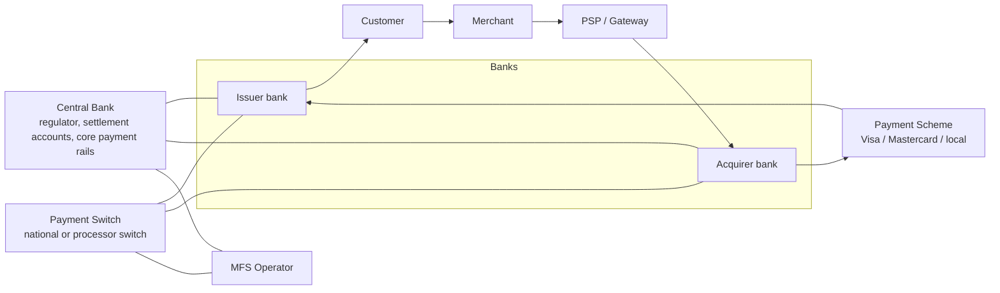

### 1.4 How entities interact: three views

**Domestic bank-to-bank transfer** 🌐 (conceptual)

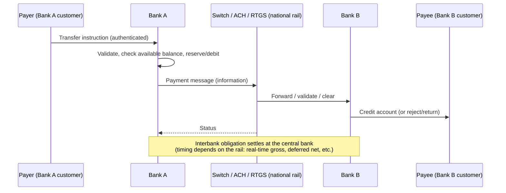

**Cross-border payment** 🌐

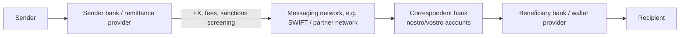

**Card payment (high level)**: see [Section 4](#4-the-four-party-card-model-and-payment-facilitators).

### 1.5 What can go wrong
- **Institutional failure** (a participant is down): payments are delayed or rejected; you need queuing, retries, and clear user states.
- **Liquidity shortage**: an institution cannot fund its settlement obligation.
- **Regulatory change**: limits, KYC rules, or settlement windows change; your system needs configuration, not hard-coded rules.

### 1.6 What the engineer should build
Model **parties** and **roles** separately (an institution can be issuer and acquirer). Keep configuration for each counterparty: endpoints, credentials, cut-offs, limits, fee schedules, and holiday calendars. Never assume one provider per function.

---

## 2. Banking Fundamentals

### 2.1 Account types 🌐

| Type | Purpose | Typical features |
|---|---|---|
| **Savings** | Store value, earn interest | Interest, transaction limits possible |
| **Current / checking** | Frequent business/personal transactions | Cheques, overdraft facility, often no interest |
| **Fixed/term deposit** | Lock funds for a term | Higher interest, early-withdrawal penalty |
| **Loan account** | Tracks borrowed principal | Schedule, interest, penalties |
| **Nostro/vostro** | Inter-bank accounts held with correspondents | Used for cross-border settlement |
| **Settlement/clearing account** | Institution's account at a central bank or scheme | Used for net/gross settlement |
| **Wallet / stored-value** | Non-bank stored balance (see [Section 3](#3-digital-banking-mfs-wallets-and-payment-apps)) | Regulated limits, KYC tiers |

### 2.2 Account opening (onboarding)
1. **Identification (KYC):** collect identity data and documents, verify them against reliable sources. 🇧🇩 Specific document types, e-KYC channels, and account tiers are defined by BB/BFIU circulars: ⚠️ verify.
2. **Screening:** sanctions/PEP/adverse-media checks.
3. **Risk rating:** low/medium/high drives due-diligence depth and limits.
4. **Account creation:** create account number, set status (pending → active), assign product, fees, limits.
5. **Credential issuance:** PIN/OTP/device binding/cards.

**Engineering:** onboarding is a **workflow with states** (`SUBMITTED → UNDER_REVIEW → APPROVED/REJECTED → ACTIVE`), requires **audit trails**, and must be **idempotent** (a retry must not create two accounts).

### 2.3 Deposits, withdrawals, transfers

| Operation | Information flow | Money flow | Accounting effect (bank view) |
|---|---|---|---|
| **Cash deposit** | Teller/ATM records deposit | Physical cash enters the bank | Dr Cash (asset), Cr Customer deposit (liability) |
| **Cash withdrawal** | Customer instructs, bank validates | Cash leaves | Dr Customer deposit, Cr Cash |
| **On-us transfer** (same bank) | Instruction | Book entry only | Dr Payer deposit, Cr Payee deposit |
| **Interbank transfer** | Message via a rail | Settles between banks at the central bank | Payer bank: Dr Payer deposit, Cr Settlement/clearing account; Payee bank: Dr Settlement/clearing account, Cr Payee deposit |

> **Key insight:** a customer's balance is a **liability** of the bank (the bank owes the customer). A "deposit" increases a liability, so it is a **credit** from the bank's perspective.

### 2.4 Balances: ledger vs. available

| Term | Meaning |
|---|---|
| **Ledger (book) balance** | Sum of all posted entries |
| **Available balance** | What the customer can spend now = ledger balance − holds/reservations − pending debits (+ overdraft headroom if any) |
| **Pending / uncleared** | Items recorded but not final (e.g., cheque deposited but not cleared) |
| **Hold / reservation** | Funds earmarked (e.g., card authorization) but not yet moved |

**Worked example 🔢**
- Ledger balance: BDT 10,000.00
- Authorization hold at a hotel: BDT 3,000.00
- Uncleared cheque deposit (not yet available): BDT 2,000.00 (already included in ledger but not available, so assume ledger shows 12,000 including it)
- Overdraft limit: BDT 0

Ledger balance = 12,000.00; Available = 12,000 − 3,000 (hold) − 2,000 (uncleared) = **7,000.00**.

**Engineering:** keep **both numbers** as separate, defined computations. Spending decisions use **available**; accounting uses **ledger**. A customer-facing "balance" without clarifying which one is a common source of complaints.

### 2.5 Interest calculations

**Simple interest**
`I = P × r × t` (r as annual decimal rate, t in years)

*Worked example 🔢:* P = 100,000; r = 6% p.a.; t = 0.5 years → I = 100,000 × 0.06 × 0.5 = **3,000.00**.

**Compound interest**
`A = P × (1 + r/n)^(n×t)`

*Worked example 🔢:* P = 100,000; r = 6%; monthly compounding (n = 12); t = 1 year → A = 100,000 × (1.005)^12 ≈ **106,167.78**; interest ≈ 6,167.78. Effective annual rate ≈ 6.168%.

**Daily interest accrual (e.g., overdraft)**
`daily interest = balance × annual_rate × days / day_count_basis` where the day-count basis (365, 360, actual/actual) is **defined by the product contract**. ⚠️ Do not assume.

*Worked example 🔢:* overdrawn BDT 20,000 for 10 days at 12% p.a., basis 365 → 20,000 × 0.12 × 10 / 365 ≈ **65.75**.

**Engineering:** store the rate, basis, rounding rule, and accrual date with each accrual; accrue to a ledger account (interest receivable/payable) and capitalize on a schedule; make accrual jobs **idempotent per account per day**.

### 2.6 Loans

**What:** the bank advances principal; the borrower repays principal + interest per a schedule.
**EMI (equated installment) formula:** `EMI = P × r × (1+r)^n / ((1+r)^n − 1)` where `r` = periodic rate (annual/12 for monthly), `n` = number of installments.

*Worked example 🔢:* P = 500,000; annual rate 10%; n = 12 months → r = 0.10/12 ≈ 0.008333; (1+r)^12 ≈ 1.104713; EMI ≈ 500,000 × 0.008333 × 1.104713 / 0.104713 ≈ **43,958**.

First month: interest = 500,000 × 0.008333 ≈ 4,166.67; principal part ≈ 43,958 − 4,166.67 ≈ 39,791.33; closing balance ≈ 460,208.67.

**Ledger view at disbursement (bank):** Dr Loans receivable (asset) 500,000; Cr Customer deposit (liability) 500,000.
**Repayment installment:** Dr Customer deposit 43,958; Cr Loans receivable 39,791.33; Cr Interest income 4,166.67.

**Engineering:** generate the schedule once, persist it, and handle rounding on the last installment so the balance ends at exactly zero; support prepayment, penalties, and restructuring as new schedule versions, not edits.

### 2.7 Overdrafts
A facility that allows the balance to go below zero up to a limit, usually with interest and fees. **Risks:** credit risk for the bank, concurrency risk (two withdrawals racing). **Engineering:** enforce `balance − amount ≥ −overdraft_limit` **atomically** in the same transaction as the debit.

### 2.8 Statements
A statement is a **derived, immutable view** of ledger entries for a period: opening balance, entries (date, description, debit/credit, running balance), closing balance. **Engineering:** statements must reconcile: `opening + credits − debits = closing`. Persist generated statements; do not regenerate silently if underlying data could change.

### 2.9 Fees and commissions
- **Fee:** charged to the customer for a service (transfer fee, maintenance fee).
- **Commission:** payment to an intermediary (agent, distributor) for bringing or serving business.
- **Engineering:** fees and commissions are **explicit ledger entries** (separate lines to separate accounts), computed by versioned, effective-dated rule sets. Tax/VAT treatment is jurisdiction-specific. ⚠️ Verify with the finance/tax team; never hard-code.

### 2.10 Reconciliation (introduction)
Comparing two independent records of the same events and explaining every difference. Banks reconcile ledgers to central-bank statements, nostro accounts, card scheme files, and ATM cash. Full treatment in [Section 12](#12-financial-reconciliation-in-depth).

---

## 3. Digital Banking, MFS, Wallets and Payment Apps

### 3.1 Definitions

| Term | Meaning |
|---|---|
| **Internet banking** | Web access to a bank account |
| **Mobile banking** | Bank-provided app/USSD/SMS access to a **bank account** |
| **Digital bank** | Bank whose services are primarily digital (licensing varies by country) 🇧🇩 ⚠️ verify BB policy |
| **MFS (mobile financial services)** | Mobile-money services (wallets, agents, P2P, bill pay), often by a bank-led or licensed non-bank operator |
| **Digital wallet** | Software-based stored account for payments |
| **Prepaid wallet / stored-value account** | Balance loaded in advance; the provider holds the value and owes it to the customer |
| **Payment application** | An app that initiates payments from various sources (wallet, bank, card) |

### 3.2 Comparison

| Feature | Bank account (mobile/internet banking) | MFS wallet | Prepaid/stored-value (PSP wallet) | Payment app (front-end) |
|---|---|---|---|---|
| Holds customer funds? | Yes (deposit liability) | Yes (e-money/stored value liability) | Yes | Usually **no**; initiates from other sources |
| Deposit insurance (where it exists) | Often yes | Typically different treatment ⚠️ verify | Typically different treatment ⚠️ verify | N/A |
| Interest on balance | Often | Usually limited/none ⚠️ verify | Usually none | N/A |
| KYC | Full | Tiered (often lighter at low limits) ⚠️ verify | Tiered | Depends on funding source |
| Cash in/out | Branch, ATM, agent | Agent network | Varies | N/A |
| Safeguarding of customer funds | Bank balance sheet | Funds typically held in bank accounts under regulatory rules ⚠️ verify | Same principle | N/A |
| Typical regulator | Central bank (banking supervision) | Central bank (payments/MFS framework) | Central bank (payments licensing) | Depends |

### 3.3 Regulatory implications 🌐
- **Licensing perimeter:** operating a wallet or payment system usually requires a license; the licensed *activity* determines the obligations.
- **Safeguarding:** customer funds must be protected (segregation, trust-like or escrow-like accounts), affecting your **ledger design** (customer wallet liabilities must always be backed by funds).
- **Limits and tiers:** transaction/balance limits depend on KYC level.
- **Interoperability mandates:** regulators may require wallets and banks to interconnect.

🇧🇩 **Bangladesh facts (verify with BB):** The Payment and Settlement Systems Act, 2024 was passed by Parliament on 4 July 2024 and requires approval/licensing from Bangladesh Bank to operate payment systems or provide payment services. Reports in 2026 mention BB licensing additional PSPs/e-wallet operators under that Act. See [Section 13](#13-bangladesh-ecosystem-deep-dive) and [references](#22-references-and-further-reading).

### 3.4 Accounting sketch: the wallet operator's ledger

Customer top-up from a bank account, BDT 1,000.00 🔢:

| Account | Dr | Cr |
|---|---|---|
| Bank (trust/settlement) account: asset | 1,000.00 | |
| Customer wallets: liability | | 1,000.00 |

The wallet balance is a **liability** to the operator and must be matched by funds held in the safeguarding account. A daily check **"Σ customer wallet balances ≤ funds held for customers"** is a classic safeguarding control.

### 3.5 Engineering notes
- Model **wallet**, **bank-linked account**, and **card** as *funding sources* behind one payment abstraction.
- Cash-in/cash-out via agents creates **agent float** accounts and **commission** postings.
- Interoperability adds **external settlement accounts** and reconciliation against the interoperability platform.

---

## 4. The Four-Party Card Model and Payment Facilitators

### 4.1 What it is and why it exists
Card payments need (a) a cardholder's bank to guarantee payment, (b) a merchant's bank to collect it, and (c) common rules so any card works at any merchant. The **four-party model** achieves this with a scheme that sets rules without (in the classic model) lending or holding the cardholder relationship.

### 4.2 The four parties (plus the scheme)

| Party | Relationship | Role |
|---|---|---|
| **Cardholder** | Customer of the issuer | Authorizes payment |
| **Issuer** | Issues the card; owes the scheme/acquirer on approved transactions | Authenticates, approves/declines, bills the cardholder |
| **Merchant** | Customer of the acquirer | Accepts the card, ships goods |
| **Acquirer** | Contracts with merchant | Sends transactions to the scheme, receives funds, pays the merchant |
| **Scheme (Visa, Mastercard, etc.)** | Sets rules; operates network and clearing/settlement services | Routes messages, defines fees and dispute rules |

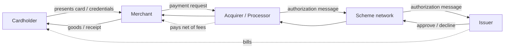

Some networks are **three-party** (the scheme is also the issuer/acquirer): same functions, fewer entities. 🌐

### 4.3 Other participants and how they fit

| Participant | What it does | Notes |
|---|---|---|
| **Payment gateway** | Secure front door for e-commerce: collects/forwards payment data (or redirects to a hosted page), encrypts/tokenizes, returns result | Technology/connectivity layer; may not hold funds |
| **Payment processor** | Handles authorization routing, clearing files, settlement reporting for acquirers/issuers | Often sits between merchant/gateway and scheme |
| **Payment facilitator (PayFac)** | Registered with an acquirer to onboard **sub-merchants** under its own master merchant account, simplifying onboarding | Takes on underwriting and chargeback responsibilities; regulatory/scheme registration required ⚠️ verify |
| **ISO (independent sales organization)** | Sells acquiring services on behalf of an acquirer | Sales/marketing; limited processing role |
| **Merchant service provider (MSP)** | Umbrella term for providers that deliver acceptance services to merchants | Terminology varies by market |
| **Token service / network tokens** | Replaces PAN with tokens | Reduces exposure and PCI scope |

**Typical e-commerce path:** Customer → Merchant site → **Gateway** (hosted fields/redirect) → **Processor/Acquirer** → **Scheme** → **Issuer**.

### 4.4 Business models: who earns what 🔢 (see worked example in [Section 6.3](#63-worked-example-where-the-fees-go))
- **Issuer:** interchange (paid by acquirer side), interest, annual fees.
- **Scheme:** scheme/assessment/processing fees.
- **Acquirer/PSP:** MDR margin = MDR − interchange − scheme fees (− processing costs).
- **Gateway/PayFac:** per-transaction fees or share of MDR.

### 4.5 What can go wrong
Sub-merchant fraud flowing through a PayFac, merchant bankruptcy (chargeback exposure), gateway outages, mis-routed transactions, and unclear liability. **Engineering:** keep **merchant → sub-merchant → terminal** hierarchy, per-merchant risk limits, reserves/holdbacks, and fully traceable references across gateway, processor, and scheme.

---

## 5. Card Payment Processing Step by Step

### 5.1 Overview
Phases: **initiation → authentication → authorization → (capture) → clearing → settlement → post-transaction events** (refund, reversal, void, chargeback).

### 5.2 Initiation
Card data enters the system by chip/contactless (card-present) or by manual entry/hosted page/token/wallet (card-not-present, "CNP"). Data includes PAN or token, expiry, amount, currency, merchant ID, terminal ID, and a unique transaction reference. 🌐 Specifications for chip transactions are published by EMVCo (see references).

### 5.3 Authentication
- **Card-present:** chip cryptogram, PIN, or device biometrics.
- **Card-not-present:** commonly an additional cardholder-authentication step such as 3-D Secure, OTP, or app approval (⚠️ requirements vary by scheme/region/regulator). A successful authentication can shift fraud liability in some programs: ⚠️ verify scheme rules.

### 5.4 Authorization

**What:** the merchant/acquirer asks the issuer, "Will you honor this payment?" The issuer checks card status, available funds/credit, fraud signals, and limits, then responds.

**What authorization is *not*:** it does **not** move money. It typically creates a **hold** (reduces available balance, not the ledger balance) and returns an **authorization code**.

```mermaid
sequenceDiagram
    participant M as Merchant / Gateway
    participant A as Acquirer / Processor
    participant S as Scheme network
    participant I as Issuer
    M->>A: Authorization request (PAN/token, amount, merchant data, reference)
    A->>S: Authorization message
    S->>I: Forward
    I->>I: Check card status, funds/credit, limits, fraud rules
    I-->>S: Response (approve + auth code / decline + reason)
    S-->>A: Response
    A-->>M: Response
    Note over I: Issuer places a hold<br/>(available balance down; ledger balance unchanged)
```

**Authorization responses (conceptual groups):** approved; declined (insufficient funds, do-not-honor, suspected fraud, expired card, invalid details); referral/pick-up; system error/timeout. ⚠️ Exact response-code tables are defined by the scheme and message standard (e.g., ISO 8583 variants); always use the official specification for your integration. Do not invent mappings.

### 5.5 Capture
Authorization alone does not finalize the sale; **capture** tells the acquirer to collect it. Some flows combine them (**sale/auth-capture**, e.g., e-commerce for instant goods); others separate them (**auth then later capture**, e.g., hotels, shipping).

### 5.6 Clearing
**What:** the exchange of final transaction records (typically batch files or messages) between acquirer, scheme, and issuer so that **obligations can be calculated**: who owes whom, how much, after interchange and fees, in which currency.

**How it works (conceptually):**
1. Acquirer submits captured transactions to the scheme.
2. The scheme validates, applies fee rules, converts currency where needed.
3. The scheme sends presentments to issuers.
4. The scheme computes **net positions** for each participant for the settlement cycle.

### 5.7 Settlement
**What:** the actual transfer of funds between financial institutions (through settlement accounts, often at the central bank or a settlement bank) to discharge net obligations. Then the acquirer pays the merchant **per the merchant agreement** (e.g., T+N days, net of MDR, with possible reserves) ⚠️ timing is contractual and scheme/rail dependent.

```mermaid
sequenceDiagram
    participant M as Merchant
    participant A as Acquirer
    participant S as Scheme (clearing)
    participant I as Issuer
    participant SB as Settlement bank / central bank accounts
    M->>A: Capture / batch of approved transactions
    A->>S: Clearing file (presentments)
    S->>I: Presentments
    S->>S: Compute net positions, fees, FX
    S-->>A: Settlement report (amounts due)
    S-->>I: Settlement report (amounts owed)
    I->>SB: Pays net obligation
    SB->>A: Net funds credited
    A->>M: Payout net of MDR (per agreement)
    I->>I: Posts transaction to cardholder account; later bills cardholder
```

### 5.8 Refunds, reversals, voids

| Event | When | What happens | Notes |
|---|---|---|---|
| **Void** | After authorization (or capture) but **before settlement/clearing** | Cancels the transaction so it may never clear; hold released | Availability and cut-off depend on the processor ⚠️ |
| **Reversal** | Technical/business undo of an authorization (e.g., timeout, merchant cancels) | Releases the hold at the issuer | Often automatic after timeouts; **advice/reversal messages** exist in message standards |
| **Refund (credit)** | After settlement | A **new** transaction moves funds back (merchant → acquirer → scheme → issuer → cardholder) | Not a deletion of the original; may take time to appear |
| **Partial refund** | Any time after capture | Returns part of the amount | Must not exceed captured − already refunded |

**Engineering:** model **void/reversal** (undo before money moved) and **refund** (new money movement) as different workflows with different ledger consequences.

### 5.9 Chargebacks and disputes

**What:** a cardholder (via the issuer) disputes a transaction (fraud, not received, not as described, duplicate, etc.). The issuer can **reverse funds** to the cardholder and debit the acquirer, who debits the merchant, unless the merchant successfully disputes it.

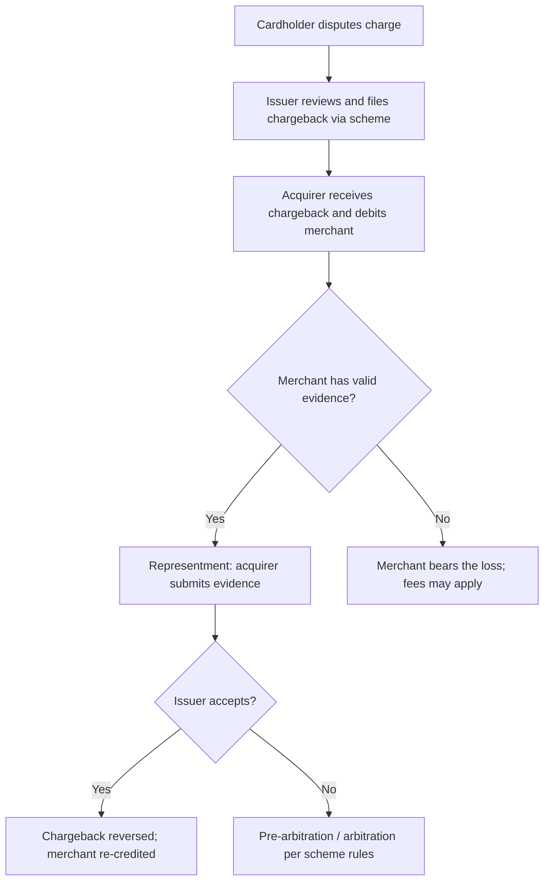

⚠️ Reason codes, time limits, evidence requirements, and fees are defined by each scheme's rules and may change. Use the scheme's current dispute documentation (see references). Do not hard-code timelines from blogs.

**Engineering:** a dispute is a **case** with a state machine, deadlines, evidence attachments, ledger entries (provisional debit, recovery, write-off), and reporting. Keep the link to the original payment.

---

## 6. Money Flow vs. Information Flow

### 6.1 The core idea
Every payment has two planes:

| Plane | Contents | Speed | Reversibility |
|---|---|---|---|
| **Information flow** | Messages: requests, approvals, clearing records, reports | Seconds (authorization) to hours/days (clearing files) | Messages can be reversed by other messages |
| **Money flow** | Actual movement of balances between institutions' settlement accounts, then to the merchant | Scheduled by rail/cycle (real-time to days) | Reversal needs new money movements |

**Authorization is mostly information:** "the issuer promises to pay if the merchant captures and presents correctly." It creates a **hold**, not a transfer.

### 6.2 Timeline of one card sale

| Step | Information moves? | Money moves? | Balance effect |
|---|---|---|---|
| Authorization | Yes (request/response) | **No** | Issuer: available balance ↓ (hold) |
| Capture / clearing submission | Yes | **No** | Obligation becomes final |
| Clearing | Yes (net positions calculated) | **No** | Interchange/fees determined |
| Interbank settlement | Yes (settlement report) | **Yes** (between institutions) | Issuer pays, acquirer receives (net) |
| Merchant payout | Yes (payout advice) | **Yes** (acquirer → merchant) | Merchant account credited per agreement |
| Cardholder billing | Yes (statement) | **Yes** (cardholder pays issuer: credit cards) or already debited (debit cards) | |

### 6.3 Worked example: where the fees go 🔢
*All rates below are invented for teaching. Real interchange, scheme fees, and MDR vary by scheme, card type, region, and contract, and may be regulated.*

Sale amount: **BDT 10,000.00**

| Item | Rate | Amount | Paid by → to |
|---|---|---|---|
| Interchange | 1.50% | 150.00 | Acquirer side → Issuer |
| Scheme fees | 0.15% | 15.00 | Acquirer/issuer → Scheme |
| Acquirer margin | 0.35% | 35.00 | Retained by acquirer/PSP |
| **MDR (merchant discount rate)** | 2.00% | **200.00** | Merchant → Acquirer |

- **Merchant receives:** 10,000 − 200 = **9,800.00**
- **Net settled from the scheme to the acquirer (simplified):** 10,000 − 150 − 15 = **9,835.00**
- **Acquirer keeps:** 9,835 − 9,800 = **35.00** (before its own costs)

**Acquirer ledger entries at settlement 🔢**

| Account | Dr | Cr |
|---|---|---|
| Scheme settlement receivable (asset) | 9,835.00 | |
| Interchange expense | 150.00 | |
| Scheme fee expense | 15.00 | |
| Merchant payable (liability) | | 9,800.00 |
| MDR revenue | | 200.00 |
| **Totals** | **10,000.00** | **10,000.00** |

Then, when the acquirer pays the merchant: Dr Merchant payable 9,800.00; Cr Bank (settlement) 9,800.00.

### 6.4 Why this matters for software
- A "successful payment" in the UI may mean **authorized**, not **settled**. Define and expose states precisely.
- You cannot spend funds you've only authorized. Merchant balances should distinguish **pending**, **available for payout**, and **paid out**.
- Reconciliation must compare **three layers**: your payment records, scheme/processor reports, and bank/settlement statements.

---

## 7. Detailed Scenarios: Holds, Failures, Duplicates, Timeouts, Mismatches

### 7.1 Authorization hold, partial capture, delayed capture 🔢
A hotel authorizes **BDT 30,000** at check-in.

| Day | Event | Issuer view | Merchant/acquirer view |
|---|---|---|---|
| 1 | Auth 30,000 approved | Hold 30,000; ledger unchanged | Payment `AUTHORIZED` |
| 3 | Final bill 24,500; capture 24,500 | Hold reduced to captured amount; remaining 5,500 released (timing issuer/scheme dependent ⚠️) | Payment `CAPTURED` (partial) |
| 4+ | Clearing & settlement | Ledger debit 24,500 posts | Settlement report; payout later |

**Rules for engineers:** captured ≤ authorized (unless the scheme allows incremental authorizations); authorizations **expire** (validity windows are scheme/issuer dependent ⚠️); delayed capture risks expiry and decline.

### 7.2 Failed transaction
Decline codes → map to a **small internal taxonomy** (e.g., `INSUFFICIENT_FUNDS`, `DO_NOT_HONOR`, `SUSPECTED_FRAUD`, `INVALID_CARD`, `TECHNICAL_ERROR`) while storing the raw provider code. **Retry only technical errors**, never "do not honor" or fraud declines without new customer action.

### 7.3 Duplicate requests
Causes: user double-click, client retry, load balancer retry, provider redelivery.
**Defense:** `Idempotency-Key` on your API, unique merchant order reference, a unique provider reference per attempt (or reuse the same reference for safe retries), and unique constraints in the database.

### 7.4 Timeouts and unknown outcomes

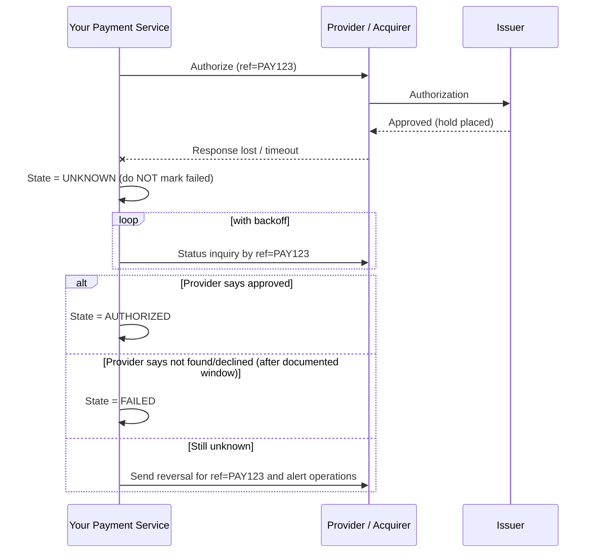

**Principle:** a timeout means **unknown**. Marking it failed can leave the customer's funds held and the merchant unpaid; marking it successful can ship goods for nothing.

### 7.5 Asynchronous callbacks
Providers often finalize via **webhooks/IPNs** after redirects. Callbacks can be **duplicated, delayed, out of order, or forged**.
**Handling:** verify signatures; dedupe by event ID; accept only legal state transitions; re-query the provider's status API before fulfilling (server-side confirmation); respond `2xx` quickly and process asynchronously.

### 7.6 Settlement delays
Payments authorized today may settle days later; holidays/weekends and cut-offs matter. 🇧🇩 Business-day calendars (weekend and public holidays) must come from official calendars and be configurable. ⚠️ Never assume T+1.
**Engineering:** compute **expected settlement date** from rail rules and holiday calendar; alert when settlement is overdue; show merchants **pending vs. available** funds.

### 7.7 Reconciliation mismatches 🔢

| Case | Internal ledger | Provider report | Likely cause | Action |
|---|---|---|---|---|
| Amount differs | 10,000 | 9,985 | Fee netted in provider report | Map fee component; book fee |
| Missing at provider | Captured | Absent | Never submitted / failed capture | Inquire; resubmit or reverse |
| Missing internally | Absent | Present | Lost callback; unknown state | Create from provider truth; investigate |
| Duplicate | One | Two | Duplicate submission | Refund/reverse duplicate |
| Timing | Today | Tomorrow | Cut-off/time zone | Mark as timing; re-match next cycle |
| Currency | BDT 10,000 | USD 82.50 | FX conversion | Compare using locked rate |

---

## 8. Double-Entry Bookkeeping and Ledgers

### 8.1 What it is and why it exists
Every financial event has **two sides**: something is received and something is given. Recording both makes errors **self-detecting**: total debits must equal total credits. For fintech, the ledger is the **source of truth** for money.

### 8.2 Account types and normal balances

| Type | Examples | Increases with | Normal balance |
|---|---|---|---|
| **Asset** | Cash, bank settlement account, receivables | Debit | Debit |
| **Liability** | Customer deposits/wallets, merchant payable | Credit | Credit |
| **Equity** | Retained earnings | Credit | Credit |
| **Revenue** | Fee income, MDR revenue | Credit | Credit |
| **Expense** | Interchange, scheme fees, provider fees | Debit | Debit |

**Accounting equation:** Assets = Liabilities + Equity (+ Revenue − Expenses over time).

### 8.3 Debit/credit conventions: the memory aid
- **Debit** = left side; **Credit** = right side. They are *not* "good/bad" or "add/subtract" by themselves.
- Assets and expenses: debit increases. Liabilities, equity, revenue: credit increases.
- A customer's wallet balance is a **credit balance** in the operator's books (liability).

### 8.4 Chart of accounts (CoA), general ledger (GL) and subledgers
- **CoA:** structured list of accounts with codes, types, and hierarchy.
- **GL:** the main ledger containing summary/control accounts.
- **Subledger:** detailed records (e.g., each customer wallet) whose **sum equals** a GL control account. "Customer wallets (control)" in the GL = Σ individual wallet subledger balances.

*Starter CoA for a wallet/PSP 🔢*

| Code | Name | Type |
|---|---|---|
| 1000 | Bank: settlement account | Asset |
| 1100 | Receivable from provider/scheme | Asset |
| 1200 | Agent float | Asset |
| 1900 | Suspense / unreconciled | Asset |
| 2000 | Customer wallets (control) | Liability |
| 2100 | Merchant payable | Liability |
| 2200 | Taxes payable | Liability |
| 4000 | Fee revenue | Revenue |
| 4100 | MDR revenue | Revenue |
| 5000 | Interchange and scheme expense | Expense |
| 5100 | Provider fees | Expense |
| 5900 | Rounding differences | Expense |

### 8.5 Journal entries: patterns 🔢

**(a) Wallet top-up from bank, BDT 1,000, fee BDT 10 (fee deducted from the credited amount)**

| Account | Dr | Cr |
|---|---|---|
| 1000 Bank settlement | 1,000.00 | |
| 2000 Customer wallets | | 990.00 |
| 4000 Fee revenue | | 10.00 |

**(b) P2P wallet transfer BDT 500, fee BDT 5 charged to sender**

| Account | Dr | Cr |
|---|---|---|
| 2000 Customer wallets (sender subledger) | 505.00 | |
| 2000 Customer wallets (receiver subledger) | | 500.00 |
| 4000 Fee revenue | | 5.00 |

**(c) Merchant payment BDT 2,000, MDR 1.5% (= 30)**

| Account | Dr | Cr |
|---|---|---|
| 2000 Customer wallets | 2,000.00 | |
| 2100 Merchant payable | | 1,970.00 |
| 4100 MDR revenue | | 30.00 |

**(d) Merchant settlement payout BDT 1,970**

| Account | Dr | Cr |
|---|---|---|
| 2100 Merchant payable | 1,970.00 | |
| 1000 Bank settlement | | 1,970.00 |

**(e) Refund of (c) in full (merchant bears fee reversal per contract: example only)**

| Account | Dr | Cr |
|---|---|---|
| 2100 Merchant payable | 1,970.00 | |
| 4100 MDR revenue | 30.00 | |
| 2000 Customer wallets | | 2,000.00 |

**(f) Authorization hold:** a hold is usually **not** a journal entry; it is a reservation record that reduces **available balance**. Capture converts it into postings. (Some systems post holds to memo accounts; decide deliberately and document.)

### 8.6 Ledger design rules for engineers
1. Entries are **append-only**; fix errors with **reversing/adjusting entries**.
2. Each journal entry has ≥ 2 lines and **Σ debits = Σ credits per currency**.
3. Every entry references the business event and an **idempotency key**.
4. Balances are derived from entries (cached balances must be verified against them).
5. Use a **suspense account** for unidentified items instead of forcing wrong postings.
6. Store amounts as **integer minor units** (or fixed-scale decimals) with an explicit currency.

### 8.7 What can go wrong
Mutable balances without entries, unbalanced entries from partial failures, mixed currencies in one entry, hot-account lock contention, and "fixing" history by editing rows.

---

## 9. Transaction Engineering Fundamentals

### 9.1 Transaction lifecycle and payment states

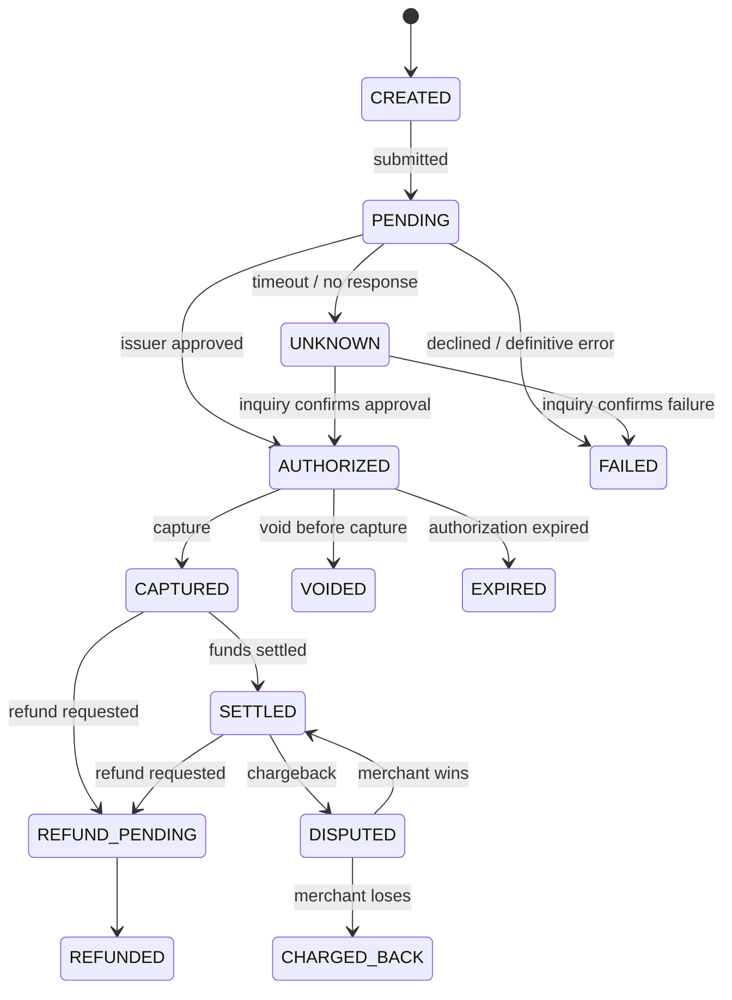

**Rules:** allowed transitions are a whitelist; terminal states are immutable; store a **transition history** (who/what/when/why); keep **raw provider status** separate from your normalized state.

### 9.2 Idempotency
**What:** performing the same request multiple times has the effect of one.
**Why:** networks fail; clients and providers retry.
**How:** client sends a unique key; server stores `(scope, key, request_hash, response)` under a **unique constraint**; replays return the stored response; same key with a different body is rejected.
**Mistakes:** keys only in a cache with TTL; not hashing the request; scoping keys globally; creating a new transaction ID on replay.

```python
# Sketch: idempotent creation using a unique constraint (Django)
from django.db import IntegrityError, transaction

def create_payment(scope, key, request_hash, payload):
    try:
        with transaction.atomic():
            rec = IdempotencyRecord.objects.create(scope=scope, key=key, request_hash=request_hash, status="IN_PROGRESS")
            payment = Payment.objects.create(**payload)
            rec.status, rec.resource_id = "COMPLETED", str(payment.id)
            rec.save()
            return payment
    except IntegrityError:
        rec = IdempotencyRecord.objects.get(scope=scope, key=key)
        if rec.request_hash != request_hash:
            raise ConflictError("Idempotency key reused with a different request")
        return Payment.objects.get(id=rec.resource_id)  # replay
```

### 9.3 ACID properties in payments

| Property | Meaning | Payment example |
|---|---|---|
| **Atomicity** | All-or-nothing | Debit and credit post together or not at all |
| **Consistency** | Invariants hold after each transaction | Entry balanced; balance ≥ limit |
| **Isolation** | Concurrent transactions don't interfere | Two withdrawals cannot both use the same funds |
| **Durability** | Committed data survives crashes | Posted entry persists after failover |

### 9.4 Concurrency control (preventing double spending)
Scenario: balance 1,000; two requests withdraw 800 simultaneously. Without control, both read 1,000 and both succeed.

Safe patterns:
1. **Pessimistic lock:** `SELECT ... FOR UPDATE` on the account row; lock multiple accounts in a **consistent order** to avoid deadlocks.
2. **Conditional atomic update:** `UPDATE account SET balance = balance - 800 WHERE id = :id AND balance >= 800;` and check rows affected.
3. **Optimistic locking:** version column; retry on conflict.
4. **Serializable isolation** with retry.

Application-level checks like `if balance >= amount` before a separate write are **unsafe**.

### 9.5 Transaction limits and balance reservations
- **Limits:** per transaction, daily/monthly cumulative, velocity (count per window), by KYC tier/product. 🇧🇩 Actual regulatory limits come from BB circulars: ⚠️ never hard-code; use effective-dated configuration.
- **Reservation (hold):** record `(account, amount, reason, expires_at, state)`; `available = ledger − Σ active holds`; capture/release transitions; expiry job; idempotent operations.
- **Enforcement point:** checks and the debit/hold must occur in **one atomic unit**, otherwise limits can be bypassed by parallel requests.

### 9.6 Eventual consistency in practice
Some effects can lag (notifications, reports), but money-moving invariants cannot. Keep the **ledger posting and payment state** in one local ACID transaction; publish events via an outbox; make consumers idempotent.

---

## 10. Fees, Pricing, FX, Remittances and Recurring Payments

### 10.1 Fee types

| Fee | Paid by | Paid to | Notes |
|---|---|---|---|
| **Interchange** | Acquirer side | Issuer | Set by scheme/regulation/market rules ⚠️ verify current rules |
| **Scheme/assessment fees** | Issuer/acquirer | Scheme | Per scheme fee schedule |
| **MDR** | Merchant | Acquirer/PSP | Contractual; may be blended or interchange-plus |
| **Processing/gateway fee** | Merchant | Gateway/processor | Per transaction or monthly |
| **Cash-out/cash-in fees** | Customer (or agent commission paid by operator) | Operator/agent | ⚠️ Regulated in some markets: verify |
| **FX markup/spread** | Customer | Bank/provider | See below |

**MDR pricing models:** *blended* (flat %), *interchange-plus* (pass-through of interchange and scheme fees plus a margin), *tiered*.

**Fee engine requirements:** effective dating, per-merchant overrides, min/max caps, rounding rules documented, separate ledger lines, and audit of who changed pricing.

### 10.2 Foreign exchange (FX)
- **Mid-market rate:** midpoint between buy and sell quotes.
- **Spread:** difference between the rate offered to the customer and the mid-rate; **markup/margin** is the provider's revenue.
- **Formula:** `spread % = (customer_rate − mid_rate) / mid_rate × 100` (for a customer buying foreign currency).

*Worked example 🔢:* mid-rate 1 USD = 120.00 BDT; customer buys USD at 121.20 → spread = (121.20 − 120.00)/120.00 = **1.00%**. Customer pays 121.20 BDT per USD; provider earns 1.20 BDT per USD before costs.

**Ledger view (customer buys USD 100 using BDT at 121.20; bank holds USD position) 🔢**

| Account | Dr | Cr |
|---|---|---|
| Customer BDT account (liability) | 12,120.00 BDT | |
| FX position: BDT | | 12,000.00 BDT (at mid) |
| FX spread revenue | | 120.00 BDT |
| (parallel USD legs: FX position USD, Cr; Customer USD account, Dr/Cr per product design) | | |

Real FX accounting involves position accounts per currency and revaluation; ⚠️ model it with your finance team. **Engineering:** lock the **quote** (rate, expiry, ID) and settle at the locked rate; round per currency exponent.

### 10.3 Remittances
**What:** cross-border transfers by individuals, typically to family. **Participants:** sender-side provider (bank/money transfer operator/app), payout partner (bank, MFS, cash pickup), regulators, FX counterparties, correspondents.

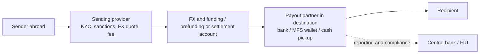

Cost = **explicit fee + FX spread + intermediary costs**. The World Bank publishes remittance price comparisons (see references).
🇧🇩 Inward remittance channels, reporting, and any incentive programs are set by Bangladesh Bank and government policy: ⚠️ verify current rules; do not assume.
**Engineering:** compliance checks **before** committing funds; quote lock; partner status polling; handling **payout failure/return**; partner prefunding and reconciliation.

### 10.4 Recurring payments
Types: card-on-file subscriptions, direct debit with mandate, wallet auto-pay.
**Concepts:** initial consent (mandate/agreement), **tokenized credentials**, schedule, retry policy for failures ("dunning"), notifications, cancellation, and regulatory/scheme requirements for stored credentials ⚠️ verify.
**Engineering:** a **subscription/mandate** entity separate from payments; each cycle creates an idempotent payment keyed by `(mandate_id, cycle_date)`; support pause/cancel; handle expired cards/updated tokens; avoid retry storms.

---

## 11. Risk, Fraud and Compliance

### 11.1 Fraud prevention
**Common fraud types:** stolen card/credential use, account takeover, social engineering/SIM swap, merchant fraud, friendly fraud (false disputes), mule accounts.
**Controls:** strong authentication, device/behavior signals, velocity/amount rules, blacklists, risk scoring, step-up (OTP/3DS), manual review, post-transaction monitoring, chargeback feedback loops.
**Engineering:** a **synchronous risk decision API** with a latency budget plus asynchronous analysis; decisions logged with reasons; policy for **fail-open vs. fail-closed** per flow; rule changes versioned with shadow-mode testing.

### 11.2 KYC / CDD / EDD
- **KYC/CDD:** identify and verify customers, understand the relationship, risk-rate them.
- **EDD:** deeper checks for higher risk (PEPs, high-risk geographies/products).
- **Ongoing monitoring:** periodic reviews, event-driven re-checks.
**Engineering:** KYC tiers drive **limits and features**; store verification evidence and decisions immutably; support re-verification and expiry.

### 11.3 AML / CFT
- **Stages of money laundering:** placement, layering, integration.
- **Obligations (general):** customer due diligence, monitoring, reporting suspicious activity to the FIU, record-keeping, staff training.
- **Examples of monitoring scenarios:** structuring (many just-below-threshold transactions), rapid in/out movement, unusual geography, dormant account spikes.
🇧🇩 The Financial Intelligence Unit is the **BFIU**; applicable laws and circulars (for example, money-laundering and anti-terrorism legislation and BFIU guidance) must be checked for **current text and amendments** ⚠️.
**Engineering:** alert → case → investigation → STR/SAR filing workflow with SLAs, maker-checker approvals, and tamper-evident audit logs.

### 11.4 Sanctions screening
Screen customers, beneficiaries, and counterparties against relevant lists (UN and applicable national/foreign lists per your obligations). **Challenges:** fuzzy name matching, transliteration (Bangla/English names), false positives, list update frequency.
**Engineering:** ingest lists with versioning; screen at onboarding, periodically, and per relevant transaction; hold/release workflow; log match decisions.

### 11.5 Transaction monitoring
Rule-based and model-based detection on streams of transactions; produces alerts for AML and fraud. Separate **fraud** (loss prevention, real-time) from **AML** (regulatory reporting, often near-real-time/batch) though they share data.

### 11.6 PCI DSS (card data security)
- **What:** an industry standard from the PCI Security Standards Council for organizations that store, process, or transmit cardholder data.
- **Engineering takeaways:** minimize scope (hosted fields, redirect, tokenization); never store sensitive authentication data (such as CVV) after authorization; encrypt/mask PAN; protect keys; segment networks; log and monitor; test regularly. ⚠️ Use the **current version** of the standard from the PCI SSC.

### 11.7 Data protection
Principles: lawful basis/consent, minimization, purpose limitation, retention limits, access control, breach response, cross-border transfer rules. 🇧🇩 Check the **current status** of data protection and cybersecurity legislation and any BB data/IT security guidelines: ⚠️.
**Engineering:** data classification, field-level encryption, masking in logs, retention jobs, access audit, data-subject request tooling, and residency awareness.

### 11.8 Operational, liquidity and settlement risk

| Risk | Definition | Example | Engineering/operational response |
|---|---|---|---|
| **Operational** | Loss from failed processes, systems, people, or external events | Outage, bad deployment, insider fraud | Redundancy, change control, maker-checker, monitoring, DR drills |
| **Liquidity** | Inability to meet payment obligations when due | Wallet operator lacks bank funds for cash-outs/settlement | Liquidity dashboards, prefunding thresholds, alerts, forecasting |
| **Settlement** | Counterparty fails to deliver funds/assets after you've paid or delivered | Paying out merchants before the scheme settles | Delay payouts to settlement, reserves/holdbacks, exposure limits per counterparty |
| **Credit** | Borrower/counterparty default | Overdraft or merchant chargebacks exceed funds | Limits, collateral/reserves |
| **Fraud/compliance** | Losses or penalties from fraud/regulatory breaches | Unscreened sanctioned party | Controls above |

The BIS/IOSCO *Principles for Financial Market Infrastructures* discuss these risks for systemically important systems (see references).

---

## 12. Financial Reconciliation in Depth

### 12.1 What and why
Reconciliation proves that **your records match external truth**, or explains every difference. It catches lost callbacks, duplicate postings, fee errors, and fraud.

### 12.2 Types

| Type | Compares | Typical frequency |
|---|---|---|
| **Internal** | Ledger vs. wallet balances/subledgers | Continuous/daily |
| **External: provider** | Your payment records vs. PSP/scheme reports | Daily |
| **External: bank** | Ledger bank account vs. bank statement | Daily |
| **Three-way** | Order/payment ↔ ledger ↔ bank/provider | Daily/periodic |
| **Settlement** | Expected settlement vs. actual receipt | Per cycle |

### 12.3 Pipeline

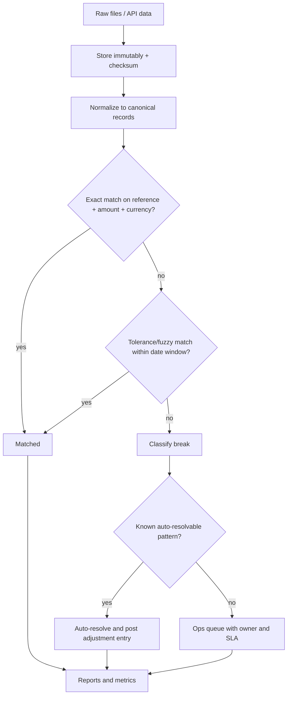

### 12.4 Break categories and adjustments
Missing internally / missing externally / amount mismatch / duplicate / timing difference / currency or FX difference / fee difference. **Adjustments** are **new ledger entries** (to suspense or the correct account), never edits to history.

### 12.5 Metrics
Match rate, break count and value, aging buckets, time-to-resolution, unreconciled amount (value at risk), recurring root causes.

---

## 13. Bangladesh Ecosystem Deep Dive

> 🇧🇩 This section separates **sourced facts** (with references) from **engineering guidance** and **items to verify**. Where details come from news or secondary sources, that is stated. Primary documents (BB circulars, regulations, Acts) should always be consulted.

### 13.1 Actors and infrastructure

| Component | What sources say | Engineering relevance |
|---|---|---|
| **Bangladesh Bank (BB)** | Central bank; its Payment Systems Department's stated activities include operating the Bangladesh Automated Clearing House (with BACPS and BEFTN), developing NPSB, establishing RTGS, MFS framework, e-payment gateway initiatives, and payment-systems oversight [BB-PSD] | Primary regulator and operator of national rails; follow its circulars |
| **BACH / BACPS / BEFTN** | BACH comprises the cheque-processing system (BACPS) and the electronic funds transfer network (BEFTN) [TBS-1] | Batch-style interbank electronic transfers (e.g., bulk credits/debits) |
| **Nikash-BEFTN** | News report: since 12 Nov 2023, electronic fund transfers run on "Nikash-BEFTN," software developed by BB replacing the original BEFTN system [TBS-1] | Confirm current file formats/specs with the participant documentation ⚠️ |
| **NPSB** | Operational since 2012; ensures interoperability among banks for account and card-based transactions [TBS-1] | Card/ATM/POS and interbank retail transfers; connect via your bank/PSP participant |
| **BD-RTGS** | Launched 29 Oct 2015 for real-time settlement of large-value and time-critical interbank payments on a gross basis; upgraded in Nov 2024 [TBS-1] | High-value flows; operating hours/limits ⚠️ verify |
| **Binimoy (IDTP)** | Interoperable digital transaction platform inaugurated in Nov 2022 to enable transfers across banks, MFS and PSPs; BB issued operating rules later (reported Oct 2024) describing direct and indirect participants, Virtual IDs, Direct Pay and Request to Pay [Binimoy-1, Binimoy-2, Binimoy-3] | Interoperability integration patterns; participant roles |
| **Bangla QR** | National interoperable QR for merchant payments; a BB circular directed banks, MFS, PSPs and PSOs to replace proprietary merchant QR codes with Bangla QR (reported with a June 30 deadline and penalties under the 2024 Act); P2P Bangla QR was reported as planned [QR-1, QR-2, QR-3] | QR parsing/generation, merchant onboarding, routing by scheme |
| **MFS (bKash, Nagad, Rocket, Upay, etc.)** | Licensed mobile financial services providers ⚠️ confirm the current licensed list on BB's site | Wallet APIs, cash-in/out, merchant payments, disbursement |
| **PSPs / PSOs** | Under the Payment and Settlement Systems Act, 2024, providing payment services or operating a payment system requires BB approval/licence; BB has publicly warned about unlicensed platforms; 2026 reports mention newly licensed PSPs/e-wallet operators [Act-1, Act-2, Act-3, Act-4] | Verify a partner's licence status before integrating |
| **Local gateways** | Several local payment gateways operate (e.g., SSLCommerz, aamarPay, ShurjoPay) ⚠️ licensing status and capabilities must be verified per provider | Hosted checkout, IPN, server-side validation |
| **BFIU** | Bangladesh Financial Intelligence Unit (AML/CFT) | STR/CTR reporting, KYC guidance |

### 13.2 Legal framework (what to verify)
- **Payment and Settlement Systems Act, 2024:** per secondary sources, passed 4 July 2024; before it, payment activity was conducted under BB's *Payment and Settlement Systems Regulations, 2014* and *Regulations on Electronic Fund Transfers, 2014* issued under BB Order 1972, Art. 7A(e) [Act-1, Act-2]. ⚠️ Check the gazetted Act, its commencement date, and the rules/circulars issued under it.
- **MFS rules:** BB issues MFS regulations/guidelines (agent rules, limits, KYC). ⚠️ Retrieve the current version from BB.
- **AML/CFT:** money-laundering and anti-terrorism laws and BFIU circulars. ⚠️ Verify current status and amendments.
- **Foreign exchange and remittance:** BB foreign-exchange regulations and circulars. ⚠️
- **Data/cyber:** check current legislation and BB ICT/security guidelines. ⚠️

### 13.3 Local flows

**MFS cash-in at an agent (conceptual) 🌐🇧🇩**

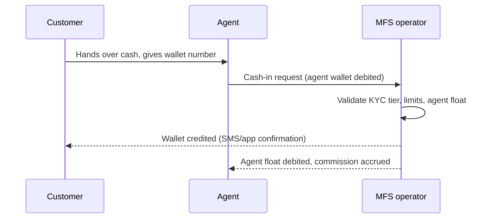
Ledger sketch 🔢 (cash-in BDT 1,000): Dr Agent float (asset: e-money moved to agent... operator-specific) or per operator's design; Cr Customer wallets 1,000. ⚠️ Operators structure agent accounts differently; model with your finance team.

**Merchant payment via Bangla QR (conceptual)**

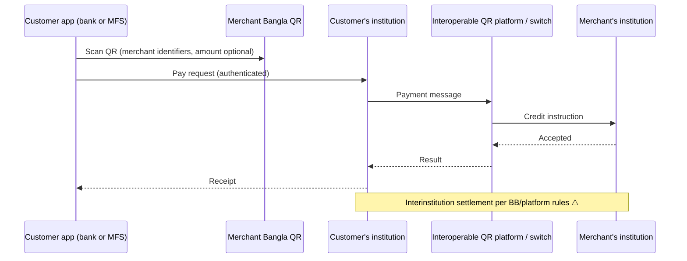

**Salary/bulk disbursement via batch rail:** your system generates the bank's required batch file → bank submits via the electronic batch network → returns/rejections arrive in later files → you reconcile and re-handle failures. ⚠️ File formats, cut-offs, and holiday handling come from the bank/BB specifications.

### 13.4 Local engineering realities (guidance, not legal fact)
- Provider reliability and documentation vary → adapters, inquiry jobs, defensive parsing.
- Weekend/holiday calendars matter for settlement and batch cut-offs; use BB's official calendar. ⚠️
- BDT uses 2 decimal places; store minor units (poisha).
- Bangla/English name matching affects KYC and sanctions screening.
- OTP/SMS delivery is part of the payment critical path in many flows; plan fallbacks.

### 13.5 General vs. Bangladesh-specific, summarized

| Concept | General practice 🌐 | Bangladesh-specific 🇧🇩 (verify) |
|---|---|---|
| Central bank role | Oversight and settlement | BB operates BACH/BEFTN, NPSB, BD-RTGS |
| Interbank retail switch | National/third-party switch | NPSB |
| Instant interoperability | Real-time rail/overlay | Binimoy (IDTP); NPSB expansions reported ⚠️ |
| QR payments | EMV QR-based standards | Bangla QR mandated for merchant points |
| Licensing | Regulator licenses PSPs | Payment and Settlement Systems Act, 2024 |
| AML | FATF-based | BFIU circulars and national laws |
| Wallet limits/tiers | Risk-based | BB circulars (limits change) |

---

## 14. How These Concepts Shape FinTech Software

| Concept | Design implication |
|---|---|
| Money vs. information flow | Distinct states: authorized, captured, settled, paid-out; separate pending/available balances |
| Settlement delays | Expected-date computation, overdue alerts, merchant fund buckets |
| Double-entry | Ledger service as the only writer of money state; balanced-entry constraints |
| Idempotency | Keys on every mutating API/consumer; unique constraints |
| Timeouts | `UNKNOWN` state + inquiry + reversal strategy |
| Concurrency | Row locks/conditional updates; deterministic lock order |
| Fees/FX | Versioned fee engine; quote locking; explicit ledger lines |
| KYC/AML | Tiered limits; screening hooks; case management; immutable evidence |
| PCI/data protection | Tokenization; scope minimization; field-level encryption; log masking |
| Reconciliation | Immutable raw inputs; matching pipeline; adjustment entries; break metrics |
| Operational/liquidity risk | Dashboards, thresholds, runbooks, maker-checker |
| Regulatory change | Configuration over code; effective-dated rules; adapters per counterparty |

**Reference building blocks:** payment API (idempotent) → payment service (state machine) → risk service → ledger service (ACID) → provider adapters (anti-corruption layer) → outbox/events → notifications/reporting → reconciliation → audit.

---

## 15. Common Mistakes

1. Treating authorization as final payment.
2. Marking timeouts as failures (or successes).
3. Using `float` for money; rounding inconsistently.
4. Storing a mutable balance without ledger entries.
5. Skipping idempotency or keeping it only in a cache.
6. Checking balance in Python before a separate update (race condition).
7. Trusting the browser redirect instead of server-side confirmation.
8. Hard-coding limits, fees, settlement days, or holidays.
9. Editing historical records instead of posting reversing entries.
10. Ignoring partial captures/refunds and over-refunding.
11. No suspense account or break workflow for unreconciled items.
12. Logging PAN, CVV, OTPs, or secrets.
13. Not verifying partner licensing/regulatory status.
14. Assuming scheme/regulatory rules from blogs instead of official documents.
15. Treating fraud and AML as one-time checks instead of continuous monitoring.

---

## 16. Interview Questions with Answers

**Q1. What is the difference between authorization, clearing, and settlement?**
Authorization is the issuer's approval and a hold (information). Clearing exchanges final transaction records and calculates obligations. Settlement moves funds between institutions (then the acquirer pays the merchant).

**Q2. Why can a "successful" card payment still not mean the merchant has money?**
Success usually means authorized/captured; settlement and payout occur later per scheme cycle and merchant agreement, possibly with reserves or chargeback exposure.

**Q3. Explain the four-party model.**
Cardholder, issuer, merchant, acquirer, with the scheme providing rules and network. The acquirer collects from the issuer via the scheme, pays the merchant net of MDR; the issuer pays interchange-adjusted amounts and bills the cardholder.

**Q4. What is the difference between a void, a reversal, and a refund?**
Void/reversal undo a transaction before money moved (release hold/cancel before clearing). A refund is a new money movement after settlement returning funds.

**Q5. Why is a customer's wallet balance a liability?**
The operator owes that money to the customer; it increases with credits in the operator's books and must be backed by safeguarded funds.

**Q6. How do you prevent double spending?**
Make the check and update atomic in the database (row lock or conditional update, serializable isolation), with idempotency keys and constraints; do not rely on application-level checks or distributed locks alone.

**Q7. What do you do when a provider times out?**
Set an `UNKNOWN` state, keep funds held, query status using the same reference, retry with backoff, and reverse or escalate after the documented window; never blindly retry non-idempotent calls.

**Q8. Ledger balance vs. available balance?**
Ledger = posted entries; available = ledger − holds − pending debits (+ overdraft headroom).

**Q9. How is MDR related to interchange?**
MDR is what the merchant pays the acquirer. It covers interchange (to issuer), scheme fees, and the acquirer's margin.

**Q10. Why must ledger entries be immutable?**
Auditability and integrity: history cannot be silently changed; errors are corrected by new entries.

**Q11. What is reconciliation and why do it daily?**
Matching internal records to provider/bank records and explaining every difference; daily catches lost callbacks, duplicates, and fee errors early.

**Q12. What is the FX spread and how do you compute it?**
The difference between the customer's rate and the mid-rate, as a percentage of mid-rate.

**Q13. KYC vs. AML?**
KYC identifies and verifies customers; AML is the broader program including monitoring and suspicious-activity reporting.

**Q14. What reduces PCI DSS scope?**
Not touching card data: hosted fields/redirects, tokenization, network segmentation, and outsourcing to compliant providers.

**Q15. Why are webhooks risky and how do you handle them?**
They can be duplicated, delayed, out of order, or forged; verify signatures, dedupe, validate state transitions, and confirm status server-side.

**Q16. What's the risk of paying merchants immediately after authorization?**
Settlement and chargeback risk: funds may never arrive or may be reversed; use holds/reserves and pay out after settlement per risk policy.

**Q17. What is a suspense account?**
A temporary holding account for unidentified or unresolved items, so books stay balanced while operations investigate.

**Q18. How should regulatory limits be implemented?**
As effective-dated configuration enforced atomically in the transaction path, with audit of changes, not hard-coded constants.

---

## 17. Practical Exercises

| # | Exercise | Measurable outcome |
|---|---|---|
| 1 | Draw the ecosystem map for a card payment and a bank transfer, labeling information vs. money flows | Diagram reviewed by a peer; every arrow labeled |
| 2 | Compute simple/compound interest and EMI for 5 scenarios in Python using `Decimal` | Results match a trusted calculator within one minor unit |
| 3 | Write balanced journal entries for 12 events (top-up, P2P, merchant payment, refund, settlement, chargeback, fee reversal, FX) | All entries balance; account types correct |
| 4 | Implement a `Money` class and allocation function | Property tests show allocation always sums to the total |
| 5 | Build a minimal ledger (tables + posting function) with a balanced-entry constraint | Unbalanced posting is rejected by the DB |
| 6 | Implement idempotency with unique constraints | Replaying a request 50 times yields one effect |
| 7 | Concurrency test: 100 parallel withdrawals against a limited balance | Exactly the affordable number succeed; final balance ≥ 0 |
| 8 | Implement the payment state machine with transition history | Illegal transitions raise errors; history complete |
| 9 | Simulate provider timeout-but-success with a fake provider and an inquiry job | Final state is correct; no double charge |
| 10 | Build a reconciliation script with injected breaks | 100% of breaks detected and classified |
| 11 | Write an MDR/interchange split calculator and post the entries | Debits = credits; merchant net matches formula |
| 12 | Research task: list the BB circulars/regulations relevant to MFS and PSPs and summarize each with source links | Each item has an official URL and retrieval date |

---

## 18. Final Knowledge Checklist

**Ecosystem**
- [ ] I can describe each actor, its role, and how it earns money.
- [ ] I can trace domestic, cross-border, and card flows.

**Banking**
- [ ] I can compute interest, EMI, ledger vs. available balance.
- [ ] I can explain overdrafts, statements, fees vs. commissions.

**Cards**
- [ ] I can explain the four-party model and PayFac/ISO/gateway/processor roles.
- [ ] I can explain auth, capture, clearing, settlement, void, reversal, refund, chargeback.
- [ ] I can state which steps move money and which move information.

**Accounting**
- [ ] I can write balanced entries and design a chart of accounts.
- [ ] I understand GL vs. subledger and normal balances.

**Engineering**
- [ ] I can design payment states, idempotency, and atomic balance updates.
- [ ] I can handle timeouts, duplicates, callbacks, and reservations.
- [ ] I can design a reconciliation pipeline and break workflow.

**Risk and compliance**
- [ ] I can explain KYC/EDD, AML, sanctions, monitoring, PCI DSS, data protection.
- [ ] I can describe operational, liquidity, and settlement risk with mitigations.

**Bangladesh**
- [ ] I can describe BB's role and the main rails (BACH/BEFTN, NPSB, BD-RTGS, Binimoy, Bangla QR) and which details I must verify.
- [ ] I know where to find current circulars and regulations.

---

## 19. Glossary

| Term | Definition |
|---|---|
| **Acquirer** | Institution that contracts with merchants to accept card payments and receives funds from the scheme |
| **Agent (MFS)** | Retail point that performs cash-in/cash-out for an MFS operator |
| **AML/CFT** | Anti-money laundering / countering the financing of terrorism |
| **Authorization** | Issuer approval of a payment, typically placing a hold |
| **Authorization code** | Code returned by the issuer on approval |
| **Available balance** | Funds usable now (ledger balance minus holds/pending debits plus overdraft headroom) |
| **BACH** | Bangladesh Automated Clearing House (🇧🇩), including BACPS and BEFTN |
| **BEFTN** | Bangladesh Electronic Funds Transfer Network (🇧🇩) |
| **BFIU** | Bangladesh Financial Intelligence Unit (🇧🇩) |
| **Capture** | Instruction to collect an authorized amount |
| **Chargeback** | Issuer-initiated reversal of a card payment after a dispute |
| **Chart of accounts** | Structured list of ledger accounts |
| **Clearing** | Exchange and validation of transaction records and calculation of obligations |
| **CNP** | Card-not-present transaction |
| **Correspondent bank** | Bank providing services (accounts, payments) to another bank, often cross-border |
| **Credit** | Right side of a ledger entry; increases liabilities/equity/revenue |
| **Debit** | Left side of a ledger entry; increases assets/expenses |
| **EDD** | Enhanced due diligence for higher-risk customers |
| **EMI** | Equated monthly installment |
| **Escrow** | Funds held by a third party until conditions are met |
| **FIU** | Financial intelligence unit |
| **Float** | Funds held in transit or in an operator's/agent's accounts |
| **General ledger (GL)** | Main accounting ledger with control accounts |
| **Hold / reservation** | Earmarked funds not yet transferred |
| **Idempotency** | Property that repeating a request has the same effect as once |
| **Interchange** | Fee paid between acquirer and issuer side on card transactions |
| **ISO (acquiring)** | Independent sales organization selling acquiring services |
| **Issuer** | Institution that issues cards/accounts to cardholders |
| **KYC / CDD** | Know your customer / customer due diligence |
| **Ledger balance** | Sum of posted entries |
| **MDR** | Merchant discount rate: percentage fee merchants pay on card/digital sales |
| **MFS** | Mobile financial services |
| **Nostro / vostro** | "Our account with you" / "your account with us" between banks |
| **PAN** | Primary account number (card number) |
| **PayFac** | Payment facilitator onboarding sub-merchants under its master account |
| **PCI DSS** | Payment Card Industry Data Security Standard |
| **PEP** | Politically exposed person |
| **Presentment** | Transaction record submitted via clearing to the issuer |
| **PSO / PSP** | Payment system operator / payment service provider |
| **Reconciliation** | Matching two records and explaining differences |
| **Refund** | New transaction returning funds after settlement |
| **Reversal** | Undo of an authorization or transaction before money has moved |
| **RTGS** | Real-time gross settlement |
| **Scheme** | Card/payment network with rules (e.g., Visa, Mastercard) |
| **Settlement** | Transfer of funds that discharges obligations between institutions |
| **Subledger** | Detailed ledger whose total equals a GL control account |
| **Suspense account** | Temporary account for unidentified/unresolved items |
| **Switch** | Infrastructure routing transactions between institutions |
| **Tokenization** | Replacing sensitive data with a surrogate value |
| **Void** | Cancelling a transaction before settlement/clearing |
| **Webhook / IPN** | Server-to-server notification of an event |

---

## 20. Suggested Learning Sequence

| Stage | Topics | Output |
|---|---|---|
| **1. Beginner** | Sections 1-2, glossary; interest and EMI | Ecosystem diagram; calculations notebook |
| **2. Foundations** | Section 3, Section 8 (accounting), `Decimal`/Money | Chart of accounts; 12 journal entries |
| **3. Payments core** | Sections 4-6 | Annotated card-payment timeline; fee split calculator |
| **4. Engineering** | Sections 7, 9, 12 | State machine, idempotency, concurrency tests, reconciliation script |
| **5. Compliance and risk** | Section 11 | One-page controls map for a wallet product |
| **6. Money products** | Section 10 | Quote-lock and remittance flow design |
| **7. Bangladesh** | Section 13 + primary-source reading | Verified summary with official links |
| **8. Integration** | Section 14, then build the wallet + ledger project | Working service with tests |
| **9. Advanced** | ISO 8583/20022, scheme documentation, PCI DSS detail | Parser/simulator; compliance mapping |

---

## 21. FinTech Software Engineer's Practical Checklist

**Money and ledger**
- [ ] Minor units or fixed-scale decimals; currency attached everywhere
- [ ] Double-entry enforced; append-only; reversal-based corrections
- [ ] Subledger totals tie to GL control accounts, verified continuously
- [ ] Suspense account and adjustment workflow exist

**Payments**
- [ ] Explicit state machine with history; `UNKNOWN` state
- [ ] Idempotency on all mutating endpoints and consumers
- [ ] Authorization vs. capture vs. settlement modeled separately
- [ ] Refund bounds enforced atomically; chargeback case workflow
- [ ] Webhooks verified, deduped, order-tolerant; server-side confirmation

**Concurrency and reliability**
- [ ] Atomic check-and-update for balances/limits
- [ ] Deterministic lock ordering; short transactions; no network calls inside locks
- [ ] Outbox for events; retries with backoff and jitter; DLQ
- [ ] Backups, restore drills, RPO/RTO defined

**Security**
- [ ] TLS everywhere; secrets in a manager; key rotation
- [ ] RBAC, maker-checker for sensitive actions
- [ ] Tokenization/scope minimization for card data; no sensitive data in logs
- [ ] Immutable audit trail; tamper-evident logs

**Compliance**
- [ ] KYC tiers with configurable limits; evidence retained
- [ ] Sanctions screening and transaction monitoring with case management
- [ ] Regulatory parameters (limits, fees, calendars) are effective-dated configuration
- [ ] Partner licensing and certification verified and recorded

**Operations**
- [ ] Reconciliation daily; break aging and value-at-risk dashboards
- [ ] Alerts on business invariants (imbalance, stuck payments, overdue settlement)
- [ ] Runbooks and on-call; blameless postmortems
- [ ] Liquidity/prefunding monitoring and counterparty exposure limits

---

## 22. References and Further Reading

> Retrieved/checked through web search on 19 Oct 2026. **Primary/official** sources should be preferred. Items marked *(secondary)* are news or law-firm summaries used only to flag developments; confirm them against official publications. Some official sites restructure URLs; if a link moves, start from the organization's home page and search by title.

### 22.1 Official and primary sources (start here)

| Topic | Source | Link |
|---|---|---|
| Bangladesh central bank (circulars, regulations, reports) | Bangladesh Bank | https://www.bb.org.bd/ |
| BB Payment Systems Department (functions: BACH, BEFTN, NPSB, RTGS, MFS framework) **[BB-PSD]** | Bangladesh Bank | https://www.bb.org.bd/en/index.php/about/deptdtl/59 |
| BB Payment Systems Report (Dec 2021 edition; look for later editions) | Bangladesh Bank | https://www.bb.org.bd//pub/annual/psdreport/paymentreport_dec2021.pdf |
| AML/CFT in Bangladesh | Bangladesh Financial Intelligence Unit (BFIU) | https://www.bfiu.org.bd/ |
| Principles for Financial Market Infrastructures (settlement/liquidity/operational risk) | BIS CPMI-IOSCO | https://www.bis.org/cpmi/publ/d101.htm |
| Banking supervision standards | Basel Committee | https://www.bis.org/bcbs/ |
| AML/CFT global standards (FATF Recommendations) | FATF | https://www.fatf-gafi.org/ |
| Card data security standard (PCI DSS) | PCI Security Standards Council | https://www.pcisecuritystandards.org/ |
| Chip, QR and 3-D Secure specifications | EMVCo | https://www.emvco.com/ |
| ISO 20022 financial messaging | ISO 20022 | https://www.iso20022.org/ |
| Card scheme rules and dispute guides (use the current publicly available documents) | Visa / Mastercard | https://usa.visa.com/ · https://www.mastercard.com/ |
| UN sanctions information | UN Security Council | https://www.un.org/securitycouncil/ |
| US sanctions lists (if applicable to your obligations) | OFAC | https://ofac.treasury.gov/ |
| Remittance price comparison | World Bank | https://remittanceprices.worldbank.org/ |

### 22.2 Secondary sources cited in Section 13 *(secondary)*

| Tag | Claim supported | Link |
|---|---|---|
| **[TBS-1]** | BACH/BACPS/BEFTN structure; Nikash-BEFTN since 12 Nov 2023; NPSB since 2012; BD-RTGS launched 29 Oct 2015 and upgraded Nov 2024 | https://www.tbsnews.net/node/1077966 |
| **[Act-1]** | Payment and Settlement Systems Act, 2024 passed 4 July 2024; prior reliance on 2014 regulations; approval/licence requirements | https://www.vdb-loi.com/?p=4964 |
| **[Act-2]** | Same, second summary | https://vdb-loi.com/?p=4970 |
| **[Act-3]** | Parliament passage and key provisions (BB approval; penalties) | https://thefinancialexpress.com.bd/national/parliament-passes-payment-and-settlement-system-bill-2024 |
| **[Act-4]** | BB warning on unlicensed platforms and cited Act sections | https://www.dhakatribune.com/amp/business/420801/bb-warns-against-22-unauthorized-online-payment |
| **[Binimoy-1]** | Binimoy inauguration and purpose | https://www.thedailystar.net/tech-startup/science-gadgets-and-tech/tech-news/news/joy-launches-new-transaction-platform-binimoy-3167986 |
| **[Binimoy-2]** | Binimoy operating rules (participants, Virtual ID, Direct Pay, RTP) | https://thefinancialexpress.com.bd/economy/instant-bank-mfs-transaction-swap-rules-announced |
| **[Binimoy-3]** | Binimoy overview | https://thefinancialexpress.com.bd/home/how-inter-mfs-transaction-system-binimoy-works-1668350791 |
| **[QR-1]** | BB circular mandating Bangla QR at merchant points | https://thefinancialexpress.com.bd/trade/bb-mandates-bangla-qr-for-all-digital-payments |
| **[QR-2]** | Same circular; penalty references | https://online91.thedailystar.net/business/news/banks-mfs-providers-asked-adopt-bangla-qr-june-or-face-penalties-4141576 |
| **[QR-3]** | Planned P2P via Bangla QR | https://thefinancialexpress.com.bd/trade/bb-set-to-introduce-person-to-person-money-transfer-through-bangla-qr |
| PSP/e-wallet licences under the 2024 Act (2026 report) | Newly licensed PSPs | https://thefinancialexpress.com.bd/trade/10-companies-authorised-as-e-wallet-operators-in-bangladesh |

### 22.3 What to look up in primary sources (to-do list)
1. The gazetted **Payment and Settlement Systems Act, 2024**, its commencement notification, and rules/circulars issued under it.
2. Current **MFS regulations/guidelines**, agent and KYC-tier rules, and transaction/balance limits.
3. **Nikash-BEFTN** and **NPSB/BD-RTGS** participant documentation: message/file formats, cut-offs, return handling.
4. **Binimoy operating rules** and **Bangla QR** technical specifications and circulars.
5. **BFIU circulars** on KYC/e-KYC, STR/CTR, sanctions screening obligations.
6. **Foreign exchange and remittance** circulars relevant to your product.
7. **Scheme rulebooks/dispute guides** available to your acquirer/PSP, plus **PCI DSS** (current version) and your provider's attestation of compliance.
8. Any **data protection/cybersecurity** laws and BB ICT security guidelines currently in force.

### 22.4 Further reading (books)
- *Payment Systems in the U.S.* (Benson, Loftesness, Jones), the US-centric but conceptually broad.
- *Designing Data-Intensive Applications* (Kleppmann), transactions, consistency, streams.
- *Accounting Made Simple* (Piper), for double-entry basics.
- *Security Engineering* (Anderson), banking and payment security chapters.
- *Microservices Patterns* (Richardson), sagas, outbox and event-driven design.

---

**Closing note:** the ledger is the truth, authorization is a promise, settlement is the money, and reconciliation is how you prove it. Build every system so you can answer, at any moment, *where each unit of money is, why it is there, and how you know.*
