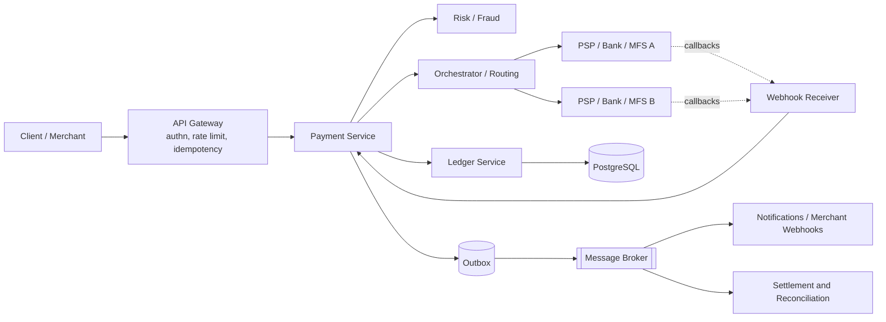
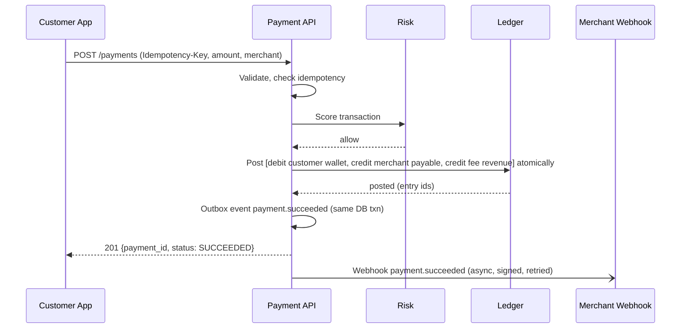
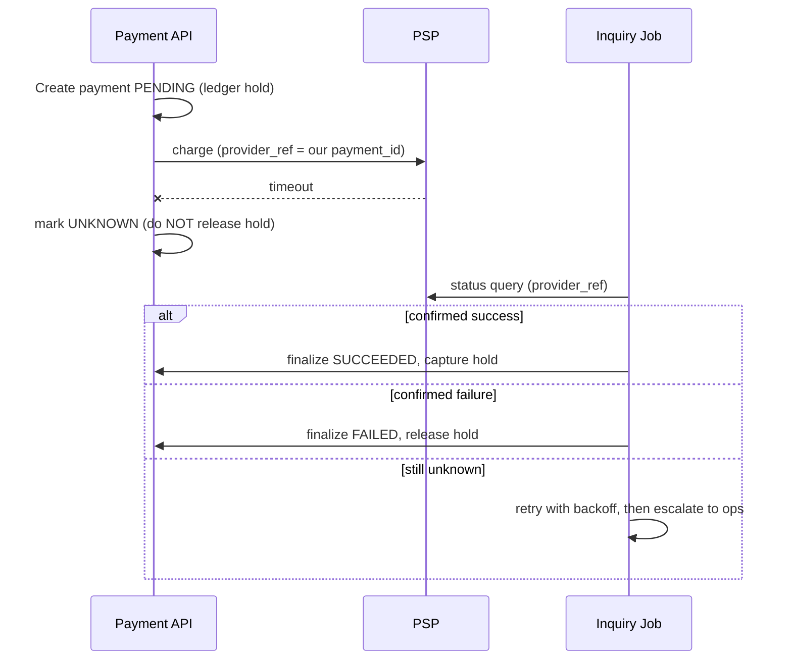
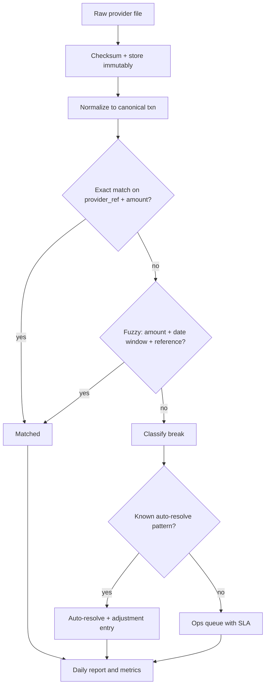
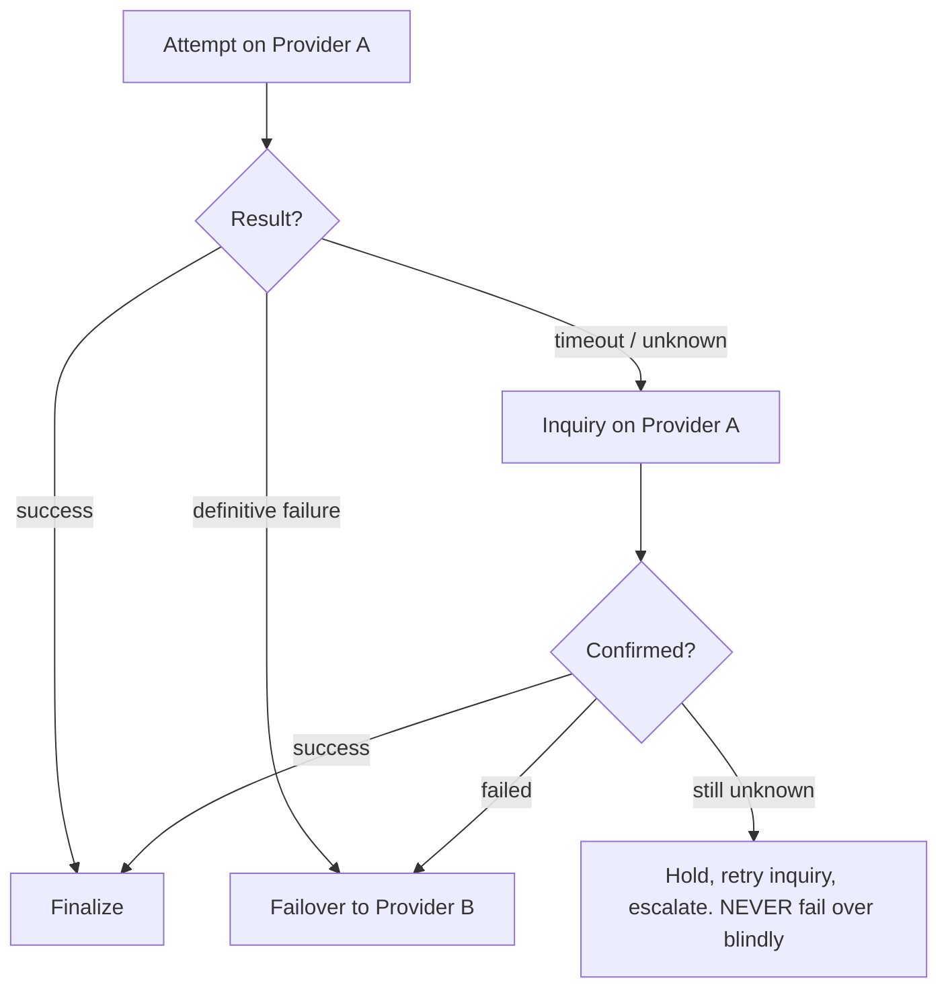

# FinTech Specialist Software Engineer: Complete Roadmap

**For:** a Python/Django backend developer (REST APIs, PostgreSQL, Redis, Celery, Docker, third-party integrations)
**Destination:** FinTech Backend Engineer → Payment Systems Specialist → FinTech Software Architect
**Focus:** financial correctness, security, reliability, compliance, real-world engineering, with attention to Bangladesh and international ecosystems

> **Note on regulations:** laws, circulars and scheme rules change often. Everything under compliance and Bangladesh-specific rules is a learning map, not legal advice. Always verify against the current Bangladesh Bank circulars, BFIU guidance, and scheme/regulator documents before building or certifying anything.

---

## Table of Contents

1. [Purpose, Scope and How to Use This Roadmap](#1-purpose-scope-and-how-to-use-this-roadmap)
2. [Priority Map: What Matters Most](#2-priority-map-what-matters-most)
3. [Skills Gap Analysis](#3-skills-gap-analysis)
4. [Level Overview](#4-level-overview)
5. [Level 1: Beginner (Financial and Payment Foundations)](#5-level-1-beginner-financial-and-payment-foundations)
6. [Level 2: Intermediate (Core Payment Engineering)](#6-level-2-intermediate-core-payment-engineering)
7. [Level 3: Advanced (Distributed Financial Systems)](#7-level-3-advanced-distributed-financial-systems)
8. [Level 4: Specialist (Architecture and Domain Mastery)](#8-level-4-specialist-architecture-and-domain-mastery)
9. [Deep Dive: Payment System Architecture and Workflows](#9-deep-dive-payment-system-architecture-and-workflows)
10. [Deep Dive: Ledger Design and Financial Integrity](#10-deep-dive-ledger-design-and-financial-integrity)
11. [Deep Dive: Financial Mathematics and Monetary Values](#11-deep-dive-financial-mathematics-and-monetary-values)
12. [Deep Dive: Security Engineering for FinTech](#12-deep-dive-security-engineering-for-fintech)
13. [Compliance, Regulation and Standards](#13-compliance-regulation-and-standards)
14. [Bangladesh Financial Ecosystem](#14-bangladesh-financial-ecosystem)
15. [International Payment Ecosystems](#15-international-payment-ecosystems)
16. [Production Engineering Stack](#16-production-engineering-stack)
17. [Choosing Technology: Databases, Queues, Caches, Locks](#17-choosing-technology-databases-queues-caches-locks)
18. [Testing Strategy for Financial Systems](#18-testing-strategy-for-financial-systems)
19. [Emerging Areas](#19-emerging-areas)
20. [Portfolio Projects](#20-portfolio-projects)
21. [System Design Interview Questions](#21-system-design-interview-questions)
22. [Debugging Scenarios](#22-debugging-scenarios)
23. [Realistic Study Plan](#23-realistic-study-plan)
24. [Employability: What to Prioritize](#24-employability-what-to-prioritize)
25. [Career Progression Path](#25-career-progression-path)
26. [Recommended Documentation and Resources](#26-recommended-documentation-and-resources)
27. [Master Checklists](#27-master-checklists)
28. [Appendix: Reference Code and Diagrams](#28-appendix-reference-code-and-diagrams)

---

## 1. Purpose, Scope and How to Use This Roadmap

### 1.1 What FinTech engineering is (and is not)

FinTech engineering is backend engineering where **a bug is a monetary loss, a compliance incident, or both**. The core difference from general backend work:

| General backend | FinTech backend |
|---|---|
| "Eventually works" is acceptable | Every cent must be accounted for, always |
| Retry freely | Retries can double-charge unless idempotent |
| Delete or update rows | Records are append-only and auditable |
| Trust your own database | Reconcile against external truth (banks, schemes, MFS) |
| Security is a feature | Security and compliance are legal obligations |
| Outage = bad UX | Outage = stuck funds, regulatory reports, lost merchants |

### 1.2 The per-topic template used throughout

For each major topic, learn it through these ten questions:

1. **What** is it?
2. **Why** does it matter?
3. **How** does it work internally?
4. **Business use cases**
5. **Common implementation mistakes**
6. **Security risks**
7. **Architectural considerations**
8. **Python/Django implementation**
9. **Exercise**
10. **Completion check** (can I explain it, build it, and break it?)

### 1.3 How to use this file

- Work level by level. Do not skip the completion criteria.
- Every level ends with a **build** and a **break** task: build the thing, then write tests that try to corrupt it.
- Keep a `fintech-journal/` repo: design notes, incident-style postmortems of your own bugs, and ADRs (architecture decision records).
- Spend roughly **40% reading, 60% building**.

---

## 2. Priority Map: What Matters Most

Not all topics are equal. Ranked by real-world impact on hiring and on-the-job correctness:

### Tier 1: Non-negotiable (master first)

| Topic | Why |
|---|---|
| Double-entry ledger design | The source of truth for money |
| Idempotency and duplicate prevention | Prevents double charges |
| Transaction lifecycle and state machines | Every payment flow depends on it |
| Database transactions, isolation, locking | Prevents double spending and race conditions |
| Decimal/money handling and rounding | Prevents silent value drift |
| Webhooks, callbacks, timeouts, retries | Where most production incidents originate |
| Reconciliation | How you detect that everything else failed |
| Security basics (HMAC, TLS, secrets, audit logs) | Mandatory in every FinTech |

### Tier 2: Strongly expected

PSP/gateway integration patterns, settlement and clearing, refunds and chargebacks, KYC/AML basics, RBAC and audit trails, observability, async processing (Celery plus broker), Bangladesh rails (MFS, NPSB, BEFTN).

### Tier 3: Specialist differentiators

Payment orchestration and smart routing, ISO 8583 and ISO 20022, event sourcing, distributed sagas, fraud/risk engines, open banking APIs, cross-border/FX, HSM and key management.

### Tier 4: Awareness only (initially)

Blockchain settlement, stablecoins, deep cryptography internals, advanced ML fraud models. Know the trade-offs; go deep only if your target employer needs it.

---

## 3. Skills Gap Analysis

### 3.1 What you already have (leverage it)

| Existing skill | FinTech application |
|---|---|
| Django/DRF | Wallet, merchant and admin APIs |
| PostgreSQL | The ledger store; you must go deeper on isolation and locking |
| Redis | Rate limits, short-lived idempotency cache (never the source of truth) |
| Celery | Webhook delivery, settlement jobs, retries |
| Docker | Reproducible environments |
| Third-party API integration | PSP and bank integrations |

### 3.2 Gaps to close (in order)

| Gap | Close by |
|---|---|
| Accounting fundamentals (debits/credits, chart of accounts) | Level 1, Project 1 |
| PostgreSQL concurrency (isolation levels, `SELECT ... FOR UPDATE`, advisory locks, constraints) | Level 2 |
| State machines and idempotent consumers | Level 2 |
| Cryptography in practice (HMAC, signatures, key rotation) | Level 2-3 |
| Reconciliation and settlement | Level 3 |
| Distributed consistency (outbox, sagas, exactly-once illusions) | Level 3 |
| Compliance literacy (PCI DSS, KYC/AML) | Level 2-4 |
| Domain knowledge of local rails (Bangladesh) | Parallel track, from Level 1 |
| Observability and incident handling | Level 3 |

### 3.3 Self-assessment (score 0-3 per row, re-run each level)

- Can I explain why `float` must never hold money?
- Can I write a ledger posting that cannot be unbalanced?
- Can I describe what happens if the callback arrives before the API response?
- Can I design a safe retry for a timed-out debit?
- Can I explain T+1 settlement and what a reconciliation break is?

---

## 4. Level Overview

| Level | Name | Duration (part-time, ~12-15 h/week) | Primary outcome | Project |
|---|---|---|---|---|
| 1 | Beginner | 6-8 weeks | Understand money movement, accounting, Decimal, basic security | Wallet + ledger (v1) |
| 2 | Intermediate | 10-12 weeks | Build correct, concurrent, idempotent payment flows | Gateway integration, merchant payments |
| 3 | Advanced | 12-16 weeks | Distributed consistency, reconciliation, observability | Reconciliation engine, monitoring |
| 4 | Specialist | 16+ weeks (ongoing) | Architecture, orchestration, compliance depth, cross-border | Orchestration platform |

Total: roughly **12-18 months** to genuine specialist level, with employability typically reached around the end of Level 2 plus parts of Level 3.

---

## 5. Level 1: Beginner (Financial and Payment Foundations)

### 5.1 Prerequisites
Python proficiency, Django/DRF, SQL basics, REST, Git, Docker basics. (You have these.)

### 5.2 Learning objectives
By the end you can: explain how money moves in a bank, card, and mobile-money payment; model accounts with double-entry; use `Decimal` correctly; and sign/verify requests with HMAC.

### 5.3 Topics

#### 5.3.1 Financial system foundations
- Central bank, commercial banks, payment service providers, MFS operators, schemes, switches, merchants, acquirers, issuers.
- Banking operations: accounts, deposits, withdrawals, interest, overdraft, statements.
- Digital banking vs. mobile financial services vs. wallets.
- **Four-party card model:** cardholder, issuer, merchant, acquirer, plus the scheme (Visa/Mastercard).
- **Money flow vs. information flow:** authorization is information; settlement is the actual movement of funds, usually later.

#### 5.3.2 Core payment vocabulary
Authorization, capture, void, refund, chargeback, settlement, clearing, reconciliation, interchange, MDR (merchant discount rate), payout, disbursement, remittance, escrow, float, nostro/vostro.

#### 5.3.3 Payment methods overview

| Method | Typical flow | Key traits |
|---|---|---|
| Card (credit/debit) | Auth → capture → clearing → settlement | Chargebacks, PCI scope, 3-D Secure |
| Bank transfer | Instruction → clearing → settlement | Batch or real-time, irrevocability |
| Mobile money / wallet | Wallet debit/credit within operator ledger | Cash-in/cash-out via agents |
| Merchant QR | Scan → pay from wallet/bank/card | Interoperability standards |
| Direct debit | Mandate → pull | Mandate management, returns |

#### 5.3.4 Accounting fundamentals (critical)
- **Double-entry bookkeeping:** every transaction posts equal debits and credits; the sum of all entries is always zero (or debits = credits).
- Account types: Assets, Liabilities, Equity, Revenue, Expenses.
- **Normal balances:** assets/expenses increase with debits; liabilities/equity/revenue increase with credits.
- General ledger vs. sub-ledgers (e.g., customer wallet accounts as a sub-ledger controlled by one GL liability account).
- **Chart of accounts (CoA):** structured code list; design it before writing code.
- Fees, commissions, taxes/VAT as separate ledger legs, never as hidden math.

**Example: customer wallet top-up of 1,000.00 via bank, with 10.00 fee**

| Account | Debit | Credit |
|---|---|---|
| Bank settlement account (asset) | 1,000.00 | |
| Customer wallet (liability) | | 990.00 |
| Fee revenue (revenue) | | 10.00 |

Debits 1,000.00 = Credits 1,000.00.

#### 5.3.5 Money and Decimal basics
See [Section 11](#11-deep-dive-financial-mathematics-and-monetary-values). Minimum for Level 1: `Decimal`, `quantize`, rounding modes, storing in `NUMERIC` or integer minor units.

#### 5.3.6 Security basics
Hashing vs. encryption, TLS, HMAC request signing, API key handling, password hashing, never logging secrets or PAN. See [Section 12](#12-deep-dive-security-engineering-for-fintech).

#### 5.3.7 Bangladesh primer (parallel)
Role of Bangladesh Bank; what MFS is (bKash, Nagad, Rocket, Upay); what NPSB, BEFTN, RTGS do at a high level. Details in [Section 14](#14-bangladesh-financial-ecosystem).

### 5.4 Exercises
1. Draw the money flow of a card payment, a wallet P2P transfer, and a cash-in at an agent.
2. Design a chart of accounts for a wallet company (customer wallets, agent float, fee revenue, VAT payable, settlement bank accounts, suspense).
3. Write 10 journal entries by hand: top-up, P2P, merchant payment with commission, refund, withdrawal, fee reversal.
4. Python: implement a `Money` value object (amount `Decimal`, currency, no float coercion) with add/subtract/allocate.
5. Implement HMAC-SHA256 request signing and verification with replay protection (timestamp + nonce).

### 5.5 Completion criteria
- [ ] Explain authorization vs. clearing vs. settlement without notes.
- [ ] Produce balanced journal entries for 10 scenarios.
- [ ] `Money` class passes tests proving no float use and correct rounding/allocation (e.g., splitting 100.00 three ways loses nothing).
- [ ] HMAC verification uses constant-time comparison and rejects replays.

### 5.6 Build: Project 1 v0.1
Minimal ledger tables + wallet account creation + posting API. See [Section 20](#20-portfolio-projects).

---

## 6. Level 2: Intermediate (Core Payment Engineering)

### 6.1 Prerequisites
Level 1 complete. Comfortable with Django ORM transactions.

### 6.2 Learning objectives
Build payment flows that survive retries, concurrency, and partial failures; integrate a gateway; understand webhooks and settlement.

### 6.3 Topics

#### 6.3.1 Transaction lifecycle and state machines
Model payments as explicit finite state machines.

```
CREATED → PENDING → AUTHORIZED → CAPTURED → SETTLED
             │           │            └→ REFUND_PENDING → REFUNDED
             │           └→ VOIDED
             └→ FAILED / EXPIRED / UNKNOWN (timeout, needs inquiry)
```

Rules:
- Allowed transitions are a whitelist; everything else raises.
- Terminal states are immutable.
- Keep a **state transition history** table (append-only).
- Introduce an explicit `UNKNOWN`/`PENDING_INQUIRY` state for timeouts; never guess success or failure.

#### 6.3.2 Idempotency
- **What:** repeated identical requests have the same effect as one.
- **How:** client sends `Idempotency-Key`; server stores `(key, request_hash, response, status)` under a unique constraint; concurrent duplicates are blocked by the constraint or a row lock.
- **Mistakes:** keeping keys only in Redis with TTL (lost on eviction), not comparing request bodies (same key, different amount must be rejected), not scoping keys per merchant/user, returning a new transaction ID on replay.
- Idempotency applies at **every boundary**: your API, your consumers, your outbound calls to PSPs (use their idempotency/reference field).

#### 6.3.3 Concurrency and double-spend prevention
Techniques, from simplest and safest:

1. **Row-level pessimistic lock:** `SELECT ... FOR UPDATE` on the account row inside a transaction. Lock accounts in a **consistent order** (e.g., by ID) to avoid deadlocks.
2. **Conditional atomic update:** `UPDATE accounts SET balance = balance - :amt WHERE id = :id AND balance >= :amt`; check rows affected.
3. **Optimistic concurrency:** version column; retry on conflict.
4. **Serializable isolation** with retry on serialization failure.
5. **Advisory locks** for per-entity serialization (`pg_advisory_xact_lock`).

Avoid: read-modify-write in Python without locks, Redis-only locks guarding database money state, relying on application-level `if balance >= amount`.

#### 6.3.4 Database transactions in Django
- `transaction.atomic()`, `select_for_update()`, `F()` expressions, `on_commit()` for dispatching tasks only after commit.
- Know the PostgreSQL isolation levels (Read Committed default, Repeatable Read, Serializable) and what anomalies each allows.
- Use DB constraints (CHECK, UNIQUE, FK, exclusion) as your last line of defense.

#### 6.3.5 Webhooks and asynchronous callbacks
- Verify signature, timestamp, and source; respond fast (2xx) and process asynchronously.
- Callbacks may arrive **duplicated, out of order, late, or before the API response**. Store raw payload, dedupe by event ID, apply only valid state transitions.
- When no callback arrives: **inquiry/polling job** against the provider's status API.
- Outbound webhooks to merchants: signed, retried with exponential backoff and jitter, dead-letter queue, replay UI.

#### 6.3.6 Timeouts, retries, reversals
- A timeout ≠ failure. Treat as unknown, then query status, then (only if confirmed failed) reverse or release.
- Retries need idempotency; use exponential backoff plus jitter and max attempts.
- **Reversal** vs. **refund** vs. **void:** reversal undoes an unsettled/failed leg (same-day, often automatic); void cancels an authorization; refund returns settled funds as a new transaction.
- Never edit or delete the original ledger entry; post compensating entries.

#### 6.3.7 Payment gateway and PSP integration
Typical flows to learn: hosted checkout/redirect, tokenized/direct API, wallet tokenized agreement, server-to-server confirm, IPN/webhook. Integrate one or two local gateways and one international sandbox (Stripe or similar for learning).

Pattern: create a **provider adapter interface** so each PSP is a plugin:

```python
class PaymentProvider(Protocol):
    def create_payment(self, req: CreatePayment) -> ProviderResult: ...
    def query_status(self, provider_ref: str) -> ProviderStatus: ...
    def refund(self, req: RefundRequest) -> ProviderResult: ...
    def verify_webhook(self, headers: dict, body: bytes) -> VerifiedEvent: ...
```

#### 6.3.8 Settlement, clearing, reconciliation (introduction)
- Clearing: exchange and validation of payment instructions; settlement: final transfer of funds between institutions.
- Settlement cycles (T+0, T+1, T+2), cut-off times, holidays.
- Reconciliation types: **internal** (ledger vs. wallet balances), **external** (ledger vs. provider/bank statement), **three-way** (order vs. ledger vs. bank).
- Break categories: missing at provider, missing internally, amount mismatch, duplicate, timing difference.

#### 6.3.9 Fees, commissions, limits
- Fee engine: fixed, percentage, tiered, min/max caps, per-merchant overrides, effective dating.
- Limits: per transaction, daily/monthly, velocity, per KYC tier. Enforce atomically with the posting.
- Commission splits and settlement to multiple parties (marketplace payouts).

#### 6.3.10 Wallet and merchant domains
Wallet types, KYC tiers, cash-in/cash-out, P2P, bill pay, merchant onboarding, QR acceptance, settlement to merchant bank account, payout schedules, holds/reserves.

### 6.4 Exercises
1. Implement an idempotency middleware/decorator with Postgres-backed keys and request hashing.
2. Write a concurrency test: 100 parallel debits against a balance of 1,000.00 for 50.00 each; assert exactly 20 succeed and final balance is 0.00.
3. Implement a payment state machine with a transition table and history.
4. Build a webhook receiver: signature check, dedupe, out-of-order handling.
5. Simulate a provider timeout and write the inquiry job that resolves it.
6. Implement a fee engine with tiered percentage plus cap, using `Decimal`.

### 6.5 Completion criteria
- [ ] Concurrency tests pass reliably under parallel load.
- [ ] Replaying the same request 50 times yields one ledger posting.
- [ ] Out-of-order and duplicate webhooks never corrupt state.
- [ ] You can explain every state of your payment machine and who can trigger each transition.

---

## 7. Level 3: Advanced (Distributed Financial Systems)

### 7.1 Prerequisites
Level 2 complete; working wallet/ledger with idempotency and a gateway integration.

### 7.2 Learning objectives
Operate financial systems at scale: consistency across services, automated reconciliation, observability, fault tolerance, fraud signals.

### 7.3 Topics

#### 7.3.1 Distributed transactions and eventual consistency
- Why two-phase commit is rare in payments; what replaces it.
- **Transactional outbox:** write business change and outgoing event in the same DB transaction; a relay publishes it.
- **Inbox/idempotent consumer:** dedupe by message ID.
- **Saga pattern:** orchestrated vs. choreographed; compensating actions; saga state persisted.
- **Exactly-once is a design goal achieved by at-least-once delivery + idempotent processing.**
- Money-moving steps must have a compensation or a manual-resolution path.

#### 7.3.2 Event-driven architecture and event sourcing
- Domain events vs. integration events; schema registry and versioning.
- Event store as an append-only log; projections for balances.
- When event sourcing helps (audit, replay, temporal queries) and when it hurts (complexity, GDPR/privacy erasure conflicts, query difficulty).
- In practice, many FinTechs use a **relational double-entry ledger as the source of truth** plus events for integration.

#### 7.3.3 High-volume processing
- Hot-account contention (e.g., one fee account touched by every transaction): use **account sharding / sub-accounts** and periodic aggregation, or batch posting.
- Partition tables by time (monthly/daily); archival policies.
- Bulk settlement and payout batching.
- Queue back-pressure, rate limiting, bulkheads, circuit breakers.
- Measure: TPS, p95/p99 latency, lock wait time, queue lag, reconciliation lag.

#### 7.3.4 Automated reconciliation
Pipeline:
1. **Ingest** provider/bank files (CSV, SFTP, API) with checksums; store raw files immutably.
2. **Normalize** into a canonical format.
3. **Match** (exact key → fuzzy: amount/date/reference windows).
4. **Classify** breaks and auto-resolve known patterns.
5. **Route** unresolved items to an ops queue with SLA.
6. **Report** daily with aging and value at risk.
7. **Post adjustments** as ledger entries (never edits).

#### 7.3.5 Immutable records and audit
- Append-only tables with DB triggers/permissions preventing `UPDATE`/`DELETE`.
- Hash-chained entries (each row stores hash of previous) for tamper evidence.
- Who/what/when/why audit logs for every privileged action; segregation of duties (maker-checker).

#### 7.3.6 Observability
- Structured logs with correlation IDs (payment ID, request ID, provider ref); never log PAN, CVV, secrets.
- Metrics: success rate by provider/method, latency, timeouts, retries, queue depth, break counts, unsettled amount.
- Distributed tracing (OpenTelemetry) across API, Celery, provider calls.
- Alerts on **business invariants**: ledger imbalance, stuck PENDING payments, settlement not received, webhook failure rate.

#### 7.3.7 Reliability, HA and DR
- Postgres replication, failover, backups, PITR; define **RPO/RTO**.
- Multi-AZ deployment, health checks, graceful degradation.
- Disaster recovery drills; runbooks; game days (kill the broker, kill the DB primary, delay the provider).
- Zero-downtime migrations (expand/contract), feature flags.

#### 7.3.8 Fraud and risk (engineering view)
- Rules engine: velocity, amount thresholds, new-device, geo mismatch, blacklists.
- Real-time scoring vs. async review; hold, challenge (OTP/3DS), decline.
- Feedback loop: confirmed fraud/chargebacks feed rules and models.
- Case management workflow, false-positive tracking.

#### 7.3.9 Microservices and DDD for finance
- Bounded contexts: Accounts/Ledger, Payments, Merchants, Risk, Compliance/KYC, Notifications, Settlement/Reconciliation, Reporting.
- The ledger service should be small, strict, and boring; protect it behind a narrow API.
- Don't start with microservices; begin with a **modular monolith** and extract where scaling or team boundaries demand.
- API versioning, backward-compatible schema evolution, consumer-driven contract tests.

### 7.4 Exercises
1. Implement transactional outbox + relay + idempotent consumer with Celery/RabbitMQ or Redis Streams/Kafka.
2. Write a saga for "wallet debit → provider payout → confirm" with compensation and a stuck-saga recovery job.
3. Build a reconciliation job against a synthetic bank statement with injected breaks.
4. Add OpenTelemetry tracing; build a dashboard and an alert for ledger imbalance.
5. Load-test hot-account contention and implement sub-account sharding.
6. Chaos exercise: kill workers mid-transaction; prove no money is lost or duplicated.

### 7.5 Completion criteria
- [ ] Reconciliation catches 100% of injected breaks in tests.
- [ ] Killing any single component mid-flow leaves ledger balanced and flows recoverable.
- [ ] Documented RPO/RTO and a tested restore.
- [ ] Dashboards show business invariants, not only CPU.

---

## 8. Level 4: Specialist (Architecture and Domain Mastery)

### 8.1 Prerequisites
Level 3 complete; production-like experience or equivalent project depth.

### 8.2 Learning objectives
Design platforms, make defensible trade-offs, own compliance interfaces, and mentor others.

### 8.3 Topics

#### 8.3.1 Payment orchestration
- Single API in front of many PSPs/banks/MFS; **smart routing** by cost, success rate, method, amount, time-of-day; failover and retry across providers (with idempotency safeguards so a retry on provider B cannot duplicate a success on provider A).
- Provider health scoring, circuit breakers, routing rules as data (versioned, auditable).
- Unified status model and error taxonomy mapping each provider's codes.
- Tokenization vaults, network tokens, cascading.

#### 8.3.2 Ledger platforms at scale
- Multi-currency ledgers, multi-entity (legal entity) ledgers, intercompany accounts.
- Balance computation strategies: running balance column vs. computed from entries vs. materialized snapshots with checkpoints.
- Holds/pending balances (available vs. ledger balance).
- Period close, accruals, month-end reporting, regulatory reports.

#### 8.3.3 Card and message-level protocols
- **ISO 8583:** bitmap-based message format (MTI, bitmaps, data elements) used by card switches/ATMs/POS; learn message types (0100/0110 auth, 0200/0210 financial, 0400 reversal, 0800 network).
- **ISO 20022:** XML-based rich messaging (pacs.008, pacs.002, pain.001, camt.053); migration of SWIFT, SEPA, and real-time systems.
- EMV basics, 3-D Secure 2, tokenization.

#### 8.3.4 Cross-border and FX
- Correspondent banking, SWIFT messaging, nostro/vostro, SEPA, remittance corridors, FX spread vs. fee, rate locking, cut-offs, sanctions screening.
- FX accounting: realized vs. unrealized gains, position accounts.

#### 8.3.5 Risk, compliance engineering
- Transaction monitoring scenarios, SAR/STR workflows, sanctions list ingestion, PEP screening, risk-based customer scoring, regulatory reporting automation.
- Data retention, privacy, consent, data residency.

#### 8.3.6 Architecture leadership
- ADRs, threat models per system, capacity planning, cost modeling (cost per transaction), build-vs-buy of switch/orchestration/ledger components, vendor risk management.
- Org design for regulated engineering: change management, release approvals, segregation of duties, incident management and post-incident reviews.

### 8.4 Exercises
1. Design an orchestration platform (routing, failover, status normalization) and write an ADR for each major decision.
2. Implement a toy ISO 8583 parser/packer in Python and a mock authorization host.
3. Parse an ISO 20022 `pain.001` and generate `pacs.008`-style output; validate against XSD.
4. Design a multi-currency ledger with FX conversion postings and position accounts.
5. Run a threat-modeling session (STRIDE) on your own platform and fix the top five findings.

### 8.5 Completion criteria
- [ ] You can defend each major architectural choice with trade-offs and failure modes.
- [ ] Orchestrator survives provider failure drills without double-processing.
- [ ] Threat model, DR plan, and compliance mapping documented for the platform.

---

## 9. Deep Dive: Payment System Architecture and Workflows

### 9.1 Reference architecture



### 9.2 Authorization, authentication, processing
- **Authentication (who are you?):** API keys, OAuth 2.0 client credentials, mTLS between institutions, user login + OTP/PIN/biometric.
- **Authorization (may you do this?):** RBAC/ABAC, per-merchant scopes, limits, transaction-level checks.
- **Payment authorization (card sense):** issuer approval that places a hold; do not confuse with access authorization.
- Strong customer authentication: OTP, 3-D Secure, PIN, device binding.

### 9.3 Sample flow: wallet merchant payment



### 9.4 Sample flow: external PSP with timeout



### 9.5 Common implementation mistakes
- Treating the HTTP response as the only source of truth.
- Updating balances without a corresponding ledger entry.
- Releasing funds on timeout.
- Non-idempotent callbacks and retries.
- Mutating historical rows to "fix" issues.
- Tight coupling to one provider's status codes.
- Doing network I/O inside a database transaction holding row locks.

### 9.6 Settlement flow (merchant payouts)
1. Collect successful, unsettled payments up to cut-off.
2. Compute gross, fees, taxes, reserves, net.
3. Create settlement batch and ledger postings (merchant payable → settlement/bank clearing).
4. Generate payout instruction (BEFTN/bank API/MFS disbursement).
5. Await confirmation; mark settled; handle failures/returns.
6. Reconcile payout against bank statement.

### 9.7 Refunds and chargebacks
- **Refund:** merchant-initiated; full or partial; cannot exceed captured minus already refunded; new transaction linked to the original; fees treatment defined per contract.
- **Chargeback (card):** issuer-initiated dispute: retrieval request → chargeback → representment → pre-arbitration → arbitration. Engineering needs: evidence storage, deadlines, state tracking, ledger entries for provisional debit and recovery.

---

## 10. Deep Dive: Ledger Design and Financial Integrity

### 10.1 Principles
1. Every movement of value is a **journal entry** with ≥2 lines; debits equal credits **per currency**.
2. **Append-only:** corrections are reversing/adjusting entries.
3. Balances are derived from (or verified against) entries.
4. Each entry references the business event that caused it (payment ID, idempotency key).
5. Posting is atomic: all lines or none.
6. Integrity is enforced in the database, not only the app.

### 10.2 Reference schema (PostgreSQL)

```sql
CREATE TABLE ledger_account (
    id            BIGSERIAL PRIMARY KEY,
    code          TEXT NOT NULL UNIQUE,            -- chart of accounts code
    name          TEXT NOT NULL,
    type          TEXT NOT NULL CHECK (type IN ('ASSET','LIABILITY','EQUITY','REVENUE','EXPENSE')),
    currency      CHAR(3) NOT NULL,
    parent_id     BIGINT REFERENCES ledger_account(id),
    owner_type    TEXT,                            -- e.g. 'customer_wallet'
    owner_id      TEXT,
    allow_negative BOOLEAN NOT NULL DEFAULT FALSE,
    status        TEXT NOT NULL DEFAULT 'ACTIVE',
    created_at    TIMESTAMPTZ NOT NULL DEFAULT now()
);

CREATE TABLE journal_entry (
    id               BIGSERIAL PRIMARY KEY,
    idempotency_key  TEXT NOT NULL UNIQUE,
    entry_type       TEXT NOT NULL,                -- PAYMENT, REFUND, FEE, ADJUSTMENT, REVERSAL
    reference_type   TEXT NOT NULL,
    reference_id     TEXT NOT NULL,
    reverses_id      BIGINT REFERENCES journal_entry(id),
    description      TEXT,
    effective_date   DATE NOT NULL,
    created_at       TIMESTAMPTZ NOT NULL DEFAULT now(),
    created_by       TEXT NOT NULL
);

CREATE TABLE journal_line (
    id             BIGSERIAL PRIMARY KEY,
    entry_id       BIGINT NOT NULL REFERENCES journal_entry(id),
    account_id     BIGINT NOT NULL REFERENCES ledger_account(id),
    direction      CHAR(1) NOT NULL CHECK (direction IN ('D','C')),
    amount_minor   BIGINT NOT NULL CHECK (amount_minor > 0),   -- integer minor units
    currency       CHAR(3) NOT NULL,
    created_at     TIMESTAMPTZ NOT NULL DEFAULT now()
);
CREATE INDEX ON journal_line (account_id, id);
CREATE INDEX ON journal_line (entry_id);

-- Cached balance (verified continuously against lines)
CREATE TABLE account_balance (
    account_id       BIGINT PRIMARY KEY REFERENCES ledger_account(id),
    balance_minor    BIGINT NOT NULL,       -- signed in the account's normal direction
    last_line_id     BIGINT NOT NULL,
    version          BIGINT NOT NULL DEFAULT 0,
    updated_at       TIMESTAMPTZ NOT NULL DEFAULT now()
);
```

Enforce balanced entries with a **deferred constraint trigger** that checks `SUM(debits) = SUM(credits)` per entry and currency at commit, and block `UPDATE`/`DELETE` on `journal_entry` and `journal_line` via triggers and revoked privileges.

```sql
CREATE OR REPLACE FUNCTION forbid_mutation() RETURNS trigger AS $$
BEGIN
  RAISE EXCEPTION 'ledger tables are append-only';
END; $$ LANGUAGE plpgsql;

CREATE TRIGGER journal_line_immutable
BEFORE UPDATE OR DELETE ON journal_line
FOR EACH ROW EXECUTE FUNCTION forbid_mutation();
```

### 10.3 Posting in Django (pattern)

```python
from decimal import Decimal
from django.db import transaction, IntegrityError

class InsufficientFunds(Exception): ...
class DuplicatePosting(Exception): ...

@transaction.atomic
def post_transfer(*, idem_key, from_acct_id, to_acct_id, amount_minor, ref_type, ref_id, actor):
    if amount_minor <= 0:
        raise ValueError("amount must be positive")

    # Idempotency: unique key makes the second concurrent attempt fail or return the original
    try:
        entry = JournalEntry.objects.create(
            idempotency_key=idem_key, entry_type="TRANSFER",
            reference_type=ref_type, reference_id=ref_id,
            effective_date=timezone.localdate(), created_by=actor,
        )
    except IntegrityError:
        return JournalEntry.objects.get(idempotency_key=idem_key)  # replay -> same result

    # Lock in deterministic order to avoid deadlocks
    ids = sorted([from_acct_id, to_acct_id])
    balances = {
        b.account_id: b
        for b in AccountBalance.objects.select_for_update().filter(account_id__in=ids).order_by("account_id")
    }
    src = balances[from_acct_id]
    if not src.account.allow_negative and src.balance_minor < amount_minor:
        raise InsufficientFunds()

    JournalLine.objects.bulk_create([
        JournalLine(entry=entry, account_id=from_acct_id, direction="D", amount_minor=amount_minor, currency="BDT"),
        JournalLine(entry=entry, account_id=to_acct_id,   direction="C", amount_minor=amount_minor, currency="BDT"),
    ])
    # Customer wallets are liabilities: a debit to the wallet decreases it, credit increases it.
    AccountBalance.objects.filter(account_id=from_acct_id).update(balance_minor=F("balance_minor") - amount_minor, version=F("version") + 1)
    AccountBalance.objects.filter(account_id=to_acct_id).update(balance_minor=F("balance_minor") + amount_minor, version=F("version") + 1)
    return entry
```

> Careful with sign conventions: decide and document how `balance_minor` relates to debit/credit per account type, and test it exhaustively. A customer wallet is a *liability* to the operator, so crediting it increases the balance.

### 10.4 Available vs. ledger balance and holds
- **Ledger (posted) balance:** sum of posted lines.
- **Available balance:** ledger balance minus active holds.
- Holds are rows with amount, expiry, and state (ACTIVE, CAPTURED, RELEASED); capture converts to postings; expiry job releases.

### 10.5 Integrity verification (run continuously)
- Per entry: debits = credits.
- Globally: total debits = total credits per currency.
- Per account: `account_balance` = replay of lines.
- Wallet sub-ledger total = control account balance in GL.
- Alert and halt the affected flow on any violation.

### 10.6 Mistakes to avoid
- Storing only a mutable `balance` column (no lines).
- Using `float`, or mixing currencies in a single entry.
- Posting fees as an afterthought in separate non-atomic transactions.
- Allowing deletes/updates "just this once".
- Lock ordering inconsistencies causing deadlocks.
- Reading balances outside the transaction that writes.
- No suspense/clearing accounts, which leaves nowhere to park unresolved items.

### 10.7 Exercises
1. Implement the schema above with the balance trigger and immutability trigger; write tests that attempt violations.
2. Add holds, capture, release, and expiry.
3. Build the continuous verifier as a Celery beat job with metrics.
4. Implement reversals that mirror the original lines and link `reverses_id`.
5. Replay lines to rebuild balances from scratch and compare.

---

## 11. Deep Dive: Financial Mathematics and Monetary Values

### 11.1 Rules for money in code
1. Never use `float` for money.
2. Store as **integer minor units** (poisha/cents) or `NUMERIC(p, s)` with a fixed scale. Pick one and be consistent.
3. Always carry the **currency** with the amount; never add different currencies.
4. Apply rounding only at defined points, with a documented mode.
5. Allocate remainders deterministically (largest remainder or first-N rule).

### 11.2 Python `Decimal` essentials

```python
from decimal import Decimal, ROUND_HALF_UP, ROUND_HALF_EVEN, getcontext

getcontext().prec = 28
amount = Decimal("1234.565")
print(amount.quantize(Decimal("0.01"), rounding=ROUND_HALF_UP))    # 1234.57
print(amount.quantize(Decimal("0.01"), rounding=ROUND_HALF_EVEN))  # 1234.56  (banker's rounding)

# Never: Decimal(0.1)  -> inexact; always: Decimal("0.1")
```

- Create from **strings** or integers.
- Parse API input directly into `Decimal` (e.g., DRF `DecimalField`), never through float JSON parsing paths where avoidable.
- Django: `DecimalField(max_digits=..., decimal_places=...)`; for ledgers prefer `BigIntegerField` minor units.

### 11.3 Allocation without losing a cent

```python
def allocate(total_minor: int, ratios: list[int]) -> list[int]:
    total_ratio = sum(ratios)
    shares = [total_minor * r // total_ratio for r in ratios]
    remainder = total_minor - sum(shares)
    for i in range(remainder):           # distribute leftover minor units
        shares[i % len(shares)] += 1
    return shares

assert allocate(100, [1, 1, 1]) == [34, 33, 33]
assert sum(allocate(100, [1, 1, 1])) == 100
```

### 11.4 Core formulas to master

| Topic | Formula / idea |
|---|---|
| Simple interest | `I = P × r × t` |
| Compound interest | `A = P (1 + r/n)^(n·t)` |
| Effective annual rate | `EAR = (1 + r/n)^n − 1` |
| Loan EMI (amortization) | `EMI = P · r(1+r)^n / ((1+r)^n − 1)` (r = periodic rate) |
| Amortization schedule | each period: interest = balance × r; principal = EMI − interest; balance −= principal |
| Percentage fee | `fee = round(amount × rate)` with cap/min |
| FX conversion | `target = source × rate`, round per currency exponent; spread = (mid − applied)/mid |
| Day count | actual/365, actual/360, 30/360 (know which the product uses) |

### 11.5 Amortization in Python (schedule with final-period correction)

```python
from decimal import Decimal, ROUND_HALF_UP
TWO = Decimal("0.01")

def schedule(principal: Decimal, annual_rate: Decimal, months: int):
    r = annual_rate / Decimal(12)
    if r == 0:
        emi = (principal / months).quantize(TWO, ROUND_HALF_UP)
    else:
        f = (1 + r) ** months
        emi = (principal * r * f / (f - 1)).quantize(TWO, ROUND_HALF_UP)
    bal, rows = principal, []
    for m in range(1, months + 1):
        interest = (bal * r).quantize(TWO, ROUND_HALF_UP)
        pay = emi if m < months else bal + interest   # last payment clears rounding drift
        principal_part = pay - interest
        bal -= principal_part
        rows.append((m, pay, interest, principal_part, bal))
    return rows
```

### 11.6 Rounding strategy decisions (document each)
- Rounding mode (half-up vs. half-even), per currency exponent (BDT/USD: 2, JPY: 0, KWD/BHD: 3).
- Round per line vs. per total (affects tax/VAT totals; regulators and contracts often dictate).
- Where rounding differences go (rounding/suspense account), never silently dropped.

### 11.7 Property-based tests (Hypothesis)
- `allocate` always sums to the total.
- Round-trip conversions stay within a defined tolerance.
- Fee engine never exceeds the amount; never negative.

### 11.8 Exercises
Implement `Money`, allocation, fee tiers, amortization, and an FX converter with spread; test with Hypothesis.

---

## 12. Deep Dive: Security Engineering for FinTech

### 12.1 Encryption
- **In transit:** TLS 1.2+ (prefer 1.3), strong ciphers, HSTS, certificate management/rotation. Internal service traffic also encrypted (mTLS).
- **At rest:** disk/DB encryption plus **field-level/application-level encryption** for sensitive data (account numbers, national IDs). Use envelope encryption: data keys encrypted by a master key in a KMS/HSM.
- **Never roll your own crypto.** Use vetted libraries (`cryptography`, `PyNaCl`).

### 12.2 Hashing, MAC, signatures

| Primitive | Use | Notes |
|---|---|---|
| Password hash (Argon2id/bcrypt/scrypt) | Credentials/PINs | Slow, salted; Django's default hashers |
| SHA-256 | Integrity, fingerprints | Not for passwords |
| **HMAC-SHA256** | Webhook/request authenticity with shared secret | Constant-time compare |
| RSA/ECDSA signatures | Non-repudiation, bank/partner APIs | Private key in HSM/KMS; rotate |
| AES-GCM | Data encryption | Unique nonce per encryption |

Webhook verification:

```python
import hmac, hashlib, time

def verify_webhook(secret: bytes, body: bytes, signature_hex: str, timestamp: str, tolerance=300) -> bool:
    if abs(time.time() - int(timestamp)) > tolerance:
        return False                                    # replay window
    expected = hmac.new(secret, timestamp.encode() + b"." + body, hashlib.sha256).hexdigest()
    return hmac.compare_digest(expected, signature_hex)  # constant-time
```

### 12.3 Identity and access
- **OAuth 2.0:** client credentials for server-to-server; authorization code + PKCE for user-facing apps.
- **OpenID Connect:** identity layer on OAuth for login/SSO.
- **mTLS:** both sides present certificates; common for bank/switch connectivity.
- **API keys:** scoped, hashed at rest, rotatable, per-environment; IP allowlisting where partners support it.
- **RBAC** with least privilege; **maker-checker** for sensitive actions (refunds, limit changes, manual adjustments); short-lived admin access.

### 12.4 Secrets management
Keep secrets out of code/Git/images; use Vault/cloud secret managers; rotation policies; separate per environment; scan commits (gitleaks); never print secrets in logs or error pages.

### 12.5 Audit logging
Immutable, tamper-evident, time-synced; record actor, action, target, before/after, source IP, request ID; protect and retain per regulation; alert on anomalous privileged activity.

### 12.6 Threat modeling and secure coding
- STRIDE per data flow; abuse cases (replay, race conditions, enumeration, mass assignment, IDOR, SSRF through webhook URLs).
- Validate all input; parameterized queries; output encoding; CSRF for cookie-based sessions; rate limit and lockout; OTP brute-force protection.
- Business-logic abuse: negative amounts, rounding exploitation, limit bypass by splitting, parallel requests (race).
- Dependency scanning, SAST/DAST, container scanning, signed images.

### 12.7 Penetration-testing fundamentals
OWASP Top 10 and API Security Top 10; tools: Burp Suite, OWASP ZAP; practice on intentionally vulnerable apps; test your own wallet API for IDOR, race conditions (parallel requests), replay, and auth bypass.

### 12.8 Card data security (PCI DSS view)
- Avoid touching card data: use hosted fields/redirect/tokenization to **minimize PCI scope**.
- Never store CVV after authorization; mask PAN; encrypt/tokenize stored PAN; key management controls; network segmentation; logging and monitoring; regular scans and pen tests.

### 12.9 Exercises
1. Add HMAC-signed webhooks with rotation (two active secrets).
2. Implement envelope encryption for a sensitive field with key rotation.
3. Exploit then fix a race condition in a deliberately naive transfer endpoint.
4. Write a STRIDE threat model for the wallet API.

---

## 13. Compliance, Regulation and Standards

### 13.1 Why engineers need this
Compliance shapes data models (KYC records, audit trails), flows (holds, screening), retention, and reporting. Engineers who understand it are far more valuable.

### 13.2 Key frameworks (international)

| Area | What it covers | Engineering implications |
|---|---|---|
| **PCI DSS** | Card data protection | Scope minimization, tokenization, encryption, logging, segmentation, vulnerability management |
| **KYC / CDD / EDD** | Verify customer identity; enhanced diligence for higher risk | Tiered accounts and limits, document capture, verification workflow, periodic review |
| **AML / CFT** | Detect and report suspicious activity | Transaction monitoring rules, case management, STR/SAR filing, record retention |
| **Sanctions screening** | Block listed persons/entities (UN, OFAC, others) | Name matching (fuzzy), list ingestion, real-time and batch screening, false-positive handling |
| **FATF Recommendations** | Global AML/CFT standards (incl. Travel Rule for transfers) | Originator/beneficiary data carried with transfers |
| **Data privacy (e.g., GDPR-style laws)** | Lawful processing, consent, minimization, rights | Data classification, retention/erasure, access controls, cross-border transfer rules |
| **Consumer protection** | Fair fees, disclosure, dispute handling | Transparent fee records, complaint and dispute workflows |
| **Operational resilience / outsourcing rules** | Vendor risk, continuity | DR plans, exit strategies, SLA monitoring |
| **ISO 27001 / SOC 2** | Information security management | Policies, evidence, access reviews, change management |

### 13.3 Responsibilities
- **Financial institutions (banks):** licensed deposit-taking, prudential rules, full KYC/AML, capital and liquidity.
- **Payment service providers / MFS operators:** licensed under payments regulation; safeguard customer funds (trust/escrow-like accounts), KYC, transaction limits, reporting, agent oversight.
- **Technology vendors:** contractual and regulatory obligations through their clients; security attestations.

### 13.4 International standards vs. local requirements
- International standards (PCI DSS, FATF, ISO 20022, EMV) provide a **common baseline**.
- Local law adds: licensing categories, transaction/balance limits, data localization, reporting formats and deadlines, approved communication channels, local currency rules, local scheme participation.
- **Approach:** build to the strictest common baseline; make local rules **configuration** (limits, tiers, report formats) rather than code forks.

### 13.5 Engineering patterns for compliance
- Configurable limit engine by KYC tier/product/jurisdiction.
- Immutable audit trail and evidence store.
- Screening hooks on onboarding and on each relevant transaction.
- Case management with SLAs and four-eyes approval.
- Data retention schedules and legal-hold support.
- Regulatory report generators (testable, versioned).

---

## 14. Bangladesh Financial Ecosystem

> Verify all details against current Bangladesh Bank publications; the landscape evolves quickly.

### 14.1 Players and rails

| Component | What it is | Engineering relevance |
|---|---|---|
| **Bangladesh Bank (BB)** | Central bank, regulator, operator of national payment infrastructure | Licensing, circulars, limits, reporting |
| **BFIU** | Bangladesh Financial Intelligence Unit (AML/CFT) | STR reporting, guidance |
| **Banks** | Commercial banks, including Islamic banks | Core banking integrations, APIs, host-to-host |
| **MFS providers** | e.g., bKash, Nagad, Rocket, Upay (bank-led or other licensed models) | Wallet APIs, cash-in/out, merchant payments, disbursement |
| **PSPs / PSOs** | Licensed payment service providers and operators | Gateway, aggregation, wallets under license |
| **Local payment gateways** | e.g., SSLCommerz, aamarPay, ShurjoPay and similar | Hosted checkout, IPN/callbacks, merchant onboarding |
| **NPSB** | National Payment Switch Bangladesh: interbank switch for cards/ATM/POS/internet and fund-transfer interoperability | Card-based and account-based interbank transactions |
| **BEFTN** | Bangladesh Electronic Funds Transfer Network: batch ACH-style credit/debit | Salary, bulk payouts, bill collection; batch files, return handling |
| **BD-RTGS** | Real-time gross settlement for high-value, time-critical payments | High-value interbank settlement; cut-offs |
| **Binimoy (IDTP)** | Interoperable digital transaction platform for real-time interoperability across banks and MFS | Real-time account/wallet interoperability |
| **Bangla QR** | National interoperable QR standard (EMV QR-based) | QR generation/parsing, merchant acceptance across schemes |
| **NPS** | National payment switch services (commonly used term alongside NPSB) | Check current naming and scope in BB documentation |
| **Cards** | Local schemes and Visa/Mastercard/UnionPay etc. | PCI DSS, 3-D Secure, local issuer/acquirer rules |

### 14.2 Regulatory landscape to study (verify current versions)
- Payment and settlement systems legislation and regulations (payment systems oversight, PSP/PSO licensing, MFS guidelines).
- Mobile Financial Services regulations (agent rules, limits, KYC tiers, distributor/agent structures).
- Money Laundering Prevention law and Anti-Terrorism law; BFIU circulars (KYC, STR/CTR).
- Foreign exchange regulations for inward/outward remittance and foreign payments.
- Data protection and cyber security legislation (check status and scope).
- BB circulars on interoperability, QR, fees/charges, cash-out limits and e-KYC.

### 14.3 Typical Bangladesh integration patterns
- **Gateway checkout:** create session → redirect → IPN + return URL → **server-side validation** with the gateway before fulfillment (never trust the redirect alone).
- **MFS merchant API:** token grant → create payment → customer authorizes in wallet app → execute/query → callback.
- **Disbursement:** bulk payout via MFS or bank API; asynchronous results; retries must be idempotent via your reference.
- **BEFTN batch:** generate files in the bank's format, cut-off times, return/reject processing the next cycle; reconcile on return files.
- **Bank APIs / host-to-host:** SFTP + PGP or mTLS API; statement files (e.g., MT940/camt-like or bank CSV) for reconciliation.
- **Bangla QR:** parse TLV fields, validate CRC, map to merchant, route payment by scheme.

### 14.4 Local engineering realities
- Variable provider reliability and documentation quality → build adapters, strong inquiry jobs, and defensive parsing.
- Settlement and cut-off calendars (Bangladesh weekend is Friday-Saturday; holidays) → business-day calculators.
- Bangla/English names in KYC and screening → Unicode normalization and transliteration-aware matching.
- NID verification and e-KYC workflows through approved channels.
- BDT has 2 decimal places (poisha); store minor units.
- High mobile-first usage: USSD/app/OTP flows and SMS delivery reliability matter.

### 14.5 Exercises
1. Map money flows for: MFS cash-in at an agent, merchant payment via Bangla QR, bank-to-wallet via interoperability, salary payout via BEFTN.
2. Build a BEFTN-style batch file generator with validation and a return-file processor.
3. Implement a Bangla QR (TLV + CRC16) parser/generator.
4. Write a Bangladesh business-day calendar service for settlement dates.

---

## 15. International Payment Ecosystems

| System | Type | Key points |
|---|---|---|
| **Card networks (Visa, Mastercard, UnionPay, others)** | Four-party scheme | Auth/clearing/settlement, interchange, scheme fees, chargeback rules, tokenization |
| **ISO 8583** | Message standard | Binary/ASCII bitmap messages for card auth/financial/reversal/network management |
| **ISO 20022** | Rich XML messaging | Replacing legacy formats; richer structured data; used by SWIFT CBPR+, SEPA, many RTPs |
| **SWIFT** | Messaging network | Instructs transfers via correspondent banks; MT to MX (ISO 20022) migration; gpi tracking |
| **SEPA** | Eurozone payments | SCT, SCT Inst (instant), SDD (direct debit); IBAN/BIC |
| **ACH (US)** | Batch bank network | Credits/debits, windows, returns (R-codes), NACHA rules |
| **Fedwire** | US RTGS | High-value, real-time gross settlement |
| **Faster payments / RTP / FedNow / UPI / PIX** | Real-time rails | 24/7, irrevocable, request-to-pay, QR/alias addressing |
| **Open banking** | API access to bank data/payments | Consent, strong authentication, standardized APIs |

### 15.1 Cross-border payment processing
Flow: sender bank/PSP → FX and fees → compliance screening → messaging (SWIFT/partner) → correspondent chain → beneficiary bank → credit. Challenges: cost, speed, transparency, sanctions/AML, returns, regulatory reporting. Engineering: quote service with rate locks, payment tracking, status mapping, repair queues for failed messages, nostro reconciliation.

### 15.2 ISO 8583 learning path
1. Understand MTI (e.g., 0100, 0110, 0200, 0210, 0400, 0410, 0800).
2. Parse the primary/secondary bitmap.
3. Learn key data elements (PAN, processing code, amount, STAN, RRN, response code, terminal ID).
4. Implement pack/unpack and an auth simulator; handle reversals on timeout.
5. Study field-level encryption (PIN block, key exchange) conceptually; PIN handling belongs in HSMs.

### 15.3 ISO 20022 learning path
Study message families: `pain` (initiation), `pacs` (interbank clearing/settlement), `camt` (reporting/statements). Work with XSD validation, namespaces, and structured vs. unstructured remittance information.

---

## 16. Production Engineering Stack

### 16.1 Application layer (Python/Django/DRF)
- **Modular monolith** layout: `ledger/`, `payments/`, `merchants/`, `risk/`, `kyc/`, `settlement/`, `notifications/`, each with its own services layer; views stay thin.
- Domain services and repositories; keep ORM calls for money paths in a small, audited module.
- DRF: serializers with `DecimalField`/integer minor units, explicit versioned routes (`/v1/`), pagination, consistent error model, throttling.
- Disable debug, set strict `ALLOWED_HOSTS`, secure cookies, CSP, and disable sensitive data in Django admin or restrict it heavily.

### 16.2 Data layer
- PostgreSQL: constraints, partial/unique indexes, partitioning, `pg_stat_statements`, connection pooling (PgBouncer), logical replication for read models, PITR backups.
- Migrations: expand/contract, never lock large tables carelessly (`CREATE INDEX CONCURRENTLY`), backfill in batches, review every migration touching money tables.

### 16.3 Async and messaging
- **Celery** for jobs (retries with backoff, `acks_late`, idempotent tasks, task time limits).
- Brokers: RabbitMQ (routing, DLQs) or Kafka (log, replay, high throughput); Redis as broker is acceptable for lower-criticality jobs but understand durability limits.
- DLQs, poison-message handling, replay tooling, per-queue priorities (payment finalization above email).

### 16.4 Infrastructure
- **Docker** images (minimal, pinned, scanned), Docker Compose for local; Kubernetes/ECS for production when justified.
- **Linux** skills: networking, TLS debugging (`openssl s_client`), `tcpdump`, systemd, resource limits, log analysis.
- **CI/CD:** lint, type check (mypy), tests, SAST, dependency/container scan, migration check, build, staged deployment (canary/blue-green), approvals for production, automated rollback.
- **Cloud:** VPC isolation, private subnets for DB, security groups, WAF, KMS/HSM, secret manager, multi-AZ; consider data residency requirements.

### 16.5 Observability
Logs (structured), metrics (Prometheus/Grafana or cloud), traces (OpenTelemetry), error tracking, uptime/synthetic checks, SLOs (e.g., 99.95% payment API availability, p99 latency), on-call and runbooks.

### 16.6 Performance optimization
Index by access path; avoid N+1; batch writes; keep transactions short (no network calls inside); shard hot accounts; cache **read-only** reference data (never balances as truth); use async for non-critical work; load-test with realistic concurrency and failure injection.

### 16.7 Fault tolerance patterns
Timeouts everywhere, retries with jitter, circuit breakers, bulkheads, idempotent operations, dead-letter queues, graceful degradation (e.g., queue payouts when provider is down), health-based routing.

### 16.8 API versioning and schema evolution
Additive changes by default; version breaking changes; deprecation policy; tolerate unknown fields; consumer-driven contracts; versioned event schemas with a registry.

---

## 17. Choosing Technology: Databases, Queues, Caches, Locks

| Tool | Good for | Dangerous when |
|---|---|---|
| **PostgreSQL (relational)** | Ledger, balances, payments, idempotency keys: ACID, constraints, locking | Used without constraints or with weak isolation assumptions |
| **Event store / Kafka log** | Audit streams, integration events, replay, projections | Used as the *only* place balances live without strong invariants |
| **Message queue (RabbitMQ/SQS/Celery)** | Async work, retries, decoupling | Assuming exactly-once; no idempotency; losing messages on broker failure |
| **Redis cache** | Rate limiting, sessions, short TTL lookups, ephemeral dedupe hints | Treated as the source of truth for balances/idempotency; eviction or failover loses data |
| **Distributed lock (Redis/etcd/ZooKeeper)** | Coordinating non-DB resources, leader election, job singletons | Used to protect money state instead of DB locks; lock expiry + pauses cause double execution |
| **NoSQL document store** | Flexible logs, provider payload archives, search | Used for multi-record financial atomicity it can't guarantee |
| **Search (Elasticsearch)** | Ops search, transaction exploration | Used as a system of record |
| **Object storage** | Raw provider files, statements, evidence, archives | No immutability/retention controls |

Rules of thumb:
1. **Money state lives in the relational DB transaction.** Everything else is derived, cached, or transient.
2. A distributed lock is an optimization; the **database constraint is the correctness guarantee** (use fencing tokens or version checks).
3. Anything that can be redelivered must be idempotent.
4. Prefer fewer moving parts; every added system is another failure mode and compliance surface.

---

## 18. Testing Strategy for Financial Systems

| Test type | What to verify | Tools |
|---|---|---|
| **Unit** | Money math, fee engine, state transitions, allocation | pytest |
| **Property-based** | Invariants over random inputs: balanced entries, allocation sums, no negative fees | Hypothesis |
| **Integration** | DB constraints, ledger postings, Celery tasks, outbox relay | pytest-django, testcontainers |
| **Contract** | Provider adapter vs. recorded provider behavior; merchant webhook schema; service-to-service | Pact, schema validation, VCR-style recordings |
| **Concurrency** | Parallel debits, duplicate requests, deadlock-free ordering | threads/multiprocessing, `pytest-xdist`, load tools |
| **Failure simulation** | Timeouts, 5xx, duplicate/out-of-order webhooks, broker/DB outage, crash mid-transaction | toxiproxy, fault injection, chaos scripts |
| **Security** | AuthN/Z, IDOR, replay, injection, rate limits, signature verification | OWASP ZAP, custom tests, Bandit |
| **Reconciliation** | Injected breaks detected; adjustments post correctly; idempotent reruns | synthetic statement generators |
| **End-to-end** | Full payment workflow across services in a staging environment with provider sandboxes | pytest + docker-compose, Playwright for checkout |
| **Performance** | TPS, latency under contention, hot-account behavior | Locust, k6 |

### 18.1 Invariants to assert in nearly every test
- Sum of debits = sum of credits (global and per entry).
- No account below its allowed minimum.
- Payment state is reachable via allowed transitions only.
- One idempotency key → at most one ledger effect.
- Wallet sub-ledger total = GL control account.

### 18.2 Example concurrency test (pattern)

```python
import threading
import pytest

@pytest.mark.django_db(transaction=True)
def test_no_double_spend():
    acct = make_wallet(balance_minor=100_000)        # 1,000.00
    results = []
    def worker(i):
        try:
            post_transfer(idem_key=f"k{i}", from_acct_id=acct.id, to_acct_id=sink.id,
                          amount_minor=5_000, ref_type="t", ref_id=str(i), actor="test")
            results.append("ok")
        except InsufficientFunds:
            results.append("insufficient")
    threads = [threading.Thread(target=worker, args=(i,)) for i in range(100)]
    [t.start() for t in threads]; [t.join() for t in threads]
    assert results.count("ok") == 20
    assert get_balance(acct.id) == 0
    assert ledger_is_balanced()
```

### 18.3 Test data and environments
Use deterministic fixtures, fake clocks (freezegun/time-machine) for expiry and cut-offs, sandbox credentials, and never real card data or production data in lower environments (mask/synthesize).

---

## 19. Emerging Areas

| Area | What it is | Practical use | Limitations |
|---|---|---|---|
| **Open banking** | Consent-based API access to account data/payments | Account aggregation, pay-by-bank, affordability checks | Bank API inconsistency, consent UX, regulatory variation |
| **Banking-as-a-Service (BaaS)** | Licensed bank exposes accounts/cards via API | Launch wallets/cards without a license | Dependence on sponsor bank, compliance burden stays with you |
| **Embedded finance** | Financial products inside non-financial apps | Checkout lending, merchant capital, insurance | Regulatory perimeter, risk concentration |
| **Payment orchestration platforms** | Unified layer over many PSPs | Higher approval rates, cost routing, resilience | Added complexity, new single point of failure |
| **Real-time payments** | 24/7 instant irrevocable transfers | Instant payouts, account-to-account commerce | Irrevocability raises fraud risk; liquidity management |
| **Blockchain-based settlement** | Shared ledger settlement | Cross-border treasury, tokenized assets | Regulatory uncertainty, volatility, on/off-ramp friction, finality models |
| **Stablecoins** | Tokens pegged to fiat | Cross-border settlement, treasury | Reserve/regulatory risk, depeg risk, compliance requirements |
| **Tokenization** | Replace sensitive data with tokens (PAN, network tokens) | Reduce PCI scope, secure recurring payments | Token vault becomes critical dependency |
| **AI-powered fraud detection** | ML scoring, anomaly detection, graph analysis | Reduce fraud losses and false positives | Data drift, explainability, adversarial adaptation, bias; keep human review and rules as guardrails |

Study depth: awareness for all; deep dive into **payment orchestration, real-time payments, tokenization, and fraud ML basics** first.

---

## 20. Portfolio Projects

Build in order. Each project must have: README with architecture, ADRs, OpenAPI spec, tests with invariants, Docker Compose, and a production-readiness checklist.

### 20.0 Common project template

| Section | Contents |
|---|---|
| Business requirements | Actors, features, non-goals |
| Architecture | Diagram, components, data flow |
| Database design | ERD, constraints, indexes |
| API contracts | OpenAPI, idempotency, error model, versioning |
| Transaction workflows | Sequence diagrams, state machines |
| Security | Authn/z, secrets, encryption, audit, threat model |
| Failure scenarios | Table of failures and expected behavior |
| Testing strategy | Invariants, concurrency, failure, e2e |
| Deployment | CI/CD, environments, migrations, rollback |
| Production readiness | Checklist (Section 27) |

---

### Project 1: Digital Wallet + Double-Entry Ledger

**Business requirements:** user registration with KYC tiers (tier limits), wallet creation, cash-in (simulated agent/bank), P2P transfer, cash-out, fees, statements, admin adjustments with maker-checker.

**Architecture:** Django modular monolith; PostgreSQL ledger; Celery for notifications/statement jobs; Redis for rate limiting only.

**Database:** `ledger_account`, `journal_entry`, `journal_line`, `account_balance`, `hold`, `wallet`, `kyc_profile`, `limit_policy`, `fee_rule`, `audit_log`, `idempotency_record`.

**API contracts:** `POST /v1/wallets`, `POST /v1/transfers` (Idempotency-Key), `POST /v1/cash-in`, `POST /v1/cash-out`, `GET /v1/wallets/{id}/statement`, `POST /v1/admin/adjustments` (maker), `POST /v1/admin/adjustments/{id}/approve` (checker).

**Workflows:** transfer posting with fee legs, holds for cash-out, reversals.

**Security:** JWT/OAuth for users; PIN + OTP for money movement; per-user rate limits; audit all admin actions.

**Failure scenarios:** duplicate request, concurrent debits, crash after commit before response, insufficient funds, limit breach, deadlock retry.

**Testing:** property-based ledger tests, 100-thread double-spend test, replay test, verifier job.

**Deployment:** Compose + CI pipeline with migration checks.

**Done when:** verifier shows zero imbalances after chaos test; statement totals match ledger.

---

### Project 2: Payment Gateway Integration

**Business requirements:** accept payments via 2 providers (e.g., a local gateway + a sandbox international PSP) through a unified internal API.

**Architecture:** provider adapter interface, payment service with state machine, webhook receiver, inquiry job, outbox events.

**Database:** `payment`, `payment_attempt`, `provider_event` (raw payloads), `payment_state_history`, `provider_config`.

**API:** `POST /v1/payments`, `GET /v1/payments/{id}`, `POST /v1/payments/{id}/refund`, `POST /webhooks/{provider}`.

**Workflows:** create → redirect/confirm → webhook → server-side validate → capture/post → merchant notify; timeout → UNKNOWN → inquiry.

**Security:** signature verification, secret storage, SSRF-safe merchant webhook URLs, no card data stored.

**Failure scenarios:** duplicate/out-of-order/late webhooks, provider downtime, mismatched amount in callback, forged callback, redirect returned but webhook missing.

**Testing:** recorded-contract tests per provider, failure injection, state-machine exhaustive test.

**Done when:** every provider outcome converges to the correct terminal state without manual action.

---

### Project 3: Merchant Payment Processing System

**Business requirements:** merchant onboarding (KYC/KYB), API keys, payment acceptance (wallet, card via gateway, QR), fee/MDR configuration, settlement to merchant bank/wallet, refunds, dashboard, signed merchant webhooks.

**Architecture:** merchants, payments, settlement, notification contexts; dashboard API; settlement batch scheduler.

**Database:** `merchant`, `merchant_user`, `api_key` (hashed), `mdr_rule`, `settlement_batch`, `settlement_item`, `payout`, `refund`, `reserve`.

**API:** merchant payments API, refunds, settlements list, webhook endpoints management, sandbox/live modes.

**Workflows:** payment → ledger (customer → merchant payable, fee revenue, VAT) → settlement batch → payout → confirmation → ledger release.

**Security:** key scoping/rotation, IP allowlist, per-merchant rate limits, maker-checker for payout changes, audit.

**Failure scenarios:** payout failure/return, partial refund exceeding balance, merchant webhook endpoint down, rounding mismatches in fees.

**Testing:** settlement math property tests, payout idempotency, refund bounds.

**Done when:** a merchant can onboard in sandbox, take payments, refund, and be settled with exact ledger tie-out.

---

### Project 4: Automated Reconciliation Engine

**Business requirements:** ingest provider/bank statements, match with internal ledger/payments, classify breaks, resolve or escalate, produce reports, post adjustments.

**Architecture:** file ingestors (SFTP/API/upload), normalizer, matcher pipeline, break manager, ops UI/API, reporting.

**Database:** `recon_run`, `recon_file`, `external_txn`, `match`, `break`, `break_resolution`, `adjustment_link`.

**Workflows:** ingest → normalize → exact match → tolerance/fuzzy match → classify → auto-resolve → queue → report → adjust ledger.

**Security:** immutable raw files, checksum, access control, four-eyes for manual adjustments.

**Failure scenarios:** duplicate file upload, partial files, format changes, timezone/date cut-off differences, many-to-one matches (batch settlements), fee netting.

**Testing:** synthetic statements with injected breaks (missing, duplicate, amount diff, timing), idempotent reruns, large-file performance.

**Done when:** all injected breaks are detected, auto-resolution rate measured, and rerunning a day is a no-op.

---

### Project 5: Transaction Monitoring and Fraud Detection Service

**Business requirements:** real-time risk decision on transactions plus AML monitoring scenarios and case management.

**Architecture:** synchronous decision API (<50-100 ms budget), async enrichment, rules engine (rules as data), feature store (Redis for counters, Postgres for history), case management, optional ML scorer.

**Database:** `risk_event`, `rule`, `rule_version`, `decision`, `watchlist`, `alert`, `case`, `case_action`, `feedback_label`.

**Rules examples:** velocity (N tx in M minutes), amount spikes, new device + high value, structuring (many just-below-threshold), round-tripping, dormant account sudden activity, sanctions hit.

**Security:** rule change approvals, audit, PII minimization, explainable decisions (rule IDs and reasons stored).

**Failure scenarios:** risk service down (define fail-open vs. fail-closed per flow), stale counters, rule misconfiguration causing mass declines (kill switch, shadow mode).

**Testing:** replay historical datasets, shadow-mode evaluation, precision/recall tracking, latency tests.

**Done when:** rules can be changed safely with shadow-mode, decisions are explainable, and alerts flow into case workflows.

---

### Project 6: Distributed Payment Orchestration Platform

**Business requirements:** a single payment API routing to multiple providers by cost, success rate, method, and amount; automatic failover; unified status and error taxonomy; reconciliation across providers.

**Architecture:** API gateway, orchestrator (routing engine), provider adapters as isolated workers, ledger service, event bus, settlement/recon, admin console, observability stack.

**Database:** `routing_rule` (versioned), `provider_health`, `route_decision`, `payment`, `attempt`, `provider_error_map`, `outbox`, `cost_table`.

**Workflows:** route → attempt → (timeout → inquiry before any failover) → failover only if provably failed → finalize → ledger → events.

**Security:** mTLS between services, per-service credentials, secrets in vault, signed events, threat model, PCI scope isolation.

**Failure scenarios:** provider A times out but succeeded (must not double-charge via B), health flapping, routing rule error, broker outage, partial region failure.

**Testing:** chaos suite, contract tests per adapter, simulated provider fleet with configurable failure, load tests, DR drill.

**Done when:** provider failure drills show zero double-charges and measurable approval-rate/cost improvement versus single-provider baseline.

---

## 21. System Design Interview Questions

Practice each with: requirements → API → data model → flow diagrams → failure modes → scaling → security → trade-offs.

1. Design a digital wallet with P2P transfers for 10M users.
2. Design a double-entry ledger that supports multi-currency and 5,000 TPS.
3. Design an idempotent payment API. What happens on timeout, retry, and concurrent duplicates?
4. Design a payment gateway/PSP: merchant onboarding to settlement.
5. Design a reconciliation system for 50 providers with different file formats.
6. Design a real-time fraud detection system with a 100 ms budget.
7. Design a payout/disbursement system for 1M salary payments via BEFTN/MFS.
8. Design a payment orchestration layer with failover; how do you avoid double charges?
9. Design a refund and chargeback management system.
10. Design a rate-limited, signed webhook delivery system with guaranteed at-least-once delivery.
11. Design a KYC/e-KYC onboarding pipeline with tiered limits.
12. Design a settlement engine with cut-offs, holidays, and reserves.
13. Design a notification system for OTP and transaction alerts with delivery fallback.
14. Design a cross-border remittance platform with FX quote locking.
15. Design a ledger migration from a legacy system with zero downtime.
16. Design a hot-account solution (single fee account, 10k TPS).
17. Design an audit and compliance reporting system.
18. How would you detect and recover from a ledger imbalance in production?

### Conceptual questions
- Why is exactly-once delivery impossible, and what do we do instead?
- Compare serializable isolation vs. explicit row locking for transfers.
- What is the difference between reversal, void, refund, and chargeback?
- When would you choose event sourcing for a ledger, and when not?
- How do you test that money is never created or destroyed?
- Why must money logic avoid network calls inside DB transactions?
- How do you handle a provider that returns success after you've marked the payment failed?

---

## 22. Debugging Scenarios

For each, write: symptoms → hypotheses → investigation queries → root cause → fix → prevention test.

| # | Scenario | Likely cause / investigation |
|---|---|---|
| 1 | Customer charged twice | Non-idempotent retry; missing unique constraint; callback processed twice; check idempotency table and provider refs |
| 2 | Payment stuck in PENDING for hours | Missed webhook; inquiry job failing; provider status mapping gap; check job logs and provider events |
| 3 | Wallet balance doesn't match statement | Cached balance drift; non-atomic update; missing line; run replay verifier |
| 4 | Ledger imbalance alert | Partial posting path outside transaction; manual SQL; trigger disabled; inspect entries by created_at |
| 5 | Deadlocks under load | Inconsistent lock ordering; long transactions; foreign key locks; analyze `pg_locks`/logs |
| 6 | Reconciliation shows provider has success, we have failed | Timeout classified as failure; late callback ignored; need UNKNOWN state and inquiry |
| 7 | Settlement amount off by small values | Rounding per line vs. total; fee rounding mode mismatch with provider |
| 8 | Merchant says webhook never arrived | Endpoint down, signature mismatch, retries exhausted; check delivery log and replay |
| 9 | Refund exceeds original amount | Race between two partial refunds; need locked refund-balance check |
| 10 | Duplicate webhooks cause double credit | Missing event-ID dedupe; non-idempotent handler |
| 11 | Celery task ran twice | Visibility timeout/ack settings; non-idempotent task |
| 12 | Slow transfers at peak | Hot-account lock contention; missing index; pool exhaustion |
| 13 | Negative balance appeared | Missing locking or conditional update; admin path bypassing checks |
| 14 | Replay attack succeeded | No timestamp/nonce validation on signed requests |
| 15 | Mass declines after rule deploy | Rules misconfiguration; no shadow mode; need kill switch |

---

## 23. Realistic Study Plan

Assumes ~12-15 hours/week alongside a job, building on your Python/Django experience. Adjust pace but **do not skip build/break tasks**.

### 23.1 Phase plan

| Phase | Weeks | Focus | Output |
|---|---|---|---|
| **A: Foundations** | 1-8 | Accounting, payments vocabulary, Decimal, HMAC, Bangladesh primer | Chart of accounts, `Money` class, ledger v0 |
| **B: Core engineering** | 9-20 | Idempotency, state machines, concurrency, webhooks, PSP integration, settlement basics | Project 1 complete, Project 2 in progress |
| **C: Product depth** | 21-30 | Merchant processing, fees, refunds, KYC/AML basics, security hardening | Projects 2-3 complete |
| **D: Distributed and ops** | 31-44 | Outbox/sagas, reconciliation, observability, DR, fraud basics | Projects 4-5 complete |
| **E: Specialist** | 45-60+ | Orchestration, ISO 8583/20022, cross-border, architecture, compliance depth | Project 6, ADR portfolio |

### 23.2 Weekly rhythm (example)

| Day | Activity |
|---|---|
| Mon-Tue | Theory: one topic using the 10-question template |
| Wed-Thu | Build: implement with tests |
| Fri | Break: write failure/concurrency/security tests |
| Weekend | Read one spec/doc, write a journal note or ADR, review a real-world incident postmortem |

### 23.3 First 8 weeks in detail

| Week | Focus | Deliverable |
|---|---|---|
| 1 | Financial system overview, payment vocabulary | Money flow diagrams |
| 2 | Double-entry accounting | 20 journal entries, chart of accounts |
| 3 | Decimal, rounding, allocation | `Money` class + Hypothesis tests |
| 4 | Ledger schema + Django models | Ledger v0 with immutability triggers |
| 5 | Transactions, locking, isolation levels | Double-spend test passing |
| 6 | Idempotency design | Idempotency layer + replay tests |
| 7 | Security basics: HMAC, TLS, secrets | Signed API + replay protection |
| 8 | Bangladesh rails overview + review | Written ecosystem map + Level 1 review |

### 23.4 Monthly checkpoints
Each month: re-run the self-assessment (Section 3.3), demo the current project to someone (or record a walkthrough), and write a one-page "what I got wrong" note.

---

## 24. Employability: What to Prioritize

### 24.1 What FinTech employers screen for
1. Correct handling of money (Decimal/minor units, ledgers).
2. Idempotency, concurrency, and failure handling in payment flows.
3. Practical PostgreSQL depth (transactions, locking, indexes, migrations).
4. Webhook/callback and third-party integration experience.
5. Security hygiene and awareness of PCI/KYC/AML.
6. Testing discipline and production mindset (monitoring, incidents).
7. Domain literacy: settlement, reconciliation, MFS/banking rails.

### 24.2 Priority order for the job hunt
**Minimum viable FinTech backend profile (target after ~Level 2):**
- Project 1 + Project 2 on GitHub with strong READMEs, invariants tests, and ADRs.
- Able to whiteboard idempotent payment API and ledger design.
- One-page Bangladesh payment rails explainer in your portfolio.

**Differentiators (Level 3+):** reconciliation engine, observability dashboards on business invariants, chaos test evidence, orchestration design.

### 24.3 Portfolio presentation tips
- Lead with **correctness evidence**: "100 concurrent debits, zero overspend," "chaos test, zero imbalance."
- Include sequence diagrams, failure-mode tables, and postmortem-style write-ups of bugs you introduced and fixed.
- Use only sandbox data and synthetic datasets; never real credentials or customer data.

### 24.4 Interview readiness
- Be fluent in the Section 21 questions.
- Prepare 3 war stories (even from projects): a race condition, a reconciliation break, a security flaw.
- Know your numbers: TPS tested, latency, failure rates, recovery times.

### 24.5 Certifications and credentials (optional, context-dependent)
CAMS/ACAMS-style AML knowledge (conceptual), PCI awareness training, cloud security/architect certifications, Security+/OSCP-level foundations for security-leaning roles. Projects matter more than certificates for engineering roles.

---

## 25. Career Progression Path

### 25.1 Stage 1: General Backend → FinTech Backend Engineer
**Focus:** correctness, ledgers, idempotency, integrations.
**Skills:** Levels 1-2, Projects 1-3 (partially).
**Signals:** you can own a payment feature end-to-end with tests and monitoring.
**Typical time:** 6-9 months.

### 25.2 Stage 2: FinTech Backend → Payment Systems Specialist
**Focus:** distributed consistency, reconciliation, settlement, provider ecosystems, incident leadership.
**Skills:** Level 3, Projects 4-5, deep Bangladesh/international rails.
**Signals:** you design settlement/reconciliation systems, lead incident response for payment issues, and review others' money-path code.
**Typical time:** +8-12 months.

### 25.3 Stage 3: Payment Systems Specialist → FinTech Software Architect
**Focus:** platform architecture, trade-offs, compliance and risk alignment, cost/performance, vendor strategy, mentorship.
**Skills:** Level 4, Project 6, ISO standards, threat modeling, DR/HA design, organizational influence.
**Signals:** you author ADRs adopted across teams, define reference architectures, and speak fluently to compliance, risk, product, and executives.
**Typical time:** +2-4 years of real-world experience.

### 25.4 Parallel growth areas
Written communication (design docs), cross-functional work with compliance/risk/finance ops, on-call experience, cost awareness, and mentoring.

---

## 26. Recommended Documentation and Resources

### 26.1 Official documentation (learn by reading specs)
- **PostgreSQL docs:** transaction isolation, explicit locking, constraints, triggers, partitioning.
- **Django docs:** transactions, `select_for_update`, database constraints, security checklist, deployment checklist.
- **Celery docs:** task retries, acks, visibility timeouts, routing.
- **PCI Security Standards Council** documents (PCI DSS, tokenization guidance).
- **OWASP:** Top 10, API Security Top 10, ASVS, Cheat Sheet Series.
- **IETF RFCs:** OAuth 2.0 (RFC 6749), PKCE (RFC 7636), JWT (RFC 7519), HMAC (RFC 2104), TLS 1.3 (RFC 8446).
- **ISO 20022** message catalogue/documentation; **SWIFT** public documentation; **EMVCo** public specs (QR, 3-D Secure).
- **FATF Recommendations** and guidance on virtual assets/payment transparency.
- **Bangladesh Bank** website: payment systems department, circulars, MFS and PSP guidelines; **BFIU** guidance.
- **PSP/gateway/MFS API docs** (bKash, Nagad, SSLCommerz, aamarPay, ShurjoPay, Stripe sandbox) for integration patterns.
- **Open banking specifications** (e.g., UK Open Banking, Berlin Group) for API design inspiration.

### 26.2 Books (conceptual foundations)
- *Designing Data-Intensive Applications*: Martin Kleppmann (consistency, transactions, streams).
- *Accounting for Developers / basic accounting texts*: any solid intro to double-entry bookkeeping.
- *Release It!*: Michael Nygard (stability patterns).
- *Domain-Driven Design* / *Implementing Domain-Driven Design*.
- *Building Microservices*: Sam Newman.
- *Site Reliability Engineering* (Google).
- *Threat Modeling*: Adam Shostack.
- *Web Application Hacker's Handbook* / API security resources.

### 26.3 Public engineering material to study
Engineering blogs on ledger design, idempotency, and payment reliability from well-known payment and FinTech companies; open-source ledger projects (study their schemas and invariants); public incident postmortems involving payments and money movement.

### 26.4 Practice resources
Payment sandboxes, OWASP Juice Shop/crAPI for security practice, Locust/k6 for load, toxiproxy for failure injection.

---

## 27. Master Checklists

### 27.1 Money-correctness checklist
- [ ] No floats anywhere in money paths
- [ ] Currency carried with every amount; no cross-currency arithmetic
- [ ] Rounding mode/documented points; remainder allocation tested
- [ ] Integer minor units or fixed-scale `NUMERIC` consistently

### 27.2 Ledger checklist
- [ ] Double-entry enforced (DB-level)
- [ ] Append-only (triggers/permissions)
- [ ] Idempotency key unique per posting
- [ ] Deterministic lock ordering
- [ ] Balance verifier running with alerts
- [ ] Reversals link to originals
- [ ] Holds and available balance implemented

### 27.3 Payment-flow checklist
- [ ] Explicit state machine and transition history
- [ ] Timeout → UNKNOWN → inquiry
- [ ] Webhooks verified, deduped, order-tolerant
- [ ] Server-side confirmation before fulfillment
- [ ] Outbound retries with backoff + DLQ
- [ ] Refund bounds enforced atomically

### 27.4 Security checklist
- [ ] TLS everywhere; mTLS where required
- [ ] Secrets in a manager; rotation tested
- [ ] HMAC/signature verification with replay protection
- [ ] RBAC, maker-checker for sensitive actions
- [ ] Audit logs immutable and monitored
- [ ] No PAN/CVV/secrets in logs
- [ ] Dependency/container scanning in CI
- [ ] Threat model + pen-test findings addressed

### 27.5 Compliance checklist
- [ ] KYC tiers and limits configurable
- [ ] Sanctions/AML screening integrated and tested
- [ ] STR/SAR workflow and retention policies
- [ ] PCI scope minimized and documented
- [ ] Data retention/privacy controls
- [ ] Regulatory reports reproducible

### 27.6 Reliability and operations checklist
- [ ] Timeouts, retries, circuit breakers configured
- [ ] RPO/RTO defined; restore tested
- [ ] Zero-downtime migration process
- [ ] Alerts on business invariants (imbalance, stuck payments, recon breaks)
- [ ] Runbooks and on-call process
- [ ] Load and chaos tests passed
- [ ] Rollback plan for every release

### 27.7 Production-readiness gate (per project)
- [ ] Architecture + ADRs + threat model documented
- [ ] All invariants covered by automated tests
- [ ] Failure scenarios table tested
- [ ] CI/CD with approvals and rollback
- [ ] Dashboards, alerts, and runbooks live
- [ ] Reconciliation proves ledger ties out to external truth

---

## 28. Appendix: Reference Code and Diagrams

### 28.1 Idempotency record (Django model sketch)

```python
class IdempotencyRecord(models.Model):
    scope = models.CharField(max_length=64)          # merchant/user id
    key = models.CharField(max_length=128)
    request_hash = models.CharField(max_length=64)   # sha256 of canonical request
    status = models.CharField(max_length=16)         # IN_PROGRESS / COMPLETED
    response_code = models.IntegerField(null=True)
    response_body = models.JSONField(null=True)
    resource_id = models.CharField(max_length=64, null=True)
    created_at = models.DateTimeField(auto_now_add=True)

    class Meta:
        constraints = [models.UniqueConstraint(fields=["scope", "key"], name="uniq_idem_scope_key")]
```

Handling rules:
1. Insert `IN_PROGRESS` row (unique constraint resolves races).
2. If the row exists and `request_hash` differs → `422/409` (key reuse with different payload).
3. If `COMPLETED` → return the stored response.
4. If `IN_PROGRESS` and recent → `409` retry-later (or wait briefly); if stale → recover via the resource state.
5. On completion, store the response in the **same transaction** as the business effect where possible.

### 28.2 Payment state transitions (table-driven)

```python
ALLOWED = {
    "CREATED":   {"PENDING", "FAILED", "EXPIRED"},
    "PENDING":   {"AUTHORIZED", "CAPTURED", "FAILED", "UNKNOWN", "EXPIRED"},
    "UNKNOWN":   {"CAPTURED", "FAILED"},            # only via inquiry/ops
    "AUTHORIZED":{"CAPTURED", "VOIDED", "EXPIRED"},
    "CAPTURED":  {"SETTLED", "REFUND_PENDING"},
    "REFUND_PENDING": {"REFUNDED", "CAPTURED"},
    "SETTLED":   {"REFUND_PENDING"},
}

def transition(payment, new_state, *, actor, reason):
    with transaction.atomic():
        p = Payment.objects.select_for_update().get(pk=payment.pk)
        if new_state not in ALLOWED.get(p.state, set()):
            raise InvalidTransition(p.state, new_state)
        PaymentStateHistory.objects.create(payment=p, from_state=p.state, to_state=new_state,
                                           actor=actor, reason=reason)
        p.state = new_state
        p.save(update_fields=["state", "updated_at"])
        return p
```

### 28.3 Transactional outbox

```python
@transaction.atomic
def capture_payment(payment_id):
    p = Payment.objects.select_for_update().get(pk=payment_id)
    transition(p, "CAPTURED", actor="system", reason="provider_confirmed")
    post_ledger_for_capture(p)
    OutboxEvent.objects.create(topic="payment.captured", key=str(p.id),
                               payload={"payment_id": p.id, "amount_minor": p.amount_minor})
# A relay (Celery beat / separate worker) publishes unsent outbox rows (SELECT ... FOR UPDATE SKIP LOCKED)
# and marks them sent. Consumers dedupe by event id.
```

### 28.4 Reconciliation matching sketch



### 28.5 Orchestration failover safety rule



### 28.6 Chart of accounts (starter)

| Code | Name | Type |
|---|---|---|
| 1000 | Bank: settlement account | Asset |
| 1100 | Provider receivable (pending settlement) | Asset |
| 1200 | Agent float | Asset |
| 1900 | Suspense / unreconciled | Asset |
| 2000 | Customer wallets (control) | Liability |
| 2100 | Merchant payable | Liability |
| 2200 | VAT/tax payable | Liability |
| 2300 | Settlement in transit | Liability |
| 4000 | Fee revenue | Revenue |
| 4100 | FX spread revenue | Revenue |
| 5000 | Provider fees | Expense |
| 5100 | Chargeback/fraud losses | Expense |
| 5900 | Rounding differences | Expense |

---

**Final principle:** in FinTech engineering, *speed comes from correctness you can prove.* Build every feature so that you can answer, at any moment: *where is every unit of money, who moved it, why, and how do I know the books are right?*
