# Mobile Financial Services (MFS) and Digital Payment Systems
### A Beginner-to-Advanced Guide for FinTech Backend Engineers, with a Bangladesh Focus (Upay, bKash, Nagad, Rocket)

> **Evidence labels used throughout**
> - ✅ **Verified**: confirmed from an official or authoritative source during research for this guide (source tagged, e.g. `[S3]`; see [Section 24](#24-references-and-further-reading)).
> - 🟡 **Reported**: stated by secondary sources (news, community integration docs, law-firm notes). Treat as a lead, then confirm in primary documents.
> - ❓ **Unverified / unavailable**: could not be confirmed from public authoritative sources. **Do not build on it.**
> - 🌐 **General practice**: industry-wide concept, not tied to one provider.
> - 🧪 **Hypothetical**: invented contract or numbers for teaching. **Not any real provider's API, fees, limits or timelines.**
> - ⚠️ **Verify**: time-sensitive; confirm against current Bangladesh Bank (BB), BFIU, or provider documents.
>
> **Critical honesty note about Upay.** No public developer portal or API specification for Upay Bangladesh (UCB Fintech Company Limited) was found during research. Be careful not to confuse it with **UPayments** (a Kuwait-based gateway whose public docs appear in search results for "Upay API"); that is an unrelated company. Third-party packages claim support for an "Upay" API, but those claims are unverified community statements. This guide therefore gives **no Upay endpoint names, payload fields, signature schemes, limits, fees or settlement schedules**. Upay's authorized integration documentation, obtained through its business team, is the only valid source for them.

---

## Table of Contents

0. [Learning Objectives, Prerequisites and Conventions](#0-learning-objectives-prerequisites-and-conventions)
1. [MFS Fundamentals](#1-mfs-fundamentals)
2. [Regulatory Environment in Bangladesh](#2-regulatory-environment-in-bangladesh)
3. [How MFS Operates: Participants and Money Movement](#3-how-mfs-operates-participants-and-money-movement)
4. [The MFS Transaction Lifecycle](#4-the-mfs-transaction-lifecycle)
5. [Customer-Facing Status vs. Financial Settlement Status](#5-customer-facing-status-vs-financial-settlement-status)
6. [Upay: What Is Verified and What Is Not](#6-upay-what-is-verified-and-what-is-not)
7. [Integrating with an MFS Provider: Generic Patterns and Provider Notes](#7-integrating-with-an-mfs-provider-generic-patterns-and-provider-notes)
8. [Production Architecture with Django, DRF, PostgreSQL, Redis and Celery](#8-production-architecture-with-django-drf-postgresql-redis-and-celery)
9. [Financial Correctness and Transaction Safety](#9-financial-correctness-and-transaction-safety)
10. [Failure Scenarios and Recovery Strategies](#10-failure-scenarios-and-recovery-strategies)
11. [Security, Compliance and Risk Management](#11-security-compliance-and-risk-management)
12. [Advanced Topics](#12-advanced-topics)
13. [Formulas and Worked Examples](#13-formulas-and-worked-examples)
14. [Bangladesh Case Studies](#14-bangladesh-case-studies)
15. [Provider Integration Checklist](#15-provider-integration-checklist)
16. [Troubleshooting Scenarios](#16-troubleshooting-scenarios)
17. [Common Engineering Mistakes](#17-common-engineering-mistakes)
18. [Interview Questions with Answers](#18-interview-questions-with-answers)
19. [Practical Exercises](#19-practical-exercises)
20. [Glossary](#20-glossary)
21. [Beginner-to-Advanced Learning Stages](#21-beginner-to-advanced-learning-stages)
22. [Final Knowledge Checklist](#22-final-knowledge-checklist)
23. [Open Items to Verify](#23-open-items-to-verify)
24. [References and Further Reading](#24-references-and-further-reading)

---

## 0. Learning Objectives, Prerequisites and Conventions

### 0.1 Learning objectives
After this guide you should be able to:
1. Explain what MFS is, who participates, how e-money is created and backed, and how it differs from banks, PSPs, PSOs and wallets.
2. Trace every common MFS transaction (cash-in, cash-out, P2P, merchant, disbursement, bill, top-up, bank-wallet, remittance) in terms of **information flow, money flow, ledger entries, states, failures and reconciliation**.
3. Separate **customer-facing status** from **financial settlement status** and design software that never confuses them.
4. Design a **provider-independent** Django integration layer that supports several MFS providers behind adapters.
5. Make money-moving code safe under retries, timeouts, concurrency and duplicate or out-of-order callbacks.
6. Distinguish verified provider facts from assumptions, and know exactly what to request from a provider before writing code.

### 0.2 Prerequisites
Python and Django/DRF, PostgreSQL transactions, REST/webhooks, basic Celery and Redis. Accounting basics help (see the companion guide `financial_system_foundations.md`).

### 0.3 Conventions
- Amounts are stored as **integer minor units** (poisha) or fixed-scale decimals. Examples show `BDT 1,000.00`.
- Provider names in code are hypothetical (`ProviderX`) unless explicitly stated.
- Each major concept is explained as: **what it is, why it exists, how it works, who participates, how money and information flow, what can go wrong, and how to implement it safely.**

---

## 1. MFS Fundamentals

### 1.1 What MFS is and why it exists
**Mobile Financial Services (MFS)** let people store value and make payments using a mobile phone and a network of cash-in/cash-out agents, even without a conventional bank account. The stored value is **electronic money (e-money)**: the provider owes it to the customer and must keep matching funds safeguarded. MFS exists to extend financial access (low-cost accounts, agent networks instead of branches) and to digitize payments such as bills, salaries and merchant purchases.

### 1.2 Business models 🌐
| Model | Description | Revenue sources |
|---|---|---|
| **Bank-led / bank subsidiary** | A bank (or its subsidiary) holds the MFS licence and the trust funds | Cash-out fees, transaction fees, merchant fees, float income, remittance and disbursement fees |
| **Non-bank / telco-led** | Operator without a banking licence, usually partnered with a bank for funds | Same, plus airtime and ecosystem services |
| **Aggregator / PSP** | Provides gateway or wallet services across providers | Per-transaction fees, MDR margin, SaaS fees |

In Bangladesh, the Daily Star notes that MFS providers operate under a "subsidiary model" with specific regulatory conditions `[S14]` ✅, and the licensed MFS names include bKash, Nagad, Rocket and Upay. Ownership and licence details change; confirm on BB's site ⚠️.

### 1.3 Core architecture of an MFS platform 🌐

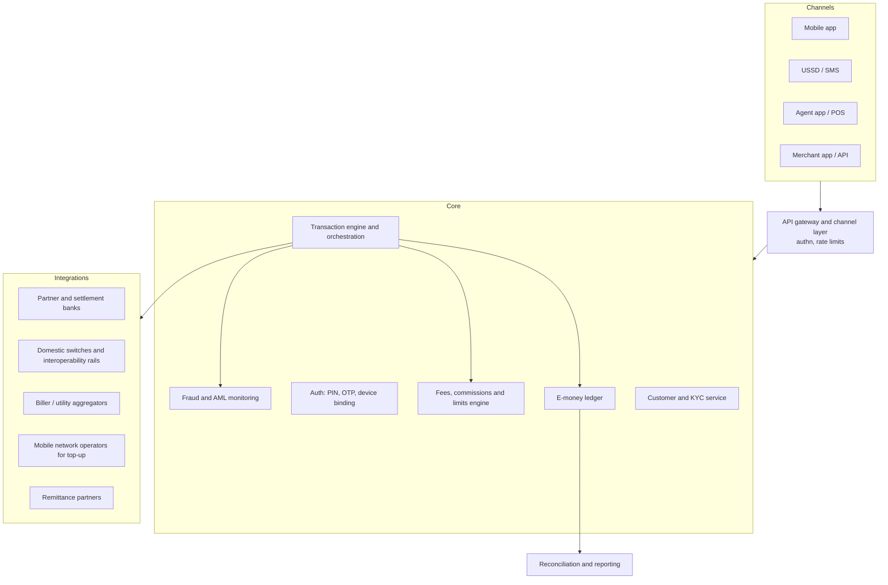

### 1.4 How MFS compares with neighbouring concepts

| Aspect | **Commercial bank** | **MFS provider** | **PSP** | **PSO** | **Digital wallet (generic)** | **Mobile banking app** | **Traditional banking system** |
|---|---|---|---|---|---|---|---|
| Holds customer funds | Yes: deposits | Yes: e-money, backed by safeguarded funds | Sometimes (if licensed) | Operates a system; may not hold customer funds | Yes (stored value) or pass-through | No (front end for a bank account) | Yes |
| Typical customer | Banked | Often under-banked | Merchants | Participants in the system | Consumers | Bank customers | Bank customers |
| Access channel | Branch, ATM, app | App, USSD, agents | API, checkout | Participant connections | App | App/USSD | Branch, ATM |
| Cash-in/out | Branch/ATM | Agents | Rare | N/A | Varies | Via bank | Branch/ATM |
| Regulator view | Banking supervision | MFS regulations | Payment services licence | Payment systems licence | Depends on licence | Bank supervision | Banking supervision |
| Core record | Core banking ledger | E-money ledger | Merchant/settlement ledger | System clearing/settlement records | Wallet ledger | Bank ledger | Core banking ledger |

**PSP vs. PSO (🌐, and under Bangladesh's Payment and Settlement Systems Act, 2024 ⚠️):** a PSP provides payment services to users or merchants; a PSO operates a payment system (e.g., a clearing or switching infrastructure). The Act requires BB approval/licence for operating payment systems or providing payment services `[S8]` ✅. Confirm exact licence categories and their scopes in the Act and BB circulars.

### 1.5 The Bangladesh MFS landscape

| Provider | What is verified | What to verify |
|---|---|---|
| **Upay** | Digital financial service brand of UCB Fintech Company Limited, a subsidiary of United Commercial Bank; started after receiving a BB licence in early 2021 per its official YouTube channel `[S17]` ✅; app offers send money, add money from banks, cash-out via agents/ATMs, bill payment, mobile recharge and QR/merchant payments `[S18]` ✅; services listed include inward remittance and salary disbursement `[S17]` ✅; QR merchant payments and scholarship disbursement partnership reported `[S19]` 🟡 | Public API/integration documentation ❓; limits, fees, settlement schedules ❓ |
| **bKash** | Official developer portal exists at developer.bka.sh with tokenized checkout docs (referenced by multiple integration projects) `[S11]` ✅ | Current API version, credentials process, rate limits, IPN details ⚠️ |
| **Nagad** | Merchant API documentation and sandbox access are obtained from Nagad (community wrappers state this) `[S12]` 🟡 | Current API version, key exchange and signing details ⚠️ |
| **Rocket** | Bank-led MFS associated with Dutch-Bangla Bank (DBBL) 🟡 | Merchant API availability and terms ❓ |

---

## 2. Regulatory Environment in Bangladesh

> This section lists what sources say. It is **not legal advice**. Limits, fees and rules change; retrieve current text from BB/BFIU.

### 2.1 Verified or reported framework
| Item | Status | Notes |
|---|---|---|
| **Bangladesh Mobile Financial Services (MFS) Regulations, 2018** | ✅ `[S13][S14]` | Issued by BB under its 1972 Order; replaced earlier MFS guidelines; MFS providers supervised by BB's Payment Systems Department |
| Safeguarding and reconciliation clauses (e.g., daily reconciliation of e-money against bank cash deposits reported to BB; capital and securities-investment conditions) | 🟡 `[S14]` | Cited by clause in a newspaper analysis. Read the regulation itself ⚠️ |
| **BFIU circulars** (e.g., Circular 20, Circular 25) on KYC/e-KYC for MFS | 🟡 `[S14]` | Check current versions and any replacements ⚠️ |
| **Payment and Settlement Systems Act, 2024** | ✅ `[S8]` | Passed by Parliament on 4 July 2024; BB approval/licence needed to operate payment systems or provide payment services |
| Transaction limits | ⚠️ | Limits for cash-in, cash-out, P2P and balances have been revised several times (e.g., tightened in 2017, raised in 2019 `[S15][S16]` 🟡). **Those numbers are historical; do not use them.** Use the currently effective BB circulars, held in configuration |
| Progressive/tiered KYC | 🟡 `[S20]` | An AFI policy paper recommends limits based on progressive KYC; actual tiers must come from BB/BFIU |
| Interoperability and QR | ✅ `[S5][S6]` | Binimoy (IDTP) and Bangla QR; see Section 12 |

### 2.2 What this means for engineers
1. **Never hard-code limits, KYC tiers, fees or holiday calendars.** Model them as effective-dated configuration with an audit trail.
2. **Know who is regulated for what.** The MFS provider is the licensed party for wallets and e-money; an integrating fintech app is typically a **customer/merchant/partner** of the provider, but may itself need its own licence if it holds funds or runs a payment service ⚠️ (ask counsel).
3. **Evidence matters.** Keep records that auditors and regulators can inspect: KYC evidence (if you collect it), consent records, transaction logs, reconciliation outputs.

---

## 3. How MFS Operates: Participants and Money Movement

### 3.1 Participants
| Participant | Role |
|---|---|
| **Customer** | Holds a wallet; cashes in/out; pays, sends, receives |
| **Agent** | Retail point that converts cash ↔ e-money; holds an agent wallet (float); earns commission |
| **Distributor / super-agent** | Supplies e-money float to agents; manages an agent network; earns commission 🌐 |
| **Merchant** | Accepts wallet payments (QR, checkout, API) |
| **MFS provider** | Runs the e-money ledger, wallets, agent network, risk and compliance |
| **Partner / settlement bank** | Holds the **trust/safeguarding account** backing e-money; settles with other banks |
| **Mobile network operators (MNOs)** | Carry USSD/SMS; receive top-up payments; may distribute services |
| **Payment gateways / PSPs** | Provide merchant checkout across providers |
| **Billers** | Utilities and institutions collecting bills |
| **Switches / interoperability platforms** | Route transactions between institutions |
| **Regulators** | BB (payments, MFS), BFIU (AML/CFT) |

### 3.2 E-money creation and backing 🌐
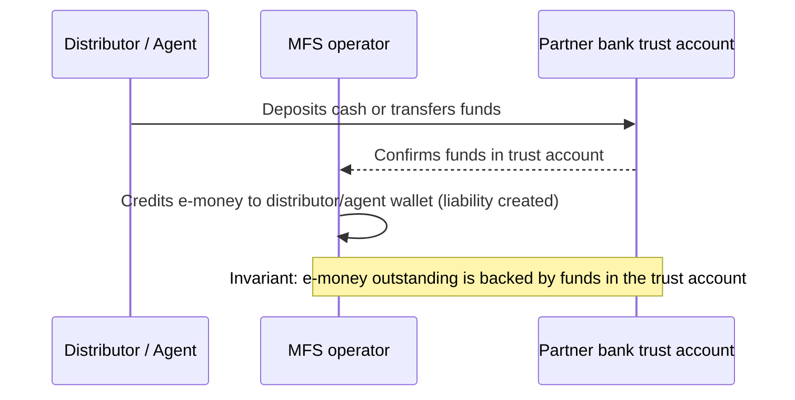
**Why it matters:** the operator's **e-money liability** (sum of all wallet balances) must be matched by safeguarded funds. A daily "e-money vs. trust balance" check is a core control (Bangladesh regulations reportedly require daily reconciliation reporting `[S14]` 🟡 ⚠️).

### 3.3 Money vs. information in MFS
Most MFS transactions **between wallets of the same provider** are **book entries inside the provider's ledger**: no interbank movement occurs. Interbank money moves only when value enters or leaves the provider's trust accounts (bank-to-wallet, wallet-to-bank, merchant settlement to a bank account, remittance funding), and that interbank leg settles on a **rail** such as an interbank electronic network, a real-time gross system or an interoperability platform.

---

## 4. The MFS Transaction Lifecycle

### 4.1 Customer registration, KYC, PIN and device
**Flow (generic 🌐):** registration request → identity capture (NID and biometric/e-KYC where required ⚠️) → verification against authoritative data → risk rating and screening → account activation with a **KYC tier** → PIN setup → device binding.

| Step | What it is / why | Engineering notes |
|---|---|---|
| **Registration** | Link a mobile number to a profile | Unique constraint on `(msisdn)`; idempotent creation; verify number ownership via OTP |
| **KYC / e-KYC** | Identify and verify the customer; e-KYC uses digital/biometric verification | Store verification result, evidence references, reviewer, timestamps; state machine `SUBMITTED → VERIFIED/REJECTED → ACTIVE`. Bangladesh MFS e-KYC is governed by BFIU circulars ✅ `[S14]` (verify current) |
| **Account verification** | Confirm account validity before payouts | For integrators: use the provider's account-verification capability **only if documented** ❓ |
| **Authentication** | Prove who is acting (PIN, OTP, biometrics) | PIN stored as salted slow hash (or verified inside an HSM), never reversible; attempt counters and lockouts |
| **PIN management** | Create, change, reset | Reset requires strong re-verification; notify user; invalidate sessions |
| **Device binding** | Tie the account to a device | Store device fingerprint hash, binding time; require step-up on a new device; Upay's app listing describes a device-bound PIN model ("no one can access your upay account from other mobile devices") `[S18]` 🟡 |
| **Balance management** | Maintain ledger, available, reserved balances | Section 9 |

### 4.2 Transaction type reference
Each row summarizes purpose, participants, money movement and main risks. Fees/commissions below are **🧪 illustrative**; real values come from provider tariffs and BB rules ⚠️.

| Type | Purpose | Participants | Money movement | Typical failure points | Reversal mechanism |
|---|---|---|---|---|---|
| **Cash-in** | Convert cash to e-money | Customer, agent, provider | Agent wallet ↓, customer wallet ↑ (book entries) | Agent float insufficient; limit breach; network timeout after agent hands over cash | Provider reverses the pair of entries; manual investigation |
| **Cash-out** | Convert e-money to cash | Customer, agent, provider | Customer wallet ↓ (+fee), agent wallet ↑; agent pays cash | Customer debited but agent not credited; duplicate request | Reversal entries; dispute workflow |
| **P2P** | Send money between users | Two customers, provider | Sender ↓ (+fee), receiver ↑ | Receiver not found/blocked; limit; duplicate | Reversal if receiver credit fails |
| **P2B / merchant payment** | Pay a merchant | Customer, merchant, provider (+gateway) | Customer ↓, merchant ↑ (net of MDR), fee revenue | Callback lost; duplicate; merchant unreachable | Refund (new transaction) after success; cancel before completion |
| **B2P / disbursement** | Business pays people (refunds, rewards) | Business, provider, recipient | Business prefund/wallet ↓, recipient ↑ | Recipient wallet invalid; duplicate disbursement | Recall only if supported ❓; otherwise compensating process |
| **Salary disbursement** | Bulk B2P | Employer, provider, employees | Batch debit, many credits | Partial batch success; wrong amounts | Per-item status and retry; reversals per item |
| **G2P** | Government benefit payments | Agency, provider, beneficiaries | Funded account ↓, beneficiaries ↑ | Beneficiary validation, large batches | Per-item reconciliation with agency lists |
| **Bill payment** | Pay utilities/fees | Customer, provider, biller aggregator, biller | Customer ↓, biller/aggregator payable ↑, later settled to biller | Biller confirmation delayed; "paid but not posted at biller" | Biller-side reversal/refund; manual claims |
| **Mobile top-up** | Airtime recharge | Customer, provider, MNO/aggregator | Customer ↓, MNO payable ↑ | Top-up not delivered | Retry or refund by operator rules |
| **Bank-to-wallet (add money)** | Fund wallet from bank | Customer, bank, provider | Interbank leg then wallet ↑ | Bank debit succeeded but wallet credit pending | Hold until bank confirmation; reconcile |
| **Wallet-to-bank** | Withdraw to bank | Customer, provider, bank | Wallet ↓ then interbank credit | Bank credit rejected/returned | Re-credit wallet on return |
| **International remittance (inward)** | Receive foreign money into wallet/bank | Sender abroad, partner, provider/bank, recipient | FX conversion, prefunded or settled leg, wallet credit | Compliance hold; partner status ambiguity; name mismatch | Return to sender per partner rules |
| **Domestic transfer (interbank/interop)** | Cross-provider transfers | Two institutions, platform | Interbank settlement on the rail | Status unknown after timeout | Platform-defined reversals/returns ⚠️ |

### 4.3 Common transaction template (apply to each type)
1. **Business purpose** → 2. **Entities** → 3. **Request/response flow** → 4. **Money movement** → 5. **Ledger impact** → 6. **Fees/commissions** → 7. **States** → 8. **Failures** → 9. **Reversals** → 10. **Reconciliation** → 11. **Example**.

### 4.4 Detailed flows

**Cash-out (generic)**
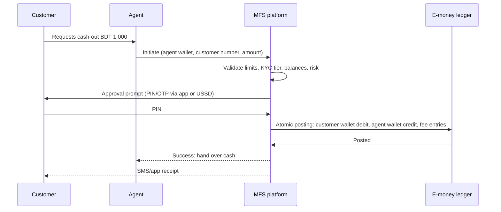

**Merchant payment (generic)**
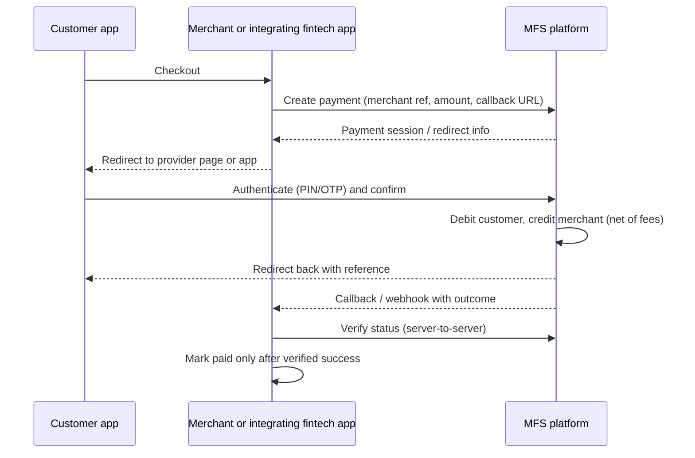

**Salary disbursement (generic)**
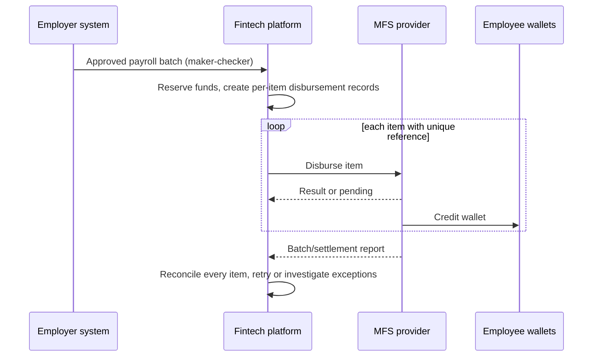

### 4.5 Sample double-entry ledger entries 🧪
**Provider (e-money operator) perspective.** All wallets are liabilities of the operator.

| Event | Account | Dr | Cr |
|---|---|---|---|
| **Cash-in BDT 1,000** | Agent wallet (liability) | 1,000.00 | |
| | Customer wallet (liability) | | 1,000.00 |
| Commission accrual (illustrative 0.5%) | Agent commission expense | 5.00 | |
| | Agent commission payable | | 5.00 |
| **Cash-out BDT 1,000, fee 15** | Customer wallet | 1,015.00 | |
| | Agent wallet | | 1,000.00 |
| | Fee revenue | | 15.00 |
| Agent commission (illustrative 9) | Commission expense | 9.00 | |
| | Agent commission payable | | 9.00 |
| **P2P BDT 500, fee 5 to sender** | Sender wallet | 505.00 | |
| | Receiver wallet | | 500.00 |
| | Fee revenue | | 5.00 |
| **Merchant payment BDT 2,000, MDR 1.5%** | Customer wallet | 2,000.00 | |
| | Merchant wallet or payable | | 1,970.00 |
| | MDR revenue | | 30.00 |
| **Bank-to-wallet BDT 3,000** | Trust bank account (asset) | 3,000.00 | |
| | Customer wallet | | 3,000.00 |
| **Wallet-to-bank BDT 3,000** | Customer wallet | 3,000.00 | |
| | Trust bank account | | 3,000.00 |
| **Bill payment BDT 1,200, fee 10** | Customer wallet | 1,210.00 | |
| | Biller payable | | 1,200.00 |
| | Fee revenue | | 10.00 |
| Biller settlement | Biller payable | 1,200.00 | |
| | Trust/settlement bank | | 1,200.00 |

**Integrating-fintech perspective (🧪 illustrative; your chart of accounts will differ).**

| Event | Account | Dr | Cr |
|---|---|---|---|
| **Collect BDT 1,000 via MFS, provider fee 2% = 20, verified success** | Receivable from provider (asset) | 980.00 | |
| | Provider fee expense | 20.00 | |
| | Customer order payable / deferred revenue | | 1,000.00 |
| Provider settles to your bank | Bank | 980.00 | |
| | Receivable from provider | | 980.00 |
| **Prefund provider balance 100,000** | Provider prefund balance (asset) | 100,000.00 | |
| | Bank | | 100,000.00 |
| **Disburse salary 5,000, provider fee 25** | Salary payable (liability) | 5,000.00 | |
| | Provider fee expense | 25.00 | |
| | Provider prefund balance | | 5,025.00 |

---

## 5. Customer-Facing Status vs. Financial Settlement Status

### 5.1 The principle
A **customer-facing status** is what the user sees ("Successful", "Pending", "Failed"). A **financial status** is the true state of money and ledgers: posted, reserved, settled, reversed, reconciled. They **diverge** during timeouts, delayed callbacks, partner delays and investigations. Model them as separate fields, and derive the UI status from the financial truth plus business rules.

### 5.2 Status model (recommended 🌐)

| Dimension | Values (example) | Meaning |
|---|---|---|
| `customer_status` | `PROCESSING`, `SUCCESSFUL`, `FAILED`, `REVERSED`, `UNDER_REVIEW` | What the user is told |
| `provider_status` (raw) | Stored verbatim | Exactly what the provider returned (never overwritten) |
| `financial_status` | `NONE`, `RESERVED`, `POSTED`, `SETTLED_EXTERNAL`, `REVERSED`, `REFUNDED`, `RECONCILED`, `BREAK` | Ledger and settlement reality |
| `investigation_status` | `NONE`, `OPEN`, `RESOLVED` | Manual handling |

### 5.3 Mapping examples
| Situation | Customer sees | Financial reality | Action |
|---|---|---|---|
| Provider returned success; ledger posted | Successful | `POSTED`, later `SETTLED_EXTERNAL` | Reconcile with settlement file |
| Provider timed out | Processing | `RESERVED` (hold kept) | Inquiry, then finalize |
| Provider says failed | Failed | Release hold | Notify |
| Success at provider, local update failed | Processing | Provider charged; ours `RESERVED` | Inquiry/reconciliation finalizes; alert |
| Reversal after success | Reversed | `REVERSED` entries posted | Audit trail |
| Customer says debited but no service | Under review | Compare internal ledger vs provider record | Manual investigation, then refund or confirm |

---

## 6. Upay: What Is Verified and What Is Not

### 6.1 Verified facts about the provider
| Fact | Status | Source |
|---|---|---|
| Upay is the digital financial service brand of **UCB Fintech Company Limited**, a subsidiary of **United Commercial Bank (UCB)** | ✅ | `[S17][S19]` |
| It began operating in early 2021 after receiving a Bangladesh Bank licence (per its official YouTube channel) | ✅ (provider statement) | `[S17]` |
| Services advertised: mobile transactions/send money, add money from banks, cash-out via agents and ATMs, utility bill payment, mobile recharge, in-store and e-commerce payments, QR payments, inward remittance, salary disbursement | ✅ (provider statements) | `[S17][S18]` |
| Utility bills, mobile recharge from all operators, QR/mobile-number merchant payments | ✅ (app listing) | `[S18]` |
| Campus partnership for QR merchant payments, tuition fees and scholarship disbursements | 🟡 (news) | `[S19]` |
| Upay has arrangements with mobile operators so the app can work without an active internet connection | 🟡 (encyclopedic summary, verify) | `[S21]` |

### 6.2 What is **not** verifiable from public sources ❓
- Public developer portal, API reference, sandbox access terms
- Endpoint names, base URLs, authentication scheme, header names, signature algorithm
- Request/response fields, status and error code lists
- Callback/webhook support and format
- Transaction limits, fee structure, settlement schedule, report formats
- Which of the generic patterns (wallet debit, disbursement, cash-in/out via API, bill collection, account verification) are exposed to external partners

**Warning about community packages:** third-party packages list "Upay" next to other providers with phrases like "Bearer Token REST API, Create/Verify/Refund" `[S22]`. That is an **unverified community claim**; it may be wrong, outdated or for a different service. Do not use it as a specification.

### 6.3 How to obtain Upay's authoritative integration information
1. Contact Upay/UCB Fintech's business or merchant team (official site: upaybd.com `[S17][S18]`).
2. Request, in writing, the **integration package**: API reference, sandbox credentials and test wallets, signing/authentication specification, callback specification, status and error codes, rate limits, limits and fees schedule, settlement and report formats, IP allowlisting process, go-live checklist and a technical contact.
3. Sign the merchant/partner agreement; record contractual SLAs, settlement timing, dispute and reversal procedures, and liability allocation.
4. Keep the documents under version control with their version/date; subscribe to change notices.

### 6.4 Upay integration architecture: the roles (generic to any bank-subsidiary MFS) 🌐
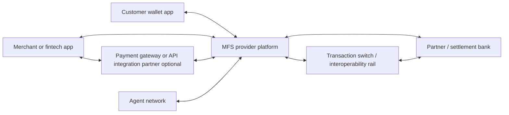
Which of these roles exist in a specific Upay integration (for example whether a gateway sits in between, or which bank settles) **must come from Upay's documentation and contract** ❓.

---

## 7. Integrating with an MFS Provider: Generic Patterns and Provider Notes

### 7.1 Generic integration lifecycle 🌐
| Stage | What happens | Notes |
|---|---|---|
| **Merchant/partner onboarding** | Business documents, agreement, compliance checks | Usually via the provider's business team |
| **Sandbox access** | Test credentials and test wallets | Often provided on onboarding (bKash: app key/secret and username/password shared during onboarding per integration docs 🟡 `[S11]`) |
| **Credentials** | API key/secret, usernames, certificates, public/private keys | Store in a secrets manager; separate per environment; rotation plan |
| **IP allowlisting** | Provider restricts callers to registered IPs | Some providers require your production server IPs (community note about Nagad live deployment 🟡 `[S12]`); use stable egress IPs/NAT; plan for failover IPs |
| **Request signing / authentication** | Token grants, HMAC or RSA signatures, headers | **Scheme is provider-specific**; follow the spec exactly |
| **Transaction initiation** | Create payment / debit / disbursement | Unique merchant reference per attempt |
| **Inquiry (status) APIs** | Query by your reference and/or provider ID | Essential for unknown outcomes |
| **Callbacks/webhooks/IPN** | Provider notifies outcome | Verify authenticity; dedupe; do not trust blindly |
| **Reports** | Transaction, settlement and reconciliation reports | Formats and schedule from provider |
| **Production go-live** | Whitelisting, certification, production credentials | Run a pre-production checklist (Section 15) |

### 7.2 Integration patterns (generic; **not all are supported by any given provider**)
| Pattern | Description | Notes |
|---|---|---|
| **Wallet debit / merchant payment** | Customer authorizes payment from their wallet to your merchant account | Redirect/checkout or direct approval; verify server-side |
| **Wallet credit / disbursement** | You push money to a customer wallet | Needs prefund or settlement arrangement and strict duplicate prevention |
| **Cash-in / cash-out via API** | Agent-style operations through partner APIs | Typically restricted to licensed agents/partners; confirm eligibility ❓ |
| **Bill collection** | Provider or you collect bills and settle with billers | May be via a biller aggregator |
| **Account/wallet verification** | Check that a wallet exists/is active/name match | Availability and privacy rules vary ❓ |
| **Refund** | Return money for a prior payment | Separate API and rules ⚠️ |

### 7.3 bKash: what public integration documentation says (verify in the official portal)
Official documentation lives at **developer.bka.sh** `[S11]` ✅ (portal referenced by several integration projects; always read it directly, since versions change). Based on community integrations that cite it 🟡, the **tokenized checkout** flow is:

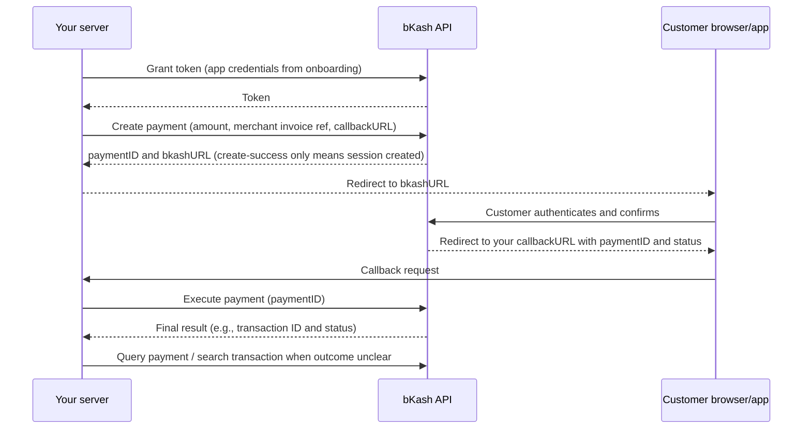
Points that matter for design (🟡 reported by community docs referencing bKash; confirm):
- A successful **create** response means only that a payment session exists; **completion is decided by execute/query**, not by the browser redirect `[S10]`.
- Sandbox and production use different hosts; credentials are issued during onboarding; HTTPS with a valid certificate is required `[S11]`.
- The integration guidance referenced by community READMEs recommends a **30-second API timeout** `[S11]`. Confirm the current value.
- IPN/notification mechanisms exist in addition to redirects `[S10]`; verify how they are authenticated.
- Search-transaction and refund APIs exist `[S10]`.
- Exact header names, payload fields, status codes and version differences: **read the current official docs** ⚠️.

### 7.4 Nagad and Rocket notes
- **Nagad:** documentation and sandbox access come from Nagad on request; community wrappers indicate merchant integration uses RSA key material and a callback/verify flow `[S12]` 🟡. Treat details (key exchange, encryption, field names) as ❓ until you receive Nagad's documents.
- **Rocket (DBBL):** public merchant API documentation was not found in research ❓. Obtain it from DBBL.
- **Aggregators:** gateways such as SSLCommerz advertise one API over multiple MFS/cards `[S23]` 🟡. An aggregator can reduce integration effort but adds a counterparty, fees and its own settlement/reconciliation layer.

### 7.5 Source-of-truth rule
For **endpoint names, authentication schemes, request formats, response codes, limits and supported transaction types**: use only the provider's authorized documents. Everything in Sections 8-10 uses **🧪 hypothetical** contracts with a fictional `ProviderX`.

---

## 8. Production Architecture with Django, DRF, PostgreSQL, Redis and Celery

### 8.1 Goals
1. **Provider independence:** business logic never imports provider SDKs/fields.
2. **Financial safety:** ledger and payment state change atomically; no network calls inside lock-holding transactions.
3. **Recoverability:** every ambiguous outcome converges via inquiry and reconciliation.
4. **Operability:** logs, metrics, traces and audit trails by default.

### 8.2 System architecture
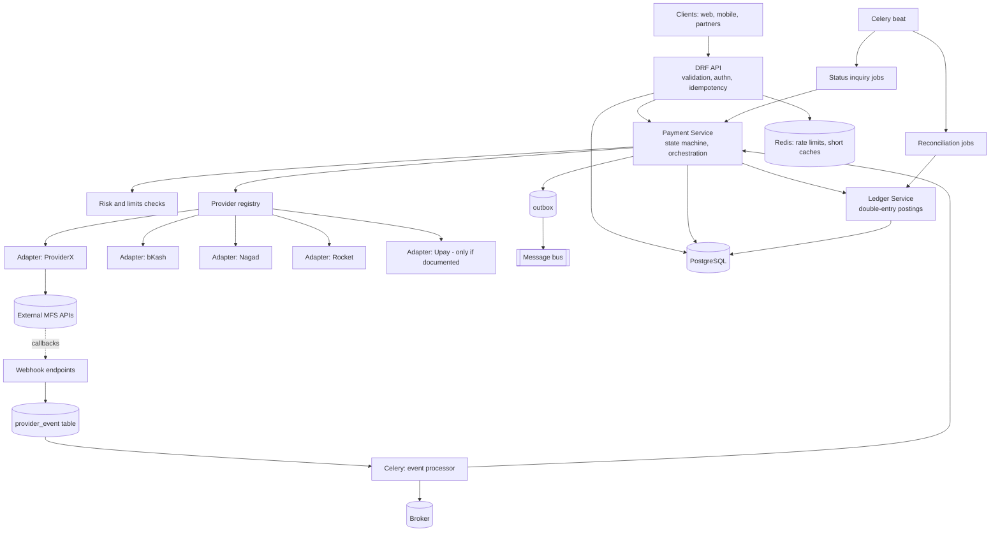
**Redis is never the source of truth** for money, idempotency or state.

### 8.3 Module layout
```
payments/
  api/            # DRF serializers, views, throttles (thin)
  services/       # PaymentService, LedgerService, ReconciliationService (use cases)
  selectors/      # read-only query functions
  domain/         # states, value objects, exceptions, transition rules
  providers/
    base.py       # ProviderAdapter protocol + normalized DTOs
    registry.py
    providerx/    # request/response mapping for a specific provider
  models/         # ORM models and constraints
  tasks/          # Celery tasks (inquiry, event processing, reconciliation)
  webhooks/       # endpoints, signature verification delegates
  config/         # typed settings, per-provider configuration (no secrets)
```

### 8.4 Normalized contract (provider-independent)
```python
# providers/base.py  (🧪 illustrative, provider-independent)
from dataclasses import dataclass
from decimal import Decimal
from enum import Enum
from typing import Protocol, Optional

class Outcome(str, Enum):
    SUCCEEDED = "SUCCEEDED"
    FAILED = "FAILED"
    PENDING = "PENDING"     # provider accepted, final result later
    UNKNOWN = "UNKNOWN"     # timeout/ambiguous: must be resolved by inquiry

@dataclass(frozen=True)
class InitiateRequest:
    our_reference: str          # unique per attempt; we generate it
    amount_minor: int
    currency: str
    customer_msisdn: Optional[str]
    callback_url: Optional[str]
    metadata: dict

@dataclass(frozen=True)
class ProviderResult:
    outcome: Outcome
    provider_reference: Optional[str]
    redirect_url: Optional[str]
    raw_status: str              # stored verbatim
    raw_code: Optional[str]
    raw_payload: dict            # stored for audit (mask sensitive data)

@dataclass(frozen=True)
class VerifiedEvent:
    dedupe_key: str              # unique id of the event
    our_reference: Optional[str]
    provider_reference: Optional[str]
    result: ProviderResult

class ProviderAdapter(Protocol):
    code: str
    def initiate(self, req: InitiateRequest) -> ProviderResult: ...
    def inquire(self, our_reference: str, provider_reference: Optional[str]) -> ProviderResult: ...
    def verify_and_parse_webhook(self, headers: dict, body: bytes) -> VerifiedEvent: ...
    def refund(self, our_reference: str, amount_minor: int) -> ProviderResult: ...  # only if supported
    def supports(self, capability: str) -> bool: ...   # e.g. "refund", "disbursement"
```
Each adapter maps its own request/response fields to these DTOs. Unsupported capabilities raise `CapabilityNotSupported`. **The adapter file for a provider is written only from that provider's documentation.**

### 8.5 Django models and constraints 🧪
```python
# models/payments.py
from django.db import models
from django.db.models import Q, CheckConstraint, UniqueConstraint

class PaymentTransaction(models.Model):
    class State(models.TextChoices):
        CREATED = "CREATED"
        RESERVED = "RESERVED"          # funds/hold secured (if needed)
        SUBMITTED = "SUBMITTED"        # sent to provider
        PENDING = "PENDING"            # provider accepted, awaiting final
        UNKNOWN = "UNKNOWN"            # ambiguous outcome
        SUCCEEDED = "SUCCEEDED"
        FAILED = "FAILED"
        REVERSED = "REVERSED"

    id = models.UUIDField(primary_key=True)
    merchant_id = models.CharField(max_length=64)
    idempotency_key = models.CharField(max_length=128)
    request_hash = models.CharField(max_length=64)
    provider = models.CharField(max_length=32)
    our_reference = models.CharField(max_length=64, unique=True)       # sent to provider
    provider_reference = models.CharField(max_length=128, null=True, blank=True)
    amount_minor = models.BigIntegerField()
    currency = models.CharField(max_length=3, default="BDT")
    state = models.CharField(max_length=16, choices=State.choices, default=State.CREATED)
    customer_status = models.CharField(max_length=24)                   # derived for UI
    raw_provider_status = models.CharField(max_length=64, blank=True)   # verbatim
    version = models.BigIntegerField(default=0)
    next_inquiry_at = models.DateTimeField(null=True, blank=True)
    inquiry_attempts = models.IntegerField(default=0)
    created_at = models.DateTimeField(auto_now_add=True)
    updated_at = models.DateTimeField(auto_now=True)

    class Meta:
        constraints = [
            UniqueConstraint(fields=["merchant_id", "idempotency_key"], name="uniq_merchant_idem"),
            UniqueConstraint(fields=["provider", "provider_reference"],
                             condition=Q(provider_reference__isnull=False),
                             name="uniq_provider_ref"),
            CheckConstraint(check=Q(amount_minor__gt=0), name="amount_positive"),
        ]
        indexes = [models.Index(fields=["state", "next_inquiry_at"])]

class PaymentStateHistory(models.Model):          # append-only
    txn = models.ForeignKey(PaymentTransaction, on_delete=models.PROTECT)
    from_state = models.CharField(max_length=16)
    to_state = models.CharField(max_length=16)
    reason = models.CharField(max_length=128)
    actor = models.CharField(max_length=64)
    created_at = models.DateTimeField(auto_now_add=True)

class ProviderEvent(models.Model):                # raw inbound events, deduped
    provider = models.CharField(max_length=32)
    dedupe_key = models.CharField(max_length=190)
    received_at = models.DateTimeField(auto_now_add=True)
    raw_headers = models.JSONField()
    raw_body = models.TextField()
    processed_at = models.DateTimeField(null=True)
    class Meta:
        constraints = [UniqueConstraint(fields=["provider", "dedupe_key"], name="uniq_event")]

class LedgerAccount(models.Model):
    code = models.CharField(max_length=64, unique=True)
    type = models.CharField(max_length=12)        # ASSET/LIABILITY/EQUITY/REVENUE/EXPENSE
    currency = models.CharField(max_length=3)
    allow_negative = models.BooleanField(default=False)

class AccountBalance(models.Model):
    account = models.OneToOneField(LedgerAccount, on_delete=models.PROTECT)
    balance_minor = models.BigIntegerField()      # in the account's normal direction
    reserved_minor = models.BigIntegerField(default=0)   # active holds
    version = models.BigIntegerField(default=0)
    class Meta:
        constraints = [CheckConstraint(check=Q(reserved_minor__gte=0), name="reserved_nonneg")]

class JournalEntry(models.Model):                  # append-only
    idempotency_key = models.CharField(max_length=190, unique=True)
    entry_type = models.CharField(max_length=32)
    reference_type = models.CharField(max_length=32)
    reference_id = models.CharField(max_length=64)
    reverses = models.ForeignKey("self", null=True, on_delete=models.PROTECT)
    created_at = models.DateTimeField(auto_now_add=True)

class JournalLine(models.Model):                   # append-only
    entry = models.ForeignKey(JournalEntry, on_delete=models.PROTECT, related_name="lines")
    account = models.ForeignKey(LedgerAccount, on_delete=models.PROTECT)
    direction = models.CharField(max_length=1)     # 'D' or 'C'
    amount_minor = models.BigIntegerField()
    currency = models.CharField(max_length=3)
    class Meta:
        constraints = [CheckConstraint(check=Q(amount_minor__gt=0), name="line_positive"),
                       CheckConstraint(check=Q(direction__in=["D", "C"]), name="line_dir")]
```
Add database-level protections: a deferred constraint trigger enforcing `SUM(debits)=SUM(credits)` per entry and currency, and triggers/permissions forbidding `UPDATE`/`DELETE` on journal tables.

### 8.6 Payment initiation (wallet debit style) 🧪
```python
# services/payment_service.py
import hashlib, json, uuid
from django.db import transaction, IntegrityError
from django.utils import timezone

def initiate_payment(*, merchant_id, idem_key, payload, provider_code):
    req_hash = hashlib.sha256(json.dumps(payload, sort_keys=True).encode()).hexdigest()

    # 1) Local, atomic part: idempotent create + reservation. No network I/O here.
    with transaction.atomic():
        try:
            txn = PaymentTransaction.objects.create(
                id=uuid.uuid4(), merchant_id=merchant_id, idempotency_key=idem_key,
                request_hash=req_hash, provider=provider_code,
                our_reference=f"PAY-{uuid.uuid4().hex[:20]}",
                amount_minor=payload["amount_minor"], currency="BDT",
                customer_status="PROCESSING",
            )
        except IntegrityError:
            existing = PaymentTransaction.objects.get(merchant_id=merchant_id, idempotency_key=idem_key)
            if existing.request_hash != req_hash:
                raise IdempotencyConflict()
            return existing                               # replay: same result
        reserve_funds_if_needed(txn)                      # SELECT ... FOR UPDATE inside
        transition(txn, "RESERVED", actor="system", reason="reserved")

    # 2) Network part: outside any lock-holding DB transaction.
    adapter = registry.get(provider_code)
    try:
        result = adapter.initiate(build_request(txn))
    except (TimeoutError, ConnectionError):
        mark_unknown(txn.id, reason="network_error_on_initiate")   # never "failed"
        schedule_inquiry(txn.id, delay_seconds=15)
        return txn

    apply_provider_result(txn.id, result, source="initiate")
    return txn
```

### 8.7 Applying results safely (single choke point) 🧪
```python
def apply_provider_result(txn_id, result, source):
    with transaction.atomic():
        txn = PaymentTransaction.objects.select_for_update().get(pk=txn_id)
        if txn.state in TERMINAL_STATES:
            log_late_result_if_conflicting(txn, result, source)   # e.g., success after FAILED => alert
            return txn
        txn.raw_provider_status = result.raw_status
        if result.provider_reference and not txn.provider_reference:
            txn.provider_reference = result.provider_reference

        if result.outcome == Outcome.SUCCEEDED:
            post_ledger_for_success(txn)                  # idempotent by key f"{txn.id}:success"
            transition(txn, "SUCCEEDED", actor=source, reason="provider_confirmed")
            enqueue_outbox("payment.succeeded", txn)
        elif result.outcome == Outcome.FAILED:
            release_reservation(txn)
            transition(txn, "FAILED", actor=source, reason=result.raw_code or "provider_failed")
            enqueue_outbox("payment.failed", txn)
        elif result.outcome == Outcome.PENDING:
            transition_if_allowed(txn, "PENDING", actor=source, reason="provider_pending")
            schedule_inquiry(txn.id, delay_seconds=30)
        else:  # UNKNOWN
            transition_if_allowed(txn, "UNKNOWN", actor=source, reason="ambiguous")
            schedule_inquiry(txn.id, delay_seconds=15)
        txn.save()
    return txn
```
All paths (initiate response, webhook, inquiry job, reconciliation) call this **same function**, so rules live in one place.

### 8.8 Ledger posting with row locking 🧪
```python
def post_entry(*, idem_key, entry_type, ref_type, ref_id, lines):
    # lines: list of (account_code, 'D'|'C', amount_minor)
    assert sum(a for _, d, a in lines if d == "D") == sum(a for _, d, a in lines if d == "C")
    with transaction.atomic():
        try:
            entry = JournalEntry.objects.create(idempotency_key=idem_key, entry_type=entry_type,
                                                reference_type=ref_type, reference_id=ref_id)
        except IntegrityError:
            return JournalEntry.objects.get(idempotency_key=idem_key)     # replay

        codes = sorted({c for c, _, _ in lines})                             # deterministic lock order
        balances = {b.account.code: b for b in
                    AccountBalance.objects.select_for_update()
                    .select_related("account").filter(account__code__in=codes).order_by("account__code")}
        for code, direction, amount in lines:
            b = balances[code]
            delta = signed_delta(b.account.type, direction, amount)          # per normal-balance rules
            new_balance = b.balance_minor + delta
            if new_balance - b.reserved_minor < 0 and not b.account.allow_negative:
                raise InsufficientFunds(code)
            b.balance_minor = new_balance
            b.version += 1
        JournalLine.objects.bulk_create([JournalLine(entry=entry, account=balances[c].account,
                                                      direction=d, amount_minor=a, currency="BDT")
                                         for c, d, a in lines])
        AccountBalance.objects.bulk_update(balances.values(), ["balance_minor", "version"])
        return entry
```
`signed_delta` encodes: asset/expense increase on debit; liability/equity/revenue increase on credit. Test it exhaustively.

### 8.9 Webhook endpoint 🧪
```python
# webhooks/views.py
from django.http import HttpResponse
from django.views.decorators.csrf import csrf_exempt

@csrf_exempt
def provider_webhook(request, provider_code):
    adapter = registry.get(provider_code)
    try:
        event = adapter.verify_and_parse_webhook(dict(request.headers), request.body)  # raises on invalid signature
    except InvalidSignature:
        security_log("invalid_signature", provider_code, request)
        return HttpResponse(status=401)
    try:
        ev = ProviderEvent.objects.create(provider=provider_code, dedupe_key=event.dedupe_key,
                                          raw_headers=dict(request.headers), raw_body=request.body.decode())
    except IntegrityError:
        return HttpResponse(status=200)                  # duplicate: acknowledge, do nothing
    process_provider_event.delay(ev.id)                  # Celery; respond fast
    return HttpResponse(status=200)
```
Whether a provider expects a particular response body/status for callbacks is **provider-specific** ❓: follow its documentation.

### 8.10 Celery tasks: events and inquiry 🧪
```python
@shared_task(bind=True, acks_late=True, max_retries=8)
def process_provider_event(self, event_id):
    ev = ProviderEvent.objects.get(pk=event_id)
    adapter = registry.get(ev.provider)
    parsed = adapter.verify_and_parse_webhook(ev.raw_headers, ev.raw_body.encode())
    txn = find_txn(parsed.our_reference, parsed.provider_reference, ev.provider)
    # Do not trust the webhook alone: re-confirm via status inquiry before finalizing money effects.
    confirmed = adapter.inquire(txn.our_reference, txn.provider_reference)
    apply_provider_result(txn.id, confirmed, source="webhook+inquiry")
    ev.processed_at = timezone.now(); ev.save(update_fields=["processed_at"])

@shared_task(bind=True, acks_late=True)
def run_inquiry(self, txn_id):
    txn = PaymentTransaction.objects.get(pk=txn_id)
    if txn.state not in ("PENDING", "UNKNOWN", "SUBMITTED"):
        return
    result = registry.get(txn.provider).inquire(txn.our_reference, txn.provider_reference)
    apply_provider_result(txn.id, result, source="inquiry")
    if result.outcome in (Outcome.PENDING, Outcome.UNKNOWN):
        delay = min(3600, 15 * (2 ** txn.inquiry_attempts))
        reschedule(txn.id, delay)                     # exponential backoff + jitter; escalate after N attempts
```

### 8.11 Configuration, secrets, environments
- **Typed settings** (e.g., pydantic-settings) per environment; provider config holds base URLs, timeouts, feature flags; **secrets** come from a secret manager/env injection, never Git.
- Separate sandbox and production credentials, databases and webhook secrets; guard against sandbox keys in production with startup checks.
- **Timeouts:** explicit connect/read timeouts per provider (use the provider's documented guidance ⚠️); total deadline per request.
- **Connection pooling:** reuse `requests.Session`/`httpx.Client` per adapter; limit pool size; keep-alive.
- **Rate limiting:** DRF throttles for your API; outbound client-side rate limiting per provider limits (from the provider's docs ❓).
- **API versioning:** `/v1/` for your API; adapters isolate provider version changes.

### 8.12 Observability
- **Structured logs:** JSON with `trace_id`, `payment_id`, `our_reference`, `provider`, `state`; **mask** MSISDN/PINs/tokens.
- **Metrics (RED + business):** request rate, error rate, latency per provider; payments by state; UNKNOWN count and age; inquiry attempts; webhook failures; reconciliation match rate; unreconciled value.
- **Tracing:** OpenTelemetry spans across API → service → adapter → provider call → Celery tasks; propagate context in task headers.
- **Alerts:** UNKNOWN older than threshold, ledger imbalance (must be zero), provider success-rate drop, callback signature failures, settlement overdue.

### 8.13 Sequence diagrams

**Payment initiation**
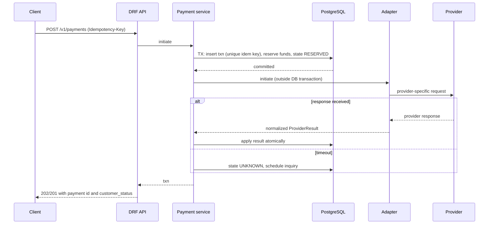

**Callback processing**
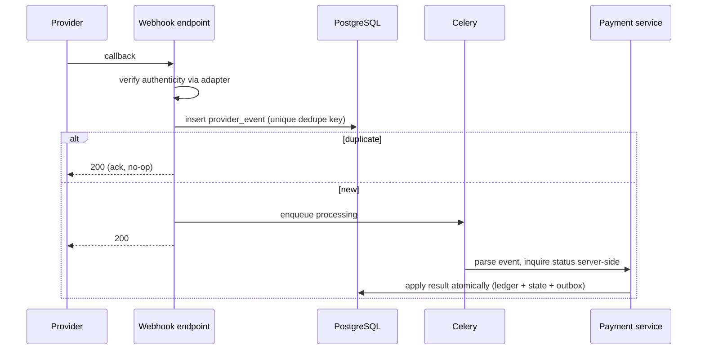

**Status inquiry**
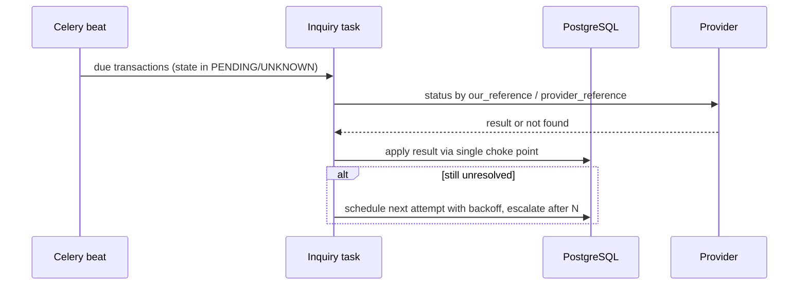

**Wallet debit and credit (internal ledger)**
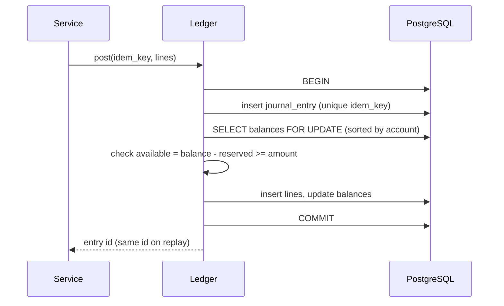

**Settlement reconciliation**
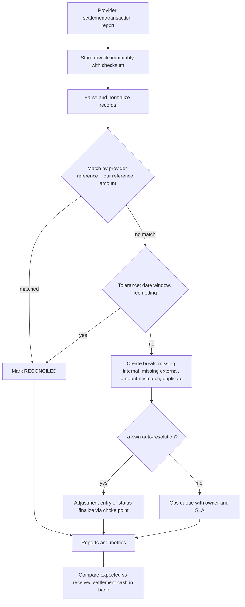

### 8.14 Sample API contracts (🧪 hypothetical: your own API, not a provider's)
```http
POST /v1/payments
Idempotency-Key: 7c9e6679-7425-40de-944b-e07fc1f90ae7
Content-Type: application/json

{ "provider": "providerx", "amount_minor": 150000, "currency": "BDT",
  "customer_msisdn": "+8801XXXXXXXXX", "order_ref": "ORD-9981",
  "callback_url": "https://merchant.example/hooks/payments" }
```
```http
HTTP/1.1 202 Accepted
{ "id": "5f2c...", "customer_status": "PROCESSING", "redirect_url": "https://...", "idempotent_replay": false }
```
`GET /v1/payments/{id}` returns `customer_status`, `financial_status`, timestamps; never expose raw provider payloads to end users.

---

## 9. Financial Correctness and Transaction Safety

### 9.1 Principles
1. **Single writer of money state:** only the ledger service posts entries; the payment service asks it to.
2. **Local ACID, global eventual:** payment state + ledger posting + outbox row in **one DB transaction**; everything else asynchronous.
3. **Append-only history;** corrections by reversing/adjusting entries.
4. **Constraints as last defense:** unique idempotency, positive amounts, balanced entries, non-negative reserved.
5. **No network I/O while holding row locks.**

### 9.2 Customer wallet ledger and balances
| Balance | Definition |
|---|---|
| **Ledger balance** | Net of all posted entries |
| **Reserved balance** | Sum of active holds |
| **Available balance** | `ledger − reserved` (+ overdraft if allowed; normally none for wallets) |
Spending decisions use **available**. Show the user the available balance; accounting uses ledger.

### 9.3 Reservations (holds) 🧪
```python
def reserve_funds_if_needed(txn):
    with transaction.atomic():
        bal = AccountBalance.objects.select_for_update().get(account__code=f"wallet:{txn.payer_id}")
        if bal.balance_minor - bal.reserved_minor < txn.amount_minor:
            raise InsufficientFunds()
        bal.reserved_minor += txn.amount_minor
        bal.version += 1
        bal.save(update_fields=["reserved_minor", "version"])
        Hold.objects.create(txn=txn, amount_minor=txn.amount_minor, state="ACTIVE")
```
On success: convert hold into postings and decrease `reserved_minor`; on failure: release the hold. A janitor job releases expired holds **only if the payment is terminally resolved** (never while UNKNOWN).

### 9.4 Preventing the classic errors
| Error | Cause | Prevention |
|---|---|---|
| **Double debit** | Retry without idempotency; two workers finalize same txn | Idempotency keys + unique constraints + single choke point with row lock on txn |
| **Duplicate disbursement** | Retry after timeout creates a second payout | Deterministic `our_reference` per payout item; inquiry **before** any re-send; provider-side idempotency if documented ❓ |
| **Incorrect wallet credit** | Crediting on redirect/webhook only | Credit only after server-side verified success; amount and currency validation against our record |
| **Lost callback** | Endpoint down or ack failure | Inquiry job + reconciliation as backstops |
| **Delayed response** | Slow provider | `PENDING/UNKNOWN` states and inquiry; no UI "failed" |
| **Inconsistent states** | Multiple writers | One function applies results; allowed-transition table; history log |
| **UI vs. ledger mismatch** | Derived status computed ad hoc | Derive `customer_status` from `financial_status` rules in one place |
| **Concurrent withdrawals** | Check-then-act race | `SELECT ... FOR UPDATE` or conditional update; consistent lock order |

### 9.5 Exactly-once business effect over at-least-once delivery
Delivery is at-least-once (callbacks, retries, Celery redelivery). The **business effect** is made single by: unique idempotency keys at API boundary, unique `ProviderEvent` dedupe, unique ledger entry keys (`f"{txn_id}:success"`), terminal-state guard, and amount/reference validation. "Exactly-once delivery" is not assumed.

### 9.6 Sample posting for success (integrator, collection) 🧪
```python
def post_ledger_for_success(txn):
    fee = compute_provider_fee(txn)                       # from configured, versioned tariff
    post_entry(
        idem_key=f"{txn.id}:success",
        entry_type="COLLECTION", ref_type="payment", ref_id=str(txn.id),
        lines=[("recv:provider:" + txn.provider, "D", txn.amount_minor - fee),
               ("exp:provider_fees",            "D", fee),
               ("liab:order_payable",           "C", txn.amount_minor)],
    )
```

---

## 10. Failure Scenarios and Recovery Strategies

> Rule: **a timeout never means failure.** Always resolve ambiguity by inquiry using the same reference.

| # | Scenario | What actually may have happened | Recovery strategy | Audit and reconciliation |
|---|---|---|---|---|
| 1 | **HTTP timeout on initiate** | Provider may have processed it | State `UNKNOWN`; keep hold; inquire by `our_reference` with backoff; finalize on confirmed result; escalate to ops if still unknown after N attempts/window | Log each attempt; flag in recon until matched |
| 2 | **Connection failure before send** | Provider never saw it | Inquiry can confirm "not found"; only re-send if provider documents "not found" as conclusive after its consistency window ❓; reuse same reference | Keep attempt history |
| 3 | **Provider 5xx** | Unknown | Treat as unknown; inquire; retry with same reference | Record raw error |
| 4 | **Invalid signature on callback** | Forgery or config error | Reject (401), do not change state; alert; rely on inquiry for the real transaction | Security log with source IP and headers (masked) |
| 5 | **Delayed callback** | Callback after we already finalized via inquiry | Idempotent apply: terminal state, no-op if consistent; alert if **conflicting** | Store raw event; compare in recon |
| 6 | **Duplicate webhooks** | At-least-once delivery | Unique `(provider, dedupe_key)` → ack and ignore | Count duplicates metric |
| 7 | **Out-of-order events** | "success" arrives before "pending" | Allowed-transition table: ignore stale/lower-rank events; prefer provider's timestamps/sequence only if documented ❓; confirm via inquiry | Event log retained |
| 8 | **Provider success, local update failed** | Customer charged, we crashed before finalizing | Payment remains `RESERVED/UNKNOWN`; inquiry job or reconciliation finds provider success; finalize via choke point | Priority alert if provider-success/internal-unfinal older than threshold |
| 9 | **Ambiguous outcome persists** | Provider cannot answer | Do not release funds or ship goods automatically; manual investigation with provider; if provider later confirms success, honor; if failure, release | Case record with evidence, decision, approver |
| 10 | **Late success after we marked failed** | We erred or provider changed result | Never silently reopen; open an incident; either complete service (if still possible) or **refund/reverse** via the provider's documented process | Dedicated "late success" report |
| 11 | **Crash between ledger commit and publish** | Event not sent | Transactional outbox + relay; consumers idempotent | Outbox lag metric |
| 12 | **DB failover mid-request** | In-flight transaction lost | Client retries with the same idempotency key; unique constraints make replay safe | Replay logged |
| 13 | **Broker outage** | Tasks not delivered | Outbox/DB-based scheduler (`next_inquiry_at` polling) as fallback; Celery redelivery tolerant | Queue depth/lag alert |
| 14 | **Amount mismatch in callback** | Tampering or provider bug | Reject finalization; hold in `UNDER_REVIEW`; compare with provider inquiry | Security/ops alert |

**Reversal or refund decision tree**
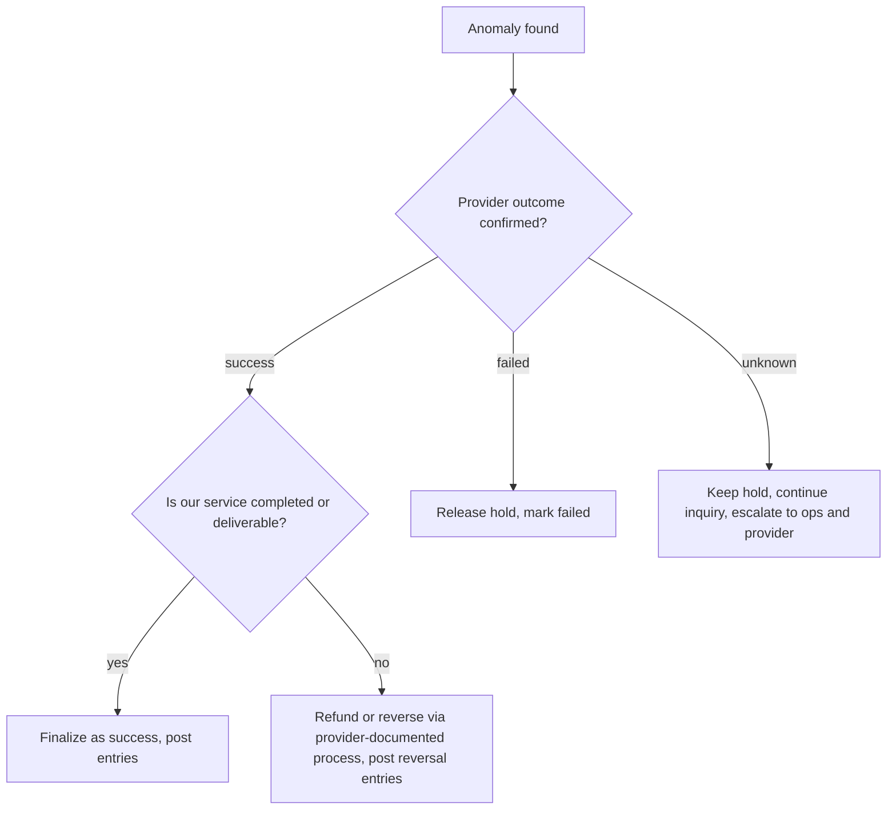

---

## 11. Security, Compliance and Risk Management

### 11.1 Four different questions
| Concept | Question | Example |
|---|---|---|
| **Authentication** | Who are you? | PIN/OTP/biometrics; API credentials |
| **Authorization** | May you do this? | Role/scope checks, limits, ownership of the wallet |
| **Transaction approval** | Do you consent to *this* transaction? | PIN/OTP confirmation of amount and payee |
| **Settlement** | When is money finally transferred between institutions? | Interbank/trust account movements |
Passing authentication does not imply approval; approval does not imply settlement.

### 11.2 Established security principles 🌐
- **PIN security:** hash with a slow salted algorithm or verify inside an HSM; lockouts, rate limits, no PIN in logs, never transmitted in clear.
- **OTP:** short-lived, single-use, bound to transaction/session, rate limited; SMS has known weaknesses (SIM swap), so add device binding/risk signals.
- **API authentication:** follow the provider's scheme; typical patterns include token grants and signed requests (HMAC/RSA) ✅ as general patterns, **but which one a given provider uses is provider-specific** ❓.
- **Replay prevention:** timestamp/nonce windows on signed callbacks where supported; dedupe keys always.
- **TLS 1.2+ everywhere** (RFC 8446 for TLS 1.3 `[S29]`), HSTS, certificate management.
- **Encryption at rest:** database/disk plus field-level encryption for PII and sensitive identifiers; envelope encryption with key rotation.
- **Secrets:** vault/secret manager, rotation, no secrets in logs/Git/images.
- **IP allowlisting:** both inbound (your webhooks accept only provider IPs if documented) and outbound (provider allowlists your IPs).
- **RBAC and least privilege:** separate roles for ops, finance, support; maker-checker for refunds, manual adjustments, payouts.
- **Audit logging:** who/what/when/why, immutable, time-synced.
- **Sensitive-data masking:** MSISDN, NID, account numbers masked in logs and UIs.
- **PCI DSS applicability:** applies if you store/process/transmit **card** data. Pure wallet-to-wallet MFS flows may not involve card data, but a gateway that also accepts cards does. Minimize scope via redirect/tokenization `[S27]` ⚠️.
- **Privacy/PII:** collect only what you need; retention limits; access controls; consent records. 🇧🇩 Check current data-protection and cybersecurity laws and BB ICT guidelines ⚠️.
- **Device and session security:** short-lived sessions, device binding, step-up authentication for risky actions, jailbreak/root signals, secure token storage.

### 11.3 Fraud and risk controls
| Control | Notes |
|---|---|
| **Velocity checks** | Count/amount per window per wallet, device, agent, merchant |
| **Transaction limits** | Per transaction/day/month by KYC tier; **configurable, effective-dated, sourced from BB circulars and provider tariffs** ⚠️ |
| **Behavioral rules** | New device + high value; rapid cash-in then cash-out; many small transfers to one receiver |
| **Agent fraud monitoring** | Unusual float movement, repeated reversals, NID capture gaps |
| **Social-engineering defenses** | Warning prompts on first-time payees; cooling-off for high-risk changes |
| **Decision API** | Synchronous allow/step-up/deny with fail-open vs. fail-closed policy per flow |
| **Case management** | Alerts → cases → decisions with SLAs and audit |

### 11.4 KYC, AML and sanctions
- **KYC/e-KYC:** identity verification and tiering; BFIU circulars govern MFS KYC in Bangladesh ✅ `[S14]` (verify current text).
- **AML/CFT monitoring:** structuring, rapid movement, mule patterns, agent-related risks; STR reporting to the FIU ⚠️.
- **Sanctions screening:** where applicable to your obligations; fuzzy name matching, Bangla/English transliteration, list versioning, hold/release workflow.
- **Responsibility split:** the **MFS provider** is responsible for its customers' KYC, wallet limits, agent oversight and e-money safeguarding. An **integrating fintech** is responsible for **its own users, data, controls and contractual obligations** (and for any KYC it performs), and may carry regulatory duties of its own if licensed ⚠️. Obtain the allocation in your contract and confirm with compliance counsel.

### 11.5 Established principle vs. legal obligation
| Established security principle (portable) | Legal/regulatory obligation (verify in current BB/BFIU texts) |
|---|---|
| Hash PINs, rotate secrets, mTLS/TLS, audit logs, least privilege | Required KYC documents/tiers, retention periods, STR deadlines, reporting formats |
| Velocity and anomaly detection | Specific transaction limits and cash-out rules |
| Reconcile e-money against trust funds | Reporting cadence and form of the reconciliation to BB |
| Minimize PII | Data localization/consent rules, if any |

---

## 12. Advanced Topics

### 12.1 Real-time processing vs. asynchronous settlement vs. batch reconciliation
| Layer | Purpose | Latency | Failure handling |
|---|---|---|---|
| **Real-time transaction processing** | Authorize and post customer-visible outcome | Seconds | Idempotency, timeouts, UNKNOWN state |
| **Asynchronous settlement** | Move money between institutions (bank legs, merchant payouts, biller settlements) | Minutes to days (rail and contract dependent ⚠️) | Settlement status tracking, retries, returns |
| **Batch reconciliation** | Prove records agree; find breaks | Daily/intraday | Break workflow, adjustments |

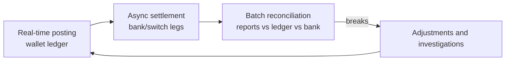
Real-time entries can be *provisional*; settlement and reconciliation make them *final in the books*.

### 12.2 Payment switches, interbank transfers and domestic infrastructure
| Component | What is verified | Notes |
|---|---|---|
| **BB-operated rails** | BB's Payment Systems Department operates/develops BACH (BACPS and BEFTN), NPSB and RTGS `[S1]` ✅ | Details and specifications from BB ⚠️ |
| **Nikash-BEFTN** | Since 12 Nov 2023, electronic fund transfers run on BB-developed "Nikash-BEFTN" `[S2]` 🟡 | Confirm current spec |
| **NPSB** | Operational since 2012; interoperability among banks for account and card-based transactions `[S2]` 🟡 | MFS-to-bank links may use NPSB and/or other rails; confirm per provider |
| **BD-RTGS** | Launched 29 Oct 2015; upgraded Nov 2024 `[S2]` 🟡 | High-value |
| **Binimoy (IDTP)** | Interoperable platform; operating rules describe direct/indirect participants, Virtual IDs, Direct Pay, Request to Pay `[S5][S6]` 🟡 | MFS and PSPs may participate as indirect participants |
| **Bangla QR** | BB circular directing banks, MFS, PSPs and PSOs to replace proprietary merchant QR with Bangla QR; P2P Bangla QR reported as planned `[S7][S9]` 🟡 | QR parsing and routing per BB spec |

**Engineering implication:** your integration may reach the same wallet through different rails; keep a **rail-agnostic payment model** and record the rail used per transaction.

### 12.3 Settlement banks, prefunding and liquidity management
- **Settlement bank / trust account:** holds funds backing e-money and settles obligations.
- **Prefunding (disbursement):** you deposit funds with the provider (or hold a provider-side balance) before disbursing. Risks: insufficient balance → failed payouts; excess → idle capital and counterparty risk.
- **Liquidity management:** forecast outflows, set minimum/maximum thresholds, automate top-ups, track agent float, alert before breaches.
- **Settlement risk:** paying out before incoming settlement is confirmed creates exposure; use reserves and cut-off rules.

### 12.4 Reconciliation files, matching, unmatched items and suspense
- **Files:** provider transaction report, settlement report, bank statement. Formats/schedules are provider-specific ❓.
- **Automated matching keys:** `our_reference`, `provider_reference`, amount, currency, date window, status.
- **Break types:** missing internal, missing external, amount mismatch, duplicate, status mismatch, timing, fee difference.
- **Suspense accounts:** hold unidentified receipts/payments until resolved; every suspense item has an owner, age and SLA; no permanent suspense.
- **Adjustment rule:** adjust by new entries; link to the break record.

### 12.5 Refunds, reversals, chargebacks
- **Reversal:** undo of a not-yet-final or just-completed transaction by the platform; **refund:** new transaction returning value after completion; **chargeback:** applies to **card** schemes (dispute by issuer); wallet disputes follow the provider's own dispute process ⚠️. Use only provider-documented refund/reversal capabilities ❓.

### 12.6 Commissions, agent incentives, MDR
- **Agent commission:** share of fees on cash-in/out; may be tiered; accrued per transaction and settled periodically.
- **Distributor override:** share of agent commissions.
- **Incentives:** campaigns (bonuses for volume) must be separate, budgeted ledger flows.
- **MDR (merchant discount rate):** fee on merchant payments; may be split among provider, bank, aggregator. Rates are contractual and possibly regulated ⚠️.
- **Engineering:** effective-dated tariff tables; commission accrual entries; payout runs with maker-checker; audit.

### 12.7 Foreign exchange and remittances
Inward remittance to wallets or bank accounts involves sender-side partner, FX conversion, compliance checks, funding/settlement and payout. Upay lists inward remittance among its services `[S17]` ✅. BB rules for channels, reporting and any incentives must come from BB circulars ⚠️.
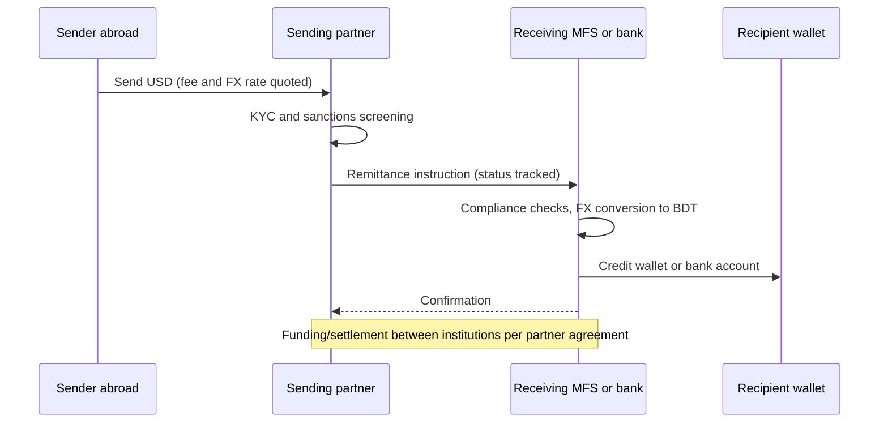
Engineering: quote lock, partner status polling, duplicate detection by partner reference, handling holds/returns, FX rate audit.

### 12.8 Service availability, DR, HA and failover
- **HA:** multi-AZ database with automated failover, stateless app nodes behind load balancers, redundant brokers.
- **DR:** backups with PITR, restore drills, defined RPO/RTO, documented failover runbooks, secondary region for critical data where justified.
- **Provider failover:** circuit breakers per provider; **never fail over a payment to another provider before confirming the first attempt's outcome** (risk of double payment).
- **Degradation:** queue non-urgent work; show `PROCESSING` honestly; disable features, not integrity.

### 12.9 Observability, incident management, audit, reporting
- **Incident management:** severity levels, on-call, runbooks (UNKNOWN pile-up, callback signature failures, provider outage, ledger imbalance), communication templates, blameless postmortems with action items.
- **Audit trails:** immutable logs of state transitions, admin actions, configuration changes (tariffs, limits), access to PII.
- **Financial reporting:** daily transaction summaries, e-money/trust reconciliation (provider side), settlement and fee reports, outstanding-break aging, regulatory reports in BB-prescribed formats ⚠️.

---

## 13. Formulas and Worked Examples
> All numbers are 🧪 illustrative.

**13.1 Fee and commission split (cash-out).**
Amount BDT 5,000; customer fee 1.5% → 75.00. Illustrative split: agent 60% = 45.00, distributor 6.67% ≈ 5.00, operator 33.33% = 25.00 (sum 75.00). Allocate remainders deterministically so the split always sums to the fee.

**13.2 Merchant payment (MDR).**
Amount BDT 2,000; MDR 1.5% → 30.00; merchant net = 1,970.00. If MDR is split 40/60 between provider and aggregator → 12.00 / 18.00.

**13.3 E-money safeguarding ratio.**
`coverage = trust_account_balance / e-money_outstanding`. Example: trust BDT 1,000,000,000; e-money outstanding BDT 998,500,000 → coverage ≈ 1.0015 (≥ 1.00 required by the principle; exact regulatory requirement ⚠️).

**13.4 Prefund sizing (disbursement).**
`required_prefund = peak_daily_outflow × days_uncovered × (1 + safety_margin)`.
Peak daily outflow BDT 30,000,000; days uncovered (weekend/holiday gap before top-up can settle) 3; safety 10% → 30,000,000 × 3 × 1.10 = **99,000,000**.

**13.5 Reconciliation match rate.**
`match_rate = matched / total_internal_records × 100`. 49,850 matched of 50,000 → **99.70%**; the 150 breaks are classified and aged.

**13.6 Agent float coverage.**
`float_cover_hours = agent_available_float / avg_hourly_cash-out_demand`. Float BDT 400,000; demand BDT 50,000/hour → **8 hours**; alert below threshold.

**13.7 Remittance cost.**
Send USD 200; mid-rate 120.00 BDT/USD; applied rate = mid × (1 − 1.0%) = 118.80; recipient gets 200 × 118.80 = **23,760 BDT** vs. 24,000 at mid → FX cost 240 BDT. Add transfer fee USD 3 ≈ 360 BDT at mid → total cost ≈ 600 BDT ≈ **2.5%** of 24,000.

**13.8 Backoff schedule (inquiry).**
`delay_n = min(cap, base × 2^n)` with jitter. base 15 s, cap 3,600 s → 15, 30, 60, 120, 240, 480, 960, 1,920, 3,600 s...

---

## 14. Bangladesh Case Studies
> Realistic but **hypothetical** scenarios using the Bangladesh context. Rails, limits and provider capabilities named in them must be verified.

### Case 1: Garment-factory salary disbursement via MFS wallets
**Context:** Dhaka-area employer pays 8,000 workers monthly through a payroll fintech.
**Design:** maker-checker approval → per-item disbursement records with deterministic references `PAYROLL-2026-10-{employee_id}` → batched submission within provider limits ❓ → per-item status inquiry → exceptions queue (inactive wallet, name mismatch) → reconciliation with provider report.
**Key risks and controls:** duplicate payouts on retry (reference + inquiry-before-resend), prefund shortfall (liquidity alert), partial batch (per-item state), wage-dispute evidence (immutable audit trail).
**Outcome metric:** 100% of items terminal within agreed time; reconciliation zero unexplained breaks.

### Case 2: Utility bill collection through a wallet
**Flow:** customer pays an electricity bill → provider debits wallet → biller aggregator confirms → settlement to utility.
**Problem:** "paid but not posted at biller." **Solution:** `PENDING_BILLER` financial state; inquiry to the aggregator; customer sees "Processing" until confirmed; auto-refund path if biller rejects; daily three-way reconciliation (customer debits, aggregator confirmations, biller settlement).

### Case 3: E-commerce checkout with an MFS provider
**Flow:** shop creates payment session → customer approves in wallet → callback → **server-side verification** → order confirmed.
**Problem:** customer returns to the shop via redirect, but callback is delayed. **Solution:** order stays "awaiting payment"; inquiry job confirms; never mark paid from the browser redirect alone `[S10]` 🟡.

### Case 4: Inward remittance credited to a wallet
**Flow:** expatriate sends funds via a partner; MFS provider credits recipient wallet.
**Problem:** compliance hold or name mismatch. **Solution:** `UNDER_REVIEW` status with SLA; clear customer messaging; returns processed through the partner; FX rate and fee recorded per transaction.

### Case 5: Agent float shortage in a rural area
**Flow:** an agent in a rural market serves many customers. Each **cash-in** consumes the agent's **e-money float** (the agent hands e-money to the customer and takes cash). Each **cash-out** increases the agent's e-money (the agent receives e-money and pays out cash), so it depletes the agent's **physical cash**.
**Insight:** monitor both the agent's **e-money float** (limits cash-in capacity) and **physical cash** (limits cash-out capacity). Rebalancing flows through distributors and banks. Alerts and demand forecasting reduce failed customer transactions.

---

## 15. Provider Integration Checklist

**Before coding**
- [ ] Obtain authorized API documentation, sandbox credentials, test wallets, limits/fees schedule, settlement and report specs, callback spec, error-code list
- [ ] Confirm which capabilities are supported (debit, disbursement, refund, inquiry, verification)
- [ ] Confirm regulatory and licensing status of both parties ⚠️
- [ ] Record SLA, dispute/reversal procedures, technical contacts, escalation path

**Design**
- [ ] Adapter implements only documented capabilities
- [ ] Unique `our_reference` per attempt; reuse on safe retries
- [ ] Explicit `UNKNOWN` handling and inquiry job
- [ ] Callback authentication per spec; dedupe; raw event storage
- [ ] Single choke point for applying results; allowed-transition table

**Security**
- [ ] Secrets in a manager; separate sandbox/production credentials
- [ ] Egress IPs registered with the provider; inbound IP restrictions if documented
- [ ] TLS verification on; no secrets in logs; PII masking

**Operations**
- [ ] Timeouts and retry policy per provider docs
- [ ] Dashboards: success rate, latency, UNKNOWN age, callback failures
- [ ] Reconciliation job with provider reports; break workflow; suspense ownership
- [ ] Runbooks; on-call; provider outage playbook

**Go-live**
- [ ] End-to-end sandbox tests incl. failure and duplicate cases
- [ ] Production credentials and allowlisting verified
- [ ] Small-value live test; monitored rollout; rollback plan

---

## 16. Troubleshooting Scenarios

| # | Symptom | Likely causes | Investigation | Fix |
|---|---|---|---|---|
| 1 | Customer charged, order not confirmed | Callback lost; local finalize failed | Check `provider_event`, inquiry logs; query provider by reference | Finalize via choke point; fix root cause |
| 2 | Many payments stuck `UNKNOWN` | Inquiry task failing; provider status API changed | Celery logs; provider response samples | Fix mapping; re-run inquiry; alert thresholds |
| 3 | Duplicate payouts | Resend without inquiry; reference regenerated | Compare references and provider records | Deterministic references; inquiry-before-resend |
| 4 | Webhook 401s spike | Secret rotated; clock skew; proxy altering body | Signature debug logs (masked); compare raw bytes | Restore secret; verify body integrity; sync clocks |
| 5 | Ledger imbalance alert | Manual SQL; trigger disabled; partial posting path | Find entries with unequal sums | Reversing entries; add constraint tests |
| 6 | Daily reconciliation shows missing external records | Report cut-off/timezone; provider delay | Compare date windows and statuses | Adjust windows; re-run; document timing breaks |
| 7 | Balance negative | Race condition; admin bypass | Audit lock usage; check code paths | Use locks/conditional updates; block bypass |
| 8 | Sandbox works, production fails | IP not allowlisted; credentials; TLS | Network traces; provider onboarding status | Complete allowlisting; verify config |
| 9 | Refund exceeds paid amount | Concurrent partial refunds | Refund table and locks | Lock payment row; enforce `refunded ≤ paid` |
| 10 | Customer says "money deducted" but we show failed | Late success or provider-side hold | Inquiry; provider case | Honor provider truth; refund/complete; log incident |

---

## 17. Common Engineering Mistakes
1. Treating a timeout as failure, or the browser redirect as proof of payment.
2. Skipping server-side verification before crediting or fulfilling.
3. Keeping idempotency only in Redis, or reusing keys for different payloads.
4. Calling providers inside DB transactions that hold row locks.
5. Multiple code paths updating payment state and ledger (no single choke point).
6. Mutating or deleting ledger entries instead of posting adjustments.
7. Using floats for money; mixing currencies; inconsistent rounding.
8. Hard-coding limits, fees, KYC tiers or holiday calendars.
9. Copying community API snippets as if they were official specifications.
10. Not storing raw provider requests/responses/events (impossible to investigate).
11. Failing over to a second provider before resolving the first attempt.
12. No reconciliation, or reconciliation without an owner and SLA for breaks.
13. Logging PINs, OTPs, tokens, full MSISDNs or NIDs.
14. Releasing holds on a timer while the outcome is still unknown.
15. Ignoring regulatory changes; no process to track BB/BFIU circulars.

---

## 18. Interview Questions with Answers

**Q1. What is e-money and why must it be backed?**
A provider's liability to customers; funds held in safeguarded accounts ensure customers can redeem. Regulators require safeguarding and reconciliation (verify specifics ⚠️).

**Q2. How does an MFS cash-in change balances?**
Agent wallet is debited and customer wallet credited (book entries); the agent receives physical cash. No interbank movement is involved unless funds enter/leave trust accounts.

**Q3. Why separate customer status from financial status?**
The UI must stay honest during ambiguity while the ledger records truth; they differ during timeouts, delayed callbacks and investigations.

**Q4. How do you handle a timeout on a wallet debit?**
Mark `UNKNOWN`, keep the hold, inquire by the same reference with backoff, finalize on confirmed result, escalate if unresolved.

**Q5. How do you prevent duplicate disbursements?**
Deterministic per-item references, unique constraints, inquiry before any re-send, provider idempotency if documented, and reconciliation as backstop.

**Q6. Why verify callbacks and still call the inquiry API?**
Callbacks can be forged, duplicated or delayed; server-side confirmation uses an authenticated channel and the provider's authoritative state.

**Q7. How do you design for multiple providers?**
Adapter pattern with normalized DTOs, a provider registry, capability flags, and a single payment service; provider specifics stay inside adapters and configuration.

**Q8. Why is `select_for_update()` used, and what are its limits?**
It locks rows to serialize concurrent balance changes; lock in consistent order, keep transactions short, avoid network calls inside, and remember it only protects within one database.

**Q9. What is the difference between reversal and refund?**
Reversal undoes a transaction not yet final (or via the platform's immediate undo); refund is a new, separate money movement after completion, bounded by the original amount.

**Q10. What belongs in a reconciliation break workflow?**
Immutable inputs, classification, auto-resolution of known patterns, owner and SLA for manual items, adjustments as ledger entries, aging metrics.

**Q11. What is prefunding and its risk?**
Depositing funds with a provider before disbursing; shortfall causes failed payouts, excess raises counterparty and capital cost; manage with forecasts and thresholds.

**Q12. What is the difference between authentication, authorization, approval and settlement?**
Who you are; what you may do; consent to this specific transaction; final inter-institution funds transfer.

**Q13. Should limits be in code?**
No: effective-dated configuration with audit, sourced from BB circulars and provider tariffs.

**Q14. How do you treat undocumented provider behavior?**
Don't rely on it. Ask the provider in writing, test in sandbox, record answers, and build defensive handling.

**Q15. When can PCI DSS apply to an MFS integration?**
When card data is stored, processed or transmitted (e.g., a gateway adding card acceptance). Pure wallet flows may not involve card data; minimize scope regardless.

**Q16. What distinguishes real-time processing, async settlement and batch reconciliation?**
Immediate customer outcome; later interbank money movement; periodic proof that records agree and handling of breaks.

---

## 19. Practical Exercises

| # | Exercise | Outcome measure |
|---|---|---|
| 1 | Draw money/information flows for cash-in, cash-out, merchant payment, bank-to-wallet | Every arrow labeled; ledger entries balanced |
| 2 | Write balanced journal entries for 12 MFS events (operator and integrator views) | All balance; account types correct |
| 3 | Implement the `ProviderAdapter` protocol and a `FakeProvider` with modes: success, fail, pending, timeout-but-success, duplicate callback, out-of-order | Test suite exercises all modes |
| 4 | Implement `apply_provider_result` as the single choke point with a transition table | Illegal transitions rejected; history complete |
| 5 | Build idempotent payment creation with unique constraints | 50 replays → one effect |
| 6 | Concurrency test: 100 parallel debits against one wallet | No overspend; ledger balanced |
| 7 | Build the inquiry job with backoff and escalation | All UNKNOWN items converge in simulation |
| 8 | Implement webhook endpoint with raw event store and dedupe | Duplicate events are no-ops |
| 9 | Reconciliation script with injected breaks | 100% detected and classified |
| 10 | Prefund-sizing calculator and alerting | Alert fires before simulated shortfall |
| 11 | Write a "documents to request from Upay" email/checklist and a gap analysis template | Reviewed by a peer |
| 12 | Research task: list current BB/BFIU instruments for MFS (regulations, circulars) with official links and retrieval dates | Each item has a primary source |

---

## 20. Glossary

| Term | Meaning |
|---|---|
| **Agent** | Retail point converting cash ↔ e-money |
| **BACH / BEFTN** | Bangladesh Automated Clearing House / Electronic Funds Transfer Network |
| **B2P / P2B / P2P / G2P** | Business-to-person / person-to-business / person-to-person / government-to-person |
| **BFIU** | Bangladesh Financial Intelligence Unit |
| **Binimoy (IDTP)** | Interoperable Digital Transaction Platform (Bangladesh) |
| **Cash-in / Cash-out** | Convert cash to e-money / e-money to cash |
| **Distributor** | Intermediary supplying float to agents |
| **E-KYC** | Digital identity verification for onboarding |
| **E-money** | Electronic value issued against funds received |
| **Float** | E-money or cash balance held by an agent/distributor |
| **HMAC** | Keyed hash used for message authentication |
| **Idempotency** | Repeating an operation has the effect of one |
| **IDTP** | Interoperable Digital Transaction Platform |
| **IPN** | Instant payment notification (callback) |
| **KYC** | Know your customer |
| **Ledger / available / reserved balance** | Posted total / spendable / earmarked by holds |
| **MDR** | Merchant discount rate |
| **MFS** | Mobile financial services |
| **MSISDN** | Mobile subscriber number |
| **NPSB** | National Payment Switch Bangladesh |
| **PSO / PSP** | Payment system operator / payment service provider |
| **Prefunding** | Depositing funds ahead of disbursements |
| **Reconciliation** | Matching records across systems and explaining differences |
| **Reversal / refund / chargeback** | Undo / return after completion / issuer-initiated card dispute |
| **Suspense account** | Temporary holding for unidentified items |
| **Trust / safeguarding account** | Bank account holding funds that back e-money |
| **UNKNOWN (state)** | Ambiguous outcome requiring inquiry |
| **Webhook** | Server-to-server event notification |

---

## 21. Beginner-to-Advanced Learning Stages

| Stage | Focus | Sections | Deliverable |
|---|---|---|---|
| **1. Beginner** | MFS concepts, participants, regulation overview | 1-3 | Ecosystem diagram; glossary notes |
| **2. Foundational** | Transaction lifecycle, ledger entries, statuses | 4-5, 9.1-9.3 | 12 balanced journal entries; status model |
| **3. Intermediate** | Integration patterns, adapter architecture, Django implementation | 6-8 | FakeProvider + adapter + models |
| **4. Advanced** | Safety under failure, security, compliance | 9-11 | Chaos test suite; threat model |
| **5. Expert** | Settlement, liquidity, reconciliation, DR, observability | 12-13 | Reconciliation engine; prefund calculator; runbooks |
| **6. Specialist** | Multi-provider platform, regulatory tracking, case studies | 14-15, 23 | Production-readiness review with real provider documents |

---

## 22. Final Knowledge Checklist

**Concepts**
- [ ] I can explain MFS, e-money, agents, distributors, trust accounts, and how they differ from banks, PSPs, PSOs.
- [ ] I can describe each transaction type's participants, money flow and ledger entries.

**Engineering**
- [ ] I can design provider-independent adapters and a single result-application choke point.
- [ ] I can implement idempotency, holds, row locking and append-only ledgers.
- [ ] I can handle timeouts, duplicates, out-of-order events and late success safely.
- [ ] I can build inquiry jobs and reconciliation with break workflows.

**Security and compliance**
- [ ] I can separate authentication, authorization, approval and settlement.
- [ ] I can list controls for PIN/OTP, API auth, secrets, PII, fraud and AML.
- [ ] I know which obligations must be verified in current BB/BFIU documents.

**Provider discipline**
- [ ] I never assume provider API details; I obtain authorized documents and record versions.
- [ ] I can state exactly what is verified and unverified about Upay, bKash, Nagad and Rocket.

---

## 23. Open Items to Verify
| Item | Why | Where to check |
|---|---|---|
| Upay integration documentation, supported capabilities, auth scheme, limits, fees, settlement | Not publicly available ❓ | Upay/UCB Fintech business team and contract |
| Nagad and Rocket current integration specs | Obtained on request ❓ | Nagad / DBBL |
| bKash current API version, credentials, rate limits, IPN authentication | Versions change | developer.bka.sh |
| Current BB MFS regulation text and amendments; limits and fees | Time-sensitive | bb.org.bd circulars |
| Current BFIU KYC/e-KYC circulars and STR rules | Time-sensitive | bfiu.org.bd |
| Payment and Settlement Systems Act, 2024: commencement, rules, licence categories | Time-sensitive | Gazette, BB |
| NPSB, Binimoy, Bangla QR technical specifications and participation rules | Specs change | BB / platform operators |
| Data protection/cybersecurity legal requirements | Evolving | Official gazettes, BB ICT guidelines |
| Ownership/licensing details of MFS providers | Can change | BB licensed-entity lists |

---

## 24. References and Further Reading

> Checked via web search on 19 Oct 2026. Prefer **primary** sources. Tags: **P** primary/official, **S** secondary (news, law-firm, community). Community integration repositories are listed only to show what practitioners report; they are **not** specifications.

### 24.1 Official and primary
| Tag | Source | Link |
|---|---|---|
| [S1] P | Bangladesh Bank, Payment Systems Department (functions: BACH/BACPS/BEFTN, NPSB, RTGS, MFS framework) | https://www.bb.org.bd/en/index.php/about/deptdtl/59 |
| [P1] P | Bangladesh Bank home (circulars, regulations, licensed entities, reports) | https://www.bb.org.bd/ |
| [P2] P | Bangladesh Financial Intelligence Unit | https://www.bfiu.org.bd/ |
| [S11] P | bKash developer portal (tokenized checkout overview, references) | https://developer.bka.sh/docs/tokenized-checkout-overview · https://developer.bka.sh/docs/checkout-process-overview · https://developer.bka.sh/reference |
| [S17] P | Upay official YouTube channel (company description, licence, services) | https://www.youtube.com/c/upaybangladesh |
| [S18] P | Upay official app listing (UCB Fintech Company Limited) | https://play.google.com/store/apps/details?id=bd.com.upay.customer&hl=en |
| [P3] P | Upay website (contact the business team for integration) | https://www.upaybd.com/ |
| [P4] P | Nagad (request merchant API documentation) | https://nagad.com.bd/ |
| [P5] P | Dutch-Bangla Bank (Rocket) | https://www.dutchbanglabank.com/ |
| [P6] P | PCI Security Standards Council | https://www.pcisecuritystandards.org/ |
| [P7] P | FATF Recommendations | https://www.fatf-gafi.org/ |
| [P8] P | BIS CPMI-IOSCO Principles for Financial Market Infrastructures | https://www.bis.org/cpmi/publ/d101.htm |
| [P9] P | EMVCo (QR and card specifications) | https://www.emvco.com/ |
| [P10] P | ISO 20022 | https://www.iso20022.org/ |
| [P11] P | OWASP API Security Top 10 | https://owasp.org/API-Security/ |
| [S29] P | RFC 8446 TLS 1.3 | https://www.rfc-editor.org/rfc/rfc8446 |
| [P12] P | RFC 2104 HMAC | https://www.rfc-editor.org/rfc/rfc2104 |
| [P13] P | Django `select_for_update` | https://docs.djangoproject.com/en/stable/ref/models/querysets/#select-for-update |
| [P14] P | Django database transactions | https://docs.djangoproject.com/en/stable/topics/db/transactions/ |
| [P15] P | Celery documentation | https://docs.celeryq.dev/ |
| [P16] P | OpenTelemetry documentation | https://opentelemetry.io/docs/ |
| [S27] P | PCI DSS (current version via PCI SSC library) | https://www.pcisecuritystandards.org/ |

### 24.2 Secondary sources used in this guide
| Tag | Claim supported | Link |
|---|---|---|
| [S2] S | BACH structure; Nikash-BEFTN since 12 Nov 2023; NPSB since 2012; BD-RTGS 2015, upgraded Nov 2024 | https://www.tbsnews.net/node/1077966 |
| [S5] S | Binimoy launch and purpose | https://www.thedailystar.net/tech-startup/science-gadgets-and-tech/tech-news/news/joy-launches-new-transaction-platform-binimoy-3167986 |
| [S6] S | Binimoy operating rules (participants, Virtual ID, Direct Pay, RTP) | https://thefinancialexpress.com.bd/economy/instant-bank-mfs-transaction-swap-rules-announced |
| [S7] S | Bangla QR mandate circular | https://thefinancialexpress.com.bd/trade/bb-mandates-bangla-qr-for-all-digital-payments |
| [S9] S | Planned P2P via Bangla QR | https://thefinancialexpress.com.bd/trade/bb-set-to-introduce-person-to-person-money-transfer-through-bangla-qr |
| [S8] S | Payment and Settlement Systems Act, 2024 (passed 4 July 2024; BB approval/licence requirements) | https://www.vdb-loi.com/?p=4964 · https://thefinancialexpress.com.bd/national/parliament-passes-payment-and-settlement-system-bill-2024 |
| [S13] S | MFS Regulations, 2018 background; BB PSD supervision; BFIU Circular 20 | https://thefinancialexpress.com.bd/views/regulatory-oversight-in-mfs-industry-1612534358 |
| [S14] S | MFS Regulations 2018 clauses on reconciliation/capital; e-KYC circulars (BFIU 20, 25) | https://www.thedailystar.net/mobile-financial-services-strengthen-compliance-anti-money-laundering-anti-terror-financing-measures-2029925 |
| [S15] S | Historical MFS limits (2017 tightening; historical only) | https://futurestartup.com/2017/01/12/bb-tightens-mfs-transaction-rules-personal-level-clouding-e-commerce-payment-scenario/ |
| [S16] S | Historical MFS limits (2019 revision; historical only) | https://today.thefinancialexpress.com.bd/print/bb-ups-limits-on-mfs-transaction-1558287546 |
| [S19] S | Upay and UCSI partnership; Upay as UCB Fintech's MFS | https://www.tbsnews.net/economy/corporates/upay-ucsi-university-partner-develop-cashless-campus-1490496 |
| [S20] S | AFI policy paper on AML/CFT for MFS in Bangladesh (progressive KYC) | https://afi-global.org/opinion/aml-cft-regulations-for-mobile-financial-services-mfs-policy-options-for-bangladesh/ |
| [S21] S | UCB subsidiaries; Upay arrangements with mobile operators | https://en.wikipedia.org/wiki/United_Commercial_Bank_(Bangladesh) |
| [S10] S | Community bKash tokenized client documenting create/execute/status behaviour (references bKash docs) | https://pypi.org/project/bkash-pgw-tokenized/ |
| [S12] S | Community Nagad wrappers (documentation and sandbox from Nagad; IP/credential notes) | https://packagist.org/packages/codeboxr/nagad · https://packagist.org/packages/luova/nagad |
| [S22] S | Community package listing "Upay" (unverified API claims) | https://packagist.org/packages/unipay/unipay-bd |
| [S23] S | Community aggregator listing (MFS and gateways) | https://github.com/rdnasim/bangla-apis |
| Not Upay-BD | UPayments (Kuwait): **unrelated** company; do not confuse | https://developers.upayments.com/ |

### 24.3 Further reading
- *Designing Data-Intensive Applications* (Kleppmann): transactions, consistency, streams.
- *Release It!* (Nygard): timeouts, circuit breakers, stability patterns.
- *Microservices Patterns* (Richardson): outbox, sagas.
- *Security Engineering* (Anderson): payment and banking security.
- GSMA mobile money resources (industry practice on agent networks, safeguarding, interoperability): https://www.gsma.com/
- CGAP resources on digital financial services and agent networks: https://www.cgap.org/

---

**Closing principle:** the provider's documentation is the only source for what a provider's API does; the ledger is the only source for what your system owes; reconciliation is how you prove both agree. Build so that, at any moment, you can say where every taka is, why it is there, and how you know.
