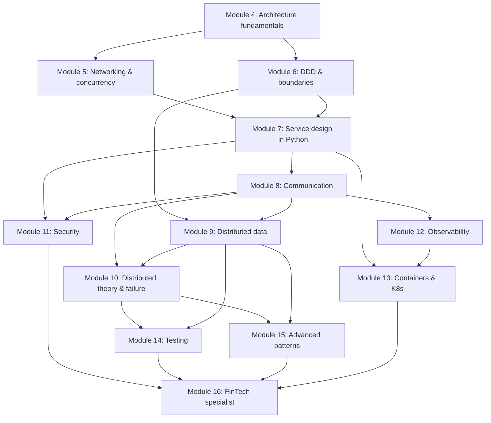
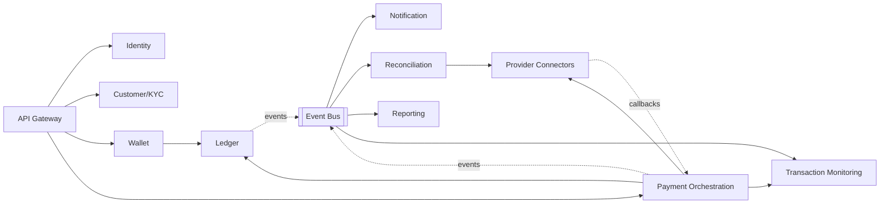
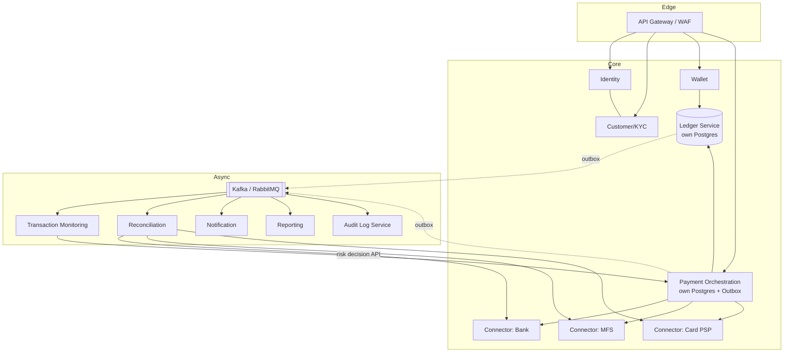
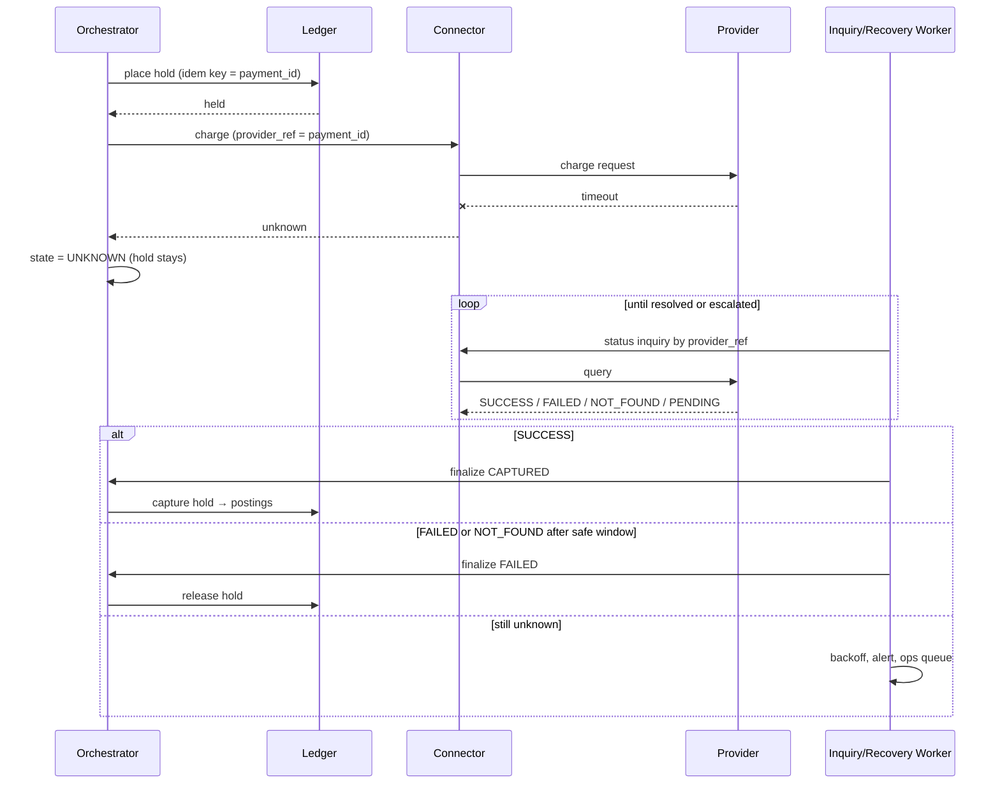
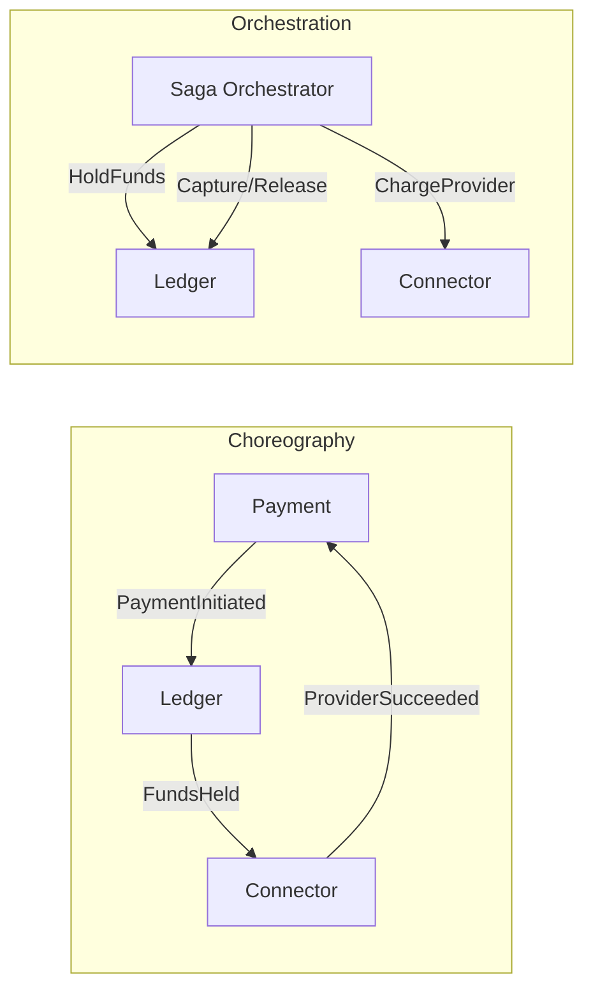

# Microservices Architecture Mastery Roadmap (FinTech Edition)

**For:** a Python/Django backend developer (DRF, PostgreSQL, Redis, Celery, Docker, third-party payment integrations)
**Goal:** independently design, explain, implement, test, deploy, debug and maintain production-grade microservices for FinTech platforms, and know *why* each decision is made, *when* it is appropriate, *what can go wrong*, and *how to recover*.

> **Reading legend**
> - 🔴 **DEEP**: understand the mechanism well enough to derive it, implement it, and debug it.
> - 🟡 **WORKING**: use confidently, know the trade-offs.
> - 🟢 **RECOGNIZE**: know what it is and when it applies; learn details on demand.
> - **Prereq:** topics to complete first. **Out:** what you can do afterwards.

---

## Table of Contents

1. [How This Roadmap Works](#1-how-this-roadmap-works)
2. [Deep vs. Recognize: Priority Map](#2-deep-vs-recognize-priority-map)
3. [Dependency Map and Learning Order](#3-dependency-map-and-learning-order)
4. [Level 0: Architecture Fundamentals](#4-level-0-architecture-fundamentals)
5. [Level 1: Networking and Concurrency Foundations](#5-level-1-networking-and-concurrency-foundations)
6. [Level 2: Domain-Driven Design and Service Boundaries](#6-level-2-domain-driven-design-and-service-boundaries)
7. [Level 3: Designing a Service in Python](#7-level-3-designing-a-service-in-python)
8. [Level 4: Inter-Service Communication](#8-level-4-inter-service-communication)
9. [Level 5: Distributed Data Management](#9-level-5-distributed-data-management)
10. [Level 6: Distributed Systems Theory and Failure Patterns](#10-level-6-distributed-systems-theory-and-failure-patterns)
11. [Level 7: Security for Microservices](#11-level-7-security-for-microservices)
12. [Level 8: Observability and Production Operations](#12-level-8-observability-and-production-operations)
13. [Level 9: Containers, Kubernetes and Infrastructure](#13-level-9-containers-kubernetes-and-infrastructure)
14. [Level 10: Testing Distributed Systems](#14-level-10-testing-distributed-systems)
15. [Level 11: Advanced Architectural Patterns](#15-level-11-advanced-architectural-patterns)
16. [Level 12: FinTech Specialist Architecture](#16-level-12-fintech-specialist-architecture)
17. [Cross-Cutting Practices](#17-cross-cutting-practices)
18. [Portfolio Projects](#18-portfolio-projects)
19. [Study Schedule: Daily and Weekly](#19-study-schedule-daily-and-weekly)
20. [Milestone Assessments](#20-milestone-assessments)
21. [System Design Interview Preparation](#21-system-design-interview-preparation)
22. [Code-Review and Production-Readiness Checklists](#22-code-review-and-production-readiness-checklists)
23. [Resources: Documentation, Books, Papers](#23-resources-documentation-books-papers)
24. [Appendix: Reference Code, Schemas and Diagrams](#24-appendix-reference-code-schemas-and-diagrams)

---

## 1. How This Roadmap Works

### 1.1 Six learner levels mapped to modules

| Learner level | Modules covered | Typical duration* |
|---|---|---|
| **Beginner** | 4 (architecture fundamentals), 5 (networking, concurrency) | 5-6 weeks |
| **Foundational** | 6 (DDD), 7 (service design in Python) | 8-10 weeks |
| **Intermediate** | 8 (communication), 9 (distributed data) | 10-12 weeks |
| **Advanced** | 10 (distributed theory and failure), 11 (security), 12 (observability) | 12-14 weeks |
| **Expert** | 13 (containers, Kubernetes), 14 (testing), 15 (advanced patterns) | 12-14 weeks |
| **FinTech specialist** | 16 (financial microservices), capstone | 12-16 weeks |

\*At 12-15 hours/week alongside work. Total ≈ 14-18 months. Compress only by dropping breadth, never the hands-on work.

### 1.2 The consistent teaching format (apply to every nano-topic)

For each concept, fill out this card in your notes (the "concept card"):

1. **Definition** in one plain-language sentence
2. **Why it exists** (the problem before the solution)
3. **How it works internally**
4. **Prerequisites**
5. **Problems it solves**
6. **Trade-offs and limits**
7. **Real-world example** (prefer FinTech)
8. **Python/Django implementation sketch**
9. **Common mistakes**
10. **Exercise + measurable outcome**

### 1.3 Module structure

Each module below lists: **Prereq → Lessons → Nano-topics (with depth tag) → Hands-on tasks → Debugging exercise → Design question → Exit criteria**. Diagrams, schemas and API samples appear inline or in the [Appendix](#24-appendix-reference-code-schemas-and-diagrams).

### 1.4 Rule of the roadmap
**Failure first.** For every pattern, learn the failure it prevents, then *simulate that failure* before and after applying the pattern.

---

## 2. Deep vs. Recognize: Priority Map

### 2.1 Understand deeply 🔴 (architectural reasoning)

| Area | Why |
|---|---|
| Service boundaries, bounded contexts, data ownership | Wrong boundaries cause a distributed monolith, the costliest mistake |
| Network failure semantics (timeouts, partial failure, uncertain outcomes) | Every remote call can succeed, fail, or *be unknown* |
| Delivery semantics and idempotency | Duplicates are certain; double charges are optional |
| Transactional outbox / inbox, sagas | The practical replacement for distributed transactions |
| Consistency models and isolation levels | Determines whether a wallet can overspend |
| Double-entry ledger and financial state machines | Financial correctness |
| Timeouts, retries, backoff, jitter, circuit breakers, backpressure | Stops cascading failures |
| AuthN/Z, JWT validation, service identity, mTLS basics | Prevents lateral movement |
| Observability (traces, metrics, logs, SLOs) | You cannot fix what you cannot see |
| Testing failure modes | Proves the design works |

### 2.2 Use confidently 🟡

Django/DRF/FastAPI service structure, PostgreSQL concurrency, RabbitMQ and Kafka core concepts, Docker, Compose, CI/CD, Prometheus/Grafana/OpenTelemetry, Kubernetes core objects, contract testing, API gateway.

### 2.3 Recognize only 🟢 (learn on demand)

Service mesh internals, Kubernetes operators, GraphQL federation, vector clocks beyond concept, Paxos/Raft internals (concept-level suffices), multi-region active-active data tooling, specific vendor clouds' proprietary services, Terraform advanced modules, eBPF networking.

---

## 3. Dependency Map and Learning Order



### 3.1 What can wait

| Can wait until | Topics |
|---|---|
| After Module 9 | CQRS/event sourcing depth, Kafka internals |
| After Module 12 | Kubernetes advanced (operators, Gateway API depth), service mesh |
| After the first saga project | Multi-region, sharding, consensus details |
| Never required early | GraphQL, serverless, advanced cloud networking |

---

## 4. Level 0: Architecture Fundamentals

**Prereq:** Django backend experience. **Out:** explain architecture styles and decide when *not* to use microservices.

### 4.1 Module 4.A Software architecture basics 🟡
- **Lessons:** what architecture is (decisions that are costly to change); quality attributes (availability, latency, throughput, consistency, security, maintainability, deployability, cost); architectural drivers; trade-off analysis.
- **Nano-topics:** coupling vs. cohesion; modularity; layering; separation of concerns; architectural fitness functions; "-ilities" conflicts (consistency vs. availability, latency vs. durability).
- **Exercise:** list the top 5 quality attributes of a wallet platform and rank them; justify the ranking.

### 4.2 Module 4.B Architectural styles 🔴

| Style | Deployment unit | Data | Strength | Weakness |
|---|---|---|---|---|
| **Monolith** | One | One DB | Simple, fast to build, ACID | Scaling teams/deploys, blast radius |
| **Modular monolith** | One | One DB (schemas per module) | Clear boundaries, simple ops | Needs discipline; single scaling unit |
| **SOA** | Several, coarse | Often shared | Reuse via ESB/contracts | Heavy middleware, shared data |
| **Microservices** | Many, independent | DB per service | Independent deploy/scale, team autonomy | Operational and distributed complexity |
| **Serverless/functions** 🟢 | Functions | Managed | Elastic, low ops | Cold starts, limits, vendor lock-in |

- **Nano-topics:** deployment unit vs. module; independent deployability test; SOA vs. microservices (smart pipes vs. dumb pipes); shared database anti-pattern; "distributed monolith".

### 4.3 Module 4.C Why adopt, when to avoid 🔴
- **Reasons to adopt:** independent team scaling, independent release cadence, differing scaling profiles, fault isolation, polyglot needs, regulatory isolation (e.g., PCI scope).
- **Reasons to avoid:** small team, unclear domain, startup stage with changing requirements, no DevOps maturity, weak automated testing, strong cross-entity transactional needs.
- **Disadvantages:** network failures, latency, data consistency, operational overhead, debugging difficulty, versioning, testing complexity, organizational overhead (Conway's law).
- **Common misconceptions:** "microservices are always faster" (they add latency); "small services are better" (boundary quality matters); "each service can be written in any language" (maintenance cost); "microservices = Kubernetes"; "REST between services = microservices".
- **Decision tool:** *the microservices readiness checklist* (Appendix 24.1).
- **Exercise:** write a one-page ADR deciding monolith vs. modular monolith vs. microservices for a 5-developer wallet startup. Expected: modular monolith.

### 4.D Module 4.D Distributed systems: the 8 fallacies 🔴
Network is reliable; latency is zero; bandwidth is infinite; network is secure; topology doesn't change; there is one administrator; transport cost is zero; the network is homogeneous.
- **Nano-topics:** partial failure; unreliable networks; unbounded delays; independent failure of components; no global clock; no shared memory.
- **Exit criteria:** you can explain why `call_service()` in code is fundamentally different from a local function call.

---

## 5. Level 1: Networking and Concurrency Foundations

**Prereq:** Level 0. **Out:** reason about what happens between two services on a wire and inside a Python process.

### 5.1 Module 5.A Network fundamentals 🟡/🔴

| Lesson | Nano-topics |
|---|---|
| **TCP/IP model** | IP addressing, subnets/CIDR (🟡), ports, TCP handshake, retransmission, congestion control (🟢), connection states (TIME_WAIT, CLOSE_WAIT) |
| **Sockets** | Client/server sockets, blocking vs. non-blocking, listen backlog, file descriptors |
| **DNS** | Records (A, AAAA, CNAME, SRV), TTL, resolver caching, DNS failure modes, DNS-based discovery |
| **HTTP/1.1, HTTP/2, HTTP/3** | Methods, status codes, headers, keep-alive, multiplexing, head-of-line blocking, streaming |
| **TLS/HTTPS** | Handshake, certificates, chain of trust, SNI, TLS termination, mTLS (🔴 later), cipher suites (🟢) |
| **Latency** | Propagation vs. transmission vs. queueing vs. processing delay; p50/p95/p99; tail latency amplification across fan-out |
| **Timeouts** | Connect vs. read vs. total timeouts; deadline propagation |
| **Connection pooling** | Why pools, pool sizing, exhaustion, keep-alive reuse, PgBouncer, `requests.Session`/`httpx.Client` |

- **Hands-on:** (1) write a raw TCP echo server in Python; (2) use `curl -v`, `openssl s_client`, `dig`, `tcpdump` to watch a request; (3) measure latency with and without connection reuse.
- **Debugging exercise:** a service intermittently fails with "connection reset by peer"; determine whether it is a pool, timeout, or server-side issue.
- **Exit criteria:** explain what happens from DNS lookup to first byte for an HTTPS call, and where each timeout applies.

### 5.2 Module 5.B Serialization and data formats 🟡

| Format | Notes |
|---|---|
| **JSON** | Human-readable, schema-less, ambiguous numbers (never floats for money) |
| **Protocol Buffers** | Binary, schema-first, field numbers, forward/backward compatibility rules |
| **Avro** 🟢 | Schema registry friendly, used with Kafka |
| **MessagePack** 🟢 | Compact JSON-like |

- **Nano-topics:** schema evolution rules (add optional fields; never reuse field numbers); required vs. optional; default values; versioning; canonical serialization for signatures; Decimal and timestamp representations (ISO 8601 UTC; money as string or minor-unit integers).
- **Exercise:** define a `Money` message in protobuf and JSON schema; evolve it without breaking old consumers.

### 5.3 Module 5.C Communication styles (conceptual) 🔴
- Synchronous request-response vs. asynchronous messaging; blocking vs. non-blocking; one-to-one vs. one-to-many; temporal coupling; spatial coupling; availability coupling.
- **Rule:** synchronous calls multiply availability: availability of a chain ≈ product of availabilities (five 99.9% services in series ≈ 99.5%).

### 5.4 Module 5.D Concurrency and the Python model 🔴

| Concept | Key points |
|---|---|
| **Processes vs. threads** | Memory isolation, context switching, cost |
| **Concurrency vs. parallelism** | Interleaving vs. simultaneous execution |
| **GIL** | One thread executes Python bytecode at a time; releases on I/O; free-threaded builds exist (🟢 track) |
| **I/O-bound vs. CPU-bound** | Threads/async for I/O; processes for CPU |
| **asyncio** | Event loop, coroutines, `await`, tasks, cancellation, blocking-call pitfalls |
| **WSGI vs. ASGI** | Gunicorn sync/gthread workers; Uvicorn/Hypercorn; Django async views; FastAPI |
| **Worker models** | Gunicorn workers x threads sizing; Celery prefork/gevent/threads; DB connections per worker |
| **Race conditions** | Check-then-act, lost updates, TOCTOU |
| **Synchronization** | Locks, semaphores, queues; why in-process locks don't help across instances |

- **Hands-on:** (1) threaded counter race → fix with lock; (2) asyncio fan-out of 100 HTTP calls with `asyncio.gather` and a semaphore; (3) benchmark sync vs. async FastAPI endpoints under load; (4) demonstrate GIL effect on CPU-bound threads.
- **Debugging exercise:** async endpoint becomes slow because of a blocking ORM call; find and fix it.
- **Exit criteria:** pick the right concurrency model for a webhook receiver, a CPU-heavy report job, and a high-fan-out aggregator.

---

## 6. Level 2: Domain-Driven Design and Service Boundaries

**Prereq:** Levels 0-1. **Out:** derive service boundaries from the business rather than from technology.

### 6.1 Module 6.A Strategic design 🔴

| Lesson | Nano-topics |
|---|---|
| **Ubiquitous language** | Glossary building, same word different meaning across contexts ("account" in identity vs. ledger) |
| **Domains and subdomains** | Core, supporting, generic subdomains; invest custom effort in core (ledger, orchestration), buy generic (email, identity provider) |
| **Bounded context** | Explicit model boundary; language and model consistent inside; translation at edges |
| **Context mapping** | Partnership, shared kernel, customer-supplier, conformist, anti-corruption layer, open host service, published language, separate ways |
| **Event storming** | Big-picture, process-level, design-level; discovering events, commands, aggregates, policies, hot spots |

- **Hands-on:** run a solo event storming for "wallet top-up and merchant payment"; produce a context map.

### 6.2 Module 6.B Tactical design 🔴/🟡

| Building block | Meaning | FinTech example |
|---|---|---|
| **Entity** | Identity continues over time | `Wallet`, `Payment` |
| **Value object** | Immutable, equality by value | `Money(amount, currency)`, `PhoneNumber` |
| **Aggregate** | Consistency boundary; changes via one root | `Payment` (with attempts), `JournalEntry` (with lines) |
| **Aggregate root** | Only entry point to modify internals | `JournalEntry` |
| **Domain invariant** | Rule always true after a transaction | Entry debits = credits |
| **Repository** | Collection-like access to aggregates | `PaymentRepository` |
| **Domain service** | Domain logic not owned by one entity | `FeeCalculator` |
| **Application service** | Orchestrates use cases, transactions | `CapturePaymentUseCase` |
| **Domain event** | Fact that happened, past tense | `PaymentCaptured` |
| **Factory** 🟢 | Complex creation | `PaymentFactory` |

- **Aggregate design rules:** keep aggregates small; reference other aggregates by ID; one transaction modifies one aggregate; use eventual consistency between aggregates; design around invariants, not data relationships.
- **Mistake to avoid:** anemic domain model (all logic in services, entities as bags of fields) vs. over-engineering simple CRUD (use plain Django where the domain is trivial).

### 6.3 Module 6.C Identifying service boundaries 🔴
Techniques (use several and compare):
1. **Business capability:** what the business does (Onboarding, Payments, Ledger).
2. **Subdomain:** from domain analysis.
3. **Workflow / business process:** end-to-end flows and handoffs.
4. **Transaction boundary:** things that must change atomically stay together.
5. **Data ownership:** who is the single writer of each fact.
6. **Team ownership:** Conway's law; "two-pizza team" per service.
7. **Change frequency and scaling profile:** parts that change/scale differently.

**Boundary smell tests:** two services always deployed together; one service cannot work without synchronous calls to five others; chatty communication; shared tables; change requests touching 3+ services; circular dependencies.

### 6.4 Module 6.D Decomposition risks 🔴

| Anti-pattern | Symptom | Fix |
|---|---|---|
| **Distributed monolith** | Lockstep deployments | Re-draw boundaries; async decoupling |
| **Nano-services** | A service per table; huge call graph | Merge around invariants |
| **Mega-service** | One team can't own it | Split by subdomain |
| **Shared database** | Cross-service SQL, hidden coupling | Database per service + APIs/events |
| **Circular dependencies** | A→B→A calls | Introduce events; move logic |
| **Chatty services** | N+1 over network | Coarser APIs, local replicas of data, API composition |
| **Entity services** | CRUD wrappers on tables | Capability-oriented services |

### 6.5 Module 6.E FinTech decomposition worked example 🔴

| Service | Owns (data) | Responsibility | Type |
|---|---|---|---|
| **Identity** | credentials, sessions, MFA | authentication, tokens | Generic (consider buying) |
| **Customer / KYC** | profiles, KYC docs, tier | onboarding, verification | Supporting |
| **Wallet** | wallet accounts, limits, holds metadata | wallet lifecycle, limit enforcement | Core |
| **Ledger** | accounts, journal entries/lines | double-entry postings, balances | Core (strict) |
| **Payment orchestration** | payments, attempts, routing rules | payment state machine, provider routing | Core |
| **Provider connectors** | provider credentials, raw events | adapters for banks/PSPs/MFS | Supporting |
| **Transaction monitoring** | risk events, rules, alerts, cases | fraud and AML | Core/Supporting |
| **Reconciliation** | external transactions, matches, breaks | match internal vs. external | Core |
| **Notification** | templates, delivery logs | SMS/email/push | Generic |
| **Reporting** | read models | analytics, regulatory reports | Supporting |



- **Exercise:** for each service, write: owned data, commands accepted, events published, events consumed, synchronous dependencies, and what happens when each dependency is down.
- **Exit criteria:** defend each boundary using at least two different decomposition techniques; identify two places where merging is justified.

---

## 7. Level 3: Designing a Service in Python

**Prereq:** Levels 0-2. **Out:** a production-shaped single service with clean structure, config, validation, auth, migrations, health checks, and pipeline.

### 7.1 Module 7.A Choosing the framework 🟡

| Choice | Use when | Avoid when |
|---|---|---|
| **Django + DRF** | Rich domain with admin, ORM, migrations, auth, mature ecosystem; CRUD-heavy internal services; need Django admin for ops | Pure high-throughput I/O proxy services |
| **FastAPI** | Async I/O-heavy APIs, strict typed contracts (Pydantic), OpenAPI first, lightweight connectors/gateways | You need Django admin/ORM conveniences and have simple sync workloads |
| **Flask/Starlette/lightweight** 🟢 | Tiny single-purpose services | Complex domains needing structure |
| **Plain worker (Celery/consumer)** | Event consumers, batch jobs | Needs request/response API |

**Guidance:** one framework per service is fine; standardize on one or two across the org. Do not rewrite to FastAPI for fashion; measure first.

### 7.2 Module 7.B Internal structure of a service 🔴

```
payment_service/
├── api/                  # presentation: DRF views / FastAPI routers, serializers, schemas
├── application/          # use cases, commands, DTOs, unit of work interface, app exceptions
├── domain/               # entities, value objects, aggregates, domain services, domain events, domain exceptions
├── infrastructure/       # ORM models, repositories, message publishers, provider clients, config
├── config/               # settings, DI wiring
└── tests/
```

**Dependency rule:** dependencies point inward: `api → application → domain`; `infrastructure → application/domain` (implements interfaces). The domain imports nothing from Django.

| Concept | Nano-topics |
|---|---|
| **SOLID** | Single responsibility; open/closed; Liskov; interface segregation; **dependency inversion** (🔴) |
| **Repository** | Interface in domain/application, implementation in infrastructure; returns aggregates, not ORM rows |
| **Unit of Work** | Defines the transaction boundary; commits aggregates + outbox together |
| **Dependency injection** | Constructor injection; composition root; FastAPI `Depends`; simple manual wiring over heavy frameworks |
| **DTOs/serializers/schemas** | Boundary objects; never expose ORM models over the wire |
| **Exceptions** | Domain exceptions (invariant violated) vs. application exceptions (not found, conflict) vs. infrastructure errors; map to HTTP status in the presentation layer |
| **Logging** | Structured JSON, correlation IDs, no secrets/PII |
| **Config** | 12-factor: env vars, typed settings (pydantic-settings), per-environment overrides, secrets from a store |

**Avoiding over-engineering:** use the full layered structure for **core** services (ledger, payments); use plain Django (fat models with tests) for simple supporting services (notification templates). Introduce a repository only when it earns its keep (test isolation, multiple backends, complex queries).

### 7.3 Module 7.C API design 🔴/🟡
- **REST maturity:** resources, verbs, status codes, pagination (cursor over offset for large sets), filtering, errors (RFC 9457 problem details), idempotency (`Idempotency-Key`), long-running operations (`202 Accepted` + status resource).
- **Contracts:** OpenAPI as source of truth; examples; error catalog; money as string or minor units.
- **Versioning:** URI (`/v1`) vs. header; additive evolution; deprecation window; never break consumers silently.
- **Backward compatibility rules:** adding optional fields OK; removing/renaming fields, tightening validation, changing semantics = breaking.
- **Validation:** at the edge (serializers/Pydantic) plus domain invariants inside.

### 7.4 Module 7.D Service lifecycle 🟡
- **Health checks:** liveness (process OK), readiness (can serve; DB reachable), startup; avoid making liveness depend on downstream services.
- **Migrations:** each service owns its schema; backward-compatible expand/contract migrations enable zero-downtime deploys; never run destructive changes in the same release as code dependent on them.
- **Independent pipelines:** per-service repo or path-filtered CI; build → test → scan → package → deploy → smoke test; contract tests gate merges.
- **Configuration management:** feature flags, runtime config, secrets rotation without redeploy where possible.

### 7.5 Module 7.E Authentication and authorization in a service (intro) 🟡
Validate JWT at the edge and again in services that need identity; enforce object-level authorization in the service (never trust the gateway alone). Full treatment in [Level 7](#11-level-7-security-for-microservices).

### 7.6 Hands-on
1. Build a `customer` service in Django/DRF with layered structure and a pure-Python domain layer.
2. Build a `notification` service in FastAPI with Pydantic schemas.
3. Add typed settings, `/health/live`, `/health/ready`, structured logs, OpenAPI.
4. Write a repository + unit of work and test domain logic without a database.

**Debugging exercise:** a migration locks a large table during deploy; redesign using expand/contract.
**Design question:** where do validation rules live (serializer, application, domain) and why?
**Exit criteria:** domain tests run in milliseconds without Django; swapping an infrastructure component does not touch the domain.

---

## 8. Level 4: Inter-Service Communication

**Prereq:** Levels 1-3. **Out:** choose and implement the right communication pattern per requirement.

### 8.1 Module 8.A Synchronous communication 🟡

| Style | Strengths | Weaknesses | Use for |
|---|---|---|---|
| **REST/HTTP+JSON** | Ubiquitous, easy debugging, cacheable | Verbose, no strict contract by default | Public APIs, simple internal calls |
| **gRPC** | HTTP/2, protobuf, streaming, strict contracts, codegen, deadlines | Harder to debug, browser limits | Internal low-latency service calls |
| **GraphQL** 🟢 | Client-shaped queries, BFF aggregation | N+1, caching/authorization complexity | BFFs/mobile aggregation |

- **Nano-topics:** deadlines (gRPC) and timeout propagation; client-side load balancing; retries on idempotent calls only; error mapping; versioning protobuf; health checking protocol; streaming types (unary, server, client, bidi).
- **Hands-on:** implement the same internal call in REST (httpx) and gRPC (`grpcio`); compare latency, payload, error handling.

### 8.2 Module 8.B Asynchronous messaging concepts 🔴

| Concept | Meaning |
|---|---|
| **Message** | Data + metadata (id, type, timestamp, correlation id) |
| **Command** | Request to do something; one handler; may fail |
| **Event** | Fact that happened; many subscribers; cannot be rejected |
| **Query/reply** | Request-response over messaging with reply queue/correlation id |
| **Queue (point-to-point)** | Competing consumers share work |
| **Pub/sub** | Every subscriber gets a copy |
| **Event notification** | "Something happened, here's an ID", consumer calls back for details; small, but couples availability |
| **Event-carried state transfer** | Event carries the data; consumers keep local replicas; reduces call-backs, increases staleness/duplication |
| **Request-response messaging** | Async RPC with correlation ID and timeout |

**Choosing a pattern:**

| Requirement | Pattern |
|---|---|
| Need an answer now to proceed (e.g., authorize before showing result) | Sync call with timeout and fallback |
| Fire-and-forget side effects (send SMS) | Async command/event |
| Many consumers react to a fact | Pub/sub event |
| Consumer needs data repeatedly without calling owner | Event-carried state transfer + local read model |
| Long-running process | Async + status resource/saga |
| Strict ordering per entity | Partitioned log or single-consumer queue keyed by entity |

### 8.3 Module 8.C Message brokers 🔴/🟡

**RabbitMQ 🟡/🔴**
- Concepts: exchanges (direct, topic, fanout, headers), queues, bindings, routing keys, virtual hosts, consumers, prefetch (QoS), acks/nacks, publisher confirms, TTL, dead-letter exchanges, quorum queues vs. classic, streams.
- Guarantees: per-queue FIFO (broken by requeue/multiple consumers), at-least-once with acks + confirms, persistence needs durable queue + persistent messages.
- Fit: task distribution, flexible routing, RPC-style, moderate throughput, rich per-message semantics.

**Apache Kafka 🟡/🔴**
- Concepts: topics, partitions, offsets, brokers, replication factor, ISR, leader/follower, producers (acks, idempotent producer, batching, keys), consumer groups, offset commits, rebalancing, log retention vs. compaction, transactions (exactly-once within Kafka), Schema Registry, Kafka Connect (CDC, e.g., Debezium).
- Guarantees: ordering **per partition**; at-least-once typical; replay by resetting offsets; consumers are pull-based.
- Fit: event streaming, event sourcing, high throughput, replay/audit, many independent consumers.
- Pitfalls: hot partitions, key choice, rebalance storms, committing offsets before processing (data loss) or after (duplicates), poison messages blocking a partition, consumer lag.

**Redis Streams 🟡**
- Concepts: stream entries, consumer groups, pending entries list (PEL), `XACK`, `XCLAIM`, trimming.
- Fit: lightweight streaming where Redis already exists; weaker durability and operational guarantees than Kafka; memory-bound.

**Celery 🟡**
- A task queue framework (not a broker): producers, brokers (RabbitMQ/Redis), workers, result backends, beat scheduler, `acks_late`, retries/backoff, routing, rate limits, visibility timeout (Redis), canvas (chains, groups, chords).
- Fit: background jobs inside a service. **Not** a good inter-service event backbone; tasks couple to Python/Celery protocol and lack replay/schema discipline.

**Comparison**

| Aspect | RabbitMQ | Kafka | Redis Streams | Celery |
|---|---|---|---|---|
| Model | Smart broker, queues | Distributed log | Lightweight log | Job framework over a broker |
| Ordering | Per queue (conditions) | Per partition | Per stream | None guaranteed |
| Replay | Limited (streams feature) | Yes (retention) | Limited | No |
| Throughput | Moderate-high | Very high | High (memory) | Depends on broker |
| Delivery default | At-least-once | At-least-once (exactly-once in-Kafka) | At-least-once | At-least-once (acks_late) |
| Routing flexibility | High | Topic/partition | Low | Task routing |
| Ops complexity | Moderate | High | Low | Low (plus broker) |
| Best for | Work queues, routing | Event backbone, streaming | Simple pipelines | In-service background tasks |

- **Delivery semantics:**
  - **At-most-once:** may lose, never duplicates.
  - **At-least-once:** never loses (if configured), may duplicate. *Default for money systems.*
  - **Exactly-once:** only achievable within a closed system (e.g., Kafka transactions) or *emulated* via at-least-once + idempotent processing. Be skeptical of exactly-once claims across a database + broker.
- **Operational nano-topics:** acknowledgments (manual after processing), retries (immediate vs. delayed queues), dead-letter queues (inspection and replay tooling), poison messages (max attempts then DLQ), backpressure (prefetch limits, bounded queues, pausing consumers), consumer lag monitoring, message TTL, ordering vs. parallelism trade-off, schema registry and versioned events.
- **Hands-on:** RabbitMQ topic exchange with DLX; Kafka producer/consumer group with manual commits; kill a consumer mid-message and observe redelivery; create a poison message and route it to a DLQ.

### 8.D Module 8.D Edge and discovery infrastructure 🟡

| Component | Role | Notes |
|---|---|---|
| **Reverse proxy** | Terminate TLS, route, cache (Nginx, Envoy, HAProxy) | |
| **Load balancer** | L4 vs. L7; algorithms (round robin, least connections, consistent hash); health checks | |
| **API gateway** | Single entry: authn, rate limiting, routing, request aggregation, version routing, transformations | Keep it thin; no business logic |
| **Ingress controller** | Kubernetes entry (Nginx/Traefik/Envoy-based) | |
| **Service discovery** | Client-side vs. server-side; registry (Consul, etcd) 🟢; Kubernetes DNS (service names) 🟡 | |
| **Centralized configuration** | Config service, Kubernetes ConfigMaps/Secrets, Vault | |
| **Internal vs. public APIs** | Different auth (mTLS/service tokens vs. user tokens), rate limits, versioning, schemas, exposure | Never expose internal APIs publicly |

- **BFF** 🟡: backend-for-frontend per client type (mobile/web/merchant dashboard) to tailor payloads.
- **Hands-on:** Nginx or Kong/Traefik gateway in front of two services with JWT validation and rate limiting; Compose DNS-based discovery.

### 8.5 Exit criteria
Given 10 business requirements, choose sync vs. async and justify; demonstrate redelivery handling; explain why Celery is not your event bus.

---

## 9. Level 5: Distributed Data Management

**Prereq:** Levels 2-4. **Out:** keep data consistent across independent databases without cross-service transactions.

### 9.1 Module 9.A Data ownership 🔴
- **Database per service:** private schema/DB; only the owner reads/writes; others use APIs/events.
- **Levels of isolation:** private tables → private schema → private DB → private cluster (choose by risk/compliance).
- **Why avoid direct cross-DB access:** couples schemas, bypasses invariants, blocks independent deploys.
- **Independent migrations:** each service migrates its own DB; contract = API/events, not schema.
- **Reference data duplication:** copy by ID plus minimal denormalized fields; accept staleness.

### 9.2 Module 9.B Cross-service queries 🔴/🟡

| Technique | How | Trade-off |
|---|---|---|
| **API composition / aggregator** | A composer calls services and joins in memory | Latency, partial failure, N+1; fine for small reads |
| **Materialized view / read model** | Subscribe to events and maintain a local denormalized store | Eventual consistency; more storage |
| **CQRS** | Separate write model from read model | Complexity; justified by divergent read/write needs |
| **Data lake / warehouse** 🟢 | CDC to analytics store | For reporting, not transactional flow |

### 9.3 Module 9.C Why distributed transactions are hard 🔴
- No shared transaction manager; independent failure; network uncertainty.
- **Two-phase commit (2PC):** coordinator prepares all participants, then commits. Problems: blocking if coordinator fails, locks held across network, availability drops, unsupported by most brokers/SaaS. Use only where unavoidable (🟢 XA awareness).
- **Alternative:** keep each *invariant* inside one service's local ACID transaction; coordinate between services with sagas and events.

### 9.4 Module 9.D Consistency models 🔴

| Model | Meaning | Practical example |
|---|---|---|
| **Strong / linearizable** | Behaves like a single copy; reads see the latest write | Ledger balance check within the ledger DB |
| **Sequential** 🟢 | Same order seen by all, not necessarily real-time | |
| **Causal** | Causally related ops seen in order | Show reply only after the message it replies to |
| **Read-your-writes** | A client sees its own writes | After top-up, user sees the new balance |
| **Monotonic reads** | Never go back in time | Don't show balance dropping then rising due to replica lag |
| **Eventual** | Replicas converge if no new writes | Reporting dashboards, notification counts |

- **Nano-topics:** replication lag; stale reads; read-after-write via primary routing / session stickiness / version tokens ("wait until read model reaches version N"); sync vs. async replication; where staleness is acceptable (dashboards) vs. unacceptable (available-balance checks).

### 9.5 Module 9.E Concurrency control 🔴
- **Isolation levels (PostgreSQL):** Read Committed (default), Repeatable Read (snapshot; write skew possible), Serializable (SSI; needs retry). Anomalies: dirty read, non-repeatable read, phantom, lost update, write skew.
- **Optimistic locking:** version column; `UPDATE ... WHERE version = :v`; retry on 0 rows.
- **Pessimistic locking:** `SELECT ... FOR UPDATE` (plus `SKIP LOCKED` for queues, `NOWAIT`); consistent lock ordering to avoid deadlocks.
- **Advisory locks:** serialize per-entity work within a database.
- **Constraints as invariants:** UNIQUE, CHECK, exclusion constraints.
- **Hands-on:** reproduce lost update, write skew, and deadlock; fix each.

### 9.6 Module 9.F Event-driven consistency tools 🔴
- **Idempotent operations:** natural (set X=5) vs. made idempotent (dedupe key).
- **Transaction boundaries:** one local transaction = state change + outbox row.
- **Transactional outbox / inbox / CDC:** detailed in [Level 6](#10-level-6-distributed-systems-theory-and-failure-patterns).
- **Sagas:** orchestration vs. choreography, compensations (detailed below).

### 9.7 Module 9.G Sagas 🔴

| Aspect | Choreography | Orchestration |
|---|---|---|
| Control | Distributed via events | Central orchestrator state machine |
| Coupling | Implicit event web | Orchestrator knows participants |
| Visibility | Hard to trace | Easy: one place for state |
| Best for | Simple 2-3 step flows | Complex, money-moving flows (**prefer orchestration for payments**) |
| Risks | Cyclic event chains, hidden flow | Orchestrator becomes a god-service if it holds domain logic |

- **Saga step types:** compensatable steps (can be undone: reserve funds), pivot step (point of no return: send payout), retriable steps (must eventually succeed: notify).
- **Compensating transactions:** semantic undo (post reversing entry, not delete); must be idempotent; may themselves fail → retry/escalate.
- **Saga state:** persisted; each step idempotent; timeouts per step; recovery job scans stuck sagas.
- **Isolation problem:** sagas lack isolation (other transactions see intermediate states) → countermeasures: semantic locks (PENDING states), commutative updates, re-reads, versioning.
- **Hands-on:** implement an orchestrated saga for `wallet debit → provider payout → confirm/compensate`, with persisted state and a recovery worker.

### 9.8 Module 9.H CQRS and Event Sourcing 🟡 (deep later)
- **CQRS:** separate command and query models; may share a DB initially; query side built from events/projections.
- **Event sourcing:** store events as source of truth; rebuild state by replaying; **snapshots** to speed replay; **projections**; **schema evolution** of events (upcasting, versioning, weak schema); replay for new read models; GDPR/erasure and PII challenges (crypto-shredding 🟢).
- **When:** audit-heavy domains, temporal queries, complex state history. **When not:** simple CRUD, teams new to distributed systems. Many ledgers use a **relational append-only journal** instead of full event sourcing, and that is a valid, simpler choice.

### 9.9 Worked FinTech data scenarios

| Scenario | Atomic inside one service | Coordinated across services |
|---|---|---|
| **Wallet transfer (same ledger)** | Debit + credit + fee postings in **one ledger transaction** | Notify via event after commit |
| **Payment authorization** | Create payment, place **hold** in ledger (ledger local txn) | Orchestrator ↔ ledger (sync command with idempotency key) ↔ provider |
| **Capture** | Convert hold to postings (ledger local) | Payment state updated; event to merchant/reporting |
| **Refund** | Reversal postings in ledger | Payment state + provider refund + merchant notification via saga |
| **Settlement** | Batch postings in ledger | Payout via provider, confirmation event, reconciliation |
| **Reconciliation** | Recon DB matches/breaks (local) | Adjustment commands to ledger; ops workflow |

- **Exit criteria:** for any workflow, identify aggregates, local transactions, events, saga steps, compensations, and visible intermediate states.

---

## 10. Level 6: Distributed Systems Theory and Failure Patterns

**Prereq:** Levels 4-5. **Out:** reason about partial failure and build resilient interactions.

### 10.1 Module 10.A Resilience patterns (each: purpose → mechanism → implementation → limits → failure scenario → test)

| Pattern | Purpose | Mechanism | Pitfalls | Test |
|---|---|---|---|---|
| **Timeouts** | Bound waiting | Connect/read/total; deadlines propagate and shrink down the call chain | Too long = thread exhaustion; too short = false failures | Inject latency; assert caller gives up within budget |
| **Retries** | Mask transient faults | Only on idempotent ops/safe errors; cap attempts | Retry storms, amplification across layers | Count attempts under failure |
| **Exponential backoff** | Reduce pressure | delay = base × 2^n, capped | Synchronized clients | Observe spacing |
| **Jitter** | Desynchronize retries | Full/equal/decorrelated jitter | | Statistical spread test |
| **Circuit breaker** | Stop calling a failing dependency | Closed → Open → Half-open; failure-rate threshold, cooldown | Wrong thresholds; shared state across instances | Force failures; verify fast-fail and recovery |
| **Bulkhead** | Isolate resources | Separate pools/queues per dependency or tenant | Over-partitioning | Saturate one pool; others unaffected |
| **Rate limiting** | Protect services/fairness | Token bucket, leaky bucket, sliding window; per client/IP/API key | Distributed counters accuracy | Burst test |
| **Load shedding** | Survive overload | Reject low-priority work early (429/503) | Shedding critical work | Overload test with priorities |
| **Backpressure** | Slow producers to match consumers | Bounded queues, prefetch limits, pull-based consumption | Unbounded buffers hide failure until OOM | Slow consumer test |
| **Bounded queues** | Prevent memory/latency blowup | Max size + reject/drop policy | | Fill queue; assert policy |
| **Request deduplication / idempotency keys** | Safe retries | Unique key store, request hash | Keys only in cache; reusing keys with different payloads | Replay N times; one effect |
| **Fallbacks/degradation** | Partial service | Cached/default/queue-for-later | Stale-data harm in money flows | Disable dependency |

**Retry safety rule:** never retry non-idempotent operations unless protected by idempotency keys; never retry on every layer (retry budgets).

### 10.2 Module 10.B Reliable messaging patterns 🔴

**Transactional outbox**
- Problem: dual write (DB + broker) can leave them inconsistent.
- Mechanism: in one DB transaction write state + outbox row; a relay (poller with `FOR UPDATE SKIP LOCKED`, or CDC/Debezium 🟡) publishes and marks sent.
- Guarantees: at-least-once publication; ordering per aggregate if relay preserves it.
- Pitfalls: relay duplicates (consumers must dedupe), outbox table growth (purge), publication lag monitoring.

**Transactional inbox (idempotent consumer)**
- Store processed `message_id` in the **same transaction** as the consumer's side effects; unique constraint blocks duplicates.

**Change data capture (CDC)** 🟡: stream DB WAL changes (Debezium → Kafka); avoids polling; couples consumers to table schemas unless an outbox table is the CDC source (recommended).

**Dead-letter queues and poison messages:** bounded retries → DLQ with failure metadata; alert; tooling to inspect/fix/replay; never silently drop.

**Message ordering:** guaranteed only within a partition/queue and with a single consumer per key; design consumers to tolerate out-of-order (version numbers, state machine guards, "ignore stale").

**Duplicate delivery:** assume always; dedupe by message ID or business key.

**Delivery semantics recap:** at-most-once (losses), at-least-once (duplicates), *effectively-once business processing* = at-least-once + idempotency; "exactly-once" claims hold only within a bounded system and don't cover your external side effects (e.g., calling a payment provider).

### 10.3 Module 10.C Distributed systems theory 🔴/🟡

| Topic | Essentials |
|---|---|
| **CAP theorem** 🔴 | Under a network partition you must choose consistency or availability; partition tolerance isn't optional. Misuse warning: CAP is about behavior *during partitions*, not a general 3-way pick |
| **PACELC** 🟡 | If Partition: A vs. C; Else: Latency vs. Consistency. Explains normal-operation trade-offs |
| **Network partitions / split brain** 🔴 | Two nodes both believe they're leader; prevent with quorums and fencing |
| **Leader election** 🟡 | One active coordinator; implemented via consensus store (etcd/ZooKeeper), DB lease, or Kubernetes lease |
| **Consensus** 🟢/🟡 | Raft/Paxos purpose: agree on a log under failures; know what it gives (etcd, Kafka KRaft, Consul) and its cost (majority latency) |
| **Quorum reads/writes** 🟡 | `R + W > N` yields overlap; tune for consistency vs. latency |
| **Clock skew** 🔴 | Wall clocks differ and jump; don't order events by timestamps from different machines; use DB sequences/versions |
| **Logical clocks** 🟡 | Lamport timestamps (partial causality order), vector clocks (detect concurrency) |
| **Leases** 🟡 | Time-bounded ownership; holder must stop when the lease expires |
| **Fencing tokens** 🔴 | Monotonic token on each lock grant; the resource rejects stale tokens |
| **Distributed locks** 🔴 | Useful for efficiency/leader election, **not sufficient for financial correctness** |

**Why distributed locks alone cannot guarantee financial correctness**
1. A lock holder can pause (GC, VM stall) past its lease; another holder starts; both write.
2. Clocks skew; lock expiry timing is unreliable.
3. The lock service and the database are separate systems; the write may still happen after the lock is lost.
4. Network delays can deliver a stale request after the lock moved.
**Therefore:** enforce correctness **at the resource** using DB constraints, conditional updates (`WHERE version = :v`), unique idempotency keys, and fencing tokens checked by the database. Use locks only to reduce wasted work.

### 10.4 Module 10.D Reasoning about partial failure 🔴

A framework for any remote call (A calls B to move money):

| Outcome observed by A | Actual state of B | Safe handling |
|---|---|---|
| Success response | Done | Record success |
| Definitive failure (4xx with clear semantics) | Not done | Record failure; compensate if earlier steps |
| Timeout / connection reset | **Unknown** (done, not done, or in progress) | Mark UNKNOWN; **query by idempotency key/reference**; never blindly retry non-idempotent or declare failure |
| 5xx | Unknown or not done | Retry with the same idempotency key |
| Response lost | Done | Retry returns stored result (idempotency) |

**Failure catalog to practice:** cascading failures (retry storms, thread pool exhaustion), duplicate requests, delayed events, out-of-order messages, unavailable dependencies, process crash between DB commit and publish, DB failover (in-flight transactions lost, replica lag), broker outage, recovery after uncertain payment outcome.

### 10.5 Hands-on
1. Implement retry with exponential backoff + full jitter; chart request amplification with and without a retry budget.
2. Build a circuit breaker (or use a library) and test open/half-open transitions.
3. Implement outbox + relay + inbox and prove no loss/duplication under `kill -9`.
4. Demonstrate a fencing-token-protected write vs. a naive lock.
5. Simulate clock skew and show why timestamp ordering fails.

**Debugging exercise:** a consumer reprocesses messages after rebalance and double-credits; find missing inbox dedupe.
**Design question:** design deduplication for a webhook consumer receiving at-least-once events across 3 instances.
**Exit criteria:** can explain every row in the partial-failure table with a concrete code response.

---

## 11. Level 7: Security for Microservices

**Prereq:** Levels 3-4. **Out:** secure edges and internals; limit blast radius.

### 11.1 Module 11.A Identity foundations 🔴
- **Authentication vs. authorization;** identity providers (Keycloak, Auth0/Okta, cloud IdPs 🟢; or in-house Identity service).
- **OAuth 2.0 grants:** authorization code + PKCE (user apps), client credentials (service-to-service), refresh token, device code 🟢; implicit and password grants are deprecated/avoid.
- **OpenID Connect:** ID token, userinfo, discovery (`.well-known/openid-configuration`), JWKS.
- **Tokens:** access vs. refresh vs. ID; opaque vs. JWT; lifetimes; rotation; revocation (short TTL + denylist/introspection).
- **JWT structure:** header.payload.signature; `alg`, `kid`, `iss`, `aud`, `sub`, `exp`, `nbf`, `iat`, `jti`, scopes/roles.
- **JWT validation checklist 🔴:** verify signature with trusted JWKS keys (cache + rotate by `kid`); reject `alg: none` and algorithm confusion (pin expected algorithms); validate `iss`, `aud`, `exp`, `nbf`; enforce scopes; clock-skew leeway small; never accept tokens meant for another audience.

### 11.2 Module 11.B Service-to-service security 🔴/🟡
- **Service identities / workload identity:** each service has its own credentials (SPIFFE/SPIRE 🟢, Kubernetes service accounts, cloud workload identity).
- **mTLS:** both sides authenticate with certificates; short-lived certs; automatic rotation (cert-manager, mesh); CA hierarchy; revocation strategy.
- **Token propagation vs. token exchange:** pass user context safely (OAuth token exchange 🟡); avoid blindly forwarding powerful user tokens; use internal tokens with narrow audiences.
- **Zero trust:** authenticate and authorize every call; no trust from network location.
- **Network segmentation:** namespaces, Kubernetes NetworkPolicies, VPC/subnets, egress control; deny-by-default.

### 11.3 Module 11.C Data and secret protection 🔴
- **Encryption in transit** (TLS 1.2+/1.3, mTLS internally) and **at rest** (disk/DB + field-level encryption for sensitive data, envelope encryption with KMS).
- **Key rotation:** versioned keys (`kid`), re-encrypt lazily/batch, dual-validity windows.
- **Secrets management:** Vault/cloud secret managers/Kubernetes secrets with encryption at rest + external secret operators; dynamic DB credentials; never in images/Git/logs/env dumps.
- **Database credentials and least privilege:** per-service DB users; no superuser at runtime; separate migration user; read-only roles for reporting.
- **Sensitive data handling:** classification, masking in logs, tokenization of PAN, data minimization, retention.

### 11.4 Module 11.D API and application security 🔴/🟡
- **Gateway controls:** authn, coarse authz, rate limiting, request size limits, schema validation, WAF 🟢, CORS (browser clients), security headers (HSTS, CSP, X-Content-Type-Options).
- **Request signing and replay protection:** HMAC/RSA signatures over method+path+body+timestamp; nonce/timestamp window; idempotency separate from replay protection.
- **Input validation:** allowlists, schema validation, size limits.
- **Attacks and defenses:**

| Attack | Defense |
|---|---|
| **BOLA/IDOR (broken object-level authorization)** | Check ownership on every object access in the service; test with another user's IDs |
| **Broken function-level authorization** | Role/scope checks per endpoint; deny by default |
| **Injection (SQL/command/template)** | Parameterized queries/ORM, no shell interpolation |
| **SSRF** | Allowlist outbound destinations for user-supplied URLs (e.g., merchant webhooks), block link-local/metadata IPs, DNS rebinding protection |
| **Mass assignment** | Explicit serializer fields |
| **Excessive data exposure** | Response DTOs; field-level authorization |
| **Business logic abuse** | Negative amounts, limit splitting, race conditions → invariants + rate limits + monitoring |
| **Lateral movement** | Per-service identity, mTLS, network policies, least-privileged tokens |
| **Credential leakage** | Secret scanning, short-lived creds, log scrubbing |
| **Privilege escalation** | RBAC reviews, separation of duties, no wildcard roles |
| **Unauthorized internal API access** | Internal APIs require service identity + authz, not just "private network" |

### 11.5 Module 11.E Supply chain and platform security 🟡
- **Dependency scanning** (pip-audit, Dependabot/Renovate, Safety), lockfiles with hashes, private package index; typosquatting awareness.
- **Container security:** minimal/distroless base images, non-root user, read-only filesystems, drop capabilities, image scanning (Trivy), pin digests, signed images (cosign 🟢).
- **SBOM** (CycloneDX/SPDX): generate per build, store, scan for new CVEs.
- **CI/CD security:** protected branches, least-privilege pipeline credentials, secret scanning, provenance (SLSA 🟢).
- **Audit trails and tamper-evident logs:** append-only storage, hash-chaining or WORM storage, time sync, access logging for admin actions.
- **Security testing:** SAST (Bandit, Semgrep), DAST (OWASP ZAP), dependency/container scans, authorization test suites, fuzzing 🟢, periodic pen tests, threat modeling (STRIDE).

### 11.6 Hands-on
1. Implement JWT validation middleware with JWKS caching; write negative tests (wrong aud, expired, alg none, wrong issuer).
2. Client-credentials flow between two services with scoped tokens.
3. mTLS between two services in Compose with a local CA.
4. BOLA test suite for the wallet API.
5. STRIDE threat model for the payment flow; list mitigations.

**Exit criteria:** an attacker who compromises one service cannot call the ledger or read another service's database.

---

## 12. Level 8: Observability and Production Operations

**Prereq:** Level 4. **Out:** diagnose any request across services and operate against SLOs.

### 12.1 Module 12.A Logs 🔴/🟡
- Structured JSON logs; levels; **correlation ID / request ID / trace ID** generated at the edge, propagated via headers and message metadata; log business identifiers (payment_id) but never secrets/PII.
- Centralization: shippers (Fluent Bit/Vector) → Loki/Elasticsearch/cloud logging; retention, cost, sampling; audit logs separate from debug logs.

### 12.2 Module 12.B Metrics 🔴
- **Types:** counter, gauge, histogram, summary; cardinality control (never label by user/payment ID).
- **RED method** (services): Rate, Errors, Duration. **USE method** (resources): Utilization, Saturation, Errors.
- **Golden signals:** latency, traffic, errors, saturation.
- **Latency percentiles:** p50/p95/p99 from histograms; averages hide tail pain.
- **Queue/broker metrics:** queue depth, consumer lag, redelivery rate, DLQ size.
- **Database metrics:** connections, slow queries, locks/waits, replication lag, cache hit ratio.
- **Dependency health:** per-provider success rate, latency, timeouts, circuit state.
- **Business metrics:** payments by state, success rate by provider, stuck-pending count, ledger imbalance (must be 0), unreconciled amount, settlement lag.

### 12.3 Module 12.C Distributed tracing 🔴
- Concepts: trace, span, parent/child, attributes, events, baggage; sampling (head vs. tail).
- **Context propagation:** W3C `traceparent`/`tracestate`; HTTP headers; message headers for Kafka/RabbitMQ/Celery (manual injection/extraction).
- **OpenTelemetry:** API/SDK, auto vs. manual instrumentation (Django, FastAPI, psycopg, requests/httpx, Celery), Collector (receivers, processors, exporters), semantic conventions.
- **Backends:** Jaeger, Grafana Tempo (🟡), vendor APMs 🟢.
- **Tracing one request:** gateway → payment → ledger → provider; see where time goes; correlate trace ↔ logs ↔ metrics via trace IDs/exemplars.

### 12.4 Module 12.D Reliability management 🔴
- **SLI:** measurable indicator (e.g., % of payment API requests succeeding < 500 ms). **SLO:** target (99.9% over 30 days). **SLA:** contractual promise with consequences (looser than SLO).
- **Error budget:** `1 − SLO`; spend on releases/experiments; burn-rate alerts (fast + slow windows).
- **Alerting principles:** alert on symptoms (SLO burn, user impact), page only for actionable; avoid cause-based noise; runbooks per alert; severity levels; escalation.
- **Technical vs. business failures:** HTTP 500 vs. "insufficient funds" (valid business outcome, not an error budget burn) → separate counters; track *business transaction* success (end-to-end payment completion) distinct from request success.
- **Diagnosing:** latency (trace waterfall), cascading failures (retry rates, saturation, circuit state), saturation (queue depth, pool usage), regressions (deploy markers on dashboards).

### 12.5 Module 12.E Stack selection

| Need | Typical choice |
|---|---|
| Metrics | Prometheus (+ Alertmanager) + Grafana |
| Traces | OpenTelemetry → Tempo or Jaeger |
| Logs | Loki (cost-effective) or Elasticsearch/OpenSearch (search-heavy) |
| All-in-one managed | Cloud-native or commercial APM when team is small |
**Selection criteria:** cost at your volume, retention, query power, operational burden, vendor lock-in, compliance/data residency.

### 12.6 Hands-on
1. Instrument two services + Celery with OpenTelemetry; propagate trace context through RabbitMQ headers.
2. Build Grafana dashboards: RED per service, DB, queue lag, business funnel.
3. Define SLOs for payment creation and write burn-rate alerts.
4. Inject latency in the ledger; locate it via a trace and a metric.

**Exit criteria:** from an alert, you can reach the root cause in under 15 minutes using only dashboards, traces and logs.

---

## 13. Level 9: Containers, Kubernetes and Infrastructure

**Prereq:** Levels 3, 8. **Out:** package, run, deploy, and troubleshoot the platform.

### 13.1 Module 13.A Docker 🟡
- **Concepts:** images and layers, layer cache, containers, namespaces and cgroups (conceptually), registries.
- **Dockerfile craft:** multi-stage builds, slim/distroless base, non-root user, `.dockerignore`, pinned versions, copy dependency files first for cache efficiency, healthcheck.
- **Runtime:** container networking (bridge, host, user-defined networks, DNS names), volumes vs. bind mounts, environment variables, secrets (Docker/Compose secrets, never baked in), resource limits (CPU/memory), restart policies, signal handling (PID 1, graceful shutdown with SIGTERM).
- **Security:** image scanning, minimal capabilities, read-only rootfs.
- **Compose:** multi-service local environments, networks, volumes, dependency + health-gated start, profiles, override files.
- **Hands-on:** multi-stage Django/FastAPI images; Compose stack with Postgres per service, RabbitMQ/Kafka, Redis, gateway, observability stack.

### 13.2 Module 13.B Docker Compose vs. Kubernetes: decision guide

| Situation | Choice |
|---|---|
| Local dev, CI integration tests, single-host small deployments | **Compose** |
| Few services, small team, simple scaling, limited ops skills | Compose/managed container service (ECS, Cloud Run) 🟢 |
| Many services, autoscaling, rolling/canary needs, multi-node resilience, self-healing, multi-team platform | **Kubernetes** (preferably managed) |
| Strict compliance isolation needs, multi-environment standardization | Kubernetes with policies |
**Warning:** Kubernetes adds large operational complexity; adopt when the problems it solves are real.

### 13.3 Module 13.C Kubernetes fundamentals 🟡

| Object | Purpose | Notes |
|---|---|---|
| **Pod** | Smallest unit; one or more containers | Ephemeral |
| **Deployment** | Declarative replicas, rolling updates | Stateless services |
| **Service** | Stable virtual IP/DNS; ClusterIP/NodePort/LoadBalancer | Service discovery |
| **Ingress / Gateway API** | HTTP routing into the cluster | Gateway API is the modern, more expressive model 🟡 |
| **ConfigMap / Secret** | Config and sensitive config | Secrets are base64, enable encryption at rest + external secret managers |
| **StatefulSet** | Stable identity/storage | Brokers, DBs (prefer managed DBs) |
| **Job / CronJob** | Batch/scheduled tasks | Settlement jobs, reconciliation runs |
| **Probes** | Liveness, readiness, startup | Readiness gates traffic; liveness restarts |
| **Requests/limits** | Scheduling and enforcement | Set both; avoid CPU limit throttling surprises |
| **Namespaces** | Logical isolation | Per team/environment |
| **RBAC / ServiceAccounts** | API authorization / workload identity | Least privilege |
| **NetworkPolicies** | Pod-level firewall | Default deny |
| **HPA/VPA/KEDA** | Autoscaling on CPU/memory/custom metrics (e.g., queue lag) | KEDA 🟢 |
| **PodDisruptionBudget** | Keep minimum available during maintenance | |
| **Rolling/canary/blue-green** | Deployment strategies | See below |
| **Helm** | Templated packaging | Kustomize alternative 🟢 |
| **Operators / CRDs** 🟢 | Encode operational knowledge (DB/Kafka operators) | |

### 13.4 Deployment strategies 🔴/🟡

| Strategy | How | Risk | Notes |
|---|---|---|---|
| **Rolling** | Replace pods gradually | Mixed versions coexist → need backward-compatible APIs/DB | Default |
| **Blue-green** | Two environments, switch traffic | Cost; DB compatibility | Fast rollback |
| **Canary** | Small % of traffic to the new version, observe, expand | Needs metrics + automation | Best for payment paths |
| **Feature flags** | Decouple deploy from release | Flag debt | Kill switches for risky features |

**Database migrations with deploys:** expand/contract in separate releases; run migrations as a Job before rollout (backward-compatible), never block on long locks.

### 13.5 Module 13.D Troubleshooting Kubernetes 🟡
Commands and diagnoses: `kubectl get/describe/logs/exec/events/top`, `CrashLoopBackOff` (app crash/probe/config), `ImagePullBackOff`, `Pending` (resources/taints/PVC), OOMKilled (limits), readiness failures, DNS issues, NetworkPolicy blocks, rollout stuck (`kubectl rollout status/undo`).

### 13.6 Module 13.E Cloud and infrastructure 🟡
- **Cloud fundamentals:** regions/AZs, VPC, subnets, security groups, load balancers, managed databases, object storage, IAM, KMS, managed Kubernetes, queues/streams.
- **IaC:** Terraform (state, modules, plan/apply, remote state, drift) 🟡; policy-as-code 🟢; GitOps (Argo CD/Flux) 🟢.
- **CI/CD:** pipeline stages, artifact immutability, environment promotion, automated migrations, smoke tests, automated rollback, approvals for production financial services.
- **Secrets:** external secrets operator, Vault; rotation.
- **Resilience:** backups (PITR), restore drills, RPO/RTO, HA (multi-AZ), DR (warm standby), multi-region (active-passive first; active-active only with a clear data strategy), chaos drills.
- **Cost optimization:** right-size requests/limits, autoscaling, spot for stateless/batch, storage tiering, observability cost control (sampling, retention), cost per transaction as an architectural metric.

### 13.7 Hands-on
1. Deploy two services + RabbitMQ + Postgres to a local cluster (kind/minikube) with Helm or Kustomize.
2. Add readiness/liveness probes, resource limits, HPA, PDB, NetworkPolicy.
3. Perform a canary rollout; simulate failure and roll back.
4. Provision a cloud sandbox environment with Terraform.

**Exit criteria:** a deployment of a breaking schema change completes with zero downtime using expand/contract and canary.

---

## 14. Level 10: Testing Distributed Systems

**Prereq:** Levels 3-6. **Out:** a robust, non-fragile test pyramid for services and workflows.

### 14.1 Test taxonomy

| Layer | Scope | Tools | Speed |
|---|---|---|---|
| **Unit / domain** | Pure domain logic, value objects, state machines | pytest, Hypothesis | ms |
| **Application-service** | Use cases with fake repositories/ports | pytest, in-memory fakes | ms |
| **Repository/integration** | Real DB behavior, constraints, locking | pytest-django, Testcontainers | s |
| **API integration** | HTTP layer, auth, serialization, errors | DRF `APIClient`, FastAPI `TestClient`, httpx | s |
| **Contract (consumer-driven)** | API compatibility between services | Pact (Python), schema/OpenAPI diff checks | s |
| **Message contract** | Event schema compatibility | Pact messages, Schema Registry compatibility, JSON Schema/Avro/Protobuf checks, `buf breaking` | s |
| **Component** | One service in isolation with real infra and stubbed neighbors | Testcontainers, WireMock/respx/mockserver | s-min |
| **End-to-end** | Critical journeys across the deployed system | pytest + staging env | min |
| **Smoke** | Post-deploy sanity | Scripts/synthetic checks | s |
| **Performance (load)** | Expected traffic | Locust, k6 | min |
| **Stress / soak** | Beyond capacity; long-duration leaks | Locust/k6 | hours |
| **Chaos/fault injection** | Kill, delay, drop | toxiproxy, chaos-mesh/Litmus 🟢, custom | varies |
| **Security** | Authz, injection, scans | ZAP, Bandit, pip-audit | varies |
| **Recovery** | Restore, failover, replay | DR drills | scheduled |

**Principles:** test the pyramid bottom-heavy; push business rules to fast tests; use contract tests to replace most cross-service E2E; keep a *small* set (5-15) of critical-path E2E tests; avoid tests dependent on every external service by using sandboxes, stubs, and recorded contracts; make tests deterministic (fake clocks, seeded IDs, explicit waiting with polling not sleeps).

### 14.2 Testing distributed workflows without fragility
- **Test each saga step and compensation independently** (unit), then the orchestrator state machine with fake participants (component), then one or two real-environment flows (E2E).
- **Observe through events/state, not timing:** poll for terminal state with timeout.
- **Test doubles for providers:** a configurable fake provider (success, decline, timeout-but-succeeded, duplicate callback, delayed callback, out-of-order).

### 14.3 Failure-case test matrix

| Scenario | How to test | Assertion |
|---|---|---|
| **Duplicate messages** | Publish same message N times | One business effect |
| **Delayed events** | Deliver event after later state change | State machine rejects/ignores stale |
| **Out-of-order** | Reorder events | Final state correct |
| **Concurrent transfers** | N threads/processes on one account | No overspend, ledger balanced |
| **Database failure** | Kill DB / toxiproxy reset mid-transaction | No partial postings; recovers |
| **Broker outage** | Stop broker; resume | Outbox accumulates; publishes after; no loss/dup effects |
| **Provider timeout** | Fake provider times out but succeeds | UNKNOWN → inquiry → correct final state, no double charge |
| **Partial saga completion** | Crash after step 2 | Recovery worker completes/compensates |
| **Retries** | Failing dependency with transient errors | Bounded attempts, idempotent effect |
| **Service recovery** | Restart services mid-flow | Flow resumes; invariants hold |
| **Consumer crash before ack** | Kill after side effect, before ack | Redelivery deduped by inbox |

### 14.4 Python tooling 🟡
`pytest`, `pytest-django`, `pytest-asyncio`, `pytest-xdist`, `factory_boy`, `Hypothesis`, `freezegun`/`time-machine`, `respx`/`responses`, `Testcontainers-python`, `Pact-python`, `Locust`, `toxiproxy-python`, `schemathesis` (OpenAPI fuzzing).

### 14.5 Contract testing flow (consumer-driven)
1. Consumer writes expectations (pact) for the provider API/message.
2. Pact is published to a broker.
3. Provider CI verifies it against the real implementation.
4. "Can I deploy?" gate blocks incompatible releases.

### 14.6 Hands-on
1. Property-based test: ledger entries always balance for random postings.
2. Concurrency test: 200 parallel debits.
3. Fake-provider test suite with 8 behaviors.
4. Pact contract between Payment (consumer) and Ledger (provider).
5. Chaos script: kill the broker, DB, and a worker during a load test; assert invariants after.

**Exit criteria:** every failure row in 14.3 has an automated test, and the suite runs in CI in a reasonable time using layered execution.

---

## 15. Level 11: Advanced Architectural Patterns

**Prereq:** Levels 5-6. For each pattern: motivation → trade-offs → failure modes → complexity → when to use.

| Pattern | Motivation | Trade-offs/Failure modes | Complexity | Use when |
|---|---|---|---|---|
| **Strangler fig** 🔴 | Incrementally replace a monolith | Dual-running costs; data sync issues; stuck migrations | Medium | Migrating legacy |
| **Anti-corruption layer** 🔴 | Protect your model from legacy/provider models | Translation maintenance; leaky mappings | Low-Med | Integrating banks/PSPs/legacy |
| **Sidecar** 🟡 | Co-deployed helper (proxy, logging, mTLS) | Resource overhead; lifecycle coupling | Medium | Mesh proxies, agents |
| **Ambassador** 🟢 | Sidecar that proxies outbound calls (retries, TLS) | Added hop | Low | Standardizing client behavior |
| **Backend for Frontend (BFF)** 🟡 | Per-client API shaping | Duplication; more services | Medium | Mobile vs. web vs. merchant portal |
| **Service mesh** 🟢 | mTLS, retries, traffic splitting, telemetry without code | Operational complexity, latency, debugging difficulty | High | Many services, strong security/traffic needs |
| **CQRS** 🟡 | Divergent read/write needs | Eventual consistency; two models | Med-High | Heavy read load, complex projections |
| **Event sourcing** 🟡 | Full history, replay | Schema evolution, rebuild times, privacy | High | Audit-critical domains with justification |
| **Transactional outbox** 🔴 | Atomic state + event | Relay lag; duplicates | Low-Med | Any event-publishing service |
| **Saga orchestration** 🔴 | Cross-service workflows | Compensation complexity; no isolation | High | Payments, onboarding, settlement |
| **API composition** 🟡 | Cross-service reads | Latency; partial failure | Low | Simple aggregations |
| **Materialized views** 🟡 | Fast local reads | Staleness; rebuild cost | Med | Dashboards, search |
| **Multi-tenancy** 🟡 | Many clients on shared infra | Noisy neighbors; data isolation risks | Med-High | White-label/B2B platforms (shared schema, schema-per-tenant, DB-per-tenant trade-offs) |
| **Sharding / partitioning** 🟡 | Scale writes/storage | Cross-shard queries/transactions; resharding | High | Very high volume ledgers; choose shard key by entity (account) |
| **Caching** 🟡 | Latency, load reduction | Staleness, invalidation, stampedes | Low-Med | Reference data, read-heavy; never cache authoritative balances for decisions |
| **Read replicas** 🟡 | Read scaling | Replication lag; read-your-writes issues | Low | Reporting, history |
| **Connection pooling** 🟡 | DB protection | Pool exhaustion; pooling mode vs. transactions (PgBouncer) | Low | Always |
| **Rate limiting** 🟡 | Protect and fairness | Distributed accuracy | Low-Med | APIs/partners |
| **Multi-region** 🟢/🟡 | Latency, DR, residency | Data consistency, conflict resolution, cost | Very high | Regulatory/residency or tier-1 availability |

**Caching strategies:** cache-aside, read-through, write-through, write-behind (dangerous for money), TTL, explicit invalidation, stampede protection (locking/early refresh), negative caching.

### 15.1 Governance and engineering management

| Topic | Essentials |
|---|---|
| **Architectural Decision Records (ADRs)** 🔴 | Context, decision, alternatives, consequences, status; store in repo; reference in reviews |
| **Threat modeling** 🔴 | STRIDE, data-flow diagrams, trust boundaries, mitigations, revisit on design changes |
| **Capacity planning** 🟡 | Load model (peak TPS, fan-out), per-component limits, headroom, growth, test with load |
| **Performance budgets** 🟡 | Latency budget per hop (e.g., 300 ms end-to-end across 4 hops), memory/CPU budgets, CI performance gates |
| **Reliability engineering** 🟡 | SLOs, error budgets, incident response, postmortems (blameless), game days |
| **Technical debt** 🟡 | Track, classify, schedule, budget capacity; link to risk |
| **Monolith → microservices migration** 🔴 | Strangler approach: (1) modularize inside the monolith; (2) enforce boundaries (no cross-module DB access); (3) extract the least-coupled capability first (e.g., notifications); (4) route via gateway; (5) dual-write/CDC for data migration then cut over; (6) delete old code; avoid big-bang rewrite |
| **When a modular monolith is better** 🔴 | Small team; unstable domain boundaries; strong transactional coupling; limited DevOps maturity; cost sensitivity; you cannot yet say *why* a service must deploy independently |

---

## 16. Level 12: FinTech Specialist Architecture

**Prereq:** all previous levels. **Out:** design and defend a financial microservices platform.

### 16.1 Module 16.A Platform architecture 🔴



### 16.2 Module 16.B Service responsibilities and rules

| Service | Strict rules |
|---|---|
| **Ledger** | Only service that posts journal entries; append-only; double-entry enforced by constraints; idempotent postings; no business workflow logic |
| **Wallet** | Wallet lifecycle, limits, available-balance view (via ledger); delegates postings to ledger |
| **Payment orchestration** | Owns payment state machine and routing; never moves money except via ledger commands; stores provider references |
| **Provider connector** | Translates to/from provider formats (anti-corruption layer); handles credentials, signatures, callbacks; stateless where possible |
| **Transaction monitoring** | Real-time decision API with strict latency budget + async analysis; explainable rules |
| **Reconciliation** | Ingests external statements; matches; raises breaks; requests adjustments via ledger |
| **Notification** | Idempotent sends; templates; delivery tracking; never in the critical path |
| **Reporting** | Read models from events/CDC; never writes back |
| **Audit** | Append-only, tamper-evident, receives events from all services |

### 16.3 Module 16.C Ledger and money-correctness fundamentals 🔴
- **Double-entry:** every journal entry has ≥ 2 lines; Σ debits = Σ credits per currency.
- **Debit/credit rules:** assets/expenses +debit; liabilities/equity/revenue +credit. Customer wallet balances are **liabilities** of the operator.
- **Immutable journals:** append-only; fixes are reversing/adjusting entries.
- **Balances:** derived from lines; cached balance updated atomically in the same transaction; verifier job compares cache vs. replay.
- **Currency precision:** integer minor units or `Decimal`; currency per line; ISO 4217 exponents; explicit rounding policy; allocation without loss.
- **Atomic balance updates:** `UPDATE ... SET balance = balance - :a WHERE id=:id AND balance >= :a` or `SELECT ... FOR UPDATE` in deterministic order.
- **Concurrent withdrawals / double-spend prevention:** DB-level atomicity + idempotency keys + constraints; not application checks or distributed locks alone.
- **Limits, fees, commissions:** versioned rules; computed deterministically; posted as explicit ledger lines; limits enforced in the same transaction as the posting when strict.
- **Holds (authorization):** reserve available balance without moving ledger balance; capture or release; expiry job.

### 16.4 Module 16.D Payment state machine and transaction lifecycle 🔴

```
CREATED → RISK_CHECKED → HELD → AUTHORIZED → CAPTURED → SETTLED
   │            │          │         │            └→ REFUND_PENDING → REFUNDED
   │            │          │         └→ VOIDED
   └→ REJECTED  └→ DECLINED └→ FAILED / EXPIRED
                      any provider timeout → UNKNOWN → (inquiry) → CAPTURED | FAILED
```

- Transition whitelist, append-only transition history, terminal states immutable, `UNKNOWN` explicit.
- **Authorization vs. capture:** authorize reserves; capture settles value; partial captures; void before capture; refunds after capture (partial/multiple bounded by captured − refunded); chargebacks as provider-initiated reversals with evidence workflow.

### 16.5 Module 16.E What must be atomic vs. coordinated

| Must be atomic (inside one service's DB transaction) | Coordinated (saga/events) |
|---|---|
| Journal entry lines + balance cache | Wallet ↔ ledger ↔ payment status updates |
| Hold creation with available-balance check | Payment ↔ provider call outcomes |
| Payment state transition + history + outbox row | Notification, reporting, monitoring |
| Idempotency record + business effect | Settlement payout + confirmation + reconciliation |
| Refund bound check + refund record | Merchant webhook delivery |

**Rule:** never hold DB transactions or row locks open across network calls to other services.

### 16.6 Module 16.F Handling an uncertain provider outcome 🔴



Key rules: reuse the **same provider reference** on any retry; do not release funds while UNKNOWN; "not found" is conclusive only after the provider's documented consistency window; a late callback after FAILED must trigger a reversal/refund workflow and an alert.

### 16.7 Module 16.G Preventing duplicate transactions on retries
1. Client-supplied `Idempotency-Key` on the payment API; unique `(merchant_id, key)`; stored request hash.
2. Deterministic internal IDs for ledger commands (`ledger_idem_key = payment_id + ":capture"`).
3. Provider-side reference = your payment ID; provider idempotency headers when supported.
4. Consumers dedupe via inbox.
5. Constraints (unique) as the last defense.

### 16.8 Module 16.H Reconciliation across internal and external records 🔴
- Sources: provider settlement files/APIs, bank statements, internal ledger/payment records.
- Pipeline: ingest raw (immutable) → normalize → match by reference/amount/date window → classify breaks (missing internally/externally, amount mismatch, duplicate, timing) → auto-resolve known patterns → ops queue → adjustment commands to ledger (never edits).
- Three-way reconciliation: payment ↔ ledger ↔ provider/bank.
- Metrics: match rate, break aging, unreconciled value, time-to-resolution.

### 16.9 Module 16.I Financial security and compliance in architecture 🔴/🟡
- OAuth 2.0 + OIDC for users and merchants; client credentials + mTLS for services; JWT validation at gateway and services; RBAC/ABAC; maker-checker for sensitive financial operations; least-privilege DB roles (the payment service cannot write ledger tables directly).
- Secrets/keys: KMS/HSM for signing keys; envelope encryption; scheduled key rotation; provider credentials per environment.
- Audit trail: who/what/when/why, immutable, replicated, time-synced; includes admin actions and configuration changes.
- Fraud and monitoring: synchronous risk check with strict latency/fail-open-or-closed policy per flow; asynchronous AML scenarios; case management; feedback labels.
- **PCI DSS considerations:** minimize scope (hosted fields/tokenization; isolate any service touching PAN in its own network segment); never store CVV; encrypt/tokenize PAN; strict key management; logging and monitoring; vulnerability management.
- **General principles vs. country-specific rules:**

| General (portable) | Country-specific (configurable; verify locally) |
|---|---|
| Double-entry, immutability, idempotency, reconciliation, audit, least privilege, encryption, PCI DSS | Licensing categories, KYC tiers/limits, reporting formats and deadlines, data residency/localization, local scheme rules (e.g., national switches, QR standards), allowed settlement cycles/cut-offs, AML thresholds and STR/CTR filing rules |
Design country rules as **versioned configuration and adapters**, not hard-coded logic.

### 16.10 Module 16.J FinTech-specific system design questions
1. Design the wallet-to-wallet transfer path: what is atomic, what is evented?
2. Payment authorization to provider with failover: how to avoid double-charging across providers?
3. Design the idempotent payment API end-to-end, including storage and replay behavior.
4. Design settlement and merchant payouts with reconciliation and failure recovery.
5. How would you migrate balances from a legacy system into the ledger with zero downtime?
6. A hot merchant account causes lock contention; redesign.
7. Provider sends a success callback 3 hours after you marked the payment failed; handle it.
8. Ledger service is down; what can the platform still do safely?

---

## 17. Cross-Cutting Practices

| Practice | Details |
|---|---|
| **Documentation** | C4 diagrams (context, container, component), sequence diagrams for every money flow, ADRs, runbooks, API docs, event catalog |
| **Event design** | Naming (past tense), envelope (id, type, version, occurred_at, correlation_id, causation_id, producer), schema registry, compatibility rules, PII minimization |
| **API governance** | Style guide, error format, idempotency convention, pagination, deprecation policy |
| **Team practices** | Service ownership, on-call, blameless postmortems, production readiness reviews, architecture review board (lightweight) |
| **Developer experience** | One-command local environment, service templates (cookiecutter), shared libraries kept thin (logging, tracing, auth) to avoid coupling |
| **Cost awareness** | Cost per transaction, per service; observability spend |

---

## 18. Portfolio Projects

Every project must include: README (architecture and trade-offs), ADRs, diagrams (C4 + sequence), OpenAPI/proto + event schemas, Compose or Kubernetes manifests, automated tests including failure tests, runbook, and measurable acceptance criteria.

### Project 1: Modular Monolith (identify domain boundaries)
- **Business requirements:** Customer onboarding, wallets, simple transfers, notifications.
- **Bounded contexts:** Identity, Customer, Wallet, Ledger, Notification (as Django apps/modules).
- **Boundaries enforced:** no cross-module ORM imports; modules interact through public service interfaces; separate DB schemas per module; import-linter rules in CI.
- **Database ownership:** one Postgres, schema per module.
- **APIs/events:** in-process domain events (simple dispatcher), internal interfaces.
- **Consistency:** strong (single DB transaction) including ledger posting.
- **Security:** JWT auth, RBAC, audit log.
- **Failure scenarios:** concurrent transfers, duplicate requests.
- **Tests:** domain unit tests, concurrency tests, architecture tests (import rules).
- **Deployment:** single Docker image + Compose.
- **Acceptance criteria:** import-linter passes; 100 concurrent debits never overspend; each module has a documented public interface; you can state what would force you to extract each module.

### Project 2: Split into Customer and Notification services
- **Requirements:** extract Customer (KYC profile) and Notification into independent services.
- **Bounded contexts/service boundaries:** Customer service (Django), Notification service (FastAPI).
- **Database ownership:** each has its own DB; monolith holds the remainder.
- **APIs:** `GET /v1/customers/{id}`, `POST /v1/notifications` (idempotent); OpenAPI.
- **Events:** `CustomerRegistered`, `CustomerKycUpgraded`.
- **Consistency:** eventual between services; read-your-writes for customer's own profile.
- **Security:** service tokens (client credentials), per-service DB users.
- **Failure scenarios:** notification service down (must not block transfer), customer service latency.
- **Tests:** contract tests (monolith ↔ customer service), strangler routing tests.
- **Deployment:** Compose with 3 containers + 3 databases.
- **Acceptance criteria:** monolith transfers succeed with notification service down; data migrated without loss; both services deploy independently.

### Project 3: API gateway and service-to-service communication
- **Requirements:** a single entry point; internal vs. public APIs.
- **Components:** gateway (Kong/Traefik/Envoy/Nginx), JWT validation at gateway, rate limiting, request IDs; REST internally plus one gRPC call.
- **APIs:** public `/v1/*`; internal APIs on a private network with service auth.
- **Security model:** user tokens at the edge; service tokens internally; mTLS between gateway and services (stretch).
- **Failure scenarios:** upstream timeout, circuit open, rate-limit exceeded, invalid token.
- **Tests:** gateway config tests; timeout/retry behavior; BOLA tests.
- **Acceptance criteria:** internal endpoints unreachable from outside; p95 gateway overhead under agreed budget; retries limited by budget; trace ID flows end-to-end.

### Project 4: Asynchronous events with RabbitMQ or Kafka
- **Requirements:** publish domain events, consume in Notification and Reporting.
- **Event schemas:** envelope + versioned payloads (JSON Schema/Avro); registry or repo-based compatibility checks.
- **Consistency:** eventual; consumers idempotent via inbox.
- **Failure scenarios:** consumer crash, duplicate delivery, poison message, broker restart, consumer lag.
- **Tests:** redelivery tests, DLQ routing, schema compatibility in CI.
- **Acceptance criteria:** zero duplicate side effects under 1,000 redeliveries; DLQ replay tool works; consumer lag metric alerts.

### Project 5: Outbox-based publishing
- **Requirements:** no lost or phantom events.
- **Design:** outbox table in each publishing service; relay (SKIP LOCKED poller or Debezium); ordering per aggregate key; purge job.
- **Failure scenarios:** crash after commit before publish; relay duplicate publish; broker outage; relay lag.
- **Tests:** `kill -9` between commit and publish; broker down for 10 minutes; verify all events eventually published exactly once *in effect*.
- **Acceptance criteria:** 0 lost events across 10,000-transaction chaos run; outbox lag SLI defined and alerting.

### Project 6: Saga-based payment workflow
- **Requirements:** order/payment: reserve funds → call provider → confirm/compensate.
- **Services:** Payment Orchestrator (saga state machine), Wallet/Ledger, Provider Connector (fake provider with fault modes), Notification.
- **Database ownership:** orchestrator saga table; ledger journal; connector raw events.
- **APIs:** `POST /v1/payments` (idempotent); internal ledger commands with idempotency keys.
- **Events:** `PaymentInitiated`, `FundsHeld`, `ProviderSucceeded`, `PaymentCompleted`, `PaymentFailed`, `HoldReleased`.
- **Consistency:** local ACID in ledger; saga across services; semantic locks (HELD/PENDING states).
- **Security:** service identities, scoped tokens, audit log.
- **Failure scenarios:** provider timeout-but-succeeded, crash mid-saga, duplicate callbacks, compensation failure, late success after failure.
- **Tests:** full failure matrix (Section 14.3), recovery worker tests.
- **Acceptance criteria:** after chaos run (random kills, delays, duplicates), 100% of sagas reach a terminal state; ledger balanced; zero double charges; stuck-saga alert fires within defined time.

### Project 7: Observability and distributed tracing
- **Requirements:** trace a payment across gateway → orchestrator → ledger → connector → broker → consumer.
- **Components:** OpenTelemetry SDK + Collector, Prometheus, Grafana, Tempo/Jaeger, Loki.
- **Deliverables:** RED dashboards, business funnel dashboard, SLOs + burn-rate alerts, runbook.
- **Failure scenarios:** injected ledger latency; provider error spike; consumer lag growth.
- **Acceptance criteria:** root cause located from alert in < 15 min in 3 injected-incident drills; 100% of payment requests carry trace ID; no PII in logs (automated check).

### Project 8: Docker and Kubernetes deployment
- **Requirements:** deploy the platform to Kubernetes with safe rollouts.
- **Components:** Helm/Kustomize charts, Ingress/Gateway API, Postgres (managed or operator), broker, probes, resource limits, HPA, PDB, NetworkPolicies, secrets via external secret store, CI/CD pipeline.
- **Failure scenarios:** pod crash loops, node drain, bad release, failed migration, secret rotation.
- **Tests:** smoke tests post-deploy, canary analysis, rollback drill, chaos (pod delete under load).
- **Acceptance criteria:** zero-downtime rolling and canary deploys under load; automated rollback on SLO breach; documented RTO/RPO with a successful restore drill.

### Project 9 (Capstone): Production-oriented FinTech payment platform
- **Business requirements:** wallets, merchant payments, multi-provider routing, refunds, settlement, reconciliation, audit.
- **Bounded contexts/services:** Identity, Customer/KYC, Wallet, **Ledger**, Payment Orchestration, Provider Connectors (2+ adapters + fake), Transaction Monitoring, Reconciliation, Notification, Reporting, Audit.
- **Database ownership:** one DB per service; ledger DB with immutability triggers and least-privilege roles.
- **APIs:** public API via gateway; internal idempotent commands; OpenAPI + protobuf; versioned.
- **Event schemas:** documented catalog (e.g., `payment.captured.v1`, `ledger.entry_posted.v1`); schema registry compatibility checks.
- **Consistency requirements:** ledger strong/ACID; cross-service eventual with sagas; read-your-writes on wallet balance via ledger-backed reads.
- **Security model:** OIDC + client credentials; mTLS; RBAC + maker-checker; secrets manager; key rotation; tamper-evident audit; PCI scope isolation.
- **Failure simulations:** provider timeout-but-succeeded; duplicate and late callbacks; broker outage; DB failover; service crash mid-saga; reconciliation breaks injected; hot-account contention; clock skew in a worker; poison message.
- **Test strategy:** property-based ledger tests; contract tests (APIs + events); concurrency tests; chaos suite; reconciliation tests; security tests; load/soak.
- **Deployment:** Kubernetes with canary, migrations via expand/contract, GitOps optional.
- **Measurable acceptance criteria:**
  - Σ debits = Σ credits globally at all times (verifier reports 0 violations).
  - Under chaos load (≥ 50 TPS for 30 min with random failures): 0 lost transactions, 0 duplicated financial effects, 100% of payments in terminal state within defined time.
  - Reconciliation detects 100% of injected breaks; re-running a day is a no-op.
  - Payment API SLO (e.g., 99.9% availability, p99 < 800 ms) met in load test.
  - Documented threat model, ADRs, runbooks, DR drill completed.

### 18.1 Recovery demonstration checklist (for Projects 6 and 9)
- [ ] Kill orchestrator mid-saga → recovery resumes from persisted state.
- [ ] Provider times out but succeeded → inquiry finalizes correctly; no second charge.
- [ ] Broker outage → outbox drains afterwards; no loss/dup effects.
- [ ] DB failover → in-flight requests retried idempotently.
- [ ] Late callback after failure → reversal/refund workflow + alert.
- [ ] Reconciliation reveals and corrects an injected missing-posting break via adjustment entry.

---

## 19. Study Schedule: Daily and Weekly

Assumes ~12-15 hours/week (weekday 1.5 h, weekend 3-4 h). Adjust the pace; do not drop build/break/review blocks.

### 19.1 Daily structure (weekday, ~90 min)

| Block | Time | Activity |
|---|---|---|
| Recall | 10 min | Retrieve yesterday's concept card from memory (no notes), then check |
| Learn | 30 min | One nano-topic: read primary source/documentation |
| Build | 40 min | Implement/experiment (code, diagram, failure injection) |
| Capture | 10 min | Fill concept card; add one question for weekend review |

### 19.2 Weekly rhythm

| Day | Focus |
|---|---|
| Mon | New topic A (theory) |
| Tue | Topic A hands-on |
| Wed | New topic B (theory) |
| Thu | Topic B hands-on |
| Fri | **Break it:** failure/concurrency/security test of the week's work |
| Sat | Project work (3-4 h) + design question (write-up with diagrams) |
| Sun | Revision: spaced review of old cards, one paper/chapter, ADR for any decision made; plan next week |

### 19.3 Phase calendar

| Weeks | Module(s) | Weekly highlights | Checkpoint |
|---|---|---|---|
| 1-2 | 4 | Styles, fallacies, ADR on monolith vs. microservices | Quiz + ADR |
| 3-6 | 5 | Networking labs, serialization, concurrency labs | Lab report |
| 7-12 | 6 | DDD strategic+tactical, event storming, boundaries | Context map + defense |
| 13-18 | 7 | Service structure, APIs, migrations, **Project 1** | Project 1 acceptance |
| 19-24 | 8 | Sync/async, brokers, gateway, **Projects 2-3** | Projects 2-3 acceptance |
| 25-30 | 9 | Data ownership, consistency, concurrency, sagas | Saga prototype |
| 31-36 | 10 | Resilience patterns, outbox/inbox, theory, **Projects 4-5** | Projects 4-5 acceptance |
| 37-40 | 11 | Security module, threat model | Security test suite |
| 41-45 | 12 | Observability, SLOs, **Project 7** | Incident drills |
| 46-52 | 13-14 | Containers, Kubernetes, testing depth, **Project 8** | Deploy + chaos drill |
| 53-56 | 15 | Advanced patterns, migration case study | ADR portfolio |
| 57-70 | 16 + capstone | FinTech platform, **Project 6 refinement + Project 9** | Capstone acceptance |
| 71-76 | Interview prep | Mock designs, review, portfolio polish | Mock interviews |

> Project 6 (saga) can start around week 31 once Module 9 is complete and be completed alongside Module 10; the table groups by primary focus.

### 19.4 Spaced-repetition plan
Review cards at +1 day, +3 days, +7 days, +21 days, +60 days. Keep a "failure modes" deck separate: front = scenario, back = what happens + correct handling.

---

## 20. Milestone Assessments

| Milestone | After | Assessment (pass criteria) |
|---|---|---|
| **M1** | Module 5 | Explain a full HTTPS call and every timeout; fix a pool-exhaustion lab |
| **M2** | Module 6 | Present a context map for a wallet platform; defend 3 boundaries and 2 merges |
| **M3** | Module 7 | Service passes the code-review checklist; domain tests run without Django |
| **M4** | Module 8 | Pick communication styles for 10 requirements with justification; DLQ + redelivery demo |
| **M5** | Module 9 | Saga with compensation survives crash test; explain why 2PC isn't used |
| **M6** | Module 10 | Chaos run on outbox/inbox with zero loss/dup effects; explain fencing tokens |
| **M7** | Module 11 | JWT negative-test suite passes; threat model reviewed; BOLA tests green |
| **M8** | Module 12 | Three incident drills diagnosed < 15 min each |
| **M9** | Modules 13-14 | Zero-downtime canary deploy; failure matrix tests in CI |
| **M10** | Module 15 | ADR portfolio (≥ 8 ADRs) and a monolith-migration plan |
| **M11 (Final)** | Capstone | Meets Project 9 acceptance; 45-minute system design defense with Q&A |

---

## 21. System Design Interview Preparation

### 21.1 Approach template (use every time)
1. Clarify requirements (functional, non-functional, scale, compliance).
2. Define entities, APIs, and invariants.
3. Draw a high-level architecture and data ownership.
4. Walk through the main flow (sequence diagram).
5. Identify consistency requirements and transaction boundaries.
6. Enumerate failures (partial failure table) and mitigations.
7. Scale (partitioning, caching, queues), security, observability.
8. State trade-offs and alternatives; state what you'd defer.

### 21.2 Question bank
1. Monolith vs. microservices for a 10-person fintech: decide and justify.
2. Design a payment gateway/PSP platform.
3. Design a wallet with double-entry ledger at 5,000 TPS.
4. Design an idempotent payment API and its storage.
5. Design a saga for merchant payout with compensations.
6. Design exactly-once-in-effect event processing for webhooks.
7. Design a transactional outbox and CDC pipeline.
8. Design a rate limiter shared across API gateway instances.
9. Design reconciliation with 50 providers.
10. Design multi-region active-passive DR for a ledger; define RPO/RTO.
11. Design a fraud decision service under a 100 ms budget with fail-open/closed policy.
12. How do you migrate a monolith's payments module into a service with no downtime?
13. How do you trace and diagnose a p99 latency regression in a 6-service flow?
14. Kafka vs. RabbitMQ for payment events: decide.
15. How do you prevent lateral movement after a service compromise?

### 21.3 Conceptual drills
- Why can't a distributed lock prevent double spending by itself?
- Explain CAP and PACELC with a wallet example.
- What does "exactly-once" mean, and where does it break?
- Compare choreography and orchestration for payments.
- When is eventual consistency unacceptable in a wallet?
- What's the difference between liveness and readiness probes, and what happens if liveness depends on the DB?

### 21.4 Debugging scenarios

| # | Scenario | Investigate |
|---|---|---|
| 1 | Customers double-charged after a deploy | Retry layer + missing idempotency key propagation; consumer rebalance |
| 2 | Balance negative under load | Missing atomic check; read-modify-write; replica read |
| 3 | Events missing in reporting | Dual write instead of outbox; relay stuck; consumer committed offset early |
| 4 | Entire platform slow when notification is slow | Sync call in critical path; no timeout/bulkhead |
| 5 | Payments stuck in UNKNOWN | Inquiry job failing; provider status mapping; backoff misconfigured |
| 6 | Kafka consumer lag grows after release | Slow handler, rebalance storm, poison message, hot partition |
| 7 | 5xx spike after JWKS rotation | JWKS cache not refreshed by `kid` |
| 8 | Pod restarts every few minutes | Liveness depends on DB; OOMKilled; probe timing |
| 9 | Migration deployed, old pods crash | Non-backward-compatible schema change |
| 10 | Reconciliation shows mismatches only on Mondays | Weekend/holiday cut-off and timezone handling |

---

## 22. Code-Review and Production-Readiness Checklists

### 22.1 Code-review checklist (per PR)
**Design**
- [ ] Does the change respect service boundaries and data ownership?
- [ ] Are domain rules in the domain layer, not views/serializers?
- [ ] No direct access to another service's database?

**Correctness**
- [ ] Money uses integer minor units/`Decimal`; currency carried.
- [ ] Invariants enforced in DB where possible.
- [ ] Transaction scope minimal; no network calls inside DB transactions with locks.
- [ ] Idempotency for every mutating endpoint/consumer.
- [ ] Concurrency considered (locks/version checks/constraints).

**Resilience**
- [ ] Timeouts on every outbound call; retries only where safe, with backoff + jitter.
- [ ] Failure of each dependency handled and tested.
- [ ] Messages are consumed idempotently; poison handling defined.

**Security**
- [ ] Authn + authz (object-level) checked; scopes verified.
- [ ] Inputs validated; no sensitive data in logs.
- [ ] Secrets not in code; least-privilege credentials.

**Operability**
- [ ] Logs structured with correlation IDs; metrics + traces added.
- [ ] Health endpoints correct; config externalized.
- [ ] Migration backward-compatible (expand/contract).

**Tests**
- [ ] Unit + integration tests; failure and duplicate cases covered.
- [ ] Contract tests updated for API/event changes.

### 22.2 Service production-readiness criteria
- [ ] Independent pipeline, deploy, rollback
- [ ] SLOs defined; dashboards and alerts live
- [ ] Runbook for top 5 failure modes
- [ ] Capacity tested; limits/requests set; autoscaling configured
- [ ] Backups and restore tested; RPO/RTO documented
- [ ] Threat model done; dependencies scanned; image scanned; SBOM stored
- [ ] Data classification and retention defined
- [ ] On-call owner and escalation path
- [ ] Graceful shutdown and startup verified
- [ ] Chaos test passed for dependency failure

### 22.3 Financial-correctness criteria (money-moving services)
- [ ] Double-entry invariant verified continuously
- [ ] Append-only enforcement tested
- [ ] Reconciliation to external truth operating
- [ ] Idempotency verified under concurrency
- [ ] Uncertain-outcome (UNKNOWN) handling tested
- [ ] Audit trail complete and tamper-evident

---

## 23. Resources: Documentation, Books, Papers

### 23.1 Official documentation (prioritize mechanisms)
- **PostgreSQL:** transaction isolation, explicit locking, `SKIP LOCKED`, constraints, logical replication/WAL.
- **Django/DRF; FastAPI/Pydantic; Celery** docs (retries, acks, visibility timeout).
- **RabbitMQ:** reliability guide, consumer acknowledgements and publisher confirms, quorum queues.
- **Apache Kafka:** design section, delivery semantics, transactions, consumer groups; **Debezium** docs (outbox event router).
- **Redis Streams** docs.
- **gRPC and Protocol Buffers** docs (including compatibility guidance).
- **OpenTelemetry**, **Prometheus**, **Grafana/Tempo/Loki** docs.
- **Docker** and **Kubernetes** documentation (concepts, probes, networking, RBAC, NetworkPolicy, Gateway API).
- **Terraform** documentation.
- **OWASP:** API Security Top 10, ASVS, Cheat Sheets; **RFCs:** OAuth 2.0 (6749), PKCE (7636), JWT (7519), JWT best practices (8725), OAuth 2.0 Security BCP, TLS 1.3 (8446), HTTP semantics (9110), problem details (9457), W3C Trace Context.
- **PCI Security Standards Council** documents.

### 23.2 Books (mechanism-focused)
- *Designing Data-Intensive Applications*: Martin Kleppmann (**essential**: replication, transactions, consistency, streams).
- *Domain-Driven Design*: Eric Evans; *Implementing Domain-Driven Design*: Vaughn Vernon; *Learning Domain-Driven Design*: Vlad Khononov.
- *Building Microservices* (2nd ed.): Sam Newman; *Microservices Patterns*: Chris Richardson (sagas, outbox, CQRS).
- *Architecture Patterns with Python*: Harry Percival & Bob Gregory (repository, UoW, events in Python).
- *Release It!* (2nd ed.): Michael Nygard (stability patterns).
- *Site Reliability Engineering* and *The Site Reliability Workbook* (Google); *Implementing Service Level Objectives*: Alex Hidalgo.
- *Enterprise Integration Patterns*: Hohpe & Woolf (messaging vocabulary).
- *Kafka: The Definitive Guide*; *RabbitMQ in Depth*.
- *Database Internals*: Alex Petrov; *Fundamentals of Software Architecture*: Richards & Ford; *Software Architecture: The Hard Parts*: Ford et al. (distributed trade-offs, sagas).
- *Threat Modeling*: Adam Shostack; *Container Security*: Liz Rice; *Kubernetes in Action* (Marko Lukša) or *Kubernetes Up & Running*.
- *Accounting basics* text (double-entry), plus public engineering write-ups on ledgers.

### 23.3 Papers and foundational reading
- Lamport, *Time, Clocks, and the Ordering of Events in a Distributed System*.
- Brewer's CAP and Gilbert & Lynch's proof; Abadi's PACELC paper.
- Helland, *Life Beyond Distributed Transactions: An Apostate's Opinion*.
- Garcia-Molina & Salem, *Sagas*.
- Ongaro & Ousterhout, *In Search of an Understandable Consensus Algorithm (Raft)*.
- Kleppmann, *How to do distributed locking* (fencing tokens) and the discussion on Redlock.
- Dean & Barroso, *The Tail at Scale*.
- Google's *Dapper* paper (tracing); *Spanner* paper (🟢 for TrueTime/consistency ideas).
- Fowler/Lewis, *Microservices* article; Fowler's *MonolithFirst* and *Strangler Fig* articles.
- "Fallacies of Distributed Computing" (Deutsch).

### 23.4 Practice resources
Katacoda-style labs replaced by local kind/minikube; Testcontainers; Toxiproxy; Chaos Mesh; OWASP crAPI/Juice Shop; payment provider sandboxes; open-source ledger/payment projects for schema study; public postmortem collections.

---

## 24. Appendix: Reference Code, Schemas and Diagrams

### 24.1 Microservices readiness checklist
- [ ] Domain boundaries identified and stable enough
- [ ] Team can own and operate separate deployables (on-call, pipelines)
- [ ] Automated tests + CI/CD mature
- [ ] Observability foundation exists (logs, metrics, traces)
- [ ] Clear reason for independent deployment/scaling
- [ ] Data ownership can be separated without cross-service transactions on the hot path
- [ ] Organization accepts eventual consistency where needed
If several are unchecked → stay a **modular monolith**.

### 24.2 Layered service skeleton (Python)

```python
# domain/payment.py: no framework imports
from dataclasses import dataclass, field
from enum import Enum

class PaymentState(str, Enum):
    CREATED = "CREATED"; HELD = "HELD"; CAPTURED = "CAPTURED"
    FAILED = "FAILED"; UNKNOWN = "UNKNOWN"

class InvalidTransition(Exception): ...

_ALLOWED = {
    PaymentState.CREATED: {PaymentState.HELD, PaymentState.FAILED},
    PaymentState.HELD: {PaymentState.CAPTURED, PaymentState.FAILED, PaymentState.UNKNOWN},
    PaymentState.UNKNOWN: {PaymentState.CAPTURED, PaymentState.FAILED},
}

@dataclass
class Payment:
    id: str
    amount_minor: int
    currency: str
    state: PaymentState = PaymentState.CREATED
    events: list = field(default_factory=list)

    def transition(self, new: PaymentState):
        if new not in _ALLOWED.get(self.state, set()):
            raise InvalidTransition(f"{self.state} -> {new}")
        self.state = new
        self.events.append({"type": f"payment.{new.value.lower()}", "payment_id": self.id})
```

```python
# application/ports.py and use case
from typing import Protocol

class PaymentRepository(Protocol):
    def get(self, payment_id: str) -> Payment: ...
    def save(self, payment: Payment) -> None: ...

class UnitOfWork(Protocol):
    payments: PaymentRepository
    def __enter__(self): ...
    def __exit__(self, *exc): ...
    def commit(self): ...           # commits aggregate + outbox rows atomically

def capture_payment(uow: UnitOfWork, payment_id: str):
    with uow:
        p = uow.payments.get(payment_id)
        p.transition(PaymentState.CAPTURED)
        uow.payments.save(p)        # repository also writes p.events into the outbox table
        uow.commit()
```

### 24.3 Outbox and inbox schemas

```sql
CREATE TABLE outbox (
    id            BIGSERIAL PRIMARY KEY,
    event_id      UUID NOT NULL UNIQUE,
    aggregate_id  TEXT NOT NULL,
    event_type    TEXT NOT NULL,
    payload       JSONB NOT NULL,
    headers       JSONB NOT NULL DEFAULT '{}',   -- trace context, correlation id
    created_at    TIMESTAMPTZ NOT NULL DEFAULT now(),
    published_at  TIMESTAMPTZ
);
CREATE INDEX outbox_unpublished ON outbox (id) WHERE published_at IS NULL;

CREATE TABLE inbox (
    message_id    UUID PRIMARY KEY,              -- dedupe key
    consumer      TEXT NOT NULL,
    processed_at  TIMESTAMPTZ NOT NULL DEFAULT now()
);
```

Relay query pattern:

```sql
-- inside a short transaction
SELECT id, event_id, aggregate_id, event_type, payload, headers
FROM outbox
WHERE published_at IS NULL
ORDER BY id
LIMIT 100
FOR UPDATE SKIP LOCKED;
-- publish with broker confirms, then:
UPDATE outbox SET published_at = now() WHERE id = ANY(:ids);
```

Idempotent consumer:

```python
from django.db import transaction, IntegrityError

def handle(message):
    try:
        with transaction.atomic():
            Inbox.objects.create(message_id=message.id, consumer="reporting")  # unique → duplicate raises
            apply_business_effect(message)                                      # same transaction
    except IntegrityError:
        return  # duplicate: already processed; ack it
```

### 24.4 Retry with backoff and full jitter

```python
import random, time

def retry(fn, *, attempts=5, base=0.2, cap=5.0, retry_on=(TimeoutError, ConnectionError)):
    for n in range(attempts):
        try:
            return fn()
        except retry_on:
            if n == attempts - 1:
                raise
            sleep = random.uniform(0, min(cap, base * (2 ** n)))   # full jitter
            time.sleep(sleep)
```

Apply only to idempotent or key-protected operations; combine with a per-request retry budget and total deadline.

### 24.5 Idempotent payment API contract (sample)

```http
POST /v1/payments
Idempotency-Key: 7c9e6679-7425-40de-944b-e07fc1f90ae7
Authorization: Bearer <JWT aud=payments-api>
Content-Type: application/json

{ "wallet_id": "w_123", "merchant_id": "m_456",
  "amount": { "value": "1500", "currency": "BDT", "minor_units": true },
  "reference": "order-9981" }
```

```http
HTTP/1.1 202 Accepted
Location: /v1/payments/pay_01HZ...
{ "id": "pay_01HZ...", "state": "PENDING", "idempotency_replayed": false }
```

Rules: same key + same body → same response (replayed flag true); same key + different body → `409/422`; in-progress duplicate → `409` with `Retry-After`.

### 24.6 Event envelope (sample)

```json
{
  "event_id": "0b0c1d2e-...",
  "type": "payment.captured",
  "version": 1,
  "occurred_at": "2026-10-18T10:15:30Z",
  "producer": "payment-orchestration",
  "correlation_id": "req_8a7b...",
  "causation_id": "evt_7712...",
  "traceparent": "00-4bf92f3577b34da6a3ce929d0e0e4736-00f067aa0ba902b7-01",
  "data": { "payment_id": "pay_01HZ...", "amount_minor": 150000, "currency": "BDT" }
}
```

### 24.7 Saga orchestrator state (schema sketch)

```sql
CREATE TABLE saga_instance (
    id            UUID PRIMARY KEY,
    saga_type     TEXT NOT NULL,                 -- 'payment_v1'
    business_key  TEXT NOT NULL UNIQUE,          -- payment_id
    state         TEXT NOT NULL,                 -- STARTED, HELD, PROVIDER_CALLED, COMPLETED, COMPENSATING, FAILED
    step          INT NOT NULL,
    data          JSONB NOT NULL,
    next_retry_at TIMESTAMPTZ,
    attempts      INT NOT NULL DEFAULT 0,
    version       BIGINT NOT NULL DEFAULT 0,
    updated_at    TIMESTAMPTZ NOT NULL DEFAULT now()
);
CREATE INDEX saga_due ON saga_instance (next_retry_at) WHERE state NOT IN ('COMPLETED','FAILED');
```

A recovery worker scans `saga_due`, loads with `FOR UPDATE SKIP LOCKED`, advances or compensates idempotently, and alerts when `attempts` or age exceeds thresholds.

### 24.8 Choreography vs. orchestration (diagram)



### 24.9 Ledger service API (sample)

```http
POST /internal/v1/postings
Idempotency-Key: pay_01HZ...:capture
Authorization: Bearer <service token aud=ledger scope=ledger:post>

{ "entry_type": "PAYMENT_CAPTURE",
  "reference": { "type": "payment", "id": "pay_01HZ..." },
  "lines": [
    { "account": "wallet:w_123",     "direction": "D", "amount_minor": 150000, "currency": "BDT" },
    { "account": "merchant:m_456",   "direction": "C", "amount_minor": 147000, "currency": "BDT" },
    { "account": "revenue:fees",     "direction": "C", "amount_minor": 3000,   "currency": "BDT" }
  ] }
```

Response `201` with `entry_id`; replay with same key returns the same `entry_id`; unbalanced lines return `422`.

### 24.10 Quick reference: failure → pattern

| Failure | Pattern |
|---|---|
| Slow dependency | Timeout, deadline propagation, bulkhead, circuit breaker |
| Transient errors | Retry + backoff + jitter (idempotent only) |
| Overload | Rate limit, load shedding, backpressure, autoscaling |
| Duplicate delivery | Idempotent consumer, inbox, unique constraints |
| Lost events | Outbox, publisher confirms, durable queues |
| Cross-service workflow failure | Saga + compensation + recovery worker |
| Uncertain outcome | UNKNOWN state, inquiry by reference, reconciliation |
| Stale reads | Read-your-writes routing, version tokens, avoid replicas for decisions |
| Split brain / stale lock holder | Fencing tokens, resource-side checks |
| Credential theft | Short-lived tokens, mTLS, least privilege, rotation |
| Bad deploy | Canary, feature flags, automated rollback, expand/contract migrations |

---

**Final principle:** microservices trade local simplicity for organizational scalability. Adopt them only when you can name the problem they solve, and when you do, design every interaction assuming the network will fail, messages will duplicate, and clocks will lie, while ensuring that **money is never created, lost, or duplicated.**
